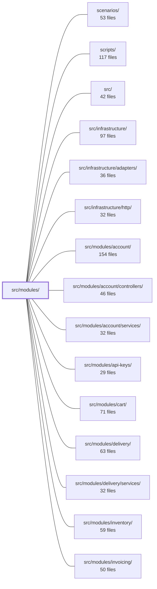

---
tags:
  - 2brain
  - 2brain/module
  - project/boilerplate-node-backend
type: module
module: src/modules/
files: 127
updated: 2026-10-29T19:21:39.650359+00:00
---

# src/modules/

## Purpose

`src/modules/` is the application's feature layer: each subdirectory is a self-contained bounded context (e.g. `access`, `analytics`, `antibot`, `audit-logs`, and dozens more) that owns its data models, business rules, HTTP routes, and tests. Modules communicate with one another only through their public barrel (`index.ts`), keeping internal schemas, repositories, and service invariants private to the owning context.

## Key parts

- **`access/`** — The identity-and-authorization domain. Defines the `Tenant` and `Membership` Mongoose collections, enforces grant/revoke invariants (`services/grants.ts`, `services/protection.ts`), centralises role-change audit emission (`services/role-audit.ts`), and exposes a single `accessService` object for sibling modules.
- **`analytics/`** — A stateless relay for browsing events. Validates a closed set of event schemas at the controller, routes each event to its declaring module's `toReport` via `services/relay.ts`, and forwards to the analytics port. Always returns 204 regardless of whether the event was stored.
- **`antibot/`** — Exposes two read-only endpoints (`GET /antibot/config`, `GET /antibot/challenge`) so a frontend can bootstrap the active human-challenge widget. The enforcement middleware (`humanChallengeGate`) lives in infrastructure; this module only handles the "tell the caller what to expect" side.
- **`audit-logs/`** — Persists the app-wide audit trail behind `GET /audit` (tenant) and `GET /observability/audit` (platform). Wires the write-side sink in `module.ts` so any `emitAuditEvent` call lands in this module's repository; handles retention via a TTL index and operator pseudonymisation in `presenter.ts`.
- **Remaining sub-modules** (87+ additional files) — Cover account, orders, payments, products, inventory, delivery, invoicing, returns, tickets, users, cart, notifications, locales, api-keys, and observability, each following the same manifest → barrel → service → repository → test structure.

## How it connects

- **`src/infrastructure/`** provides the HTTP server, database drivers, and cross-cutting middleware (e.g. `humanChallengeGate`, the analytics emitter port) that module controllers and services consume.
- **`src/` (kernel)** — The kernel's permission and ability resolvers read tenant/membership data from `access/` on every authenticated request; module manifests (`module.ts`) register routes, browser events, and personal-data obligations into the kernel's module registry.
- **Sibling modules** (account, orders, payments, products, etc.) import each other's public barrels for cross-domain operations (e.g. an order service checking a membership, a ticket controller invoking the antibot gate). No module reaches into another's internals.
- **`scenarios/` and `scripts/`** exercise the full module stack in end-to-end or operational flows.

## Where to start

1. **`src/modules/access/index.ts`** — Shows the barrel contract every module follows; reading it tells you exactly what the rest of the codebase may import from `access`.
2. **`src/modules/audit-logs/module.ts`** — A compact, self-contained module manifest that demonstrates how a sub-module wires its router, config, service, and write-side hook into the kernel in one file.

## Connected modules

[[boilerplate-node-backend_ROOT|/ (repository root)]] · [[boilerplate-node-backend_scenarios|scenarios/]] · [[boilerplate-node-backend_scripts|scripts/]] · [[boilerplate-node-backend_src|src/]] · [[boilerplate-node-backend_src_infrastructure|src/infrastructure/]] · [[boilerplate-node-backend_src_infrastructure_adapters|src/infrastructure/adapters/]] · [[boilerplate-node-backend_src_infrastructure_http|src/infrastructure/http/]] · [[boilerplate-node-backend_src_modules_account|src/modules/account/]] · [[boilerplate-node-backend_src_modules_account_controllers|src/modules/account/controllers/]] · [[boilerplate-node-backend_src_modules_account_services|src/modules/account/services/]] · [[boilerplate-node-backend_src_modules_api-keys|src/modules/api-keys/]] · [[boilerplate-node-backend_src_modules_cart|src/modules/cart/]] · [[boilerplate-node-backend_src_modules_delivery|src/modules/delivery/]] · [[boilerplate-node-backend_src_modules_delivery_services|src/modules/delivery/services/]] · [[boilerplate-node-backend_src_modules_inventory|src/modules/inventory/]] · … and 11 more

## Files
- `src/modules/access/audit.ts` — Declares the audit-action vocabulary for the access module (role assignment and revocation) and registers it into the app-wide `AuditActionMap` via TypeScript module augmentation. It exists so that compliance queries can find access-mutating events by the `access.*` prefix while distinguishing them from read-only operations like `membershipsOf` or `rolesOf`.
- `src/modules/access/index.ts` — Public barrel (entry point) for the Access module. Sibling modules are restricted to importing **only** from this file (per `docs/theory/strategic-ddd.md` §5); it curates what is exposed externally while keeping internal runtime schemas private.
- `src/modules/access/model.ts` — Defines the two Mongoose collections that persist the authorization domain: **Tenant** (the single shop this deployment serves) and **Membership** (which user holds which role in which scope). It is the data-layer anchor for the `access` module — the "what is stored" that the services in `./services/` enforce write-invariants on and that the kernel resolver reads on every authenticated request.
- `src/modules/access/module.ts` — Defines the **access** module manifest — the identity-and-access domain that `kernel/permissions.ts` and `kernel/ability.ts` query for tenants and memberships. It is intentionally routeless (no HTTP endpoints) and exists purely to expose the tenant/membership collections to other modules via the barrel, while also declaring the module's personal-data obligations (GDPR Art. 15 collection and hard-delete erasure).
- `src/modules/access/repository.ts` — Data-access layer for the **tenant** and **membership** Mongoose collections. It contains only query shaping (filters, update operators, transaction-session pass-through); all business invariants live in `./services/`. Callers in the services layer are the sole consumers.
- `src/modules/access/services/grants.ts` — Defines the authorization rules for assigning and revoking roles. Enforces two invariants at the code level (not documentation): a grant is refused if the role name is not declared in the preset catalog for the target scope, or if the granter does not hold the `assign:Role` permission. Exposes several entry points — throwing, non-throwing, and audited — so callers in different contexts (synchronous validation, HTTP error mapping, pre-transaction checks) can pick the right shape.
- `src/modules/access/services/index.ts` — Barrel file for the access service. It re-exports the public API of the three sub-services (`grants`, `memberships`, `protection`) plus `role-audit`, and bundles every database-reading or writing operation into a single `accessService` object so callers have one import site for all access-related work.
- `src/modules/access/services/memberships.ts` — The service layer for the membership half of the authorization model: creating tenants, assigning and revoking roles (who holds which role in which scope), and bulk operations for reads and erasure. It sits between the repository (raw MongoDB/Mongoose access) and the callers that need business-logic-level membership mutations with validation, audit, and transaction support.
- `src/modules/access/services/protection.ts` — Encapsulates the "protecting people" authorization rule: an account that holds a staff role may only be modified by a caller holding the `assign:Role` ability, and money-step operations on one's own order are flagged in the audit trail. Exposes both the pure decision logic and the async lookup helpers so services can enforce the rule consistently without duplicating the condition.
- `src/modules/access/services/role-audit.ts` — Centralises the audit-row emission for every role change (grant, revoke, refused attempt) so the three writer paths produce a single, consistent audit-trail shape instead of each spelling it differently. It exists to prevent the drift that historically caused one branch (revoke's failure) to silently drop `role` from its metadata.
- `src/modules/access/tests/factories.ts` — Test-side facade that exposes `access`'s internals (membership rows, audit action names, and a granter-less role write) to **sibling modules'** tests. Siblings import from this file instead of `../model` or `../audit` directly, because their import boundaries forbid reaching into another module's internals (see `docs/reference/tests.md`).
- `src/modules/access/tests/integration/access.test.ts` — Integration tests for the access module's **storage layer** — membership seeding, assignment, revocation, and the invariants that guard them — run against the in-memory MongoDB wired up by `setupTestDb`. Unlike the cross-cutting conformance suite (which proves both backends *agree* on a decision), this file proves the decisions are read **from a correctly-writable store**: one role per person per tenant, no privilege escalation, no undeclared roles, and audit events fired on both success and failure.
- `src/modules/access/tests/unit/grantable-roles.test.ts` — Unit-tests the `grantableRoles` service function in isolation: for each preset caller role, it asserts exactly which tenant-scoped roles that caller may assign, and cross-checks the read-side list against the write-side `assertCanGrant` guard so the two can never drift apart.
- `src/modules/access/tests/unit/protection.test.ts` — Unit tests for the staff-account protection logic in the access module. It verifies that `holdsStaffRole`, `staffHoldersAmong`, `mayChangeAccount`, `canChangeAccount`, `roleProtectedRefusal`, and `ownOrderFlag` enforce the rule that only a holder of `assign:Role` (or the account owner, or the system actor) may modify a staff account, and that a refusal is both returned and audited. All repository and audit I/O is mocked so the tests exercise pure decision logic in isolation.
- `src/modules/analytics/controllers/post-analytics-event.ts` — HTTP controller for `POST /analytics/events`. Validates the request body against a closed set of browsing-event schemas, hands a valid event to the analytics service for optional relay, and always returns **204 No Content** so the client can never distinguish whether the event was stored or dropped.
- `src/modules/analytics/index.ts` — Public barrel (entry point) for the analytics module. It is the **only** surface a sibling module may import from, per the strategic DDD rule documented in `docs/theory/strategic-ddd.md` §5. Internally it simply re-exports the relay service; all other module-owned wiring (`module.ts`, `routes.ts`, `controllers/`) is deliberately excluded from the public API.
- `src/modules/analytics/module.ts` — Module manifest that wires the analytics browsing-event relay into the kernel. It mounts the `/analytics` route, registers the declared browser events (product page opened, search made, etc.) with the analytics service after all modules are known, and marks the module as stateless. Business-fact events (cart, checkout, order, payment, signup, login) are explicitly out of scope here.
- `src/modules/analytics/routes.ts` — Defines the Express route table for the analytics relay. It exposes a single public `POST /analytics/events` endpoint for recording one browsing event. The route is intentionally open to guests; authentication is optional and only serves to attach a signed-in visitor's id when present.
- `src/modules/analytics/services/index.ts` — Barrel file that re-exports the analytics relay API as a single `analyticsService` object. It exists so that consumers (controllers, other modules) import from one well-known path rather than reaching into the `relay.ts` implementation directly.
- `src/modules/analytics/services/relay.ts` — Dispatch layer that receives a validated browsing-event request (from the analytics controller) and forwards it to the analytics port via the event's registered `BrowserEventTarget`. It owns no consent logic (the port handles that) and knows no concrete event names (modules declare those in `AppModule.browserEvents`). It exists to decouple the controller from the per-event provider-mapping logic.
- `src/modules/analytics/tests/contract/api.contract.test.ts` — Contract test for `POST /analytics/events` that pins the API's closed-set behavior: the two known event types (`product_viewed`, `products_searched`) must return `204 No Content`, and any event outside that set must be rejected with `422 Unprocessable Entity`.
- `src/modules/analytics/tests/integration/relay.test.ts` — Integration test for the `POST /analytics/events` relay endpoint. Verifies the relay's core guarantee — that no event reaches the analytics provider without an explicit consent header, and that the HTTP response is `204` in both the consented and non-consented paths. Also covers payload validation (closed event-name set, unknown-field rejection, format checks) driven through the real application stack.
- `src/modules/analytics/tests/unit/relay.test.ts` — Unit tests for the analytics relay service. Verifies that `relayEvent` routes a request body to the owning module's `toReport` function (looked up by the body's `event` field) and forwards the module-built report to the analytics emitter, while silently dropping events that no registered module claims.
- `src/modules/antibot/controllers/get-antibot-challenge.ts` — Express route handler for `GET /antibot/challenge`. It asks the active human-challenge adapter whether it can issue a self-hosted challenge; if so, it returns the challenge object, otherwise it returns a 404. This endpoint is only meaningful for self-hosted (non-vendor) providers—vendor-hosted widgets fetch their challenge from the vendor and never hit this route.
- `src/modules/antibot/controllers/get-antibot-config.ts` — Controller for the public `GET /antibot/config` endpoint. It reports which human-challenge provider is active, supplies the parameters the frontend needs to render that provider's widget, and returns a `rungs` summary of the other antibot mechanisms (identity budgets, email policy). It is one of two routes in the antibot module, the other being `GET /antibot/challenge`.
- `src/modules/antibot/index.ts` — Public barrel (entry point) for the `antibot` module. It is intentionally empty because, per the project's strategic DDD rule (`docs/theory/strategic-ddd.md` §5), sibling modules must import through this barrel—and everything this module owns is internal wiring (`module.ts`, `routes.ts`, `controllers/`) that a barrel never re-exports. The actual runtime concern (the `humanChallengeGate` middleware) is consumed by other modules via `infrastructure/` paths directly, bypassing this file entirely.
- `src/modules/antibot/module.ts` — Module manifest for the **antibot** module. Its job is minimal: declare two public HTTP routes (at `/antibot`) that expose which human-challenge provider is active, so a frontend can decide whether to render a challenge widget before submitting a guarded form. The actual enforcement gate (`humanChallengeGate`) is a cross-cutting middleware owned elsewhere; this module only handles the "tell the caller what to expect" side.
- `src/modules/antibot/openapi.yaml` — OpenAPI 3.1.0 contract for the antibot module (rung 3 of the anti-automation ladder). It declares the two public, unauthenticated endpoints that expose the active human-challenge provider's configuration and (for self-hosted providers) a challenge to solve, plus the schemas the API returns.
- `src/modules/antibot/routes.ts` — Defines the two public HTTP routes for the antibot module — exposing which human-challenge provider is active and, when the server self-hosts that provider, the challenge payload the client must render. Both endpoints are read-only and exist solely to let a browser client bootstrap the challenge flow without hitting a heavier API.
- `src/modules/antibot/tests/contract/api.contract.test.ts` — Contract tests for the `/antibot/challenge` and `/antibot/config` endpoints, plus an end-to-end proof that selecting a provider actually gates a downstream route (`POST /tickets`). The E2E gate case lives here rather than in the tickets suite because `antibot` is the only module that understands both the client-facing challenge and the token-validation side without importing the guarded routes.
- `src/modules/audit-logs/config.ts` — Defines the single configuration surface for the audit-logs module: the retention period (in days) for audit entries. It declares the config shape so the rest of the module and the global configuration loader can validate and supply the value at startup.
- `src/modules/audit-logs/controllers/get-audit.ts` — Controller for `GET /audit`. Returns a paginated, filtered page of the current shop's own action history (audit entries), accessed with a tenant key rather than a platform key. It answers the same query that `observability`'s `listObservabilityAuditEntries` does, but scoped to the tenant.
- `src/modules/audit-logs/index.ts` — Public barrel (single import surface) for the audit-logs module. Sibling modules must import only through this file rather than reaching into `service.ts` or `model.ts` directly, enforcing the strategic DDD encapsulation rule.
- `src/modules/audit-logs/metrics.ts` — Defines the domain-owned Prometheus counter for the audit-logs module. The counter tracks audit entries that made it into the compliance log but failed to persist into the queryable trail, giving operators a signal for the deliberate fail-open path in `record()`.
- `src/modules/audit-logs/model.ts` — Defines the Mongoose schema, indexes, serialization transform, and model for the `AuditLog` collection — the durable store behind `GET /observability/audit`. It persists the same shape that the audit logger (`@infrastructure/observability/audit`) emits, so no translation layer exists between write and read.
- `src/modules/audit-logs/module.ts` — Module manifest for the audit-logs feature. It assembles the router, config slice, and service into an `AppModule` and, via the `onRegistered` hook, wires the write-side sink so that `emitAuditEvent` calls from anywhere in the codebase persist rows through this module's service.
- `src/modules/audit-logs/openapi.yaml` — OpenAPI 3.1.0 contract for the audit-logs module. It defines the shop-scoped `GET /audit` endpoint, the shared `AuditEntryItem` row schema (also referenced by the platform observability endpoint and the account export), and the module's contribution to `AccountExportResponse`.
- `src/modules/audit-logs/presenter.ts` — Transforms a stored audit-log entry into the **platform operator's** view by replacing the raw IP address with a pseudonymised correlation digest. The tenant view serves the entry as stored; this file exists solely to produce the one-field operator variant so the operator can correlate repeated attempts without seeing end-user IPs.
- `src/modules/audit-logs/repository.ts` — Data-access layer for the audit log. Strictly append-and-read: one write entry point (`create`) and two read paths (filtered page search, keyset-cursor pagination for an actor's own entries). There is no update or delete by design — expiry is delegated to a Mongo TTL index on the model.
- `src/modules/audit-logs/routes.ts` — Defines the tenant-facing `/audit` Express router. It exposes a single read endpoint (`GET /audit`) that returns a shop's own action history, gated behind the `read:AuditLog` permission. The router is deliberately tenant-scoped, not platform-operator-scoped.
- `src/modules/audit-logs/service.ts` — The audit-log service that bridges the write path (recording emitted audit entries into the persistence layer) and the three read paths (tenant-staff listing, platform-operator incident view, and per-account data export). It applies the collection's scoping, sorting, and filtering policies on top of the raw repository, keeping those decisions out of the repository itself.
- `src/modules/audit-logs/tests/contract/audit.test.ts` — Contract tests for the `GET /audit` endpoint — the single route owned by the audit-logs module. They verify that an authorized caller (holder of `read:AuditLog`) can filter and retrieve entries, while several invalid filter inputs are rejected with `422` rather than silently returning partial or unfiltered results.
- `src/modules/audit-logs/tests/integration/incidents.test.ts` — Integration tests for the operator-facing `searchIncidents` read path. They pin the exact allow-list of actions the platform operator may see (security failures, failed sign-ins, credential-attack signals) and, equally explicitly, the actions that must be withheld (customer orders, admin actions on customers, successful sign-ins, shop-internal role-protection rows). They also verify that raw IP addresses are replaced by a keyed HMAC digest in the operator view while remaining untouched in the admin view.
- `src/modules/audit-logs/tests/integration/repository.test.ts` — Integration tests for `auditLogRepository` (and one service-level filter) executed against an in-memory MongoDB instance. Verifies create, search-with-filters, pagination semantics, deep-paging correctness, and the `ownOrder` filter — guarding against regressions like capped reads and `Number()`-coerced date bounds.
- `src/modules/audit-logs/tests/unit/retention.test.ts` — Unit test that verifies the TTL index declared on the audit log collection resolves to the correct `expireAfterSeconds` value, both for the default (90 days) and a caller-supplied retention period. Because the TTL is baked in at module-load time from an environment variable, the tests must force a fresh import to exercise different values.
- `src/modules/audit-logs/tests/unit/schema-contract.test.ts` — A compliance contract test that pins down the `auditLogSchema` (Mongoose) as a regulatory artifact rather than a convenience. It asserts the required fields, closed-set enums, schema options (`timestamps`, `bufferCommands`), index topology, and TTL retention window. Unlike typical unit tests, it documents *why* each constraint exists (e.g., a silent buffer would swallow audit-loss signals) and fails if the schema drifts from the operational contract.
- `src/modules/audit-logs/tests/unit/service.test.ts` — Unit tests for `auditLogService.record` and `auditLogService.search`, focused exclusively on their deliberate failure asymmetry: `record` is fail-open (swallows write failures into a log line + metric, never throws) while `search` is fail-closed (propagates read failures to the caller). The repository and logger are mocked because a real repository cannot be made to fail on demand.
- `src/modules/shop/config.ts` — Declares the shop's identity and operational settings—legal name, address, contact, return address, ship-to countries, return-postage rule, and default currency. Every value is read at call time (not captured at import) so tests can vary them per case; a production change requires a restart.
- `src/modules/shop/controllers/get-shop.ts` — Handler for the public `GET /shop` endpoint. It returns the shop's identity, shipping/return addresses, and trade currency so that any caller can identify the seller before making a purchase. No authentication is required by design.
- `src/modules/shop/index.ts` — Public barrel for the shop module. It is the **only** surface a sibling module may import from, enforcing the module-boundary rule codified in `docs/theory/strategic-ddd.md` §5. All exports are re-exported from `./service`; nothing else (config, manifest) is exposed.
- `src/modules/shop/module.ts` — Declares the shop module's manifest: a single routing mount, one config-slice boot gate, and no data persistence. It is the registration point that tells the kernel *what* the shop module exposes and *how* to wire it in.
- `src/modules/shop/routes.ts` — Defines the Express route table for the shop module. It registers a single read-only endpoint (`GET /shop`) that returns the shop's identity, currency, ship-to countries, and return address. Because the response is static (changes only on redeploy) and there are no write paths, the endpoint relies solely on the global burst rate-limit for protection.
- `src/modules/shop/service.ts` — Single reader surface for all shop-level configuration (country, timezone, identity, currency, shipping, returns). Every sibling module that needs a "which country", "where do returns go", or "what's the VAT jurisdiction" answer imports from here instead of reading `shopConfig` directly. Also composes the public `Shop` record returned by `GET /shop`.
- `src/modules/shop/tests/contract/api.contract.test.ts` — Contract tests for the public `GET /shop` endpoint. They verify the exact public payload (seller identity, currency, ship-to countries, return address, terms version) and, just as importantly, that internal/operator data (time zone) is never leaked and that optional fields (VAT number, trade register, registration number) are omitted when unset.
- `src/modules/shop/tests/unit/config.test.ts` — Unit-tests the shop module's configuration layer: both the boot-time gate (`assertModuleConfig`) and the per-call reader functions (jurisdiction, timezone, identity, return address, postage payer, ship-to countries, currency). Verifies required-variable enforcement, value normalization (upper-casing, trimming, canonical timezone names), fallback behavior (return address → shop address), and sensible defaults (currency → EUR, postage payer → consumer).
- `src/modules/sitemap/config.ts` — Defines the sitemap module's configuration surface: the per-file URL limit (a deployment-tunable value) and the list of static frontend pages (a fixed fact derived from the router rules). It exists to keep these two kinds of knowledge separate — one is a product-page setting, the other is a property of the paired frontend.
- `src/modules/sitemap/controllers/get-sitemap-index.ts` — Express handler for `GET /sitemap/index.xml` — the top-level sitemap index that lists all other sitemap files (shop pages + per-run product sitemaps). It delegates file discovery to the sitemap service and XML serialization to a shared helper.
- `src/modules/sitemap/controllers/get-sitemap-pages.ts` — Express controller that serves `GET /sitemap/pages.xml`. It fetches the shop's static pages from the sitemap service, serializes them into an XML sitemap via a `SitemapStream`, and writes the XML to the HTTP response.
- `src/modules/sitemap/controllers/get-sitemap-products.ts` — Express GET handler for `/sitemap/products-{page}.xml`. Validates the page-number path parameter, fetches that page's product entries from the sitemap service, and streams them back as an XML sitemap response.
- `src/modules/sitemap/controllers/send-xml.ts` — Single shared output path for every sitemap file. Given a set of entries and the appropriate `sitemap` XML stream writer, it streams the result into an Express response with a 1-hour public cache header, guaranteeing consistent headers, backpressure handling, and cleanup across all sitemap endpoints.
- `src/modules/sitemap/index.ts` — Public barrel (re-export) for the `sitemap` module. It exists so that sibling modules have a single, stable import target and never reach into the module's internal file layout. Per the strategic-DDD rule (see `docs/theory/strategic-ddd.md` §5), this file is the **only** surface a sibling module is allowed to import from.
- `src/modules/sitemap/module.ts` — Module manifest for the **sitemap** feature. It declares how the `sitemap.xml` endpoint is mounted into the application (route table, config slice, personal-data classification) so the kernel registry can wire it in. The module itself owns no collection; it reads `products` and `locales` through their services to build the XML on request.
- `src/modules/sitemap/routes.ts` — Defines the Express route table for the public, unauthenticated sitemap endpoints. It maps three GET paths to their respective controllers so the module can expose XML sitemaps to crawlers.
- `src/modules/sitemap/service.ts` — Pure read-side logic for generating XML sitemap content. It answers three questions—*which files the index lists, what the pages file contains, and what a given products file contains*—by reading the live product catalogue and the served-locale list on every call. Nothing is persisted here; the HTTP layer is free to cache the results.
- `src/modules/sitemap/tests/contract/api.contract.test.ts` — Contract tests that assert the HTTP-level guarantees of every `/sitemap/*` endpoint: status code, `Content-Type`, and `Cache-Control`. They deliberately do **not** inspect XML body content (entries, alternates, `lastmod`, pagination split)—that responsibility belongs to the integration test in `tests/integration/sitemap.test.ts`.
- `src/modules/sitemap/tests/integration/sitemap.test.ts` — Integration test suite that exercises the sitemap HTTP endpoints (`/sitemap/index.xml`, `/sitemap/pages.xml`, `/sitemap/products-{n}.xml`) against a real database with all production modules registered. It verifies entry enumeration, language alternates, `x-default` resolution, `lastmod` semantics, per-file URL-limit splitting, and 404 for unlisted files.
- `src/modules/stats/controllers/get-stats.ts` — Thin read controllers for the stats module. Each exported handler maps a `GET /stats/*` route to a `statsService` method, with Zod-based query validation. All period-based reads share the `statsHandler` wrapper from `./respond`; the pipeline (snapshot) and limits (static constants) handlers are written manually.
- `src/modules/stats/controllers/respond.ts` — Provides the shared handler factory for all stats read endpoints. It encapsulates the common flow — parse the query, validate the period against the shop's timezone, delegate to a composer, and shape the response — so individual stats controllers only supply their schema and business logic.
- `src/modules/stats/domain/calendar.ts` — Pure-arithmetic calendar-day operations for the stats module. A day is represented as three integers (`year`, `month`, `day`) with no clock time and no timezone; all arithmetic runs on UTC-midnight timestamps. This keeps the rules trivially table-testable and defers zone/clock concerns to `services/range.ts`, which is where a day becomes an instant.
- `src/modules/stats/domain/index.ts` — Barrel file for the stats domain layer. It re-exports the public API of the two domain submodules (`range` and `calendar`) under a single import path, so consumers can `import { … } from '../domain'` without reaching into individual files.
- `src/modules/stats/domain/range.ts` — Pure domain rules that validate a requested reporting period (two calendar days + a bucket interval) and compute the bucket boundaries it touches. Exists to keep "what is a legal range" logic free of I/O, framework, or timezone concerns so it is trivially testable and reusable.
- `src/modules/stats/index.ts` — Public barrel file for the `stats` module. It is the sole import surface that sibling modules are allowed to use (per the rule in `docs/theory/strategic-ddd.md` §5). It re-exports everything from the module's `domain` and `services` sub-barrels so consumers can do a single `import … from '@modules/stats'` instead of reaching into internal paths.
- `src/modules/stats/module.ts` — Module manifest for the **stats** module. It registers the sales-dashboard routes under `/stats` and declares the module's metadata (name, no personal data, locale path) so the kernel can discover and mount it. No business logic lives here; the actual figures are composed on read from other modules' barrels.
- `src/modules/stats/routes.ts` — Defines the Express router for the `/stats` dashboard. All nine endpoints are read-only GET routes guarded by the `read:Stats` permission and wrapped with `privateNoCache` so no sales figure ever lands in a shared cache. The file exists as a thin, declarative wiring layer: it does no business logic itself, only maps URLs to controllers.
- `src/modules/stats/services/breakdowns.ts` — Composes the sales dashboard's breakdown tables and snapshots. Each exported function orchestrates one or more domain-service reads (orders, returns, payments, invoicing), merges or aggregates the raw rows, and shapes the result into a typed dashboard response. This file contains no domain logic of its own — it is a read-only aggregation layer over the module services.
- `src/modules/stats/services/figures.ts` — Pure computation layer that turns raw money-and-count sums (kept in minor units) into the published decimal figures for a single currency bucket. It exists so that summing buckets always equals summing the whole, and so the minor-unit → decimal conversion happens exactly once, at the boundary.
- `src/modules/stats/services/index.ts` — Barrel module that assembles the stats service's public API. It aggregates the read-only query functions from `sales.ts` and `breakdowns.ts` into a single `statsService` object and re-exports the period-resolution utilities from `range.ts`, giving controllers one import point for all dashboard data reads.
- `src/modules/stats/services/range.ts` — Resolves a date-range query (`from`/`to` strings) into a concrete `Period` object containing half-open instant windows, a comparison window for the preceding period, and every bucket start. All date-to-instant conversion uses the shop's local timezone so that boundaries and `$dateTrunc` bucket edges always agree.
- `src/modules/stats/services/sales.ts` — Merges time-bucketed sales data from three domain services (invoicing money, order counts/units, returned units) into a single per-currency, per-bucket structure and formats it as `SalesStats`. It is a thin merge layer — each upstream service already returns grouped rows, so this file only combines them by key without performing a large join.
- `src/modules/stats/tests/contract/api.contract.test.ts` — Contract tests that lock down the observable API behavior of every `GET /stats/*` endpoint: response status, authorization boundaries (admin vs. manager vs. unauthenticated customer), validation errors (422 with rule-specific messages), and cache-control guarantees. They exist to catch regressions in the public contract without depending on internal implementation.
- `src/modules/stats/tests/integration/stats.test.ts` — Integration test suite for the stats service (`statsService`) that exercises sales aggregation, product/category breakdowns, and per-product time series against a real MongoDB instance. It focuses on edge cases at the boundaries: shop-local timezone bucketing (`Europe/Rome`), currency separation, deleted-but-invoiced orders, credit-note reversals on their own day, bucket-size invariance, and previous-period comparison. It is the only test that passes a real IANA zone name through `$dateTrunc` on the Mongo binary.
- `src/modules/stats/tests/unit/calendar.test.ts` — Unit tests for the pure calendar-arithmetic functions in the stats domain. The focus is on edge cases: invalid calendar dates, leap-year boundaries, month/year rollover, and the Monday-start week convention. No clocks, no time zones — just three-integer day values.
- `src/modules/stats/tests/unit/figures.test.ts` — Unit tests for the sales-figures service. They pin down the arithmetic contracts of `figuresOf` (net sales subtract reversals; shipping and VAT are charged-minus-refunded; no division by zero orders), plus the simpler helpers `addRawFigures` and `rateOf`.
- `src/modules/stats/tests/unit/range.test.ts` — Unit tests for the range-validation domain logic in `domain/range.ts`. Verifies that `checkRange` enforces the four rules (valid calendar days, ordered endpoints, ≤ 731 days, ≤ 400 buckets) and that `previousOf` shifts a range back by its own length, ending the day before `from`.
- `src/modules/stats/tests/unit/routes.test.ts` — Validates the stats router's contract: it exposes exactly nine documented `GET` endpoints, every one requires an authenticated session, and every one is gated by the single `read:Stats` permission. The file exists to make any unauthorised addition, method change, or permission drift fail immediately.
- `src/modules/stock-alerts/controllers/delete-stock-alert.ts` — Thin HTTP adapter that handles `DELETE /stock-alerts/:productId`. It validates the `productId` path parameter, delegates to `stockAlertService.cancel` scoped to the authenticated caller, and formats the resulting HTTP response.
- `src/modules/stock-alerts/controllers/get-stock-alerts.ts` — Thin HTTP adapter for the `GET /stock-alerts` endpoint. It extracts the caller's identity from the authenticated request, delegates to `stockAlertService.list`, and shapes the result into a standard JSON response. Exists so the service layer stays transport-agnostic.
- `src/modules/stock-alerts/controllers/post-stock-alerts.ts` — Thin Express controller for `POST /stock-alerts`. Validates the incoming body, delegates to `stockAlertService.ask`, and serializes the result into an HTTP response. It contains no business logic.
- `src/modules/stock-alerts/emails.ts` — Builds the single outbound email for the stock-alerts module: the "back in stock" notification. It returns a fully-populated, localized `EmailContent` object (subject, body, link) that the mailer adapter can send directly. No cross-promotion or extra content is attached.
- `src/modules/stock-alerts/events.ts` — Declares the stock-alerts module's domain event (`stock_alert.sent`) by augmenting the kernel's shared `DomainEventMap` interface, and exports a single name constant so emitters and listeners reference the same string literal.
- `src/modules/stock-alerts/index.ts` — Public barrel (module facade) for the **stock-alerts** bounded context. It is the *only* import surface other modules or sibling modules are allowed to use, enforcing the DDD rule documented in `docs/theory/strategic-ddd.md` §5. Sibling modules never reach into internal files (`service.ts`, `events.ts`, etc.) directly.
- `src/modules/stock-alerts/jobs.generated.ts` — Auto-generated registry of scheduled job metadata (name, cron schedule, summary) for the stock-alerts module. It exists as a single source of job *definitions* derived from `module.yaml`, so that `jobs.ts` can attach execution logic without duplicating schedule/name data.
- `src/modules/stock-alerts/jobs.ts` — Declares the scheduled job(s) owned by the `stock-alerts` module. The single job performs the hourly "sweep" that converts preorders whose release date has passed into buyable products, then flushes any resulting notifications through the outbox before the lease expires.
- `src/modules/stock-alerts/model.ts` — Defines the Mongoose schema, model, and document types for a stock-alert record — a single back-in-stock request that pairs a user with a product. The file owns the data shape and persistence indices only; all queries live in `./repository` and business rules in `./service`.
- `src/modules/stock-alerts/module.ts` — Module manifest for the **stock-alerts** feature. It wires the module's routes, background jobs, domain-event subscriptions, and personal-data (export/erase) hooks into the application kernel so a signed-in buyer can request a one-time notification when an un-orderable product becomes available again. The file itself contains no business logic; it is purely declarative registration.
- `src/modules/stock-alerts/presenter.ts` — Transforms stored `StockAlertDocument` records into the exact wire shape declared by the OpenAPI contract (`StockAlertsResponse`). The output object is built field-by-field rather than serialized from the document, guaranteeing that any field absent from the contract cannot leak into the response.
- `src/modules/stock-alerts/repository.ts` — Data-access layer for stock alerts. Encapsulates all MongoDB reads and writes the stock-alert feature needs: idempotent alert creation, cancellation, per-user and per-product lookups, and the bulk cleanups owed when an account or a product is erased. It extends the generic CRUD factory with domain-specific operations.
- `src/modules/stock-alerts/routes.ts` — Defines the Express router for the stock-alerts (back-in-stock) feature. All three routes are authenticated (signed-in user only, no permission key), so a request always belongs to the caller's own account. The file wires the three controllers to their HTTP methods and applies the auth middleware once for the whole group.
- `src/modules/stock-alerts/service.ts` — Service layer for back-in-stock alerts. It orchestrates the full lifecycle of a buyer's "notify me" request—creation, cancellation, listing, deletion on account/product removal—and answers those requests (one email + one inbox row) when a product becomes buyable again. It is the single module through which controllers, event handlers, and scheduled sweeps interact with stock alerts.
- `src/modules/stock-alerts/tests/contract/api.contract.test.ts` — Contract tests for the `/stock-alerts` endpoints (GET, POST, DELETE). Because every route returns the same `StockAlertsResponseEnvelope`, these tests exist solely to confirm each declared HTTP branch (200, 401, 404, 409, 422, 405) is reachable over real HTTP and that the response body matches the spec shape. Business-logic and inventory-signal wiring is explicitly left to the integration suite.
- `src/modules/stock-alerts/tests/integration/stock-alerts.test.ts` — Integration test for the stock-alerts module exercising the real HTTP API and service wiring end-to-end. It verifies the full lifecycle of a back-in-stock alert—creation, idempotency, refusal while the product is buyable, cancellation, listing, the buyable-again signal (mail + event + deletion), and the hourly sweep for release-date transitions—using registered real modules rather than isolated unit mocks.
- `src/modules/stock-alerts/tests/unit/schema-contract.test.ts` — Unit test that locks down the **declarations** (not runtime documents) of `stockAlertSchema`. It asserts the schema's required fields, reference targets, exact index set (including the `userId`+`productId` unique index that makes a repeated request a no-op at the database level), and the `timestamps` option—so that a silently dropped `unique` or an accidental extra index is caught immediately.
- `src/modules/wishlist/analytics.ts` — Defines the wishlist module's analytics event names and registers them into the app-wide `AnalyticsEventMap` via TypeScript module augmentation. This gives the wishlist a type-safe set of funnel events (save → exit-to-purchase) without the consuming code needing to know the literal strings.
- `src/modules/wishlist/controllers/delete-wishlist-item.ts` — Thin HTTP adapter for `DELETE /wishlist/items/:productId`. Validates the incoming request, delegates to `wishlistService.remove`, and shapes the Express response. Exists to keep route registration in `routes.ts` declarative while isolating parameter validation and response formatting from the service layer.
- `src/modules/wishlist/controllers/get-wishlist.ts` — Thin HTTP adapter that handles the `GET /wishlist` route. It extracts the authenticated user's ID from the request, delegates to `wishlistService.get`, and formats the result as a standard success response. Exists to keep routing, service logic, and HTTP concerns separated.
- `src/modules/wishlist/controllers/post-move-to-cart.ts` — Thin HTTP adapter for `POST /wishlist/items/:productId/move-to-cart`. Extracts the authenticated user and product ID, delegates to `wishlistService.moveToCart`, and shapes the HTTP response (success or refusal). Contains no business logic itself.
- `src/modules/wishlist/controllers/post-wishlist-items.ts` — HTTP adapter for `POST /wishlist/items`. Validates the request body against a Zod schema, extracts the authenticated user and caller context, delegates the write to `wishlistService.add`, and returns the full wishlist as a `200` response.
- `src/modules/wishlist/events.ts` — Declares the wishlist module's domain-event payloads by augmenting the kernel's `DomainEventMap` interface, so the app-wide event catalogue grows incrementally per module. Exports the single event-name constant used by emitters and listeners.
- `src/modules/wishlist/factories.ts` — Builds wishlist fixtures (ready for `wishlistRepository.create`) from minimal caller input. Follows the same owner-addressed pattern as cart factories: the document is keyed by `userId` and no wishlist `_id` is generated or transmitted, so no `_id` override is accepted.
- `src/modules/wishlist/index.ts` — Public barrel (re-export facade) for the wishlist module. It is the **only** import surface that sibling modules are permitted to use, enforcing the strategic-DDD boundary rule documented in `docs/theory/strategic-ddd.md` §5. It exposes no logic of its own.
- `src/modules/wishlist/model.ts` — Defines the Mongoose schema, model, and TypeScript interfaces for the per-user wishlist document. It establishes the persisted shape (one document per user, an array of product-only lines), the serialization transform, and the database index needed for reverse product lookups — so that every other file in the wishlist module can assume a single, stable document contract.
- `src/modules/wishlist/module.ts` — Module manifest for the wishlist feature. Wires the wishlist's router, personal-data hooks, and domain-event subscription into the application registry so the kernel can mount, export, erase, and react on the module's behalf.
- `src/modules/wishlist/module.yaml` — Declarative metadata for the wishlist module. It classifies the module within the domain model, declares its inter-module dependencies, and records its audit-policy exemption. Exists so tooling and humans can resolve module boundaries without reading the implementation.
- `src/modules/wishlist/openapi.yaml` — OpenAPI 3.1.0 contract for the wishlist module. It defines the four endpoints a client uses to save, list, remove, and move-to-cart products, plus the schemas those endpoints exchange. The `x-personal-data` extension lets the account-export bundler splice wishlist data into `AccountExportResponse` without the module hard-coding the export shape.
- `src/modules/wishlist/presenter.ts` — Transforms the internal `WishlistDocument` into the wire shape declared by `openapi.yaml` (a `WishlistResponse`). This module is the single mapping point between the stored domain model and the API contract; the client renders product details from its own store.
- `src/modules/wishlist/probes.ts` — Exports the wishlist module's contract probes — a small set of HTTP requests that exercise behaviors the OpenAPI contract cannot express (saving a hidden product, operating on entries that were never saved, malformed IDs). The probes are consumed by the runnable-collections tooling to generate test traffic against a live or mock backend.
- `src/modules/wishlist/repository.ts` — Repository layer for the wishlist module. It combines the standard CRUD surface provided by `createRepository` with the four domain-specific writes a wishlist actually receives (add a line, remove a line, delete for a user, remove a product from all). It exists so the service and tests never touch Mongoose directly.
- `src/modules/wishlist/routes.ts` — Defines the Express route table for the wishlist feature. All routes are authenticated (a wishlist belongs to a user) and none require admin. This file wires HTTP methods/paths to their controller handlers and applies the shared auth middleware in one place.
- `src/modules/wishlist/service.ts` — Domain service for the wishlist module. It orchestrates all wishlist operations (view, add, remove, move-to-cart, deletion) by coordinating repository access, product/cart availability lookups, analytics emission, and domain events. Exposes a single `wishlistService` object as the only entry point for controllers and sibling modules.
- `src/modules/wishlist/tests/contract/api.contract.test.ts` — Contract tests for the `/wishlist` API. Every route returns the same `WishlistResponseEnvelope` shape and requires authentication. The assertions here verify that each **declared** HTTP response (200, 404, 422, 405) is actually reachable over the wire. Business-logic rules are covered by the unit suite, not here.
- `src/modules/wishlist/tests/integration/items-removed.test.ts` — Integration test that verifies `wishlistService.removeByProductId` publishes a `WISHLIST_ITEMS_REMOVED` domain event containing the affected user IDs, product ID, and localized titles — and publishes **nothing** when no wishlist referenced the product (preventing empty notifications).
- `src/modules/wishlist/tests/integration/service.test.ts` — Integration test suite for `wishlistService` and `wishlistRepository.addLine`. It exercises the service's core invariants end-to-end against a real database: idempotent adds, catalogue visibility gates (404 on deleted or inactive products), availability reporting per line, the move-to-cart ordering guarantee (cart write before line drop), and exactly-once analytics emission.
- `src/modules/wishlist/tests/integration/wishlist-races.test.ts` — Integration tests that pin down the concurrency invariants of the wishlist endpoints. The file validates two distinct race classes—**RW1** (duplicate lines from concurrent saves of the same product, guarded by `$addToSet`) and **RW2** (duplicate wishlist documents from concurrent first-saves via `upsert`)—plus a mixed save/move-to-cart interleaving. Each test fires `RACE_SIZE` concurrent requests and asserts on final database state, not just HTTP status codes.
- `src/modules/wishlist/tests/unit/analytics.test.ts` — Guarantees that the wishlist module's analytics event strings are frozen to the exact values Umami dashboards key on, and that those events are properly registered in the app-wide `AnalyticsEventMap` union. It exists to make a silent string rename (or a dropped module augmentation) a compile/test failure rather than a dashboard gap that goes unnoticed.
- `src/modules/wishlist/tests/unit/factories.test.ts` — Unit tests for the `makeWishlist` factory. Verifies that the factory correctly converts string IDs into Mongoose `ObjectId` instances, that wishlist line items contain **only** a `productId` (no quantity), and that an absent `items` field is kept distinct from an explicitly empty one so schema defaults apply.
- `src/modules/wishlist/tests/unit/routes.test.ts` — Unit test that locks down the wishlist router's public contract: the exact set and order of endpoints, the universal authentication requirement, and the single permission-guarded route. It exists so that structural changes to `routes.ts` (new endpoints, reordering, guard changes) are caught immediately and reviewed against the "wishlists are personal, not admin" design intent.
- `src/modules/wishlist/tests/unit/schema-contract.test.ts` — Contract test that pins the structural invariants of `wishlistSchema` — the index, defaults, types, refs, and sub-schema shape that make the "one wishlist per user" and "no per-line identity" design enforceable at the database level. It asserts _what the schema declares_, not _what operations do_, so a silent schema change breaks the build before it breaks a query.

---
[[boilerplate-node-backend_INDEX|← boilerplate-node-backend index]]
