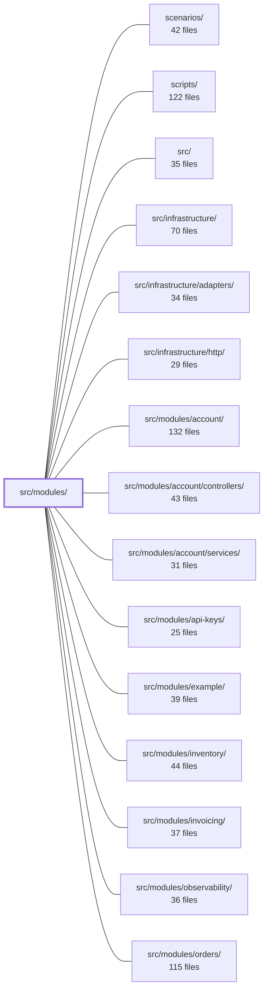

---
tags:
  - 2brain
  - 2brain/module
  - project/boilerplate-node-backend
type: module
module: src/modules/
files: 59
updated: 2026-10-15T13:36:17.257834+00:00
---

# src/modules/

## Purpose

`src/modules/` is the application's domain-layer: every subdirectory is a self-contained bounded context (access, analytics, antibot, audit-logs, account, orders, payments, etc.) that follows a uniform internal structure — a module manifest (`module.ts`), a public barrel (`index.ts`), and the standard model → repository → service → controller/route layering. This is where all business rules, data schemas, API routes, and feature-scoped tests live. Sibling modules may import from each other only through a module's barrel file, enforcing the single-point-of-entry convention defined in `docs/theory/strategic-ddd.md` §5.

## Key parts

- **`access/`** — The authorization domain. `model.ts` defines the Tenant and Membership collections; `repository.ts` shapes queries; `service.ts` enforces role-grant invariants (declared roles only, no privilege escalation); `audit.ts` registers the two auditable actions (role assign/revoke) into the app-wide `AuditActionMap`. The barrel (`index.ts`) is the only surface other modules may import.
- **`analytics/`** — A stateless relay for browser-side UI events (page views, searches). `routes.ts` exposes one `POST /analytics/events` endpoint; `services/relay.ts` looks up the owning module's `toReport` mapping and forwards via the shared analytics port. Business-fact events (cart, checkout, payment) are explicitly out of scope.
- **`antibot/`** — Two read-only endpoints (`GET /antibot/config`, `GET /antibot/challenge`) that let a frontend discover the active human-challenge provider and fetch a self-hosted challenge. Stateless; the actual gating middleware is cross-cutting infrastructure.
- **`audit-logs/`** — Durable audit trail. `service.ts` acts as the persistence sink for `@infrastructure/observability/audit` and provides tenant (`search`) and operator (`searchIncidents`) read paths. `model.ts` owns the Mongoose schema with a TTL index for retention; `repository.ts` is append-and-read-only. OpenAPI spec, Prometheus failure counter, and a full test ladder (unit → integration → contract) round it out.
- **Remaining modules** (`account`, `api-keys`, `inventory`, `invoicing`, `observability`, `orders`, `payments`, `products`, `returns`, `users`, `example`) — Each follows the same manifest/barrel/layering pattern and is listed in the dependency graph as a peer under `src/modules/`.

## How it connects

- **`src/infrastructure/`** (and its `adapters/`, `http/` subdirectories) provides the cross-cutting HTTP runtime, database adapters, and observability primitives (audit logger, consent gate) that every module's service and controller layers depend on.
- **`src/`** (kernel) — The access module explicitly references kernel files (`permissions.ts`, `ability.ts`, `access/query.ts`) for permission evaluation and ability checking; modules declare their manifests into the app kernel, which discovers and wires them at boot.
- **`src/modules/account/`** — Consumes membership/role data through the `access` barrel; the `audit-logs` module registers an Art. 15 data-export slice that feeds into account data downloads.
- **`scenarios/` and `scripts/`** — Provide seed data and operational scripts that exercise the modules' routes and data paths in non-test contexts.
- **`/` (repository root)** — Hosts the shared configuration loader (e.g., `authorization-roles.yaml`, retention env vars) that modules read at startup.

## Where to start

1. **`src/modules/antibot/module.ts`** — The simplest complete module manifest: two routes, no persistence, no service layer. Reading it (alongside `routes.ts` and the two tiny controllers) shows the full module pattern in ~80 lines.
2. **`src/modules/access/index.ts` + `service.ts`** — Once the pattern is clear, the access module demonstrates the richer side: how a barrel enforces encapsulation, how the service layer sits between repository and routes, and how invariants are hard-refused rather than logged.

## Connected modules

[[boilerplate-node-backend_ROOT|/ (repository root)]] · [[boilerplate-node-backend_scenarios|scenarios/]] · [[boilerplate-node-backend_scripts|scripts/]] · [[boilerplate-node-backend_src|src/]] · [[boilerplate-node-backend_src_infrastructure|src/infrastructure/]] · [[boilerplate-node-backend_src_infrastructure_adapters|src/infrastructure/adapters/]] · [[boilerplate-node-backend_src_infrastructure_http|src/infrastructure/http/]] · [[boilerplate-node-backend_src_modules_account|src/modules/account/]] · [[boilerplate-node-backend_src_modules_account_controllers|src/modules/account/controllers/]] · [[boilerplate-node-backend_src_modules_account_services|src/modules/account/services/]] · [[boilerplate-node-backend_src_modules_api-keys|src/modules/api-keys/]] · [[boilerplate-node-backend_src_modules_example|src/modules/example/]] · [[boilerplate-node-backend_src_modules_inventory|src/modules/inventory/]] · [[boilerplate-node-backend_src_modules_invoicing|src/modules/invoicing/]] · [[boilerplate-node-backend_src_modules_observability|src/modules/observability/]] · … and 5 more

## Files
- `src/modules/access/audit.ts` — Declares the audit-action vocabulary owned by the access module and registers it into the app-wide `AuditActionMap` via TypeScript declaration merging. Only two events are audited—role assignment and role revocation—because those are the sole access-module actions that _change_ what a user may do; all other access-module functions are reads.
- `src/modules/access/index.ts` — Barrel file for the `access` module. It is the **only** import surface that sibling modules (e.g. `account`) are permitted to use, enforcing a single-point-of-entry convention described in `docs/theory/strategic-ddd.md` §5. Internal runtime schemas (`repository.ts`, `model.ts` runtime values) are intentionally kept private.
- `src/modules/access/model.ts` — Defines the two Mongoose collections that back the authorization domain: **Tenant** (the single shop this deployment serves) and **Membership** (which user holds which role in which scope). This file is the *data* half of the access module — it stores identity and grant rows but contains no route logic, no permission evaluation, and no write-invariant enforcement (those live in `./service.ts` and the kernel files `permissions.ts` / `ability.ts` / `access/query.ts`).
- `src/modules/access/module.ts` — Defines the **access** module's manifest (a single default-exported object satisfying `AppModule`) for the tenant-and-membership domain. It is intentionally routeless: no endpoint creates a shop or grants a role, so the module exists purely to declare its personal-data obligations (GDPR Art. 15 collect/erase) and to act as the barrel through which other modules consume membership data.
- `src/modules/access/repository.ts` — Thin data-access layer over the `tenants` and `memberships` Mongoose collections. It shapes queries only; all authorization invariants and business rules live in `./service.ts`. Exists so the service layer never touches Mongoose directly.
- `src/modules/access/service.ts` — Service layer for the authorization model: it reads tenants and memberships, validates and writes role grants, and enforces two invariants as hard refusals (not warnings) — that every assigned role is declared in `shared/authorization-roles.yaml`, and that a granter cannot hand out permissions they do not themselves hold. It sits between the HTTP/routing layer and the repository layer, adding the business rules that make a role write safe.
- `src/modules/access/tests/integration/access.test.ts` — Integration tests for the authorization model's **storage layer** — membership rows in an in-memory Mongo (wired by `setupTestDb`). Proves the service writers (`service.ts`, `repository.ts`) can create, replace, and refuse memberships correctly, and that every invariant is enforced at write time. Complements `tests/cross-cutting/authorization-conformance.test.ts` (which proves both backends decide identically) and `tests/integration/access.test.ts` (which seeds the full demo model).
- `src/modules/access/tests/unit/grantable-roles.test.ts` — Unit test for `grantableRoles` that doubles as a human-reviewable table of which tenant roles each preset caller may grant. The module docblock makes this explicit: when a new role is added to `shared/authorization-roles.yaml` that shifts grant permissions, the corresponding row here is the thing to review.
- `src/modules/access/tests/unit/hierarchy.test.ts` — Unit-tests the rank/level rule in isolation: `levelOfUser`, `canActOn`, `outrankedRefusal`, and `ownMoneyRefusal` from the access service. Membership data is a plain in-memory `Map` (one row per case) rather than a database, so each test exercises the comparison logic without I/O. The header notes that the complementary cross-cutting "role-hierarchy" suite covers the same rule through real routes and a real database.
- `src/modules/analytics/controllers/post-analytics-event.ts` — Handler for `POST /analytics/events`. Validates an incoming browsing event against a closed zod schema, then delegates to the analytics relay service. Deliberately returns the same `204` whether or not the event was actually forwarded, so the client can never detect whether measurement occurred.
- `src/modules/analytics/index.ts`
- `src/modules/analytics/module.ts` — Module manifest for the browsing-event relay. It exposes `POST /analytics/events`, a single stateless endpoint through which a browser reports UI-level activity (page opens, searches) that the response cache otherwise hides from the server. Those events are forwarded to an analytics provider via the shared consent gate. Business-fact events (cart, checkout, order, payment, signup, login) are explicitly **not** accepted here; they are emitted by the owning service.
- `src/modules/analytics/routes.ts` — Defines the Express route table for the analytics relay. It exposes a single public `POST /analytics/events` endpoint for recording one browsing event. The route is intentionally open to guests; authentication is optional and only serves to attach a signed-in visitor's id when present.
- `src/modules/analytics/services/relay.ts` — Dispatch layer that receives a validated browsing-event request (from the analytics controller) and forwards it to the analytics port via the event's registered `BrowserEventTarget`. It owns no consent logic (the port handles that) and knows no concrete event names (modules declare those in `AppModule.browserEvents`). It exists to decouple the controller from the per-event provider-mapping logic.
- `src/modules/analytics/tests/contract/api.contract.test.ts` — Contract test for `POST /analytics/events` that pins the API's closed-set behavior: the two known event types (`product_viewed`, `products_searched`) must return `204 No Content`, and any event outside that set must be rejected with `422 Unprocessable Entity`.
- `src/modules/analytics/tests/integration/relay.test.ts` — Integration test for the `POST /analytics/events` relay endpoint. It drives the real HTTP app (with a test database) to verify that the relay enforces visitor consent and strict input validation before forwarding events to the analytics provider, and that it always answers `204` when the event is accepted (consented or not) or `422` when rejected.
- `src/modules/analytics/tests/unit/relay.test.ts` — Unit tests for the analytics relay service. Verifies that `relayEvent` routes a request body to the owning module's `toReport` function (looked up by the body's `event` field) and forwards the module-built report to the analytics emitter, while silently dropping events that no registered module claims.
- `src/modules/antibot/controllers/get-antibot-challenge.ts` — Express route handler for `GET /antibot/challenge`. It asks the active human-challenge adapter whether it can issue a self-hosted challenge; if so, it returns the challenge object, otherwise it returns a 404. This endpoint is only meaningful for self-hosted (non-vendor) providers—vendor-hosted widgets fetch their challenge from the vendor and never hit this route.
- `src/modules/antibot/controllers/get-antibot-config.ts` — Controller for the public `GET /antibot/config` endpoint. It reports which human-challenge provider is active, supplies the parameters the frontend needs to render that provider's widget, and returns a `rungs` summary of the other antibot mechanisms (identity budgets, email policy). It is one of two routes in the antibot module, the other being `GET /antibot/challenge`.
- `src/modules/antibot/index.ts` — Intentionally empty barrel file for the `antibot` module. It exists solely to satisfy the project convention (strategic-DDD §5) that every module directory exposes a barrel, even when that barrel has nothing to publish. All antibot logic lives in wiring files (`module.ts`, `routes.ts`, `controllers/`) or in cross-cutting infrastructure, none of which a barrel re-exports.
- `src/modules/antibot/module.ts` — Module manifest for the `antibot` module. It registers two public HTTP routes (served under `/antibot`) that expose which human-challenge provider is active, letting a frontend decide whether to render a challenge widget before submitting a guarded form. The module is intentionally stateless — it carries no persistence or locale data — and performs no boot-time checks of its own, because the actual challenge gate (`humanChallengeGate`) is cross-cutting middleware that runs regardless of whether this module's routes are mounted.
- `src/modules/antibot/openapi.yaml` — OpenAPI 3.1.0 contract for the antibot module — the "rung 3" human-challenge step in the anti-automation ladder. It declares the two public, unauthenticated endpoints clients call to discover the active challenge provider and (for self-hosted providers) fetch a work unit to solve.
- `src/modules/antibot/routes.ts` — Defines the two public HTTP routes for the antibot module — exposing which human-challenge provider is active and, when the server self-hosts that provider, the challenge payload the client must render. Both endpoints are read-only and exist solely to let a browser client bootstrap the challenge flow without hitting a heavier API.
- `src/modules/antibot/tests/contract/api.contract.test.ts` — Contract tests for the `/antibot/challenge` and `/antibot/config` endpoints, verifying they respond correctly under different provider and email-policy configurations. Also contains the end-to-end proof that a selected provider actually gates a real guarded route (`POST /feedback/contact`) with a 401 when no token is present. The e2e portion lives here (not in `feedback`'s own suite) because `antibot` is the only module that understands both sides of the handshake—what the client is told to render and what counts as a valid token—without importing the routes it guards.
- `src/modules/audit-logs/config.ts` — Defines the single configuration surface for the audit-logs module: the retention period (in days) for audit entries. It declares the config shape so the rest of the module and the global configuration loader can validate and supply the value at startup.
- `src/modules/audit-logs/controllers/get-audit.ts` — Defines the tenant-scoped `GET /audit` controller, returning a filtered, paged list of the shop's own action history. It is the tenant-key counterpart to the platform's `listObservabilityAuditEntries`; both ultimately read the same collection through `auditLogService`.
- `src/modules/audit-logs/index.ts` — Public barrel (single import surface) for the audit-logs module. Sibling modules must import only through this file rather than reaching into `service.ts` or `model.ts` directly, enforcing the strategic DDD encapsulation rule.
- `src/modules/audit-logs/metrics.ts` — Defines the domain-owned Prometheus counter for the audit-logs module. The counter tracks audit entries that made it into the compliance log but failed to persist into the queryable trail, giving operators a signal for the deliberate fail-open path in `record()`.
- `src/modules/audit-logs/model.ts` — Defines the Mongoose schema, indexes, serialization transform, and model for the `AuditLog` collection — the durable store behind `GET /observability/audit`. It persists the same shape that the audit logger (`@infrastructure/observability/audit`) emits, so no translation layer exists between write and read.
- `src/modules/audit-logs/module.ts` — Module manifest for the audit-logs feature. It assembles the service, router, and config into a single `AppModule` object and installs the persistence sink (`auditLogService.record`) as the audit writer when the module is registered. It exists so the app kernel can discover, enable, and wire the module declaratively without importing its internals at module-load time.
- `src/modules/audit-logs/openapi.yaml` — OpenAPI 3.1.0 contract for the **audit-logs** module. It defines the tenant-facing endpoint `GET /audit` (a shop's own action history), the shared `AuditEntryItem` row schema, and registers the module's slice of the account data export. It is the machine-readable API spec that documents and constrains what the module exposes to tenants.
- `src/modules/audit-logs/repository.ts` — Read-only data access layer for the audit log collection. It exposes two operations — append one entry, read a filtered page — and deliberately omits any update or delete path. Expiry is handled by the model's TTL index, not by application code.
- `src/modules/audit-logs/routes.ts` — Defines the Express router for the tenant-facing `GET /audit` endpoint. It exposes a shop's own action history, restricted to roles that hold the `audit.any.read` permission (a tenant key, not a platform-operator key). The file exists to wire authentication, credential-type validation, and permission gating in front of the single audit-reading controller.
- `src/modules/audit-logs/service.ts` — The audit log service that acts as the persistence sink behind `@infrastructure/observability/audit` (registered by the module at import time) and provides the two read paths: `search` for a tenant's staff (`GET /audit`) and `searchIncidents` for the platform operator (`GET /observability/audit`). It also exposes `findOwnAuditEntries` for an account's Art. 15 data export.
- `src/modules/audit-logs/tests/contract/audit.test.ts` — Contract tests for the `GET /audit` endpoint — the single route owned by the audit-logs module. Verifies authentication, role-based authorization, query-filter semantics (actor, target, outcome, since), and input-validation errors that the endpoint must return.
- `src/modules/audit-logs/tests/integration/incidents.test.ts` — Integration tests that pin down exactly which audit-log rows the **operator's** incident read (`auditLogService.searchIncidents`) returns. They lock in the allow-list (security/auth failure rows) and the withholding (customer activity, shop-internal admin actions, successful logins), plus the HMAC-digest treatment of IP addresses — so that a future code change to the filter logic is caught immediately.
- `src/modules/audit-logs/tests/integration/repository.test.ts` — Integration test suite that exercises `auditLogRepository` (create, search, deep paging, and cursor-based own-trail reads) against an in-memory MongoDB spun up by `setupTestDb`. It exists to lock in the repository's contract—filter semantics, pagination math, `since`-bound exclusivity, tie-breaking sort order, and field-shape guarantees—so that regressions in the capped-read or cursor logic are caught before they reach the service layer.
- `src/modules/audit-logs/tests/unit/retention.test.ts` — Unit test that verifies the TTL index declared on the audit log collection resolves to the correct `expireAfterSeconds` value, both for the default (90 days) and a caller-supplied retention period. Because the TTL is baked in at module-load time from an environment variable, the tests must force a fresh import to exercise different values.
- `src/modules/audit-logs/tests/unit/schema-contract.test.ts` — A compliance contract test that pins down the `auditLogSchema` (Mongoose) as a regulatory artifact rather than a convenience. It asserts the required fields, closed-set enums, schema options (`timestamps`, `bufferCommands`), index topology, and TTL retention window. Unlike typical unit tests, it documents *why* each constraint exists (e.g., a silent buffer would swallow audit-loss signals) and fails if the schema drifts from the operational contract.
- `src/modules/audit-logs/tests/unit/service.test.ts` — Unit tests for `auditLogService`'s two functions, focused on their deliberately asymmetric failure semantics: `record` must never throw (fail-open, fire-and-forget) while `search` must propagate errors (fail-closed, admin-facing read). The repository and logger are mocked so failures can be triggered on demand.
- `src/modules/stats/controllers/get-stats.ts` — Thin, read-only HTTP controllers for the stats endpoints. Each export is a one-line (or near-one-line) handler that validates its query/params with a Zod schema, then delegates to the corresponding `statsService` method. The file exists so that `routes.ts` can map URL paths to handlers without containing any business logic or shared wiring.
- `src/modules/stats/controllers/respond.ts` — Provides the single shared handler factory (`statsHandler`) that every stats read endpoint uses. It encapsulates the common flow—read the query string, validate it against a Zod schema, resolve the date range against the shop's timezone, invoke a caller-supplied composer, and shape the HTTP response—so that sibling controllers (e.g. `get-stats.ts`) only supply the schema and the composer.
- `src/modules/stats/domain/calendar.ts` — Pure calendar-day arithmetic with no clocks or time zones. A day is just `{year, month, day}`; all internal math runs on UTC-midnight timestamps so DST is never a concern. This module supplies the date primitives (parsing, formatting, shifting, bucketing) that the stats range layer builds on.
- `src/modules/stats/domain/index.ts` — Barrel file for the stats domain layer. It re-exports the public API of the two domain submodules (`range` and `calendar`) under a single import path, so consumers can `import { … } from '../domain'` without reaching into individual files.
- `src/modules/stats/domain/range.ts` — Defines the validation rules and core domain logic for time-range requests in stats reports. It is pure (no I/O) and works exclusively in calendar days, so the rules are identical regardless of the requester's time zone.
- `src/modules/stats/index.ts` — Public barrel file for the `stats` module. It is the sole import surface that sibling modules are allowed to use (per the rule in `docs/theory/strategic-ddd.md` §5). It re-exports everything from the module's `domain` and `services` sub-barrels so consumers can do a single `import … from '@modules/stats'` instead of reaching into internal paths.
- `src/modules/stats/module.ts` — Module manifest for the **stats** module. It registers a read-only aggregation endpoint at `/stats` that composes sales figures on demand from the `invoicing`, `orders`, `payments`, and `returns` modules. No data is stored, cached, or precomputed here.
- `src/modules/stats/routes.ts` — Defines the `/stats` Express router — a set of read-only GET endpoints exposing sales, product, category, payment, operations, customer, and pipeline figures. Every route is gated behind the `stats.any.read` permission and marked `privateNoCache`, because the data represents the shop's revenue and must never land in a shared cache.
- `src/modules/stats/services/breakdowns.ts` — Provides the read-only aggregation queries behind the sales dashboard: top products, category totals, a single product's time series, the payment-method mix, operations rates (cancellation / returns / refunds), customer breakdown, and the live open pipeline. Each exported function composes one or two underlying service calls into a fully shaped, serialisable response.
- `src/modules/stats/services/figures.ts` — Pure data structures and functions that turn raw per-bucket money/count sums into the published sales-figures contract. All arithmetic stays in minor units until `figuresOf` converts to decimals, guaranteeing that the sum of bucket figures equals the sum of the whole.
- `src/modules/stats/services/index.ts` — Barrel/facade module for the stats service. It re-exports every read-only stats function from the individual service files (`sales`, `breakdowns`, `range`) and bundles them into a single `statsService` object, giving controllers and the module entry point one import location. It performs no logic of its own and stores nothing.
- `src/modules/stats/services/range.ts` — Resolves an API query (`from`, `to`, optional `interval`) into a fully materialized `Period` object: the shop-local half-open instant window, a previous-period window, and every bucket-start instant (including empty buckets). Centralising this conversion here ensures the `$dateTrunc` bucketing zone and the query bounds always agree on what "a day" means.
- `src/modules/stats/services/sales.ts` — Merges three independent time-bucketed sources — invoiced money, paid orders/units, and returned units — into a single per-currency, per-bucket sales table for a given period and its predecessor. Exists so the stats layer can present a unified "sales over time" view without each consumer re-implementing the merge.
- `src/modules/stats/tests/contract/api.contract.test.ts` — Contract tests for every `GET /stats/*` read endpoint. The file pins the observable API contract: which roles may read which endpoints, what status codes are returned for invalid periods, malformed IDs, anonymous callers, and unknown query fields, and that sales data is never exposed through a shared cache. It exists so that any change to the stats API surface (routing, authz, validation, caching) is caught immediately.
- `src/modules/stats/tests/integration/stats.test.ts` — Integration test suite that exercises the stats service (`statsService`) against a real MongoDB instance, verifying that every composed figure (gross, net, VAT, refunds, per-day buckets, customer counts, cancellation/refund rates, pipeline snapshot) agrees with the underlying order, invoice, and credit-note documents. It is specifically the test that passes a real IANA zone name (`Europe/Rome`) through Mongo's `$dateTrunc`, making it the guard for shop-local-day bucketing.
- `src/modules/stats/tests/unit/calendar.test.ts` — Unit tests for the pure calendar-arithmetic functions in the stats domain. The focus is on edge cases: invalid calendar dates, leap-year boundaries, month/year rollover, and the Monday-start week convention. No clocks, no time zones — just three-integer day values.
- `src/modules/stats/tests/unit/figures.test.ts` — Unit tests for the figures calculation service, verifying the core sales formulas: net sales subtracts reversals, shipping and VAT are computed as charged-minus-refunded, and no division by zero orders occurs. Also covers field-by-field aggregation and the safe-rate helper.
- `src/modules/stats/tests/unit/range.test.ts` — Unit tests for the range-validation domain logic in `domain/range.ts`. Verifies that `checkRange` enforces the four rules (valid calendar days, ordered endpoints, ≤ 731 days, ≤ 400 buckets) and that `previousOf` shifts a range back by its own length, ending the day before `from`.
- `src/modules/stats/tests/unit/routes.test.ts` — Unit test that pins down the contract of the stats router: exactly eight read-only `GET` endpoints, every route requires an authenticated session, and every route is guarded by the single permission `stats.any.read`. It exists to catch accidental scope creep — a new public route, a missing auth guard, an inconsistent permission key, or a non-GET method — at test time rather than in production.

---
[[boilerplate-node-backend_INDEX|← boilerplate-node-backend index]]
