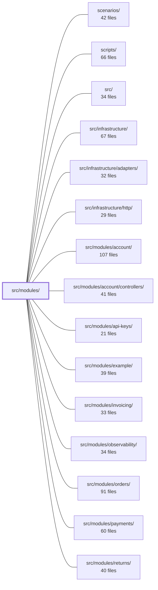

---
tags:
  - 2brain
  - 2brain/module
  - project/boilerplate-node-backend
type: module
module: src/modules/
files: 32
updated: 2026-10-07T23:55:28.647351+00:00
---

# src/modules/

## Purpose

`src/modules/` is the application's bounded-context layer: a collection of sibling domain modules, each owning a slice of business logic with its own data model, service rules, and (where applicable) HTTP routes. Every module directory exposes a single barrel file (`index.ts`) as the only import surface for other modules, enforcing the encapsulation convention defined in the project's strategic-DDD document (§5).

## Key parts

- **`access/`** — The authorization domain. Owns the Tenant and Membership collections, the role-grant service (with hierarchy invariants and the `AccessInvariantError` contract), a thin repository, and the audit-action vocabulary for role assignment/revocation. Exposes no HTTP routes; is consumed through its barrel by `account`, `api-keys`, and `users`.
- **`antibot/`** — The human-challenge gateway. Provides two public GET endpoints (`/antibot/config`, `/antibot/challenge`) and a boot-time `customCheck` that validates provider secrets before the server accepts traffic. Stores no personal data.
- **`audit-logs/`** — The immutable action trail. Defines the append-only repository, TTL-backed model, and the read path behind both the tenant-facing `GET /audit` and the platform-facing `GET /observability/audit`. The `onRegistered` hook in its manifest wires the persistence sink so `emitAuditEvent` calls land here.
- **Per-module tests** — Each sub-module carries its own `tests/` tree (unit, integration, contract) that locks down schema shape, service invariants, and wire-level API contracts independently of other modules.

## How it connects

- **`src/modules/account/`, `src/modules/api-keys/`, `src/modules/users/`** — All three import the `access` barrel to read role/membership state and to call the grant/revocation service; none reach into `access` internals.
- **`src/modules/observability/`** — The observability module surfaces the platform-wide audit read path (`GET /observability/audit`) by calling into the `audit-logs` service; `audit-logs` itself does not expose that route.
- **`src/infrastructure/`** — The shared audit logger (`@infrastructure/observability/audit`) decides *what* to record; the `audit-logs` module's model and repository decide *how* it is stored and queried. HTTP middleware in `src/infrastructure/http/` provides the routing and auth primitives each module's router builds on.
- **Sibling modules (`orders/`, `payments/`, `returns/`, `invoicing/`, `example/`)** — Share the same directory conventions (barrel, manifest, routes) and may depend on `access` for authorization checks, but do not import each other's internals.

## Where to start

1. **`src/modules/access/index.ts`** — A six-line barrel that shows the single-import-surface rule in its simplest form; reading it alongside `module.ts` in the same directory reveals the manifest-and-routes pattern every other module follows.
2. **`src/modules/access/service.ts`** — The most instructive service file in the codebase: it demonstrates how business invariants (role declared in YAML, granter hierarchy) are enforced at write time, how failures map to typed HTTP errors, and how the module stays routeless while still being the authoritative gate for what a user may do.

## Connected modules

[[boilerplate-node-backend_ROOT|/ (repository root)]] · [[boilerplate-node-backend_scenarios|scenarios/]] · [[boilerplate-node-backend_scripts|scripts/]] · [[boilerplate-node-backend_src|src/]] · [[boilerplate-node-backend_src_infrastructure|src/infrastructure/]] · [[boilerplate-node-backend_src_infrastructure_adapters|src/infrastructure/adapters/]] · [[boilerplate-node-backend_src_infrastructure_http|src/infrastructure/http/]] · [[boilerplate-node-backend_src_modules_account|src/modules/account/]] · [[boilerplate-node-backend_src_modules_account_controllers|src/modules/account/controllers/]] · [[boilerplate-node-backend_src_modules_api-keys|src/modules/api-keys/]] · [[boilerplate-node-backend_src_modules_example|src/modules/example/]] · [[boilerplate-node-backend_src_modules_invoicing|src/modules/invoicing/]] · [[boilerplate-node-backend_src_modules_observability|src/modules/observability/]] · [[boilerplate-node-backend_src_modules_orders|src/modules/orders/]] · [[boilerplate-node-backend_src_modules_payments|src/modules/payments/]] · … and 2 more

## Files
- `src/modules/access/audit.ts` — Declares the audit-action vocabulary owned by the access module and registers it into the app-wide `AuditActionMap` via TypeScript declaration merging. Only two events are audited—role assignment and role revocation—because those are the sole access-module actions that _change_ what a user may do; all other access-module functions are reads.
- `src/modules/access/index.ts` — Barrel file for the `access` module. It is the **only** import surface that sibling modules (e.g. `account`) are permitted to use, enforcing a single-point-of-entry convention described in `docs/theory/strategic-ddd.md` §5. Internal runtime schemas (`repository.ts`, `model.ts` runtime values) are intentionally kept private.
- `src/modules/access/model.ts` — Defines the two Mongoose collections that back the authorization domain: **Tenant** (the single shop this deployment serves) and **Membership** (which user holds which role in which scope). This file is intentionally routeless — it holds the data shapes and indexes that `permissions.ts`, `ability.ts`, and `access/query.ts` (kernel) read, and that `repository.ts` / `service.ts` (this module) write.
- `src/modules/access/module.ts` — Declares the `access` module's manifest (name + GDPR Art. 15 personal-data section) and registers it with the kernel. The module owns tenant and membership data but exposes no HTTP routes; it is consumed solely through its barrel export by `account`, `api-keys`, and `users`.
- `src/modules/access/repository.ts` — Thin data-access layer that shapes Mongoose queries for the tenant and membership collections. It deliberately contains no business invariants—those live in `./service.ts`—so the repository is swappable and testable in isolation.
- `src/modules/access/service.ts` — Service layer for reading and writing the authorization model (tenants, memberships, role grants). Every write path enforces two invariants at execution time — not in docs: the role must be declared in `shared/authorization-roles.yaml`, and the granter must hold every key the target role holds (one narrow exception for `users.any.create` → `customer`). Failures surface as `AccessInvariantError` (a `ConflictError` subclass → HTTP 409) or, for system callers, as an audited rejection.
- `src/modules/access/tests/integration/access.test.ts` — Integration tests for the access module's **membership storage layer** (write, edit, refuse) against an in-memory MongoDB wired up by `setupTestDb`. It verifies that the collection from which authorization decisions are *read* can be correctly written to, edited, and rejected — distinct from `tests/cross-cutting/authorization-conformance.test.ts`, which proves two backends decide identically.
- `src/modules/access/tests/unit/grantable-roles.test.ts`
- `src/modules/access/tests/unit/hierarchy.test.ts`
- `src/modules/antibot/controllers/get-antibot-challenge.ts` — Controller for `GET /antibot/challenge`. It is the endpoint a self-hosted antibot provider's widget calls to fetch a challenge. Vendor-hosted providers obtain their challenge from the vendor and never reach this route.
- `src/modules/antibot/controllers/get-antibot-config.ts` — Controller for the public `GET /antibot/config` endpoint. It reports which human-challenge provider is active, supplies the parameters the frontend needs to render that provider's widget, and returns a `rungs` summary of the other antibot mechanisms (identity budgets, email policy). It is one of two routes in the antibot module, the other being `GET /antibot/challenge`.
- `src/modules/antibot/index.ts` — Intentionally empty barrel file for the `antibot` module. It exists solely to satisfy the project convention (strategic-DDD §5) that every module directory exposes a barrel, even when that barrel has nothing to publish. All antibot logic lives in wiring files (`module.ts`, `routes.ts`, `controllers/`) or in cross-cutting infrastructure, none of which a barrel re-exports.
- `src/modules/antibot/module.ts` — Module manifest for the **antibot** module. It registers the module's routes and base path, declares that the module stores no personal data, and — most importantly — contributes a `customCheck` that validates antibot-specific environment variables **at boot**, preventing a runtime outage (e.g. a failed challenge on first guarded request) when a selected provider is missing its secrets or the email-policy selector is unrecognized.
- `src/modules/antibot/openapi.yaml` — OpenAPI 3.0.3 contract for the antibot module's two public endpoints: reading the active human-challenge configuration and fetching a self-hosted challenge. It is the machine-readable source of truth for what the client must render and submit, and it deliberately exposes no auth on either route so pre-signup flows can still reach the widget.
- `src/modules/antibot/routes.ts` — Defines the Express router for the antibot module's two public GET endpoints. It wires each path to a thin controller so the anti-scraping challenge flow (config retrieval + challenge payload) is exposed without any write side-effects.
- `src/modules/antibot/tests/contract/api.contract.test.ts` — Contract tests for the two public `/antibot` endpoints (`/challenge`, `/config`) and an end-to-end proof that a selected provider actually gates a real guarded route (`/feedback/contact`). This file lives in the antibot module rather than the feedback module because antibot is the only place that understands both halves of the handshake—what the client is told to render and what counts as a valid token—without importing the routes it guards.
- `src/modules/audit-logs/config.ts`
- `src/modules/audit-logs/controllers/get-audit.ts` — Single-export controller that handles `GET /audit`, returning a filtered, paginated list of the tenant's own action-history entries. It mirrors the read path used by the `observability` module's `getObservabilityAuditLogs`, differing only in authentication scope (tenant key vs. platform key) — both ultimately query the same collection via `auditLogService`.
- `src/modules/audit-logs/index.ts` — Public barrel (single import surface) for the audit-logs module. Sibling modules must import only through this file rather than reaching into `service.ts` or `model.ts` directly, enforcing the strategic DDD encapsulation rule.
- `src/modules/audit-logs/metrics.ts` — Defines the domain-owned Prometheus counter for the audit-logs module. The counter tracks audit entries that made it into the compliance log but failed to persist into the queryable trail, giving operators a signal for the deliberate fail-open path in `record()`.
- `src/modules/audit-logs/model.ts` — Mongoose schema, model, and serialization transform for the persisted audit-log collection. It is the durable half of the audit pipeline: the logger in `@infrastructure/observability/audit` decides *what* to record, and this file defines the shape, indexes, TTL, and read-path serialization so `GET /observability/audit` can answer "what has actor X done" from the API.
- `src/modules/audit-logs/module.ts` — Module manifest for the read-only audit trail. It declares the module's identity (name, base path, routes, locales, permissions, personal-data hook) and, via its `onRegistered` hook, wires the persistence sink so that `emitAuditEvent` calls flow into this module's collection. The module provides two read surfaces: `GET /audit` (own shop, gated on `audit.any.read`) and, through the observability module, `GET /observability/audit` (platform-wide).
- `src/modules/audit-logs/openapi.yaml` — OpenAPI 3.0.3 contract for the **audit-logs** module. It declares the single `GET /audit` endpoint (shop-scoped, role-gated action history) and the component schemas that endpoint—and the shared `POST /account/export` route—reference. It exists so consumers and code-gen tools have a machine-readable, module-local contract without reaching into another module's spec.
- `src/modules/audit-logs/repository.ts` — Append-and-read repository for audit log entries. It exposes only `create` and `search` (plus a `since` scope helper), deliberately omitting update and delete to enforce immutability at the type level. Record expiry is delegated to a Mongo TTL index defined on the model, not handled here.
- `src/modules/audit-logs/routes.ts` — Defines the Express router for the tenant-facing `GET /audit` endpoint. It exposes a shop's own action history, restricted to roles that hold the `audit.any.read` permission (a tenant key, not a platform-operator key). The file exists to wire authentication, credential-type validation, and permission gating in front of the single audit-reading controller.
- `src/modules/audit-logs/service.ts` — The audit-log service. It is the persistence sink that the observability audit module calls when an entry is emitted, and the read path behind two HTTP endpoints: `GET /observability/audit` (platform operator) and `GET /audit` (tenant staff, gated on `audit.any.read`). It sits between the domain model/repository and the controllers, applying collection-specific policies (scope, sort, pagination) that don't belong in the generic repository.
- `src/modules/audit-logs/tests/contract/audit.test.ts` — Contract tests for the single route this module exposes — `GET /audit`. Covers authentication, role-based authorization, query-parameter filtering, and response-shape validation against the API spec. Exists to lock the observable behavior of the endpoint so refactors inside the module cannot silently change the wire contract.
- `src/modules/audit-logs/tests/integration/incidents.test.ts`
- `src/modules/audit-logs/tests/integration/repository.test.ts` — Integration tests for `auditLogRepository` run against an in-memory MongoDB instance. They verify `create`, `search` (filtering, `since` semantics, pagination metadata, serialization), and a deep-paging scenario that fails against any implementation that caps reads instead of truly paginating.
- `src/modules/audit-logs/tests/unit/retention.test.ts` — Unit test that verifies the audit-log collection's TTL index is configured with the correct `expireAfterSeconds` value derived from the `NODE_AUDIT_RETENTION_DAYS` environment variable, including the 90-day default used when the variable is unset.
- `src/modules/audit-logs/tests/unit/schema-contract.test.ts` — Contract tests that lock down the Mongoose schema for audit-log entries: which fields are required, which fields are restricted to closed enum sets, which Mongoose options are set (`timestamps`, `bufferCommands`), and which indexes exist with what options (including the single TTL index). The file exists to make schema drift visible as a test failure rather than a silent production gap.
- `src/modules/audit-logs/tests/unit/service.test.ts` — Unit tests for `auditLogService` verifying its two intentionally asymmetric failure contracts: `record` is fail-open (swallows write failures into a log line, never throws) and `search` is fail-closed (propagates failures to the caller). The repository is mocked because a real one cannot be made to fail on demand.

---
[[boilerplate-node-backend_INDEX|← boilerplate-node-backend index]]
