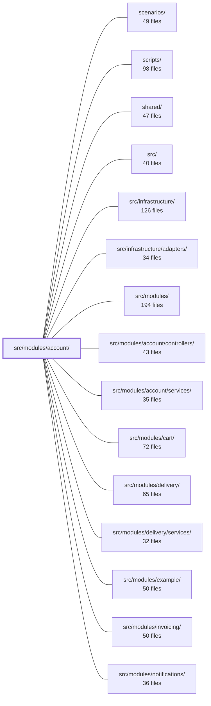

---
tags:
  - 2brain
  - 2brain/module
  - project/boilerplate-node-backend
type: module
module: src/modules/account/
files: 157
updated: 2026-11-08T10:48:58.127004+00:00
---

# src/modules/account/

## Purpose

The account module owns the full authentication and account-lifecycle domain: signup, login, session management, two-factor authentication, OAuth provider integration, password recovery, email verification and change, personal-data export, and account deletion/restore. It is the module through which every user request is authenticated and every per-user record is governed.

## Key parts

- **Module wiring** — `module.ts` (manifest: routes, events, queues, config, `onRegistered` hook), `module.yaml` (identity, kernel deps, rate-limit budgets, scheduled jobs), `index.ts` (public barrel; the only entry point sibling modules may import), `routes.ts` (Express router and middleware chain).
- **Domain layer (pure rules)** — `domain/` contains I/O-free finite-state models: `email-change.ts` (four-state FSM), `session-proof.ts` (AMR merge rules), `revocation.ts` (session-termination lookup table), `epoch.ts` (token-validity-after check), all re-exported via `domain/index.ts`.
- **OAuth sub-area** — `oauth/` holds the provider port (`providers/port.ts`), the registry (`providers/index.ts`), concrete adapters (`providers/google.ts`, `providers/github.ts`), shared client plumbing (`providers/client.ts`), per-attempt cookie/state management (`state.ts`), and the MFA + deletion-redirect cookie helpers.
- **Session sub-area** — `session/` (including `account-view.ts`) builds the credential payload (abilities, idle clock, account) returned at sign-in and refresh.
- **Persistence** — `model.ts` (Mongoose schemas for `sessions`, `accountexports`, `verificationtokens`, `erasureledgers`) and `repository.ts` (lean reads / atomic writes for those collections).
- **Policy & configuration** — `config.ts` (TTLs, retention, URLs), `rules.yaml` + `rules.schema.ts` (2FA lockout and delivered-code constants, shared with the PHP twin), `rate-limits.ts` (credential-guess, signup, MFA budgets), `mail-budget.ts` (per-recipient 10-mail/24 h cap), `cooldown.ts` (shared resend countdown).
- **Cross-cutting contracts & telemetry** — `openapi.yaml` (full `/account/*` API contract), `asyncapi.internal.yaml` (internal export-queue channel), `analytics.ts` + `audit.ts` (event and log-action vocabularies), `events.ts` (domain-event catalogue), `metrics.ts` (Prometheus counters), `emails.ts` (i18n-resolved email copy), `presenter.ts` (row → wire-shape mapping).
- **Scheduled jobs** — `jobs.ts` (inactive-account reaping, lapsed-email cleanup, expired-export purge, self-deletion grace purge).
- **Supporting** — `consent-record.ts` (terms/analytics acceptance snapshot), `roles.ts` (admin-role check for audit context), `probes.ts` (edge-case HTTP probes for the generated client collection), `session-mode.ts` (shared `jwt` / `cookie` mode constants).

## How it connects

- **`src/infrastructure/` & `src/infrastructure/adapters/`** — the kernel provides the scheduler (consuming `jobs.ts`), the shared `metricsRegistry`, the `AnalyticsEventMap` and `DomainEventMap` base interfaces (augmented by `analytics.ts` and `events.ts`), the rate-limit middleware that `rate-limits.ts` composes, and the mail-transport adapter that `emails.ts` feeds.
- **Sibling modules (`cart`, `orders`, `payments`, `invoicing`, `delivery`, `products`, `tasks`, `users`, `webhooks`, `notifications`, `observability`)** — each module registers a `personalData` section during its `onRegistered` hook; the account module's `onRegistered` resolves the full section list to drive the personal-data export job. Sibling modules also subscribe to account domain events (e.g. `account.sessions_revoked`) to tear down or flag their own per-user state. They import from this module **only** through `index.ts`.
- **`shared/`** — provides the generic `AnalyticsEventMap`, `DomainEventMap`, repository factory, and other kernel types that the account module augments or composes.
- **`src/modules/account/controllers/` & `src/modules/account/services/`** — the two internal tiers above this directory: controllers handle HTTP request/response; services orchestrate domain rules, repository calls, and event emission.
- **`scenarios/` & `scripts/`** — integration test scenarios exercise the `/account/*` endpoints end-to-end; scripts consume `rules.yaml` for the PHP-twin generation step.

## Where to start

1. **`module.ts`** — reading the manifest first gives you the full picture: which routes are registered, which events are subscribed, what the `onRegistered` hook installs app-wide, and how config slices are consumed. It is the table of contents for the entire module.
2. **`domain/email-change.ts`** — a compact, self-contained finite-state machine with no I/O. It shows the architectural pattern the team uses for business rules (pure functions, explicit transition table, no framework imports) and is directly testable without a database or HTTP server.

## Connected modules

[[boilerplate-node-backend_ROOT|/ (repository root)]] · [[boilerplate-node-backend_scenarios|scenarios/]] · [[boilerplate-node-backend_scripts|scripts/]] · [[boilerplate-node-backend_shared|shared/]] · [[boilerplate-node-backend_src|src/]] · [[boilerplate-node-backend_src_infrastructure|src/infrastructure/]] · [[boilerplate-node-backend_src_infrastructure_adapters|src/infrastructure/adapters/]] · [[boilerplate-node-backend_src_modules|src/modules/]] · [[boilerplate-node-backend_src_modules_account_controllers|src/modules/account/controllers/]] · [[boilerplate-node-backend_src_modules_account_services|src/modules/account/services/]] · [[boilerplate-node-backend_src_modules_cart|src/modules/cart/]] · [[boilerplate-node-backend_src_modules_delivery|src/modules/delivery/]] · [[boilerplate-node-backend_src_modules_delivery_services|src/modules/delivery/services/]] · [[boilerplate-node-backend_src_modules_example|src/modules/example/]] · [[boilerplate-node-backend_src_modules_invoicing|src/modules/invoicing/]] · … and 8 more

## Files
- `src/modules/account/analytics.ts` — Declares the canonical set of analytics event names owned by the account module and registers them into the shared `AnalyticsEventMap` type. Every account-related event fired anywhere in the backend must use a name from this catalogue, giving the analytics port a single, type-checked vocabulary for the account domain.
- `src/modules/account/asyncapi.internal.yaml` — AsyncAPI fragment that declares the account module's private worker queue for personal-data export jobs. It exists separately from the module's public contract so the paired frontend never sees the `backend`-only channel, and so the fragment can be merged into `asyncapi.yaml` without carrying its own `asyncapi`/`info`/`servers` envelope.
- `src/modules/account/audit.ts` — Defines the canonical set of audit action strings that the account domain emits, and registers them into the infrastructure audit map via a type-only module augmentation. This keeps the log-action vocabulary colocated with the domain that owns it without creating an import cycle, and lets log tooling and alert rules reference a stable, typed union.
- `src/modules/account/config.ts` — Defines the `account` module's runtime configuration (frontend link templates, token TTLs, export/ledger retention, deletion grace, legal-identity fields) and provides small helper functions that resolve those values into concrete URLs or timestamps. It is the single source of truth for every tunable the account module needs, keeping infrastructure generic while encoding account-specific semantics here.
- `src/modules/account/consent-record.ts` — Data-protection record module that stamps, at account-creation time, which terms version was in force, when the user accepted them, and what analytics choice (if any) the signup carried. These fields are later read by controllers to display "who agreed to what, and when."
- `src/modules/account/cooldown.ts` — Provides a single source of truth for the "wait before re-sending" countdown shared by the 2FA delivered-code flow and the verification-link flow. Both flows publish mail on a button press and must render the same countdown semantics to the client; centralising the calculation here guarantees that.
- `src/modules/account/domain/email-change.ts` — A pure, I/O-free finite-state-machine model of the email-change flow. It encodes the four states an account can be in (derived from two optional fields on the User document, never stored separately), the six events that can occur, and the transition table that maps each (state, event) pair to the next state. It exists so the service layer has a single, testable source of truth for "what is allowed and where the account ends up" without coupling to persistence or transport.
- `src/modules/account/domain/epoch.ts` — Single source of truth for the "session epoch" rule: a token or login proof is invalid if it predates the account's `tokensValidAfter` timestamp. Kept as pure functions so that the resolver, refresh path, and mint path all apply the same check and cannot drift apart.
- `src/modules/account/domain/index.ts` — Barrel (re-export) file for the **account domain layer**. It publishes the pure-rule exports from `email-change.ts`, `session-proof.ts`, and `revocation.ts` so that upper tiers (services, tests) can import domain logic through a single entry point without reaching into individual files. The domain layer is lint-guaranteed to contain no Express, Mongoose, or other tier dependencies.
- `src/modules/account/domain/revocation.ts` — A pure, I/O-free lookup table that enumerates every way an account's sessions can end. Each row describes what a cause does to the session epoch, pending one-time links, event announcements, caller re-minting, and applicable session modes. Downstream services read this table to decide *what* to do; the event reason type for `account.sessions_revoked` is derived directly from it so the list is never restated.
- `src/modules/account/domain/session-proof.ts` — Pure, side-effect-free rules for the `amr` (Authentication Methods Reference) field on a session token. It defines which proof values this app mints, how to merge proofs across re-mints, and when a **first** session must be refused because a second factor is armed but unproved. Every mint path (login, signup, password change, 2FA flows) imports from here so the logic lives in one place.
- `src/modules/account/emails.ts` — Single source of every account-module email's finished copy. Each exported builder resolves i18n strings into a complete `EmailContent` (template name, subject, render data) for a given locale. Templates only interpolate; all translation happens here at build time because the downstream mail worker has no request or locale store to resolve against.
- `src/modules/account/events.ts` — Declares the account module's domain events by augmenting the kernel's `DomainEventMap` interface, so the app-wide event catalogue grows per-module without a shared enumeration file. Also provides the string-constant names used at emit/subscribe sites.
- `src/modules/account/index.ts` — Public barrel for the `account` module. Per the strategic DDD rule (see `docs/theory/strategic-ddd.md` §5), this file is the **only** entry point a sibling module is permitted to import from. It re-exports the module's public surface while deliberately withholding internal sub-surfaces.
- `src/modules/account/jobs.ts` — Declares the four scheduled jobs the `account` module owns — inactive-account reaping, lapsed previous-email cleanup, expired export cleanup, and purge of accounts past their self-deletion grace period — as a single `JobDeclaration[]` consumed by the kernel scheduler.
- `src/modules/account/mail-budget.ts` — Enforces a per-recipient mail budget: a hard cap (10 mails / 24 h) on how many outbound messages the app will deliver to a single mailbox, regardless of which account flow (signup, reset, email-change, resend, export, deletion) initiates them. The budget is keyed to the *recipient*, not the caller, so an attacker cannot bypass it by rotating caller identities while targeting the same victim address.
- `src/modules/account/metrics.ts` — Declares the full set of Prometheus counters for the account/auth domain (login, sign-up, password flows, 2FA, email verification, account lifecycle, OAuth, data export). Each counter registers itself on the shared `metricsRegistry` so a single `/metrics` scrape includes them alongside HTTP-level metrics. Nothing in the codebase reads these counters programmatically; dashboards and alerts resolve them by metric name off the registry.
- `src/modules/account/model.ts` — Defines the four Mongoose schemas and compiled models that make up the account module's persistence layer: `accountexports`, `sessions`, `verificationtokens`, and `erasureledgers`. This file owns the shape of each collection, its indexes, and its serialization rules. All queries live in `./repository`; this file is the contract for what a row looks like.
- `src/modules/account/module.ts` — Module manifest for the `account` module. Wires together authentication (auth resolver), account lifecycle (signup, login, refresh, password reset, logout, two-step deletion), and cross-module personal-data export. Declares routes, event subscriptions, queue consumers, config slices, and the `onRegistered` hook that installs the app-wide auth resolver and resolves the per-module `personalData` section list.
- `src/modules/account/module.yaml` — Module descriptor for the **account** subdomain (signup, login, sessions, 2FA, OAuth, account lifecycle). Declares the module's identity, kernel dependencies, every rate-limit budget the module enforces, and the scheduled maintenance jobs it runs. Consumed by the runtime to wire up limiters and cron; also serves as the canonical, human-readable source of *why* each budget exists.
- `src/modules/account/oauth/config.ts` — Centralizes all OAuth-related environment-variable access, timeout policy, and URL-building logic so that providers and controllers never reference a `NODE_OAUTH_*` variable name or construct a redirect/callback URL themselves. It reads configuration and derives URLs; it does not hold sessions or mint tokens.
- `src/modules/account/oauth/deletion-redirect.ts` — Carries the deletion-restore claim check (minted by `buildDeletionPending`) in a cookie across the OAuth provider's redirect, rather than in the URL. This mirrors the pattern used by `./mfa-redirect.ts` for the 2FA challenge. The `POST /account/login/restore` endpoint reads this cookie when its request body omits `challenge`.
- `src/modules/account/oauth/mfa-redirect.ts` — Manages the single cookie (`oauthMfaChallenge`) that carries an MFA login challenge token across an OAuth provider's redirect round-trip. It exists so the challenge never appears in the URL (where it would leak via browser history and `Referer` headers), and so the two 2FA endpoints can serve both password-originated and OAuth-originated logins from the same code path.
- `src/modules/account/oauth/providers/client.ts` — Shared OAuth client plumbing used by every provider adapter on top of `openid-client`. It supplies the single `fetch` implementation every provider call goes through (deadline, body cap, no-redirect policy) and the helper that turns a provider's static server metadata into a ready-to-use `client.Configuration`. Because endpoints are hard-coded in each provider file rather than discovered over the network, login flow has no extra request that can fail or be spoofed.
- `src/modules/account/oauth/providers/github.ts` — Implements the GitHub OAuth2 provider behind the shared `OAuthProvider` port. GitHub is plain OAuth 2.0 (no OIDC, no ID token), so after the code exchange the identity is assembled from two REST calls (`/user` + `/user/emails`) because a primary email marked private never appears on `/user`.
- `src/modules/account/oauth/providers/google.ts` — Concrete `OAuthProvider` implementation for Google's OAuth 2.0 / OIDC flow, built on `openid-client`. It hard-codes Google's endpoints (no runtime discovery), enforces the `iss` callback parameter via RFC 9207, and extracts the user's identity directly from the verified ID token's claims—eliminating a separate `userinfo` round trip.
- `src/modules/account/oauth/providers/index.ts` — OAuth provider registry that supports **multiple simultaneously enabled** providers (unlike the single-winner pattern in `payments/providers/index.ts`). It exposes "which providers are configured right now" via closures re-evaluated on every call, so a provider becomes active the moment its env vars appear—no stale import-time memoisation.
- `src/modules/account/oauth/providers/port.ts` — Defines the `OAuthProvider` port — the structural contract that every identity provider (Google, GitHub, …) implements. Unlike the payments module's single-provider switch, multiple OAuth providers can be enabled simultaneously, so selection is delegated to the registry in `./index`. This file contains no runtime logic; it is purely the seam's type surface.
- `src/modules/account/oauth/state.ts` — Manages the per-attempt cookie set that an OAuth login needs before the browser leaves for the provider. It owns generation of the CSRF `state` token and PKCE `verifier`, provides create/destroy helpers for all five OAuth cookies, and exports the validation functions (`stateMatches`, `isSameOriginPath`, `isLocaleTag`) that the callback controller uses before trusting any cookie value read back from the client.
- `src/modules/account/openapi.yaml` — OpenAPI 3.1.0 module contract for the **account** module. It declares the full API surface for authentication (signup, login, refresh, session teardown, email recovery) and account self-service (profile CRUD, email change, two-factor, data export, deletion). Clients and the server implementation both derive from this file; it is the single source of truth for request/response shapes, error codes, and operational semantics of every `/account/*` endpoint.
- `src/modules/account/presenter.ts` — Pure mapping layer that converts internal row types (sessions, exports, OAuth links) into the wire shapes returned by the account API. It performs no business logic—rules like expiry caps and ownership decisions are made upstream in `session/` and `services/`—and only reshapes already-resolved values into the JSON the controllers send.
- `src/modules/account/probes.ts` — Declares four HTTP "probe" requests for the account module that the OpenAPI contract cannot express on its own (role-scoped login, explicit 401, duplicate-signup 409, rate-limit 429). These probes are injected into the generated Postman/OpenAPI client collection so developers can hit edge-case responses that no single contract operation covers.
- `src/modules/account/rate-limits.ts` — Declares the account module's rate-limit budgets as `RateLimitBudget` objects and wires them into Express middleware arrays via `buildRateLimiter`. It covers four credential-guess dimensions, Sybil-shaped signup/reset budgets, a password-check advisory budget, and two MFA challenge budgets. This file is pure configuration + composition; the actual counting lives in the shared `rate-limit` middleware.
- `src/modules/account/repository.ts` — Data-access layer for the `accountexports`, `sessions`, and (partially, per the import) `verificationtokens` collections. It exposes plain lean reads and atomic writes only — no paging, no full-text search — so the shared repository factory in `create-repository` adds no behaviour here. The file is consumed by the account services (exports, sessions, erasure, revocation, logout, etc.) as their sole path to Mongo for these collections.
- `src/modules/account/roles.ts` — Provides a single helper that determines whether a given user holds an unrestricted (admin) role on the deployment tenant. It exists so that login emit logic and audit records can record the caller's effective role (`actorRole`) by reading the live membership store, since the account document itself carries no role field.
- `src/modules/account/routes.ts` — Express `Router` that wires every HTTP endpoint for the account domain — authentication (login, signup, token refresh, logout), password reset, email verification/change, session management, 2FA lifecycle, OAuth links, account export, and account deletion/restore. It centralizes the auth middleware chain (`getAuth`, `isAuth`, `requireFreshAuth`/`requireFreshAuthWhen`), rate-limiting, upload handling, and cache-control policy so that individual controllers stay focused on business logic.
- `src/modules/account/rules.schema.ts` — Declares the Zod schema for the `account` module's section of `rules.yaml` and specifies what `npm run regenerate` should emit as `rules.generated.ts`. It covers the two-factor lockout thresholds and the delivered-code limits (digits, TTL, resend cadence, attempt ceiling).
- `src/modules/account/rules.yaml` — Single source of truth for the numeric policy constants that govern two-factor authentication (lockout thresholds, delivered-code parameters). It exists so that the TypeScript runtime (via a generated file) and the PHP twin both copy the same plain-data values, keeping the security policy consistent across languages without hand-maintaining duplicated numbers.
- `src/modules/account/session-mode.ts` — A single-leaf module that defines the two session modes a deployment can use (`jwt` and `cookie`). It exists as a shared constant so that the schema, the runtime configuration, and the session strategies can all reference the mode names **without importing each other**, avoiding circular dependencies across the account/session feature.
- `src/modules/account/session/account-view.ts` — Builds the client-facing payload that accompanies a credential: the caller's abilities (in both tenant and platform scopes), the idle-clock state, and the account itself. By bundling all three into a single response, sign-in and refresh answers eliminate follow-up reads. Used by `GET /account`, the three sign-in controllers, and the refresh-token controller.
- `src/modules/account/session/activity.ts` — Stamps an account's `lastActiveAt` timestamp whenever a session is minted or renewed. This shared utility serves both session strategies (cookie and JWT) and provides the clock that the inactivity reaper reads to decide when to expire a session.
- `src/modules/account/session/auth-context.ts` — Resolves a session's proof (`authTime` + `amr`) into the `AuthContext` object that downstream guards consume. It is the single shared step after a credential has been validated: regardless of whether the session came from a cookie or a JWT, this function decides whether the account may still act, reads current roles and factor state, and assembles the caller context (or returns `undefined` to deny).
- `src/modules/account/session/config.ts` — Declares and validates the full set of session-related environment variables (mode selector, per-tier TTLs, signing key rings, TOTP encryption ring, device-cookie HMAC secret, issuer/audience, rotation windows) in a single `defineConfig` block, then exposes a battery of typed getter functions that the JWT and cookie strategies read at runtime. It holds no token and issues none; it is the single source of truth for *how long* and *with what key* a session lives.
- `src/modules/account/session/cookie-strategy.ts` — Implements the `cookie` session mode: one random session ID per sign-in, stored only as its SHA-256 in a `sessions` row. Browsers carry it in an HttpOnly `__Host-session` cookie; other clients receive it as a `ses_…` bearer token. The file provides the full lifecycle—store, resolve, replace (on re-proof), and retire—of these rows, with no signing key, refresh, or rotation race.
- `src/modules/account/session/cookies.ts` — Cookie service that creates and destroys the two HTTP cookies the session system relies on, decoupled from *how* the session credential is represented. `__Host-session` carries the actual credential (refresh token in JWT mode, session ID in cookie mode); `isAuth` is a non-secret, readable hint so the client shell can render the correct UI before its first authenticated request resolves.
- `src/modules/account/session/device-cookie.ts` — Implements the OWASP "familiar device" cookie: after a fully successful login, a token is written to a host-only, httpOnly cookie so that the same browser can keep signing in to that account even after an attacker has exhausted the account's per-login failure budget. Without this, spending an account's lockout budget also locks out its legitimate owner. The cookie skips only the per-account budget; per-address and per-block rate limits still apply.
- `src/modules/account/session/device-label.ts` — Provides a single pure function that turns a raw `User-Agent` header into a short, human-readable label (e.g. "Firefox on Linux"). The result is stored on the session at login so the account owner can distinguish their own devices in a list. It deliberately exposes only browser name and OS name—no versions, models, or IPs—minimizing the information retained in the session compared to the full UA kept in the 90-day audit log.
- `src/modules/account/session/family-liveness.ts` — Determines whether a session **family** is still valid: it must have a live row in the repository, and (for staff roles) it must not have idled out or exceeded the staff lifetime cap. This logic is shared by the JWT bearer path (which names its family via the `sid` claim) and by SSE stream rechecks (which follow the family across credential rotation). If the family is dead, the session is revoked on the spot.
- `src/modules/account/session/idle.ts` — Backend enforcement of the staff-only session idle timeout and lifetime cap. A session whose holder (tenant or platform role) has not made a real request within the configured window is considered idled out; a session that outlives its absolute lifetime is expired. Shopper sessions are never subject to either check. Enforced server-side because a client timer is treated as advisory only.
- `src/modules/account/session/jwt-strategy.ts` — Adapter that implements the `SessionStrategy` port for the **jwt** session mode. It wraps the raw token operations in `./jwt.ts` (signing, rotation, reuse detection) behind the `SessionStrategy` interface so upstream code never sees tokens directly. It covers the full lifecycle: minting a session, resolving access/refresh credentials, retiring replaced sessions and families, and wiring SSE stream liveness checks.
- `src/modules/account/session/jwt.ts` — Creates and verifies the application's access and refresh JWTs on `jose`. All secrets, TTLs, issuer, and audience values are sourced from `./config`; this file owns only the signing/verification mechanics and the claim-shape contract. It is the core of what the `account` module does: turning a authenticated session into a bearer token and back.
- `src/modules/account/session/key-ring.ts` — Pure utility module that maps secrets to stable identifiers (`kid`) and resolves a `kid` back to its ring member. It exists so `./jwt` can locate the correct signing key from a token's header without importing any crypto signing logic, keeping the "ring math" independently testable.
- `src/modules/account/session/listing.ts` — Lists an account's live sessions for a given `SessionMode`, deduplicating JWT token families, filtering out sessions that are effectively dead (predating a ban epoch, idled out, or past the staff lifetime cap), marking the caller's current session, and shaping rows into the wire `Session` type. Shared by both session modes (cookie and JWT); the modes differ only in which rows they select and how they identify "current."
- `src/modules/account/session/login-observability.ts` — Shared observability tail (metrics, audit, analytics) that fires when a login completes—successfully or not. Extracted from `post-login.ts` so the 2FA follow-up controller (`post-login-2fa.ts`) can reuse the same "a login happened" signals without re-implementing them. Lives at the controller/session layer (not in `services/login.ts`) because the success emit must only fire after a session actually exists (cookies, access token), a fact the credential-checking services don't know about.
- `src/modules/account/session/mint-guard.ts` — Enforces the two invariants a **first** (not re-minted) session must satisfy at the moment it is issued: the proof must carry a second factor when one is armed, and the proof must not predate the account's current epoch. Both session modes call these guards inside `issue`; they are the last line of defense against a login path that skipped the challenge or raced an epoch transition.
- `src/modules/account/session/resolver.ts` — Provides the account module's concrete `AuthResolver` so the kernel can turn a presented credential (Bearer token or session cookie) into an `AuthContext` for its auth guard. It is a thin delegation layer: every method forwards to whichever session strategy the deployment has activated, keeping the kernel decoupled from account-specific auth logic.
- `src/modules/account/session/session-id.ts` — Generates and shape-checks opaque session IDs used in `cookie` authentication mode. A session ID is a 256-bit random token (`ses_` + base64url of 32 random bytes) whose **sha256 hash** (via `@infrastructure/security/hash-token`) is what gets persisted, so no plaintext ever leaves the one call-site that creates it. Because the entropy is sufficient, no HMAC or signing secret is required.
- `src/modules/account/session/session.ts` — A thin facade that every session-issuing controller calls. It exposes four operations (`issue`, `snapshot`, `reissue`, `remint`) plus a credential lookup, each of which simply delegates to `activeStrategy()`. Controllers never need to know which session mode (cookie vs. bearer-token) is active — they just call these and get back credential fields to put on the response.
- `src/modules/account/session/strategy.ts` — Defines the `SessionStrategy` interface — the single port through which every consumer (login, 2FA, reauth, the resolver) interacts with session management without knowing whether the deployment runs in `jwt` or `cookie` mode. It also exports `activeStrategy()`, the factory that returns the concrete strategy chosen at runtime from `NODE_SESSION_MODE`.
- `src/modules/account/tests/contract/account-view.contract.test.ts` — Contract test for `GET /account` that asserts the permission rules (abilities) the server sends to the client are the *same* rules the server itself enforces. Rather than checking response shape, every test reconstructs a CASL ability from the wire payload and asks it the same questions the server would, guaranteeing no silent drift between client-side greying-out and server-side 403s.
- `src/modules/account/tests/contract/api.contract.test.ts` — Contract-level integration tests for the self-service `/account` HTTP surface (profile update, password change, single-session logout, sessions listing, email verification, login with "remember me" tiers, and username limits). Unlike the unit suites that sweep generated random payloads, these tests target state-dependent contract branches—duplicate emails, revoked cookies, spent tokens, foreign sessions—that no random payload can produce. Listing assertions check concrete IDs, not just array lengths.
- `src/modules/account/tests/contract/code-delivery.contract.test.ts` — Contract test for email-code delivery against two deployment conditions other suites mask: a `log` mail transport where code mail reaches no human, and the shared hourly send budget that both 2FA and step-up (reauth) endpoints draw from. It locks the API's observable behavior (status codes, response shapes, budget enforcement) so a deployment that silently drops mail or changes budget accounting is caught here.
- `src/modules/account/tests/contract/lifecycle.contract.test.ts` — Contract tests for account-lifecycle endpoints that `api.contract.test.ts` does not cover: scheduled account deletion and restore, password-reset request (including anti-enumeration and greeting-security), logout-everywhere, and password breach-check. Each success flow is driven for real by reading the one-time token back out of the mocked mail queue, so the assertion body is what a client would actually receive.
- `src/modules/account/tests/contract/login-paths.contract.test.ts` — Contract test that verifies invariants shared by **every** session-entry point (password login, OAuth login, session continuation/refresh) are upheld: deactivated or soft-deleted accounts must never receive a session, and successful logins must audit the caller's real role and increment the shared `auth_login_total` metric. It exists so that a regression in one path (e.g. OAuth auditing the wrong role) is caught by the same table that covers password login, rather than by a per-path test added only after a bug is found.
- `src/modules/account/tests/contract/oauth.contract.test.ts` — Contract tests for the full OAuth start → callback round trip using a `fake` provider. Exercises the same path a Cypress spec walks against a real browser, but here against the real routes, real CSRF cookie, and a real database. Also covers the `GET /account/oauth/:provider` start endpoint's cookie-setting behavior, input validation, and security edge cases (Open Redirect, sibling-host cookie planting, PKCE fail-closed).
- `src/modules/account/tests/contract/reauth.contract.test.ts` — Contract tests for the **step-up reauthentication** (reauth) endpoints. It verifies which reauth methods are offered to a given account, the full email-code flow (send → spend → re-mint with `amr`), code-burn and replay rejection, stale-session re-proof for sensitive actions (export, download, session deletion), and that the step-up window is read per-request. The password-path session behaviour (cookie tiers, failed re-mint) is intentionally left to `api.contract.test.ts`.
- `src/modules/account/tests/contract/session-view.contract.test.ts` — Contract test asserting that every session "door" (password sign-in, token refresh) returns the **same** abilities payload that `GET /account` would publish, so a client never needs a follow-up read. It also pins the sign-in response shape (account view, idle clock) and the negative case (wrong password yields no account view).
- `src/modules/account/tests/contract/shop.contract.test.ts` — Contract tests for the shop-facing surface of the `/account` personal-data export: orders, payments, invoicing, delivery/fulfillment, and the address snapshot carried by a checkout. Kept as a separate file from the rest of the `/account` contract so that removing the shop domain removes exactly this file and nothing else.
- `src/modules/account/tests/contract/support.ts` — Shared setup helpers for the four account contract test suites. Provides a single login path that yields both credentials (bearer token **and** session cookie), plus small extractors for reading the bearer and `amr` claim, all working transparently across the `jwt` and `cookie` session modes.
- `src/modules/account/tests/contract/two-factor.contract.test.ts` — Contract tests that assert the HTTP response shapes (status codes, body fields) of every two-factor-authentication endpoint against what `openapi.yaml` publishes. Behavioural correctness is covered by the separate integration suite; this file only pins the API contract — success and refusal shapes.
- `src/modules/account/tests/factories.ts` — Test helper module that plants session rows and one-time token rows with known plaintext into the database, and reads back the rows an account holds. It exists so test suites (including those in other modules) can set up credentials and assert on leftover state without going through the full application flow or a repository the module barrel doesn't publish.
- `src/modules/account/tests/integration/auth-events.test.ts` — Integration tests verifying the audit-log entries and Prometheus counters produced when a one-time token is rejected (unknown or expired) and when a login attempt fails. Confirms that token rejections are tagged with `auth.*` actions (not `security.*`), counted per flow, and that failed logins record only a pseudonymised email digest rather than the raw address.
- `src/modules/account/tests/integration/auth-hardening.test.ts` — Integration tests for the two hardening layers on credential endpoints: the per-identity / per-address / per-block rate limiters and the antibot challenge gate. It verifies that guessing is bounded at each bucket independently, that successful logins never consume budget, and that the challenge gate arms at the correct threshold (half the identity budget spent, or a block-level budget exhausted). It exists as a module-local suite because the properties under test are owned by `account/rate-limits.ts`, not by the global error handler.
- `src/modules/account/tests/integration/auth-races.test.ts` — Integration test suite that fires genuinely concurrent HTTP requests (N in flight simultaneously) against the mounted account app and asserts **invariants** (e.g. "exactly one user row exists", "every issued token is distinct") rather than request orderings. It exists to prove that specific race conditions (R1, R4, R5) are closed and that a deliberate design decision—grace-period refresh-token rotation—holds under real concurrency, not just in a docblock.
- `src/modules/account/tests/integration/auth-storage.test.ts` — Integration tests that verify `sessionRepository` and `verificationTokenRepository` behave correctly against a **real database** (via Mongoose + `setupTestDb`). They cover behaviours that unit-level mocks cannot validate: atomic "one-live-link" upserts, concurrent-claim races, TTL/purge semantics, family-level deletion, and the closed vocabulary of verification-token kinds.
- `src/modules/account/tests/integration/consent-withdrawal.test.ts` — Integration test for the `account.analytics_consent_withdrawn` outbox event. Verifies that the event is written to the outbox **only** when stored consent transitions `true → false`, and that the downstream analytics provider's `forget` method is invoked exactly once per withdrawal. Also confirms the outbox retry path keeps the row `pending` when the provider rejects.
- `src/modules/account/tests/integration/cookie-hardening.test.ts` — Integration tests that pin the cookie-security contract for the account module: the refresh cookie must carry the `__Host-` prefix with the correct attribute set, `/account/refresh` must be POST-only, and every endpoint that authenticates via cookie alone (refresh, logout, the two SSE streams) must reject a foreign `Origin` with 403 before performing any session mutation.
- `src/modules/account/tests/integration/delete-account.test.ts` — Integration tests for the self-deletion HTTP contract: `DELETE /account` (locks the account, returns 202 with two dates, mails a restore link, invalidates sessions) and `POST /account/restore` (spends the mailed token to cancel the deletion). The tests assert what a real caller receives over HTTP—status codes, response bodies, `Set-Cookie` headers, and persisted account state—rather than internal collaborator behavior.
- `src/modules/account/tests/integration/device-cookie-budget.test.ts` — Integration tests for the per-account credential budget and the `__Host-device` familiar-device cookie. Verifies three security properties: a previously-seen device skips an exhausted account budget, a forged cookie gets its own small budget, and a valid session's cookie does not leak across accounts. Most cases run against stub handlers (the budget logic lives in the limiter, not the route); one case hits the real `/account/login` route to confirm cookie issuance.
- `src/modules/account/tests/integration/email-change-lapse.test.ts` — Integration tests for `accountService.reapLapsedPreviousEmails()`, the nightly sweep that clears a user's `previousEmail` field once its undo link is no longer restorable. The file locks down the exact boundary condition: a previous address is forgotten **iff** it exists **and** no live `email-change-undo` token remains.
- `src/modules/account/tests/integration/email-change-ttl.test.ts` — Integration test that verifies the expiration durations of the two tokens issued during an email-change request: the confirmation link (24 hours) and the undo link (7 days). It asserts against **literal** millisecond values rather than importing the app's TTL constants, so the test fails if the code drifts from the durations the UI and outbound mail promise.
- `src/modules/account/tests/integration/erasure-ledger.test.ts` — Integration tests for the erasure-ledger subsystem. Verifies that ledger rows are written atomically inside the erasure transaction (and vanish on rollback), that `reapplyErasures` correctly replays erasures after a snapshot restore (latest event wins, idempotent, failure-tolerant), and that deletion-lock states (canceled, purgeAt-expired) are reconciled by the same replay path.
- `src/modules/account/tests/integration/export.test.ts` — Integration test for the full data-export job lifecycle—request, inline build, download, and erasure/reaping—against a real Mongo instance and a real temporary filesystem directory. It verifies what content lands in the export file (notifications, users-module data, profile) and which sensitive fields are stripped, while faking only the mail queue and audit port.
- `src/modules/account/tests/integration/identity-rate-limit.test.ts` — Integration tests for the account module's rate-limit limiters (`sessionCredentialLimiters`, `credentialLimiters`, `signupLimiters`, `resetRequestLimiters`), verifying that each limiter keys on three independent budget dimensions—per-account (submitted email), per-address, and per-address-block (IPv4 /24, IPv6 /48). Tests are built against trivial status-code-answering handlers rather than real route handlers, because the property under test (correct keying) belongs to the limiter, not to `postSignup`/`postResetRequest`.
- `src/modules/account/tests/integration/idle-timeout.test.ts` — Integration tests (over real HTTP) verifying the **staff idle timeout** and the **staff lifetime cap** across both session modes (`jwt` and `cookie`). Confirms that staff sessions are revoked with `401 SESSION_IDLE` after the idle limit, shoppers are never idled or capped, passive requests do not reset the clock, and the refresh endpoint enforces the same rules.
- `src/modules/account/tests/integration/jobs.test.ts` — Integration test suite that verifies each declared account job resolves to the expected result shape (counts of swept rows/files). All counts are asserted as zero because the test DB is empty, confirming the jobs execute without error and return the documented contract.
- `src/modules/account/tests/integration/jwt.test.ts` — Integration test suite for the JWT session module (`session/jwt.ts`). It exercises the full sign → store → verify → rotate → revoke lifecycle against a real test database, with emphasis on the security boundary between stateless access tokens and stateful refresh tokens (the latter are checked against session rows so that logout actually ends a session).
- `src/modules/account/tests/integration/login-consent.test.ts` — Integration test that verifies the consent-gating logic for the `user_logged_in` analytics event at login: the account's stored consent answer (yes or no) is authoritative, and the `Analytics-Consent` banner header is consulted only when the account has never answered. Exercises the real `/account/login` route with the analytics provider's `capture` spied on.
- `src/modules/account/tests/integration/login-restore.test.ts` — Integration tests for the account deletion-grace login flow over HTTP. Verifies that a valid sign-in during the grace window returns a claim-check payload (no session cookie), that `POST /account/login/restore` cancels the deletion and issues a session, and that the same flow composes correctly with TOTP second-factor and OAuth callback paths.
- `src/modules/account/tests/integration/mail-recipient-budget.test.ts` — Integration tests for the per-recipient mail rate-limit budget. Verifies that all five code paths capable of pointing mail at a third party (signup route, reset route, verification resend, pending-email resend, email change) enforce a daily cap keyed on the **victim's canonical mailbox**, not the caller. The central security property under test is that `+tag` aliases, casing, and Gmail-dot variants of one inbox are all counted against the same budget.
- `src/modules/account/tests/integration/oauth-link.test.ts` — Integration tests for the OAuth callback service (`loginOrCreateFromOAuth`) and the signed-in provider-link flow (`linkProviderToSignedInAccount`, `startOAuthLink`). Because these paths perform real database operations (identity lookup, `$push` link, user creation), the tests live here rather than in `tests/unit`. They cover the full decision tree: linked-identity login, email-match refusal, unverified-email refusal, signed-in connect, token expiry, and cross-identity misuse.
- `src/modules/account/tests/integration/oauth-links.test.ts` — Integration tests for the connected-accounts surface: listing which OAuth providers a user has linked, disconnecting a provider (including the reauth-session requirement and cross-account isolation), and verifying that the reset-confirm email names the providers still attached. Exercises the real HTTP routes against a real test database.
- `src/modules/account/tests/integration/oauth-provider-route.test.ts` — Integration test for the OAuth callback route (`GET /account/oauth/:provider/callback`) that exercises the real Google and GitHub provider logic with `fetch` mocked only at the provider-server boundary. It pins two invariants invisible to unit tests: (1) the `redirect_uri` sent to the provider's token endpoint is always derived from `NODE_URL`, not the request's `Host` header, and (2) a malformed query string (repeated param, foreign/missing issuer) causes an immediate login failure rather than a silent drop.
- `src/modules/account/tests/integration/password-change-notice.test.ts` — Integration test that verifies the out-of-band "password changed" email is sent exactly once to the account's own address after a successful signed-in password change, contains recovery advice but no self-service link, and is **never** sent when the change is refused (wrong current password, mismatched confirmation, breached password) or when the flow is actually a reset (which mails its own `account.reset-confirm` template).
- `src/modules/account/tests/integration/password-hashing.test.ts` — Integration tests that verify three password-hashing guarantees *inside* the account login/change flows: (1) an unknown address still triggers one argon2id verification (decoy, so a miss costs the same as a wrong password), (2) the full password is compared rather than a truncated 72-byte prefix, and (3) a long all-lowercase passphrase is accepted as a valid password with no composition-rule rejection.
- `src/modules/account/tests/integration/persisted-locale.test.ts` — Integration tests for the `locale` field persisted on the user document. They verify the full lifecycle: capture at signup from the incoming request's language, fallback to the boot locale when no request is present, post-signup editability, non-clobbering by unrelated partial updates, and exposure in the user's JSON contract.
- `src/modules/account/tests/integration/probes.test.ts` — Integration test that verifies each probe exported by `account/probes.ts` actually returns the HTTP status code stated in its own `name` field (e.g. a probe named "Probe: 409 on a signup…" must respond with 409). This guards against drift between the probe's self-description and the real app behaviour, replacing the "paste into Bruno and trust the label" workflow.
- `src/modules/account/tests/integration/profile-audit.test.ts` — Integration test asserting the shape of the `AUTH_PROFILE_UPDATED` audit row emitted when a user edits their own profile via `accountService.updateProfile`. It verifies that preference changes (e.g. `locale`) are recorded with `from`/`to` values while a changed email is recorded only by field name in `changedFields`, never with its value. The module doc also states the audit collection is never scrubbed on erasure.
- `src/modules/account/tests/integration/purge-deletions.test.ts` — Integration test for `accountService.purgeScheduledDeletions`. Verifies the full purge cascade (user row, sessions, restore tokens) against a real test database, confirming that only owner-scheduled, due accounts are erased while not-yet-due, admin-deleted, and inactivity-reaped rows survive. Also asserts side effects: a goodbye email and the correct audit trail entries.
- `src/modules/account/tests/integration/reap-inactive.test.ts` — Integration tests for `reapInactiveAccounts` that verify the staged inactivity lifecycle (minimise → warn → soft-delete → hard-delete) against a real MongoDB instance. Each stage fires only after its own grace period elapses, and the suite asserts that no single run advances an account more than one stage.
- `src/modules/account/tests/integration/reencrypt.test.ts` — Integration test for the account module's `reencrypt` walk: it verifies that after a TOTP encryption-key rotation, a stored secret stamped `v1` is re-encrypted to `v2` while remaining decryptable under the same method ID. Because the stored value *is* the ciphertext, the stamped version is read directly off the document.
- `src/modules/account/tests/integration/reset-request-timing.test.ts` — Integration tests that verify `POST /account/password/reset` responds **immediately** (204) regardless of how long the underlying repository lookup takes, and that any backend failure is logged rather than surfaced to the client. This protects against user-enumeration: the response must not wait for or leak the outcome of the token lookup.
- `src/modules/account/tests/integration/revocation-causes.test.ts` — Integration test that fires every `RevocationCause` through its real API door and asserts the observable effects declared in the `REVOCATION` table: whether the victim session dies, whether the caller keeps a session, whether pending verification links are purged, and whether an outbox announcement is written. Runs the full matrix in both `jwt` and `cookie` session modes.
- `src/modules/account/tests/integration/self-service.test.ts` — Integration tests for the self-service account surface (profile update, password change, session revocation, email verification) exercised at the service/repository layer. Tests are grouped by the invariant each defends: profile updates must not alter role/state/password; a wrong current password yields 422 (never 401); at most one email-verification link is valid (always the newest); email changes are staged as `pendingEmail` with strict collision and no-op semantics.
- `src/modules/account/tests/integration/service-flows.test.ts` — Integration tests for the account service's happy paths and argument-level rejections: signup, login, one-time token issuance, password change, and refresh-token exchange. Driven against a real database via `setupTestDb`. Complements the sibling `service.test.ts`, which covers security invariants; this file covers the functional flows those invariants guard.
- `src/modules/account/tests/integration/service.test.ts` — Integration tests for the account service, organized by the **security invariant** each test defends rather than by API function. The invariants under guard: login failure responses must be indistinguishable (preventing account enumeration), soft-deleted accounts must be unable to log in, and a password must never reach the database in its submitted form. These are regressions a happy-path test cannot catch; if one slips, it is a production incident.
- `src/modules/account/tests/integration/session-epoch.test.ts` — Integration tests for the **session epoch** (`tokensValidAfter`) mechanism. Verifies that a token minted before an epoch bump is refused as both an access token and a refresh token, and that each "I may be compromised" event (password change, logout-all, 2FA arming, password reset, email-change undo, reauth) correctly advances the epoch and invalidates prior sessions while leaving the actor's re-minted session working.
- `src/modules/account/tests/integration/session-family.test.ts` — Integration tests verifying that a session maintains a single stable identifier across refresh-token rotation, and that token-reuse detection revokes the entire session family (all past and future token rows), not just the replayed token. The header comment explains the failure mode this guards against: if the "id" were taken from the current token row, "log out that device" would target a dead predecessor and silently fail to sign the device out.
- `src/modules/account/tests/integration/session-mint-guard.test.ts` — Integration tests that verify the session-mint guard: `startSession` must refuse to mint a first session when the account has a second factor armed and the proof lacks a second-factor AMR, and must reject a proof whose timestamp predates the account's current session epoch. `continueSession` (re-mint) is exempt from the second-factor requirement. Each case also asserts the side-effect — that a refusal stores zero session rows and a success stores exactly one.
- `src/modules/account/tests/integration/session-modes.test.ts` — Integration test that exercises the full account session lifecycle through real HTTP routes under both `NODE_SESSION_MODE` values (`cookie` and `jwt`). Every scenario in the first `describe` block runs identically in both modes to verify the strategy port's contract; mode-specific blocks (cookie origin checks, `ses_…` bearer tokens, JWT access/refresh pairs) follow. It also covers mode-switching boundaries: a session issued by one mode is not honoured by the other.
- `src/modules/account/tests/integration/session-remint-amr.test.ts` — Integration tests that assert the `amr` (Authentication Methods Reference) claim in the session cookie a response hands back whenever a live session is replaced. Each test pins down what the replacement session proves — e.g., confirming a TOTP code adds `otp`, changing the password resets to `pwd` alone — and one negative test confirms a challenge token that names no proof is refused without minting any session.
- `src/modules/account/tests/integration/signup-mail-failure.test.ts` — Verifies that `POST /account/signup` returns **201** even when the verification email cannot be queued, and that the resulting `logger.error` call fires exactly once carrying the new account's `userId` and the original error. The file exists because a silent mail-queue failure is otherwise invisible except in logs, so the log payload must be correct and unambiguous.
- `src/modules/account/tests/integration/staff-restore.test.ts` — Integration test for the `POST /users/{id}/restore` endpoint, exercising the cross-module flow where staff cancels an owner-scheduled deletion: `users` clears the purge schedule, emits a domain event, `account` consumes it to drop the restore token, and the owner receives a notification. Runs over real HTTP with the outbox relayed, since the event is the join point between the two modules.
- `src/modules/account/tests/integration/step-up-otp.test.ts` — Integration tests covering the step-up (second-factor) authentication flow on account identity routes: verifying that email-change, password-change, and deletion endpoints require an `otp` proof when 2FA is armed, that re-authentication earns only the claims it proved, and that an email change can be undone from the old address's link. Also confirms that accounts without 2FA are unaffected.
- `src/modules/account/tests/integration/two-factor-concurrency.test.ts` — Integration test that exercises one-time 2FA credentials (backup codes, mailed login codes, step-up codes) under **parallel** HTTP requests against the real app. Every assertion is written to hold under *any* request interleaving — the file exists to catch race conditions where a one-time secret could be spent twice, an attempt counter could miss a failure, or a backup-code set could be double-written.
- `src/modules/account/tests/integration/two-factor.test.ts` — End-to-end integration test for the two-factor authentication feature (TOTP device factor and email code factor). Drives the real Express app so routing, auth guards, and serialization all execute for real. Covers the full lifecycle—enroll, confirm, status, replace, remove, disable—and the login challenge flow. The file's own comment flags one test as the most critical: verifying that a challenge token alone cannot authenticate a request (bypass check).
- `src/modules/account/tests/integration/wrong-typed-input.test.ts` — Integration test guarding against a 500 (server crash) when a caller sends a wrong-typed value (number, object, array, boolean, or `null`) in the `email` field of `PATCH /account` or `PUT /account`. The critical constraint it protects: the `isChangingEmail` guard executes **before** schema validation, so it must tolerate (not throw on) values the validator would reject, and the route must respond with 422.
- `src/modules/account/tests/strategy-doubles.ts` — Shared request and response test doubles for the two session-strategy unit suites (`cookie-strategy.test.ts` and `jwt-strategy.test.ts`). It centralises the "shape" of the Express `Request`/`Response` objects the strategies consume so neither suite has to re-implement its own mocks.
- `src/modules/account/tests/unit/auth-schemas.test.ts` — Unit tests that assert the declared Mongoose schema shapes for `sessionSchema` and `verificationTokenSchema`—required fields, enum constraints, index behaviour (unique, TTL, partial-unique), and serialization safety—without touching a database. They exist so that silently dropped or altered index declarations (which would only surface as production data corruption) are caught at commit time.
- `src/modules/account/tests/unit/config.test.ts` — Unit tests for the account module's configuration surface: the `accountFrontendLink` URL builder (four link kinds), the `NODE_ACCOUNT_DELETION_GRACE_DAYS` validation, and the `deletionPurgeAt` date computation. The file exists to pin down default URL templates, per-kind env-var overrides, grace-day bounds, and the calendar-month cap logic without touching the network layer.
- `src/modules/account/tests/unit/cookie-strategy.test.ts` — Unit-level tests for the `cookie` session-mode adapter (`cookie-strategy.ts`). Verifies credential extraction from requests, the resolve pipeline (malformed → revoked → expired → proof resolution → touch-stamp), and the `issue` guards (user-not-found, 2FA, stale-proof). All collaborators are replaced with mocks; integration concerns (real store, HTTP) are deferred to `session-modes.test.ts`.
- `src/modules/account/tests/unit/cookies.test.ts` — Unit tests for the two session-cookie functions in `session/cookies.ts`. The file pins down four security invariants that together prevent account takeover or a silently-failing logout: the `__Host-session` cookie must be `httpOnly`, the `isAuth` hint must not be, `secure` must always be true, and `destroySessionCookie` must repeat the exact same flag triple used at set-time.
- `src/modules/account/tests/unit/device-cookie.test.ts` — Unit tests for the familiar-device cookie module. They verify what a device token vouches for, how multiple accounts share a single cookie (ordering, deduplication, capacity), and that no verification or cookie-setting occurs without the shared secret.
- `src/modules/account/tests/unit/device-label.test.ts` — Unit tests for `describeDevice`, the function that turns a raw `User-Agent` string into a coarse "browser on OS" label stored during cookie-mode sign-in. The tests pin the parser against real-world agent strings and guard against over-specific (leaky) or crashing (hostile) outputs.
- `src/modules/account/tests/unit/email-change-domain.test.ts` — Exhaustive unit tests for the email-change state machine. Every `(state, event)` pair is checked against a single transition table (`EDGES`), so an edge added or dropped in the domain by mistake fails immediately. Also verifies that `emailChangeStateOf` correctly derives the state from the two stored email fields, and that `undoRestoresPreviousEmail` is true only for `'changed'`.
- `src/modules/account/tests/unit/emails.test.ts` — Unit test suite for the account email builder functions in `@modules/account/emails`. It asserts the *built content* of every email — template name, action-link URL, resolved copy, locale propagation, and greeting interpolation — because these builders produce plain data objects whose errors (wrong template, swapped token kind, unresolved i18n key) never throw at call time.
- `src/modules/account/tests/unit/epoch.test.ts` — Unit tests for the two epoch-comparison predicates in the account domain: `predatesSessionEpoch` (shared by the resolver and the refresh path) and `proofPredatesEpoch` (used for a login's proof at the mint). The tests pin down boundary behavior at the exact epoch instant and the no-op case where no epoch has ever been set.
- `src/modules/account/tests/unit/family-liveness.test.ts` — Unit tests for `resolveInLiveFamily` (from `../../session/family-liveness.ts`), verifying the decision logic that determines whether a session family is revoked, idle-ended, expired, or allowed through, and whether a "stamp" (`touchFamily`) is written. The store is fully mocked; the tests exercise only the in-memory branching.
- `src/modules/account/tests/unit/jwt-strategy.test.ts` — Unit-level tests for the `jwtStrategy` adapter (`session/jwt-strategy.ts`), verifying the wiring between the strategy port and the token layer: which mint path a login vs. re-mint takes, what lands in which cookie, and how a token refusal becomes a resolver miss while an infrastructure outage stays a thrown rejection. The token layer itself is replaced (mocked) here; its own behavior is covered by `session-jwt.test.ts`.
- `src/modules/account/tests/unit/key-ring.test.ts` — Unit tests for the pure key-ID functions in `key-ring.ts`. They pin down the invariants that JWT verification depends on: key IDs are deterministic, collision-free, and independent of ring position. This file deliberately tests only the ID math—signing is covered separately in `session-jwt.test.ts`.
- `src/modules/account/tests/unit/oauth-github.test.ts` — Unit tests for the GitHub OAuth provider: verifies that `authorizeUrl` produces the correct consent-screen URL with PKCE parameters, and that `exchangeCode` performs the three-call token exchange (token → user → emails) correctly, handling identity extraction, error cases, security constraints, and timeouts. All `fetch` calls are mocked individually in the exact order the provider issues them.
- `src/modules/account/tests/unit/oauth-google.test.ts` — Unit tests for the Google OAuth provider (`googleOAuthProvider`), covering configuration detection, authorize-URL construction, and the full `exchangeCode` flow—including every security refusal the library performs before or after the token exchange. `fetch` is globally mocked so the tests exercise the library's own issuer/audience/expiry/state/PKCE checks rather than any real network I/O. Signature verification is explicitly out of scope (see the module doc-comment).
- `src/modules/account/tests/unit/oauth-state.test.ts` — Unit tests for the pure comparison and token-generation helpers in `oauth/state.ts`. Covers the OAuth CSRF state mint/compare logic, the PKCE verifier/challenge pair, and the two input-validation guards (`isSameOriginPath`, `isLocaleTag`). Cookie and HTTP plumbing is deliberately left to the integration/contract suites; this file exercises only the decision logic.
- `src/modules/account/tests/unit/operator-identity.test.ts` — Unit tests for the account module's operator-identity service and its boot gate. Verifies that `assertModuleConfig` refuses to boot when any required `NODE_LEGAL_*` variable is missing, and that `operatorIdentity()` correctly reads required fields, omits unset optional fields, falls back to `NODE_SUPPORT_EMAIL`, and prefers `NODE_LEGAL_EMAIL` when both are set.
- `src/modules/account/tests/unit/presenter.test.ts` — Unit tests for the three presenter functions in the account module (`presentSession`, `presentExportSession`, `presentExport`). Verifies that each maps a stored row into the correct wire shape, omits fields that are absent, and never leaks the credential digest into the output.
- `src/modules/account/tests/unit/rate-limits.test.ts` — Unit tests that pin the **relationships** between the account module's rate-limit budgets (identity, address, block, MFA) rather than any individual value. They verify ordering invariants (identity ≤ address ≤ block), that per-identity budgets stay a small fraction of the global browsing cap, and that MFA windows align with the challenge TTL. The file exists so that any change to a single budget number is immediately checked against its neighbors.
- `src/modules/account/tests/unit/reauth-policy.test.ts` — Unit tests for the pure decision logic of `amrAfterReauth` — the function that determines which Authentication Method References (AMR) a re-minted session should claim. This file covers the rule-level "what claims are produced" concern; the HTTP/transport behaviour lives in a separate contract test (`contract/reauth.contract.test.ts`).
- `src/modules/account/tests/unit/revocation-table.test.ts` — Tests cross-field invariants of the `REVOCATION` table that no single-cause test would surface. Each assertion checks a structural relationship *between* fields (e.g. `callerKeeps` ⇒ `announce === false`) or pins down which subset of causes participates in a given behaviour (announce, pending purge, jwt-only modes).
- `src/modules/account/tests/unit/routes.test.ts` — Unit test that pins the full surface of the account router: which endpoints exist, in what order, which middleware guards each one, and in what sequence those guards run. It exists because the account routes are security-critical (a misplaced `isAuth`, a missing rate-limit budget, or a missing `noStore` is an account takeover), and those invariants are invisible to the type system.
- `src/modules/account/tests/unit/schema-contract.test.ts` — Unit tests that pin the **declarative** (index, constraint, option) contracts of the account module's three Mongoose schemas — `accountExportSchema`, `sessionSchema`, and `verificationTokenSchema`. They exist because these database facts (unique indexes, TTL settings, partial filters) are invisible in a valid data fixture and would silently regress without an explicit assertion.
- `src/modules/account/tests/unit/session-id.test.ts` — Unit tests for the cookie-mode session ID primitives (`newSessionId`, `looksLikeSessionId`). Because the kernel dispatches on the token's shape and 256 bits of entropy underpin its security, the tests assert both structural invariants (prefix, length, alphabet) and behavioral ones (uniqueness, non-collision with JWTs/machine keys, at-rest hashing) rather than relying on implementation details.
- `src/modules/account/tests/unit/session-jwt.test.ts` — Unit-level security tests for the JWT token layer (`src/modules/account/session/jwt.ts`). Asserts the invariants that keep it safe: the access and refresh secrets never cross-verify, a refresh token is only valid while still stored, `jti` prevents same-second mutual revocation, and key-ring rotation does not mass-logout. The session store and user service are **stubbed**, not driven—query-shape assertions live in `../integration/auth-storage.test.ts`.
- `src/modules/account/tests/unit/session-listing.test.ts` — Unit tests for the session-listing module (`listSessions` and `newestPerFamily`). They lock in the published contract: one entry per sign-in family regardless of rotation-race duplicates, the caller's own family marked `current`, optional fields omitted rather than defaulted, account-epoch filtering, and staff idle-timeout visibility.
- `src/modules/account/tests/unit/session-proof.test.ts` — Unit tests for the session-proof domain logic in `../../domain/session-proof`. They verify two rules: proofs are combined without duplicates while preserving the input array, and first-session refusal only applies to armed accounts lacking an `otp` proof.
- `src/modules/account/tests/unit/session-strategy.test.ts` — Unit tests that verify the session-strategy seam: the `activeStrategy` factory picks the correct adapter per call based on `NODE_SESSION_MODE`, the resolver consults that live selection (not a frozen snapshot) when deciding whether a cookie can authenticate ordinary routes, and the mint guard enforces second-factor proof on armed accounts.
- `src/modules/account/tests/unit/tokens.test.ts` — Unit tests for the session/token configuration module (`session/config.ts`). Every value in that module controls a JWT lifetime, cookie `maxAge`, or signing secret — misreads cause silent security or availability bugs rather than request failures. The tests pin the documented contract: per-tier env-var routing, integer parsing with safe fallbacks, ring shape invariants, and the boot-gate validation logic.
- `src/modules/account/tests/unit/two-factor.test.ts` — Unit tests for the pure (no-database) layer of the `account/two-factor` module. Covers TOTP secret encryption/decryption, TOTP code verification with replay protection, backup-code generation and salted hashing, delivered-code lifecycle (arm → check → cooldown → expiry), and the Prometheus disable-counter metric. All time-dependent assertions use fixed clocks or injected timestamps so the suite is deterministic and never races wall time.
- `src/modules/account/token-types.ts` — A leaf module that names every `type` value stored in the `verificationtokens` table. It exists so the schema, the token-issuing services, and `./services/revocation` can all reference token kinds by a shared constant without importing each other, and so TTLs and uniqueness policy live next to the type names they belong to.
- `src/modules/account/two-factor/backup-codes.ts` — Pure utility module that mints, salts, and hashes one-time backup codes for account recovery. Backup codes recover the **account** itself (not a single factor), are generated once when a method is first armed, shown to the user exactly once, and then only their scrypt digests persist. The module intentionally has no project-internal imports — it depends solely on `node:crypto`.
- `src/modules/account/two-factor/delivered-code-verify.ts` — Verifies a user-supplied code against the delivered-code slot stored on the account. It deliberately separates the pure comparison (`checkDeliveredCode`) from the side-effectful writes (spending the code on a match, incrementing the miss counter on a failure) so the comparison is a deterministic check while the state mutations go through the users service's conditional-write ("door") primitives. The same code path serves both second-factor verification and step-up re-authentication.
- `src/modules/account/two-factor/delivered-codes.ts` — Pure logic for the short numeric codes a "delivered" two-factor method (e.g. email) produces: generation, hashing for at-rest storage, TTL/attempt/cooldown checks, and the final match/miss verdict. It reads and writes only an in-memory `DeliveredCodeState` entry — never the database — so the time-bound rules are testable against an injected clock.
- `src/modules/account/two-factor/index.ts` — Barrel (re-export) file for the two-factor subsystem. It has no logic of its own — it simply re-exports the public API surface of the six sibling modules (`registry`, `backup-codes`, `delivered-codes`, `delivered-code-verify`, `lockout`, `totp`) so that consumers can `import` from a single path. Per its own JSDoc, it exposes the method registry that services drive and the pure crypto helpers used by unit suites and the admin recovery path.
- `src/modules/account/two-factor/lockout.ts` — Defines the per-account 2FA lockout policy: how many consecutive wrong codes are tolerated and how long the resulting lock persists. The actual thresholds are not hard-coded here; they are sourced from a generated rules file so that operators can tune them via `rules.yaml`.
- `src/modules/account/two-factor/methods/email.ts` — Implements the email two-factor method as a "delivered code" handler: both setup and login reduce to minting a one-time code, mailing it to the account's verified address, and recording its digest. Code lifecycle (TTL, resend cooldown, attempt ceiling) is delegated to the shared `delivered-codes` module so every future delivery channel inherits the same rules.
- `src/modules/account/two-factor/methods/totp.ts` — Registry adapter for TOTP (time-based one-time password) two-factor authentication. It contains no crypto of its own; it wires the `TwoFactorMethodHandler` contract to the secret-generation, encryption, URI-building, and code-verification primitives that live in the sibling `../totp.ts` module.
- `src/modules/account/two-factor/registry.ts` — Defines the set of second-factor methods this deployment supports and the handler contract each must satisfy. It exists so that adding a new 2FA channel means registering a handler here rather than branching inside the login or verification flow; all upper-layer services resolve a method by wire-name string against this registry.
- `src/modules/account/two-factor/totp.ts` — Pure crypto layer for TOTP: encrypts/decrypts the base32 secret at rest (versioned, bound to a specific method entry) and verifies a 6-digit code against that secret with constant-time comparison, clock-skew tolerance, and replay protection. Deliberately has no database or user-document access so it can be unit-tested against fixed clocks; the persistence adapter lives in `methods/totp.ts`.

---
[[boilerplate-node-backend_INDEX|← boilerplate-node-backend index]]
