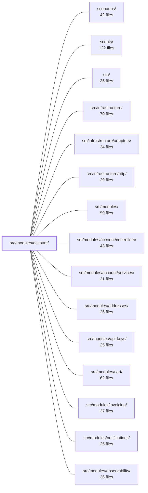

---
tags:
  - 2brain
  - 2brain/module
  - project/boilerplate-node-backend
type: module
module: src/modules/account/
files: 132
updated: 2026-10-15T13:36:40.000927+00:00
---

# src/modules/account/

## Purpose

The account module is the bounded context responsible for the full identity-and-session lifecycle: signup, login, token refresh, two-factor authentication, OAuth (Google, GitHub), email verification and change, password reset, session management (both JWT and cookie strategies), account deletion, and personal-data export. It owns *who is signed in and how*, while deliberately leaving the `User` document in the `users` module so an identity-provider swap remains possible.

## Key parts

- **Domain rules (pure, I/O-free):** `domain/email-change.ts` (finite-state machine for email change), `domain/revocation.ts` (session-termination causes and their effects), `domain/session-proof.ts` (AMR accumulation and second-factor denial). `domain/index.ts` re-exports them as one import surface. `session/epoch.ts` and `cooldown.ts` add the epoch-refusal and resend-countdown rules.
- **Session strategies:** `session/config.ts` (policy: mode, lifetimes, key rings), `session/cookie-strategy.ts` (server-side `ses_…` row), `session/cookies.ts` (HttpOnly cookie transport), `session/auth-context.ts` (proof → downstream context), `session/device-cookie.ts` (OWASP familiar-device), `session/family-liveness.ts`, `session/activity.ts`, `session/device-label.ts`.
- **OAuth sub-module (`oauth/`):** `providers/port.ts` (structural contract), `providers/client.ts` (shared `openid-client` plumbing), `providers/github.ts` and `providers/google.ts` (adapters), `providers/index.ts` (live registry), `state.ts` (CSRF/PKCE cookies), `mfa-redirect.ts` (MFA challenge cookie), `config.ts` (env + URL construction).
- **Persistence:** `model.ts` (Mongoose schemas for `accountexports`, `sessions`, `verificationtokens`) and `repository.ts` (targeted Mongoose queries—claim-once updates, scoped deletes, throttled stamps).
- **Cross-cutting declarations:** `analytics.ts` (event-name map), `audit.ts` (audit-action vocabulary), `events.ts` (domain-event map), `metrics.ts` (Prometheus counters), `config.ts` (frontend-link templates, token lifetimes, export retention).
- **Policy & protection:** `rate-limits.ts` (per-account/address/session budgets + challenge escalation), `mail-budget.ts` (per-recipient daily cap).
- **Routing & module wiring:** `routes.ts` (Express router under `/account`), `module.ts` (kernel entry point, resolver wiring, event subscriptions), `module.yaml` (machine-readable descriptor), `index.ts` (public barrel—sole cross-module import surface), `openapi.yaml` (HTTP contract), `probes.ts` (hand-written API tests), `roles.ts` (admin-role helper), `emails.ts` (locale-bound email builders).

## How it connects

- **`src/modules/users/`** — The `User` document lives there; this module reads role membership (via `roles.ts`) and subscribes to `USER_SETUP_REQUESTED` events, but owns no identity record itself.
- **`src/modules/api-keys/`** and other sibling modules — May import only through this module's public barrel (`index.ts`), never into internal sub-surfaces like `session/` or `oauth/`.
- **`src/infrastructure/`** — Supplies the shared analytics port (augmented by `analytics.ts`), the audit logger (augmented by `audit.ts`), the `metricsRegistry` (registered by `metrics.ts`), the `frontend-link` helper (consumed by `config.ts`), and `buildRateLimiter` middleware (used by `rate-limits.ts`).
- **`src/modules/account/controllers/` and `src/modules/account/services/`** — Internal sub-modules that implement the HTTP handlers and orchestration logic against the domain rules, repository, and session strategies defined here.
- **`scenarios/` and `scripts/`** — Consume the OpenAPI contract and probes for integration/E2E test generation.
- **`src/modules/notifications/`** — Downstream consumer of the `EmailContent` objects produced by `emails.ts`; the account module builds content, the notifications module handles delivery.

## Where to start

1. **`module.ts`** — The single entry point that wires the auth resolver into the kernel, declares the module's erase/export contract, registers the export consumer, and subscribes to domain events. Reading it first gives you the module's scope and its integration points with the rest of the system.
2. **`domain/index.ts`** → follow into `email-change.ts` and `revocation.ts` — These pure, I/O-free lookup tables encode the "what can happen and when" for the two most complex flows. They have no imports beyond type definitions, so they are easy to read in isolation and make the business invariants concrete before you touch any service or controller code.

## Connected modules

[[boilerplate-node-backend_ROOT|/ (repository root)]] · [[boilerplate-node-backend_scenarios|scenarios/]] · [[boilerplate-node-backend_scripts|scripts/]] · [[boilerplate-node-backend_src|src/]] · [[boilerplate-node-backend_src_infrastructure|src/infrastructure/]] · [[boilerplate-node-backend_src_infrastructure_adapters|src/infrastructure/adapters/]] · [[boilerplate-node-backend_src_infrastructure_http|src/infrastructure/http/]] · [[boilerplate-node-backend_src_modules|src/modules/]] · [[boilerplate-node-backend_src_modules_account_controllers|src/modules/account/controllers/]] · [[boilerplate-node-backend_src_modules_account_services|src/modules/account/services/]] · [[boilerplate-node-backend_src_modules_addresses|src/modules/addresses/]] · [[boilerplate-node-backend_src_modules_api-keys|src/modules/api-keys/]] · [[boilerplate-node-backend_src_modules_cart|src/modules/cart/]] · [[boilerplate-node-backend_src_modules_invoicing|src/modules/invoicing/]] · [[boilerplate-node-backend_src_modules_notifications|src/modules/notifications/]] · … and 8 more

## Files
- `src/modules/account/analytics.ts` — Declares the canonical set of analytics event names emitted by the account module and augments the shared analytics port's event-name map so TypeScript enforces type-safety at every emit site. It exists to keep the "one name → one emitter" invariant and to let each module grow the catalogue independently (same pattern as `./audit.ts` for audit actions).
- `src/modules/account/audit.ts` — Centralizes the audit-action vocabulary for the account/auth domain. It defines the canonical wire-format strings (e.g. `auth.login`, `auth.email_change.completed`) that every account service fires through the shared audit logger, and registers them on the infrastructure `AuditActionMap` via a type-only module augmentation so log tooling and alert rules get a single typed union without a runtime import cycle.
- `src/modules/account/config.ts` — Centralises the account module's frontend-link templates, token lifetimes, and export-retention defaults into a single typed config (`accountConfig`), and exposes small helpers that resolve those values into concrete frontend URLs. It exists so that the account module owns *which* links it uses and their defaults, while the generic `infrastructure/http/frontend-link.ts` stays unaware of account-specific kinds (layering rule: infrastructure must not name a module).
- `src/modules/account/cooldown.ts` — Single source of truth for the "please wait before resending" logic shared by every account flow that publishes a one-time mail (2FA code, verification link, password-reset link, reauth token, etc.). Centralising the countdown calculation and the 429 response shape ensures every client renders the same semantics without each service re-implementing the arithmetic or the error envelope.
- `src/modules/account/domain/email-change.ts` — Pure, I/O-free finite-state machine for the account email-change flow. It encodes every valid state, event, and transition as a lookup table so the *where* and *what* of an email change is defined in exactly one place. The service layer and tests consume this table; no HTTP, no database, no email is touched here.
- `src/modules/account/domain/index.ts` — Barrel (re-export) module for the **account domain layer**. It exposes the pure business rules—email-change state transitions, session-proof validation, and session revocation—as a single import surface. The file contains no logic of its own; it exists so consumers (services, tests) can import from one path rather than reaching into individual domain files.
- `src/modules/account/domain/revocation.ts` — A single, I/O-free lookup table that enumerates every cause by which an account's sessions can be terminated and specifies exactly what each cause does (epoch strategy, pending-link cleanup, subscriber announcement, caller re-mint, applicable session modes). All downstream consumers—services, event types, tests—derive their behavior and types from this table so the list of causes is declared in exactly one place.
- `src/modules/account/domain/session-proof.ts` — Pure, I/O-free rules for a session's `amr` (Authentication Method Reference) values: what the app mints, how proofs accumulate, and when a first session is denied for lacking a second-factor proof. Exists so that every mint path (login, signup, 2FA confirmation, etc.) shares one source of truth without reaching into I/O.
- `src/modules/account/emails.ts` — Single home for every email the account module sends. Each exported builder takes an explicit `locale` string (no request or locale store exists at render time in the mailer worker), binds a translator to it, and returns a fully-resolved `EmailContent` — template name, subject, and interpolation data together. Templates only interpolate; all translation happens here at build time.
- `src/modules/account/events.ts` — Declares the domain events the account module emits by augmenting the kernel's `DomainEventMap` via TypeScript module declaration merging. This keeps the event catalogue distributed across owning modules rather than centralised in a shared file.
- `src/modules/account/index.ts` — Public barrel for the Account module. It is the **only** import surface that sibling modules (e.g. `api-keys`) are permitted to use, per the strategic-DDD rule in `docs/theory/strategic-ddd.md` §5. Internal sub-surfaces (`session`, `oauth`, `two-factor`, and the export-build services) are deliberately excluded so that cross-module access funnels through the service layer.
- `src/modules/account/mail-budget.ts` — Defines and enforces a per-recipient daily mail budget (default 10 mails / 24 h) so that no single mailbox can be flooded regardless of how many distinct callers target it. It exists because caller-side rate limits bound the attacker, not the victim; this budget bounds the mailbox that would receive the mail.
- `src/modules/account/metrics.ts` — Defines and exports Prometheus `Counter` instances that track every major authentication and account-management event (login, signup, 2FA, email changes, password resets, OAuth, token lifecycle, data export). All counters register on the shared `metricsRegistry` so a single `/metrics` scrape includes both HTTP-level and domain-level signals. Nothing reads these counters programmatically; they are consumed exclusively by the metrics endpoint and alerting rules.
- `src/modules/account/model.ts` — Defines the three Mongoose schemas, document interfaces, and compiled models that make up the account module's persistence layer: `accountexports` (data-export progress), `sessions` (signed-in sessions or refresh tokens), and `verificationtokens` (one-time links/challenges in flight). This file is the single source of truth for the shape of those collections; all queries live elsewhere in `./repository`.
- `src/modules/account/module.ts` — Module entry point for the `account` domain: authentication, signup, login, token refresh, password reset, logout, two-step account deletion, and personal-data export. It wires the auth resolver into the kernel, declares the module's `personalData` erase/export contract, registers the export-queue consumer, and subscribes to the `USER_SETUP_REQUESTED` domain event. It deliberately keeps the `User` document on the `users` module rather than merging them, so that an identity-provider swap stays possible.
- `src/modules/account/module.yaml` — Machine-readable module descriptor for the account subdomain. It declares the module's scope (signup, login, sessions, two-factor, OAuth, account lifecycle), its classification, and its hard dependencies so the module system and tooling can resolve imports without parsing TypeScript.
- `src/modules/account/oauth/config.ts` — Centralizes all OAuth environment-variable access and URL construction for the account module. Providers and controllers consume the exports here rather than spelling `NODE_OAUTH_*` names or deriving redirect URIs from untrusted request data. The file reads and validates configuration only; it does not hold tokens or mint sessions.
- `src/modules/account/oauth/mfa-redirect.ts` — Manages a single HTTP cookie (`oauth_mfa_challenge`) that carries an MFA login-challenge token across an OAuth provider redirect. Because placing the challenge in the query string would expose it in browser history and `Referer` headers, it is transmitted as a cookie instead. This lets the two `POST /account/login/2fa*` endpoints serve both password-originated logins (challenge in the JSON body) and OAuth-originated logins (challenge in the cookie) through the same code path.
- `src/modules/account/oauth/providers/client.ts` — Shared OAuth client plumbing on top of `openid-client`. It centralises the one `fetch` wrapper every provider call goes through (deadline, body cap, no redirects) and the helpers that turn a provider's static server description into a working configuration, authorization URL, and code redemption. Both provider adapters (GitHub, Google) import from here rather than re-implementing this logic.
- `src/modules/account/oauth/providers/github.ts` — Implements the `OAuthProvider` port for GitHub's plain OAuth 2.0 flow. Because GitHub publishes no issuer metadata and requires two separate API calls to reconstruct a full identity (`/user` + `/user/emails`), this file hard-codes the server endpoints, performs the code exchange via the shared `client` helpers, and maps the results into the canonical `OAuthIdentity` shape.
- `src/modules/account/oauth/providers/google.ts` — Implements the Google OAuth/OIDC provider behind the shared `OAuthProvider` port. It builds the authorization URL, exchanges the authorization code for tokens, and extracts the user's identity directly from the verified ID-token claims — avoiding a separate `userinfo` round trip.
- `src/modules/account/oauth/providers/index.ts` — Central registry that tracks which OAuth providers (Google, GitHub) are currently enabled based on their environment variables. Unlike the payments module (single active provider), multiple OAuth providers can be active simultaneously, so this exposes a live "who is configured" query rather than a memoized winner. Providers are re-evaluated on every call so that setting/unsetting env vars takes effect without a restart.
- `src/modules/account/oauth/providers/port.ts` — Defines the OAuth/OIDC provider **port** — the structural contract that concrete identity providers (Google, GitHub) implement. Unlike the analogous `PaymentProvider` port in `payments/providers/index.ts`, more than one OAuth provider may be enabled simultaneously, so selection is delegated to the registry in `./index` rather than a single environment switch.
- `src/modules/account/oauth/state.ts` — Manages the per-attempt cookies that an OAuth login round-trip requires: the CSRF `state` token (double-submit pattern, not a server-side session), the PKCE `code_verifier`, and two convenience values (`continue` path, `locale`). It mints tokens, sets/clears the corresponding Express cookies, and provides the validation predicates the callback controller uses to verify a returned request is legitimate before acting on it.
- `src/modules/account/openapi.yaml` — OpenAPI 3.1.0 contract for the **account** module. It defines the module's public HTTP surface — authentication (sign-up, login, refresh, email verification, session teardown) and account management (profile CRUD, password, two-factor, data export, deletion) — and is consumed by the spec bundler, which merges it into the root document under the module's `basePath`.
- `src/modules/account/probes.ts` — Defines four hand-written API requests (probes) that the OpenAPI contract cannot express on its own — e.g. deliberate 401/409/429 responses and a non-admin login. These are emitted alongside the contract-generated collection to fill testing gaps.
- `src/modules/account/rate-limits.ts` — Defines the account module's rate-limit budgets as `RateLimitBudget` data objects and turns them into Express middleware via `buildRateLimiter`. Covers credential-guess protection (per-account, per-address, per-address-block, per-session, per-device-cookie), a password-strength check limiter, signup/reset/MFA budgets (truncated in view), and the `loginChallengeGate` that escalates to a human challenge once a budget is half-spent.
- `src/modules/account/repository.ts` — Plain Mongoose query layer for three account-scoped collections (`accountexports`, `sessions`, and `verificationtokens`). It exposes lean reads and atomic writes (claim-once updates, throttled stamps, scoped deletes) that the account services need but that the shared repository factory does not provide—there is no pagination or general search here, just targeted single-document and small-batch operations.
- `src/modules/account/roles.ts` — Provides a single helper to determine whether a given user holds an unrestricted (admin) role on the deployment's tenant. This value is needed as the `actorRole` field on every login event emission and audit record produced by the account module. Roles are read live from the membership store because the account document itself carries no role.
- `src/modules/account/routes.ts` — Express router that wires every account-related endpoint (auth, profile, password, 2FA, OAuth, sessions, email verification, account deletion) under the `/account` prefix. It centralises cross-cutting middleware (auth parsing, cache suppression, rate-limiting, human-challenge, idempotency, upload) so individual controllers stay thin and a future route cannot accidentally omit a guard.
- `src/modules/account/session-mode.ts` — Defines the shared vocabulary for the two session strategies a deployment can use (`jwt` and `cookie`). It is a dependency-free leaf module so that the schema, configuration, and strategy code can all reference the same literals without importing each other.
- `src/modules/account/session/activity.ts` — Provides a single fire-and-forget stamp of an account's `lastActiveAt` timestamp, written whenever a session is minted or kept alive. It serves as the input clock for the inactivity reaper and is shared by both session modes (cookie and JWT).
- `src/modules/account/session/auth-context.ts` — Resolves a verified session proof (auth time + AMR methods) into the `AuthContext` that downstream guards read. This is the shared "what does the proof mean" step that both cookie and JWT session strategies funnel into, so account validity, epoch expiry, and current role membership are decided in exactly one place.
- `src/modules/account/session/config.ts` — Declares the session policy for the account module: which mode (`jwt` or `cookie`) is active, how long each "remember me" tier lives, the signing key rings, the rotation/reuse windows, and the issuer/audience defaults. It holds no tokens and issues none — downstream modules (`./jwt`, `./cookie-strategy`, `./cookies`) read its values to sign, store, or set `maxAge`. Named `config.ts` (not `tokens.ts`) to make that separation explicit.
- `src/modules/account/session/cookie-strategy.ts` — Implements the `cookie` session mode: a server-side session identified by a random `ses_…` id, stored only as its SHA-256 hash in a `sessions` row. Browsers receive the id as an HttpOnly `__Host-session` cookie; non-browser clients receive it as a Bearer token. There is no JWT signing, no refresh-token rotation, and no race on rotation — logout is a row delete, and the row is read on every request anyway.
- `src/modules/account/session/cookies.ts` — HTTP cookie creation and destruction for the account session layer. Manages two cookies — `__Host-session` (carries the credential: a refresh token in `jwt` mode or a `ses_…` id in `cookie` mode) and `isAuth` (a non-secret, readable-by-JS hint so the client shell can render auth chrome before its first API response arrives). Decoupled from *how* the session is kept; only handles the transport.
- `src/modules/account/session/device-cookie.ts` — Implements the OWASP "familiar-device" cookie: after a fully successful login, the browser stores up to five HMAC-SHA256 tokens (one per account) in an httpOnly cookie. On subsequent logins, a valid token lets the browser skip the **per-account** failure budget, so an attacker who exhausts that budget cannot lock out the legitimate owner. The cookie never bypasses per-address or per-IP budgets.
- `src/modules/account/session/device-label.ts` — Produces a short, privacy-conscious label for a sign-in's origin (e.g. "Firefox on Linux") by parsing the `User-Agent` header at login time. The label is stored on the session so the account owner can distinguish their own devices in a session list. It intentionally omits versions, models, and IPs to avoid singling out a device beyond what the owner already knows.
- `src/modules/account/session/epoch.ts` — Single source of truth for the session-epoch rule: a token or a login's proof is refused when it predates the account's `tokensValidAfter`. Both checks live here as pure functions so the resolver, the refresh path, and the mint path cannot drift apart.
- `src/modules/account/session/family-liveness.ts` — Determines whether a session **family** is still alive: it has a live row in the repository and, for staff-mode sessions, has not idled out. Shared by the JWT bearer path (access token's `sid` field) and by SSE stream rechecks, since a credential rotates under a stable family.
- `src/modules/account/session/idle.ts` — Implements the backend-enforced idle timeout for staff and admin sessions. A session that has not seen a real request within the configured window is considered idled out. Shopper sessions are never idled (NIST AAL1 "MAY"). Lives in the backend so the policy cannot be bypassed by a client timer.
- `src/modules/account/session/jwt-strategy.ts` — Adapter that implements the `SessionStrategy` port for the **JWT session mode**: a short-lived (≈10 min) access token the client keeps in memory, backed by a rotating refresh token in an HttpOnly cookie with one `sessions` row per refresh token. All signing, rotation, and reuse-detection logic lives in `./jwt.ts`; this file only wires that logic into the strategy interface so callers above never see tokens.
- `src/modules/account/session/jwt.ts` — Creates and verifies the application's access and refresh JWTs (HS256, built on `jose`). Policy (secrets, TTLs, audiences, issuer) is owned by `./config`; this file is the signing and verification logic itself. It was app-level middleware until the domain split made it part of the `account` module, since issuing/verifying tokens is what `account` does.
- `src/modules/account/session/key-ring.ts` — Pure helper module that gives each signing secret in the key ring a stable identifier (`kid`) and provides lookup by that identifier. It contains no signing logic — it only derives and matches identifiers so that `./jwt` can stamp and resolve the `kid` header without this file needing to import the signer.
- `src/modules/account/session/listing.ts` — Provides the account's live-session list (the wire `Session` array) shared across both session modes. It fetches live rows, filters out rows invalidated by a ban (epoch) or by an idle-timeout, deduplicates JWT-family rows that can hold two live refreshes simultaneously, and marks the caller's own session as `current`.
- `src/modules/account/session/login-observability.ts` — Fires the metrics, audit, and analytics signals for a completed (successful or failed) login. Extracted from `post-login.ts` so that `post-login-2fa.ts` reuses the same "a login happened" tail without re-implementing it. Lives at the controller/session layer — not in `services/login.ts` — because the success emit is only valid once a session actually exists (cookies, access token), which is a controller-layer fact.
- `src/modules/account/session/mint-guard.ts` — Defines the two invariants a **first** session must satisfy at mint time: the proof must evidence an armed second factor, and it must not predate the account's current session epoch. These checks run inside `issue` (the mint path) rather than in login-branching logic, so a code path that forgets to branch to a challenge or re-validate after an epoch change is still refused at the point of no return.
- `src/modules/account/session/resolver.ts` — Implements the kernel's `AuthResolver` port for the account module. It is a thin delegation layer that forwards every credential-resolution call to whichever session strategy the deployment has activated, and is registered by `module.ts` so the kernel's auth guard can identify callers.
- `src/modules/account/session/session-id.ts` — Generates and classifies opaque session IDs used in `cookie` mode. The ID is 32 random bytes in base64url under the `ses_` prefix; only its SHA-256 is persisted, so a database leak never yields a usable credential. The file also exports cheap shape-checks that let the authentication kernel reject non-matching tokens before any database lookup.
- `src/modules/account/session/session.ts` — Facade module that gives every session-minting controller a single, mode-agnostic API. Controllers call these five functions and never learn whether the system is in `cookie` or token mode — that decision is delegated entirely to `activeStrategy()` in `strategy.ts`.
- `src/modules/account/session/strategy.ts` — Defines the **port** (the `SessionStrategy` interface) through which all higher-level code mints, resolves, and manages user sessions, without needing to know whether the deployment uses JWT or cookie mode. The single entry point is `activeStrategy()`, which returns the concrete adapter selected at process start via `NODE_SESSION_MODE`. Every caller (login, 2FA, reauth, password change, resolver) goes through this one function.
- `src/modules/account/tests/contract/abilities.test.ts` — Contract test for `GET /account/abilities`. It verifies the round-trip invariant: rules the server packs into the response must unpack (via CASL `unpackRules`) into a working `MongoAbility` on the client side. The point is not endpoint shape but that both sides agree on the same policy, preventing silent drift between server enforcement and client-side UI greying-out.
- `src/modules/account/tests/contract/api.contract.test.ts` — Contract tests for the self-service `/account` HTTP surface: login (remember-me tiers), signup, username ceiling, password change, session rotation, single-session logout, sessions listing, and email verification. They cover scenario branches that depend on multi-actor or stateful preconditions (a second account holding the same email, a revoked cookie, a spent token, someone else's session) — situations a generated-payload unit sweep cannot set up. Listing assertions check actual IDs, never just array lengths.
- `src/modules/account/tests/contract/lifecycle.contract.test.ts` — Contract tests for account-lifecycle endpoints that `api.contract.test.ts` does not cover: two-step account deletion, password-reset request, logout-all, and the live breach check. Each token-carrying flow is driven end-to-end by reading the one-time token back out of the mocked mail queue, so the assertions validate the exact payload a real client would receive.
- `src/modules/account/tests/contract/login-paths.contract.test.ts` — Contract test that asserts two invariants shared by every login/session-continuation entry point (password, OAuth, refresh/next-request) in a single pass rather than re-testing them per entry point. Rule 1: no path may mint a session for a deactivated or soft-deleted account. Rule 2: password and OAuth login must each audit the caller's real role and increment the shared `auth_login_total` counter exactly once. Refresh is deliberately excluded from Rule 2 because it audits its own action/counter.
- `src/modules/account/tests/contract/oauth.contract.test.ts` — Contract tests for the public OAuth surface: the provider-list endpoint, the start (redirect) step, and the full callback round trip. Exercises the real routes, real CSRF/PKCE cookies, and a real database using a `fake` provider registered the same way the dev preload does, so the suite catches regressions in the exact path a browser would walk.
- `src/modules/account/tests/contract/reauth.contract.test.ts` — Contract tests for the **step-up re-authentication** endpoints (`GET /account/reauth`, `POST /account/reauth/methods/email/send`, `POST /account/reauth`). They verify which re-auth methods an account is offered, that the emailed code path produces a session claiming only `email` in its `amr`, code-burn / cooldown / wrong-code semantics, and that a stale session can be re-proved. The password path's *session* behaviour (cookie tiers, failed re-mint) is deliberately out of scope and lives in `api.contract.test.ts`.
- `src/modules/account/tests/contract/shop.contract.test.ts` — Contract tests covering the shop-touching slices of the `/account` surface: the personal-data export (orders + payments) and the address snapshot carried by a checkout. The file is deliberately isolated so that removing the shop from the account module takes exactly this file with it, with no cross-cutting edits.
- `src/modules/account/tests/contract/support.ts` — Shared setup helpers for the account contract test suites. Abstracts away the dual-session-mode (`jwt` / `cookie`) branching so individual contract tests can log in, extract a bearer credential, and inspect AMR claims without repeating mode-specific logic.
- `src/modules/account/tests/contract/two-factor.contract.test.ts` — Contract tests for the two-factor authentication endpoints. Each test asserts that the HTTP response (status code and body shape) matches what `openapi.yaml` publishes for that operation—covering the status read, arming/removing factors, regenerating backup codes, and mailing login codes. The behavioural logic lives in `integration/two-factor.test.ts`; this file only pins the API surface.
- `src/modules/account/tests/factories.ts` — Test fixture helpers for the account module's **sessions** and **verification tokens**. Provides "plant" functions to seed rows with known plaintexts and "read" functions to assert what a flow left behind. Lives in the account module's test directory (rather than a shared test-utils package) because the barrel does not publish the repository — suites in other modules import these helpers from here.
- `src/modules/account/tests/integration/auth-events.test.ts` — Integration tests that assert what the audit trail and metrics record when a one-time link token is rejected (unknown or expired) and when a login attempt fails. Confirms the events use `auth.*` actions (customer-facing, not `security.*`), that the rejected-token counter is incremented per flow, and that a failed-login target is stored as a normalised pseudonymised digest rather than the raw address.
- `src/modules/account/tests/integration/auth-hardening.test.ts` — Integration tests for the credential-endpoint rate limiters and the antibot challenge gate as exported by `account/rate-limits.ts`. It verifies that per-identity and per-address budgets are independent, that only failed attempts spend budget, that the block-level budget triggers the challenge gate for credential-stuffing patterns, and that the gate engages only once the identity budget is at least half consumed (and only when an antibot provider is configured).
- `src/modules/account/tests/integration/auth-storage.test.ts` — Integration tests that exercise `sessionRepository` and `verificationTokenRepository` against a real database. The focus is on behaviours that depend on genuine storage semantics—atomic concurrent claims, one-live-link upsert idempotency, TTL/purge window capping, and cross-account isolation—that a mocked store cannot actually verify.
- `src/modules/account/tests/integration/cookie-hardening.test.ts` — Integration test that verifies the session cookie is issued with the full `__Host-` hardening profile (Secure, HttpOnly, Path=/, no Domain) and that every endpoint a lone cookie authenticates (`/account/refresh`, `/account/logout`, the two SSE streams) rejects a foreign `Origin` with 403 before touching session state. It also locks in that refresh is POST-only.
- `src/modules/account/tests/integration/delete-account.test.ts` — Integration tests for the two-step account deletion HTTP flow (`DELETE /account` and `DELETE /account/delete-confirm`), driven through the real Express app. The primary property under test is enumeration prevention: a missing account and a successful mail-both must produce an identical `200` response so an attacker cannot distinguish them. The file deliberately avoids mocking the controller, routing, or auth middleware — only the mailer and one `userService.findByEmail` call are stubbed.
- `src/modules/account/tests/integration/device-cookie-budget.test.ts` — Integration tests for the per-account credential rate-limit budget and the `device` cookie that exempts a previously-authenticated browser from that budget. Verifies that a familiar browser bypasses an exhausted account budget, a forged cookie draws from its own smaller budget, and cross-account or cross-identity scenarios do not leak exemptions. Most tests run against trivial stub handlers (the budget logic lives in the limiter module); one test exercises the real `/account/login` route to confirm cookie issuance.
- `src/modules/account/tests/integration/email-change-lapse.test.ts` — Integration tests for the nightly sweep `reapLapsedPreviousEmails`, which clears a user's `previousEmail` once the email-change undo token has expired or no longer exists. The suite verifies the exact boundary: the account is cleared *only* when it holds a previous address **and** has no live `email-change-undo` token.
- `src/modules/account/tests/integration/export.test.ts` — Integration test for the full account data-export lifecycle: requesting an export (row recorded, build queued), the worker writing the JSON file and mailing a link, downloading/streaming the file to its owner, and erasure/reaping. It exercises real Mongo, a real temporary export directory, and the real account/users/notifications services. The only fakes are the mail queue (captured into `mockOutbox`) and the audit port (captured into `mockAudit`). Because no message broker is available in the test run, every build executes inline; `settleInlineExports` serves as the "wait for the worker" step.
- `src/modules/account/tests/integration/identity-rate-limit.test.ts` — Integration tests for the identity-, address-, and address-block-keyed rate limiters exported by the account module. Each test builds a trivial Express handler around the limiter under test (via `appAnswering`) so that the assertions verify the limiter's budgeting logic in isolation, not the business logic of `postSignup`, `postResetRequest`, or `postLogin`. The file covers all five limiter families in `rate-limits.ts`: `sessionCredentialLimiters`, `credentialLimiters`, `signupLimiters`, `resetRequestLimiters`, `mfaChallengeLimiter`, plus the IPv4 /24 and IPv6 /64 block-keying shared across them.
- `src/modules/account/tests/integration/idle-timeout.test.ts` — Integration tests for the staff idle-timeout feature over real HTTP. Verifies that a staff session idle past the configured limit is revoked with `401 SESSION_IDLE`, that shopper sessions are never idle-expired, and that passive requests (`X-Session-Passive: true`) do not reset the activity clock. All cases run in both `jwt` and `cookie` session modes via `describe.each`.
- `src/modules/account/tests/integration/jwt.test.ts` — Integration test suite for the JWT session layer (`session/jwt.ts`). It exercises the full create → verify → rotate → revoke lifecycle against a real database, with particular focus on the security boundary between stateless access tokens and stateful refresh tokens, RFC 9068 `typ` enforcement, and multi-device session isolation.
- `src/modules/account/tests/integration/mail-recipient-budget.test.ts` — Integration tests for the per-recipient mail rate limiter. Verifies that the daily budget is keyed to the **canonical mailbox** (not the raw string), covering both the "route door" (client-supplied address in signup/reset bodies) and the "service door" (server-chosen recipient in verification resend, pending-email resend, and email-change flows). Exists to prove the limiter stops a mail-bomb victim while leaving bystanders untouched.
- `src/modules/account/tests/integration/oauth-link.test.ts` — Integration tests for `loginOrCreateFromOAuth` (the find-or-create-link triad in `services/oauth.ts`). Because the function performs a real identity lookup, a `$push` link, and a user insert, it lives here rather than in the unit-test folder. The suite covers all three outcome branches (login, link, signup) plus the security guard-rails (unverified email, account takeover, banned/soft-deleted refusal, idempotent re-link).
- `src/modules/account/tests/integration/oauth-links.test.ts` — Integration tests for the connected-accounts (OAuth links) API surface: listing linked providers, disconnecting a single provider under the reauth guard, and verifying that the password-reset confirmation email names the providers still attached to the account.
- `src/modules/account/tests/integration/oauth-provider-route.test.ts` — Integration test for the OAuth callback route (`GET /account/oauth/:provider/callback`) that exercises the real Google and GitHub library code paths with `fetch` mocked only at the provider's own servers. It pins two things unit tests cannot: the redirect URI sent to the token endpoint is always built from `NODE_URL` (immune to a forged `Host` header), and a foreign, missing, or repeated query parameter causes a hard login failure rather than being silently dropped.
- `src/modules/account/tests/integration/password-hashing.test.ts` — Integration tests that lock in three password-hashing invariants at the account boundary: an unknown address still pays for one argon2id verification (decoy timing), a long password is compared in full rather than truncated at 72 bytes, and the password policy is purely length-based (all-lowercase passphrases are accepted).
- `src/modules/account/tests/integration/persisted-locale.test.ts` — Integration tests verifying that the `locale` field on the user document is correctly captured from the request context at signup, falls back to the boot locale when no request context exists, remains editable via subsequent updates, is not clobbered by unrelated partial updates, and is exposed through the user's JSON serialization. The field exists so that non-request code (e.g., worker-sent emails) can resolve a user's preferred language.
- `src/modules/account/tests/integration/probes.test.ts` — Integration test that verifies each HTTP probe defined in `account/probes.ts` actually returns the status code its own name claims (e.g. a probe named _"Probe: 409 on a signup that already exists"_ must genuinely yield 409). It exists so the probe definitions shipped in generated API-client collections are machine-checked against the running app rather than trusted by their description alone.
- `src/modules/account/tests/integration/reap-inactive.test.ts` — Integration test that exercises the full inactivity-reaper stage sequence (warn → minimise → soft-delete → hard-delete) through the real service and a real database, verifying that exactly one stage advances per run and that each grace period is honoured before the next stage fires.
- `src/modules/account/tests/integration/reencrypt.test.ts` — Integration test for the account module's `reencrypt` walk: verifies that a TOTP secret still stamped `v1` is migrated to `v2` after a key rotation, and that the migrated ciphertext still decrypts correctly under its original method id.
- `src/modules/account/tests/integration/reset-request-timing.test.ts` — Integration tests that verify `POST /account/reset` returns `200` **immediately**, without waiting for the user-lookup (repository) call to settle. This guarantees no timing oracle leaks which email addresses are registered, and that any background failure is logged rather than surfaced to the caller.
- `src/modules/account/tests/integration/revocation-causes.test.ts` — Integration test that drives every revocation cause through its real HTTP (or session-rotation) door against a live database, then asserts the three observable side-effects the cause's row in the `REVOCATION` table promises: victim sessions are dead, pending tokens are purged (or kept), and the outbox announcement was (or wasn't) written. The `Record<RevocationCause, Trigger>` map makes the suite exhaustive—adding a new cause to the domain table without a trigger here is a compile error.
- `src/modules/account/tests/integration/self-service.test.ts` — Integration tests for the self-service account surface (profile update, password change, session revocation, email verification) exercised at the service/repository layer against a real test database. The tests are grouped by the invariant each defends: profile updates cannot mutate role/state/password, a wrong current password yields 422 (never 401), and at most one verification link is valid (always the newest).
- `src/modules/account/tests/integration/service-flows.test.ts` — Integration tests for the ordinary (non-security) paths of `accountService`: signup, login, one-time token issuance, and password change. Drives a real database via `setupTestDb` and asserts the happy-path responses plus argument-level rejections (422, 401, 409). Sits alongside `service.test.ts`, which owns the security invariants, and lives under `account` rather than `users` because the code under test is account's.
- `src/modules/account/tests/integration/service.test.ts` — Integration test suite for the account service (`accountService`) that guards **security invariants** across signup, login, password change, and bulk token removal. Tests are grouped by the invariant each defends (indistinguishable login failures, no-login for soft-deleted accounts, no plaintext password storage) rather than by API function, so a mutation that breaks an invariant is caught even when every happy-path assertion still passes.
- `src/modules/account/tests/integration/session-epoch.test.ts` — Integration tests for the **session epoch** (`tokensValidAfter`) mechanism: once the epoch advances, every access token and refresh token minted before that instant is refused, regardless of how the epoch moved (password change, logout-all, 2FA arming, password reset, re-authentication, email-change-undo, etc.). The tests run against a real HTTP stack and a real clock, using short sleeps to guarantee whole-second separation between token mints and the epoch bump.
- `src/modules/account/tests/integration/session-family.test.ts` — Integration tests verifying that a session's logical identity (its `id`) remains stable across refresh-token rotation, and that token-reuse detection invalidates the entire session family. The module doc explains the failure mode being guarded against: if the id were taken from the individual token row, the first rotation would orphan it, causing "log out that device" to succeed silently while leaving the device signed in.
- `src/modules/account/tests/integration/session-mint-guard.test.ts` — Integration test for the session-mint backstop: it verifies that issuing a **first** session (`startSession`) is refused when the account has a second factor armed and the proof lacks the required method, that a re-mint (`continueSession`) is exempt, and that a proof whose `provedAt` predates the account's current session epoch is rejected. It exists to pin down the guard that catches any future mint call site which forgets its own pre-check.
- `src/modules/account/tests/integration/session-modes.test.ts` — Integration test suite that exercises the full session lifecycle—login, "remember me" tiers, logout, revocation, step-up, 2FA, password change/reset, and OAuth provider login—through the real HTTP routes. The entire suite runs under **both** `NODE_SESSION_MODE` values (`jwt` and `cookie`) to verify that the strategy port delivers the same behavioral contract regardless of the chosen mode. Mode-specific assertions (origin checks, bearer tokens, refresh pairs, id renewal) live in the same tests and branch on the mode.
- `src/modules/account/tests/integration/session-remint-amr.test.ts` — Integration tests that verify the `amr` (authentication methods reference) claim in the session cookie returned whenever a live session is replaced. The invariant under test: each replacement path states exactly what it proves — a verified code *adds* `otp`, a password change *claims only* `pwd` — and nothing is silently defaulted.
- `src/modules/account/tests/integration/step-up-otp.test.ts` — Integration tests verifying that identity routes (email change, password change, account deletion) enforce an `otp` re-authentication challenge when the account has a second factor armed, that `/account/reauth` correctly grants or denies OTP proof, and that email-change undo tokens work as expected. Also confirms none of these gates apply to accounts without 2FA.
- `src/modules/account/tests/integration/two-factor-concurrency.test.ts` — Integration tests that verify one-time-use 2FA credentials (backup codes, mailed login codes, step-up codes) are spent exactly once and that attempt counters are correct **under every possible interleaving** of parallel requests. The tests exercise the real HTTP surface (`/account/login/2fa`, `/account/reauth`, `/account/2fa/methods/*/confirm`) with concurrent `Promise.all` calls to catch races that single-request tests cannot.
- `src/modules/account/tests/integration/two-factor.test.ts` — End-to-end integration tests for the two-factor authentication lifecycle: enrolling a device (TOTP) factor and a delivered (email) factor, logging in through the two-step challenge with either, removing one factor, and disabling the rest. All requests go through the real Express app so routing, guards, and serialization run for real. The file's own header calls out a bypass-check test (challenge token authenticating on its own) as the single most important assertion in the suite.
- `src/modules/account/tests/integration/wrong-typed-input.test.ts` — Integration test ensuring that sending a wrong-typed `email` value (number, object, array, boolean, or `null`) to `PATCH /account` or `PUT /account` yields a **422** and never a **500**. The `isChangingEmail` guard executes before validation; this test locks in the invariant that the guard must tolerate any JSON value without throwing.
- `src/modules/account/tests/strategy-doubles.ts` — Shared request and response test doubles used by the two session-strategy unit suites (cookie and JWT). It exists so both suites build their `SessionRequest` fixtures and `Response` mocks consistently instead of duplicating setup logic.
- `src/modules/account/tests/unit/auth-schemas.test.ts` — Unit tests that verify the structural contracts of `sessionSchema` and `verificationTokenSchema` — required fields, enum constraints, index declarations, TTL behaviour, partial-unique indexes, and serialization safety — by reading directly off the Mongoose schema objects with no database involved.
- `src/modules/account/tests/unit/config.test.ts` — Unit tests for `accountFrontendLink`, the helper that maps a link *kind* (verify, reset, delete, email-change) plus a locale and token to a full frontend URL. The file validates both the built-in default templates and the per-kind environment-variable override mechanism, ensuring each kind resolves to a distinct path and that overriding one kind does not affect the others.
- `src/modules/account/tests/unit/cookie-strategy.test.ts` — Unit-level tests for the `cookie` session-mode adapter (`cookie-strategy.ts`). Verifies three surfaces — credential extraction from a request, resolution of a presented session id, and issuance of a new session — with the session store, user service, and proof resolver all replaced by mocks. End-to-end behavior against a real store is covered separately in `../integration/session-modes.test.ts`.
- `src/modules/account/tests/unit/cookies.test.ts` — Unit tests for the session-cookie module that pin down the security contract of `createSessionCookie` and `destroySessionCookie`: the credential cookie (`__Host-session`) must be `httpOnly`, `secure`, `sameSite: 'lax'`, `path: '/'`, and `domain`-less; the companion `isAuth` hint must be deliberately **not** `httpOnly`; and clearing must repeat the same flags so the browser actually drops the cookie. Each rule is asserted in isolation so a regression in any single flag fails on its own.
- `src/modules/account/tests/unit/device-cookie.test.ts` — Unit tests for the familiar-device cookie logic in `device-cookie.ts`. Verifies the token's identity-verification rules (case-insensitive match, single-account binding, forgery rejection), the multi-account LRU cap (five, newest first), cookie attribute constraints (httpOnly, persistent, no plaintext email), and the hard dependency on `NODE_DEVICE_COOKIE_SECRET`.
- `src/modules/account/tests/unit/device-label.test.ts` — Unit tests for `describeDevice`, the function that maps a browser User-Agent string to a coarse display label (e.g. "Firefox on Linux"). The tests exist to pin down exactly which labels the function may produce, to enforce that labels stay coarse (no versions, models, or addresses), and to verify safe handling of missing, malformed, or adversarially large inputs.
- `src/modules/account/tests/unit/email-change-domain.test.ts` — Exhaustive unit tests for the email-change finite-state-machine (FSM). Every `(state, event)` pair is asserted against a local transition table so that any edge accidentally added or dropped in the domain logic fails immediately.
- `src/modules/account/tests/unit/emails.test.ts` — Unit tests for the nine account email-builder functions in `emails.ts`. They verify that each builder returns the correct template name, delegates to the right link helper with the correct `kind`/locale/token, resolves every i18n slot to real copy (not a raw key or empty string), interpolates the recipient's name, and that no two emails accidentally share a template or a link destination.
- `src/modules/account/tests/unit/epoch.test.ts` — Unit tests for the two epoch-predation predicates in `session/epoch`: `predatesSessionEpoch` (token-side, shared by the resolver and refresh path) and `proofPredatesEpoch` (login-proof side at the mint). The file pins down the boundary behavior of each so that a refactor or timezone change cannot silently alter which tokens/proofs are rejected.
- `src/modules/account/tests/unit/family-liveness.test.ts` — Unit tests for `resolveInLiveFamily`, verifying the family-liveness decision logic: whether a family is revoked, idle-ended, or treated as active based on caller role, last-seen timestamp, passive flag, and stamp freshness. The store is fully mocked so the tests isolate the decision rules from any real persistence behavior.
- `src/modules/account/tests/unit/jwt-strategy.test.ts` — Unit-level tests for the `jwtStrategy` adapter (`session/jwt-strategy.ts`), verifying the wiring between the strategy port and the token layer: which mint path a login uses versus a re-mint, what lands in which cookie, and how a token refusal maps to a resolver miss while an infrastructure outage stays a rejection. The token layer itself is tested elsewhere (`session-jwt.test.ts`) and is fully replaced by mocks here.
- `src/modules/account/tests/unit/key-ring.test.ts` — Unit tests for the pure key-identification math in `key-ring.ts`. Covers the two exported helpers (`keyId` and `keyForId`) that `jwt.ts` relies on to map a token's `kid` claim to the correct secret, ensuring no accidental key collisions, no positional dependence, and no silent fallback to the newest key.
- `src/modules/account/tests/unit/oauth-github.test.ts` — Unit tests for the GitHub OAuth provider. Verifies that `authorizeUrl` emits the correct consent-screen parameters and that `exchangeCode` performs the three-call token exchange (token → user → emails) with the right request shape, response handling, and failure paths. `fetch` is mocked throughout, queued in the exact order the provider issues its calls.
- `src/modules/account/tests/unit/oauth-google.test.ts` — Unit tests for the Google OAuth provider (`googleOAuthProvider`). They verify that `authorizeUrl` builds a correct consent-screen URL, and that `exchangeCode` correctly validates the callback (state, issuer, PKCE) and the returned ID token (audience, issuer, expiry, subject) before resolving an identity. `fetch` is mocked throughout so the tests exercise the library's own claim checks without any network I/O.
- `src/modules/account/tests/unit/oauth-state.test.ts` — Unit tests for the pure-function OAuth security helpers in `oauth/state.ts`. Covers the CSRF state comparison, PKCE verifier/challenge generation, the `continue` redirect-path guard, and locale-tag validation. Cookie/session plumbing is intentionally excluded here (covered by integration/contract suites); this file isolates the comparison logic and token-shape guarantees.
- `src/modules/account/tests/unit/rate-limits.test.ts` — Unit tests that pin **relational invariants** between the account module's rate-limit budgets (credential, signup, reset, MFA challenge, MFA send, and signed-in code delivery). The tests assert orderings and fractional ceilings between budgets rather than locking any single numeric value, so individual budgets can be tuned freely as long as the relative structure holds.
- `src/modules/account/tests/unit/reauth-policy.test.ts` — Unit tests for the two pure rules the step-up (reauth) flow adds: the `amrAfterReauth` claim set a re-minted session carries, and the boot-time refusal `oauthConfig` enforces when an enabled provider has no deliverable mail transport. HTTP-level behaviour is deliberately excluded (see `contract/reauth.contract.test.ts`).
- `src/modules/account/tests/unit/revocation-table.test.ts` — Cross-cutting invariant tests for the `REVOCATION` table. It verifies global constraints across all revocation causes that no single per-cause test would catch (e.g., "every cause that keeps the caller's session must ride the epoch in its own write").
- `src/modules/account/tests/unit/routes.test.ts` — Route-table contract test for the account module's Express router. It asserts that every endpoint is mounted, that security middleware (auth guards, rate-limit budgets, no-store, human-challenge gate, mail-recipient budget) is present, correctly scoped, and in the correct order on each route. The file exists to make regressions in middleware placement or scope visible immediately, since those regressions are invisible to the type checker.
- `src/modules/account/tests/unit/session-id.test.ts` — Unit tests for the `cookie`-mode session ID. The kernel dispatches on the ID's shape and 256 bits of entropy is the entire security guarantee, so this file locks in both invariants rather than assuming them.
- `src/modules/account/tests/unit/session-jwt.test.ts` — Unit tests for the JWT token layer (`account/session/jwt.ts`). Asserts the safety invariants of the signing/verification pipeline: access and refresh secrets never cross-verify, a refresh token is only valid while its row is still stored, `jti` (randomUUID) prevents two same-second logins from mutually revoking, and key-ring rotation does not cause mass logout. The session store and `userService` are **stubbed** (not driven); query correctness against a real store lives in `../integration/auth-storage.test.ts`.
- `src/modules/account/tests/unit/session-listing.test.ts` — Unit tests for the public session-listing functions (`listSessions`, `newestPerFamily`) in `@modules/account/session/listing`. Verifies family deduplication, caller-current marking, optional-field presence, account-epoch filtering, and the staff idle-timeout hide rule—each in isolation with mocked repositories and services.
- `src/modules/account/tests/unit/session-proof.test.ts` — Unit tests for the session-proof domain rules: verifying that proofs are combined without duplicates (and without mutating the caller's array) and that only an armed account lacking an `otp` proof is refused a first session.
- `src/modules/account/tests/unit/session-strategy.test.ts` — Unit tests for the session-strategy seam: verifying that the active adapter is selected per-call from `NODE_SESSION_MODE`, that the resolver delegates (rather than caching) to whichever adapter is active, and that the shared mint guard enforces second-factor requirements before a session is issued.
- `src/modules/account/tests/unit/tokens.test.ts` — Unit tests for the token/session configuration module (`session/config.ts`). They verify that every env-var read produces the correct parsed value (seconds, milliseconds, ring array, session mode) and that the boot-gate checks (`assertConfigIn`) enforce the documented contract—especially the invariant that `NODE_TOKEN_REUSE_WINDOW_MS` must exceed `NODE_TOKEN_ROTATION_GRACE_MS` and that signing-ring placeholders are rejected in `jwt` mode but optional in `cookie` mode.
- `src/modules/account/tests/unit/two-factor.test.ts` — Unit tests for the pure (database-free) two-factor logic in `src/modules/account/two-factor/`: TOTP secret encryption/decryption, code verification against fixed clocks, backup-code minting and salted hashing, and the shared delivered-code state machine (TTL, cooldown, attempt ceiling). Exists to pin down security invariants—replay protection, keyed (non-bare) hashing, and clock determinism—without requiring a live service or wall-clock timing.
- `src/modules/account/token-types.ts` — Leaf module that defines the closed set of `type` values the account module stores in `verificationtokens`. It exists so the DB schema, the issuing flows, and the revocation service can all reference the same token-type names and the one-LIVE constraint without importing one another (and without creating cycles).
- `src/modules/account/two-factor/backup-codes.ts` — Provides the full lifecycle utilities for one-time account-recovery backup codes: generation, per-user salting, and scrypt hashing. Backup codes recover the account itself (not a specific factor), are minted once when an account first arms two-factor, and are shown to the user exactly once before being stored only as salted digests.
- `src/modules/account/two-factor/delivered-code-verify.ts` — Verifies a delivered (e.g. emailed) code against an account using a pure comparison followed by conditional writes. It avoids a read-modify-write cycle: the comparison itself (`checkDeliveredCode`) is stateless, and the side-effects (spending the code on a match, incrementing the miss counter on a failure) are issued as separate conditional writes through the users service. The same function serves both a second-factor code and a step-up (reauth) code.
- `src/modules/account/two-factor/delivered-codes.ts` — Pure helper module for the short 6-digit codes that "delivered" two-factor methods (e.g. email) send to a user. It mints codes, defines their stored HMAC form, and evaluates whether a typed code is still valid — all against an injectable clock and a mutable method-entry object, with no database access, so TTL/attempt/cooldown logic is unit-testable in isolation.
- `src/modules/account/two-factor/index.ts` — Barrel (re-export) file for the two-factor module. It is the single import surface that services, admin-recovery code, and test suites use to access the method registry and the pure crypto/validation helpers, without reaching into individual sub-modules.
- `src/modules/account/two-factor/lockout.ts` — Declares the two policy constants that govern the 2FA wrong-code lockout: how many failed reservations an account may make before it is locked, and how long that lock persists. The file contains no logic — it is a pure constants module so the values have a single named home.
- `src/modules/account/two-factor/methods/email.ts` — Implements the email delivery method for two-factor authentication and step-up re-authentication. It mints a time-limited code, mails it to the account's verified address, and arms the code's digest on the user record. All channel-agnostic concerns (TTL, cooldown, attempt limits) are delegated to the shared delivered-code module, so every future delivery channel inherits the same constraints.
- `src/modules/account/two-factor/methods/totp.ts` — Registry adapter that exposes TOTP (authenticator-app) as a two-factor method. All cryptographic logic lives in the sibling `../totp.ts`; this file only wires the `setup` and `verify` lifecycle steps to the `TwoFactorMethodHandler` contract, adds per-enrollment secret encryption, and enforces single-use via a conditional step claim.
- `src/modules/account/two-factor/registry.ts` — Central registry of the second-factor methods this deployment supports. It defines the `TwoFactorMethodHandler` contract, registers the concrete handlers (TOTP, email), and provides lookup and ordering utilities so that services and the login flow address a method by wire-name string rather than branching on a specific channel. Adding a new 2FA channel means adding a handler here, not touching the login flow.
- `src/modules/account/two-factor/totp.ts` — Pure crypto layer for TOTP two-factor: encrypts/decrypts the base32 secret for storage and verifies user-supplied 6-digit codes against a known secret. Deliberately free of database or session concerns so it can be unit-tested against fixed clocks; the database-touching adapter lives in `methods/totp.ts`.

---
[[boilerplate-node-backend_INDEX|← boilerplate-node-backend index]]
