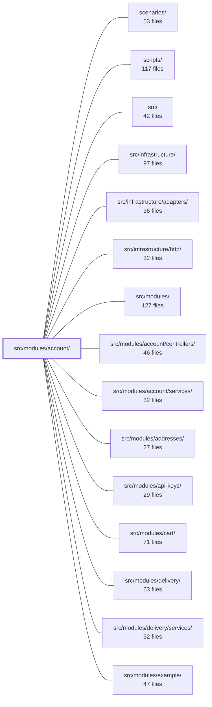

---
tags:
  - 2brain
  - 2brain/module
  - project/boilerplate-node-backend
type: module
module: src/modules/account/
files: 154
updated: 2026-10-29T19:22:04.223748+00:00
---

# src/modules/account/

## Purpose

The account module owns the full authentication and account-lifecycle surface of the application: signup, login, session management, email verification, password reset, two-factor authentication, OAuth sign-in, personal-data export, and account deletion with grace period. It enforces per-recipient mail budgets, per-flow rate limits, and the session-epoch / revocation model that invalidate tokens across the system.

## Key parts

- **Domain layer (`domain/`)** — Pure, I/O-free business rules: the email-change state machine, session-epoch invalidation, revocation-cause table, and AMR session-proof helpers. Upper tiers import through `domain/index.ts`; a lint rule forbids Express/Mongoose imports here.
- **Configuration & generated constants** — `config.ts` (link templates, token TTLs), `module.yaml` + `rate-limits.generated.ts` + `rules.generated.ts` (rate-limit budgets, 2FA lockout thresholds, job schedules). The YAML files are the editable source; the `.ts` files are regenerated via `npm run regenerate`.
- **OAuth sub-module (`oauth/`)** — Provider adapters (Google, GitHub) behind a shared `OAuthProvider` port, a live provider registry, CSRF/PKCE cookie management (`state.ts`), and redirect-carried challenge cookies for 2FA and deletion-grace flows.
- **Data & presentation** — `model.ts` (Mongoose schemas for sessions, verification tokens, account exports), `repository.ts` (single-row reads/writes), `presenter.ts` (row-to-wire mapping with no business logic).
- **Policy & security** — `rate-limits.ts` (Express middleware for credential-guess, Sybil, and MFA budgets), `cooldown.ts` (shared "wait before resending" 429 envelope), `mail-budget.ts` (per-recipient 24 h cap), `session-mode.ts` (jwt vs. cookie vocabulary).
- **Module wiring** — `module.ts` (single kernel entry point: routes, auth resolver, consumers, event subscriptions), `routes.ts` (Express router under `/account` composing per-route middleware), `jobs.ts` (scheduled reaping/cleanup), `index.ts` (public barrel; the only cross-module import surface).
- **Observability & events** — `analytics.ts`, `audit.ts`, `events.ts`, `metrics.ts` (typed event/action/counter declarations), `emails.ts` (template content for every outbound mail).
- **Contract & tests** — `openapi.yaml` (API specification), `probes.ts` (hand-written edge-case requests the contract cannot express).

## How it connects

- **`src/modules/account/controllers/` & `src/modules/account/services/`** — Controllers parse HTTP and delegate to services; services apply domain rules and call the repository. The `index.ts` barrel is the only surface sibling modules may import, so cross-module access funnels through services.
- **`src/modules/users/`** — Provides the live tenant membership store that `roles.ts` queries to resolve admin status for audit and login events; account documents reference user records but do not own role data.
- **`src/modules/addresses/`** — Supplies canonicalised / pseudonymised addresses used as keys by `mail-budget.ts` so `+tag` or dot tricks cannot create new budget buckets.
- **`src/modules/observability/`** — Reads the Prometheus counters registered by `metrics.ts` off the shared registry; the account module only writes.
- **`src/infrastructure/http/`** — The account module never imports it by name (see `config.ts` comment); link-URL construction is delegated to infrastructure so the layering rule in `docs/theory/layers.md` holds.
- **`src/modules/api-keys/`** — A sibling that imports the account barrel for session/identity checks, per the strategic-DDD rule.
- **`src/infrastructure/`** — Provides the mailer worker, queue consumers, and shared repository factory that the account module's jobs and email builders rely on at runtime.
- **`src/modules/orders/`, `src/modules/cart/`, `src/modules/payments/`** — Downstream consumers that require a valid session (minted here) and read consent/epoch state before executing commerce flows.
- **`src/modules/notifications/`** — Receives the `EmailContent` objects produced by `emails.ts` for delivery.

## Where to start

1. **`module.ts`** — The single entry point the kernel calls; reading it shows how routes, the auth resolver, consumers, event subscriptions, and rate-limit budgets are all installed in one place, giving you a map of the module's moving parts.
2. **`routes.ts`** — Lists every endpoint under `/account` with its middleware chain (rate limiter, challenge gate, idempotency, auth predicate), so you can trace a request from URL to controller to service without hunting through sub-directories.

## Connected modules

[[boilerplate-node-backend_ROOT|/ (repository root)]] · [[boilerplate-node-backend_scenarios|scenarios/]] · [[boilerplate-node-backend_scripts|scripts/]] · [[boilerplate-node-backend_src|src/]] · [[boilerplate-node-backend_src_infrastructure|src/infrastructure/]] · [[boilerplate-node-backend_src_infrastructure_adapters|src/infrastructure/adapters/]] · [[boilerplate-node-backend_src_infrastructure_http|src/infrastructure/http/]] · [[boilerplate-node-backend_src_modules|src/modules/]] · [[boilerplate-node-backend_src_modules_account_controllers|src/modules/account/controllers/]] · [[boilerplate-node-backend_src_modules_account_services|src/modules/account/services/]] · [[boilerplate-node-backend_src_modules_addresses|src/modules/addresses/]] · [[boilerplate-node-backend_src_modules_api-keys|src/modules/api-keys/]] · [[boilerplate-node-backend_src_modules_cart|src/modules/cart/]] · [[boilerplate-node-backend_src_modules_delivery|src/modules/delivery/]] · [[boilerplate-node-backend_src_modules_delivery_services|src/modules/delivery/services/]] · … and 11 more

## Files
- `src/modules/account/analytics.ts` — Declares the analytics event names emitted by the account module and registers them in the analytics port's type map. It is a pure declaration file — no runtime logic — that lets the account services reference a shared, type-safe catalogue of event strings while keeping ownership of each name in one place.
- `src/modules/account/audit.ts` — Declares the full vocabulary of audit action strings emitted by the account module and injects them into the shared `AuditActionMap` type via a declaration merge. It exists so that every account service can fire typed, self-documenting audit events without the infrastructure layer needing to know which module owns which string.
- `src/modules/account/config.ts` — Central configuration surface for the `account` module: frontend link templates (with their `NODE_FRONTEND_LINK_*` env overrides), token/TTL lifetimes, and account-lifecycle constants. It exists so that every account-related setting has one typed, overridable home, and so that the five token-bearing link kinds are declared alongside the infrastructure that turns them into URLs—without `infrastructure/http` ever naming the `account` module (see `docs/theory/layers.md`).
- `src/modules/account/consent-record.ts` — Defines the shape of consent data stamped onto an account at signup: which Terms version was accepted, when, and what analytics choice (if any) the user made. It centralises the "who agreed to what, and when" record so that downstream consumers (controllers, the shop endpoint) can read a consistent structure without re-deriving it.
- `src/modules/account/cooldown.ts` — Single source of truth for the "please wait before resending" logic shared by every account flow that publishes a one-time mail (2FA code, verification link, password-reset link, reauth token, etc.). Centralising the countdown calculation and the 429 response shape ensures every client renders the same semantics without each service re-implementing the arithmetic or the error envelope.
- `src/modules/account/domain/email-change.ts` — A pure, I/O-free state machine that models the email-change lifecycle. It encodes every valid `(state → event → next state)` edge in a single lookup table, so the service layer never re-derives "what is allowed here." The state itself is not persisted; it is derived on the fly from two optional fields on the User document.
- `src/modules/account/domain/epoch.ts` — Centralises the single "session epoch" rule: a token (or a login proof) is invalid if it predates the account's `tokensValidAfter` timestamp. Keeping the comparison in one pure module guarantees the resolver, the refresh path, and the mint all apply the identical cutoff and cannot drift apart.
- `src/modules/account/domain/index.ts` — Barrel file for the account **domain layer**. It re-exports the pure business rules (email-change transition table, session-proof helpers, revocation constants) so that upper tiers (services, controllers) import a single entry point. The file itself contains no logic—only `export` statements. A lint rule guarantees the domain layer has zero imports of Express, Mongoose, or any other tier.
- `src/modules/account/domain/revocation.ts` — A single, I/O-free declaration of every way an account's sessions can end. Each cause is a row of behavior flags (epoch strategy, pending-link purge, event announcement, caller retention, session-mode scope). `services/revocation.ts` reads these flags to execute; the `account.sessions-revoked` event's reason type is derived from this table, so the list is defined in exactly one place.
- `src/modules/account/domain/session-proof.ts` — Pure, I/O-free rules for a session's `amr` (Authentication Method Reference) values: what the app mints, how proofs accumulate, and when a first session is denied for lacking a second-factor proof. Exists so that every mint path (login, signup, 2FA confirmation, etc.) shares one source of truth without reaching into I/O.
- `src/modules/account/emails.ts` — Defines the finished email content (template name, subject, and rendered body data) for every account-flow email the application sends. Templates here only interpolate; actual translation is deferred to the mailer worker, which has no request context. Each builder binds its own locale-bound translator and returns a complete `EmailContent` object ready for the outbox.
- `src/modules/account/events.ts` — Declares the domain events emitted by the account module by augmenting the kernel's `DomainEventMap` interface (via `declare module '@kernel/events'`), so the event catalogue grows per-module without a shared enumeration file. Also re-exports the `SessionsRevokedReason` type and provides runtime string constants for each event name.
- `src/modules/account/index.ts` — Public barrel for the Account module. It is the **only** import surface that sibling modules (e.g. `api-keys`) are permitted to use, per the strategic-DDD rule in `docs/theory/strategic-ddd.md` §5. Internal sub-surfaces (`session`, `oauth`, `two-factor`, and the export-build services) are deliberately excluded so that cross-module access funnels through the service layer.
- `src/modules/account/jobs.generated.ts` — A generated data file that declares the account module's scheduled jobs (name, cron schedule, human-readable summary) as a frozen constant. It exists so the job *metadata* can be derived from a single YAML source (`module.yaml`) via `npm run regenerate`, keeping the scheduling config in one editable place while `jobs.ts` supplies the actual execution logic.
- `src/modules/account/jobs.ts` — Defines the scheduled jobs owned by the `account` module: inactive-account reaping, previous-email cleanup, expired-export reaping, and purge of accounts past their self-deletion grace period. Each service call is wrapped into a `JobDeclaration` (schedule metadata from the generated file + a `run` function + optional runtime requirements) and exported as a single array for the kernel to register.
- `src/modules/account/mail-budget.ts` — Enforces a per-recipient mail budget: a hard cap (default 10) on how many mails this app may deliver to a single mailbox in a rolling 24-hour window, regardless of which flow (signup, reset, verification, export, deletion) triggers the send. The budget protects the *recipient* (whoever's inbox is targeted), not the caller, and is keyed on the canonicalised, pseudonymised address so `+tag` or dot tricks cannot create new buckets.
- `src/modules/account/metrics.ts` — Defines the full set of domain-level Prometheus counters for the account/authentication module. Every counter is registered on the shared `metricsRegistry` so a single `/metrics` scrape carries them alongside HTTP metrics. This file is strictly a *write* surface for the account controllers; nothing in this module reads the counters back — the observability overview endpoint resolves them by name off the registry.
- `src/modules/account/model.ts` — Defines the three Mongoose schemas and compiled models that the account module owns — `accountexports`, `sessions`, and `verificationtokens`. This file is the single source of truth for the shape, indexes, and serialization rules of those collections; all read/write queries live in `./repository`, and the contract-layer wire shapes are built from these rows separately.
- `src/modules/account/module.ts` — Module manifest for the **account** module. It wires together everything the account module installs at registration time: the app-wide auth resolver, routes under `/account`, rate-limit budgets, queue consumers, personal-data export/erase declarations, and domain-event subscriptions. It exists as the single entry point that the kernel calls once every enabled module is known.
- `src/modules/account/module.yaml` — Module declaration for the account domain (signup, login, sessions, 2FA, OAuth, account lifecycle). It declares the module's dependencies, its full set of rate-limit budgets with their bounds and audit flags, and the scheduled background jobs that drive account lifecycle transitions (inactivity, email change, exports, deletions). It is the single source of truth for "what the account module owns" so that `module.ts` and the rate-limit enforcement layer can be generated or validated against it.
- `src/modules/account/oauth/config.ts` — Centralised OAuth configuration: declares the four `NODE_OAUTH_*` env vars, computes the absolute redirect/callback URIs from `NODE_URL`, and builds the frontend redirect URLs (success, 2FA, deletion-grace). It exists so that `./providers/*` and the account controllers never spell an env-var name or assemble a redirect URI themselves.
- `src/modules/account/oauth/deletion-redirect.ts` — Manages the single `__Host-oauth_deletion_challenge` cookie that carries a deletion-grace claim check (minted by `buildDeletionPending`) across an OAuth provider redirect. The claim check travels in a cookie rather than a URL parameter, mirroring the pattern used by `mfa-redirect.ts` for 2FA challenges. `POST /account/login/restore` falls back to this cookie when its request body omits `challenge`.
- `src/modules/account/oauth/mfa-redirect.ts` — Provides a single-purpose cookie (`__Host-oauth_mfa_challenge`) for carrying the `buildLoginChallenge` token across an OAuth provider redirect. The cookie exists so the challenge is never exposed in a URL query string (where it would persist in browser history and `Referer` headers) while still letting `POST /account/login/2fa` and `POST /account/login/2fa/send` serve both password-originated and OAuth-originated logins through the same endpoints.
- `src/modules/account/oauth/providers/client.ts` — Shared OAuth client layer for every provider adapter, built on top of `openid-client`. It centralises three things that all providers need identically: a hardened `fetch` (deadline, redirect rejection, body-size cap) that every library call goes through, the construction of a provider's `Configuration` from statically-declared endpoints and deployment credentials, and the two OAuth flow steps—building the consent URL and redeeming the authorization code. Endpoints are written down in each provider's own file rather than discovered over the network, so login requires no extra request that could fail or be spoofed.
- `src/modules/account/oauth/providers/github.ts` — Implements the `OAuthProvider` port for GitHub's plain OAuth 2.0 flow. Because GitHub publishes no issuer metadata and requires two separate API calls to reconstruct a full identity (`/user` + `/user/emails`), this file hard-codes the server endpoints, performs the code exchange via the shared `client` helpers, and maps the results into the canonical `OAuthIdentity` shape.
- `src/modules/account/oauth/providers/google.ts` — Implements the Google OAuth/OIDC provider behind the shared `OAuthProvider` port. It builds the authorization URL, exchanges the authorization code for tokens, and extracts the user's identity directly from the verified ID-token claims — avoiding a separate `userinfo` round trip.
- `src/modules/account/oauth/providers/index.ts` — Central registry that tracks which OAuth providers (Google, GitHub) are currently enabled based on their environment variables. Unlike the payments module (single active provider), multiple OAuth providers can be active simultaneously, so this exposes a live "who is configured" query rather than a memoized winner. Providers are re-evaluated on every call so that setting/unsetting env vars takes effect without a restart.
- `src/modules/account/oauth/providers/port.ts` — Defines the OAuth/OIDC provider **port** — the structural contract that concrete identity providers (Google, GitHub) implement. Unlike the analogous `PaymentProvider` port in `payments/providers/index.ts`, more than one OAuth provider may be enabled simultaneously, so selection is delegated to the registry in `./index` rather than a single environment switch.
- `src/modules/account/oauth/state.ts` — Manages the per-attempt cookies that an OAuth login requires before the browser is redirected to the provider: the CSRF `state` (double-submit), the PKCE `code_verifier`, and the untrusted `continue` / `locale` values the visitor supplied. It provides the generation primitives, the Express cookie set/clear helpers, and the read-back validators, all in one place so the start and callback controllers never touch `node:crypto` or cookie-flag logic directly.
- `src/modules/account/openapi.yaml` — OpenAPI 3.1.0 contract for the **account** module. It defines the full API surface for authentication (signup, login, session lifecycle, email verification) and self-service account operations (profile CRUD, email-change flow, two-factor, data export, account deletion with grace period). Serves as the machine-readable specification that `src/modules/account/module.ts` must implement and that clients consume.
- `src/modules/account/presenter.ts` — Pure mapping layer that converts internal database rows (`SessionRow`, `AccountExportRow`) and service results into the wire shapes clients expect. It contains no business logic: decisions such as "which sessions belong to the caller" or "when the staff lifetime cap ends a session" are made upstream in services, and this file only serializes already-decided values.
- `src/modules/account/probes.ts` — Defines four hand-written API requests (probes) that the OpenAPI contract cannot express on its own — e.g. deliberate 401/409/429 responses and a non-admin login. These are emitted alongside the contract-generated collection to fill testing gaps.
- `src/modules/account/rate-limits.generated.ts` — Auto-generated data file that declares every rate-limit budget belonging to the account module as a single typed constant. It exists so that the human-readable source of truth stays in `module.yaml` while the runtime gets a compile-time-checked `as const` object. The file is produced by `npm run regenerate` and must not be edited by hand.
- `src/modules/account/rate-limits.ts` — Defines the account module's rate-limit budgets and the Express middleware arrays that enforce them. Covers four credential-guess dimensions (per-account, per-device, per-address, per-address-block), two success-spent Sybil budgets (signup, password-reset-request), a password-strength advisory budget, and two MFA challenge budgets. Each budget is a `RateLimitBudget` object built from generated data in `rate-limits.generated.ts` and turned into a limiter via `buildRateLimiter`.
- `src/modules/account/repository.ts` — Thin MongoDB query layer for three collections — `accountexports`, `sessions`, and `verificationtokens`. All operations are single-row lean reads or atomic writes (insert, `findOneAndUpdate`, `deleteOne/Many`); nothing here paginates or free-text-searches, so the shared repository factory adds nothing and is intentionally not used.
- `src/modules/account/roles.ts` — Provides a single helper that determines whether a given user holds an unrestricted (admin) role on the current deployment's tenant. It exists so that login-emit and audit-record code can resolve `actorRole` from the live membership store instead of relying on a role value that does not exist on the account document itself.
- `src/modules/account/routes.ts` — Express router that wires every account-domain endpoint (auth, profile, email verification, password, 2FA, sessions, OAuth links, export, deletion/restore) under the `/account` prefix. It composes per-route middleware—rate limiters, human-challenge gates, idempotency, upload, and authorization predicates—around thin controller handlers so that policy is declared once at the route level.
- `src/modules/account/rules.generated.ts` — Generated configuration constants for two-factor authentication limits (lockout thresholds and delivered-code parameters). It exists as a single source of truth produced from `rules.yaml` so that tuning these values never requires code changes to consumer modules.
- `src/modules/account/rules.schema.ts` — Defines the Zod schema that validates `rules.yaml` for the account module (two-factor lockout and delivered-code limits), and declares the `GenerateSpec` consumed by `npm run regenerate` to produce `rules.generated.ts`. These numeric values are copied verbatim into the PHP twin as data.
- `src/modules/account/session-mode.ts` — Defines the shared vocabulary for the two session strategies a deployment can use (`jwt` and `cookie`). It is a dependency-free leaf module so that the schema, configuration, and strategy code can all reference the same literals without importing each other.
- `src/modules/account/session/activity.ts` — Provides a single fire-and-forget stamp of an account's `lastActiveAt` timestamp, written whenever a session is minted or kept alive. It serves as the input clock for the inactivity reaper and is shared by both session modes (cookie and JWT).
- `src/modules/account/session/auth-context.ts` — Resolves a session's proof (auth timestamp + authentication methods) into the `AuthContext` that downstream guards consume. Both session modes (cookie and JWT) produce a `SessionProof`; this file is the single, shared layer that decides what a valid proof *means*—account still active, epoch not expired, current roles, fresh factor state. The mode decides how a credential becomes a proof; this file decides what a proof grants.
- `src/modules/account/session/config.ts` — Declares the full session-policy surface (mode, TTL tiers, signing rings, rotation windows, issuer/audience, staff timeouts, device-cookie secret, TOTP encryption key) as a single typed config object, then exposes narrow getter functions so consumers never touch raw env vars directly. It is policy, not tokens: it defines *what* `jwt-strategy` signs against, what `cookie-strategy` stores against, and what `device-cookie` HMACs against.
- `src/modules/account/session/cookie-strategy.ts` — Implements the `cookie` session strategy: a single random session id stored only as its SHA-256 hash in a `sessions` row, delivered to browsers via an HttpOnly `__Host-session` cookie and to other clients as a `ses_…` Bearer token. Owns the full lifecycle — mint, resolve, rotate-on-re-proof, retire, and activity stamping — without signing keys, refresh tokens, or rotation races.
- `src/modules/account/session/cookies.ts` — HTTP cookie creation and destruction for the account session, decoupled from the session-keep strategy. It manages two cookies: `__Host-session` (carries the credential — refresh token in `jwt` mode, session id in `cookie` mode) and `isAuth` (a readable UI hint so the client shell renders the correct chrome before its first network round-trip).
- `src/modules/account/session/device-cookie.ts` — Implements the OWASP "familiar device" cookie: after a fully successful login it marks the browser as trusted for that account so the account's per-login-attempt failure budget is skipped on subsequent logins from the same browser. This prevents an attacker who exhausts the budget from also locking out the legitimate owner. One cookie carries up to five HMAC tokens (one per account), so a multi-account browser keeps all its familiarities.
- `src/modules/account/session/device-label.ts` — Produces a short, privacy-conscious label for a sign-in's origin (e.g. "Firefox on Linux") by parsing the `User-Agent` header at login time. The label is stored on the session so the account owner can distinguish their own devices in a session list. It intentionally omits versions, models, and IPs to avoid singling out a device beyond what the owner already knows.
- `src/modules/account/session/family-liveness.ts` — Determines whether a session **family** is still valid: it must have a live row in the repository, and—when the caller is staff—must not have idled out or exceeded the staff lifetime cap. If the family has lapsed, it is revoked. Otherwise, the request is counted as activity (throttled to one stamp per minute). This logic is shared by JWT bearer resolution (an access token names its family via `sid`) and by SSE stream rechecks, which must follow the family across credential rotations.
- `src/modules/account/session/idle.ts` — Implements the **staff idle timeout** and **staff lifetime cap**: two independent backend-enforced expiry rules that apply only to callers holding a tenant or platform role. Shopper sessions are never affected. The logic lives here (rather than in a client timer) so it is authoritative.
- `src/modules/account/session/jwt-strategy.ts` — Implements the `jwt` session strategy: a short-lived (10-minute) access token held client-side plus a rotating refresh token in an HttpOnly cookie, one `sessions` row per refresh token. This file is the adapter that places the token primitives from `./jwt.ts` behind the `SessionStrategy` port, so callers never see raw tokens.
- `src/modules/account/session/jwt.ts` — Owns all JWT issuance and verification for the account module. Wraps `jose` with this app's specific policy (key rings, TTLs, audiences, issuer, token-type headers, required claims) so that callers get a small, typed surface (`verifyAccessToken`, `verifyRefreshWithRow`, signing) instead of repeating configuration. Policy knobs live in `./config`; this file is the single point where a token is signed or checked.
- `src/modules/account/session/key-ring.ts` — Pure helper module that gives each signing secret in the key ring a stable identifier (`kid`) and provides lookup by that identifier. It contains no signing logic — it only derives and matches identifiers so that `./jwt` can stamp and resolve the `kid` header without this file needing to import the signer.
- `src/modules/account/session/listing.ts` — Provides the "list my sessions" read path shared by both session modes (cookie and JWT). It fetches the caller's live session rows, filters out rows that are no longer valid (pre-epoch, idled, or past the staff lifetime cap), deduplicates JWT token-family rows, marks the caller's current session, and shapes the result into the wire `Session` list.
- `src/modules/account/session/login-observability.ts` — Extracts the post-login observability tail (Prometheus counter, audit record, analytics event) so that both `post-login.ts` and `post-login-2fa.ts` share one definition of "a login completed." It lives at the controller/session layer rather than in `services/login.ts` because the SUCCESS emit must only fire after a session (cookies, access token) actually exists — a fact credential-checking services do not know.
- `src/modules/account/session/mint-guard.ts` — Guards that must pass before a **first** session is minted for an account. They enforce two invariants at the mint site (rather than relying on each login branch to check them): (1) a session cannot be issued when a second factor is armed but the proof carries none, and (2) a session cannot be issued on a proof whose check preceded the account's current epoch (e.g. a password change committed mid-login). Both session strategies invoke these from their `issue` path, never from a re-mint.
- `src/modules/account/session/resolver.ts` — Implements the kernel's `AuthResolver` port for the account module. It is a thin delegation layer that forwards every credential-resolution call to whichever session strategy the deployment has activated, and is registered by `module.ts` so the kernel's auth guard can identify callers.
- `src/modules/account/session/session-id.ts` — Generates and classifies opaque session IDs used in `cookie` mode. The ID is 32 random bytes in base64url under the `ses_` prefix; only its SHA-256 is persisted, so a database leak never yields a usable credential. The file also exports cheap shape-checks that let the authentication kernel reject non-matching tokens before any database lookup.
- `src/modules/account/session/session.ts` — Facade module that gives every session-minting controller a single, mode-agnostic API. Controllers call these five functions and never learn whether the system is in `cookie` or token mode — that decision is delegated entirely to `activeStrategy()` in `strategy.ts`.
- `src/modules/account/session/strategy.ts` — Defines the **port** (interface) that every session-mode implementation must satisfy, and exposes `activeStrategy` as the single entry point the rest of the codebase uses to mint, resolve, rotate, and list sessions. Callers (login controllers, 2FA handlers, the resolver, SSE streams) never reference a concrete strategy; they call `activeStrategy()` and work against `SessionStrategy`. This is what lets the deployment flip between `jwt` and `cookie` mode without touching application logic.
- `src/modules/account/tests/contract/abilities.test.ts` — Contract test for `GET /account/abilities`. Rather than asserting response shape, it verifies the **round-trip invariant**: the rules the server packs into the payload, when unpacked by the client via CASL's `unpackRules`, produce the same allow/deny decisions the server itself would make. This catches silent drift between server-side enforcement and client-side greying-out.
- `src/modules/account/tests/contract/api.contract.test.ts` — Contract tests for the self-service `/account` HTTP surface: profile update, password change, single-session logout, session listing, and email verification. Unlike the unit suites' generated-payload sweep, these tests exercise state-dependent branches (a second account holding the email, a revoked cookie, a spent token, someone else's session) that no random payload can set up. Listing assertions check concrete IDs, never just array lengths.
- `src/modules/account/tests/contract/code-delivery.contract.test.ts` — Contract test verifying the email code-delivery surface (2FA setup/confirm/send and step-up reauth send) under two deployment conditions that the other account suites mask: a `log` mail transport where no recipient can read mail, and the shared hourly send budget that both the 2FA send and the step-up send draw from.
- `src/modules/account/tests/contract/lifecycle.contract.test.ts` — Contract tests for account-lifecycle endpoints that `api.contract.test.ts` does not cover: scheduled deletion + restore, password-reset request (including the anti-enumeration guarantee), "log out everywhere," the in-field breach check, and the mailed-greeting safety check. Each flow is driven end-to-end: the one-time token or greeting text is read back from the mocked mailer queue, so the assertion targets the exact artifact a real recipient would receive.
- `src/modules/account/tests/contract/login-paths.contract.test.ts` — Contract test that asserts invariants shared by **all** session-acquisition paths (password login, OAuth login, and session continuation via refresh or next-request) in a single table-driven suite. Two rules are enforced: (1) no path may grant a session or audit a successful `AUTH_LOGIN` for a deactivated/soft-deleted account, and (2) password and OAuth login must each audit the caller's real membership role exactly once and increment the shared `auth_login_total` counter. A third section verifies that all paths stop at a 2FA challenge for an armed account. The suite exists so that a regression in one path is caught against the baseline rather than discovered per-bug.
- `src/modules/account/tests/contract/oauth.contract.test.ts` — Contract tests for the OAuth surface (`GET /account/oauth/providers`, `GET /account/oauth/:provider`, `GET /account/oauth/:provider/callback`). Exercises the full start → callback round trip against the real routes, real CSRF/PKCE cookies, and a real database, using a locally registered `fake` provider that production would never seed. Mirrors the path a Cypress spec walks in a browser but at the HTTP level.
- `src/modules/account/tests/contract/reauth.contract.test.ts` — Contract tests for the **email-code step-up** path of account reauth. Covers which methods `GET /account/reauth` offers, the full send → submit → consume cycle for the mailed 6-digit code, replay/burn protection, stale-session re-proof, and the export-gating that follows a successful reauth. The password path's own session mechanics (cookie tiers, failed re-mint) are intentionally left to `api.contract.test.ts`.
- `src/modules/account/tests/contract/shop.contract.test.ts` — Contract tests for the shop-facing slices of `POST /account/export`: orders, payments, invoicing, cart, shipments, fulfillment orders, and the checkout address snapshot. It is deliberately isolated from the rest of the `/account` contract so that removing the shop module takes exactly this file with it.
- `src/modules/account/tests/contract/support.ts` — Shared setup helpers for the account contract test suites. Provides mode-agnostic login, token extraction, and `amr`-claim inspection so that `api`, `oauth`, `reauth`, and `shop` contract tests can authenticate and assert session state without duplicating session-mode logic.
- `src/modules/account/tests/contract/two-factor.contract.test.ts` — Contract tests that verify the HTTP response shapes (status codes, field presence, types) of the second-factor authentication endpoints against the definitions published in `openapi.yaml`. Business-logic assertions live in `integration/two-factor.test.ts`; this file only checks that each success and refusal answer matches the published contract.
- `src/modules/account/tests/factories.ts` — Test fixture helpers for the account module's **sessions** and **verification tokens**. Provides "plant" functions to seed rows with known plaintexts and "read" functions to assert what a flow left behind. Lives in the account module's test directory (rather than a shared test-utils package) because the barrel does not publish the repository — suites in other modules import these helpers from here.
- `src/modules/account/tests/integration/auth-events.test.ts` — Integration test verifying the audit-trail entries produced when a one-time link token is rejected (unknown or expired) and when a login attempt fails. It asserts the correct `action`, `targetId`, and `metadata.flow` values reach the logger, and that the Prometheus rejection counter increments per flow. Lives under `auth.*` (not `security.*`) because a stale link is the common customer-facing cause.
- `src/modules/account/tests/integration/auth-hardening.test.ts` — Integration tests for the credential-endpoint hardening layer defined in `account/rate-limits.ts`: verifies that per-identity and per-address rate-limit buckets behave independently, that successful logins don't consume budget, that the block-level budget arms the antibot challenge gate, and that the gate engages at the correct identity-budget threshold. Scoped to this module's limiters rather than the global error handler, which is covered by the root-level suite of the same name.
- `src/modules/account/tests/integration/auth-races.test.ts` — Integration tests that fire N genuinely concurrent requests against the mounted account app (via supertest) to verify concurrency invariants on signup, login/session, OAuth callback, and refresh-token-rotation endpoints. The suite asserts *properties* ("exactly one account exists", "all N tokens survive") rather than which request won, and documents the specific race each test guards (R1, R4, R5) along with the mechanism that closes it.
- `src/modules/account/tests/integration/auth-storage.test.ts` — Integration tests that exercise `sessionRepository` and `verificationTokenRepository` against a real MongoDB instance. They verify concurrency guarantees (atomic claims, one-live-link upserts), TTL/expiry semantics, and account-scoping rules that a mocked store cannot self-validate.
- `src/modules/account/tests/integration/consent-withdrawal.test.ts` — Integration test verifying the full lifecycle of the `account.analytics_consent_withdrawn` outbox event: that it is written to the outbox *only* when stored analytics consent flips `true → false`, that the resolved analytics provider's `forget` method is invoked with the user id upon settlement, and that a provider failure leaves the row `pending` for retry.
- `src/modules/account/tests/integration/cookie-hardening.test.ts` — Integration tests that verify the `__Host-session` refresh cookie is correctly hardened (prefix, flags, absence of `Domain`) and that the three cookie-only-authenticated surfaces — `POST /account/refresh`, `POST /account/logout`, and the two SSE streams — reject a foreign `Origin` header before performing any state change.
- `src/modules/account/tests/integration/delete-account.test.ts` — Integration tests exercising the full self-deletion and restoration flow over real HTTP against a real test database. Covers `DELETE /account` (lock, mail, session teardown) and `POST /account/restore` (cancel, single-use token, grace expiry), asserting the status codes and side-effects a caller actually observes.
- `src/modules/account/tests/integration/device-cookie-budget.test.ts` — Integration tests for the per-account credential rate-limit budget and the `__Host-device` cookie that exempts a legitimate browser from that budget. Verifies that the cookie is issued only on successful login, that an owner's browser bypasses an exhausted account budget, that the cookie is scoped to the account it was issued for, and that a forged cookie draws on its own separate (small) budget rather than the account budget.
- `src/modules/account/tests/integration/email-change-lapse.test.ts` — Integration tests for the nightly sweep `reapLapsedPreviousEmails`, which clears a user's `previousEmail` field once the undo token that would restore it is either expired or entirely absent. The suite verifies the sweep's boundary conditions: it acts only on lapsed or missing undo tokens, ignores other token types, and never touches the current email or a pending change.
- `src/modules/account/tests/integration/email-change-ttl.test.ts` — Integration test that pins the time-to-live of the two links issued during an email change: the confirmation link (new address) and the undo link (old address). Rather than importing the app's own constants, it asserts against literal durations (24 h / 7 d) so the test enforces the promise made to the user in the account UI and the outgoing mail, not just internal consistency.
- `src/modules/account/tests/integration/export.test.ts` — Integration test for the account data-export lifecycle: request → inline build → download → erasure/reaper. It exercises the real services, real Mongo, and a real temporary export directory; the only fakes are the mail enqueue (captured into `mockOutbox`) and the audit recorder (captured into `mockAudit`). It covers the service-level flow; the HTTP layer of the same flow lives in `contract/api.contract.test.ts`.
- `src/modules/account/tests/integration/identity-rate-limit.test.ts` — Integration tests for the account module's rate limiters (`sessionCredentialLimiters`, `credentialLimiters`, `signupLimiters`, `resetRequestLimiters`), verifying their multi-dimensional budgets: per-identity (submitted email / authenticated account), per-address, and per-address-block (IPv4 /24, IPv6 /48). Tests are built against trivial handlers rather than real endpoints, because the property under test belongs to the limiter middleware itself.
- `src/modules/account/tests/integration/idle-timeout.test.ts` — Integration tests that verify the staff idle-timeout and staff lifetime-cap enforcement over real HTTP, across both `jwt` and `cookie` session modes. They confirm that staff sessions are revoked (with `401 SESSION_IDLE` or `401 UNAUTHORIZED`) when idle too long or signed in too long, while shopper sessions are never subject to either limit, and that a `Session-Passive: true` request does not reset the idle clock.
- `src/modules/account/tests/integration/jobs.test.ts` — Integration tests that pin the **return shape** (zero-count objects) of each declared account job when the test database is empty. These shapes are the contract the demo profile's `POST /__test/jobs/:name` endpoint relays back, so a journey test can assert "the job did something" without inspecting internals.
- `src/modules/account/tests/integration/jwt.test.ts` — Integration tests for the JWT session lifecycle (`session/jwt.ts`): access-token verification, refresh-token verification (including the stateful DB check that makes logout actually revoke), rotation semantics, session minting (`startSession`), and token-type enforcement. Because refresh-token security depends on a database row existing, these tests run against a real test database rather than in isolation.
- `src/modules/account/tests/integration/login-consent.test.ts` — Integration test verifying the consent-gating rules for the `user_logged_in` analytics event during login. It asserts that the account's stored consent answer always wins, and only when no answer has ever been recorded does the `Analytics-Consent` banner header determine whether the event fires. The test drives the real `/account/login` route and inspects the analytics provider's `capture` call.
- `src/modules/account/tests/integration/login-restore.test.ts` — Integration tests for the login and account-restore flows during the deletion grace window. Verifies over HTTP that a valid sign-in on a pending account returns a claim check (no session), that `POST /account/login/restore` cancels the deletion and starts a session, that TOTP is required before the claim check is offered, and that the OAuth callback path surfaces the same claim-check cookie.
- `src/modules/account/tests/integration/mail-recipient-budget.test.ts` — Integration test for the per-recipient mail rate-limit budget. It verifies that the limiter correctly caps the *recipient* mailbox (not the caller) across every code path that can target a stranger's inbox: the two body-addressed routes (signup, reset) and the three server-chosen-recipient services (verification resend, pending-email resend, email change). It also pins down the canonical-mailbox keying (e.g. `+tag` and Gmail-dot folding) that prevents a mail-bomb from bypassing the budget.
- `src/modules/account/tests/integration/oauth-link.test.ts` — Integration tests for the OAuth callback service (`loginOrCreateFromOAuth`) and the signed-in connect flow (`linkProviderToSignedInAccount`). Because these paths touch the real database (identity lookup, `$push` linking, user creation), they live in `tests/integration` rather than alongside the pure provider logic in `tests/unit`. The suite verifies find-or-create semantics, email-verification enforcement, token lifecycle, and security edge cases (account takeover, replay, cross-identity linking).
- `src/modules/account/tests/integration/oauth-links.test.ts` — Integration tests for the connected-accounts (OAuth provider) surface of the account module. Covers listing linked providers via `GET /account/oauth/links`, disconnecting one via `DELETE /account/oauth/links/{provider}`, reauth-freshness enforcement, cross-account isolation, and the content of the reset-confirm email that names still-connected providers.
- `src/modules/account/tests/integration/oauth-provider-route.test.ts` — Integration test for `GET /account/oauth/:provider/callback` that exercises the real Google and GitHub provider logic while mocking `fetch` at the providers' own servers. It pins two security properties invisible to unit tests: (1) the `redirect_uri` sent to the token endpoint is built from `NODE_URL`, not the request's `Host` header, and (2) a foreign, missing, or repeated query parameter (e.g. `code`, `iss`) causes the login to fail rather than being silently dropped.
- `src/modules/account/tests/integration/password-change-notice.test.ts` — Integration tests verifying the out-of-band email notice sent to the account's address after a **signed-in** password change succeeds. Confirms the notice is sent exactly once with advice text and no link, is **not** sent when the change is refused (wrong current password, mismatched confirmation, breached new password), and is distinct from the separate confirmation mail a password **reset** sends.
- `src/modules/account/tests/integration/password-hashing.test.ts` — Integration tests that pin down three security properties at the boundary between the account service and the password-hashing layer: an unknown address still triggers one argon2id verification (decoy / timing-equality), a long password is compared in full rather than truncated, and a composition rule does not reject a valid long passphrase.
- `src/modules/account/tests/integration/persisted-locale.test.ts` — Integration tests verifying that the `locale` field on the user document is correctly captured from the request context at signup, falls back to the boot locale when no request context exists, remains editable via subsequent updates, is not clobbered by unrelated partial updates, and is exposed through the user's JSON serialization. The field exists so that non-request code (e.g., worker-sent emails) can resolve a user's preferred language.
- `src/modules/account/tests/integration/probes.test.ts` — Integration test that verifies each HTTP probe defined in `account/probes.ts` actually returns the status code its own name claims (e.g. a probe named _"Probe: 409 on a signup that already exists"_ must genuinely yield 409). It exists so the probe definitions shipped in generated API-client collections are machine-checked against the running app rather than trusted by their description alone.
- `src/modules/account/tests/integration/profile-audit.test.ts` — Integration test verifying that the `AUTH_PROFILE_UPDATED` audit row for an own-profile edit records preference changes by value (from → to) while recording an email change by field name only — the actual email value is never stored in the audit metadata. Also documents the invariant that the audit collection is never scrubbed on user erasure.
- `src/modules/account/tests/integration/purge-deletions.test.ts` — Integration tests for `accountService.purgeScheduledDeletions()`. Verifies that the purge erases only owner-initiated deletions that are past their `purgeAt` date, cascades to sessions and restore tokens, leaves not-yet-due / admin-deleted / reaper rows untouched, is idempotent on re-run, sends a single goodbye email, and emits the correct audit events — all against a real database.
- `src/modules/account/tests/integration/reap-inactive.test.ts` — Integration test that verifies the inactivity reaper's staged lifecycle — minimise → warn → soft delete → hard delete — enforces correct ordering, respects grace periods between stages, and never advances more than one stage per run. It exercises the real `reapInactiveAccounts` service against a real MongoDB instance.
- `src/modules/account/tests/integration/reencrypt.test.ts` — Integration test for the account module's `reencrypt` walk. Verifies that after a TOTP encryption-key rotation, an enrolled 2FA secret originally stamped `v1` is rewritten to `v2` in the database and remains decryptable under the same method id.
- `src/modules/account/tests/integration/reset-request-timing.test.ts` — Integration test verifying that `POST /account/password/reset` responds immediately (204) without waiting for the background user-lookup or email-enqueue to complete, and that any failure occurring in that background work is logged rather than swallowed. This guards against user-enumeration timing leaks and ensures operational visibility of reset-request failures.
- `src/modules/account/tests/integration/revocation-causes.test.ts` — Integration test that fires every revocation cause through its real HTTP endpoint (or, for refresh-reuse, the real token-rotation path) and asserts the full contract the `REVOCATION` row claims: the victim device is revoked, the caller's session state matches `callerKeeps`, pending links are purged iff `pending` is true, and the outbox announcement matches `announce`. The `Record<RevocationCause, Trigger>` type means a cause added to the domain table without a corresponding trigger here is a compile error.
- `src/modules/account/tests/integration/self-service.test.ts` — Integration tests for the self-service account surface at the service/repository layer: profile update, password change, session revocation, and email verification. Each test group defends a specific invariant — a profile update cannot alter role/state/password, a wrong current password yields 422 (never 401, which would log out a valid session), and at most one verification link is active (always the newest).
- `src/modules/account/tests/integration/service-flows.test.ts` — Integration tests for the account service's happy-path and argument-validation flows: signup, login, one-time token issuance, password change, and refresh-token exchange. Uses a real database (`setupTestDb`) to exercise the full service layer end-to-end. The sibling `service.test.ts` in the same directory covers security invariants; this file covers the ordinary paths they sit on.
- `src/modules/account/tests/integration/service.test.ts` — Integration tests for the account service's security invariants across signup, login, password change, and bulk token removal. Tests are grouped by the invariant each defends (e.g., "two login failures must be indistinguishable," "a password must never be stored as it arrived") rather than by function, because these regressions are invisible to happy-path tests and constitute real security incidents if they slip.
- `src/modules/account/tests/integration/session-epoch.test.ts` — Integration tests for the **session epoch** (`tokensValidAfter`): the mechanism by which a user's "I may be compromised" events invalidate every previously minted access token and refresh cookie. The suite verifies that tokens stamped in an earlier whole second are refused after a bump, that each privileged action (password change, logout-all, 2FA arming, password reset, re-auth, email-change undo) moves the epoch correctly, and that failure paths (datastore outage, bump rejection) behave as specified.
- `src/modules/account/tests/integration/session-family.test.ts` — Integration tests that verify a session's identity (its `id`) remains stable across refresh-token rotation, and that replaying a superseded token revokes the entire token family (including the successor). These tests guard against a specific regression: if the id were derived from the token row, it would go stale on the first rotation, causing "log out that device" to silently succeed while leaving the device signed in.
- `src/modules/account/tests/integration/session-mint-guard.test.ts` — Integration test for the session-mint backstop: it verifies that issuing a **first** session (`startSession`) is refused when the account has a second factor armed and the proof lacks the required method, that a re-mint (`continueSession`) is exempt, and that a proof whose `provedAt` predates the account's current session epoch is rejected. It exists to pin down the guard that catches any future mint call site which forgets its own pre-check.
- `src/modules/account/tests/integration/session-modes.test.ts` — Integration test that exercises the full account session lifecycle (login, logout, revocation, password change, step-up, 2FA, OAuth) through real HTTP routes under **both** `NODE_SESSION_MODE` values (`jwt` and `cookie`). It verifies that the strategy port fulfils the same behavioural contract regardless of transport, and that sessions never cross between modes.
- `src/modules/account/tests/integration/session-remint-amr.test.ts` — Integration tests that verify the `amr` (authentication-method) claim written into the `__Host-session` cookie after every path that replaces a live session. The contract under test: a verified code adds `otp` to the prior claims, a password change resets to `pwd` alone, and a challenge token that names no proof is rejected without minting a session.
- `src/modules/account/tests/integration/signup-mail-failure.test.ts` — Integration test that proves `POST /account/signup` still returns **201** when the verification email fails to queue (e.g. token store is down), and that the resulting `logger.error` line includes the new account's `userId` so operators can identify whose mail was lost.
- `src/modules/account/tests/integration/staff-restore.test.ts` — Integration test for `POST /users/{id}/restore`, the endpoint a staff member calls to cancel an owner-scheduled account deletion. It exercises the full cross-module flow over HTTP: the `users` module clears the deletion schedule and emits a domain event, which the `account` module consumes to drop the restore token and notify the owner by email.
- `src/modules/account/tests/integration/step-up-otp.test.ts` — Integration test suite that verifies step-up authentication behavior for account identity routes. It asserts that when an account has TOTP armed, sensitive routes (email change, password change, account deletion) return `401 REAUTH_REQUIRED` unless the session's `amr` includes `otp`; that a re-authentication earns only the factors it actually proved; and that an email change can be undone via a token mailed to the old address. Accounts without a second factor are unaffected.
- `src/modules/account/tests/integration/two-factor-concurrency.test.ts` — Integration tests that verify two-factor one-time secrets—backup codes, mailed login codes, and step-up reauth codes—are consumed exactly once when identical or competing requests arrive in parallel. Every assertion must hold under any interleaving; a test that passes only because one request happened to win first is considered meaningless.
- `src/modules/account/tests/integration/two-factor.test.ts` — Integration test suite for two-factor authentication (TOTP and delivered email codes), driven through the real Express app so routing, guards, and serialization all execute. Covers enrollment, pending-enrollment status, login challenge flow, factor replacement, removal, and disabling. The file's own doc comment calls the bypass test (a challenge token must not authenticate a request on its own) the single most important assertion in the suite.
- `src/modules/account/tests/integration/wrong-typed-input.test.ts` — Integration test ensuring that sending a wrong-typed `email` value (number, object, array, boolean, or `null`) to `PATCH /account` or `PUT /account` yields a **422** and never a **500**. The `isChangingEmail` guard executes before validation; this test locks in the invariant that the guard must tolerate any JSON value without throwing.
- `src/modules/account/tests/strategy-doubles.ts` — Shared request and response test doubles used by the two session-strategy unit suites (cookie and JWT). It exists so both suites build their `SessionRequest` fixtures and `Response` mocks consistently instead of duplicating setup logic.
- `src/modules/account/tests/unit/auth-schemas.test.ts` — Unit tests that validate the structural declarations of the `sessionSchema` and `verificationTokenSchema` Mongoose schemas by reading the schema objects in-memory — no database connection is required. Each assertion guards against a specific silent failure mode (dropped TTL index, lost unique constraint, open `type` enum, serialized digest).
- `src/modules/account/tests/unit/config.test.ts` — Unit tests for the account config module's three public concerns: the `accountFrontendLink` URL builder (default templates and per-kind env-var overrides), the `NODE_ACCOUNT_DELETION_GRACE_DAYS` validation (default value and 1–31 range), and the `deletionPurgeAt` date calculation (grace-days vs. calendar-month cap).
- `src/modules/account/tests/unit/cookie-strategy.test.ts` — Unit tests for the `cookie` mode session strategy adapter (`cookie-strategy.ts`). They verify three operations in isolation: credential extraction from a request (`credentialOf`), bearer/cookie resolution against the session store (`resolveBearer` / `resolveCookie`), and session minting (`issue`). The session store, account read, and proof resolver are all replaced with mocks; their real behaviour is covered by `../integration/session-modes.test.ts`.
- `src/modules/account/tests/unit/cookies.test.ts` — Unit tests for the session-cookie module that pin down the security contract of `createSessionCookie` and `destroySessionCookie`: the credential cookie (`__Host-session`) must be `httpOnly`, `secure`, `sameSite: 'lax'`, `path: '/'`, and `domain`-less; the companion `isAuth` hint must be deliberately **not** `httpOnly`; and clearing must repeat the same flags so the browser actually drops the cookie. Each rule is asserted in isolation so a regression in any single flag fails on its own.
- `src/modules/account/tests/unit/device-cookie.test.ts` — Unit tests for the familiar-device cookie logic in `device-cookie.ts`. Verifies the token's identity-verification rules (case-insensitive match, single-account binding, forgery rejection), the multi-account LRU cap (five, newest first), cookie attribute constraints (httpOnly, persistent, no plaintext email), and the hard dependency on `NODE_DEVICE_COOKIE_SECRET`.
- `src/modules/account/tests/unit/device-label.test.ts` — Unit tests for `describeDevice`, the function that maps a browser User-Agent string to a coarse display label (e.g. "Firefox on Linux"). The tests exist to pin down exactly which labels the function may produce, to enforce that labels stay coarse (no versions, models, or addresses), and to verify safe handling of missing, malformed, or adversarially large inputs.
- `src/modules/account/tests/unit/email-change-domain.test.ts` — Exhaustive unit tests for the email-change finite-state-machine (FSM). Every `(state, event)` pair is asserted against a local transition table so that any edge accidentally added or dropped in the domain logic fails immediately.
- `src/modules/account/tests/unit/emails.test.ts` — Unit tests for the account email-builder functions in `@modules/account/emails`. Because these builders are pure data-shapers that never throw on a wrong template, link kind, or token, the suite asserts the *built content itself*: correct template ID, correct delegated link URL, resolved (non-raw-key) copy, name interpolation, locale propagation, and cross-email invariants (distinct templates, shared footer, unique link kinds).
- `src/modules/account/tests/unit/epoch.test.ts` — Unit tests for the two epoch-comparison predicates exported by the account domain module. They pin down the boundary semantics (inclusive vs. exclusive at the bump moment) and the `undefined`-epoch short-circuit for both the token path and the login-proof path.
- `src/modules/account/tests/unit/family-liveness.test.ts` — Unit tests for `resolveInLiveFamily`, verifying the decision logic that determines whether a family session is live, revoked, idle, or expired. The store is fully replaced with mocks; correctness of *which* rows the repository queries is deferred to the integration suite (as stated in the module docstring).
- `src/modules/account/tests/unit/jwt-strategy.test.ts` — Unit tests for the `jwtStrategy` adapter (`session/jwt-strategy.ts`). Validates the wiring between the strategy port and the token layer: which mint path a login takes versus a re-mint, which values land in which cookie, and the critical distinction that a token *refusal* (`TokenRejection`) resolves to a resolver miss while a *generic outage* propagates as a rejection. The token layer itself is tested in `session-jwt.test.ts` and is fully replaced here.
- `src/modules/account/tests/unit/key-ring.test.ts` — Unit tests for the pure key-identification math in `key-ring.ts`. Covers the two exported helpers (`keyId` and `keyForId`) that `jwt.ts` relies on to map a token's `kid` claim to the correct secret, ensuring no accidental key collisions, no positional dependence, and no silent fallback to the newest key.
- `src/modules/account/tests/unit/oauth-github.test.ts` — Unit tests for the GitHub OAuth provider. Verifies that `authorizeUrl` emits the correct consent-screen parameters and that `exchangeCode` performs the three-call token exchange (token → user → emails) with the right request shape, response handling, and failure paths. `fetch` is mocked throughout, queued in the exact order the provider issues its calls.
- `src/modules/account/tests/unit/oauth-google.test.ts` — Unit tests for the Google OAuth provider (`googleOAuthProvider`). They verify that `authorizeUrl` builds a correct consent-screen URL, and that `exchangeCode` correctly validates the callback (state, issuer, PKCE) and the returned ID token (audience, issuer, expiry, subject) before resolving an identity. `fetch` is mocked throughout so the tests exercise the library's own claim checks without any network I/O.
- `src/modules/account/tests/unit/oauth-state.test.ts` — Unit tests for the pure-function OAuth security helpers in `oauth/state.ts`. Covers the CSRF state comparison, PKCE verifier/challenge generation, the `continue` redirect-path guard, and locale-tag validation. Cookie/session plumbing is intentionally excluded here (covered by integration/contract suites); this file isolates the comparison logic and token-shape guarantees.
- `src/modules/account/tests/unit/presenter.test.ts` — Unit tests for the account presenter's three mapping functions (`presentSession`, `presentExportSession`, `presentExport`). The tests verify that stored repository rows are correctly shaped into wire responses and that the credential digest (`tokenHash`) never leaks into any output.
- `src/modules/account/tests/unit/rate-limits.test.ts` — Unit test that pins the **ordinal relationships** between the account module's rate-limit budgets (credential, signup, reset, MFA) rather than their absolute values. It enforces invariants like "identity budget < global browsing budget / 5" and "identity ≤ address ≤ block" so that the budgets remain meaningful relative to one another, even if individual numbers are later tuned.
- `src/modules/account/tests/unit/reauth-policy.test.ts` — Unit tests for the two pure rules the step-up (reauth) flow adds: the `amrAfterReauth` claim set a re-minted session carries, and the boot-time refusal `oauthConfig` enforces when an enabled provider has no deliverable mail transport. HTTP-level behaviour is deliberately excluded (see `contract/reauth.contract.test.ts`).
- `src/modules/account/tests/unit/revocation-table.test.ts` — Verifies cross-cutting invariants of the `REVOCATION` table — constraints that hold *across* all causes simultaneously and would not be caught by a test targeting a single cause in isolation (e.g. "every cause that keeps the caller's session must announce `false`").
- `src/modules/account/tests/unit/routes.test.ts` — Security-invariant tests for the account router. The file asserts that middleware presence, ordering, and authorization placement match the documented contract — invariants a type checker cannot see (e.g. `noStore` must cover every route, credential routes must carry all four rate-limit dimensions, token-bearing routes must stay public). A single mis-order or missing guard on any of these routes is an account-takeover vector.
- `src/modules/account/tests/unit/schema-contract.test.ts` — Verifies the *declarative* shape of the account module's three Mongoose schemas (export, session, verification token) — required fields, unique constraints, index definitions, and TTL semantics. These are "database facts" that a valid data fixture cannot express (e.g., a TTL that deletes a spent row), so the test asserts them directly against the schema objects.
- `src/modules/account/tests/unit/session-id.test.ts` — Unit tests for the `cookie`-mode session ID. The kernel dispatches on the ID's shape and 256 bits of entropy is the entire security guarantee, so this file locks in both invariants rather than assuming them.
- `src/modules/account/tests/unit/session-jwt.test.ts` — Unit-level tests for the token layer in `@modules/account/session/jwt`. Asserts safety invariants: the access and refresh secrets never cross-verify, refresh tokens are only valid while still stored, `jti` prevents same-second mutual revocation, and key-ring rotation does not mass-logout. The session store and `userService` are replaced with stubs; the actual query behaviour is covered in `../integration/auth-storage.test.ts`.
- `src/modules/account/tests/unit/session-listing.test.ts` — Unit tests for the session-listing module (`@modules/account/session/listing`). Verifies that `newestPerFamily` deduplicates rotation-race rows and that `listSessions` publishes the correct shape, marks the caller's family as current, omits absent optional fields, enforces the account token epoch, and applies the staff idle-timeout rule. The repository's `listLive` is fully stubbed; query construction is left to the integration suite.
- `src/modules/account/tests/unit/session-proof.test.ts` — Unit tests for the session-proof domain rules: verifying that proofs are combined without duplicates (and without mutating the caller's array) and that only an armed account lacking an `otp` proof is refused a first session.
- `src/modules/account/tests/unit/session-strategy.test.ts` — Unit tests for the session-strategy seam: verifying that the active adapter is selected per-call from `NODE_SESSION_MODE`, that the resolver delegates (rather than caching) to whichever adapter is active, and that the shared mint guard enforces second-factor requirements before a session is issued.
- `src/modules/account/tests/unit/tokens.test.ts` — Unit tests for the session/token configuration module (`@modules/account/session/config`). Validates that every env-var-driven value (tier expiry times, access-token TTL, signing rings, cookie max-age, session mode, rotation/reuse windows) parses correctly, routes to the right tier, falls back to documented defaults instead of `NaN`/`undefined`, and that the slice's boot gate enforces the correct required keys per session mode.
- `src/modules/account/tests/unit/two-factor.test.ts` — Unit tests for the pure (database-free) two-factor logic in `src/modules/account/two-factor/`: TOTP secret encryption/decryption, code verification against fixed clocks, backup-code minting and salted hashing, and the shared delivered-code state machine (TTL, cooldown, attempt ceiling). Exists to pin down security invariants—replay protection, keyed (non-bare) hashing, and clock determinism—without requiring a live service or wall-clock timing.
- `src/modules/account/token-types.ts` — A leaf module that names every token kind stored in the `verificationtokens` table and declares their TTL and uniqueness constraints. It exists so the schema, the issuing flows, and the revocation service can all reference token types by name without importing one another, preventing circular dependencies within the account module.
- `src/modules/account/two-factor/backup-codes.ts` — Provides the full lifecycle utilities for one-time account-recovery backup codes: generation, per-user salting, and scrypt hashing. Backup codes recover the account itself (not a specific factor), are minted once when an account first arms two-factor, and are shown to the user exactly once before being stored only as salted digests.
- `src/modules/account/two-factor/delivered-code-verify.ts` — Verifies a delivered (e.g. emailed) code against an account using a pure comparison followed by conditional writes. It avoids a read-modify-write cycle: the comparison itself (`checkDeliveredCode`) is stateless, and the side-effects (spending the code on a match, incrementing the miss counter on a failure) are issued as separate conditional writes through the users service. The same function serves both a second-factor code and a step-up (reauth) code.
- `src/modules/account/two-factor/delivered-codes.ts` — Pure (no I/O, no database) helper module for the short numeric codes that a "delivered" 2FA method (e.g. email) mints, stores as an HMAC, and checks against a user's typed input. It centralises the TTL, attempt-limit, and cooldown logic so those rules can be unit-tested against an injected clock without touching the persistence layer.
- `src/modules/account/two-factor/index.ts` — Barrel (re-export) file for the two-factor module. It is the single import surface that services, admin-recovery code, and test suites use to access the method registry and the pure crypto/validation helpers, without reaching into individual sub-modules.
- `src/modules/account/two-factor/lockout.ts` — Exports the two constants that define the per-account wrong-code lockout policy for armed 2FA: how many consecutive failures are allowed and how long the resulting lock lasts. The actual enforcement (storing the counter, applying the lock) lives elsewhere (`users`); this file only supplies the policy numbers.
- `src/modules/account/two-factor/methods/email.ts` — Implements email as a "delivered" two-factor method: setup and verification both reduce to minting a one-time code, mailing it, and recording its digest. Serves as the concrete `TwoFactorMethodHandler` for the `email` method in the 2FA registry, and is shared verbatim by the step-up re-authentication flow.
- `src/modules/account/two-factor/methods/totp.ts` — Registry adapter that exposes TOTP (authenticator-app) as a two-factor method. All cryptographic logic lives in the sibling `../totp.ts`; this file only wires the `setup` and `verify` lifecycle steps to the `TwoFactorMethodHandler` contract, adds per-enrollment secret encryption, and enforces single-use via a conditional step claim.
- `src/modules/account/two-factor/registry.ts` — Central registry of the second-factor methods this deployment supports. It defines the `TwoFactorMethodHandler` contract, registers the concrete handlers (TOTP, email), and provides lookup and ordering utilities so that services and the login flow address a method by wire-name string rather than branching on a specific channel. Adding a new 2FA channel means adding a handler here, not touching the login flow.
- `src/modules/account/two-factor/totp.ts` — Pure crypto layer for TOTP two-factor: encrypts/decrypts the base32 secret for storage and verifies user-supplied 6-digit codes against a known secret. Deliberately free of database or session concerns so it can be unit-tested against fixed clocks; the database-touching adapter lives in `methods/totp.ts`.

---
[[boilerplate-node-backend_INDEX|← boilerplate-node-backend index]]
