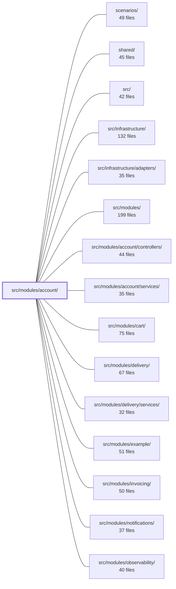

---
tags:
  - 2brain
  - 2brain/module
  - project/boilerplate-node-backend
type: module
module: src/modules/account/
files: 165
updated: 2026-11-15T00:30:14.703226+00:00
---

# src/modules/account/

## Purpose

The `account` module is the bounded context responsible for every aspect of a user's identity and authentication lifecycle: signup, login (password and OAuth), token minting and refresh, two-factor authentication, password reset, email verification and change, personal-data export, and scheduled account deletion. It owns the domain rules, persistence schemas, API surface, and security policies for these flows, and exposes a single public barrel so sibling modules interact with it through one well-defined seam.

## Key parts

- **Domain layer (`domain/`)** — Pure, I/O-free rule tables: the email-change state machine (`email-change.ts`), the session-epoch invalidation check (`epoch.ts`), the AMR / session-proof rules (`session-proof.ts`), and the revocation lookup table (`revocation.ts`). Re-exported through `domain/index.ts`; lint-guaranteed to have no Express or Mongoose imports.
- **Module wiring** — `module.ts` (runtime manifest: routes, jobs, event subscriptions, auth resolver, GDPR contracts) and `module.yaml` (static manifest: dependencies, rate-limit budgets, job list, group membership). `index.ts` is the sole public barrel other modules may import.
- **Persistence** — `model.ts` defines the four Mongoose schemas (sessions, verification tokens, account exports, erasure ledgers); `repository.ts` provides the low-level lean reads and atomic writes.
- **HTTP surface** — `routes.ts` mounts every endpoint under `/account/`; `presenter.ts` maps internal rows to wire shapes; `controllers/` and `services/` hold the request-handling and orchestration logic respectively.
- **OAuth sub-module (`oauth/`)** — Provider adapters (Google, GitHub) behind a shared `OAuthProvider` port, with per-attempt cookie state (`state.ts`), MFA and deletion-redirect cookie carriers, and centralized config/URL building (`config.ts`, `providers/client.ts`).
- **Security & policy** — `rate-limits.ts` (Express middleware for credential-guessing, Sybil, MFA surfaces), `cooldown.ts` (resend back-off for 2FA and verification), `mail-budget.ts` (per-recipient daily cap), `rules.yaml` + `rules.schema.ts` (2FA numeric policy shared with the PHP twin via codegen).
- **Observability & events** — `analytics.ts`, `audit.ts`, `metrics.ts` register this module's vocabulary into shared type maps and the Prometheus registry; `events.ts` augments the kernel's `DomainEventMap`.
- **Operational** — `jobs.ts` declares the four scheduled jobs (reaping, lapsed-email cleanup, export sweep, deletion purge); `emails.ts` builds fully-localised email content for the adapter worker; `openapi.yaml` / `asyncapi.internal.yaml` / `probes.ts` supply the API contract and test-probe data for the bundling pipeline.

## How it connects

- **`src/infrastructure/`** — The module registers its audit-action strings into infrastructure's `AuditActionMap` and its analytics names into the shared `AnalyticsEventMap`. Its `globals.d.ts` augments the infrastructure-layer Express `Request` type with an account-specific field. `metrics.ts` pushes counters onto the infrastructure-provided `metricsRegistry`.
- **`src/infrastructure/adapters/`** — `emails.ts` produces `EmailContent` objects that are consumed later by `adapters/email.worker.ts`, which performs the actual transport without a request context.
- **`src/modules/users/`** — `roles.ts` reads the live membership store to resolve the caller's effective role for audit records and login emit logic, since the account document itself carries no role field.
- **`src/modules/account/controllers/` and `src/modules/account/services/`** — Internal tiers within this module; `routes.ts` delegates to controllers, which in turn call services and the domain layer.
- **`shared/`** — Type-level registration sites (`AnalyticsEventMap`, `DomainEventMap`) live here; the account module merges its names into them via declaration merging.
- **`scenarios/`** — Integration-level test scenarios exercise the account module's public API surface (login, 2FA, deletion) end-to-end.
- **Sibling modules (`orders/`, `payments/`, `notifications/`, etc.)** — Interact with the account module exclusively through `index.ts`, the single permitted import entry point, per the strategic-DDD rule.

## Where to start

Read `domain/index.ts` (and the four files it re-exports) first: together they are under 200 lines of pure logic and reveal the core invariants—epoch invalidation, AMR proofs, revocation causes, and the email-change state machine—that every other file in the module enforces. Then open `module.ts` to see how those rules are wired into routes, jobs, events, and the auth resolver in a single declarative object.

## Connected modules

[[boilerplate-node-backend_ROOT|/ (repository root)]] · [[boilerplate-node-backend_scenarios|scenarios/]] · [[boilerplate-node-backend_shared|shared/]] · [[boilerplate-node-backend_src|src/]] · [[boilerplate-node-backend_src_infrastructure|src/infrastructure/]] · [[boilerplate-node-backend_src_infrastructure_adapters|src/infrastructure/adapters/]] · [[boilerplate-node-backend_src_modules|src/modules/]] · [[boilerplate-node-backend_src_modules_account_controllers|src/modules/account/controllers/]] · [[boilerplate-node-backend_src_modules_account_services|src/modules/account/services/]] · [[boilerplate-node-backend_src_modules_cart|src/modules/cart/]] · [[boilerplate-node-backend_src_modules_delivery|src/modules/delivery/]] · [[boilerplate-node-backend_src_modules_delivery_services|src/modules/delivery/services/]] · [[boilerplate-node-backend_src_modules_example|src/modules/example/]] · [[boilerplate-node-backend_src_modules_invoicing|src/modules/invoicing/]] · [[boilerplate-node-backend_src_modules_notifications|src/modules/notifications/]] · … and 7 more

## Files
- `src/modules/account/analytics.ts` — Declares the canonical set of analytics event names owned by the account module and registers them into the shared `AnalyticsEventMap` type. Every account-related event fired anywhere in the backend must use a name from this catalogue, giving the analytics port a single, type-checked vocabulary for the account domain.
- `src/modules/account/asyncapi.internal.yaml` — AsyncAPI fragment that declares the account module's private worker queue for personal-data export jobs. It exists separately from the module's public contract so the paired frontend never sees the `backend`-only channel, and so the fragment can be merged into `asyncapi.yaml` without carrying its own `asyncapi`/`info`/`servers` envelope.
- `src/modules/account/audit.ts` — Declares the full set of audit action strings the account/auth domain emits and registers them into infrastructure's `AuditActionMap` via type-only declaration merging. This lets log tooling, alert rules, and downstream code reference the vocabulary by name while keeping the strings owned by the domain module rather than the infrastructure layer.
- `src/modules/account/config.ts` — Central configuration surface for the `account` module: declares every tunable (frontend link templates, token TTLs, export/grace periods, legal-identity fields) in one `defineConfig` block, and exposes small pure helpers that resolve a link or a duration from the resolved config so callers never touch `process.env` directly.
- `src/modules/account/consent-record.ts` — Defines the consent "stamp" shapes an account carries for terms acceptance and analytics choice. Each exported function produces the exact object (timestamp + version/value) that a signup, provider sign-in, or first-password flow writes onto the account record, so the controller can later answer "who agreed to what, and when."
- `src/modules/account/cooldown.ts` — Shared helper that computes the remaining cooldown before a "resend" action is allowed and produces the 429 response the client turns into a countdown. It exists so the two flows that publish mail on a button press — the 2FA delivered code and the verification link — share one source of truth for both the arithmetic and the error shape.
- `src/modules/account/domain/email-change.ts` — Defines the email-change state machine as a pure transition table with no I/O. It encodes every legal (state, event) → next-state edge in one place so callers can derive the account's email-change status from two optional User fields and determine where an event leads, without touching the database or network.
- `src/modules/account/domain/epoch.ts` — Single source of truth for the "session epoch" rule: a token or login proof is invalid if it predates the account's `tokensValidAfter` timestamp. Kept as pure functions so that the resolver, refresh path, and mint path all apply the same check and cannot drift apart.
- `src/modules/account/domain/index.ts` — Barrel (re-export) file for the **account domain layer**. It publishes the pure-rule exports from `email-change.ts`, `session-proof.ts`, and `revocation.ts` so that upper tiers (services, tests) can import domain logic through a single entry point without reaching into individual files. The domain layer is lint-guaranteed to contain no Express, Mongoose, or other tier dependencies.
- `src/modules/account/domain/revocation.ts` — A pure, I/O-free lookup table that enumerates every way an account's sessions can end. Each row describes what a cause does to the session epoch, pending one-time links, event announcements, caller re-minting, and applicable session modes. Downstream services read this table to decide *what* to do; the event reason type for `account.sessions_revoked` is derived directly from it so the list is never restated.
- `src/modules/account/domain/session-proof.ts` — Pure, side-effect-free rules for the `amr` (Authentication Methods Reference) field on a session token. It defines which proof values this app mints, how to merge proofs across re-mints, and when a **first** session must be refused because a second factor is armed but unproved. Every mint path (login, signup, password change, 2FA flows) imports from here so the logic lives in one place.
- `src/modules/account/emails.ts` — Every account-module email's finished content (template name, subject, localized body fields) is built here. Because emails render later in `adapters/email.worker.ts` with no request or locale store available, each builder binds its own translator to the recipient's locale up front and returns a complete `EmailContent` object. Templates only interpolate; they never translate.
- `src/modules/account/events.ts` — Declares the account module's domain events by augmenting the kernel's `DomainEventMap` interface, so the app-wide event catalogue grows per-module without a shared enumeration file. Also provides the string-constant names used at emit/subscribe sites.
- `src/modules/account/globals.d.ts` — Augments the Express `Request` interface with an account-specific field (`credentialAttemptFailed`) via TypeScript declaration merging. It exists as a separate file because the infrastructure layer's `globals.d.ts` must remain module-agnostic (per `docs/theory/layers.md`), so any `Request` property that only the account module sets and reads is declared here.
- `src/modules/account/index.ts` — Public barrel for the `account` module. Per the strategic DDD rule (see `docs/theory/strategic-ddd.md` §5), this file is the **only** entry point a sibling module is permitted to import from. It re-exports the module's public surface while deliberately withholding internal sub-surfaces.
- `src/modules/account/jobs.ts` — Declares the four scheduled jobs the `account` module owns — inactive-account reaping, lapsed-previous-email cleanup, expired-export sweep, and scheduled-deletion purge — as a single exported `JobDeclaration[]` that the registry picks up at startup.
- `src/modules/account/mail-budget.ts` — Per-recipient mail budget that caps how many mails the app will deliver to a single mailbox within a 24-hour window (default 10), regardless of which flow (signup, reset, email-change, export) triggered the send. It protects the *victim's* inbox from being turned into a weapon by a caller who can point arbitrary flows at stranger addresses.
- `src/modules/account/metrics.ts` — Declares the full set of Prometheus counters for the account/auth domain (login, sign-up, password flows, 2FA, email verification, account lifecycle, OAuth, data export). Each counter registers itself on the shared `metricsRegistry` so a single `/metrics` scrape includes them alongside HTTP-level metrics. Nothing in the codebase reads these counters programmatically; dashboards and alerts resolve them by metric name off the registry.
- `src/modules/account/model.ts` — Defines the four Mongoose schemas and compiled models that make up the account module's persistence layer: `accountexports`, `sessions`, `verificationtokens`, and `erasureledgers`. This file owns the shape of each collection, its indexes, and its serialization rules. All queries live in `./repository`; this file is the contract for what a row looks like.
- `src/modules/account/module.ts` — Module manifest for the **account** module. It installs the application-wide auth resolver, declares the module's routes, jobs, rate-limit budgets, queue consumers, event subscriptions, and GDPR export/erasure contracts. It exists so the kernel's `registerModules` pass can wire the account lifecycle (signup, login, refresh, password reset, two-step deletion) into the app in a single declarative object.
- `src/modules/account/module.yaml` — Module manifest for the **account** subdomain (group `foundation`). It declares the module's dependencies, its full set of rate-limit budgets, and its scheduled jobs. Everything an operator or the runtime needs to understand what the account module *is*, what it *depends on*, and what it *enforces* lives here.
- `src/modules/account/oauth/config.ts` — Centralizes all OAuth-related environment-variable access, timeout policy, and URL-building logic so that providers and controllers never reference a `NODE_OAUTH_*` variable name or construct a redirect/callback URL themselves. It reads configuration and derives URLs; it does not hold sessions or mint tokens.
- `src/modules/account/oauth/deletion-redirect.ts` — Carries the deletion-restore claim check (minted by `buildDeletionPending`) in a cookie across the OAuth provider's redirect, rather than in the URL. This mirrors the pattern used by `./mfa-redirect.ts` for the 2FA challenge. The `POST /account/login/restore` endpoint reads this cookie when its request body omits `challenge`.
- `src/modules/account/oauth/mfa-redirect.ts` — Manages the single cookie (`oauthMfaChallenge`) that carries an MFA login challenge token across an OAuth provider's redirect round-trip. It exists so the challenge never appears in the URL (where it would leak via browser history and `Referer` headers), and so the two 2FA endpoints can serve both password-originated and OAuth-originated logins from the same code path.
- `src/modules/account/oauth/providers/client.ts` — Shared OAuth client plumbing used by every provider adapter on top of `openid-client`. It supplies the single `fetch` implementation every provider call goes through (deadline, body cap, no-redirect policy) and the helper that turns a provider's static server metadata into a ready-to-use `client.Configuration`. Because endpoints are hard-coded in each provider file rather than discovered over the network, login flow has no extra request that can fail or be spoofed.
- `src/modules/account/oauth/providers/github.ts` — Implements the GitHub OAuth2 provider behind the shared `OAuthProvider` port. GitHub is plain OAuth 2.0 (no OIDC, no ID token), so after the code exchange the identity is assembled from two REST calls (`/user` + `/user/emails`) because a primary email marked private never appears on `/user`.
- `src/modules/account/oauth/providers/google.ts` — Concrete `OAuthProvider` implementation for Google's OAuth 2.0 / OIDC flow, built on `openid-client`. It hard-codes Google's endpoints (no runtime discovery), enforces the `iss` callback parameter via RFC 9207, and extracts the user's identity directly from the verified ID token's claims—eliminating a separate `userinfo` round trip.
- `src/modules/account/oauth/providers/index.ts` — OAuth provider registry that supports **multiple simultaneously enabled** providers (unlike the single-winner pattern in `payments/providers/index.ts`). It exposes "which providers are configured right now" via closures re-evaluated on every call, so a provider becomes active the moment its env vars appear—no stale import-time memoisation.
- `src/modules/account/oauth/providers/port.ts` — Defines the `OAuthProvider` port — the structural contract that every identity provider (Google, GitHub, …) implements. Unlike the payments module's single-provider switch, multiple OAuth providers can be enabled simultaneously, so selection is delegated to the registry in `./index`. This file contains no runtime logic; it is purely the seam's type surface.
- `src/modules/account/oauth/state.ts` — Defines the per-attempt cookie set and helper functions that carry an OAuth login from the start controller through the provider round-trip and back to the callback. It mints CSRF `state` and PKCE `verifier` tokens, provides idempotent cookie set/destroy pairs, and supplies the validation predicates (`isSameOriginPath`, `isLocaleTag`, `stateMatches`) that the callback must apply before trusting any client-writable cookie value.
- `src/modules/account/openapi.yaml` — OpenAPI 3.1.0 module contract for the **account** domain. It declares the module's tags, custom error codes, its slice of the personal-data export payload, and the full request/response schemas for authentication and self-service profile endpoints. It exists as the single source of truth for the account API surface so that clients, bundlers, and code generators can consume it without parsing handler code.
- `src/modules/account/presenter.ts` — Pure mapping layer that converts internal row types (sessions, exports, OAuth links) into the wire shapes returned by the account API. It performs no business logic—rules like expiry caps and ownership decisions are made upstream in `session/` and `services/`—and only reshapes already-resolved values into the JSON the controllers send.
- `src/modules/account/probes.ts` — Declares four API requests that the OpenAPI contract for the account module cannot express on its own (error-triggering states, cross-identity logins, rate-limit exhaustion). The array is consumed by the client-collections bundling pipeline to emit runnable Postman/Insomnia-style probe steps alongside the contract-generated collection.
- `src/modules/account/rate-limits.ts` — Defines the account module's rate-limit budgets as `RateLimitBudget` data objects and converts them into Express middleware via `buildRateLimiter`. It covers four distinct abuse surfaces: credential guessing (public and signed-in), password-strength lookups, Sybil signups/resets, and MFA challenges. Numeric thresholds live in `rate-limits.generated`; this file only wires keying, skip logic, and escalation policy.
- `src/modules/account/repository.ts` — Low-level query functions for three Mongoose collections (`accountexports`, `sessions`, `verificationtokens`). It exposes plain lean reads and atomic writes only—no pagination, no compound search—so it bypasses the shared repository factory entirely. Services in the account module call into this file instead of touching Mongoose models directly.
- `src/modules/account/roles.ts` — Provides a single helper that determines whether a given user holds an unrestricted (admin) role on the deployment tenant. It exists so that login emit logic and audit records can record the caller's effective role (`actorRole`) by reading the live membership store, since the account document itself carries no role field.
- `src/modules/account/routes.ts` — Express router that mounts every endpoint in the account module under the `/account` prefix. It wires up authentication (login, signup, token refresh, logout), password reset, email verification, email change, 2FA, re-authentication/step-up, session management, OAuth linking, account export, and account deletion. It also applies the cross-cutting middlewares (auth context, no-cache, origin checks) that every route in the module needs.
- `src/modules/account/rules.schema.ts` — Declares the Zod schema for the `account` module's section of `rules.yaml` and specifies what `npm run regenerate` should emit as `rules.generated.ts`. It covers the two-factor lockout thresholds and the delivered-code limits (digits, TTL, resend cadence, attempt ceiling).
- `src/modules/account/rules.yaml` — Single source of truth for the numeric policy constants that govern two-factor authentication (lockout thresholds, delivered-code parameters). It exists so that the TypeScript runtime (via a generated file) and the PHP twin both copy the same plain-data values, keeping the security policy consistent across languages without hand-maintaining duplicated numbers.
- `src/modules/account/session-mode.ts` — A single-leaf module that defines the two session modes a deployment can use (`jwt` and `cookie`). It exists as a shared constant so that the schema, the runtime configuration, and the session strategies can all reference the mode names **without importing each other**, avoiding circular dependencies across the account/session feature.
- `src/modules/account/session/account-view.ts` — Shapes the response body for session-related endpoints: it packages the caller's CASL abilities (in both tenant and platform scopes), the idle-clock snapshot, and—on sign-in—the account record itself—into a single payload so the client never needs a follow-up read. The shipped abilities are strictly a rendering hint; every request is still re-evaluated server-side.
- `src/modules/account/session/activity.ts` — Provides a single, fire-and-forget helper that stamps an account's `lastActiveAt` timestamp whenever a session is minted or refreshed. It exists so both session strategies can share one uniform "keep-alive" signal that the inactivity reaper reads, without either strategy owning that concern.
- `src/modules/account/session/auth-context.ts` — Resolves a session proof (`authTime` + `amr`) into the `AuthContext` object that authorization guards read. It is the strategy-agnostic half of request authentication: the cookie and JWT strategies each decide *how* a credential becomes a proof, and this file decides *what* that proof means — whether the account may still act, whether the epoch has invalidated it, and which roles apply right now.
- `src/modules/account/session/config.ts` — Declares and validates the full set of session-related environment variables (mode selector, per-tier TTLs, signing key rings, TOTP encryption ring, device-cookie HMAC secret, issuer/audience, rotation windows) in a single `defineConfig` block, then exposes a battery of typed getter functions that the JWT and cookie strategies read at runtime. It holds no token and issues none; it is the single source of truth for *how long* and *with what key* a session lives.
- `src/modules/account/session/cookie-strategy.ts` — Implements the **cookie** session strategy: a single random session ID (stored only as its SHA-256 hash in a `sessions` row) that travels to browsers in an HttpOnly `__Host-session` cookie and to other clients as a `ses_…` Bearer token. No signing key, no refresh token, no rotation race — logging out is a row delete and the row is read on every request anyway. This file provides the full lifecycle: issue, resolve, replace (OWASP id renewal), and retire sessions.
- `src/modules/account/session/cookies.ts` — Centralized HTTP cookie service for the account session layer. It owns the two cookies the browser holds on the user's behalf — `__Host-session` (the actual credential: a refresh token in JWT mode or a `ses_…` id in cookie mode) and `isAuth` (a non-secret, script-readable hint so the client shell can render auth chrome before its first API call returns) — and exposes create/destroy pairs so callers never hand-roll cookie flags.
- `src/modules/account/session/device-cookie.ts` — Implements the OWASP "familiar device" cookie: after a fully successful login, a token is written to a host-only, httpOnly cookie so that the same browser can keep signing in to that account even after an attacker has exhausted the account's per-login failure budget. Without this, spending an account's lockout budget also locks out its legitimate owner. The cookie skips only the per-account budget; per-address and per-block rate limits still apply.
- `src/modules/account/session/device-label.ts` — Parses the `User-Agent` header at sign-in into a short, human-readable device label (e.g. `"Firefox on Linux"`) that is stored on the session so an account owner can distinguish their own devices in a sign-in list. Deliberately omits version numbers, model names, and IP addresses to avoid creating an identifier beyond what the owner already knows (see `docs/theory/data-protection.md`).
- `src/modules/account/session/family-liveness.ts` — Determines whether a session **family** is still valid: it must have a live row in the repository, and (for staff roles) it must not have idled out or exceeded the staff lifetime cap. This logic is shared by the JWT bearer path (which names its family via the `sid` claim) and by SSE stream rechecks (which follow the family across credential rotation). If the family is dead, the session is revoked on the spot.
- `src/modules/account/session/idle.ts` — Backend enforcement of the staff-only session idle timeout and lifetime cap. A session whose holder (tenant or platform role) has not made a real request within the configured window is considered idled out; a session that outlives its absolute lifetime is expired. Shopper sessions are never subject to either check. Enforced server-side because a client timer is treated as advisory only.
- `src/modules/account/session/jwt-strategy.ts` — Adapter that implements the `SessionStrategy` port for the **jwt** session mode. It wraps the raw token operations in `./jwt.ts` (signing, rotation, reuse detection) behind the `SessionStrategy` interface so upstream code never sees tokens directly. It covers the full lifecycle: minting a session, resolving access/refresh credentials, retiring replaced sessions and families, and wiring SSE stream liveness checks.
- `src/modules/account/session/jwt.ts` — Core JWT signing and verification for the account session module, built on `jose`. Owns the wire format of access and refresh tokens, enforces token-kind separation via `typ`/`aud`, resolves signing keys from a rotation ring, and checks refresh-token revocation against the session repository. All secrets, TTLs, and audience/issuer values are sourced from `./config`; this file contains no policy of its own.
- `src/modules/account/session/key-ring.ts` — Pure utility module that maps secrets to stable identifiers (`kid`) and resolves a `kid` back to its ring member. It exists so `./jwt` can locate the correct signing key from a token's header without importing any crypto signing logic, keeping the "ring math" independently testable.
- `src/modules/account/session/listing.ts` — Lists an account's live sessions for one session mode, returning them as the wire `Session` array. It deduplicates JWT refresh families, filters out rows that are effectively dead (pre-epoch, idled, past staff cap), and marks the caller's own session as `current`.
- `src/modules/account/session/login-observability.ts` — The metrics, audit, and analytics "tail" that fires after a completed login. Extracted from `post-login.ts` so that `post-login-2fa.ts` (the second step of a 2FA login) reuses it instead of duplicating what "a login happened" means. It lives at the controller layer — not in `services/login.ts` — because the success signal must only fire once a session actually exists (cookies, access token), a fact the credential-check functions don't know.
- `src/modules/account/session/mint-guard.ts` — Enforces the two invariants a **first** (not re-minted) session must satisfy at the moment it is issued: the proof must carry a second factor when one is armed, and the proof must not predate the account's current epoch. Both session modes call these guards inside `issue`; they are the last line of defense against a login path that skipped the challenge or raced an epoch transition.
- `src/modules/account/session/resolver.ts` — Provides the account module's concrete `AuthResolver` so the kernel can turn a presented credential (Bearer token or session cookie) into an `AuthContext` for its auth guard. It is a thin delegation layer: every method forwards to whichever session strategy the deployment has activated, keeping the kernel decoupled from account-specific auth logic.
- `src/modules/account/session/session-id.ts` — Generates and shape-checks opaque session IDs used in `cookie` authentication mode. A session ID is a 256-bit random token (`ses_` + base64url of 32 random bytes) whose **sha256 hash** (via `@infrastructure/security/hash-token`) is what gets persisted, so no plaintext ever leaves the one call-site that creates it. Because the entropy is sufficient, no HMAC or signing secret is required.
- `src/modules/account/session/session.ts` — A thin facade that every session-issuing controller calls. It exposes four operations (`issue`, `snapshot`, `reissue`, `remint`) plus a credential lookup, each of which simply delegates to `activeStrategy()`. Controllers never need to know which session mode (cookie vs. bearer-token) is active — they just call these and get back credential fields to put on the response.
- `src/modules/account/session/strategy.ts` — Defines the `SessionStrategy` interface — the single port through which every consumer (login, 2FA, reauth, the resolver) interacts with session management without knowing whether the deployment runs in `jwt` or `cookie` mode. It also exports `activeStrategy()`, the factory that returns the concrete strategy chosen at runtime from `NODE_SESSION_MODE`.
- `src/modules/account/tests/contract/account-view.contract.test.ts` — Contract test that verifies the `GET /account` response carries the *same* permission rules the server enforces, so a client can derive its UI state from the wire payload rather than duplicating policy. It also pins the idle-clock fields and the optimistic-concurrency (`If-Match`/ETag) semantics of `PATCH /account`.
- `src/modules/account/tests/contract/api.contract.test.ts` — Contract tests for the self-service `/account` HTTP surface (login, signup, profile update, password change, session management, email verification). Unlike the unit suites' generated-payload sweep, these tests exercise state-dependent contract branches—a second account holding the same email, a revoked cookie, a spent token, someone else's session—that no random payload can set up. Listing assertions check specific IDs, never just lengths.
- `src/modules/account/tests/contract/code-delivery.contract.test.ts` — Contract test for email-code delivery against two deployment conditions other suites mask: a `log` mail transport where code mail reaches no human, and the shared hourly send budget that both 2FA and step-up (reauth) endpoints draw from. It locks the API's observable behavior (status codes, response shapes, budget enforcement) so a deployment that silently drops mail or changes budget accounting is caught here.
- `src/modules/account/tests/contract/lifecycle.contract.test.ts` — Contract tests for account-lifecycle endpoints that `api.contract.test.ts` does not cover: scheduled account deletion and restore, password-reset request (including anti-enumeration and greeting-security), logout-everywhere, and password breach-check. Each success flow is driven for real by reading the one-time token back out of the mocked mail queue, so the assertion body is what a client would actually receive.
- `src/modules/account/tests/contract/login-paths.contract.test.ts` — Contract test that verifies invariants shared by **every** session-entry path (password, OAuth, and refresh/continuation) in one place instead of per-bug. It enforces two rules: (1) none of the paths may issue a session for a deactivated or soft-deleted account, and (2) password and OAuth login must audit the caller's real role and increment the shared `auth_login_total` metric exactly once. Refresh is deliberately excluded from rule 2 because it uses its own audit action and counter.
- `src/modules/account/tests/contract/oauth.contract.test.ts` — Contract tests for the full OAuth start → callback round trip using a `fake` provider. Exercises the same path a Cypress spec walks against a real browser, but here against the real routes, real CSRF cookie, and a real database. Also covers the `GET /account/oauth/:provider` start endpoint's cookie-setting behavior, input validation, and security edge cases (Open Redirect, sibling-host cookie planting, PKCE fail-closed).
- `src/modules/account/tests/contract/reauth.contract.test.ts` — Contract tests for the **step-up reauthentication** (reauth) endpoints. It verifies which reauth methods are offered to a given account, the full email-code flow (send → spend → re-mint with `amr`), code-burn and replay rejection, stale-session re-proof for sensitive actions (export, download, session deletion), and that the step-up window is read per-request. The password-path session behaviour (cookie tiers, failed re-mint) is intentionally left to `api.contract.test.ts`.
- `src/modules/account/tests/contract/session-view.contract.test.ts` — Contract test asserting that session-endpoint responses (sign-in, token refresh) carry the same `abilities` object that `GET /account` would publish, so a client never needs a follow-up read after authenticating. One test per "door," one rule set regardless of transport mode.
- `src/modules/account/tests/contract/shop.contract.test.ts` — Contract tests for the shop-facing surface of the `/account` personal-data export: orders, payments, invoicing, delivery/fulfillment, and the address snapshot carried by a checkout. Kept as a separate file from the rest of the `/account` contract so that removing the shop domain removes exactly this file and nothing else.
- `src/modules/account/tests/contract/support.ts` — Shared setup helpers for the four account contract test suites. Provides a single login path that yields both credentials (bearer token **and** session cookie), plus small extractors for reading the bearer and `amr` claim, all working transparently across the `jwt` and `cookie` session modes.
- `src/modules/account/tests/contract/two-factor.contract.test.ts` — Contract tests that assert the HTTP response shapes (status codes, body fields) of every two-factor-authentication endpoint against what `openapi.yaml` publishes. Behavioural correctness is covered by the separate integration suite; this file only pins the API contract — success and refusal shapes.
- `src/modules/account/tests/factories.ts` — Test helper module that plants session rows and one-time token rows with known plaintext into the database, and reads back the rows an account holds. It exists so test suites (including those in other modules) can set up credentials and assert on leftover state without going through the full application flow or a repository the module barrel doesn't publish.
- `src/modules/account/tests/integration/auth-events.test.ts` — Integration tests that pin down exactly what lands in the audit trail and metrics when a one-time link token is refused (unknown or expired) and when a login attempt fails. The module doc-block clarifies the naming intent: these are `auth.*` events, not `security.*`, because a stale link or a mistyped password is the common customer scenario rather than an attack.
- `src/modules/account/tests/integration/auth-hardening.test.ts` — Integration tests for the two hardening layers on credential endpoints: the per-identity / per-address / per-block rate limiters and the antibot challenge gate. It verifies that guessing is bounded at each bucket independently, that successful logins never consume budget, and that the challenge gate arms at the correct threshold (half the identity budget spent, or a block-level budget exhausted). It exists as a module-local suite because the properties under test are owned by `account/rate-limits.ts`, not by the global error handler.
- `src/modules/account/tests/integration/auth-races.test.ts` — Integration tests that fire N genuinely concurrent requests (via supertest + `raceN`) at account endpoints to verify invariants under race conditions. Rather than asserting which request "won", each test checks a property that must hold regardless of scheduling: exactly one account exists, every token row survives, every refresh exchange returns a working token. The file exists because these invariants cannot be proven by serial tests or docblock assertions alone.
- `src/modules/account/tests/integration/auth-storage.test.ts` — Integration tests for `sessionRepository` and `verificationTokenRepository` that run against a real database. They verify behaviours a mock can only self-confirm: atomic single-claim under concurrency, one-live-link upsert semantics, TTL/purge date clamping, family-scoped cascading deletes, and the closed-vocabulary guard on token kinds.
- `src/modules/account/tests/integration/consent-withdrawal.test.ts` — Integration test for the `account.analytics_consent_withdrawn` outbox event. Verifies that the event is written to the outbox **only** when stored consent transitions `true → false`, and that the downstream analytics provider's `forget` method is invoked exactly once per withdrawal. Also confirms the outbox retry path keeps the row `pending` when the provider rejects.
- `src/modules/account/tests/integration/cookie-hardening.test.ts` — Integration tests that verify the session cookie is `__Host-` prefixed with the correct security attributes, and that every endpoint a cookie alone authenticates (refresh, logout, the two SSE streams) rejects a foreign `Origin` with a 403 before touching session state.
- `src/modules/account/tests/integration/delete-account.test.ts` — Integration tests for the self-deletion HTTP contract: `DELETE /account` (locks the account, returns 202 with two dates, mails a restore link, invalidates sessions) and `POST /account/restore` (spends the mailed token to cancel the deletion). The tests assert what a real caller receives over HTTP—status codes, response bodies, `Set-Cookie` headers, and persisted account state—rather than internal collaborator behavior.
- `src/modules/account/tests/integration/device-cookie-budget.test.ts` — Integration tests for the per-account credential budget and the `__Host-device` familiar-device cookie. Verifies three security properties: a previously-seen device skips an exhausted account budget, a forged cookie gets its own small budget, and a valid session's cookie does not leak across accounts. Most cases run against stub handlers (the budget logic lives in the limiter, not the route); one case hits the real `/account/login` route to confirm cookie issuance.
- `src/modules/account/tests/integration/email-change-door.test.ts` — Integration test suite for the `POST /account/email-change` endpoint — the single entry point for changing a user's email address. It pins the step-up requirement, the full repeat/conflict table (current, pending, replaced, taken), the two outbound mails, the audit row, and confirms that `PUT`/`PATCH /account` no longer accept an `email` field.
- `src/modules/account/tests/integration/email-change-lapse.test.ts` — Integration tests for `accountService.reapLapsedPreviousEmails()`, the nightly sweep that clears a user's `previousEmail` field once its undo link is no longer restorable. The file locks down the exact boundary condition: a previous address is forgotten **iff** it exists **and** no live `email-change-undo` token remains.
- `src/modules/account/tests/integration/email-change-ttl.test.ts` — Integration test that pins the user-facing TTLs of the two tokens issued by an email-change request: the confirmation link (24 h) and the undo link (7 days). The durations are asserted against **literal** millisecond values rather than the constants the production code reads, so the test guards the promise made on the account page and in the mail, not internal consistency.
- `src/modules/account/tests/integration/erasure-ledger.test.ts` — Integration tests for the erasure-ledger subsystem. Verifies that ledger rows are written transactionally with account erasure, that `reapplyErasures` correctly replays (or skips) erasures after a snapshot restore, and that deletion-lock edge cases (late cancellations, expired purge dates) are handled. Also asserts audit-event emission and idempotency.
- `src/modules/account/tests/integration/export.test.ts` — Integration test for the account data-export job lifecycle: requesting an export, inline building (no broker), downloading, and expiration/reaping. It runs against a real Mongo instance and a real temporary export directory, exercising the actual services end-to-end. The only fakes are the mailer queue and the audit logger, both captured for assertions.
- `src/modules/account/tests/integration/identity-rate-limit.test.ts` — Integration tests for the account module's rate limiters, verifying the "identity and block-keyed budgets" design (Anti-automation Rung 1). Each limiter is tested against trivial Express handlers (fixed 401/200/201/302 responses) to isolate the keying logic—identity (email), address-block (/24, /48), and account dimensions—without coupling the assertions to `postSignup`, `postResetRequest`, or any other real route handler.
- `src/modules/account/tests/integration/idle-timeout.test.ts` — Integration tests (over real HTTP) verifying the **staff idle timeout** and the **staff lifetime cap** across both session modes (`jwt` and `cookie`). Confirms that staff sessions are revoked with `401 SESSION_IDLE` after the idle limit, shoppers are never idled or capped, passive requests do not reset the clock, and the refresh endpoint enforces the same rules.
- `src/modules/account/tests/integration/jobs.test.ts` — Integration test suite that verifies each declared account job resolves to the expected result shape (counts of swept rows/files). All counts are asserted as zero because the test DB is empty, confirming the jobs execute without error and return the documented contract.
- `src/modules/account/tests/integration/jwt.test.ts` — Integration test suite for the JWT session module (`session/jwt.ts`). It exercises the full sign → store → verify → rotate → revoke lifecycle against a real test database, with emphasis on the security boundary between stateless access tokens and stateful refresh tokens (the latter are checked against session rows so that logout actually ends a session).
- `src/modules/account/tests/integration/link-crash-window.test.ts` — Integration tests that prove the atomicity contract of one-time link spending: the token spend and the account write it unlocks commit in a single transaction. Each test fails the *write* (not the spend) to verify the transaction rolls back, leaving the token live and the account unchanged, then retries successfully. One case per link flow (verify, email-change confirm, email-change undo, OAuth link, TOTP confirm) plus targeted sub-cases (transient retry, outbox-write failure, 409 conflict, race with a concurrent confirmation).
- `src/modules/account/tests/integration/login-consent.test.ts` — Integration test that verifies the consent-gating logic for the `user_logged_in` analytics event at login: the account's stored consent answer (yes or no) is authoritative, and the `Analytics-Consent` banner header is consulted only when the account has never answered. Exercises the real `/account/login` route with the analytics provider's `capture` spied on.
- `src/modules/account/tests/integration/login-restore.test.ts` — Integration tests (over HTTP) for the login-restore flow that activates when a user signs in during their self-scheduled deletion grace period. Covers the claim-check response from `POST /account/login`, the `POST /account/login/restore` endpoint, the interaction with an armed second factor (TOTP), and the OAuth callback path — verifying that no session is issued until the restore is completed and that the account's deletion fields are cleared.
- `src/modules/account/tests/integration/mail-recipient-budget.test.ts` — Integration tests for the per-recipient mail rate-limit budget. They exercise every entry point that can direct mail at a chosen address — the two body-addressed routes (signup, reset) and the three server-chosen service paths (verification resend, pending-email resend, email change) — verifying that the budget tracks the canonical mailbox, that refusals carry consistent metadata (status, `Retry-After`, body, `RateLimit` header), and that no state is persisted when a request is refused.
- `src/modules/account/tests/integration/no-store-conditional.test.ts` — Integration test verifying that the origin still honours `If-None-Match` and returns a 304 on a `no-store` endpoint, per RFC 9110 §13.1.2. `no-store` constrains *caches*, not the origin server, so the account router must answer conditionals even when its `Cache-Control` header is `no-store`.
- `src/modules/account/tests/integration/oauth-link.test.ts` — Integration tests for the OAuth callback service (`loginOrCreateFromOAuth`) and the signed-in provider-link flow (`linkProviderToSignedInAccount`, `startOAuthLink`). Because these paths perform real database operations (identity lookup, `$push` link, user creation), the tests live here rather than in `tests/unit`. They cover the full decision tree: linked-identity login, email-match refusal, unverified-email refusal, signed-in connect, token expiry, and cross-identity misuse.
- `src/modules/account/tests/integration/oauth-links.test.ts` — Integration tests for the connected-OAuth-provider endpoints under `/account/oauth/links` (list, disconnect) and for the password-reset confirmation email. Verifies that the API exposes provider names and timestamps (never raw provider identifiers), that disconnecting requires a fresh session, that only the caller's own links are addressable, and that the reset-confirm mail accurately reports which providers remain linked.
- `src/modules/account/tests/integration/oauth-provider-route.test.ts` — Integration test for `GET /account/oauth/:provider/callback` that exercises the **real** Google and GitHub OAuth logic end-to-end while mocking `fetch` at the provider's own server endpoints. It pins behaviours invisible to unit tests: the redirect URI is always built from `NODE_URL` (not the request `Host`), repeated or foreign query parameters cause a hard failure, the Google `iss` parameter is validated per RFC 9207, and the rate-limit ("address") budget is spent or refunded correctly on each outcome.
- `src/modules/account/tests/integration/password-change-notice.test.ts` — Integration test verifying the out-of-band email sent to the account holder after a successful signed-in password change. It asserts the mail is delivered exactly once, addressed correctly, carries the `account.password-changed` template with advice text and no reset link, and is never sent for a refused change or a password reset (which uses its own `account.reset-confirm` template).
- `src/modules/account/tests/integration/password-hashing.test.ts` — Integration tests that pin down three password-hashing guarantees in the account login/change flows: an unknown address still triggers a real argon2id verification (decoy, timing-attack mitigation), passwords longer than 72 bytes are compared in full (no silent truncation), and a long all-lowercase passphrase is a valid password (length is the sole shape constraint).
- `src/modules/account/tests/integration/persisted-locale.test.ts` — Integration tests for the `locale` field persisted on the user document. They verify the full lifecycle: capture at signup from the incoming request's language, fallback to the boot locale when no request is present, post-signup editability, non-clobbering by unrelated partial updates, and exposure in the user's JSON contract.
- `src/modules/account/tests/integration/probes.test.ts` — Integration test that verifies each probe exported by `account/probes.ts` actually returns the HTTP status code stated in its own `name` field (e.g. a probe named "Probe: 409 on a signup…" must respond with 409). This guards against drift between the probe's self-description and the real app behaviour, replacing the "paste into Bruno and trust the label" workflow.
- `src/modules/account/tests/integration/profile-audit.test.ts` — Integration test that verifies the `AUTH_PROFILE_UPDATED` audit event records preference changes by value (from → to) while deliberately omitting any email address from the audit metadata. It exists to lock in the privacy contract of own-profile edits: sensitive fields are never persisted into the audit trail.
- `src/modules/account/tests/integration/purge-deletions.test.ts` — Integration test for `accountService.purgeScheduledDeletions`. Verifies the full purge cascade (user row, sessions, restore tokens) against a real test database, confirming that only owner-scheduled, due accounts are erased while not-yet-due, admin-deleted, and inactivity-reaped rows survive. Also asserts side effects: a goodbye email and the correct audit trail entries.
- `src/modules/account/tests/integration/reap-inactive.test.ts` — Integration test for `reapInactiveAccounts` that verifies the staged inactivity lifecycle (minimise → warn → soft-delete → hard-delete) against a real database. It asserts that each stage fires only after the grace period following the prior stage, that no two stages advance in a single run, and that the reaper's own bookkeeping fields (`inactivityWarnedAt`, `inactivityMinimisedAt`, `deletedAt`, `deletedBy`) are written correctly.
- `src/modules/account/tests/integration/reencrypt.test.ts` — Integration test for the account module's `reencrypt` walk: it verifies that after a TOTP encryption-key rotation, a stored secret stamped `v1` is re-encrypted to `v2` while remaining decryptable under the same method ID. Because the stored value *is* the ciphertext, the stamped version is read directly off the document.
- `src/modules/account/tests/integration/resend-budget.test.ts` — Integration test that verifies a **refused** email-verification resend (cooldown / 429) does **not** consume the signed-in credential budget — the budget should only be spent by wrong passwords on `/reauth` and `/password`. It asserts this by reading the `RateLimit` header the real app writes, rather than inspecting an internal limiter.
- `src/modules/account/tests/integration/reset-request-timing.test.ts` — Verifies that `POST /account/password/reset` returns **204 immediately** — before the underlying email lookup, token write, and mail enqueue have completed — so response timing cannot be used to enumerate registered addresses. Also confirms that a repository failure is logged (not swallowed) while still producing a 204.
- `src/modules/account/tests/integration/reset-terms.test.ts` — Integration tests for the Terms-of-service record stamped during the password-reset confirm path. An account created by staff holds no Terms record, so the holder's first `completePasswordReset` call is where one is created. The file exercises both the service method and the HTTP route, verifying validation, version stamping, and idempotency when a record already exists.
- `src/modules/account/tests/integration/revocation-causes.test.ts` — Integration test that validates every row of the `REVOCATION` table (from `domain/revocation.ts`) against the real HTTP doors. For each cause it fires the cause through its actual API endpoint and asserts the three side-effects the row promises: whether pending links are purged (`pending`), whether an outbox event is written (`announce`), and whether the caller retains one live session (`callerKeeps`). A new cause added to the table without a corresponding trigger here is a **compile error** thanks to the `Record<RevocationCause, Trigger>` type.
- `src/modules/account/tests/integration/self-service.test.ts` — Integration tests for the self-service account service surface (profile update, password change, session revocation, email verification/confirmation). Each test group defends a specific invariant: a profile update cannot mutate role/state/password, a wrong current password yields 422 (never 401), and at most one verification link is valid (always the newest). Tests run against a real test database via `setupTestDb`.
- `src/modules/account/tests/integration/service-flows.test.ts` — Integration tests for the account service's ordinary (happy-path and argument-rejection) flows: signup, login, one-time token issuance, password change, and refresh-token exchange. Drives a real database via `setupTestDb` and complements the sibling `service.test.ts`, which covers security invariants. Lives under `account/tests/` (not `users/tests/`) because the code under test is `account`'s.
- `src/modules/account/tests/integration/service.test.ts` — Integration tests for the account service that verify security invariants rather than happy-path flows: indistinguishable login failures, soft-delete enforcement, password-at-rest hashing, strict body validation, and anti-bot email policy. Grouped by the invariant each test defends, because a regression in any of these is a production incident no unit test would catch.
- `src/modules/account/tests/integration/session-epoch.test.ts` — Integration tests for the **session epoch** (`tokensValidAfter`): the guarantee that any access or refresh token minted before a "compromised" event is immediately refused, and that each qualifying event (password change, logout-all, 2FA arming, password reset, re-auth, email-change undo, credential change) advances the epoch. Uses a real clock — tests sleep ~1.1 s so the next token's whole-second `auth_time` lands after the epoch.
- `src/modules/account/tests/integration/session-family.test.ts` — Integration tests verifying that a session maintains a single stable identifier across refresh-token rotation, and that token-reuse detection revokes the entire session family (all past and future token rows), not just the replayed token. The header comment explains the failure mode this guards against: if the "id" were taken from the current token row, "log out that device" would target a dead predecessor and silently fail to sign the device out.
- `src/modules/account/tests/integration/session-mint-guard.test.ts` — Integration test that pins the two guarantees of the session-mint backstop: a first session (`startSession`) is refused unless the proof satisfies the account's armed second factor, and any proof whose timestamp predates the account's current session epoch is rejected. It also verifies that `auth_time` is stamped in NumericDate seconds from the caller-supplied proof time.
- `src/modules/account/tests/integration/session-modes.test.ts` — Integration test suite that exercises the full session lifecycle (login, remember-me tiers, keep-alive, revocation, 2FA, OAuth, password change/reset, step-up) against real HTTP routes under **both** `NODE_SESSION_MODE` values (`cookie` and `jwt`). The core promise it enforces: the strategy port exposes identical behavior regardless of which transport is active, and a session issued under one mode is never usable under the other.
- `src/modules/account/tests/integration/session-remint-amr.test.ts` — Integration tests that assert the `amr` (Authentication Methods Reference) claim in the session cookie a response hands back whenever a live session is replaced. Each test pins down what the replacement session proves — e.g., confirming a TOTP code adds `otp`, changing the password resets to `pwd` alone — and one negative test confirms a challenge token that names no proof is refused without minting any session.
- `src/modules/account/tests/integration/signup-mail-failure.test.ts` — Verifies that `POST /account/signup` returns **201** even when the verification email cannot be queued, and that the resulting `logger.error` call fires exactly once carrying the new account's `userId` and the original error. The file exists because a silent mail-queue failure is otherwise invisible except in logs, so the log payload must be correct and unambiguous.
- `src/modules/account/tests/integration/staff-restore.test.ts` — Integration test for the `POST /users/{id}/restore` endpoint, exercising the cross-module flow where staff cancels an owner-scheduled deletion: `users` clears the purge schedule, emits a domain event, `account` consumes it to drop the restore token, and the owner receives a notification. Runs over real HTTP with the outbox relayed, since the event is the join point between the two modules.
- `src/modules/account/tests/integration/step-up-otp.test.ts` — Integration tests covering the step-up OTP requirement for identity-sensitive account routes (email change, password change, account deletion). Verifies that sessions proven only by password are challenged for an `otp` method, that re-authentication via `POST /account/reauth` earns or denies OTP proof correctly, and that email changes can be undone from the old address's mailed link.
- `src/modules/account/tests/integration/two-factor-concurrency.test.ts` — Integration tests that verify one-time-use two-factor secrets (backup codes, emailed login codes, step-up codes) are spent exactly once and that wrong-guess counters hold regardless of request interleaving. Every test fires parallel HTTP requests through the real app (supertest) and asserts invariants that must hold under **any** scheduling order, not just the one where a single request happens to win.
- `src/modules/account/tests/integration/two-factor.test.ts` — Integration test suite that drives the real Express app through the full two-factor authentication lifecycle: enrolling TOTP and email-code factors, logging in via the two-step challenge, removing a factor, and disabling 2FA entirely. All routing, auth guards, and serialization run for real. The most critical assertion (not visible in the truncated portion) verifies that a challenge token alone cannot authenticate a request—a bypass would invalidate every other test.
- `src/modules/account/tests/integration/wrong-typed-input.test.ts` — Integration test that guarantees `POST /account/email-change` returns **422** (not 500) when the `email` field is sent as a wrong type. Because the step-up guard runs *before* the request body is parsed, whatever the client puts in `email` reaches validation as-is; this test pins that no type causes an unhandled crash.
- `src/modules/account/tests/strategy-doubles.ts` — Shared request and response test doubles for the two session-strategy unit suites (`cookie-strategy.test.ts` and `jwt-strategy.test.ts`). It centralises the "shape" of the Express `Request`/`Response` objects the strategies consume so neither suite has to re-implement its own mocks.
- `src/modules/account/tests/unit/auth-schemas.test.ts` — Unit tests that assert the declared Mongoose schema shapes for `sessionSchema` and `verificationTokenSchema`—required fields, enum constraints, index behaviour (unique, TTL, partial-unique), and serialization safety—without touching a database. They exist so that silently dropped or altered index declarations (which would only surface as production data corruption) are caught at commit time.
- `src/modules/account/tests/unit/config.test.ts` — Unit tests for the account module's frontend-link URL templates and account-deletion grace-period logic. Verifies that each link kind produces a correct, distinct URL, that per-kind env-var overrides work in isolation, and that the deletion purge date respects both the configured grace window and calendar-month boundaries.
- `src/modules/account/tests/unit/cookie-strategy.test.ts` — Unit tests for the `cookie` session-mode adapter (`cookieStrategy`). Covers three behaviours: which credential a request names (`credentialOf`), how a presented session id resolves against a stored row (`resolveBearer` / `resolveCookie`), and what guards and side-effects apply when a new session is minted (`issue`). The session store, account read, and proof resolver are all replaced with mocks; integration-level behaviour (real store, HTTP transport) is delegated to `../integration/session-modes.test.ts`.
- `src/modules/account/tests/unit/cookies.test.ts` — Unit tests for the two session-cookie functions in `session/cookies.ts`. The file pins down four security invariants that together prevent account takeover or a silently-failing logout: the `__Host-session` cookie must be `httpOnly`, the `isAuth` hint must not be, `secure` must always be true, and `destroySessionCookie` must repeat the exact same flag triple used at set-time.
- `src/modules/account/tests/unit/device-cookie.test.ts` — Unit tests for the familiar-device cookie module. They verify what a device token vouches for, how multiple accounts share a single cookie (ordering, deduplication, capacity), and that no verification or cookie-setting occurs without the shared secret.
- `src/modules/account/tests/unit/device-label.test.ts` — Unit tests for `describeDevice`, the function that turns a raw `User-Agent` string into a coarse "browser on OS" label stored during cookie-mode sign-in. The tests pin the parser against real-world agent strings and guard against over-specific (leaky) or crashing (hostile) outputs.
- `src/modules/account/tests/unit/email-change-domain.test.ts` — Exhaustive unit tests for the email-change state machine. Every `(state, event)` pair is checked against a single transition table (`EDGES`), so an edge added or dropped in the domain by mistake fails immediately. Also verifies that `emailChangeStateOf` correctly derives the state from the two stored email fields, and that `undoRestoresPreviousEmail` is true only for `'changed'`.
- `src/modules/account/tests/unit/emails.test.ts` — Unit tests for the fourteen account email builder functions exported by `@modules/account/emails`. Because these builders "fail like code" (a wrong `template`, `linkUrl`, or token silently produces a wrong or broken email), the tests assert the fully-built payload: correct template ID, correct link kind and token, resolved i18n copy (not raw keys), and correct locale passthrough.
- `src/modules/account/tests/unit/epoch.test.ts` — Unit tests for the two epoch-comparison predicates in the account domain: `predatesSessionEpoch` (shared by the resolver and the refresh path) and `proofPredatesEpoch` (used for a login's proof at the mint). The tests pin down boundary behavior at the exact epoch instant and the no-op case where no epoch has ever been set.
- `src/modules/account/tests/unit/family-liveness.test.ts` — Unit tests for `resolveInLiveFamily` (from `../../session/family-liveness.ts`), verifying the decision logic that determines whether a session family is revoked, idle-ended, expired, or allowed through, and whether a "stamp" (`touchFamily`) is written. The store is fully mocked; the tests exercise only the in-memory branching.
- `src/modules/account/tests/unit/get-refresh-token.test.ts` — Unit tests for the `getRefreshToken` controller covering the **outage branch**: when the underlying database refresh query fails (timeout or server-selection error), the response must be a retryable **503** (not a 401, which clients interpret as "signed out"), and the error must be logged through `rejectDatabaseError`.
- `src/modules/account/tests/unit/jwt-strategy.test.ts` — Unit-level tests for the `jwtStrategy` adapter (`session/jwt-strategy.ts`), verifying the wiring between the strategy port and the token layer: which mint path a login vs. re-mint takes, what lands in which cookie, and how a token refusal becomes a resolver miss while an infrastructure outage stays a thrown rejection. The token layer itself is replaced (mocked) here; its own behavior is covered by `session-jwt.test.ts`.
- `src/modules/account/tests/unit/key-ring.test.ts` — Unit tests for the pure key-ID functions in `key-ring.ts`. They pin down the invariants that JWT verification depends on: key IDs are deterministic, collision-free, and independent of ring position. This file deliberately tests only the ID math—signing is covered separately in `session-jwt.test.ts`.
- `src/modules/account/tests/unit/oauth-github.test.ts` — Unit-test suite for the GitHub OAuth provider: verifies the authorize-URL construction (client id, PKCE, scope, redirect) and the three-call `exchangeCode` flow (token → user → emails), plus the env-var configuration gate. `fetch` is mocked globally once per call, in provider order.
- `src/modules/account/tests/unit/oauth-google.test.ts` — Unit tests for the Google OAuth provider (`googleOAuthProvider`). They verify that the authorize URL is built correctly, that `exchangeCode` validates the callback query (state, issuer, duplicate params, errors) before making any network call, that the token-endpoint response is validated (issuer, audience, expiry, subject, `email_verified`), and that transport-level safeguards (redirect policy, byte cap, abort-on-timeout) are enforced. `fetch` is fully mocked; no real network or signature verification occurs.
- `src/modules/account/tests/unit/oauth-state.test.ts` — Unit tests for the pure comparison and token-generation helpers in `oauth/state.ts`. Covers the OAuth CSRF state mint/compare logic, the PKCE verifier/challenge pair, and the two input-validation guards (`isSameOriginPath`, `isLocaleTag`). Cookie and HTTP plumbing is deliberately left to the integration/contract suites; this file exercises only the decision logic.
- `src/modules/account/tests/unit/operator-identity.test.ts` — Unit tests for the account module's operator-identity service and its boot gate. Verifies that `assertModuleConfig` refuses to boot when any required `NODE_LEGAL_*` variable is missing, and that `operatorIdentity()` correctly reads required fields, omits unset optional fields, falls back to `NODE_SUPPORT_EMAIL`, and prefers `NODE_LEGAL_EMAIL` when both are set.
- `src/modules/account/tests/unit/presenter.test.ts` — Unit tests for the account presenter's three wire-mapping functions. They verify that stored domain objects (`SessionRow`, export request rows) are shaped correctly for the API response and—critically—that the credential (`tokenHash`) never appears in the serialized output.
- `src/modules/account/tests/unit/rate-limits.test.ts` — Unit tests that pin the **relationships** between the account module's rate-limit budgets (identity, address, block, MFA) rather than any individual value. They verify ordering invariants (identity ≤ address ≤ block), that per-identity budgets stay a small fraction of the global browsing cap, and that MFA windows align with the challenge TTL. The file exists so that any change to a single budget number is immediately checked against its neighbors.
- `src/modules/account/tests/unit/reauth-policy.test.ts` — Unit tests for the pure decision logic of `amrAfterReauth` — the function that determines which Authentication Method References (AMR) a re-minted session should claim. This file covers the rule-level "what claims are produced" concern; the HTTP/transport behaviour lives in a separate contract test (`contract/reauth.contract.test.ts`).
- `src/modules/account/tests/unit/revocation-table.test.ts` — Cross-cutting invariant tests for the `REVOCATION` table. Each test asserts a relationship *between* fields across causes (e.g., "every `callerKeeps` cause must also have `epoch: 'with-write'`") that a per-cause test would not catch. The file exists so that adding or editing a cause in the domain table is immediately checked against these structural guarantees.
- `src/modules/account/tests/unit/routes.test.ts` — Locks in the security-relevant invariants of the account Express router: exact endpoint order, per-route middleware placement (`noStore`, `isAuth`, rate-limit budgets, mail budget, human-challenge gate), and the deliberate public exposure of token-bearing credential routes. It exists because these arrangements are invisible to TypeScript and a silent reordering would be an account-takeover vector.
- `src/modules/account/tests/unit/schema-contract.test.ts` — Unit tests that pin the **declarative** (index, constraint, option) contracts of the account module's three Mongoose schemas — `accountExportSchema`, `sessionSchema`, and `verificationTokenSchema`. They exist because these database facts (unique indexes, TTL settings, partial filters) are invisible in a valid data fixture and would silently regress without an explicit assertion.
- `src/modules/account/tests/unit/session-id.test.ts` — Unit tests for the cookie-mode session ID primitives (`newSessionId`, `looksLikeSessionId`). Because the kernel dispatches on the token's shape and 256 bits of entropy underpin its security, the tests assert both structural invariants (prefix, length, alphabet) and behavioral ones (uniqueness, non-collision with JWTs/machine keys, at-rest hashing) rather than relying on implementation details.
- `src/modules/account/tests/unit/session-jwt.test.ts` — Unit test suite for the session JWT token layer (`src/modules/account/session/jwt.ts`). It asserts security invariants at the token level—secret separation (access vs. refresh), refresh-token validity tied to a stored row, `jti` uniqueness, key-ring rotation without mass logout, and claim-shape enforcement—while the session store and user service are stubbed out. Query-level correctness is deliberately left to `../integration/auth-storage.test.ts`.
- `src/modules/account/tests/unit/session-listing.test.ts` — Unit tests for the two exports of `@modules/account/session/listing` (`newestPerFamily` and `listSessions`). They verify the public shape of the session list: one entry per family regardless of rotation-race duplicates, correct `current` marking, absence (not invention) of optional fields, account-epoch (ban) filtering, and the staff idle-timeout rule. The store is fully replaced; what `listLive` returns is controlled per-case.
- `src/modules/account/tests/unit/session-proof.test.ts` — Unit tests for the session-proof domain logic in `../../domain/session-proof`. They verify two rules: proofs are combined without duplicates while preserving the input array, and first-session refusal only applies to armed accounts lacking an `otp` proof.
- `src/modules/account/tests/unit/session-strategy.test.ts` — Unit tests that verify the session-strategy seam: the `activeStrategy` factory picks the correct adapter per call based on `NODE_SESSION_MODE`, the resolver consults that live selection (not a frozen snapshot) when deciding whether a cookie can authenticate ordinary routes, and the mint guard enforces second-factor proof on armed accounts.
- `src/modules/account/tests/unit/tokens.test.ts` — Unit tests for the session/token configuration module (`session/config.ts`). Every value in that module controls a JWT lifetime, cookie `maxAge`, or signing secret — misreads cause silent security or availability bugs rather than request failures. The tests pin the documented contract: per-tier env-var routing, integer parsing with safe fallbacks, ring shape invariants, and the boot-gate validation logic.
- `src/modules/account/tests/unit/two-factor-outcomes.test.ts` — Unit tests for the `rejectLocked` helper in the two-factor outcomes service. Verifies that the 429 rejection carries the correct error code and that the `retryAfter` value is computed as the remaining lock time (rounded up to whole seconds), with sensible fallbacks, without touching a database.
- `src/modules/account/tests/unit/two-factor.test.ts` — Unit tests for the pure (no-database) layer of the `account/two-factor` module. Covers TOTP secret encryption/decryption, TOTP code verification with replay protection, backup-code generation and salted hashing, delivered-code lifecycle (arm → check → cooldown → expiry), and the Prometheus disable-counter metric. All time-dependent assertions use fixed clocks or injected timestamps so the suite is deterministic and never races wall time.
- `src/modules/account/token-types.ts` — Defines the closed, named set of one-time token types stored in the `verificationtokens` table. Exists as a leaf module so that the schema, the services that issue tokens, and the service that purges them can all reference the same string constants and TTLs without importing each other.
- `src/modules/account/two-factor/backup-codes.ts` — Pure utility module that mints, salts, and hashes one-time backup codes for account recovery. Backup codes recover the **account** itself (not a single factor), are generated once when a method is first armed, shown to the user exactly once, and then only their scrypt digests persist. The module intentionally has no project-internal imports — it depends solely on `node:crypto`.
- `src/modules/account/two-factor/delivered-code-verify.ts` — Single-point verification of a delivered (2FA / step-up) code against an account. It splits the work into a **pure comparison** (`checkDeliveredCode`) and **conditional writes** (spend on match, record a miss on failure) so that concurrent callers cannot double-spend a code. The same path is used for a second factor's code and for a step-up reauth code.
- `src/modules/account/two-factor/delivered-codes.ts` — Pure logic for the short numeric codes a "delivered" two-factor method (e.g. email) produces: generation, hashing for at-rest storage, TTL/attempt/cooldown checks, and the final match/miss verdict. It reads and writes only an in-memory `DeliveredCodeState` entry — never the database — so the time-bound rules are testable against an injected clock.
- `src/modules/account/two-factor/index.ts` — Barrel (re-export) file for the two-factor subsystem. It has no logic of its own — it simply re-exports the public API surface of the six sibling modules (`registry`, `backup-codes`, `delivered-codes`, `delivered-code-verify`, `lockout`, `totp`) so that consumers can `import` from a single path. Per its own JSDoc, it exposes the method registry that services drive and the pure crypto helpers used by unit suites and the admin recovery path.
- `src/modules/account/two-factor/lockout.ts` — Defines the per-account 2FA lockout policy: how many consecutive wrong codes are tolerated and how long the resulting lock persists. The actual thresholds are not hard-coded here; they are sourced from a generated rules file so that operators can tune them via `rules.yaml`.
- `src/modules/account/two-factor/methods/email.ts` — Implements the email two-factor method as a "delivered code" handler: both setup and login reduce to minting a one-time code, mailing it to the account's verified address, and recording its digest. Code lifecycle (TTL, resend cooldown, attempt ceiling) is delegated to the shared `delivered-codes` module so every future delivery channel inherits the same rules.
- `src/modules/account/two-factor/methods/totp.ts` — Registry adapter for the TOTP two-factor method. It exposes a `TwoFactorMethodHandler` object whose `setup` mints an encrypted TOTP secret and whose `verify` checks a six-digit code against it. All cryptographic work is delegated to the sibling `../totp.ts`; this file only wires the handler into the registry contract.
- `src/modules/account/two-factor/registry.ts` — Defines the set of second-factor methods this deployment supports and the handler contract each must satisfy. It exists so that adding a new 2FA channel means registering a handler here rather than branching inside the login or verification flow; all upper-layer services resolve a method by wire-name string against this registry.
- `src/modules/account/two-factor/totp.ts` — Pure crypto layer for TOTP: encrypts/decrypts the base32 secret at rest (versioned, bound to a specific method entry) and verifies a 6-digit code against that secret with constant-time comparison, clock-skew tolerance, and replay protection. Deliberately has no database or user-document access so it can be unit-tested against fixed clocks; the persistence adapter lives in `methods/totp.ts`.

---
[[boilerplate-node-backend_INDEX|← boilerplate-node-backend index]]
