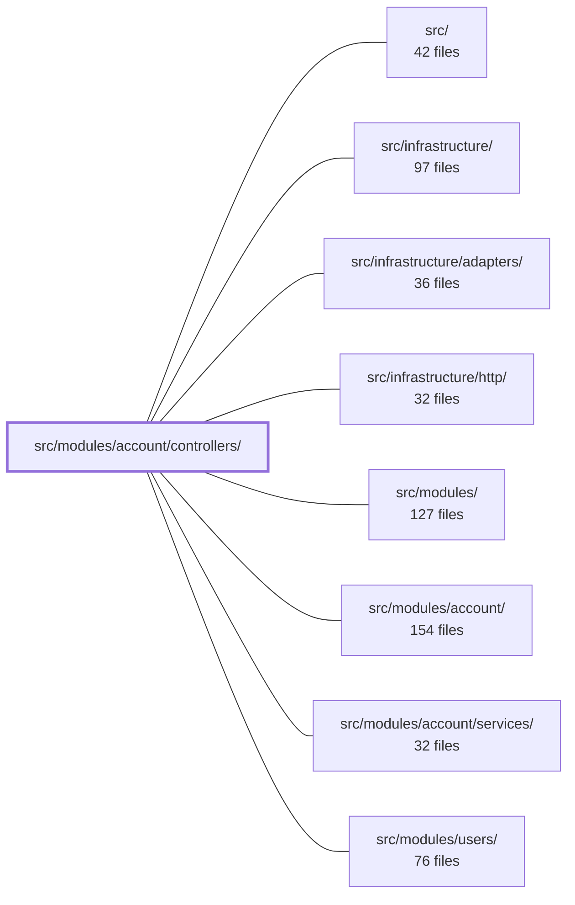

---
tags:
  - 2brain
  - 2brain/module
  - project/boilerplate-node-backend
type: module
module: src/modules/account/controllers/
files: 46
updated: 2026-10-29T19:22:24.057702+00:00
---

# src/modules/account/controllers/

## Purpose

This directory contains the Express HTTP controllers (route handlers) for the account module. Each file is a thin adapter that wires a specific `GET`/`POST`/`DELETE` endpoint to the corresponding business logic in the service layer, handling only request parsing, authentication context extraction, response shaping, cookie management, and error-to-HTTP-status mapping. No domain rules or data-access logic lives here.

## Key parts

- **Authentication & session lifecycle** — `post-login`, `post-login-2fa`, `post-login-2fa-send`, `post-login-restore`, `post-logout`, `post-logout-everywhere`, `get-refresh-token`. These cover the full sign-in/sign-out cycle, including two-factor login, restore-login, token refresh, and session teardown (cookie clearing).
- **Two-factor management** — `get-2fa`, `post-2fa-setup`, `post-2fa-confirm`, `post-2fa-disable`, `post-2fa-method-remove`, `post-2fa-method-send`, `post-2fa-backup-codes`. The complete CRUD surface for arming, confirming, removing, and regenerating backup codes for second-factor methods.
- **OAuth sign-in & linking** — `get-oauth-start`, `get-oauth-callback`, `get-oauth-links`, `get-oauth-providers`, `delete-oauth-link`, `post-oauth-link-start`. Handles the redirect-based provider consent flow (PKCE + CSRF state), the callback that exchanges codes, and the "connect a provider to my existing account" path.
- **Account lifecycle & credentials** — `delete-account`, `post-account-restore`, `post-password-change`, `post-password-check`, `post-reset-confirm`, `get-account`, `get-account-export`, `post-account-export`. Covers deletion (with grace-period restore), password change/check/reset, profile retrieval, and the async export job (status poll + file download).
- **Email-change workflow** — `cancel-pending-email`, `post-email-change-confirm`, `post-email-change-undo`, `post-pending-email-resend`. Token-driven endpoints (no session required for confirm/undo) that promote, revert, or cancel a pending email address change.
- **Reauthentication (step-up)** — `get-reauth-methods`, `post-reauth`, `post-reauth-method-send`. Lets a client responding to a `401 REAUTH_REQUIRED` challenge discover available methods and re-prove identity without destroying the session.
- **Session inspection & config** — `get-session`, `get-sessions`, `delete-session`, `get-session-config`. Read/revoke individual or all sessions and expose deployment-level session settings to the client.
- **Permissions** — `get-my-abilities`. Serves the caller's CASL ability rules (tenant + platform scopes) so the client can render UI affordances; all real authorization still happens server-side per request.

## How it connects

- **`src/modules/account/services/`** — Every controller in this directory delegates its core logic to one of the account or two-factor services (`accountService.*`, `twoFactorService.*`, `requestExport`, etc.). This directory is the HTTP face; the services own validation, data access, and domain rules.
- **`src/modules/users/`** — The controllers resolve authenticated user IDs and, in a few cases (e.g. `get-account`, `post-login-restore`), interact with the users collection directly through the account service, which in turn reads the users domain.
- **`src/infrastructure/http/`** — Controllers depend on the shared HTTP layer for middleware (auth guards, session-cookie helpers, error-envelope formatting, metrics recording) and for the Express app wiring that binds these handlers to routes in `routes.ts`.
- **`src/infrastructure/adapters/`** — Certain controllers (OAuth callback code exchange, email dispatch for password-reset and email-change tokens) rely on adapters that wrap external SDKs or transport concerns, keeping the controller free of provider-specific details.

## Where to start

1. **`post-login.ts`** — It is the most exercised endpoint and shows the canonical pattern: validate body → call service → branch on the service result (full session / 2FA challenge / deletion-pending) → set cookies / return envelope → record metrics. Reading it once makes the "thin adapter" convention in every other file obvious.
2. **`get-oauth-callback.ts`** — It demonstrates the one major deviation from the JSON-envelope norm (302 redirects for browser navigation) and exercises CSRF state, PKCE, code exchange, and the link-vs-signin split, giving a newcomer a complete picture of how the module handles non-trivial multi-step flows.

## Connected modules

[[boilerplate-node-backend_src|src/]] · [[boilerplate-node-backend_src_infrastructure|src/infrastructure/]] · [[boilerplate-node-backend_src_infrastructure_adapters|src/infrastructure/adapters/]] · [[boilerplate-node-backend_src_infrastructure_http|src/infrastructure/http/]] · [[boilerplate-node-backend_src_modules|src/modules/]] · [[boilerplate-node-backend_src_modules_account|src/modules/account/]] · [[boilerplate-node-backend_src_modules_account_services|src/modules/account/services/]] · [[boilerplate-node-backend_src_modules_users|src/modules/users/]]

## Files
- `src/modules/account/controllers/cancel-pending-email.ts` — Thin HTTP adapter that handles `DELETE /account/email-change`, delegating all business logic to `accountService.cancelPendingEmailChange`. It extracts the authenticated user's id and caller context, then translates the service result into a 204 or an error response.
- `src/modules/account/controllers/delete-account.ts` — Handler for `DELETE /account`. An authenticated user requests deletion of their own account; the controller verifies the user still exists, delegates scheduling to the account service, clears the session cookie in the same response, and returns **202** with the `requestedAt` and `purgeAt` timestamps.
- `src/modules/account/controllers/delete-oauth-link.ts` — Thin HTTP adapter that handles `DELETE /account/oauth/links/{provider}`. It delegates the actual unlinking to `accountService.unlinkOAuthProvider` and, on success, returns the caller's *current* list of remaining OAuth links.
- `src/modules/account/controllers/delete-session.ts` — HTTP controller for `DELETE /account/sessions/:sessionId`. It validates the `sessionId` param, delegates to `accountService.sessionRevoke`, and handles the HTTP response (including cookie cleanup when the revoked session is the caller's current one).
- `src/modules/account/controllers/get-2fa.ts` — Thin HTTP adapter for `GET /account/2fa`. It reads the authenticated caller's current second-factor status (active methods and available options) by delegating to `twoFactorService.twoFactorStatus`, then formats the result into a standard success or rejection response.
- `src/modules/account/controllers/get-account-export.ts` — HTTP controllers for the account-export endpoints: one returns the status of the caller's export job, the other streams the finished export file as a JSON download. They exist to separate the "is my export ready?" poll from the actual file transfer, and to enforce that the file is always owned by the authenticated caller.
- `src/modules/account/controllers/get-account.ts` — HTTP controller for `GET /account`. It is a thin adapter that resolves the authenticated caller's full profile row from the users collection (via `accountService.getOwnProfile`), shapes it into the `Account` wire type, and returns it with an ETag. It exists separately from the service layer so that the HTTP concerns (auth check, status codes, ETag, response envelope) stay isolated from the data-access logic.
- `src/modules/account/controllers/get-my-abilities.ts` — Handler for `GET /account/abilities`. Publishes the server's CASL permission rules (in wire format) for the authenticated caller across **both** tenant and platform scopes, so clients can render UI affordances (grey-out, hide) from a single authoritative source instead of each inventing its own guess. The endpoint is strictly read-only; every actual authorization decision is still re-evaluated server-side on each request.
- `src/modules/account/controllers/get-oauth-callback.ts` — Handler for `GET /account/oauth/:provider/callback` — the endpoint a provider's consent screen redirects the browser back to. It validates the CSRF `state` and PKCE verifier, exchanges the authorization code, then either links the identity to an already-signed-in account or finds/creates an account and mints a session. Every failure after `state` is trusted is communicated via a 302 redirect carrying `?error=<code>` because the browser is mid-navigation and cannot read a JSON body.
- `src/modules/account/controllers/get-oauth-links.ts` — Thin Express controller that handles `GET /account/oauth/links`. It resolves the authenticated user's ID, delegates to `accountService.listOAuthLinks`, transforms the result through the account presenter, and returns the formatted list of connected sign-in providers (with their connection timestamps).
- `src/modules/account/controllers/get-oauth-providers.ts` — Thin HTTP adapter for `GET /account/oauth/providers`. It exposes the set of enabled OAuth providers for the current deployment so the frontend can render the correct "Continue with…" buttons without hardcoding a list.
- `src/modules/account/controllers/get-oauth-start.ts` — Single-handler controller for `GET /account/oauth/:provider`. It is the one route in the account module that answers a browser navigation with a `302 Location` redirect rather than a JSON envelope, because the destination is an external consent screen and there is no body to negotiate.
- `src/modules/account/controllers/get-reauth-methods.ts` — Thin Express handler for `GET /account/reauth`. It exposes the reauthentication methods available to the caller's account so that a client receiving a `401 REAUTH_REQUIRED` challenge can discover how to complete reauth. All business logic lives in `accountService`; this file only adapts the HTTP layer.
- `src/modules/account/controllers/get-refresh-token.ts` — HTTP handler for `POST /account/refresh`. A thin adapter that exchanges a refresh cookie for a new short-lived access token and simultaneously rotates the refresh cookie. Only active in `jwt` session mode; returns 404 in `cookie` mode.
- `src/modules/account/controllers/get-session-config.ts` — Public `GET /account/session-config` controller that reports how this deployment manages session persistence (mode, tiered lifetimes, optional staff cap) so clients can adapt at boot rather than carrying their own configuration switch.
- `src/modules/account/controllers/get-session.ts` — Thin HTTP adapter for `GET /account/sessions/:sessionId`. It validates the path parameter, delegates the actual lookup to `accountService.sessionGet`, and shapes the JSON response. It exists so that routing (`routes.ts`) stays declarative while this file owns the request/response lifecycle for the single-session endpoint.
- `src/modules/account/controllers/get-sessions.ts` — Thin HTTP adapter for `GET /account/sessions`. It extracts the authenticated user's ID, delegates to `accountService.sessionsList`, and writes the result back as a JSON response. All session-querying logic (which rows qualify, marking the current session, keeping credentials off the wire) lives in the service layer.
- `src/modules/account/controllers/post-2fa-backup-codes.ts` — HTTP handler for `POST /account/2fa/backup-codes`. Accepts a valid 2FA code, delegates to `twoFactorService.regenerateBackupCodes` to mint a fresh set of ten backup codes (discarding the old ones), and returns the new set. It exists as the thin Express adapter that wires routing, validation, metrics, and the service layer together.
- `src/modules/account/controllers/post-2fa-confirm.ts` — Thin HTTP adapter for `POST /account/2fa/methods/{method}/confirm`. Validates the incoming request, delegates to `twoFactorService.confirmTwoFactorMethod`, handles session reminting (since arming a factor revokes all existing sessions), and returns the confirmation payload including backup codes when this is the account's first factor.
- `src/modules/account/controllers/post-2fa-disable.ts` — HTTP handler for `POST /account/2fa/disable`. Validates the request body (code or backup code), delegates to `twoFactorService.disableTwoFactor`, and remints the caller's session — because disabling all factors revokes every session, including the one carrying this request.
- `src/modules/account/controllers/post-2fa-method-remove.ts` — HTTP controller for `POST /account/2fa/methods/{method}/remove`. Removes a single 2FA method while leaving the remaining factors armed. Requires both a critical-auth session and a valid one-time code (same security bar as full 2FA disable) so a stolen-but-fresh session cannot strip factors individually.
- `src/modules/account/controllers/post-2fa-method-send.ts` — Thin HTTP adapter for `POST /account/2fa-methods/{method}/send`. Parses the path parameter, delegates to `twoFactorService.sendMethodCode`, and maps the result (or refusal) to an Express response. It exists so the route layer stays declarative while business logic lives in the service.
- `src/modules/account/controllers/post-2fa-setup.ts` — Thin HTTP adapter for `POST /account/2fa/methods/{method}/setup`. Validates the request, then delegates to `twoFactorService.setupTwoFactorMethod`. Exists to keep Express-specific concerns (parsing, response shaping, error catching) out of the service layer.
- `src/modules/account/controllers/post-account-export.ts` — Thin Express controller for `POST /account/export`. It extracts the caller's ID from the auth context, delegates to `requestExport`, and returns a `202` with the export status and a `Location` header. All real work (building the export file, mailing a link) happens asynchronously in the service layer.
- `src/modules/account/controllers/post-account-restore.ts` — Controller for the public `POST /account/restore` endpoint. It validates a one-time restore token (delivered via email) and cancels the account's scheduled deletion. The token is the sole credential; the route performs no authentication or session creation.
- `src/modules/account/controllers/post-email-change-confirm.ts` — Controller for `POST /account/email-change/confirm`. It validates a one-time email-change token from the request body and, on success, promotes the caller's `pendingEmail` to the active `email`. The endpoint is intentionally public: the token itself is the credential, not a session or login.
- `src/modules/account/controllers/post-email-change-undo.ts` — Controller for `POST /account/email-change/undo`. It validates a one-time undo token (delivered to the old address) and reverts the account's email change. The endpoint is public—no session auth; the token in the body is the sole credential.
- `src/modules/account/controllers/post-login-2fa-send.ts` — Thin HTTP adapter for `POST /account/login/2fa/send`. Validates the request body, resolves a 2FA challenge token, delegates to `twoFactorService.sendLoginCode`, and returns the delivery result. Exists to keep the login flow's two-factor step as a single, self-contained Express handler that routes can register directly.
- `src/modules/account/controllers/post-login-2fa.ts` — HTTP controller for `POST /account/login/2fa`, the second leg of a two-factor login. It verifies the challenge returned by `POST /account/login` against the caller's code (or backup code), then mints a full session with an `otp` AMR proof — mirroring what `postLogin` does for single-factor accounts.
- `src/modules/account/controllers/post-login-restore.ts` — Implements the `POST /account/login/restore` handler, the final step of signing in an account that is inside the grace period of its own deletion. It redeems the deletion challenge (cancelling the pending deletion) and then mints a session in the same manner as the standard `postLogin` flow.
- `src/modules/account/controllers/post-login.ts` — The `POST /account/login` controller. It validates the "remember me" tier, calls the account service to verify credentials, then branches into one of three outcomes: issue a full session (refresh cookie + short-lived access token), return a 2FA challenge, or surface a deletion-pending claim. All success/failure login metrics are recorded here at the controller level rather than inside the service.
- `src/modules/account/controllers/post-logout-everywhere.ts` — Thin HTTP adapter that wires the `DELETE /account/sessions` route to `accountService.logoutEverywhere`. It delegates all business logic to the service layer and only handles request extraction, response formatting, and cookie teardown.
- `src/modules/account/controllers/post-logout.ts` — HTTP adapter for `POST /account/logout`. Translates an Express request/response into a single call to `accountService.logoutCurrentSession`, then clears the session cookie and returns 200 No Content. It exists to keep the logout logic in the service layer while this file handles only the HTTP surface (credential extraction, cookie teardown, error mapping).
- `src/modules/account/controllers/post-oauth-link-start.ts` — POST controller for `/account/oauth/links/{provider}` that initiates the "connect a provider to my existing account" flow. Unlike the sign-in `GET` route, it returns JSON (an `authorizeUrl`) to a signed-in client and sets the session cookies (OAuth state, PKCE verifier, link token, optional continue/locale) that the callback will trust when the browser returns from the provider.
- `src/modules/account/controllers/post-password-change.ts` — Thin HTTP adapter for `POST /account/password`. Validates the request body, delegates the actual password change to `accountService.passwordChangeWithCurrent`, and re-issues the caller's own session token so the user is not signed out of the tab in which they typed the new password.
- `src/modules/account/controllers/post-password-check.ts` — Advisory controller for `POST /account/password/check`. It reports whether a candidate password appears in known breach databases so the client can warn the user. It is deliberately unauthenticated (signup requires it before an account exists) and never blocks anything — the four password-SET endpoints remain the authoritative server-side gate.
- `src/modules/account/controllers/post-pending-email-resend.ts` — Thin HTTP adapter for `POST /account/email-change/resend`. It extracts the authenticated caller's ID and delegates to `accountService.resendPendingEmailVerificationFor`, then maps the result (or rejection) onto the Express response. The controller itself contains no business logic.
- `src/modules/account/controllers/post-reauth-method-send.ts` — Thin HTTP adapter for `POST /account/reauth/methods/{method}/send`. It validates the path parameter, delegates to `accountService.sendReauthCode`, and shapes the JSON response. It exists so that an account **without** a password can receive a step-up code (e.g. via e-mail) using only a stale session.
- `src/modules/account/controllers/post-reauth.ts` — HTTP controller for `POST /account/reauth`. It is the server-side handler for a `401 REAUTH_REQUIRED` step-up challenge: the caller re-proves identity (password or emailed OTP code), and the session is re-minted with a fresh `auth_time` without being destroyed. It is a thin adapter over `accountService.reauth` plus a session re-issue.
- `src/modules/account/controllers/post-reset-confirm.ts` — Controller for `POST /account/password/reset/confirm`. Receives a one-time reset token (delivered via email link) plus a new password, delegates the atomic token-spend and password-set to the account service, and on success destroys the session cookie and returns 204.
- `src/modules/account/controllers/post-reset-request.ts` — Thin HTTP adapter for `POST /account/password/reset`. Validates the request body shape and fires a non-blocking call to `accountService.requestPasswordReset`, then immediately returns `204 No Content` — the same response (and timing) for registered and unregistered emails, preventing user enumeration.
- `src/modules/account/controllers/post-session-touch.ts` — Handler for `POST /account/sessions/current/touch`. It does **not** write any activity data — it simply reads the current idle clock (already advanced by upstream auth middleware) and returns the server-side session-activity snapshot so a client can drive a "still there?" prompt from authoritative numbers.
- `src/modules/account/controllers/post-signup.ts` — HTTP controller for `POST /account/signup`. It is a thin adapter that destructures the JSON body, delegates all business logic to `accountService.signup`, then maps the result onto one of three HTTP responses: a validation failure (422), an antibot-rung-2 refusal (201, body-identical to success), or a genuine registration (201 + session cookies). No images or file uploads are handled here.
- `src/modules/account/controllers/post-verify-confirm.ts` — Controller for `POST /account/email-verification/confirm`. Validates the request body, delegates to the account service to spend a one-time email-verification token and mark the email as verified, and emits a Prometheus metric for the outcome.
- `src/modules/account/controllers/post-verify-request.ts` — Thin HTTP adapter for `POST /account/email-verification/resend`. It extracts the authenticated user's id, delegates to `accountService.requestEmailVerificationFor`, and maps the service result (success or refusal) onto an Express response. It exists to keep transport concerns (auth-context extraction, response formatting, error shaping) separate from verification business logic.
- `src/modules/account/controllers/update-account.ts` — Defines the `PUT /account` (full replace) and `PATCH /account` (partial merge) endpoint handlers. Both operate exclusively on the authenticated caller's own record—the target id is never supplied by the client. The handlers are produced by the shared `createUpdateController` factory and delegate all business logic (field merging, email-verification flow, auditing) to `accountService.updateProfile`.

---
[[boilerplate-node-backend_INDEX|← boilerplate-node-backend index]]
