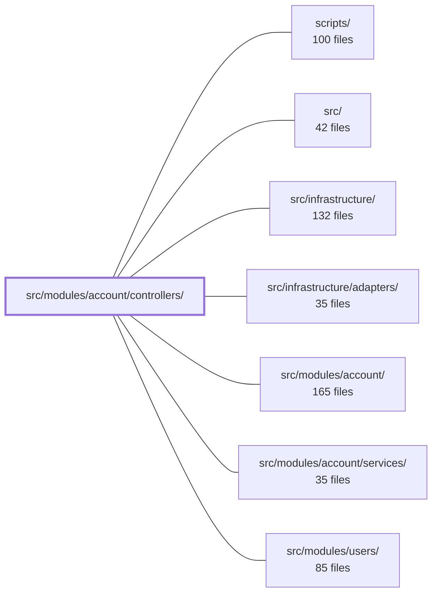

---
tags:
  - 2brain
  - 2brain/module
  - project/boilerplate-node-backend
type: module
module: src/modules/account/controllers/
files: 44
updated: 2026-11-15T00:30:30.323040+00:00
---

# src/modules/account/controllers/

## Purpose

The controller layer for the Account module. Every file here is a thin HTTP adapter: it parses the incoming request (Zod-validated body, path params, cookies), delegates the actual business logic to the account or two-factor service, and shapes the outbound HTTP response (status code, headers, cookies, redirect). No domain rules, state transitions, or persistence live in this directory.

## Key parts

- **Auth & session lifecycle** — `post-login.ts`, `post-login-2fa.ts`, `post-logout.ts`, `post-logout-everywhere.ts`, `get-refresh-token.ts`, `post-reauth.ts`. Handle credential verification, 2FA challenge issuance/verification, session minting and revocation, and the `401 REAUTH_REQUIRED` step-up flow.
- **Two-factor enrollment & management** — `get-2fa.ts`, `post-2fa-setup.ts`, `post-2fa-confirm.ts`, `post-2fa-disable.ts`, `post-2fa-method-remove.ts`, `post-2fa-method-send.ts`, `post-2fa-backup-codes.ts`. Thin adapters over `twoFactorService`; each security-sensitive mutation re-mints the caller's session because the service revokes all active sessions.
- **OAuth integration** — `get-oauth-start.ts` (redirects to provider), `get-oauth-callback.ts` (code exchange, connect-or-login), `post-oauth-link-start.ts`, `get-oauth-links.ts`, `delete-oauth-link.ts`. Manage PKCE/state cookies and the three possible callback outcomes.
- **Email change & account export** — `post-email-change.ts` / `post-email-change-confirm.ts` / `post-email-change-resend.ts` / `post-email-change-undo.ts` / `delete-email-change.ts`; `post-account-export.ts` / `get-account-export.ts`. The confirm/undo endpoints are public (token-in-body is the credential); the export pair splits status query from streaming the file.
- **Password management** — `post-password-change.ts`, `post-password-check.ts`, `post-reset-request.ts`, `post-reset-confirm.ts`. The reset-request endpoint always returns 204 to prevent user enumeration; the check endpoint is advisory only.
- **Session introspection** — `get-sessions.ts`, `get-session.ts`, `delete-session.ts`, `post-session-touch.ts`. Read or revoke individual sessions; `post-session-touch` is a no-op that returns the server-side activity clock.
- **Account read & deletion** — `get-account.ts` (fresh profile fetch), `delete-account.ts` (schedules timed purge), `post-account-restore.ts` (public, token-gated cancel of pending deletion).

## How it connects

- **`src/modules/account/services/`** — The primary collaborator. Nearly every controller delegates its core operation to `accountService` or `twoFactorService` methods (login, logout, `getOwnProfile`, `requestExport`, `cancelPendingEmailChange`, `twoFactorStatus`, etc.). The controller is the only place Express-specific concerns (Zod parsing, cookie set/destroy, `catchAs` error mapping, Prometheus counters, `requireFreshAuth` gating) appear.
- **`src/infrastructure/adapters/`** — Provides shared response helpers (success envelope, `catchAs`, streaming utilities) and likely the auth middleware that populates the authenticated context the controllers read from.
- **`src/modules/account/`** (parent) — The route definitions that wire each URL path to the corresponding controller function live one level up; this directory supplies only the handler implementations.
- **`src/modules/users/`** — The user entity/schema definitions that `AccountView` presenters and service return types are built on; controllers reference the shape indirectly through the service contracts.

## Where to start

1. **`post-login.ts`** — The most complex controller in the module. Reading it reveals the three-outcome branch (2FA challenge, deletion-grace, full session), how metrics and audit logging are emitted at the controller level, and the cookie/token patterns used across the rest of the directory.
2. **`get-oauth-callback.ts`** — The only controller that performs a full external round-trip (code exchange) and returns a 302 redirect instead of JSON. Understanding its `state`/PKCE validation and the connect-vs-login split clarifies how the OAuth cookie contract established in `get-oauth-start.ts` is consumed.

## Connected modules

[[boilerplate-node-backend_scripts|scripts/]] · [[boilerplate-node-backend_src|src/]] · [[boilerplate-node-backend_src_infrastructure|src/infrastructure/]] · [[boilerplate-node-backend_src_infrastructure_adapters|src/infrastructure/adapters/]] · [[boilerplate-node-backend_src_modules_account|src/modules/account/]] · [[boilerplate-node-backend_src_modules_account_services|src/modules/account/services/]] · [[boilerplate-node-backend_src_modules_users|src/modules/users/]]

## Files
- `src/modules/account/controllers/delete-account.ts` — Single-purpose Express controller for `DELETE /account`. When an authenticated user requests deletion, it verifies the account row still exists, schedules a timed purge via the account service, destroys the session cookie, and responds 202 with `requestedAt` and `purgeAt` timestamps.
- `src/modules/account/controllers/delete-email-change.ts` — Thin HTTP adapter for the `DELETE /account/email-change` endpoint. It extracts the authenticated user's ID and caller context from the request, delegates to `accountService.cancelPendingEmailChange`, and maps the result to an appropriate HTTP response (204 on success, 409 on refusal, or an error status via `catchAs`).
- `src/modules/account/controllers/delete-oauth-link.ts` — Thin HTTP adapter for `DELETE /account/oauth/links/{provider}`. It delegates the actual unlinking to `accountService.unlinkOAuthProvider`, then returns the caller's updated list of linked OAuth providers. Exists to keep the route handler a trivial mapping between HTTP concerns and the account service.
- `src/modules/account/controllers/delete-session.ts` — Thin HTTP adapter for `DELETE /account/sessions/:sessionId`. Validates the caller's identity and the session-ID parameter, delegates the actual revocation to `accountService.sessionRevoke`, and emits either a `404` or a `204` response — clearing the session cookie only when the revoked session is the caller's current one.
- `src/modules/account/controllers/get-2fa.ts` — HTTP controller for `GET /account/2fa`. Returns the authenticated caller's current second-factor status (enrolled methods and still-available options). It is a thin adapter: all business logic lives in `twoFactorService.twoFactorStatus`; this file only translates the service result into an HTTP response.
- `src/modules/account/controllers/get-account-export.ts` — Two Express route handlers for the account-export feature: one returns the caller's export **status** (state, dates) and the other **streams** the finished export file as a JSON attachment. The split exists because the file endpoint requires fresh auth (`requireFreshAuth`) and streams raw bytes, while the status endpoint is a lightweight, envelope-wrapped query.
- `src/modules/account/controllers/get-account.ts` — Thin HTTP adapter for `GET /account`. It fetches the authenticated user's full profile fresh from the database (via `accountService.getOwnProfile`) and returns a complete `AccountView`, rather than echoing the JWT payload which would silently omit fields like `verifiedAt` and `locale` that the client's verify banner and saved-language flow depend on.
- `src/modules/account/controllers/get-oauth-callback.ts` — Handler for `GET /account/oauth/:provider/callback` — the endpoint an OAuth provider's consent screen redirects the browser back to. It validates the CSRF `state` and PKCE verifier, exchanges the authorization code with the provider, then either links the identity to an already-signed-in account (connect flow) or finds-or-creates a user and issues a session (login flow). Exactly three response shapes reach the caller: 404 (unknown provider), 400 (state/verifier mismatch), or 302 back to the frontend (everything else, with `?error=<code>` appended for failures).
- `src/modules/account/controllers/get-oauth-links.ts` — Thin HTTP adapter for the `GET /account/oauth/links` endpoint. It extracts the caller's user ID from the auth context, delegates to `accountService.listOAuthLinks`, shapes the result with a presenter, and writes a standard success or error response. No business logic lives here.
- `src/modules/account/controllers/get-oauth-start.ts` — Controller for `GET /account/oauth/:provider`. Validates the provider name, mints a CSRF `state` value and a PKCE code verifier (both stored as cookies), optionally persists `?continue=` and `?locale=` query parameters as cookies, and responds with a **302 redirect** to the provider's consent screen. It is the sole account route that answers with a redirect rather than a JSON body.
- `src/modules/account/controllers/get-reauth-methods.ts` — Thin HTTP adapter for `GET /account/reauth`. It exposes which re-authentication methods (e.g. passkey, OTP) are available to answer a `401 REAUTH_REQUIRED` challenge. It exists to keep Express plumbing separate from the `accountService.reauthMethods` business logic.
- `src/modules/account/controllers/get-refresh-token.ts` — Thin HTTP adapter for `POST /account/refresh`. Exchanges the current refresh cookie for a new short-lived access token **and** a rotated refresh cookie in the same response. Only meaningful in `jwt` session mode; in `cookie` mode the endpoint is a 404 because the single credential never rotates.
- `src/modules/account/controllers/get-session.ts` — Thin HTTP adapter that handles `GET /account/sessions/:sessionId`, delegating to `accountService.sessionGet` and mapping the result (or its absence) to a `200` or `404` response. It exists so the route layer stays declarative while validation, authorization context, and response shaping live in one small function.
- `src/modules/account/controllers/get-sessions.ts` — Thin Express controller that handles `GET /account/sessions`. It extracts the authenticated user's ID from the request context, delegates to `accountService.sessionsList`, and writes the result through the shared response helpers. All session semantics (which rows qualify, how `current` is flagged, credential hygiene) live in the service layer, not here.
- `src/modules/account/controllers/post-2fa-backup-codes.ts` — Thin HTTP adapter for `POST /account/2fa/backup-codes`. Validates the incoming request body (which must include a valid two-factor code), delegates to `twoFactorService.regenerateBackupCodes` to mint a fresh set of ten backup codes, and returns the result or an error. It exists to keep HTTP concerns (body parsing, response shaping, metrics) separate from the domain service.
- `src/modules/account/controllers/post-2fa-confirm.ts` — Thin HTTP adapter for `POST /account/2fa/methods/{method}/confirm`. Validates path params and body against Zod schemas, delegates to `twoFactorService.confirmTwoFactorMethod`, remints the caller's session (since confirming a factor revokes all existing sessions), and returns the confirmation payload (which may include backup codes for the account's first factor).
- `src/modules/account/controllers/post-2fa-disable.ts` — HTTP controller for `POST /account/2fa/disable`. Validates the request body (code or backup code), delegates to `twoFactorService.disableTwoFactor`, and—because disabling 2FA revokes all sessions including the caller's—immediately remints a fresh session so the authenticated user is not logged out mid-operation.
- `src/modules/account/controllers/post-2fa-method-remove.ts` — Thin HTTP adapter for `POST /account/2fa/methods/{method}/remove`. Accepts a valid one-time code, delegates to `twoFactorService.removeTwoFactorMethod` to drop a single 2FA factor (leaving the rest armed), then re-mints the caller's session because the removal revokes all active sessions.
- `src/modules/account/controllers/post-2fa-method-send.ts` — Thin HTTP adapter for `POST /account/2fa/methods/{method}/send`. Validates the path parameter, delegates to `twoFactorService.sendMethodCode`, and maps the service result onto a standard HTTP response. Authentication and the per-account delivery budget are enforced upstream (route middleware), not here.
- `src/modules/account/controllers/post-2fa-setup.ts` — Thin HTTP adapter for `POST /account/2fa/methods/{method}/setup`. Validates the path parameter and optional body, then delegates to `twoFactorService.setupTwoFactorMethod` to start or restart enrollment of a single 2FA method. The restart path (re-enrolling an already-armed method) requires a valid code from an existing factor as a guard against session-hijack attacks.
- `src/modules/account/controllers/post-account-export.ts` — Thin HTTP adapter for `POST /account/export`. Receives an authenticated request, delegates the actual data-export request to the `requestExport` service, and shapes the HTTP response (status, body, `Location` header). It contains no business logic beyond wiring the caller's identity into the service call.
- `src/modules/account/controllers/post-account-restore.ts` — Handler for `POST /account/restore`. Validates a one-time restore token supplied in the request body and cancels the account's scheduled deletion. The endpoint is public — the token itself is the credential, and the operation does **not** create a session or sign anyone in.
- `src/modules/account/controllers/post-email-change-confirm.ts` — Controller for `POST /account/email-change/confirm`. Validates a one-time `email-change` token from the request body and delegates to the account service to promote `pendingEmail` into the active `email`. The endpoint is intentionally public—the token in the body is the credential, not a session.
- `src/modules/account/controllers/post-email-change-resend.ts` — Thin HTTP adapter that handles `POST /account/email-change/resend`. It extracts the authenticated user's id, delegates to `accountService.resendPendingEmailVerificationFor`, and translates the result (or refusal) into a standard HTTP response. Exists to keep the account service free of Express-specific concerns.
- `src/modules/account/controllers/post-email-change-undo.ts` — HTTP controller for `POST /account/email-change/undo`. It validates a `{ token }` body, delegates to the account service to spend a one-time undo token (reverting the account to its pre-change state), and returns `204 No Content` on success. The endpoint is public—possession of the token is the sole credential.
- `src/modules/account/controllers/post-email-change.ts` — Thin HTTP adapter that handles `POST /account/email-change`. It validates the request body, delegates to `accountService.requestEmailChange`, and maps the result onto an HTTP success or error response. All business logic (messaging, pending-state transitions) lives in the service; this file only translates between HTTP and the service contract.
- `src/modules/account/controllers/post-login-2fa-send.ts` — Thin HTTP adapter that handles `POST /account/login/2fa/send`. It validates the request body, resolves a two-factor challenge token, delegates to `twoFactorService.sendLoginCode`, and returns the delivery result. It exists to keep the login 2FA flow's I/O concerns (body parsing, response shaping, metrics) separate from the service layer.
- `src/modules/account/controllers/post-login-2fa.ts` — HTTP adapter for `POST /account/login/2fa`, the second step of a two-factor login. It validates the challenge (obtained from the first `POST /account/login` response or from an OAuth-originated cookie), verifies the user-supplied code via `twoFactorService`, and on success mints a session with AMR proofs that include `otp`. It also handles the deletion-grace case where a verified code does not yield a session but a deletion-pending claim.
- `src/modules/account/controllers/post-login-restore.ts` — Handler for `POST /account/login/restore`, the final step of signing in with an account that is inside its deletion grace period. It validates (redeems) the deletion challenge to cancel the pending deletion, then mints a session identical in shape to a normal `postLogin` success.
- `src/modules/account/controllers/post-login.ts` — The `POST /account/login` controller. It authenticates a user's credentials via `accountService.login`, then branches into one of three outcomes: a 2FA challenge, a deletion-grace claim, or a full session issue (refresh cookie + short-lived access token). Success/failure metrics, audit logging, and analytics are emitted here in the controller rather than in the service layer, so that 422s raised *before* the credential check still appear in the failure trail.
- `src/modules/account/controllers/post-logout-everywhere.ts` — Thin HTTP adapter for the `DELETE /account/sessions` endpoint. It delegates all business logic to `accountService.logoutEverywhere` and is responsible only for translating the service result into an HTTP response: destroying the session cookie, returning `204` on success, or a rejection with error details on failure.
- `src/modules/account/controllers/post-logout.ts` — Thin HTTP adapter for `POST /account/logout`. Extracts the session credential from the incoming request, delegates revocation to `accountService.logoutCurrentSession`, clears the session cookie, and returns a bare 204. Exists to keep the routing layer free of business logic while providing a single, explicit entry point for ending *only the current* session.
- `src/modules/account/controllers/post-oauth-link-start.ts` — Handler for `POST /account/oauth/links/{provider}` — the signed-in flow for connecting an external sign-in provider to the caller's account. It mints the OAuth state and PKCE verifier, obtains a link token from the account service, sets all of them (plus optional `continue`/`locale`) as cookies, and responds with the provider's authorization URL for the client to navigate to.
- `src/modules/account/controllers/post-password-change.ts` — HTTP handler for `POST /account/password`. Changes a user's password by verifying the current one inline (no email round-trip), then re-mints the caller's own session token so they stay signed in in the tab they are typing in.
- `src/modules/account/controllers/post-password-check.ts` — Handles the unauthenticated `POST /account/password/check` endpoint, which reports whether a candidate password appears in a known-breach database. It exists to give clients (e.g., a signup form) an advisory signal before an account is created. It is intentionally non-blocking: the four password-SET endpoints remain the authoritative server-side gate.
- `src/modules/account/controllers/post-reauth-method-send.ts` — Thin Express controller for `POST /account/reauth/methods/{method}/send`. It validates the path parameter, extracts the caller context, and delegates to `accountService.sendReauthCode`. Exists to give password-less accounts a way to obtain a step-up code, using per-account delivery budgets and per-code cooldowns as the rate-limiting mechanism (no fresh-auth guard is applied).
- `src/modules/account/controllers/post-reauth.ts` — Thin HTTP adapter for `POST /account/reauth`. It answers a `401 REAUTH_REQUIRED` step-up challenge by re-proving the caller (password or emailed code), then re-mints the existing session with a fresh `auth_time` without destroying it. The `amr` claim on the new session reflects only what this specific call proved.
- `src/modules/account/controllers/post-reset-confirm.ts` — HTTP controller for `POST /account/password/reset/confirm`. It validates the request body, delegates the token spend + password set to the account service, and on success clears the session cookie and returns 204. It also emits a Prometheus counter for every attempt (success or failure).
- `src/modules/account/controllers/post-reset-request.ts` — HTTP adapter for `POST /account/password/reset`. It validates the request body shape, delegates to `accountService.requestPasswordReset` in a detached (fire-and-forget) call, and immediately returns `204 No Content` regardless of whether the email is registered — deliberately preventing user enumeration and timing-attack leaks.
- `src/modules/account/controllers/post-session-touch.ts` — Handler for `POST /account/sessions/current/touch`. It does **not** write anything — the auth middleware has already counted the request as activity. It simply reads the session's current activity clock from the authenticated context and returns it, so a client can display a "still there?" prompt from server-side numbers.
- `src/modules/account/controllers/post-signup.ts` — Thin HTTP adapter that handles `POST /account/signup`. It forwards the raw request body to `accountService.signup`, then branches on the result to emit either a rejection, a disguised antibot refusal, or a real 201 with a session cookie and a fire-and-forget verification email. The controller intentionally performs no field-level validation itself; all parsing and business rules live in the service.
- `src/modules/account/controllers/post-verify-confirm.ts` — Controller handler for `POST /account/email-verification/confirm`. It validates a one-time verification token from the request body, delegates the find-then-spend operation to `accountService.confirmEmailVerification`, and responds with `204 No Content` on success. It exists to keep the HTTP-layer concerns (parsing, metric tracking, error shaping) separate from the domain logic in the account service.
- `src/modules/account/controllers/post-verify-request.ts` — Thin HTTP adapter for `POST /account/email-verification/resend`. It extracts the authenticated user's ID, delegates to `accountService.requestEmailVerificationFor`, and maps the service result (success or refusal) onto the HTTP response. The controller contains no business logic itself.
- `src/modules/account/controllers/update-account.ts` — Implements the `PUT /account` (full replace) and `PATCH /account` (partial merge) handlers for the caller's own account record. Both are produced in one call to the shared `createUpdateController` factory. The handler never reads an `id` from the request; it always targets `request.authContext.id`. Email changes are explicitly excluded and handled by a separate `POST /account/email-change` endpoint.

---
[[boilerplate-node-backend_INDEX|← boilerplate-node-backend index]]
