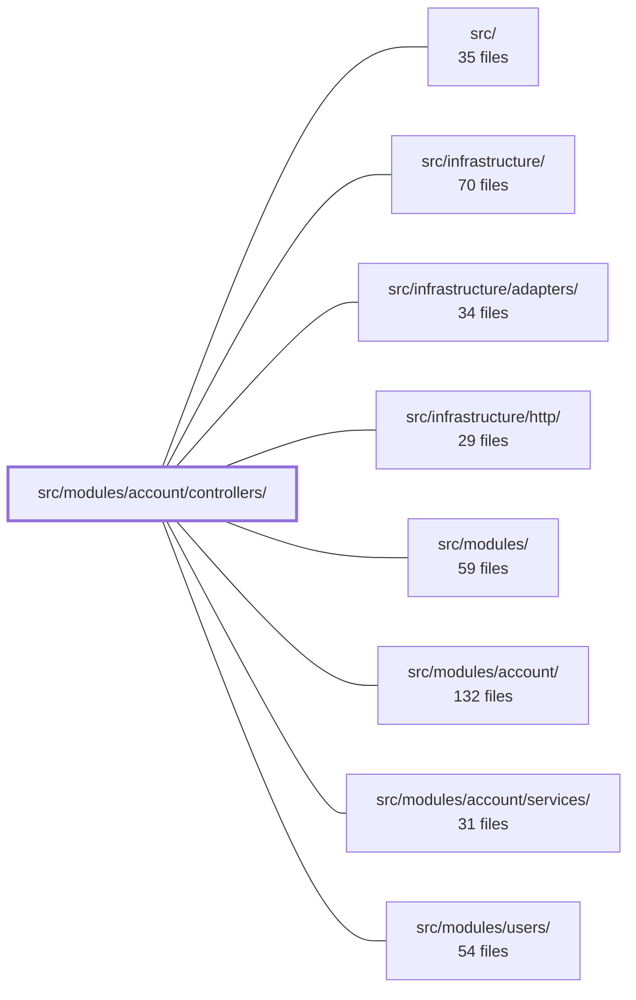

---
tags:
  - 2brain
  - 2brain/module
  - project/boilerplate-node-backend
type: module
module: src/modules/account/controllers/
files: 43
updated: 2026-10-15T13:36:57.867359+00:00
---

# src/modules/account/controllers/

## Purpose

The HTTP adapter layer for the account module. Each file is a thin Express handler that translates a single route's request into a service call and the service result back into a well-shaped HTTP response. Controllers perform input validation, session minting/teardown, cookie management, and error-to-status mapping, but contain no business logic — all domain rules live in the account and two-factor services.

## Key parts

- **Authentication & session lifecycle** — `post-login`, `post-login-2fa`, `post-login-2fa-send`, `post-logout`, `post-logout-everywhere`, `get-refresh-token`, `post-session-touch`, `get-session-config`, `post-reauth`, `get-reauth-methods`, `post-reauth-method-send`. Covers the full login (including the two-factor branch), token refresh, logout (single and global), step-up reauthentication, and the idle-clock probe.
- **Two-factor enrollment & management** — `get-2fa`, `post-2fa-setup`, `post-2fa-method-send`, `post-2fa-confirm`, `post-2fa-backup-codes`, `delete-2fa-method`, `delete-2fa`. Drives the setup → send → confirm → (regenerate backup codes) → remove lifecycle and the global disable.
- **Account profile & credential operations** — `get-account`, `post-signup`, `post-password-change`, `post-password-check`, `post-email-change-confirm`, `post-email-change-undo`, `post-pending-email-resend`, `cancel-pending-email`, `delete-account-request`, `delete-account-confirm`. Handles signup, password set/check, email change (confirm/undo), and the two-step account deletion flow.
- **OAuth** — `get-oauth-start`, `get-oauth-callback`, `get-oauth-links`, `get-oauth-providers`, `delete-oauth-link`. Implements the redirect-based OAuth handshake (start → consent → callback), provider discovery, and link management.
- **Password reset** — `post-reset-request`, `post-reset-confirm`. Fire-and-forget reset request followed by token-verified completion.
- **Sessions & export** — `get-sessions`, `delete-session`, `post-account-export`, `get-account-export`, `get-my-abilities`. Session listing/revocation, the two-step data-export flow, and CASL ability publishing.

## How it connects

- **`src/modules/account/services/`** — Every controller delegates its business logic to `accountService` or `twoFactorService` defined here. The controllers are the sole HTTP-facing surface; the services are the sole domain-logic surface.
- **`src/infrastructure/http/`** — Supplies the Express middleware (`getAuth`, `requireFreshAuth`), cookie utilities, and response helpers that controllers rely on for authentication context, session-cookie minting/destruction, and consistent JSON envelopes.
- **`src/infrastructure/adapters/`** — Provides the transport adapters (email sending, OAuth provider clients, breach-database lookups) that the services invoke; controllers never touch these directly.
- **`src/modules/account/`** — The parent module owns the route table that wires each URL to its controller function, keeping routing declarative and separate from the handler bodies.
- **`src/modules/users/`** — The user document and collection that `accountService` reads and writes; controllers never access it directly but shape their responses around its fields (e.g., `verifiedAt`, `locale`).

## Where to start

1. **`post-login.ts`** — The most complex single controller. It shows the canonical pattern: validate → delegate to service → mint session cookies → emit metrics/audit → shape the response, including the two-factor branch.
2. **`get-account.ts`** — The simplest controller in the module. One service call, one JSON response. Reading it after `post-login` makes the thin-adapter contract obvious and highlights what the controllers deliberately *do not* do.

## Connected modules

[[boilerplate-node-backend_src|src/]] · [[boilerplate-node-backend_src_infrastructure|src/infrastructure/]] · [[boilerplate-node-backend_src_infrastructure_adapters|src/infrastructure/adapters/]] · [[boilerplate-node-backend_src_infrastructure_http|src/infrastructure/http/]] · [[boilerplate-node-backend_src_modules|src/modules/]] · [[boilerplate-node-backend_src_modules_account|src/modules/account/]] · [[boilerplate-node-backend_src_modules_account_services|src/modules/account/services/]] · [[boilerplate-node-backend_src_modules_users|src/modules/users/]]

## Files
- `src/modules/account/controllers/cancel-pending-email.ts` — Thin HTTP adapter for `DELETE /account/pending-email`. It extracts the authenticated user ID and caller context from the request, delegates to `accountService.cancelPendingEmailChange`, and maps the service result (or a refusal) to an HTTP response.
- `src/modules/account/controllers/delete-2fa-method.ts` — Thin HTTP adapter for `DELETE /account/2fa/methods/{method}`. It validates the request, delegates to `twoFactorService.removeTwoFactorMethod`, remints the caller's session (since removal revokes all sessions), and returns the updated auth tokens.
- `src/modules/account/controllers/delete-2fa.ts` — HTTP handler for `DELETE /account/2fa`. Validates the request body (code or backup code), calls `twoFactorService.disableTwoFactor`, and then remints the caller's session because the disable operation revokes all active sessions—including the one the request was made on.
- `src/modules/account/controllers/delete-account-confirm.ts` — Handles the `DELETE /account/delete-confirm` endpoint. It validates a one-time deletion token supplied in the request body, delegates the hard-delete to `accountService`, then tears down the caller's session cookie before returning a success response.
- `src/modules/account/controllers/delete-account-request.ts` — Controller for `DELETE /account`. Given an authenticated user, it triggers the account-deletion confirmation flow (email with a one-time token) by delegating to `accountService`. The token itself is never exposed to the caller.
- `src/modules/account/controllers/delete-oauth-link.ts` — Thin HTTP adapter that exposes `DELETE /account/oauth/links/{provider}`. It extracts the caller's account ID, provider name, and caller context from the request, delegates to `accountService.unlinkOAuthProvider`, and translates the boolean result into a 200 or 404 JSON response.
- `src/modules/account/controllers/delete-session.ts` — Thin Express controller for `DELETE /account/sessions/:sessionId`. It validates the `sessionId` path parameter, delegates to `accountService.sessionRevoke`, and handles the two response branches (revoked vs. not found). It exists so the HTTP layer stays a single, isolated adapter over the account service's session-revocation logic.
- `src/modules/account/controllers/get-2fa.ts` — Thin HTTP adapter for `GET /account/2fa`. It reads the authenticated caller's current second-factor status (active methods and available options) by delegating to `twoFactorService.twoFactorStatus`, then formats the result into a standard success or rejection response.
- `src/modules/account/controllers/get-account-export.ts` — HTTP controller for `GET /account/export/:id`. Streams the caller's own finished export back as a JSON file attachment. Exists so the page opened from a mailed link can deliver the export file directly to the owner without ever buffering the document in memory.
- `src/modules/account/controllers/get-account.ts` — Thin HTTP adapter that serves `GET /account`: returns the authenticated user's **full** profile read fresh from the users collection, rather than echoing the (narrower) JWT claims. This exists because the JWT only carries `id`, `email`, `username`, and `admin`, which would silently drop fields the client depends on (`verifiedAt`, `locale`).
- `src/modules/account/controllers/get-my-abilities.ts` — Handler for `GET /account/abilities`. It publishes the server's enforced CASL permission rules for the caller in **both** scopes (tenant and platform) so the client can render UI affordances (enable/disable/grey-out) without maintaining its own copy of policy. It changes no authorization behavior — every request is still re-evaluated server-side.
- `src/modules/account/controllers/get-oauth-callback.ts` — Handles `GET /account/oauth/:provider/callback` — the redirect a browser receives after the OAuth provider's consent screen. Validates the CSRF `state` against its cookie, exchanges the authorization code (with PKCE verifier), resolves or creates the account, then either mints a session, routes through the 2FA challenge flow, or fails back to the frontend with a `?error=` query param. Only three response shapes ever reach the browser: 404 (unknown provider), 400 (state/verifier mismatch), or 302.
- `src/modules/account/controllers/get-oauth-links.ts` — Thin HTTP adapter for `GET /account/oauth/links`. It delegates to `accountService.listOAuthLinks`, shapes the result into a JSON-safe payload, and hands the response to Express. Exists to keep routing/wiring logic in the routes file and business logic in the service, with only the request→response mapping here.
- `src/modules/account/controllers/get-oauth-providers.ts` — Thin HTTP adapter for `GET /account/oauth/providers`. It exposes the set of enabled OAuth providers for the current deployment so the frontend can render the correct "Continue with…" buttons without hardcoding a list.
- `src/modules/account/controllers/get-oauth-start.ts` — Single-handler controller for `GET /account/oauth/:provider`. It is the one route in the account module that answers a browser navigation with a `302 Location` redirect rather than a JSON envelope, because the destination is an external consent screen and there is no body to negotiate.
- `src/modules/account/controllers/get-reauth-methods.ts` — Thin Express handler for `GET /account/reauth`. It exposes the reauthentication methods available to the caller's account so that a client receiving a `401 REAUTH_REQUIRED` challenge can discover how to complete reauth. All business logic lives in `accountService`; this file only adapts the HTTP layer.
- `src/modules/account/controllers/get-refresh-token.ts` — HTTP controller for `POST /account/refresh`. It is a thin adapter that reads the refresh-token cookie, calls `accountService.refreshAccessToken`, rotates the client's refresh cookie in the same response, and returns a fresh short-lived access token. It exists so that the refresh endpoint is cookie-only (no bearer token in headers) and so the token-rotation contract is enforced at the HTTP layer.
- `src/modules/account/controllers/get-session-config.ts` — Express controller for the public `GET /account/session-config` endpoint. It tells a client which session mode the current deployment uses so the client can adapt at boot time rather than maintaining its own configuration switch.
- `src/modules/account/controllers/get-sessions.ts` — Thin HTTP adapter for `GET /account/sessions`. It extracts the authenticated user's ID, delegates to `accountService.sessionsList`, and writes the result back as a JSON response. All session-querying logic (which rows qualify, marking the current session, keeping credentials off the wire) lives in the service layer.
- `src/modules/account/controllers/post-2fa-backup-codes.ts` — Thin HTTP adapter for `POST /account/2fa/backup-codes`. It validates the request body, delegates to `twoFactorService.regenerateBackupCodes`, and formats the success/failure response. Requires both critical auth and a valid 2FA code before allowing backup-code regeneration.
- `src/modules/account/controllers/post-2fa-confirm.ts` — Thin HTTP controller for `POST /account/2fa/methods/{method}/confirm`. It validates the path and body parameters, delegates to `twoFactorService.confirmTwoFactorMethod`, remints the caller's session (since confirming a factor revokes all existing sessions), and returns the service result (including backup codes for a first factor) along with the fresh session credentials.
- `src/modules/account/controllers/post-2fa-method-send.ts` — Thin HTTP adapter for `POST /account/2fa/methods/{method}/send`. It validates the `method` path parameter, delegates to `twoFactorService.sendMethodCode`, and maps the result to a standard HTTP success or error response. It exists to keep the service layer free of Express-specific concerns.
- `src/modules/account/controllers/post-2fa-setup.ts` — HTTP controller for `POST /account/2fa/methods/{method}/setup`. It validates incoming params and an optional body, then delegates to `twoFactorService.setupTwoFactorMethod` to start (or restart) enrollment of a single 2FA method. Exists as a thin adapter between the Express route and the service layer.
- `src/modules/account/controllers/post-account-export.ts` — Thin Express handler for `POST /account/export`. It extracts the caller's id from auth context, delegates to `requestExport`, and writes a `202` response carrying the export's `id` and `status`. All real work lives in the export service; this file only adapts HTTP to that call.
- `src/modules/account/controllers/post-email-change-confirm.ts` — Handler for `POST /account/email-change-confirm`. It validates a one-time `email-change` token from the request body and delegates to the account service to swap the caller's `pendingEmail` into `email`. The endpoint is deliberately public: the token in the body *is* the credential, analogous to `verify-confirm`.
- `src/modules/account/controllers/post-email-change-undo.ts` — HTTP handler for `POST /account/email-change-undo`. Receives a one-time undo token (emailed to the old address), validates the body, and delegates to the account service to revert a previously confirmed email change. The endpoint is public—the token in the request body is the sole credential.
- `src/modules/account/controllers/post-login-2fa-send.ts` — Thin HTTP adapter for `POST /account/login/2fa/send`. Validates the request body, resolves a 2FA challenge token (from body or cookie), delegates to `twoFactorService.sendLoginCode`, and shapes the HTTP response. The endpoint is intentionally public — the challenge token itself is the credential, consistent with the rest of the login flow.
- `src/modules/account/controllers/post-login-2fa.ts` — Controller for `POST /account/login/2fa`, the second step of a two-factor login. It validates the submitted code against the challenge issued by `POST /account/login`, then mints a full session (with `amr: ['pwd', 'otp']`) identical to a no-2FA login. It exists so the 2FA completion step can be routed independently and share the session-issuance path with `postLogin`.
- `src/modules/account/controllers/post-login.ts` — The `POST /account/login` controller. It validates the request, delegates credential checking to the account service, and on success mints the full session (refresh token, transport cookies, short-lived access token). It also handles the two-factor branch and is the single place where login success/failure metrics, audit entries, and analytics events are emitted — intentionally kept here rather than in the service so that a 422 from body-shape validation does not silently drop the attempt from the trail.
- `src/modules/account/controllers/post-logout-everywhere.ts` — Thin HTTP adapter for `POST /account/logout-all`. It delegates to `accountService.logoutEverywhere`, then destroys the caller's session cookie and returns a translated success or rejection response. Exists so the route layer stays declarative and all HTTP I/O lives in one small handler.
- `src/modules/account/controllers/post-logout.ts` — Thin HTTP adapter for `POST /account/logout`. It extracts the session credential from the request cookie, delegates to `accountService.logoutCurrentSession`, then clears the session cookie and returns a localized 200. The cookie acts as both credential and session address, so no bearer token is required.
- `src/modules/account/controllers/post-password-change.ts` — HTTP controller for `POST /account/password`. Validates the request body, delegates the actual password change (current-password-verified, no email round-trip) to `accountService.passwordChangeWithCurrent`, then re-mints the caller's session so they remain logged in. It exists as a thin adapter between the Express route and the domain service, handling validation, error mapping, metrics, and the session-reissue edge case.
- `src/modules/account/controllers/post-password-check.ts` — Handler for `POST /account/password/check`. An advisory, unauthenticated endpoint that reports whether a candidate password appears in a breach database. It is designed for the signup flow (before an account exists) and **never blocks** anything — the four password-SET endpoints remain the authoritative server-side gate.
- `src/modules/account/controllers/post-pending-email-resend.ts` — Thin HTTP adapter for `POST /account/pending-email/resend`. Extracts the authenticated user's ID and caller context, delegates to `accountService.resendPendingEmailVerificationFor`, and maps the service result onto an Express response. It exists to keep routing/transport concerns separate from the account service logic.
- `src/modules/account/controllers/post-reauth-method-send.ts` — Thin HTTP adapter for `POST /account/reauth/methods/{method}/send`. It validates the path parameter, delegates to `accountService.sendReauthCode` to mail a step-up code to a passwordless account, and shapes the HTTP response. It exists so the service layer stays transport-agnostic.
- `src/modules/account/controllers/post-reauth.ts` — HTTP adapter for `POST /account/reauth`. When a client receives a `401 REAUTH_REQUIRED` challenge (issued by `requireFreshAuth`), it calls this endpoint to re-prove identity (password or OTP code) and obtain a session with a fresh `auth_time` — without terminating the existing session. All business logic lives in `accountService.reauth`; this file only parses input, calls the service, re-mints the session, and shapes the HTTP response.
- `src/modules/account/controllers/post-reset-confirm.ts` — Controller for `POST /account/reset-confirm`. Validates the request body against a Zod schema, then delegates the actual token-spend and password-set logic to `accountService.completePasswordReset`. Handles metric recording, session-cookie destruction on success, and structured error/refusal responses.
- `src/modules/account/controllers/post-reset-request.ts` — Thin HTTP adapter for `POST /account/reset-request`. Validates the request body, fires the password-reset workflow in a detached (fire-and-forget) call, and returns a uniform `200` regardless of whether the email is registered — preventing user enumeration via both response content and response time.
- `src/modules/account/controllers/post-session-touch.ts` — Controller for `POST /account/session/touch`. It reports the caller's current session idle-clock state back to the client so the UI can render a "still there?" prompt. No activity is written by this handler—the `getAuth` middleware upstream has already counted the request as active.
- `src/modules/account/controllers/post-signup.ts` — Thin HTTP adapter for `POST /account/signup`. It extracts the request body, delegates to `accountService.signup`, then shapes the HTTP response (201 or 4xx) and — on genuine success — issues a session cookie and fires the verification email. It exists to keep the Express routing layer free of business logic and to make the "refused by antibot policy" path byte-identical in the response body to a real signup.
- `src/modules/account/controllers/post-verify-confirm.ts` — HTTP controller for `POST /account/verify-confirm`. It validates a one-time verification token from the request body, delegates the actual email-verification spend to the account service, and returns a structured success/failure response. Exists as the thin transport layer in the route → controller → service pipeline for email verification confirmation.
- `src/modules/account/controllers/post-verify-request.ts` — Thin HTTP adapter for `POST /account/verify-request`. It re-sends an email-verification link for an already-signed-up user (e.g. when the original mail never arrived). All domain logic lives in the service layer; this file only extracts auth context, delegates, and shapes the HTTP response.
- `src/modules/account/controllers/update-account.ts` — Defines the `PUT /account` (full replace) and `PATCH /account` (partial merge) handlers. Both operate exclusively on the authenticated caller's own account record—there is no entity ID in the request body. The file is a thin wiring layer: it configures the shared `createUpdateController` factory with schemas, input-parsing rules, and the service call, then delegates the actual profile mutation (including the email pending-change flow and audit logging) to `accountService.updateProfile`.

---
[[boilerplate-node-backend_INDEX|← boilerplate-node-backend index]]
