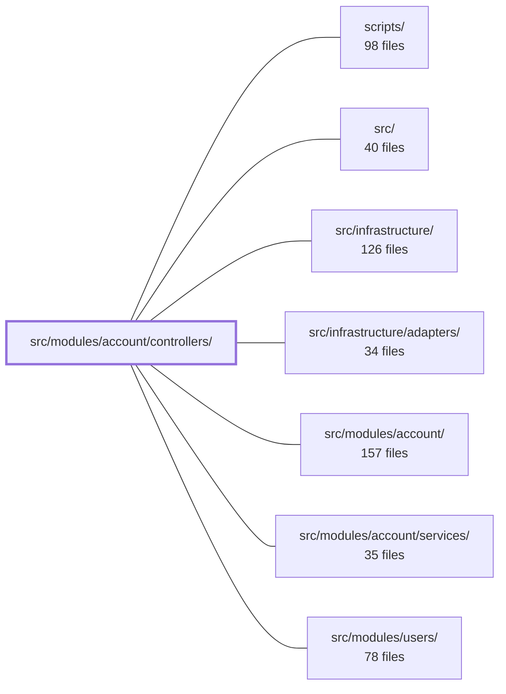

---
tags:
  - 2brain
  - 2brain/module
  - project/boilerplate-node-backend
type: module
module: src/modules/account/controllers/
files: 43
updated: 2026-11-08T10:49:13.113136+00:00
---

# src/modules/account/controllers/

## Purpose

The HTTP controller layer for the account module. Each file is a thin Express route handler that parses the request, extracts the authenticated caller's identity, delegates all business logic to the account or two-factor service, and shapes the response (status code, headers, body, cookies). No domain rules, persistence, or policy decisions live here.

## Key parts

- **Authentication & login** — `post-login.ts`, `post-login-2fa.ts`, `post-login-2fa-send.ts`, `post-login-restore.ts`, `post-signup.ts`. Handle the full sign-in path (credential check, optional second factor, grace-period restore) and the initial account creation, minting session cookies on success.
- **Session management** — `get-sessions.ts`, `get-session.ts`, `delete-session.ts`, `post-logout.ts`, `post-logout-everywhere.ts`, `post-session-touch.ts`, `get-refresh-token.ts`. List, inspect, revoke, and rotate sessions; handle refresh-token rotation and the "touch" heartbeat read.
- **Two-factor (2FA)** — `get-2fa.ts`, `post-2fa-setup.ts`, `post-2fa-confirm.ts`, `post-2fa-disable.ts`, `post-2fa-method-remove.ts`, `post-2fa-method-send.ts`, `post-2fa-backup-codes.ts`. Cover the full enrollment, confirmation, code delivery, removal, backup-code regeneration, and disable lifecycle, each re-minting the caller's session after a state change.
- **OAuth** — `get-oauth-start.ts`, `get-oauth-callback.ts`, `get-oauth-links.ts`, `post-oauth-link-start.ts`, `delete-oauth-link.ts`. Kick off the provider redirect, handle the callback (code exchange, find-or-create, or link), list connected providers, and unlink them.
- **Email & password** — `post-password-change.ts`, `post-password-check.ts`, `post-reset-request.ts`, `post-reset-confirm.ts`, `post-email-change-confirm.ts`, `post-email-change-resend.ts`, `post-email-change-undo.ts`, `delete-email-change.ts`. Password rotation, breach advisory, reset flow, and the pending-email-change lifecycle (confirm, resend, undo, cancel).
- **Account lifecycle & export** — `delete-account.ts`, `post-account-restore.ts`, `get-account-export.ts`, `post-account-export.ts`, `get-account.ts`. Scheduling a deletion, canceling it via restore token, requesting/streaming a data export, and fetching the full profile view.
- **Step-up re-authentication** — `get-reauth-methods.ts`, `post-reauth.ts`, `post-reauth-method-send.ts`. Answer a `401 REAUTH_REQUIRED` challenge by re-proving the caller and refreshing the session's `auth_time`.

## How it connects

- **`src/modules/account/services/`** — the primary delegation target. Nearly every controller calls into `accountService` or `twoFactorService` for its actual work; the controllers exist only to translate HTTP concerns (parsing, cookies, status codes) into those service calls.
- **`src/modules/account/`** (parent module) — provides shared route wiring (`routes.ts`), Zod schemas, response helpers, and the `AccountView` presenter that controllers use to shape output.
- **`src/infrastructure/` / `src/infrastructure/adapters/`** — supplies cross-cutting utilities (auth middleware, `requireFreshAuth`, metrics emitters, session-cookie helpers) that controllers invoke but do not implement.
- **`src/modules/users/`** — consulted for user-profile lookups and user-scoped operations that the account service does not own.
- **`src/`** — root-level shared types, error envelopes, and the Express app bootstrap that wires these controllers into the HTTP stack.

## Where to start

1. **`post-login.ts`** — it is the single most complete example of the module's pattern: parse body → validate tier → call `accountService.login` → on success mint a session (refresh cookie + access token + `AccountView`) → emit metrics. Reading it shows how the controller, service, cookie, and response-helper layers fit together.
2. **`get-oauth-start.ts`** — the only controller that responds with a 302 redirect rather than JSON, and the one that introduces the cookie-stored CSRF/PKCE pattern. Pairing it with `get-oauth-callback.ts` gives a full picture of the multi-step browser flow that the rest of the module doesn't exercise.

## Connected modules

[[boilerplate-node-backend_scripts|scripts/]] · [[boilerplate-node-backend_src|src/]] · [[boilerplate-node-backend_src_infrastructure|src/infrastructure/]] · [[boilerplate-node-backend_src_infrastructure_adapters|src/infrastructure/adapters/]] · [[boilerplate-node-backend_src_modules_account|src/modules/account/]] · [[boilerplate-node-backend_src_modules_account_services|src/modules/account/services/]] · [[boilerplate-node-backend_src_modules_users|src/modules/users/]]

## Files
- `src/modules/account/controllers/delete-account.ts` — Controller for the `DELETE /account` endpoint. Given an authenticated user, it locks their account, schedules a future purge, returns a `202` with the `requestedAt` and `purgeAt` dates, and destroys the session cookie in the same response.
- `src/modules/account/controllers/delete-email-change.ts` — Thin HTTP adapter that maps `DELETE /account/email-change` to the domain operation `accountService.cancelPendingEmailChange`. It extracts the authenticated user's ID and caller context from the request, delegates to the service, and translates the result into an HTTP status (204 or a refused error).
- `src/modules/account/controllers/delete-oauth-link.ts` — Thin HTTP adapter for `DELETE /account/oauth/links/{provider}`. It delegates the actual unlinking to `accountService.unlinkOAuthProvider`, then returns the caller's updated list of linked OAuth providers. Exists to keep the route handler a trivial mapping between HTTP concerns and the account service.
- `src/modules/account/controllers/delete-session.ts` — Thin HTTP adapter for `DELETE /account/sessions/:sessionId`. Validates the caller's identity and the session-ID parameter, delegates the actual revocation to `accountService.sessionRevoke`, and emits either a `404` or a `204` response — clearing the session cookie only when the revoked session is the caller's current one.
- `src/modules/account/controllers/get-2fa.ts` — HTTP controller for `GET /account/2fa`. Returns the authenticated caller's current second-factor status (enrolled methods and still-available options). It is a thin adapter: all business logic lives in `twoFactorService.twoFactorStatus`; this file only translates the service result into an HTTP response.
- `src/modules/account/controllers/get-account-export.ts` — Two Express route handlers for the account-export feature: one returns the caller's export **status** (state, dates) and the other **streams** the finished export file as a JSON attachment. The split exists because the file endpoint requires fresh auth (`requireFreshAuth`) and streams raw bytes, while the status endpoint is a lightweight, envelope-wrapped query.
- `src/modules/account/controllers/get-account.ts` — Thin HTTP adapter for `GET /account`. Fetches the authenticated user's full profile directly from the database (via `accountService.getOwnProfile`) so the response includes fields the JWT does not carry (`verifiedAt`, `locale`), and returns it shaped as an `AccountView` with an ETag for conditional-request support.
- `src/modules/account/controllers/get-oauth-callback.ts` — Controller for `GET /account/oauth/:provider/callback` — the URL a provider's consent screen redirects the browser back to. Validates the CSRF `state` against a cookie, exchanges the authorization code (with PKCE verifier), then either finds-or-creates an account and mints a session, or links the identity to an already-signed-in account ("connect" flow). All failures after state validation surface as 302 redirects back to the frontend with `?error=<code>`, because the browser is mid-navigation and a JSON body is unreadable.
- `src/modules/account/controllers/get-oauth-links.ts` — Thin HTTP adapter for the `GET /account/oauth/links` endpoint. It extracts the caller's user ID from the auth context, delegates to `accountService.listOAuthLinks`, shapes the result with a presenter, and writes a standard success or error response. No business logic lives here.
- `src/modules/account/controllers/get-oauth-start.ts` — Controller for `GET /account/oauth/:provider`. Validates the provider name, mints a CSRF `state` value and a PKCE code verifier (both stored as cookies), optionally persists `?continue=` and `?locale=` query parameters as cookies, and responds with a **302 redirect** to the provider's consent screen. It is the sole account route that answers with a redirect rather than a JSON body.
- `src/modules/account/controllers/get-reauth-methods.ts` — Thin HTTP adapter for `GET /account/reauth`. It exposes which re-authentication methods (e.g. passkey, OTP) are available to answer a `401 REAUTH_REQUIRED` challenge. It exists to keep Express plumbing separate from the `accountService.reauthMethods` business logic.
- `src/modules/account/controllers/get-refresh-token.ts` — Thin HTTP adapter for `POST /account/refresh`. In `jwt` mode it exchanges the client's refresh cookie for a new short-lived access token **and** rotates the refresh cookie in the same response. In `cookie` mode the endpoint is meaningless (the single credential never rotates) and the controller returns 404.
- `src/modules/account/controllers/get-session.ts` — Thin HTTP adapter that handles `GET /account/sessions/:sessionId`, delegating to `accountService.sessionGet` and mapping the result (or its absence) to a `200` or `404` response. It exists so the route layer stays declarative while validation, authorization context, and response shaping live in one small function.
- `src/modules/account/controllers/get-sessions.ts` — Thin Express controller that handles `GET /account/sessions`. It extracts the authenticated user's ID from the request context, delegates to `accountService.sessionsList`, and writes the result through the shared response helpers. All session semantics (which rows qualify, how `current` is flagged, credential hygiene) live in the service layer, not here.
- `src/modules/account/controllers/post-2fa-backup-codes.ts` — Thin HTTP adapter for `POST /account/2fa/backup-codes`. Validates the incoming request body (which must include a valid two-factor code), delegates to `twoFactorService.regenerateBackupCodes` to mint a fresh set of ten backup codes, and returns the result or an error. It exists to keep HTTP concerns (body parsing, response shaping, metrics) separate from the domain service.
- `src/modules/account/controllers/post-2fa-confirm.ts` — Thin HTTP adapter for `POST /account/2fa/methods/{method}/confirm`. Validates path params and body against Zod schemas, delegates to `twoFactorService.confirmTwoFactorMethod`, remints the caller's session (since confirming a factor revokes all existing sessions), and returns the confirmation payload (which may include backup codes for the account's first factor).
- `src/modules/account/controllers/post-2fa-disable.ts` — HTTP controller for `POST /account/2fa/disable`. Validates the request body (code or backup code), delegates to `twoFactorService.disableTwoFactor`, and—because disabling 2FA revokes all sessions including the caller's—immediately remints a fresh session so the authenticated user is not logged out mid-operation.
- `src/modules/account/controllers/post-2fa-method-remove.ts` — Thin HTTP adapter for `POST /account/2fa/methods/{method}/remove`. Accepts a valid one-time code, delegates to `twoFactorService.removeTwoFactorMethod` to drop a single 2FA factor (leaving the rest armed), then re-mints the caller's session because the removal revokes all active sessions.
- `src/modules/account/controllers/post-2fa-method-send.ts` — Thin HTTP adapter for `POST /account/2fa/methods/{method}/send`. Validates the path parameter, delegates to `twoFactorService.sendMethodCode`, and maps the service result onto a standard HTTP response. Authentication and the per-account delivery budget are enforced upstream (route middleware), not here.
- `src/modules/account/controllers/post-2fa-setup.ts` — Thin HTTP adapter for `POST /account/2fa/methods/{method}/setup`. Validates the path parameter and optional body, then delegates to `twoFactorService.setupTwoFactorMethod` to start or restart enrollment of a single 2FA method. The restart path (re-enrolling an already-armed method) requires a valid code from an existing factor as a guard against session-hijack attacks.
- `src/modules/account/controllers/post-account-export.ts` — Thin HTTP adapter for `POST /account/export`. Receives an authenticated request, delegates the actual data-export request to the `requestExport` service, and shapes the HTTP response (status, body, `Location` header). It contains no business logic beyond wiring the caller's identity into the service call.
- `src/modules/account/controllers/post-account-restore.ts` — Handler for `POST /account/restore`. Validates a one-time restore token supplied in the request body and cancels the account's scheduled deletion. The endpoint is public — the token itself is the credential, and the operation does **not** create a session or sign anyone in.
- `src/modules/account/controllers/post-email-change-confirm.ts` — Controller for `POST /account/email-change/confirm`. Validates a one-time `email-change` token from the request body and delegates to the account service to promote `pendingEmail` into the active `email`. The endpoint is intentionally public—the token in the body is the credential, not a session.
- `src/modules/account/controllers/post-email-change-resend.ts` — Thin HTTP adapter that handles `POST /account/email-change/resend`. It extracts the authenticated user's id, delegates to `accountService.resendPendingEmailVerificationFor`, and translates the result (or refusal) into a standard HTTP response. Exists to keep the account service free of Express-specific concerns.
- `src/modules/account/controllers/post-email-change-undo.ts` — HTTP controller for `POST /account/email-change/undo`. It validates a `{ token }` body, delegates to the account service to spend a one-time undo token (reverting the account to its pre-change state), and returns `204 No Content` on success. The endpoint is public—possession of the token is the sole credential.
- `src/modules/account/controllers/post-login-2fa-send.ts` — Thin HTTP adapter that handles `POST /account/login/2fa/send`. It validates the request body, resolves a two-factor challenge token, delegates to `twoFactorService.sendLoginCode`, and returns the delivery result. It exists to keep the login 2FA flow's I/O concerns (body parsing, response shaping, metrics) separate from the service layer.
- `src/modules/account/controllers/post-login-2fa.ts` — Controller for `POST /account/login/2fa` — the second step of a two-factor login. It validates the challenge token and the user-supplied code (or backup code), then mints a full session identical to a single-factor `postLogin`, appending `otp` to the AMR array so downstream guards see the second factor as satisfied.
- `src/modules/account/controllers/post-login-restore.ts` — Handler for `POST /account/login/restore`, the final step of signing in with an account that is inside its deletion grace period. It validates (redeems) the deletion challenge to cancel the pending deletion, then mints a session identical in shape to a normal `postLogin` success.
- `src/modules/account/controllers/post-login.ts` — The HTTP handler for `POST /account/login`. It reads the request body, validates the "remember me" tier, delegates credential checking to `accountService.login`, then — for a successful, non-2FA, non-pending-deletion result — mints a full session (refresh cookie, access token, account view). Success/failure login metrics are emitted here in the controller rather than in the service layer.
- `src/modules/account/controllers/post-logout-everywhere.ts` — Thin HTTP adapter for the `DELETE /account/sessions` endpoint. It delegates all business logic to `accountService.logoutEverywhere` and is responsible only for translating the service result into an HTTP response: destroying the session cookie, returning `204` on success, or a rejection with error details on failure.
- `src/modules/account/controllers/post-logout.ts` — Thin HTTP adapter that handles `POST /account/logout`. It extracts the session credential from the refresh cookie, delegates to `accountService.logoutCurrentSession` to revoke the stored token, then clears the cookie and returns a 204. It exists to keep route wiring (in `routes.ts`) decoupled from the actual logout logic in the service layer.
- `src/modules/account/controllers/post-oauth-link-start.ts` — Handler for `POST /account/oauth/links/{provider}` — the signed-in flow for connecting an external sign-in provider to the caller's account. It mints the OAuth state and PKCE verifier, obtains a link token from the account service, sets all of them (plus optional `continue`/`locale`) as cookies, and responds with the provider's authorization URL for the client to navigate to.
- `src/modules/account/controllers/post-password-change.ts` — HTTP handler for `POST /account/password`. Changes a user's password by verifying the current one inline (no email round-trip), then re-mints the caller's own session token so they stay signed in in the tab they are typing in.
- `src/modules/account/controllers/post-password-check.ts` — Handles the unauthenticated `POST /account/password/check` endpoint, which reports whether a candidate password appears in a known-breach database. It exists to give clients (e.g., a signup form) an advisory signal before an account is created. It is intentionally non-blocking: the four password-SET endpoints remain the authoritative server-side gate.
- `src/modules/account/controllers/post-reauth-method-send.ts` — Thin Express controller for `POST /account/reauth/methods/{method}/send`. It validates the path parameter, extracts the caller context, and delegates to `accountService.sendReauthCode`. Exists to give password-less accounts a way to obtain a step-up code, using per-account delivery budgets and per-code cooldowns as the rate-limiting mechanism (no fresh-auth guard is applied).
- `src/modules/account/controllers/post-reauth.ts` — Thin HTTP adapter for `POST /account/reauth`. It answers a `401 REAUTH_REQUIRED` step-up challenge by re-proving the caller (password or emailed code), then re-mints the existing session with a fresh `auth_time` without destroying it. The `amr` claim on the new session reflects only what this specific call proved.
- `src/modules/account/controllers/post-reset-confirm.ts` — HTTP controller for `POST /account/password/reset/confirm`. It validates a one-time password-reset token (delivered in the reset email URL) and sets the user's new password, then tears down any existing session. All domain logic (token check, password validation, atomic spend) is delegated to the account service.
- `src/modules/account/controllers/post-reset-request.ts` — HTTP adapter for `POST /account/password/reset`. It validates the request body shape, delegates to `accountService.requestPasswordReset` in a detached (fire-and-forget) call, and immediately returns `204 No Content` regardless of whether the email is registered — deliberately preventing user enumeration and timing-attack leaks.
- `src/modules/account/controllers/post-session-touch.ts` — Handler for `POST /account/sessions/current/touch`. It does **not** write anything — the auth middleware has already counted the request as activity. It simply reads the session's current activity clock from the authenticated context and returns it, so a client can display a "still there?" prompt from server-side numbers.
- `src/modules/account/controllers/post-signup.ts` — Thin Express controller for `POST /account/signup`. Destructures the JSON body with safe defaults, delegates to `accountService.signup`, then formats the 201/4xx response and (on success) issues a session cookie. It contains no business logic itself — validation, persistence, and policy decisions live in the service.
- `src/modules/account/controllers/post-verify-confirm.ts` — Controller handler for `POST /account/email-verification/confirm`. It validates a one-time verification token from the request body, delegates the find-then-spend operation to `accountService.confirmEmailVerification`, and responds with `204 No Content` on success. It exists to keep the HTTP-layer concerns (parsing, metric tracking, error shaping) separate from the domain logic in the account service.
- `src/modules/account/controllers/post-verify-request.ts` — Thin HTTP adapter for `POST /account/email-verification/resend`. It extracts the authenticated user's ID, delegates to `accountService.requestEmailVerificationFor`, and maps the service result (success or refusal) onto the HTTP response. The controller contains no business logic itself.
- `src/modules/account/controllers/update-account.ts` — Provides the `PUT /account` (full replace) and `PATCH /account` (partial merge) handlers. Both operate exclusively on the authenticated caller's record and delegate all business logic — field merging, email-change verification flow, and audit logging — to `accountService.updateProfile`. The file exists solely to wire HTTP input parsing and response shaping around that service call.

---
[[boilerplate-node-backend_INDEX|← boilerplate-node-backend index]]
