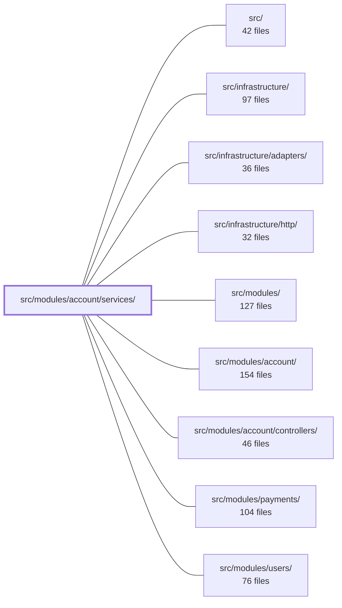

---
tags:
  - 2brain
  - 2brain/module
  - project/boilerplate-node-backend
type: module
module: src/modules/account/services/
files: 32
updated: 2026-10-29T19:22:47.167309+00:00
---

# src/modules/account/services/

## Purpose

The service layer for the account module. It contains all business logic for the account lifecycle — signup, authentication, password management, email changes, two-factor auth, session management, data export, and account deletion — exposed as callable functions that controllers invoke and that enforce domain invariants (cooldowns, token lifetimes, one-live-export-per-account, session-revocation ordering) without touching HTTP concerns.

## Key parts

- **Barrel & shared helpers** — `index.ts` aggregates every flow service into `accountService` / `twoFactorService` namespaces so controllers import a single file. `caller.ts` supplies the "load the caller's own account or 401" pattern and audit-stamping used by nearly every other file. `mail.ts` is the single service-layer call site for email enqueuing.
- **Authentication flows** — `signup.ts`, `login.ts`, `oauth.ts`, `reauth.ts` cover the three entry points (password, OAuth, step-up) and the 2FA challenge / enrollment / lockout trio (`two-factor-challenge.ts`, `two-factor-enrollment.ts`, `two-factor-lockout.ts`) with shared response shaping in `two-factor-outcomes.ts`.
- **Password & reset** — `password.ts` is the single write path (hash, epoch bump, session revocation). `password-reset-request.ts` mints the link; `password-reset.ts` spends it. Both funnel through `password.ts`.
- **Email & verification** — `email-change.ts` handles request/cancel phases; `verification.ts` centralises token issuance and pacing for every "prove this mailbox" send; `tokens.ts` defines the live/issue/spend primitives for all one-time tokens.
- **Sessions & revocation** — `sessions.ts` lists and erases session data; `refresh.ts` orchestrates token rotation with audit; `logout.ts` covers the three termination scopes; `revocation.ts` is the single entry point that reads the `REVOCATION` cause table so every caller shares identical epoch-bump + token-purge semantics.
- **Account lifecycle & deletion** — `account-deletion.ts` (grace lock + restore), `deletion-sign-in.ts` (claim-check token), `purge-deletions.ts` (Art. 17 erasure), `reap-inactive.ts` (four-stage inactivity pipeline), `previous-email-cleanup.ts` (data-minimisation sweep).
- **Data export** — `export.ts` (request/download lifecycle), `export-job.ts` (worker that streams sections to a file), `export-rows.ts` (cleanup + nightly reaper), `personal-data-registry.ts` (in-memory section store that avoids cross-module imports).
- **Profile** — `profile.ts` orchestrates `PUT /account` writes, delegating email and password concerns to their dedicated services.
- **Ops / security** — `reencrypt.ts` assembles the TOTP key ring and delegates the document walk to the users service.

## How it connects

- **`src/modules/account/controllers/`** — The controllers are the sole HTTP-facing callers of this layer. They import from `index.ts` (the barrel) and never reach into individual flow files. Services return typed envelopes (`ResponseSuccess`, `ResponseReject`) that controllers map to status codes and bodies.
- **`src/modules/account/`** (parent) — Domain value-objects (e.g. the `REVOCATION` cause table in `../domain/revocation.ts`), error classes, and constants that services consume live one level up. `reauth.ts` and `two-factor-challenge.ts` explicitly defer session minting to `../session/session.ts`.
- **`src/modules/users/`** — The users module owns the `UserDocument` persistence. `account-deletion.ts` receives a staff-cancellation *event* from users; `reencrypt.ts` delegates the document walk to the users service; `reap-inactive.ts` stages mutations that users applies.
- **`src/modules/payments/`** — Contributes a `PersonalDataSection` entry to the export pipeline; the registry (`personal-data-registry.ts`) receives it at bootstrap so `export-job.ts` can stream it without a direct import.
- **`src/infrastructure/`** — Provides the mail queue (`enqueueEmail` reached through `mail.ts`), the job broker that dispatches `export-job.ts` and the nightly reapers, and the TOTP encryption key ring consumed by `reencrypt.ts`.
- **`src/infrastructure/http/` & `src/infrastructure/adapters/`** — Underlying transport for OAuth provider calls (`oauth.ts`) and external token / rate-limit adapters used across auth flows.

## Where to start

1. **`index.ts`** — Skim the two namespace objects to see the full public surface in one screen; it tells you which flows exist and what constants/errors travel alongside them.
2. **`signup.ts`** — A short, self-contained flow (validate → guard chain → create → audit) that touches `caller.ts`, `password.ts`, `verification.ts`, `mail.ts`, and the audit helper in quick succession, giving you a working mental model of how the pieces compose before tackling the longer flows (OAuth, 2FA, export).

## Connected modules

[[boilerplate-node-backend_ROOT|/ (repository root)]] · [[boilerplate-node-backend_src|src/]] · [[boilerplate-node-backend_src_infrastructure|src/infrastructure/]] · [[boilerplate-node-backend_src_infrastructure_adapters|src/infrastructure/adapters/]] · [[boilerplate-node-backend_src_infrastructure_http|src/infrastructure/http/]] · [[boilerplate-node-backend_src_modules|src/modules/]] · [[boilerplate-node-backend_src_modules_account|src/modules/account/]] · [[boilerplate-node-backend_src_modules_account_controllers|src/modules/account/controllers/]] · [[boilerplate-node-backend_src_modules_payments|src/modules/payments/]] · [[boilerplate-node-backend_src_modules_users|src/modules/users/]]

## Files
- `src/modules/account/services/account-deletion.ts` — Implements the self-deletion grace flow: `DELETE /account` locks the account and schedules its erasure at a computed `purgeAt`; the owner can cancel via a one-time mailed restore link or by signing in before the deadline. Also handles staff-initiated cancellation (arriving as an event from the `users` module) and provides the shared "announce restore" trail used by all three cancellation paths.
- `src/modules/account/services/caller.ts` — Shared entry-point helpers for self-service account flows. It encapsulates the "load the caller's own account or return 401" pattern that nearly every account service repeats, and provides a consistent way to stamp audit entries with the actor's resolved role.
- `src/modules/account/services/deletion-sign-in.ts` — Implements the sign-in response and restore flow for accounts in a deletion grace period. When such an account signs in successfully, this module mints a short-lived "claim check" token instead of a session. The caller can later redeem that token via `POST /account/login/restore` to cancel the pending deletion and receive the data needed to create a session.
- `src/modules/account/services/email-change.ts` — Handles the **request** and **cancel** phases of an account email change. It writes to `user.pendingEmail` (never `user.email` directly), sends the two required emails (old-address notice with undo link, new-address verification link), and manages the associated tokens. The confirm and undo actions live in `./verification`.
- `src/modules/account/services/export-job.ts` — Worker that builds one account's GDPR-style data export by collecting registered `PersonalDataSection`s one at a time and streaming them into a file (so peak memory is the largest section, not the whole export), settles the row to `ready` or `failed` atomically with its domain event, and mails the requester a link or a failure notice. Invoked from the `worker.account.export` queue or inline (see `./export.ts`) when no broker is available.
- `src/modules/account/services/export-rows.ts` — Provides the shared "delete an export row and its file" operation plus the nightly reaper for expired exports. It is deliberately split out of `./export.ts` so the module barrel (`services/index.ts`) can publish the reaper to ops tooling without also exposing the export *build* path, which touches every sibling's data.
- `src/modules/account/services/export.ts` — Implements the account data-export lifecycle (GDPR Art. 15 & 20): a caller requests their data, a row is recorded and a build job is queued, a worker writes the file, and a download link is mailed. Encapsulates the "one live export per account" invariant — a `building` export is returned as-is, while a `ready` or `failed` one is replaced by a new request.
- `src/modules/account/services/index.ts` — Barrel facade for the account service layer. It aggregates every per-flow service module (signup, login, OAuth, 2FA, email verification, sessions, etc.) into two namespace objects — `accountService` and `twoFactorService` — so callers import one file and never reach into individual flow files. It also re-exports the constants, error classes, and pure helpers that controllers need alongside those functions.
- `src/modules/account/services/login.ts` — Handles password verification for two distinct flows: anonymous login (email + password) and signed-in callers confirming their own password before a sensitive action. It deliberately does **not** mint or manage sessions — that is the job of `../session/session`.
- `src/modules/account/services/logout.ts` — Implements the three session-termination actions an account can trigger: revoke one specific session, log out of only the current (cookie-backed) session, and log out everywhere (all sessions + epoch bump). Each action wires the repository mutation into the appropriate audit and analytics side-effects.
- `src/modules/account/services/mail.ts` — A single-function seam that is the **only** service-layer call site for `enqueueEmail` in the account module. It exists purely for layering: a cross-cutting test enforces that all email enqueuing originates in the service layer, and keeping this as a one-function file lets non-service callers (e.g. `two-factor/methods/email.ts`) reach it without importing an unrelated service's full surface.
- `src/modules/account/services/oauth.ts` — Implements the OAuth login/signup flow — the OAuth counterpart to the standard `login` and `signup` services. Sits one layer above the provider mechanics in `../oauth/` and decides among three outcomes for an inbound identity: log in an already-linked account, refuse an email that matches an existing account (linking requires a signed-in session), or sign up a fresh password-less user. Also provides the two-step provider-linking path (`startOAuthLink` → `linkProviderToSignedInAccount`) for connecting a provider to a currently signed-in account.
- `src/modules/account/services/password-reset-request.ts` — Implements the *request* half of the password-reset flow: looking up an account by email, issuing (or replacing) its single live reset token, and queueing the token-bearing email. Also provides the analogous one-shot setup link for admin-created accounts that arrive without a password. The companion file `./password-reset.ts` handles *spending* the link; this file only mints and delivers it.
- `src/modules/account/services/password-reset.ts` — Handles the final step of a password reset (`POST /account/password/reset/confirm`): validates the new password, resolves the one-time token from the mailed link, enforces the breached-password check, atomically spends the token, writes the new credential, and fires the post-reset audit and confirmation email. It is the counterpart to `password-reset-request`, which issues the link.
- `src/modules/account/services/password.ts` — The shared write path for every password change on an account. It validates the new-password pair, rejects breached passwords, writes the new hash and session epoch atomically, revokes old sessions, and (for the signed-in flow) verifies the current password first and sends a post-change notification email. Both the "change while logged in" and "confirm reset link" flows funnel through here so that session revocation is never missed.
- `src/modules/account/services/personal-data-registry.ts` — A module-scoped, in-memory store for the list of `PersonalDataSection` entries. It exists because the `account` module cannot import sibling modules to collect their manifest entries (the same isolation wall that constrains `@modules/locales/services/translatables.ts`), so the sections must be supplied from outside once the full set of enabled modules is known.
- `src/modules/account/services/previous-email-cleanup.ts` — Implements the nightly `reap:previous-emails` sweep: a data-minimisation pass that forgets the previous email address stored on any account whose 7-day undo link is no longer live. Once nothing can restore the old address, retaining it serves no purpose.
- `src/modules/account/services/profile.ts` — Handles the caller's own profile read and update (`PUT`/`PATCH /account`). It orchestrates the full write path—cooldown pacing, mailbox-budget check, the DB save, and post-save notifications—while delegating email-change logic to `./email-change` and password logic to a sibling service.
- `src/modules/account/services/purge-deletions.ts` — Permanently erases every account whose self-deletion grace period has expired. This is the step that discharges GDPR Art. 17 (the right to erasure); the earlier lock at deletion-request time is only a restriction. Triggered hourly by the `reap:scheduled-deletions` job.
- `src/modules/account/services/reap-inactive.ts` — Implements the four-stage inactivity reaper (minimise → warn → soft-delete → hard-delete) as a pure, ordered pipeline. It is deliberately separated from its cron caller so that stage ordering is a unit-testable fact of this module rather than an emergent property of a script file.
- `src/modules/account/services/reauth.ts` — Implements step-up re-authentication for an already-signed-in account: deciding which proof methods (password or mailed email code) the account can use, verifying a submitted proof, optionally verifying a second-factor OTP, and returning the AMR values the new session should carry. It deliberately does **not** re-mint the session — that is the controller's job (`../session/session.ts`). This module only decides and reports.
- `src/modules/account/services/reencrypt.ts` — Provides the account-domain entry point for re-encrypting all enrolled TOTP secrets onto the newest key in the TOTP encryption key ring. The actual walk over `users` documents is performed by the users service; this file assembles the key ring and binding rule and delegates. Intended to be invoked by the ops script `reencrypt` (see `@infrastructure/security/reencrypt`).
- `src/modules/account/services/refresh.ts` — Implements the refresh-token exchange endpoint logic: given a (possibly absent) refresh cookie value, it rotates the session via `rotateRefreshToken`, records an audit row for every outcome (success, missing token, invalid token, idle-expired session, or reuse of an already-rotated token), and rethrows the error so the controller can shape the HTTP response. The rotation itself is delegated to `../session/jwt`; this file is the orchestration, audit, and metrics layer around it.
- `src/modules/account/services/revocation.ts` — Single entry point for ending all of an account's live sessions. It reads a `REVOCATION` cause table (defined in `../domain/revocation.ts`) to decide *what* to do—bump the session epoch, purge pending one-time tokens, and/or announce the event—so that every caller (logout, password change, 2FA enrollment, account deletion, etc.) shares identical semantics instead of each re-implementing the sequence.
- `src/modules/account/services/sessions.ts` — Service layer for the account's session data: listing the caller's live sessions, fetching a single one, preparing credential-free rows for the data export, and performing the hard erasure (sessions + one-time verification tokens) that is part of account deletion. It deliberately never returns a live credential (refresh token or session id) outside the listing endpoints.
- `src/modules/account/services/signup.ts` — Implements the `POST /account/signup` handler. Validates the submitted fields, runs a sequential guard chain (breached-password check → anti-automation email policy → email-taken lookup + account creation), and records the outcome in audit and analytics. Returns a `ResponseSuccess<UserDocument>` or `ResponseReject` envelope.
- `src/modules/account/services/tokens.ts` — Central module for the one-time verification tokens an account holds in `verificationtokens` (password reset, email verify, email change / undo, account restore, MFA login challenge). It defines "live" once and exposes issue / find / spend / redeem primitives that the confirm-controller services compose, plus the shared refusal path (metric + audit + 422).
- `src/modules/account/services/two-factor-challenge.ts` — Implements the second step of a two-factor login: building an MFA challenge, delivering a code against it, and verifying a submitted code. Deliberately stops short of minting a session — that hand-off is the controller's job (`post-login-2fa.ts`).
- `src/modules/account/services/two-factor-enrollment.ts` — Orchestrates the user-facing two-factor enrollment lifecycle: querying status, starting (or restarting) a method's setup, delivering verification codes, confirming and arming a method, and minting backup codes. It owns the "which entry to load and when the account flag flips" logic; per-method rules (TOTP, SMS, etc.) live in `../two-factor/registry`.
- `src/modules/account/services/two-factor-lockout.ts` — Central verification gate for every two-factor code check on an armed account. A submitted code is compared against the account's armed factors (in registration order), then against backup codes, all behind a per-account wrong-code lockout counter. The file exists so that no flow can verify a code without first reserving a limited attempt budget, and so the "armed factors before backup codes" invariant is enforced in exactly one place.
- `src/modules/account/services/two-factor-outcomes.ts` — Shared "response construction" layer for two-factor authentication flows. It builds the rejections, successes, out-of-band email notices, and public method summaries that 2FA operations return to callers. It owns no flow itself—every two-factor endpoint (challenge, enrollment, reauth, lockout) reaches in here to shape its answers so that wording, status codes, audit logging, and cooldown semantics stay consistent across call sites.
- `src/modules/account/services/verification.ts` — Centralises email verification — issuing a token and queueing the mail — so that every flow that needs a "prove this mailbox" link (signup re-send, explicit user re-send, email-change request, email-change re-send) goes through one code path and cannot drift. Also enforces the shared pacing (cooldown + per-recipient mail budget) that every re-send must pass before a send is permitted.

---
[[boilerplate-node-backend_INDEX|← boilerplate-node-backend index]]
