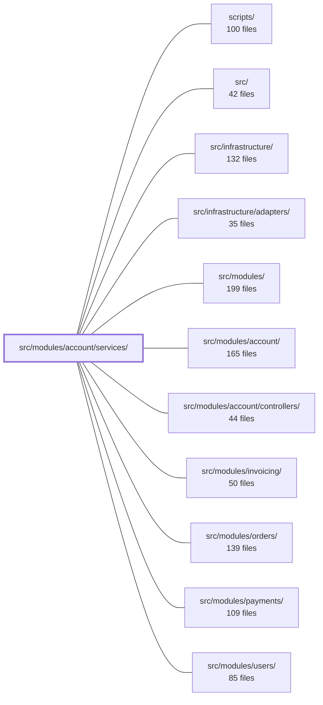

---
tags:
  - 2brain
  - 2brain/module
  - project/boilerplate-node-backend
type: module
module: src/modules/account/services/
files: 35
updated: 2026-11-15T00:30:50.478576+00:00
---

# src/modules/account/services/

## Purpose

The account service layer implements every self-service account operation—authentication, credentials, email, profile, sessions, OAuth, two-factor, data export, deletion, and GDPR compliance—as testable, controller-agnostic functions. It is the single public surface (`index.ts` barrel) through which the account controllers reach all domain logic, hiding the per-flow sub-modules behind two flat objects.

## Key parts

- **Shared primitives & tokens** — `caller.ts` (load-or-reject + audit-role helpers) and `tokens.ts` (one-time verification-token lifecycle with atomic spend-then-act) underpin nearly every other service in the module.
- **Authentication & sessions** — `login.ts`, `reauth.ts`, `refresh.ts`, `logout.ts`, `sessions.ts`, and `revocation.ts` cover the full credential-verification, step-up, token-exchange, and session-teardown cycle. The two-factor cluster (`two-factor-challenge.ts`, `two-factor-enrollment.ts`, `two-factor-lockout.ts`, `two-factor-outcomes.ts`) adds the second factor on top.
- **Credentials & verification** — `password.ts`, `password-reset.ts`, `password-reset-request.ts`, `email-change.ts`, `verification.ts`, and `previous-email-cleanup.ts` handle every path that changes or proves an identity (password change/reset, email swap, resend pacing).
- **Account lifecycle** — `signup.ts`, `account-deletion.ts`, `deletion-sign-in.ts`, `purge-deletions.ts`, `reap-inactive.ts`, `erasure-ledger.ts`, and `reencrypt.ts` manage creation, self-deletion with grace period, the hourly purge, the four-stage inactivity sweep, and the durable re-apply-after-restore ledger.
- **GDPR data export** — `export.ts` (lifecycle & single-live-export guard), `export-job.ts` (streaming worker), `export-rows.ts` (row deletion + nightly reaper), and `personal-data-registry.ts` (in-memory section list supplied at boot) implement Art. 15/20 and Art. 17 compliance.
- **OAuth & config** — `oauth.ts` (sign-in / link flows above the raw provider layer), `public-config.ts` (client-facing boot config), and `operator-identity.ts` (legal operator data for the `/config` response).
- **Barrel & shims** — `index.ts` assembles `accountService` and `twoFactorService`; `mail.ts` centralises `enqueueEmail` calls to satisfy lint and give non-service callers a minimal import target.

## How it connects

- **`src/modules/account/controllers/`** — Every controller in the account module imports from this barrel (`index.ts`) rather than reaching into individual service files. Controllers handle HTTP concerns (cookies, redirects, status codes); services return domain-level results.
- **`src/infrastructure/` & `src/infrastructure/adapters/`** — Services depend on the infrastructure layer for persistence (document store), the email queue (`enqueueEmail`), the JWT/session rotation mechanism (`refresh.ts` delegates to the JWT session module), and the TOTP key-ring used by `reencrypt.ts`.
- **`src/modules/users/`** — `account-deletion.ts` reacts to a `user.deletion_canceled` event published by the users module when staff cancel a deletion. `reencrypt.ts` delegates the actual document walk to the users service while supplying the encryption ring.
- **`src/modules/invoicing/`, `src/modules/orders/`, `src/modules/payments/`** — These modules register their `PersonalDataSection` manifests into `personal-data-registry.ts` at boot, because the account module cannot import sibling modules (circular-import wall). The export worker then streams each registered section.
- **`scripts/`** — Ops scripts (e.g. the TOTP re-encryption script at `@infrastructure/security/reencrypt`) call into `reencrypt.ts` for a single dry-run-capable entry point.
- **`src/modules/account/`** (parent) — This services directory is the internal implementation layer of the account module; the module's public `index.ts` re-exports the services barrel for external consumers.

## Where to start

1. **`index.ts`** — Read the barrel first to see the two public objects (`accountService`, `twoFactorService`) and which service files feed each one. This gives you the map before diving into any individual flow.
2. **`caller.ts`** — Nearly every other service calls `loadCallerAccount` and `recordAuditEntry` from here. Understanding the 401-vs-404 contract and the actor-role resolution pattern makes the rest of the module much easier to follow.

## Connected modules

[[boilerplate-node-backend_ROOT|/ (repository root)]] · [[boilerplate-node-backend_scripts|scripts/]] · [[boilerplate-node-backend_src|src/]] · [[boilerplate-node-backend_src_infrastructure|src/infrastructure/]] · [[boilerplate-node-backend_src_infrastructure_adapters|src/infrastructure/adapters/]] · [[boilerplate-node-backend_src_modules|src/modules/]] · [[boilerplate-node-backend_src_modules_account|src/modules/account/]] · [[boilerplate-node-backend_src_modules_account_controllers|src/modules/account/controllers/]] · [[boilerplate-node-backend_src_modules_invoicing|src/modules/invoicing/]] · [[boilerplate-node-backend_src_modules_orders|src/modules/orders/]] · [[boilerplate-node-backend_src_modules_payments|src/modules/payments/]] · [[boilerplate-node-backend_src_modules_users|src/modules/users/]]

## Files
- `src/modules/account/services/account-deletion.ts` — Implements the self-deletion-with-grace workflow: `DELETE /account` locks the account and schedules erasure at `purgeAt`; the owner can cancel via a mailed restore link or by signing in; a separate purge job (`./purge-deletions`) performs the actual erase. Staff cancel through the `users` module, and this module reacts via a `user.deletion_canceled` event.
- `src/modules/account/services/caller.ts` — Provides two shared primitives for self-service account flows: loading the caller's own account document (returning 401 rather than 404 if it no longer exists) and recording an audit entry with a freshly-resolved actor role. Every account service that operates on the caller's own data goes through these helpers instead of duplicating the load-or-reject and audit-role logic.
- `src/modules/account/services/deletion-sign-in.ts` — Implements the sign-in half of the account-deletion grace period. When a user with a scheduled purge (`purgeAt`) attempts to log in, this module issues a one-time **claim check** token instead of a session. A subsequent restore request spends that token, cancels the deletion, and returns the user + `amr` needed to mint the actual session.
- `src/modules/account/services/email-change.ts` — Service layer for the `POST /account/email-change` and `DELETE /account/email-change` endpoints. Handles requesting a new email address (parking it as `pendingEmail` without touching the proven `email` field), the full guard chain (collision checks, cooldown, mailbox budget), sending the two outbound mails (undo notice to the old address, verification link to the new one), and explicitly cancelling a pending change while revoking its token.
- `src/modules/account/services/erasure-ledger.ts` — Records account erasures, deletion schedules, and cancellations in a durable ledger that outlives the oldest backup snapshot. After a database restore brings erased or locked accounts back, `reapplyErasures` replays the ledger so the operator can re-erase or re-lock them before the app opens.
- `src/modules/account/services/export-job.ts` — Implements the account data-export worker: it streams each registered `PersonalDataSection` into a single JSON file one at a time (capping peak memory at the largest section rather than the whole export), writes the file to the private export store, atomically settles the row and publishes the readiness/failure event, then mails the download link or a failure notice to the requester. Exposes a single entry point, `runExportJob`, consumed by the `worker.account.export` queue or inline from `./export.ts` when no broker is present.
- `src/modules/account/services/export-rows.ts` — Handles the **deletion** side of account data exports: the shared single-row delete used by both the user request path and the nightly reaper, plus the reaper loop itself. It lives in a separate file from `./export.ts` so the module barrel can publish the reaper without also publishing the build path (which reaches every sibling's data).
- `src/modules/account/services/export.ts` — Implements the account data-export lifecycle (GDPR Art. 15/20) as a background job rather than a synchronous request. `POST /account/export` records a `building` row and queues a build; `GET /account/export` reports status or streams the finished file. Enforces a single live export per account, applies a mail-budget charge before any new build, and participates in account erasure.
- `src/modules/account/services/index.ts` — Barrel file that assembles the account service layer into two flat objects (`accountService`, `twoFactorService`) and re-exports shared constants, error classes, and small named helpers. It is the single public surface that controllers and the module's public index use to reach every authentication, profile, token, OAuth, and 2FA operation, while hiding the per-flow sub-modules it imports.
- `src/modules/account/services/login.ts` — Password-verification service for two distinct flows: `login` (stranger proves credentials by email/password) and `verifyOwnPassword` (signed-in caller re-proves identity before a sensitive action). It deliberately does **not** mint a session—that responsibility belongs to the sibling `session` module.
- `src/modules/account/services/logout.ts` — Implements the three logout operations for the account domain: revoke a single session by ID, log out the current (cookie-bearing) session, and log out every session across all devices (advancing the session epoch so outstanding access tokens are invalidated). Each path emits the correct audit record and analytics event, with intentionally different success/failure semantics.
- `src/modules/account/services/mail.ts` — Single-export shim that centralises every `enqueueEmail` call in the account service layer. It exists to satisfy the lint rule that bans `enqueueEmail` outside the service layer, and to give `two-factor/methods/email.ts` (not itself a service) a minimal import target without dragging in an entire service's unrelated API.
- `src/modules/account/services/oauth.ts` — Service layer for OAuth sign-in / sign-up and for connecting a provider to an already-signed-in account. It sits one level above the raw provider mechanics (`src/modules/account/oauth/`) and is the OAuth counterpart to `login.ts` and `signup.ts`. It enforces a strict three-outcome model for first-time sign-in (link, refuse, or create) and a two-step (`startOAuthLink` → `linkProviderToSignedInAccount`) flow for linking, with explicit error classes so the callback controller can emit precise `?error=` redirect codes.
- `src/modules/account/services/operator-identity.ts` — Resolves the operator identity (legal name, address, VAT, contact) that a site is legally required to publish under e-Commerce Directive Art. 5(1) and GDPR Art. 13(1)(a). It reads live values from `accountConfig` and returns a fully-populated `Operator` object, ensuring required legal fields are always present. Lives in the `account` module rather than `shop` because operator identity exists even on sites without a shop.
- `src/modules/account/services/password-reset-request.ts` — Handles the two email-delivery paths that hand a user a password-reset/setup link: the public "I forgot my password" request (always returns 200, never reveals whether the address is registered) and the one-time setup link sent to an admin-created account. It does **not** consume the link — that lives in `./password-reset`.
- `src/modules/account/services/password-reset.ts` — Implements the completion step of a password reset (the handler behind `POST /account/password/reset/confirm`). Given a token from a mailed link, it validates the new password, confirms the link is live, rejects breached passwords, then atomically spends the token and writes the new password in a single transaction. On success it marks the account verified, clears 2FA state, stamps terms acceptance if missing, records an audit row, and sends a confirmation email.
- `src/modules/account/services/password.ts` — Implements the signed-in "change password" flow and the shared write primitive that both the change and reset-confirm paths use. Validates the new-password pair, enforces breach checks, writes the credential inside a transaction (bumping the session epoch and announcing revocation), then revokes stale sessions and notifies the user.
- `src/modules/account/services/personal-data-registry.ts` — Holds the in-memory list of `PersonalDataSection` entries that the account module exposes for personal-data export. It exists because `account` cannot import other `src/modules/*` packages to gather their manifests itself (the same circular-import wall that constrains `@modules/locales/services/translatables.ts`). The list is therefore supplied from outside once, at boot, rather than assembled here.
- `src/modules/account/services/previous-email-cleanup.ts` — Implements the nightly `reap:previous-emails` sweep: for every account whose 7-day email-change undo link is no longer live (expired, spent, or revoked), it forgets the stored previous address. This is a data-minimisation step—an old address has no purpose once nothing can restore it.
- `src/modules/account/services/profile.ts` — Service layer for the caller's own profile read and update (`GET /account`, `PUT`/`PATCH /account`). Handles username, locale, phone, website, image, and analytics consent. Email and password changes are intentionally out of scope and delegated to sibling modules (`./email-change`, `./password`).
- `src/modules/account/services/public-config.ts` — Assembles the account module's slice of the `GET /config` response: the session mode, tier-based lifetimes, optional staff cap, and the list of configured OAuth providers. The values are public (no auth required) and constant for the life of the process, so a client can read them once at boot instead of maintaining its own feature switches.
- `src/modules/account/services/purge-deletions.ts` — Permanently erases accounts whose self-deletion grace period has expired. This is the step that actually discharges GDPR Art. 17; the earlier lock at deletion-request time is only a restriction. The `reap:scheduled-deletions` job invokes this function hourly.
- `src/modules/account/services/reap-inactive.ts` — Implements the four-stage inactivity reaper for user accounts: minimise personal data (stage 0), warn by email (stage 1), soft-delete (stage 2), and hard-delete (stage 3). It lives in its own importable module rather than inside the cron script so that the stage order and gating logic are a tested, verifiable fact. Two numeric dials (`minimiseDays`, `inactiveDays`) control which stages activate; a value of `0` switches a stage off.
- `src/modules/account/services/reauth.ts` — Implements the **decision layer** for step-up re-authentication (`POST /account/reauth`). Given an already-authenticated caller, it verifies that the caller still controls their account via either a password (password accounts) or a mailed one-time code (OAuth-only accounts), optionally verifies a second-factor OTP, and returns the AMR claims the new session should carry. It does **not** mint or refresh the session — that is the controller's responsibility.
- `src/modules/account/services/reencrypt.ts` — Provides the account-module entry point for re-encrypting all enrolled TOTP device secrets onto the newest key in the TOTP encryption key ring. It exists so the ops script (`@infrastructure/security/reencrypt`) can invoke a single, dry-run-capable call that delegates the actual document walk to the users service while the account module supplies the ring and binding rule.
- `src/modules/account/services/refresh.ts` — Orchestrates the refresh-token → access-token exchange: accepts an optional refresh cookie, delegates the actual rotation to the JWT session module, classifies the outcome (success, missing token, invalid, reuse), and records the appropriate audit row and metric before returning the new token pair to the controller. It exists to keep the "what to audit and how" policy separate from the "how to rotate" mechanics.
- `src/modules/account/services/revocation.ts` — Single entry point for ending an account's sessions. Given a `RevocationCause`, it decides (via the `REVOCATION` table in the domain) whether to bump the session epoch, what one-time tokens to purge, and whether to publish an `ACCOUNT_SESSIONS_REVOKED` event—then performs the row cleanup. The epoch bump is the operative step (it invalidates live ACCESS tokens); the deletion that follows is housekeeping.
- `src/modules/account/services/sessions.ts` — Service layer for the authenticated caller's own live sessions. It exposes listing, single-session lookup, data-export, and hard-erasure operations for `GET /account/sessions` and the account-deletion flow. A hard rule governs the module: no live credential (refresh token, raw session id) is ever returned to a client—the family id is the only revocation handle that crosses the boundary.
- `src/modules/account/services/signup.ts` — Implements the `POST /account/signup` handler: validates the request body, runs two anti-abuse gates (breached-password corpus, anti-automation email policy), then creates the account and its starting role in a single database round trip. Returns a unified `ResponseSuccess<UserDocument> | ResponseReject` envelope.
- `src/modules/account/services/tokens.ts` — Central manager for the one-time verification tokens an account holds in the `verificationtokens` collection (password reset, email verification, email change + undo, deletion restore, MFA login challenge). It defines what "live" means, separates finding from spending, and guarantees that spending a link and performing the unlocked action happen in a single database transaction so a partial failure never burns the token or leaves a half-applied action.
- `src/modules/account/services/two-factor-challenge.ts` — Implements the second factor of a login: building the MFA challenge, delivering a code against it, and verifying a submitted code. It deliberately stops short of minting a session or setting cookies — the `post-login-2fa` controller performs that final step. All logic here is reusable service-level code that the controllers call.
- `src/modules/account/services/two-factor-enrollment.ts` — Account-level orchestration for the two-factor lifecycle: reporting status, starting (or restarting) a method's enrollment, delivering a code for an armed delivered method, and confirming/arming a pending method. It sits between the HTTP route layer and the per-method handlers (`../two-factor` registry), owning the account flag, backup-code minting, and the outbox announcement that triggers API-key revocation when a staff member's last authenticator is lost.
- `src/modules/account/services/two-factor-lockout.ts` — Central verification entry point for checking a one-time code against an account's armed two-factor methods (and, as a fallback, backup codes), enforced behind a per-account wrong-code cap. Every flow that asks a signed-in user for a second-factor code routes through this file; it owns the reserve → compare → settle lifecycle and the lockout accounting.
- `src/modules/account/services/two-factor-outcomes.ts` — A leaf helper module that builds the **responses** (success, rejection, rate-limit) and **out-of-band side effects** (audit records, notification emails) shared by every two-factor flow. It owns no orchestration logic itself; the challenge, enrollment, and lockout services call into it to produce consistent user-facing outcomes and to keep their refusal/cooldown behaviour in one place.
- `src/modules/account/services/verification.ts` — Unifies all email-verification mail-sending (signup confirm, explicit re-send, and email-change proof) behind a single token-issuing + mail-enqueueing mechanism so the two verification kinds cannot drift. Also owns the re-send pacing (cooldown + mail-budget) and the end-to-end HTTP handlers for `POST /account/email-verification/resend` and `POST /account/email-change/resend`.

---
[[boilerplate-node-backend_INDEX|← boilerplate-node-backend index]]
