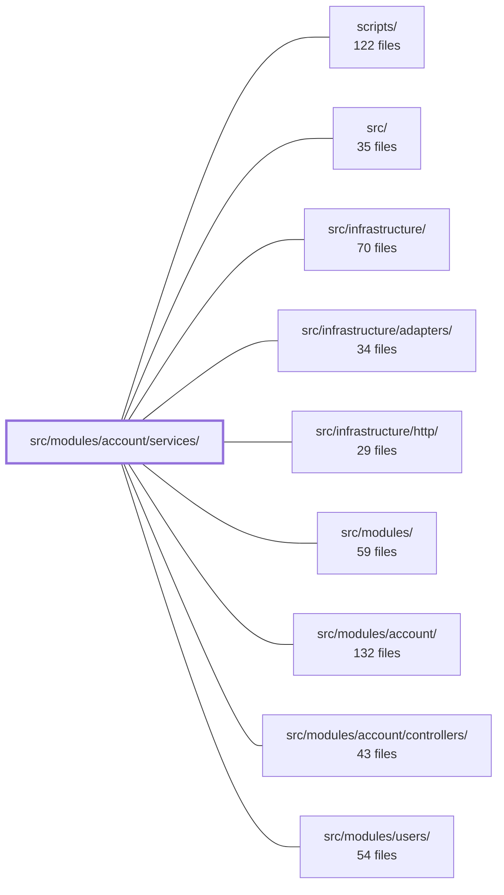

---
tags:
  - 2brain
  - 2brain/module
  - project/boilerplate-node-backend
type: module
module: src/modules/account/services/
files: 31
updated: 2026-10-15T13:37:13.016648+00:00
---

# src/modules/account/services/

## Purpose

The service layer for the account module. It contains the business logic behind every self-service account operation—authentication (login, signup, OAuth, 2FA, password reset), profile and email management, session lifecycle, data export, account deletion, and the periodic maintenance sweeps. Controllers in `src/modules/account/controllers/` call into these services; they never hit repositories or side-effect channels directly.

## Key parts

- **Shared primitives** — `caller.ts` (the "load own account or 401" helper every service reuses), `mail.ts` (single-function wrapper that enforces the one-layer rule for `enqueueEmail`), `tokens.ts` (issue/find/spend/redeem for all one-time verification tokens), `password.ts` (single funnel for breach-check + session-epoch bump + revocation on any password write).
- **Authentication flows** — `login.ts`, `signup.ts`, `oauth.ts`, `reauth.ts`, `refresh.ts`, and the four `two-factor-*.ts` files (challenge, enrollment, lockout, outcomes) covering the full 2FA surface.
- **Account & email management** — `profile.ts` (PUT/PATCH pipeline), `email-change.ts` (request + cancel), `verification.ts` (single entry point for all email-verification tokens), `revocation.ts` / `logout.ts` / `sessions.ts` (session termination and listing).
- **Password reset** — `password-reset-request.ts` (token + mail) paired with `password-reset.ts` (token spend + new password), both routing through `password.ts`.
- **Deletion & data export** — `deletion-request.ts` → `self-delete.ts` (two-step delete); `export.ts` → `export-job.ts` → `export-rows.ts` (Art. 15/20 GDPR export lifecycle); `personal-data-registry.ts` (module-scoped registry fed from outside).
- **Maintenance & ops** — `reap-inactive.ts` (staged inactivity pipeline), `previous-email-cleanup.ts` (7-day email-minimisation sweep), `reencrypt.ts` (TOTP key-ring re-encryption).
- **Barrel** — `index.ts` re-exports everything under two namespaces (`accountService`, `twoFactorService`) so controllers can import a whole group or a single function.

## How it connects

- **`src/modules/account/controllers/`** — The sole consumer. Controllers translate HTTP requests into service calls and shape responses; every side effect (audit, analytics, mail) is triggered inside the service, not the controller.
- **`src/modules/users/`** — Provides the persistence and user-document abstractions these services operate on. `reencrypt.ts` explicitly calls into the users-module walker for key-ring iteration; `personal-data-registry.ts` exists *because* the account module cannot import sibling modules' data sections directly.
- **`src/infrastructure/` (adapters, http)** — Supplies the transport and adapter layer (email enqueue, storage, HTTP utilities) that services invoke indirectly through their own thin wrappers (e.g. `mail.ts`).
- **`scripts/`** — Ops-level cron scripts (inactivity reaper, export reaper, TOTP re-encryption) call the same service functions exposed here, so stage ordering and side-effects stay unit-tested rather than duplicated in a script file.

## Where to start

1. **`index.ts`** — Read the barrel first to see the two published namespaces and the full surface of what a controller can call. It gives you the map before you enter any single flow.
2. **`caller.ts`** — A newcomer will see this helper in nearly every other service file. Understanding the "load caller or 401" pattern and the audit-stamping convention it enforces makes the rest of the module far easier to follow.

## Connected modules

[[boilerplate-node-backend_ROOT|/ (repository root)]] · [[boilerplate-node-backend_scripts|scripts/]] · [[boilerplate-node-backend_src|src/]] · [[boilerplate-node-backend_src_infrastructure|src/infrastructure/]] · [[boilerplate-node-backend_src_infrastructure_adapters|src/infrastructure/adapters/]] · [[boilerplate-node-backend_src_infrastructure_http|src/infrastructure/http/]] · [[boilerplate-node-backend_src_modules|src/modules/]] · [[boilerplate-node-backend_src_modules_account|src/modules/account/]] · [[boilerplate-node-backend_src_modules_account_controllers|src/modules/account/controllers/]] · [[boilerplate-node-backend_src_modules_users|src/modules/users/]]

## Files
- `src/modules/account/services/caller.ts` — Shared entry-point helpers for self-service account flows. It encapsulates the "load the caller's own account or return 401" pattern that nearly every account service repeats, and provides a consistent way to stamp audit entries with the actor's resolved role.
- `src/modules/account/services/deletion-request.ts` — Handles the *request* to delete an account: it issues a short-lived confirmation token, sends the user a deletion-confirmation email containing that token, and logs the event. It deliberately does **not** perform the deletion — that is `./self-delete`, which the recipient invokes by spending the token link.
- `src/modules/account/services/email-change.ts` — Handles the **request** and **cancellation** sides of an email-change flow: evaluating a `PUT/PATCH /account` `email` field against pending-change rules, persisting it to `pendingEmail`, sending the two outgoing mails (old-address undo notice + new-address verification link), and revoking the live token on explicit cancel. Confirming and undoing live in `./verification`.
- `src/modules/account/services/export-job.ts` — The export worker for a single account's Art. 15 data export. It collects every registered `PersonalDataSection` **sequentially** (one at a time, appending to the file as each arrives), writes the result to the private export store, and mails the download link to the requester. Invoked from the `worker.account.export` queue or inline via `./export.ts` when no broker is present. Its core design goal is bounding peak memory to the largest single section rather than the full export object.
- `src/modules/account/services/export-rows.ts` — Provides the shared "delete an export row and its file" operation plus the nightly reaper for expired exports. It is deliberately split out of `./export.ts` so the module barrel (`services/index.ts`) can publish the reaper to ops tooling without also exposing the export *build* path, which touches every sibling's data.
- `src/modules/account/services/export.ts` — Implements the GDPR "give me my data" flow (Art. 15/20) as an asynchronous job rather than a synchronous request. A `POST` records a `building` row and queues a build; a worker writes the JSON file; the caller downloads it later via `GET`. Enforces a single live export per account with replace-on-rebuild semantics, and participates in account erasure.
- `src/modules/account/services/index.ts` — Barrel/index file for the account services layer. It re-exports the module's individual service functions (for targeted imports) and groups them into two published namespaces — `accountService` (auth, profile, tokens, OAuth, email, deletion) and `twoFactorService` (enrollment, challenge, backup codes) — so controllers can import either a whole flow group or a single named function.
- `src/modules/account/services/login.ts` — Provides two password-verification primitives for the account module: `login` (unauthenticated email/password → user document) and `verifyOwnPassword` (authenticated caller re-confirming their password before a sensitive action). Neither function mints or touches a session token; that concern is delegated to the sibling `session` service.
- `src/modules/account/services/logout.ts` — Implements the three session-termination actions an account can trigger: revoke one specific session, log out of only the current (cookie-backed) session, and log out everywhere (all sessions + epoch bump). Each action wires the repository mutation into the appropriate audit and analytics side-effects.
- `src/modules/account/services/mail.ts` — A single-function service-layer wrapper around `enqueueEmail`. It exists purely to satisfy the layering rule that all `enqueueEmail` calls originate from the service layer (enforced by `tests/cross-cutting/side-effects-have-one-layer.test.ts`). It is deliberately kept as its own one-function file — not folded into a larger service — so that `two-factor/methods/email.ts`, which is not itself a service, can import a mail-sending capability without pulling in an unrelated service's full surface.
- `src/modules/account/services/oauth.ts` — Orchestrates the OAuth login/signup flow, sitting one layer above the provider-specific mechanics in `../oauth/`. Given an `OAuthIdentity` from a provider token exchange, it resolves to a `UserDocument` via exactly three outcomes: **login** (identity already linked), **link** (new identity attached to an existing verified account), or **signup** (fresh password-less account created). It owns the audit/analytics side-effects for link and signup, and enforces the email-verification security gates that prevent account takeover.
- `src/modules/account/services/password-reset-request.ts` — Handles the *request* half of password reset: issuing a one-time reset token for a user's mailbox and queuing the email that carries the link. The *spending* of that link lives in `./password-reset`. A second, thinner path mints the same kind of token for admin-created accounts that ship without a password.
- `src/modules/account/services/password-reset.ts` — Implements the **completion** half of a password reset (the `POST /account/reset-confirm` handler). Given the token from a mailed link, it validates the new password, checks it against breach lists, atomically spends the token, writes the new password, clears MFA state, records an audit row, and sends a confirmation email. The *request* (link generation and mailing) lives in `./password-reset-request`.
- `src/modules/account/services/password.ts` — The shared password-write funnel for the account module. Both `completePasswordReset` (in `./password-reset`) and the signed-in change (`passwordChangeWithCurrent`) end at `passwordChange` here, so a new password always gets the breach check, the session-epoch bump, and the session revocation in one place.
- `src/modules/account/services/personal-data-registry.ts` — A module-scoped, in-memory store for the list of `PersonalDataSection` entries. It exists because the `account` module cannot import sibling modules to collect their manifest entries (the same isolation wall that constrains `@modules/locales/services/translatables.ts`), so the sections must be supplied from outside once the full set of enabled modules is known.
- `src/modules/account/services/previous-email-cleanup.ts` — Implements the nightly `reap:previous-emails` sweep: a data-minimisation pass that forgets the previous email address stored on any account whose 7-day undo link is no longer live. Once nothing can restore the old address, retaining it serves no purpose.
- `src/modules/account/services/profile.ts` — Service layer for reading and updating the caller's own profile (`GET`/`PUT`/`PATCH /account`). It orchestrates the update pipeline—email-change routing, cooldown gating, mail-budget check, persistence, and notification—while keeping each concern delegated to a dedicated neighbor module.
- `src/modules/account/services/reap-inactive.ts` — Defines the staged inactivity-reaper pipeline (minimise → warn → soft-delete → hard-delete) as a single exported function. Kept separate from the cron script so that stage ordering is a unit-tested fact, not an implicit side-effect of a file nothing else imports.
- `src/modules/account/services/reauth.ts` — Implements step-up re-authentication for an already-authenticated caller: determining which proof methods an account can use, mailing a one-time code for password-less (OAuth-only) accounts, and verifying the submitted proof (password or code, plus an optional second-factor code). It returns the `amr` claim the controller should stamp on the re-minted session; the session itself is re-minted by the controller, not here.
- `src/modules/account/services/reencrypt.ts` — Thin orchestration layer that re-encrypts every enrolled TOTP device secret onto the newest entry in the TOTP key ring. It exists to bind together the key-ring source (session config) and the binding rule (two-factor TOTP) into a single call to the users-module walker, so the ops script and the account services barrel both have one account-scoped entry point.
- `src/modules/account/services/refresh.ts` — Implements the refresh-token exchange: it calls the underlying rotation (in `../session/jwt`) to swap a presented refresh token for a fresh access/refresh pair, and records the outcome — success, missing token, invalid token, or token-reuse detection — as a structured audit event. Exists so the controller layer can delegate "do the swap and tell the observability layer what happened" in one call.
- `src/modules/account/services/revocation.ts` — Centralises the "end a user's sessions" operation. Given a `RevocationCause` (defined in the domain's `REVOCATION` table), it moves the session epoch to invalidate live ACCESS tokens and then cleans up session rows and pending one-time tokens. All causes funnel through `revokeFor`, so callers only need to supply the reason.
- `src/modules/account/services/self-delete.ts` — Hard-deletes the caller's own account after a one-time confirmation token has been redeemed. This is the self-service "delete my account" flow, distinct from an admin-initiated user deletion.
- `src/modules/account/services/sessions.ts` — Service-layer functions for a user's live sessions: listing them for the authenticated caller, preparing a metadata-only view for data export, and performing hard erasure of sessions plus verification tokens during account deletion. Credentials (refresh tokens, raw session IDs) are deliberately never returned here; the family ID is the sole handle a client can revoke by.
- `src/modules/account/services/signup.ts` — Implements the `POST /account/signup` endpoint logic: validates submitted fields, runs anti-automation gates (breached-password corpus, email policy), then atomically creates the user account and its default `unverified` role in a single database transaction. Exports the `signup` handler and the `SignupInput` shape consumed by the route layer.
- `src/modules/account/services/tokens.ts` — Manages the full lifecycle of one-time verification tokens (password reset, email verify, email change + undo, account-delete confirm, MFA login challenge) stored in the `verificationtokens` collection. Defines what "live" means, provides issue / find / spend / redeem primitives, and produces the uniform 422 refusal every dead-link controller returns.
- `src/modules/account/services/two-factor-challenge.ts` — Implements the three operations of the 2FA login challenge: **build** a single-use challenge after the first factor succeeds, **deliver** a code for one armed method, and **verify** a submitted code. It deliberately stops short of minting a session — `../controllers/post-login-2fa.ts` is responsible for turning a verified challenge into cookies.
- `src/modules/account/services/two-factor-enrollment.ts` — Orchestrates the full lifecycle of second-factor methods on an account: status query, enrollment setup, code delivery, confirmation/arming, and removal. It owns the security invariants around each step (fresh-auth preconditions, code verification, delivery cooldowns, disarming-before-restart) and delegates method-specific rules to the handler registry in `../two-factor`.
- `src/modules/account/services/two-factor-lockout.ts` — Central verification gate for every two-factor code check on an armed account. A submitted code is compared against the account's armed factors (in registration order), then against backup codes, all behind a per-account wrong-code lockout counter. The file exists so that no flow can verify a code without first reserving a limited attempt budget, and so the "armed factors before backup codes" invariant is enforced in exactly one place.
- `src/modules/account/services/two-factor-outcomes.ts` — Shared "outcomes" layer for every two-factor flow: it standardizes the HTTP responses a 2FA operation returns (success, wrong-code, locked, cooldown), fires the out-of-band notification emails, builds the per-method public summary, and wraps results in audit records. It exists so that challenge, enrollment, and lockout flows all produce identical response shapes and enforcement without each re-implementing the logic.
- `src/modules/account/services/verification.ts` — Centralises email-verification for two flows—proving an account's existing address (signup / explicit re-send) and proving a pending address requested via `PUT/PATCH /account`—so that token issuance, email composition, cooldown pacing, and audit logging all live in one place and cannot drift. Every verification flow in the codebase calls into this module and nothing else.

---
[[boilerplate-node-backend_INDEX|← boilerplate-node-backend index]]
