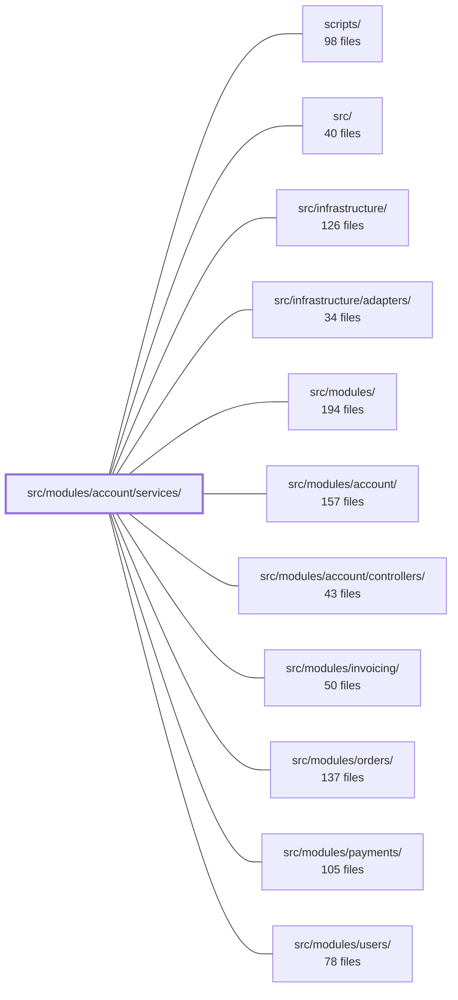

---
tags:
  - 2brain
  - 2brain/module
  - project/boilerplate-node-backend
type: module
module: src/modules/account/services/
files: 35
updated: 2026-11-08T10:49:29.301084+00:00
---

# src/modules/account/services/

## Purpose

The service layer for the account module. It contains all business logic behind user-facing account operations—authentication (password, OAuth, 2FA), profile management, account lifecycle (creation, deletion, erasure), GDPR data exports, session control, and the various token/timing side-effects those operations trigger. Controllers and external callers reach this code exclusively through the two public objects exported by `index.ts`.

## Key parts

- **Public API & entry point** — `index.ts` (barrel) exposes `accountService` and `twoFactorService`; `caller.ts` provides the shared "load the caller's account or 401" gate every self-service flow starts from.
- **Authentication & identity** — `login.ts`, `signup.ts`, `oauth.ts`, `reauth.ts`, `refresh.ts`, and the `two-factor-*` files (challenge, enrollment, lockout, outcomes) cover the full sign-in / sign-up / step-up path.
- **Credentials & password** — `password.ts` (single write-path), `password-reset.ts` + `password-reset-request.ts` (issue / spend), `verification.ts` (email-verification tokens), `tokens.ts` (one-time token lifecycle).
- **Account lifecycle & GDPR** — `account-deletion.ts`, `deletion-sign-in.ts`, `purge-deletions.ts`, `erasure-ledger.ts`, `reap-inactive.ts`, `previous-email-cleanup.ts`, `email-change.ts`.
- **Data export** — `export.ts` (row lifecycle), `export-job.ts` (build worker), `export-rows.ts` (deletion / reaper), `personal-data-registry.ts` (in-memory section list).
- **Sessions & revocation** — `sessions.ts` (listing, lookup, erasure), `revocation.ts` (single `revokeFor` entry), `logout.ts` (three logout operations).
- **Profile & public config** — `profile.ts`, `public-config.ts`, `operator-identity.ts`.
- **Cross-cutting helpers** — `mail.ts` (single `enqueueEmail` wrapper), `reencrypt.ts` (TOTP key-ring rotation).

## How it connects

- **`src/modules/account/controllers/`** — Every controller in the account module calls `accountService` or `twoFactorService` (from `index.ts`); no controller reaches into individual service files directly.
- **`src/modules/account/` (parent)** — Service files delegate to domain logic (e.g. `../domain/email-change` state machine), the provider-agnostic OAuth mechanics in `../oauth/`, the two-factor method registry in `../two-factor`, and the JWT session module for token rotation.
- **`src/modules/users/`** — The actual `users` document is owned by the users module; this service layer reads/writes through it (profile fields, TOTP secrets, session rows). Staff-initiated restores via `users` also flow back here.
- **`src/modules/invoicing/`, `src/modules/orders/`, `src/modules/payments/`** — Each registers a `PersonalDataSection` into `personal-data-registry.ts` at boot so the export job can stream their data without `account` importing them (circular-import wall).
- **`src/infrastructure/`** — Email queue (`enqueueEmail` via `mail.ts`), the `worker.account.export` queue for the export build, and the `verificationtokens` table storage.
- **`scripts/`** — Cron/reaper scripts (`reap:scheduled-deletions`, `reap:previous-emails`, `reap:inactive`) invoke the corresponding service functions; the `reencrypt` ops script calls `reencrypt.ts`.
- **Repository root / `src/`** — Boot-time code registers the personal-data sections and assembles the service objects before the app starts listening.

## Where to start

1. **`index.ts`** — Read this first to see the two public objects and which files are exposed as named re-exports. It tells you exactly what surface area controllers and external modules can touch.
2. **`caller.ts`** — Short file, but it defines the "401 vs 404" contract and the audit-actor convention that every other service file assumes. Understanding this prevents confusion when reading the larger flows (login, deletion, export).

## Connected modules

[[boilerplate-node-backend_ROOT|/ (repository root)]] · [[boilerplate-node-backend_scripts|scripts/]] · [[boilerplate-node-backend_src|src/]] · [[boilerplate-node-backend_src_infrastructure|src/infrastructure/]] · [[boilerplate-node-backend_src_infrastructure_adapters|src/infrastructure/adapters/]] · [[boilerplate-node-backend_src_modules|src/modules/]] · [[boilerplate-node-backend_src_modules_account|src/modules/account/]] · [[boilerplate-node-backend_src_modules_account_controllers|src/modules/account/controllers/]] · [[boilerplate-node-backend_src_modules_invoicing|src/modules/invoicing/]] · [[boilerplate-node-backend_src_modules_orders|src/modules/orders/]] · [[boilerplate-node-backend_src_modules_payments|src/modules/payments/]] · [[boilerplate-node-backend_src_modules_users|src/modules/users/]]

## Files
- `src/modules/account/services/account-deletion.ts` — Service layer for the self-deletion lifecycle: scheduling an account erasure with a grace period, canceling it (owner link, owner sign-in, or staff via `users`), and announcing the cancellation. Implements `DELETE /account`, `POST /account/restore`, and the event handler for staff-initiated restores.
- `src/modules/account/services/caller.ts` — Provides the shared "load the caller's own account or answer 401" entry point that every self-service account flow begins with, plus a helper that records audit entries with the actor's role resolved post-action. It centralizes the 401-vs-404 contract (a valid token for a deleted account is unauthenticated, not not-found) and the convention for naming actor roles in account audit logs.
- `src/modules/account/services/deletion-sign-in.ts` — Implements the sign-in half of the account-deletion grace period: when a user whose account is scheduled for erasure attempts to log in, they receive a one-time claim check instead of a session. Redeeming that check at `POST /account/login/restore` cancels the deletion and returns the data needed to mint the session.
- `src/modules/account/services/email-change.ts` — Handles the *request* and *cancellation* phases of an email address change. It sets `user.pendingEmail` (never `user.email` directly), sends the two mails a genuine request owes (old-address undo notice + new-address verification link), and revokes the token when a change is explicitly cancelled. Confirmation and undo live in `./verification`; the state-machine logic lives in `../domain/email-change`.
- `src/modules/account/services/erasure-ledger.ts` — Durable record of account erasures, scheduled deletions, and their cancellations, retained longer than the oldest backup. When an old snapshot is restored, `reapplyErasures` replays the ledger to re-erase or re-lock accounts that the restore brought back, ensuring the `auditlogs` (90 days) and Loki (7 days) gaps don't leave erased accounts resurrected.
- `src/modules/account/services/export-job.ts` — Implements the account-data export worker: it streams each registered `PersonalDataSection` one at a time into a JSON file (bounding peak memory to the largest single section), writes that file to the private export store, settles the `building` row to `ready` or `failed` in a single transaction that also publishes the corresponding domain event, and mails the requester a link (or a short failure notice). It runs from the `worker.account.export` queue or inline (via `./export.ts`) when no broker is configured.
- `src/modules/account/services/export-rows.ts` — Handles the **deletion** side of account data exports: the shared single-row delete used by both the user request path and the nightly reaper, plus the reaper loop itself. It lives in a separate file from `./export.ts` so the module barrel can publish the reaper without also publishing the build path (which reaches every sibling's data).
- `src/modules/account/services/export.ts` — Implements the account data-export flow (GDPR Art. 15 / 20) as a background job rather than a synchronous request. A POST records a `building` row and queues a build; a worker writes the JSON file; a link is mailed on completion. A GET reports status or streams the finished file. The module owns the row lifecycle (create, read, replace, erase) and enforces the one-live-export-per-account invariant.
- `src/modules/account/services/index.ts` — Barrel file that assembles the account module's service layer into two public objects — `accountService` and `twoFactorService` — plus a small set of named re-exports (token-type constants, OAuth error classes, a few pure helpers). It exists so that every controller and external caller reaches account logic through exactly one of those two objects, keeping 2FA callers decoupled from core-account callers at the type level.
- `src/modules/account/services/login.ts` — Handles password-based identity proofing for the account module: `login` authenticates an unauthenticated email/password pair, and `verifyOwnPassword` re-confirms a signed-in caller's password before a sensitive action. Neither function creates or invalidates a session — that is the responsibility of `../session/session`.
- `src/modules/account/services/logout.ts` — Implements the three logout operations an account can perform: revoke a specific session the caller owns, sign out of only the current session (cookie-based), and revoke every session plus invalidate the session epoch so outstanding access tokens die. Each operation is accompanied by an audit record and an analytics event.
- `src/modules/account/services/mail.ts` — A single-function service-layer wrapper around `enqueueEmail`. It exists solely to satisfy the architectural rule (enforced by `tests/cross-cutting/side-effects-have-one-layer.test.ts`) that every `enqueueEmail` call must originate from the service layer, rather than from the copy/template layer (`../emails.ts`) or from non-service modules like `two-factor/methods/email.ts`.
- `src/modules/account/services/oauth.ts` — Service layer for the OAuth login / signup / link flows. Sits one level above the provider-agnostic mechanics in `../oauth/` and is the OAuth counterpart to `login.ts` and `signup.ts`. It handles three sign-in outcomes (linked identity logs in, email match without a session is refused, new identity signs up) and a separate two-step "connect provider to signed-in account" flow, emitting audit records, analytics events, and notification mail along the way.
- `src/modules/account/services/operator-identity.ts` — Resolves the operator identity (legal name, address, VAT, contact) that a site is legally required to publish under e-Commerce Directive Art. 5(1) and GDPR Art. 13(1)(a). It reads live values from `accountConfig` and returns a fully-populated `Operator` object, ensuring required legal fields are always present. Lives in the `account` module rather than `shop` because operator identity exists even on sites without a shop.
- `src/modules/account/services/password-reset-request.ts` — Handles the *request* side of password resets: issuing a one-time reset token for an email address and queueing the reset-link email. It also issues the initial password-setup link for admin-created accounts that have no password yet. Spending (validating and acting on) the link lives in the sibling `./password-reset` module.
- `src/modules/account/services/password-reset.ts` — Completes a password reset triggered by a mailed link. Validates the password pair, looks up the live token, rejects breached passwords, atomically spends the token, writes the new password (clearing MFA lock and marking the address verified), then fires off an audit row and a confirmation email. The request-side is in `./password-reset-request`.
- `src/modules/account/services/password.ts` — The single write-path for changing a user's password. Both the signed-in "change password" flow (`passwordChangeWithCurrent`) and the reset-confirm flow funnel through `passwordChange` / `writePassword`, guaranteeing that every credential update bumps the session epoch, revokes refresh tokens, and (when the cause announces) emits an `account.sessions_revoked` outbox row — all inside one database transaction.
- `src/modules/account/services/personal-data-registry.ts` — Holds the in-memory list of `PersonalDataSection` entries that the account module exposes for personal-data export. It exists because `account` cannot import other `src/modules/*` packages to gather their manifests itself (the same circular-import wall that constrains `@modules/locales/services/translatables.ts`). The list is therefore supplied from outside once, at boot, rather than assembled here.
- `src/modules/account/services/previous-email-cleanup.ts` — Implements the nightly `reap:previous-emails` sweep. For every account whose 7-day email-change undo token is no longer live (expired, spent, or revoked), it discards the stored previous email address — a data-minimisation step, since the address has no use once it can no longer be restored.
- `src/modules/account/services/profile.ts` — Handles reading and updating the caller's own account profile (`GET`, `PUT`, `PATCH /account`). It orchestrates the full write path—cooldown pacing, mailbox-budget checks, the persisted update, and post-save side-effects (email-change notification, analytics-consent withdrawal)—while deliberately excluding password changes (owned by `./password`) and admin-only fields.
- `src/modules/account/services/public-config.ts` — Assembles the account module's slice of the `GET /config` response: the session mode, tier-based lifetimes, optional staff cap, and the list of configured OAuth providers. The values are public (no auth required) and constant for the life of the process, so a client can read them once at boot instead of maintaining its own feature switches.
- `src/modules/account/services/purge-deletions.ts` — Permanently erases accounts whose self-deletion grace period has expired. This is the step that actually discharges GDPR Art. 17 — the lock placed at request time is only a restriction; the purge removes the data. Invoked hourly by the `reap:scheduled-deletions` job.
- `src/modules/account/services/reap-inactive.ts` — Defines the four ordered stages of the inactivity reaper (minimise → warn → soft delete → hard delete) as a pure service, deliberately separated from the cron script so that stage ordering is a tested invariant rather than a side-effect of file layout. Two numeric dials (`minimiseDays`, `inactiveDays`) gate which stages run; a value of `0` switches that path off entirely.
- `src/modules/account/services/reauth.ts` — Implements step-up re-authentication for an already-signed-in caller: determines which proof methods an account supports, mails a one-time code for password-less (OAuth-only) accounts, and verifies either a typed password or a mailed code behind `POST /account/reauth`. It returns the AMR claims the *controller* uses to re-mint the session; it never mints the session itself.
- `src/modules/account/services/reencrypt.ts` — Encapsulates the re-encryption of every enrolled TOTP device secret onto the newest key in the `NODE_TOTP_ENCRYPTION_KEY` ring. Because the secrets physically live on the `users` document, this module only owns the *ring* and *binding rule*, then delegates the actual row walk to the users service. It exists so the ops script `reencrypt` (see `@infrastructure/security/reencrypt`) has a single, account-domain entry point to call.
- `src/modules/account/services/refresh.ts` — Orchestrates the refresh-token → access-token exchange: accepts an optional refresh cookie, delegates the actual rotation to the JWT session module, classifies the outcome (success, missing token, invalid, reuse), and records the appropriate audit row and metric before returning the new token pair to the controller. It exists to keep the "what to audit and how" policy separate from the "how to rotate" mechanics.
- `src/modules/account/services/revocation.ts` — Single entry point (`revokeFor`) for ending a user's sessions. Given a `RevocationCause` from the domain table, it decides whether to bump the session epoch (the step that actually invalidates live ACCESS tokens) and then performs the housekeeping of deleting session rows and optional pending-token links. Every call-site that ends sessions funnels through this one function so the epoch/announce/delete ordering is handled in one place.
- `src/modules/account/services/sessions.ts` — Service layer for the authenticated caller's own live sessions. It exposes listing, single-session lookup, data-export, and hard-erasure operations for `GET /account/sessions` and the account-deletion flow. A hard rule governs the module: no live credential (refresh token, raw session id) is ever returned to a client—the family id is the only revocation handle that crosses the boundary.
- `src/modules/account/services/signup.ts` — Implements the `POST /account/signup` handler. Validates the submitted fields, runs two anti-automation gates (breached-password check, email-policy check), and—if the email is free—creates the account and its starting role. All success and failure paths are funnelled into a uniform `ResponseSuccess | ResponseReject` envelope.
- `src/modules/account/services/tokens.ts` — Manages the full lifecycle of one-time verification tokens (password reset, email verification, account-deletion confirmation, email-change + undo, and the login MFA challenge) stored in the `verificationtokens` table. It is the single place where "live" is defined, where tokens are minted/spent, and where every refusal is counted, audited, and answered with an indistinguishable 422.
- `src/modules/account/services/two-factor-challenge.ts` — Implements the second step of a two-factor login: building an MFA challenge, delivering a code against it, and verifying a submitted code. It deliberately stops short of minting a session — that is the job of `../controllers/post-login-2fa.ts`, which receives the `VerifiedChallenge` this module returns.
- `src/modules/account/services/two-factor-enrollment.ts` — Service layer for the account's two-factor authentication lifecycle: querying armed/available methods, starting (or restarting) enrollment for a method, delivering a code for an armed delivered method, confirming (arming) a pending method, and minting backup codes. Method-specific rules (TOTP, SMS, etc.) are delegated to the registry in `../two-factor`; this file owns the *account-level* state transitions and the "which entry, when" decisions.
- `src/modules/account/services/two-factor-lockout.ts` — Central code-verification chokepoint for every 2FA flow that checks a user-supplied code against an account's armed factors. Enforces the per-account wrong-code cap (lockout) via an atomic reservation before any comparison, and guarantees a strict evaluation order: armed factors first, backup codes last. All entry points that accept a 2FA code funnel through this file.
- `src/modules/account/services/two-factor-outcomes.ts` — Centralised "result" helpers for the two-factor subsystem: building rejection responses, emitting fire-and-forget out-of-band emails, recording audit entries, and exposing a method's public summary. It has no flow of its own—every 2FA endpoint (login challenge, enrollment, reauth) calls into these to keep refusal semantics, notification copy, and audit shape consistent.
- `src/modules/account/services/verification.ts` — Centralises email-verification token issuance and mail dispatch for the two flows that share the mechanism — proving the address an account already has (signup / explicit re-send) and proving the address a `PUT/PATCH /account` change has requested. Every flow that starts either kind calls the functions here and nothing else, so the two paths cannot drift.

---
[[boilerplate-node-backend_INDEX|← boilerplate-node-backend index]]
