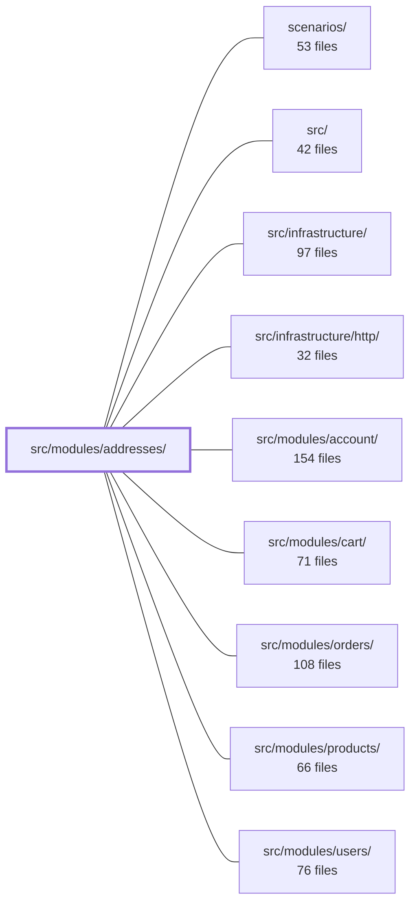

---
tags:
  - 2brain
  - 2brain/module
  - project/boilerplate-node-backend
type: module
module: src/modules/addresses/
files: 27
updated: 2026-10-29T19:23:08.123285+00:00
---

# src/modules/addresses/

## Purpose

Manages a user's address book — a per-user document holding an array of shipping/billing address entries. It owns CRUD over those entries, the "default address" pointer, PII encryption at rest, and the domain invariants (exactly one default, bounded entry count). Downstream, checkout and order confirmation resolve shipping/billing addresses against this book.

## Key parts

- **Domain core** — `model.ts` (Mongoose schema: one doc per user, `items` is a DocumentArray where each entry carries its own `_id`), `repository.ts` (CRUD + atomic enforcement of the entry cap and single-default invariant), `pii.ts` (field-level AES with per-entry AAD binding), `reencrypt.ts` (key-rotation re-encryption walk).
- **Service & presentation** — `service.ts` (single façade every controller and sibling module calls; translates repository results into shaped responses and localised errors), `presenter.ts` (maps internal model to the wire shapes in `openapi.yaml`).
- **HTTP layer** — `routes.ts` (Express router mounted under `/account`, all routes auth-gated, non-cacheable), `controllers/` (one thin file per endpoint: `post`, `get-addresses`, `get-address`, `update-address`, `put-address-default`, `delete-address`), `config.ts` (single tunable: max entries per book).
- **Module registration** — `module.ts` (manifest declaring routes, config, PII hooks, locale path for the kernel), `index.ts` (barrel; the only import surface for sibling modules).
- **API contract** — `openapi.yaml` (OpenAPI 3.1 spec for the full CRUD surface, default-address endpoint, and shared domain schemas).
- **Tests** — `tests/contract/` (API contract over real HTTP), `tests/integration/` (invariants, PII round-trip, checkout interaction, reencrypt), `tests/unit/` (route-shape, schema-contract, factory tests), plus `factories.ts` and `tests/factories.ts` for fixture construction.

## How it connects

- **account** — The addresses router is mounted under `/account` alongside the account module's own router; both share the same authenticated-user context.
- **users** — Each address book is keyed by `userId`; ownership checks (404 for foreign IDs) are enforced here, and the `users` module supplies the authenticated principal.
- **cart** — Checkout requires a billing address (`CART_BILLING_ADDRESS_REQUIRED` guard); the test helper in `tests/factories.ts` seeds a default address so cart tests don't fail on a missing fixture.
- **orders** — Order confirmation snapshots the resolved shipping and billing addresses from this book (see `tests/integration/checkout.test.ts`).
- **infrastructure** — `reencrypt.ts` is the domain-aware hook that the ops script in `@infrastructure/security/reencrypt` calls; `infrastructure/http` provides the Express plumbing the controllers and router build on.

## Where to start

1. **`model.ts`** — 30 lines that show the entire data shape (one doc per user, `items` array, per-entry `_id`, the six PII fields). Reading this first makes every other file in the module legible.
2. **`service.ts`** — The single business-logic façade. Once you know the data shape from `model.ts`, this file reveals how each operation (create, list, get, update, set-default, delete) composes the repository call, enforces invariants, and hands a presenter-ready result to the controllers.

## Connected modules

[[boilerplate-node-backend_ROOT|/ (repository root)]] · [[boilerplate-node-backend_scenarios|scenarios/]] · [[boilerplate-node-backend_src|src/]] · [[boilerplate-node-backend_src_infrastructure|src/infrastructure/]] · [[boilerplate-node-backend_src_infrastructure_http|src/infrastructure/http/]] · [[boilerplate-node-backend_src_modules_account|src/modules/account/]] · [[boilerplate-node-backend_src_modules_cart|src/modules/cart/]] · [[boilerplate-node-backend_src_modules_orders|src/modules/orders/]] · [[boilerplate-node-backend_src_modules_products|src/modules/products/]] · [[boilerplate-node-backend_src_modules_users|src/modules/users/]]

## Files
- `src/modules/addresses/config.ts` — Defines the single tunable parameter for the address book module: the maximum number of entries one address book may hold. It exists to centralise that cap so both the module registration and the repository can read a consistent, validated value from one source.
- `src/modules/addresses/controllers/delete-address.ts` — Thin HTTP adapter that handles `DELETE /account/addresses/:addressId`. It validates the path parameter, delegates the actual deletion to `addressService.remove`, and returns a 204 with no body on success. It exists so the route layer stays a one-line registration while all HTTP concerns (param extraction, error shaping, response codes) live here.
- `src/modules/addresses/controllers/get-address.ts` — Thin Express HTTP adapter that serves `GET /account/addresses/:addressId`. It validates the route parameter, delegates to `addressService.get`, and shapes the response — separating HTTP concerns from the business logic in the service layer.
- `src/modules/addresses/controllers/get-addresses.ts` — Thin HTTP adapter for `GET /account/addresses`. It extracts the caller's user id from the authenticated request, delegates to `addressService.list`, and sends the full address-book view back. It exists so the route layer stays declarative and the controller stays a single-line translation between Express and the service.
- `src/modules/addresses/controllers/post-address.ts` — HTTP handler for `POST /account/addresses`. Validates the request body, delegates creation to the address service, and responds with `201 Created` plus a `Location` header pointing to the new entry.
- `src/modules/addresses/controllers/put-address-default.ts` — Thin HTTP adapter for `PUT /account/addresses/:addressId/default`. It validates the `addressId` path parameter, delegates to the address service's `setDefault` method, and translates the service result into an HTTP response. No request body is consumed — the URI itself is the full statement (idempotent per RFC 9110 §9.3.4).
- `src/modules/addresses/controllers/update-address.ts` — Provides the two HTTP handlers for `PUT /account/addresses/:addressId` (full replace) and `PATCH /account/addresses/:addressId` (partial merge). Both are thin adapters over a single `addressService.update` call, generated by the shared `createUpdateController` factory so that replace/patch semantics, schema validation, and 404 shaping stay consistent with other entities.
- `src/modules/addresses/factories.ts` — Test-factory module for constructing address-book fixtures. It encapsulates the "how do we build a book" decision: a book is uniquely addressed by its `userId` (no `_id` override), while each entry inside it *does* carry its own identity. The single exported factory produces a document shape ready for `addressBookRepository.create`, keeping ObjectId construction in one place.
- `src/modules/addresses/index.ts` — Public barrel for the Addresses module. It is the **only** entry point a sibling module may import from, enforcing the module-boundary rule described in `docs/theory/strategic-ddd.md` §5. It re-exports the module's public surface without adding any logic of its own.
- `src/modules/addresses/model.ts` — Defines the Mongoose schema and model for a user's address book: one document per user (keyed by `userId`), holding an array of address entries as subdocuments. The design intentionally gives each entry its own `_id` so two entries with identical fields are still distinct ("home" vs. "office"), in contrast to cart/wishlist line items which are identified by their content.
- `src/modules/addresses/module.ts` — Module manifest for the **addresses** collection (one document per user, holding shipping addresses that checkout resolves against). Declares the module's routes, config, PII lifecycle hooks, and locale path so the kernel can register everything without any consumer importing `account` or this module's internals directly.
- `src/modules/addresses/openapi.yaml` — OpenAPI 3.1.0 contract for the addresses module: it declares the full CRUD surface of a user's address book (`/account/addresses`), the default-address pointer endpoint, the module's personal-data export slice, and the domain schemas (`Address`, `AddressInput`, etc.) that both the API implementation and downstream consumers (e.g. cart/checkout) rely on.
- `src/modules/addresses/pii.ts` — Encapsulates encryption and decryption of the six PII fields (fullName, street, city, zip, country, phone) on a single address-book entry, binding each ciphertext to a specific field and entry ID via an AAD string. Centralising the field list and the AAD construction ensures no caller can accidentally store or read a field in plaintext by omitting it.
- `src/modules/addresses/presenter.ts` — Maps the internal address-book model to the wire shapes declared in `openapi.yaml`. Every endpoint in `./service.ts` builds its response through this file, keeping serialization logic in one place separate from domain logic and HTTP plumbing.
- `src/modules/addresses/reencrypt.ts` — Module-level wrapper that re-encrypts every PII field in every address-book entry onto the current `NODE_PII_ENCRYPTION_KEY`. It exists so the ops script `reencrypt` (see `@infrastructure/security/reencrypt`) has a single, domain-aware entry point that knows *which* fields to touch and *how* to bind them to their address context.
- `src/modules/addresses/repository.ts` — Per-user address book repository. It exposes CRUD operations over a single Mongoose document per user (`items` is a DocumentArray) and enforces two cross-array invariants atomically: the book holds at most `addressBookMax` entries and exactly one entry is the default. All PII fields are encrypted at rest and decrypted before the document is returned to callers.
- `src/modules/addresses/routes.ts` — Express router that defines all HTTP routes for the user's address book (CRUD + default-address promotion). It is mounted under `/account` alongside the account module's own router (see `./module.ts`). Every route requires authentication; the whole router is marked non-cacheable because it handles credentials and identity-adjacent data.
- `src/modules/addresses/service.ts` — Service layer for the address-book module. It is the single point through which every controller and sibling module reads and writes the address book, translating repository results into shaped HTTP responses (`generateSuccess` / `generateReject`) and localised error messages.
- `src/modules/addresses/tests/contract/api.contract.test.ts` — Contract tests for the address-book REST API (`/account/addresses`) exercised over real HTTP against a seeded test database. The suite pins the behavioural contract of every CRUD endpoint plus the dedicated "set default" action, ensuring correct status codes, response shapes, RFC 9110 PUT/PATCH semantics, validation rules, and uniform 404 ownership responses.
- `src/modules/addresses/tests/factories.ts` — Test-helper module that seeds a single default address into an account's address book so that checkout-related tests in other modules don't fail on the `CART_BILLING_ADDRESS_REQUIRED` guard. It exists to keep those tests focused on their actual subject rather than on missing fixture data.
- `src/modules/addresses/tests/integration/addresses.test.ts` — Integration test suite for the address-book module. It exercises `addressService` end-to-end against a real (test) database to verify three cross-cutting invariants: exactly one default per non-empty book, per-user ownership (foreign entries answer 404), and the enforceable entry cap (409 when exceeded). It also confirms PII fields are encrypted at rest and round-trip correctly through the repository.
- `src/modules/addresses/tests/integration/checkout.test.ts` — Integration tests for how the address book feeds into order confirmation: which address gets snapshotted as shipping vs. billing, how default vs. named entries are resolved, and what happens when the supplied ID is stale, foreign, or inapplicable. It lives outside the rest of the address-book suite because it drags in the cart and order modules; removing the shop removes exactly this file.
- `src/modules/addresses/tests/integration/fixtures.ts` — Shared address fixtures for the addresses integration test suites. Exports two canned address objects so that `addresses.test.ts` and `checkout.test.ts` can reference identical, stable data without duplicating literals inline.
- `src/modules/addresses/tests/integration/reencrypt.test.ts` — Integration test for the `reencrypt` manifest walk in the addresses module. Verifies that, after a PII key rotation, address-book entries stamped with the old key version are re-encrypted to the new version, that a second run is a no-op (idempotency), and that a dry run performs no writes.
- `src/modules/addresses/tests/unit/factories.test.ts` — Unit tests for the `makeAddressBook` fixture builder. Verifies that the factory produces address-book documents with correct `ObjectId` handling, proper omission of absent optional fields, and faithful pass-through of deliverable fields — ensuring test fixtures seeded into the DB are edit- and delete-able.
- `src/modules/addresses/tests/unit/routes.test.ts` — Unit tests that pin down the addresses router's contract: which endpoints exist (and in what order), which middleware guards protect them, and what must *not* be present (permission keys, rate limiting, caching). The file exists to catch regressions where a route is added, reordered, or accidentally made public/storable.
- `src/modules/addresses/tests/unit/schema-contract.test.ts` — Unit test that pins the public contract of `addressBookSchema` — its required fields, indexes, defaults, references, and the shape of its `items` sub-document — so that schema drift is caught in CI. It mirrors the structure of the cart and wishlist schema-contract tests while asserting the one way the address book differs: its line items keep an Mongoose `_id`.

---
[[boilerplate-node-backend_INDEX|← boilerplate-node-backend index]]
