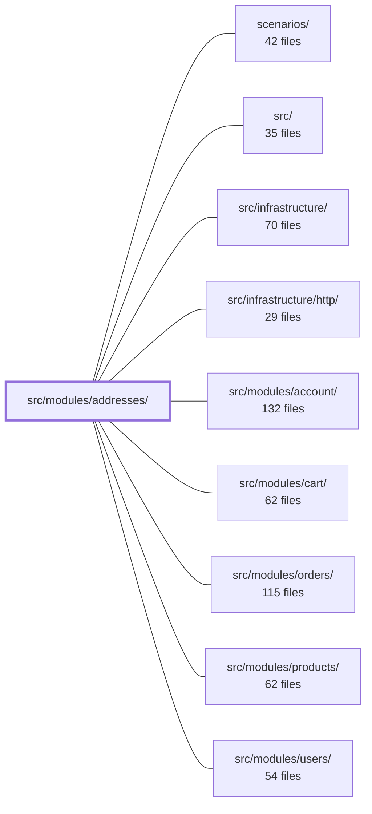

---
tags:
  - 2brain
  - 2brain/module
  - project/boilerplate-node-backend
type: module
module: src/modules/addresses/
files: 26
updated: 2026-10-15T13:37:27.468335+00:00
---

# src/modules/addresses/

## Purpose

The addresses module owns a per-user address book—the collection of shipping and billing addresses a user's checkout resolves against. It exposes a full CRUD HTTP surface under `/account/addresses`, enforces domain invariants (exactly one default, a cap on entries), encrypts PII fields at rest, and provides the address-lookup hook that cart checkout calls to snapshot addresses onto a confirmed order.

## Key parts

- **HTTP layer** — `routes.ts` mounts the Express router; `controllers/` holds one thin adapter per endpoint (GET, POST, PUT/PATCH, DELETE, PUT-default). Each controller validates input, delegates to the service, and shapes the response.
- **Domain & data** — `service.ts` exposes the six operations (get, add, update, set-default, remove, checkout-lookup); `repository.ts` handles all Mongoose CRUD, PII encrypt/decrypt at the boundary, and the "one default" + max-entries invariants; `model.ts` defines the one-document-per-user schema whose `items` sub-documents each carry their own `_id`; `presenter.ts` maps model → wire shape.
- **PII & key rotation** — `pii.ts` wraps the generic encryption primitives with address-specific AAD binding; `reencrypt.ts` is the ops entry point that migrates all stored PII to the newest key.
- **Module plumbing** — `index.ts` is the sole public barrel; `module.ts` is the `AppModule` manifest that registers the module and exposes the `personalData` hook; `config.ts` holds the single tunable (max entries per book); `openapi.yaml` is the 3.1.0 contract.
- **Tests** — `tests/` is split into `unit/` (schema-contract, routes-table, factory), `integration/` (invariants, checkout resolution, reencrypt walk), `contract/` (full HTTP CRUD lifecycle), and shared `factories.ts` / `fixtures.ts`.

## How it connects

- **`src/modules/cart/`** — The only sibling consumer. Cart's checkout calls the address module's lookup hook to resolve shipping and billing addresses before confirming an order; it never imports `account` directly.
- **`src/modules/users/`** — Reads address data exclusively through the `personalData` hook declared in `module.ts`, avoiding a direct import of this module.
- **`src/modules/account/`** — Owns the `/account` URL prefix under which this module's routes are mounted; the account module's router composes the addresses router.
- **`src/modules/orders/`** — Receives the resolved address snapshot (shipping + billing) from the checkout flow; the integration test `checkout.test.ts` verifies that hand-off.
- **`src/infrastructure/http/`** — Provides shared middleware (auth resolution, no-cache) and the `createUpdateController` factory that the update controller reuses.
- **`src/infrastructure/`** — Supplies the low-level `encryptPii`/`decryptPii` primitives and the generic re-encryption machinery that `pii.ts` and `reencrypt.ts` build upon.

## Where to start

1. **`model.ts`** — Read first to understand the data shape: one Mongoose document per user, an array of address entries, each with its own `_id`, and which fields are PII-encrypted.
2. **`service.ts`** — Then read this to see the six domain operations, how the repository and presenter are composed, and what the module exposes to controllers and sibling modules.

Together they give you the full picture of "what an address book is" and "what you can do to it" before you need to touch any controller or repository detail.

## Connected modules

[[boilerplate-node-backend_ROOT|/ (repository root)]] · [[boilerplate-node-backend_scenarios|scenarios/]] · [[boilerplate-node-backend_src|src/]] · [[boilerplate-node-backend_src_infrastructure|src/infrastructure/]] · [[boilerplate-node-backend_src_infrastructure_http|src/infrastructure/http/]] · [[boilerplate-node-backend_src_modules_account|src/modules/account/]] · [[boilerplate-node-backend_src_modules_cart|src/modules/cart/]] · [[boilerplate-node-backend_src_modules_orders|src/modules/orders/]] · [[boilerplate-node-backend_src_modules_products|src/modules/products/]] · [[boilerplate-node-backend_src_modules_users|src/modules/users/]]

## Files
- `src/modules/addresses/config.ts` — Defines the single tunable parameter for the address book module: the maximum number of entries one address book may hold. It exists to centralise that cap so both the module registration and the repository can read a consistent, validated value from one source.
- `src/modules/addresses/controllers/delete-address.ts` — Thin HTTP adapter for the `DELETE /account/addresses/:addressId` endpoint. It validates the URL parameter, delegates the actual removal to the domain service (`addressRemove`), and translates the service result into a well-formed HTTP response. It contains no business logic of its own.
- `src/modules/addresses/controllers/get-addresses.ts` — Thin HTTP adapter for the `GET /account/addresses` endpoint. It extracts the authenticated user's id, delegates to the `addressesGet` service call, and returns the caller's full address book. It exists solely to bridge Express's request/response cycle to the service layer.
- `src/modules/addresses/controllers/post-address.ts` — HTTP handler for `POST /account/addresses`. Validates the request body against the `AddAddressBody` Zod schema, delegates the create (and default-address promotion) to `addressAdd` in the service layer, and responds `201 Created` with the new address and a `Location` header.
- `src/modules/addresses/controllers/put-address-default.ts` — Thin HTTP adapter for `PUT /account/addresses/:addressId/default`. It validates the `addressId` path parameter, delegates to the address service's `addressSetDefault`, and maps the result onto an Express response. No request body is expected — the URI alone is the statement (idempotent per RFC 9110 §9.3.4).
- `src/modules/addresses/controllers/update-address.ts` — Thin controller layer for the two address-mutation endpoints (`PUT` for full replace, `PATCH` for partial merge) at `/account/addresses/:addressId`. It delegates all business logic to the `addressUpdate` service and relies on the shared `createUpdateController` factory to wire up validation, error mapping, and response shaping.
- `src/modules/addresses/factories.ts` — Test-factory module for constructing address-book fixtures. It encapsulates the "how do we build a book" decision: a book is uniquely addressed by its `userId` (no `_id` override), while each entry inside it *does* carry its own identity. The single exported factory produces a document shape ready for `addressBookRepository.create`, keeping ObjectId construction in one place.
- `src/modules/addresses/index.ts` — Public barrel for the Addresses module. It is the **only** entry point a sibling module may import from, enforcing the module-boundary rule described in `docs/theory/strategic-ddd.md` §5. It re-exports the module's public surface without adding any logic of its own.
- `src/modules/addresses/model.ts` — Defines the Mongoose schema and model for a user's address book: one document per user (keyed by `userId`), holding an array of address entries as subdocuments. The design intentionally gives each entry its own `_id` so two entries with identical fields are still distinct ("home" vs. "office"), in contrast to cart/wishlist line items which are identified by their content.
- `src/modules/addresses/module.ts` — Module manifest for the **addresses** book — the shipping-address collection a user's checkout resolves against. Declared as its own `AppModule` so that `cart`'s checkout (the only sibling consumer) never needs to import `account`, and so `users` reaches the data solely through the `personalData` hooks defined here rather than a direct import.
- `src/modules/addresses/openapi.yaml` — OpenAPI 3.1.0 contract for the addresses module. It defines the full CRUD surface for a per-user address book (list, add, replace, update, remove, set-default) under `/account/addresses`, plus the schemas and error vocabulary other parts of the API contract reference when they embed or return an address.
- `src/modules/addresses/pii.ts` — Wraps the low-level `encryptPii`/`decryptPii` primitives with address-entry-specific AAD binding so that each PII field (fullName, street, city, zip, country, phone) is cryptographically tied to the entry it belongs to. Provides whole-entry and single-field encrypt/decrypt helpers used by the repository layer on every write and read path.
- `src/modules/addresses/presenter.ts` — Maps the internal address-book model to the wire shapes declared in `openapi.yaml`. Every endpoint in `./service.ts` builds its response through this file, keeping serialization logic in one place separate from domain logic and HTTP plumbing.
- `src/modules/addresses/reencrypt.ts` — Application-level entry point for re-encrypting all address-book PII fields onto the newest `NODE_PII_ENCRYPTION_KEY`. It bridges the generic re-encryption machinery in `@infrastructure/security` with the concrete address-book schema, and is invoked by the ops script `reencrypt`.
- `src/modules/addresses/repository.ts` — Data-access layer for the per-user address book. Encapsulates all CRUD against `addressBookModel`, handles PII encryption/decryption at the boundary, enforces the "exactly one default" invariant and the max-entries cap, and exposes a uniform repository interface to `service.ts`. Most writes are read-modify-write (load → mutate → `save()`); only `addEntry` is a single atomic pipeline update.
- `src/modules/addresses/routes.ts` — Defines and exports the Express router that wires up all address-book CRUD endpoints under the `/account` path prefix. It applies shared middlewares (auth resolution, no-cache) once and delegates each route to its dedicated controller, keeping routing concerns separate from business logic.
- `src/modules/addresses/service.ts` — Service layer for the address-book module. It wraps repository calls in HTTP-shaped results (success/reject), applies presenters, and exposes the six domain operations (get, add, update, set-default, remove, checkout-lookup) plus two lifecycle hooks that controllers and the module manifest invoke.
- `src/modules/addresses/tests/contract/api.contract.test.ts` — Contract tests for the address-book HTTP API at `/account/addresses`. Validates the full CRUD lifecycle, the book-level `default` pointer, PUT full-replace vs. PATCH partial-update semantics, validation rules, and ownership (404) behavior against a real HTTP server backed by a test database.
- `src/modules/addresses/tests/factories.ts` — Provides a one-liner helper that seeds a test account with a default billing address, so that checkout and cart tests can focus on their actual subject (totals, stock, concurrency, etc.) instead of failing on the `CART_BILLING_ADDRESS_REQUIRED` guard.
- `src/modules/addresses/tests/integration/addresses.test.ts` — Integration tests for the address-book module. They verify three cross-cutting invariants end-to-end against a real database: a non-empty book has exactly one default, foreign entries are indistinguishable from invented ones (404), and the book-cap + PII-encryption rules hold under both sequential and concurrent writes.
- `src/modules/addresses/tests/integration/checkout.test.ts` — Integration tests that verify how the address resolver snapshots shipping and billing addresses onto a confirmed order. It covers default-address resolution, explicit named-entry selection, cross-user ownership enforcement, the split requirement between shipping and billing, and the digital-only (no-ship) path. It lives separately from the rest of the address-book suite because it needs a cart and an order in scope.
- `src/modules/addresses/tests/integration/fixtures.ts` — Shared address fixtures for the addresses integration test suites. Exports two canned address objects so that `addresses.test.ts` and `checkout.test.ts` can reference identical, stable data without duplicating literals inline.
- `src/modules/addresses/tests/integration/reencrypt.test.ts` — Integration test for the `reencrypt` walk that migrates PII-stamped address-book entries from an old key version (`v1`) to a new one (`v2`) after a key rotation. Verifies three guarantees: a dry run reports findings without writing, a real run rewrites every versioned field, and a second run is a no-op.
- `src/modules/addresses/tests/unit/factories.test.ts` — Unit tests for the `makeAddressBook` fixture builder. Verifies that the factory produces address-book documents with correct `ObjectId` handling, proper omission of absent optional fields, and faithful pass-through of deliverable fields — ensuring test fixtures seeded into the DB are edit- and delete-able.
- `src/modules/addresses/tests/unit/routes.test.ts` — Contract test that locks down the addresses router's route table, middleware stack, and authorization posture. It asserts *what* is mounted (exact endpoints, order, guards) rather than *how* handlers behave, so structural regressions (a route losing `noStore`, gaining a permission key, or picking up unexpected middleware) are caught immediately.
- `src/modules/addresses/tests/unit/schema-contract.test.ts` — Unit test that pins the public contract of `addressBookSchema` — its required fields, indexes, defaults, references, and the shape of its `items` sub-document — so that schema drift is caught in CI. It mirrors the structure of the cart and wishlist schema-contract tests while asserting the one way the address book differs: its line items keep an Mongoose `_id`.

---
[[boilerplate-node-backend_INDEX|← boilerplate-node-backend index]]
