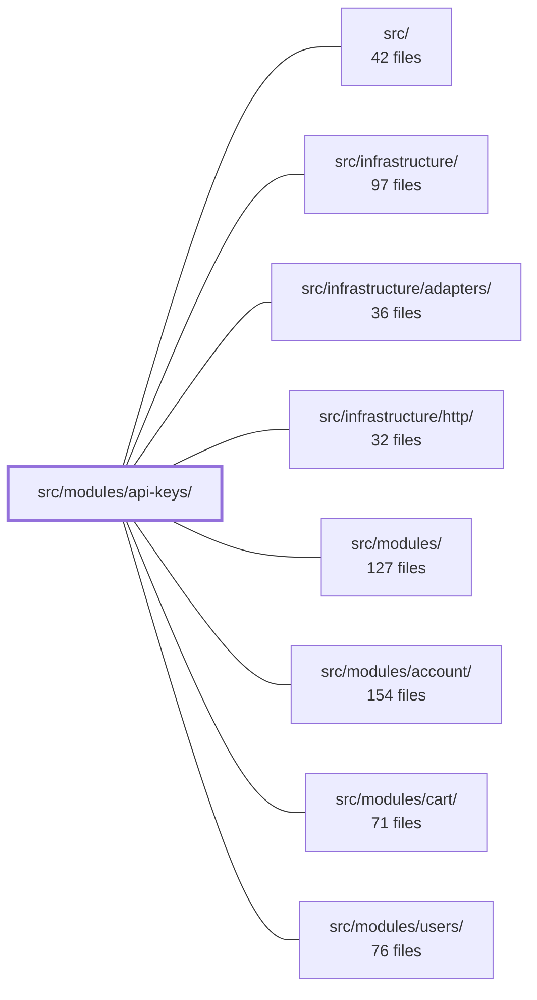

---
tags:
  - 2brain
  - 2brain/module
  - project/boilerplate-node-backend
type: module
module: src/modules/api-keys/
files: 29
updated: 2026-10-29T19:23:31.609827+00:00
---

# src/modules/api-keys/

## Purpose

The `api-keys` module owns the full lifecycle of machine-to-machine `sk_…` bearer credentials: minting, listing, reading, and revoking. It also provides the per-request credential-resolution path that authenticates API calls and re-floors each key's effective permissions against the minter's current holdings on every use. Security-critical bulk revocation (logout-everywhere, password reset, email-change undo) is coordinated with the `account` module via domain events.

## Key parts

- **HTTP surface** — `routes.ts` mounts the four admin endpoints; `controllers/` (list, get, mint, revoke) handle request parsing and response shaping; `openapi.yaml` is the authoritative REST contract.
- **Domain services** — `services/api-keys.ts` (CRUD + tenant scoping + audit + notification), `services/resolver.ts` (token parse → look up → verify → re-floor permissions), `services/actions.ts` (single supported caller action: revoke). All are exposed through `services/index.ts`.
- **Credential mechanics** — `credentials.ts` mints and verifies tokens via one-way SHA-256 (no bcrypt/argon2, since tokens are pure `randomBytes`). `model.ts` defines the Mongoose schema and guarantees the secret hash never serialises. `repository.ts` adds domain-specific queries (resolve-by-prefix, bulk revoke, user-scoped cleanup). `presenter.ts` maps a stored row to the wire shape in `openapi.yaml`.
- **Cross-cutting concerns** — `emails.ts` builds the minted/revoked notification payloads; `audit.ts` registers the action vocabulary into the app-wide `AuditActionMap`; `module.ts` is the startup manifest wiring routes, the credential resolver, event subscriptions, and personal-data hooks.
- **Module boundary** — `index.ts` is the sole public barrel; sibling modules may import only from here.
- **Tests** — `tests/unit/` (hashing, actions, emails, schema metadata), `tests/integration/` (permission-subset invariants, revocation triggers, rate-limit refund, audit side-effects, outbox atomicity), `tests/contract/` (OpenAPI conformance for the admin surface).

## How it connects

- **`src/modules/account/`** — Emits the `sessions-revoked` domain event (via outbox) on logout-everywhere, password reset, and email-change undo. The `api-keys` module subscribes to this event in `module.ts` and bulk-revokes all keys the affected user minted. Integration tests in this module verify both that `account` fires the event at the right moments and that the consumer is idempotent and retried on failure.
- **`src/modules/users/`** — The credential resolver (`services/resolver.ts`) re-floors a key's effective permissions against the minter's *current* permission set on every request; permission data originates from the users domain. Resolving a key also stamps the minter's `lastApiKeyUseAt` timestamp, which the inactivity reaper consumes.
- **`src/infrastructure/http/`** — Controllers leverage shared factories (e.g., the list-controller factory) and the standard authorization/session middlewares mounted by `routes.ts`.
- **`src/infrastructure/adapters/`** — `emails.ts` produces `EmailContent` objects but delegates actual delivery to the mail adapter; domain events (including `sessions-revoked` handling) flow through the outbox/relay infrastructure.
- **`src/modules/` (kernel registry)** — `module.ts` is loaded by the kernel at startup; the registry discovers and activates the module's routes, resolver, event subscriptions, and data-lifecycle hooks.

## Where to start

1. **`src/modules/api-keys/module.ts`** — The single manifest that shows how everything (routes, resolver, events, personal-data hooks) is wired together. Reading this first gives you the module's shape before diving into individual files.
2. **`src/modules/api-keys/services/resolver.ts`** — The most security-critical path: it shows how a raw token becomes an authenticated, permission-bounded identity on every request. Understanding the re-flooring logic here makes the rest of the lifecycle (mint, revoke, audit) click into place.

## Connected modules

[[boilerplate-node-backend_ROOT|/ (repository root)]] · [[boilerplate-node-backend_src|src/]] · [[boilerplate-node-backend_src_infrastructure|src/infrastructure/]] · [[boilerplate-node-backend_src_infrastructure_adapters|src/infrastructure/adapters/]] · [[boilerplate-node-backend_src_infrastructure_http|src/infrastructure/http/]] · [[boilerplate-node-backend_src_modules|src/modules/]] · [[boilerplate-node-backend_src_modules_account|src/modules/account/]] · [[boilerplate-node-backend_src_modules_cart|src/modules/cart/]] · [[boilerplate-node-backend_src_modules_users|src/modules/users/]]

## Files
- `src/modules/api-keys/audit.ts` — Declares the audit-action vocabulary for API-key credential events (mint, revoke, bulk-revoke-on-compromise) and registers it into the app-wide `AuditActionMap` type via module augmentation. This file contains no runtime logic beyond the constant declaration; its job is to give the API-key domain a typed, centrally-registered set of action identifiers that the observability layer and downstream consumers (dashboards, incident tooling) can reference.
- `src/modules/api-keys/controllers/get-api-key.ts` — Controller for the `GET /api-keys/:id` endpoint. Retrieves a single API key by ID scoped to the calling tenant, returning only the key metadata (never its secret). All failure modes — malformed ID, unknown ID, or another tenant's key — are collapsed into a uniform 404 to avoid leaking existence.
- `src/modules/api-keys/controllers/list-api-keys.ts` — Thin HTTP controller for `GET /api-keys`. It wires request parsing, tenant-context extraction, and service delegation into a single list-endpoint handler built via the shared list-controller factory.
- `src/modules/api-keys/controllers/mint-api-key.ts` — HTTP controller that handles `POST /api-keys` — the endpoint for minting a new API credential. It validates the request body, delegates to the API-keys service, and shapes the HTTP response (201 with a `Location` header on success, 422 on permission refusal).
- `src/modules/api-keys/controllers/revoke-api-key.ts` — Handler for `DELETE /api-keys/:id`. Revoking an API key is a state change (not a soft/hard delete), so this controller is hand-written rather than generated by `createDeleteController`. It validates the id, delegates to the API-keys service, and translates the result into an HTTP response.
- `src/modules/api-keys/credentials.ts` — Mints and verifies API-key credentials using one-way SHA-256 hashing (`hashToken`). It deliberately avoids bcrypt/argon2 because the tokens are pure `randomBytes` output with no search space to make expensive, so the ~100 ms per-authenticated-request cost buys nothing. This is the "mint and verify" half of the credential lifecycle; storage and lifecycle management live in the services layer.
- `src/modules/api-keys/emails.ts` — Defines the two email content builders for API-key lifecycle events — one sent when a credential is minted, one when credentials are revoked. Each function resolves i18n strings into a finished `EmailContent` object; the file itself never sends mail or touches secrets.
- `src/modules/api-keys/index.ts` — Public barrel (entry point) for the `api-keys` module. It is the **only** surface a sibling module may import, enforcing the module-boundary rule described in `docs/theory/strategic-ddd.md` §5. It contains no logic—only re-exports.
- `src/modules/api-keys/model.ts` — Defines the Mongoose schema, model, and wire-shape serialization for the `apikeys` collection — one document per minted machine-to-machine credential. It is the single source of truth for the document shape and ensures the secret hash never appears in serialized output.
- `src/modules/api-keys/module.ts` — Module manifest for the **api-keys** module. Wires together the HTTP routes, the `sk_...` credential resolver, domain-event subscriptions, and personal-data (collect/erase) hooks into a single `AppModule` object that the kernel registry loads at startup.
- `src/modules/api-keys/openapi.yaml` — OpenAPI 3.1.0 module contract for the `api-keys` module. It declares the REST surface (list, mint, get, revoke machine-to-machine credentials), the schemas those operations use, and the module's section of the account data export. It exists so that the API spec, the `module.ts` registration, and any code-generated clients all agree on the same shapes and error semantics.
- `src/modules/api-keys/presenter.ts` — Single location where a stored credential row is mapped to the wire shape declared in `openapi.yaml`. It exists so that the transformation logic (status resolution, document-to-contract casting) lives in one place rather than being scattered across controllers or serializers.
- `src/modules/api-keys/repository.ts` — Repository for the `apikeys` Mongoose collection. Wraps the generic CRUD factory with a small set of domain-specific queries that the shared factory cannot express — primarily the credential-resolve path's active/any-state lookups by public prefix, plus bulk revocation and user-scoped cleanup.
- `src/modules/api-keys/routes.ts` — Express router that mounts the four `/api-keys` admin endpoints (list, read, mint, revoke). It exists as the single wiring point between the shared authorization middlewares and the four domain controllers, enforcing a session-only authentication policy for the credential-management surface.
- `src/modules/api-keys/services/actions.ts` — Defines the single action a client may perform on an `ApiKey` record — revocation — by combining the caller's `delete` permission with the credential's own state (`revokedAt`). Centralises the "what can this caller do to this row?" decision in one place so no client re-derives it.
- `src/modules/api-keys/services/api-keys.ts` — Service layer for API-key (credential) CRUD: list, mint, and revoke. Enforces tenant scoping on every operation, validates that minted permissions are a subset of the minter's current holdings, records audit entries, and sends a one-time notification email to the minter. Sits between the HTTP route handlers (in `module.ts`) and the repository/presenter layers.
- `src/modules/api-keys/services/index.ts` — Barrel module for the `api-keys` service layer. It re-exports the CRUD operations from `api-keys.ts` and the credential resolver from `resolver.ts` under a single, consistently-named `apiKeysService` object so that callers have exactly one entry point instead of reaching into individual service files.
- `src/modules/api-keys/services/resolver.ts` — Implements the `sk_...` bearer-token resolution path for the API-keys module. Given a raw token, it parses, looks up, verifies, and re-floors the credential against the minter's **current** permissions on every request, returning a `Resolution<ResolvedCredential>` that the kernel's authentication layer consumes. `module.ts` registers this function at import time; the logic itself lives here.
- `src/modules/api-keys/tests/contract/api-keys.test.ts` — Contract tests for the `/api-keys` admin surface (list, get-by-id, mint, revoke), validating responses against the bundled `openapi.yaml`. Verifies auth requirements, response shapes, validation errors, and security invariants (one-time secret never re-exposed, `no-store` caching, expiry ceilings). Credentials minted here are *not* exercised against other routes — that happens in `tests/cross-cutting/`.
- `src/modules/api-keys/tests/integration/activity.test.ts` — Integration test verifying that resolving (using) an API key stamps the minter's `lastApiKeyUseAt` timestamp. This exists to prove the inactivity reaper will not treat a key-only account as idle, since that stamp is the sole "proof of life" signal for such accounts.
- `src/modules/api-keys/tests/integration/api-keys.test.ts` — Integration tests that exercise the full credential lifecycle against a real database to prove two invariants: (1) at **mint** time a key can only hold a subset of the minter's current permissions (never more, never step-up, never session-only), and (2) at every subsequent **use** the credential's effective permissions are re-floored against what the minter holds *now*, so a demotion or deactivation immediately narrows or kills the key without the stored document ever changing.
- `src/modules/api-keys/tests/integration/global-limit-refund.test.ts` — Integration test verifying that the global per-IP rate limiter "refunds" a request that carries a resolved API key, so the request is bounded by its own per-key budget rather than the shared per-IP budget. It proves that partners sharing one exit address each get independent per-key limits.
- `src/modules/api-keys/tests/integration/outcomes.test.ts` — Integration test suite that pins the observable outcomes of the API-key service at the service boundary: the one-year expiry ceiling (including leap-day edge cases), the exact wording and structure of refusal errors, the listing/status/sorting/export behaviour, and the audit + mail side-effects of minting. It complements `api-keys.test.ts` (permission-subset rules) by covering the "what comes out" side at the service door rather than the HTTP contract.
- `src/modules/api-keys/tests/integration/revoked-by-account.test.ts` — Integration tests proving that the `account` module emits the `sessions-revoked` event (delivered via the outbox) on the security-critical paths that should end every API key a user minted: logout-everywhere, password reset, and email-change undo. It also verifies the negative cases where keys must survive (replayed refresh token, ordinary password change) and the suspension-then-restore lifecycle during a scheduled account deletion. Event *handling* is covered elsewhere in `api-keys.test.ts`; this file only confirms `account` actually fires the event at the right moments.
- `src/modules/api-keys/tests/integration/sessions-revoked-outbox.test.ts` — Integration test that proves the `account.sessions-revoked` outbox event is committed atomically with the credential write and epoch bump, that a failing `api-keys` consumer is retried by the relay (not silently dropped), and that the consumer is idempotent on redelivery. Both the password-reset and logout-everywhere HTTP paths are exercised.
- `src/modules/api-keys/tests/unit/actions.test.ts` — Unit tests for `actionsForRows`, the function that determines which operations a given caller is permitted to perform on an API-key credential row. It locks in the single supported action (revoke) and its two gating conditions: the caller must hold the `delete:ApiKey` permission, and the credential must not already be revoked.
- `src/modules/api-keys/tests/unit/credentials.test.ts` — Unit tests for the one-way hashing half of the API-key credential lifecycle: minting, parsing, verifying, and formatting. Each test exercises a single exported function from `credentials.ts` in isolation, covering both happy paths and rejection/edge cases.
- `src/modules/api-keys/tests/unit/emails.test.ts` — Unit tests that verify both API-key notice emails (minted and revoked) carry a complete, correctly-worded payload in the recipient's language, and that the revoked notice names the specific event that triggered the revocation.
- `src/modules/api-keys/tests/unit/schema-contract.test.ts` — Contract tests that lock down the *declarative* metadata of `apiKeySchema` (required fields, index definitions, index options, timestamps). These assertions catch regressions that valid-document integration tests cannot: a silently dropped `required`, a lost `unique` on `publicPrefix`, or an extra index appearing.

---
[[boilerplate-node-backend_INDEX|← boilerplate-node-backend index]]
