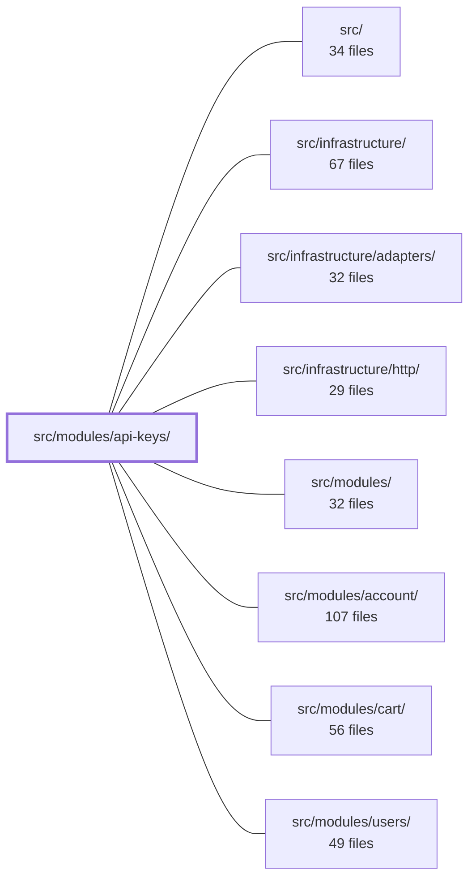

---
tags:
  - 2brain
  - 2brain/module
  - project/boilerplate-node-backend
type: module
module: src/modules/api-keys/
files: 21
updated: 2026-10-07T23:56:42.879281+00:00
---

# src/modules/api-keys/

## Purpose

The api-keys module owns the full lifecycle of machine-to-machine (M2M) API-key credentials: minting, listing, revoking, and resolving `sk_…` bearer tokens into a request-scoped identity at runtime. It exposes a small admin HTTP surface for humans to manage keys and registers a credential resolver into the app kernel so that API keys can authenticate subsequent requests without a session.

## Key parts

- **Credential lifecycle core** — `credentials.ts` handles the one-way SHA-256 hashing (mint, parse prefix, verify). `services/api-keys.ts` implements the tenant-scoped CRUD operations (list, mint, revoke) with permission checks and audit logging. `services/resolver.ts` takes a presented token, verifies it, and re-derives the minter's *current* permissions to produce a floored `Caller`.
- **HTTP surface** — `routes.ts` defines the Express router for `GET/POST/DELETE /api-keys`. `controllers/` (list, mint, revoke) validate input and delegate to the service. `openapi.yaml` is the canonical request/response contract the runtime must satisfy.
- **Data layer** — `model.ts` defines the Mongoose schema (one document per credential, secret never persisted—only its digest). `repository.ts` wraps the shared `createRepository` factory and adds domain-specific queries (active-key-by-prefix, `lastUsedAt` stamp, bulk delete by owner).
- **Module wiring** — `module.ts` is the manifest that declares routes, permission keys, and data-lifecycle hooks, and injects the credential resolver into `kernel/authentication.ts` at registration time. `index.ts` is the barrel that sibling modules are only allowed to import from. `audit.ts` registers the `mint`/`revoke` action identifiers into the app-wide `AuditActionMap`.
- **Tests** — Unit tests cover hashing and schema-shape; integration tests (real DB) verify the two enforcement halves of permission subsetting; contract tests assert OpenAPI conformance.

## How it connects

- **`src/modules/` (kernel)** — `module.ts` registers the credential resolver into the kernel's authentication pipeline at registration time; `audit.ts` augments the kernel's `AuditActionMap` type. The resolver's output (`Caller`) is the kernel's universal identity shape.
- **`src/modules/account/`** — The resolver re-derives the minter's *current* account-level permissions at use-time (not frozen at mint-time). The `revoked-by-account` integration test confirms that account-level revocation cascades into this module's credentials.
- **`src/infrastructure/`** — Consumes the shared Mongoose adapter and the `createRepository` CRUD factory for data access, and the HTTP framework primitives in `infrastructure/http/` for routing and middleware.
- **`src/modules/cart/`, `src/modules/users/`** — Permission keys like `apikeys.any.*` gate the admin surface; the resolved `Caller` produced by this module's resolver is what other modules (e.g. cart, users) consume to authorize M2M requests.

## Where to start

1. **`module.ts`** — It is the single entry point that shows how routes, permissions, the resolver, and data-lifecycle hooks are wired together at registration time. Reading it first gives you the module's full shape.
2. **`services/api-keys.ts`** — The business-logic core. It makes the permission-subset invariant (mint-time check + use-time re-flooring) concrete and shows how every mutation is tenant-scoped and audit-logged.

## Connected modules

[[boilerplate-node-backend_ROOT|/ (repository root)]] · [[boilerplate-node-backend_src|src/]] · [[boilerplate-node-backend_src_infrastructure|src/infrastructure/]] · [[boilerplate-node-backend_src_infrastructure_adapters|src/infrastructure/adapters/]] · [[boilerplate-node-backend_src_infrastructure_http|src/infrastructure/http/]] · [[boilerplate-node-backend_src_modules|src/modules/]] · [[boilerplate-node-backend_src_modules_account|src/modules/account/]] · [[boilerplate-node-backend_src_modules_cart|src/modules/cart/]] · [[boilerplate-node-backend_src_modules_users|src/modules/users/]]

## Files
- `src/modules/api-keys/audit.ts` — Declares the audit-action vocabulary for the API-keys module (mint and revoke) and registers it into the app-wide `AuditActionMap` type via TypeScript module augmentation. The file contains no runtime logic — it exists so that the two credential-lifecycle events carry a strongly-typed, discoverable action identifier wherever the audit logger is invoked.
- `src/modules/api-keys/controllers/list-api-keys.ts` — HTTP controller for `GET /api-keys`. Returns the calling tenant's API-key credentials in newest-first order, with pagination. Secrets are never included in the response.
- `src/modules/api-keys/controllers/mint-api-key.ts` — HTTP controller for `POST /api-keys`. Validates the request body against a Zod schema, extracts the tenant/caller context, delegates to the API-keys service to mint a new credential, and shapes the HTTP response (201 on success, 422 on refusal).
- `src/modules/api-keys/controllers/revoke-api-key.ts` — Controller handler for `DELETE /api-keys/:id`. It performs a **revoke** — a soft state change on an API key credential — which is distinct from the soft/hard-delete triplet that the generic `createDeleteController` factory handles. Revoking an already-revoked key is idempotent (still returns 200).
- `src/modules/api-keys/credentials.ts` — Implements the one-way hashing half of the API-key credential lifecycle: minting a new high-entropy token, parsing the public prefix out of a presented token, and verifying a presented plaintext against a stored SHA-256 digest. Deliberately avoids bcrypt/argon2 because `randomBytes(32)` leaves no search space for a stretch function to exploit, so the per-request cost buys nothing.
- `src/modules/api-keys/emails.ts`
- `src/modules/api-keys/index.ts` — Barrel (public surface) for the `api-keys` module. Sibling modules are only permitted to import from this file, enforcing the module boundary defined in `docs/theory/strategic-ddd.md` §5. It re-exports the service API and the type definitions so consumers never reach into the module's internals.
- `src/modules/api-keys/model.ts` — Defines the Mongoose schema and model for the `apikeys` collection — one document per minted machine-to-machine credential. The file is the single source of truth for the credential's shape, indexes, and wire serialization, and enforces the invariant that the secret itself is never persisted (only its sha256 hash).
- `src/modules/api-keys/module.ts` — The module manifest (entry point) for the **api-keys** module. It declares the module's routes, permission keys, and personal-data lifecycle hooks, and—crucially—wires the `sk_…` bearer-token credential resolver into the kernel at registration time (not import time) so that merely importing the file does not silently enable M2M authentication app-wide.
- `src/modules/api-keys/openapi.yaml` — OpenAPI 3.0.3 contract for the api-keys module. Defines the three machine-to-machine credential endpoints (list, mint, revoke), their request/response schemas, and the envelope wrappers that the module's runtime must produce.
- `src/modules/api-keys/presenter.ts`
- `src/modules/api-keys/repository.ts` — Data-access layer for the `apikeys` collection. It wraps the shared `createRepository` CRUD factory and adds three domain-specific queries that the generic factory cannot express: active-key resolution by prefix, a fire-and-forget `lastUsedAt` stamp, and bulk deletion by owner.
- `src/modules/api-keys/routes.ts` — Defines the Express router for the `/api-keys` admin surface. It wires three CRUD-adjacent routes (list, mint, revoke) to their respective controllers and enforces that every request is session-authenticated by a human with the appropriate `apikeys.any.*` permission.
- `src/modules/api-keys/services/api-keys.ts` — Implements the credential CRUD operations (list, mint, revoke) for the API-keys module. Every function is tenant-scoped through `context.caller.tenantId`, validates permissions against the caller's current ability set, and records audit events on state-changing actions. This file is the service layer that the module's route handlers call into.
- `src/modules/api-keys/services/index.ts` — Barrel file for the `api-keys` module's service layer. It gives controllers and the module index a single, stable import surface (`apiKeysService`) rather than exposing the individual CRUD functions directly, and it re-exports the credential resolver under a domain-specific name.
- `src/modules/api-keys/services/resolver.ts` — Implements the credential-resolution logic for `sk_…` API-key bearer tokens. Given a presented token, it parses, verifies, and re-derives the minter's **current** permissions to produce a fully-floored `Caller`. The result is registered into `kernel/authentication.ts` by `module.ts` at import time, making this file the single runtime path through which machine-to-machine credentials become a request-scoped identity.
- `src/modules/api-keys/tests/contract/api-keys.test.ts` — Contract tests for the `/api-keys` admin surface (list, mint, revoke). Each response is asserted both for expected status/body **and** for conformance to the bundled `openapi.yaml` via `toSatisfyApiSpec()`. Credentials minted here are intentionally _not_ reused against other routes in this file; cross-cutting usage lives in `tests/cross-cutting/`.
- `src/modules/api-keys/tests/integration/api-keys.test.ts` — Integration test suite (real database, no mocked repository) that proves the two enforcement halves of "a credential holds a subset of the minter's permissions, never more": the mint-time subset check in `services/api-keys.ts` and the use-time re-flooring in `module.ts`'s `CredentialResolver`. It also covers revocation, expiry, hard-delete cascading, and the `touchLastUsed` stamp path.
- `src/modules/api-keys/tests/integration/revoked-by-account.test.ts`
- `src/modules/api-keys/tests/unit/credentials.test.ts` — Unit tests for the one-way hashing half of the API-key credential lifecycle: minting, parsing, verifying, and formatting. Each test exercises a single exported function from `credentials.ts` in isolation, covering both happy paths and rejection/edge cases.
- `src/modules/api-keys/tests/unit/schema-contract.test.ts` — Unit test that pins the **declarative contract** of `apiKeySchema` — which fields are `required`, which indexes exist with which options, and which fields are intentionally _absent_ (lifecycle timestamps). It exists because integration tests that only insert valid documents cannot catch a silently dropped `required`, a `unique` constraint removed from `publicPrefix`, or a new index sneaking in; this file asserts the schema's shape in isolation.

---
[[boilerplate-node-backend_INDEX|← boilerplate-node-backend index]]
