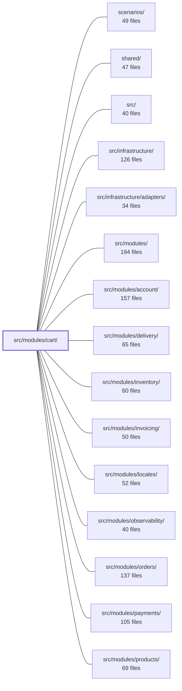

---
tags:
  - 2brain
  - 2brain/module
  - project/boilerplate-node-backend
type: module
module: src/modules/cart/
files: 72
updated: 2026-11-08T10:49:48.756915+00:00
---

# src/modules/cart/

## Purpose

The cart module owns the signed-in user's shopping basket: reading and mutating line items, merging a guest cart, reordering from a past order, setting a shipping method, and the single cross-module write that transitions the basket into a confirmed order. It encapsulates every domain rule that decides whether a line can exist, whether the basket can be checked out, and what "available" means for a given quantity—keeping those decisions pure and testable while the service and controller layers handle orchestration and HTTP.

## Key parts

- **Domain rules** (`domain/`) — Pure, side-effect-free functions: `rules.ts` (checkout eligibility verdicts), `stock.ts` (does a quantity fit for-sale stock), `merge.ts` (how many units a guest line contributes), `availability.ts` (assigns one of seven line-availability states). Consumers import via `domain/index.ts`.
- **Services** (`services/`) — One file per flow behind a single `cartService` object (`services/index.ts`). `items.ts` handles CRUD on lines and shipping; `checkout.ts` orchestrates the cart→order transition; `merge.ts` folds a guest cart in; `reorder.ts` copies a past order's lines back; `cleanup.ts` removes cart data on user/product deletion; `preorder.ts` classifies lines before asking inventory; `errors.ts` centralises rejection responses.
- **Controllers** (`controllers/`) — Thin Express adapters (one per HTTP verb+path) that validate input, extract auth context, delegate to `cartService`, and shape responses. No business logic.
- **Storage & wiring** — `model.ts` (Mongoose schema + TTL), `repository.ts` (CRUD + domain-specific writes keyed by `userId`), `config.ts` (lifetime, per-line cap, open-order cap), `routes.ts` (Express router), `module.ts` (registers the module with the kernel), `module.yaml` (architecture position, dependencies, rate-limit policies).
- **Contract & presentation** — `openapi.yaml` (HTTP surface + error vocabulary), `presenter.ts` (maps computed cart facts to the wire shape, including `canIncrease` / `checkoutable` flags).
- **Observability & guards** — `analytics.ts`, `audit.ts`, `events.ts` (typed event/action names), `metrics.ts` (Prometheus counters), `rate-limits.ts` (per-account budgets on checkout and merge), `authorization.yaml` (confirmed-email gate on spending).
- **Test/seed helpers** — `factories.ts` (builds `CartDocument` fixtures), `probes.ts` (failure-path request definitions with intent annotations).

## How it connects

- **products / inventory** — Cart reads product facts (`isPreorder`, `isBackorder`, listing status) and asks inventory for shelf availability before committing a line or allowing checkout.
- **orders** — Checkout writes a new order document; reorder reads an existing order's lines. The dependency is strictly `cart → orders`.
- **payments / delivery / invoicing** — Checkout resolves payment method, shipping choice, and billing address before placing the order atomically.
- **account / users** — The authorization rule gates checkout on a confirmed email (account module); user deletion triggers `services/cleanup.ts` to remove cart data.
- **observability** — Emits typed analytics events, audit actions, and domain events (`cart.lines_removed`, `cart.merge_refused`); exposes Prometheus counters for the overview endpoint.
- **locales** — Domain-rule rejection reasons are mapped to localised user-facing text at the service layer.
- **shared / infrastructure** — Uses the shared config reader, repository factory, rate-limiter builder, and kernel module-collection conventions.

## Where to start

1. **`domain/rules.ts`** — Short, pure, and free of imports; reading it tells you exactly *why* a checkout is refused and what the module's core business invariants are.
2. **`services/checkout.ts`** — The most complex orchestration in the module; it shows how the domain rules, product/inventory reads, and the order write are sequenced, and how a failure at any step is surfaced.

## Connected modules

[[boilerplate-node-backend_ROOT|/ (repository root)]] · [[boilerplate-node-backend_scenarios|scenarios/]] · [[boilerplate-node-backend_shared|shared/]] · [[boilerplate-node-backend_src|src/]] · [[boilerplate-node-backend_src_infrastructure|src/infrastructure/]] · [[boilerplate-node-backend_src_infrastructure_adapters|src/infrastructure/adapters/]] · [[boilerplate-node-backend_src_modules|src/modules/]] · [[boilerplate-node-backend_src_modules_account|src/modules/account/]] · [[boilerplate-node-backend_src_modules_delivery|src/modules/delivery/]] · [[boilerplate-node-backend_src_modules_inventory|src/modules/inventory/]] · [[boilerplate-node-backend_src_modules_invoicing|src/modules/invoicing/]] · [[boilerplate-node-backend_src_modules_locales|src/modules/locales/]] · [[boilerplate-node-backend_src_modules_observability|src/modules/observability/]] · [[boilerplate-node-backend_src_modules_orders|src/modules/orders/]] · [[boilerplate-node-backend_src_modules_payments|src/modules/payments/]] · … and 3 more

## Files
- `src/modules/cart/analytics.ts` — Declares the analytics event names emitted by the cart module and registers them into the analytics port's app-wide `AnalyticsEventMap`. It exists so that event-name strings live alongside the code that fires them (e.g. checkout events are here because `POST /cart/checkout` is a cart endpoint), giving the module a single source of truth for its telemetry vocabulary.
- `src/modules/cart/audit.ts` — Declares the cart module's audit action names and registers them into the app-wide `AuditActionMap` via TypeScript module augmentation. This file exists so that any audit event the cart emits has a stable, typed identifier that the observability layer can consume without circular imports.
- `src/modules/cart/authorization.yaml` — Defines the single authorization rule for the cart module: verifying that a caller's account has a confirmed email before they can *spend* their basket (i.e., check out). Cart contents themselves (add, remove, set-quantity) are intentionally rule-free; only the act of spending is gated because it is a fact about the account, not the basket.
- `src/modules/cart/config.ts` — Declares the three runtime-tunable knobs that govern cart lifetime, per-line quantity, and the per-account cap on open unpaid orders. Each value is validated at read time through the shared config infrastructure, keeping business limits in one auditable place rather than scattered across services.
- `src/modules/cart/controllers/delete-cart-item.ts` — Thin HTTP adapter that handles `DELETE /cart/items/:productId`. It extracts and validates the product ID from the URL, delegates the actual removal to `cartService.removeItemById`, and shapes the HTTP response (success or error). Exists so the service layer stays transport-agnostic.
- `src/modules/cart/controllers/delete-cart-items.ts` — Thin HTTP adapter that handles `DELETE /cart/items` — removing **all** items from the authenticated user's cart. It delegates to `cartService.remove` and exists as a dedicated, bodyless endpoint so the destructive operation is unambiguously opt-in by URL rather than hidden behind a query flag or body parameter.
- `src/modules/cart/controllers/get-cart-summary.ts` — Thin HTTP adapter for the `GET /cart/summary` endpoint. It extracts the authenticated user's ID from the request, delegates to `cartService.getForBadge`, and sends back only the `summary` sub-field of the resulting cart object.
- `src/modules/cart/controllers/get-cart.ts` — Thin HTTP adapter for the `GET /cart` endpoint. It extracts the authenticated user's ID and caller context from the incoming request, delegates to `cartService.getForView`, and formats the resulting cart into a standard HTTP success or error response.
- `src/modules/cart/controllers/patch-cart-item.ts` — Thin HTTP adapter that handles `PATCH /cart/items/:productId`, delegating to `cartService.updateItemQuantity` to change the quantity of an existing cart line and returning the updated cart. It exists to separate Express plumbing (auth, path-param validation, body parsing, response shaping) from the cart domain logic.
- `src/modules/cart/controllers/post-cart-items.ts` — Thin HTTP adapter for `POST /cart/items` ("Add to cart"). Validates the request body, delegates to `cartService.addItem`, and serialises the result. It contains no business logic — eligibility rules live in the service layer so they stay consistent with `PATCH` and wishlist move-to-cart.
- `src/modules/cart/controllers/post-cart-merge.ts` — Thin HTTP adapter for the `POST /cart/merge` endpoint. It validates the incoming body, delegates the actual merge logic to `cartService.merge`, and formats the response — keeping transport concerns separate from cart-domain logic.
- `src/modules/cart/controllers/post-checkout.ts` — Thin Express handler for `POST /cart/checkout`. Validates the request body, delegates to `cartService.orderConfirm`, records the `cart_checkout_total` metric on every outcome, and responds with the newly created order. Exists to keep the cart route surface free of business logic and to isolate the metric-recording contract in one place.
- `src/modules/cart/controllers/post-reorder.ts` — Thin HTTP adapter for `POST /cart/reorder`. Validates the request body, delegates to `cartService.reorderIntoCart`, and maps the service result (or rejection) to an HTTP response. Exists so the cart service stays transport-agnostic while the Express layer handles parsing, auth context extraction, and status-code selection.
- `src/modules/cart/controllers/put-cart-shipping-method.ts` — Thin HTTP adapter for the `PUT /cart/shipping-method` endpoint. It parses and validates the incoming request body, delegates the actual work to `cartService.setShippingMethod`, and formats the result into a standard success or error response. Exists to keep route registration and business logic separated from Express plumbing.
- `src/modules/cart/domain/availability.ts` — Defines the single precedence rule that assigns a `LineAvailability` state to a cart, wishlist, or merge-result line. It is a pure domain function: given a joined product and the ledger's unit counts, it returns exactly one of seven states in a fixed order. No side effects, no I/O.
- `src/modules/cart/domain/index.ts` — Barrel (re-export) file for the cart domain layer. It aggregates the public API of the four domain submodules—`rules`, `merge`, `stock`, and `availability`—into a single import surface, so consumers can `import { … } from '@/modules/cart/domain'` instead of reaching into individual files. Contains no logic of its own.
- `src/modules/cart/domain/merge.ts` — Pure domain rule that decides what a single guest cart line adds to the cart, given the current held quantity, whether the product is publicly listed, and the per-line cap. It contains no I/O, no catalogue lookups, and no model access — the caller supplies every input. It exists to isolate the "how many units land" decision so it can be tested and reasoned about in isolation from the service layer that invokes it.
- `src/modules/cart/domain/rules.ts` — Pure decision functions for the cart domain: given joined cart-line data, they return a verdict (ok / refused + reason) without touching status codes, i18n, or the network. The service layer maps each verdict to a response. This keeps the "why is checkout blocked?" logic testable and free of side effects.
- `src/modules/cart/domain/stock.ts` — Defines the cart's single stock-fit rule as a pure function. It exists so that checkout pre-flight, cart merge, and the cart view all share one definition of "does this line's quantity fit what is for sale," preventing the three call sites from drifting apart.
- `src/modules/cart/events.ts` — Declares the cart module's domain events (`cart.lines_removed`, `cart.merge_refused`) by augmenting the kernel's `DomainEventMap` via TypeScript declaration merging, and exports the event-name constants so emitters and listeners share a single spelling. This keeps the catalogue of app-wide events extensible per-module without editing the kernel's file.
- `src/modules/cart/factories.ts` — Builds cart fixtures (documents ready for `cartRepository.create`) from bare string product/user ids and quantities. It exists so that test and seed code can construct a valid `CartDocument` without manually wrapping every id in `Types.ObjectId` or re-declaring the line-item shape.
- `src/modules/cart/index.ts` — Public barrel (re-export) for the cart module. It is the **only** import surface allowed to sibling modules, per the strategic-DDD rule in `docs/theory/strategic-ddd.md` §5. It exposes service APIs, events, and domain logic by value, while the model and presenter are exposed as **types only**, keeping their runtime implementations (and the `cartRepository`) internal so siblings cannot bypass the service's rules.
- `src/modules/cart/metrics.ts` — Declares the domain-owned Prometheus counters for the cart module (currently: checkout attempts). Metrics live here—colocated with the cart domain—rather than in `infrastructure`, so the module is the single source of truth for what it measures. The overview endpoint reads these counters without importing this file directly (see `modules/account/metrics.ts` for the full rationale).
- `src/modules/cart/model.ts` — Defines the Mongoose schema, document interfaces, and model for the per-user cart collection. It encodes the storage contract (field names, constraints, indexes, TTL) so that cart data matches the `openapi.yaml` `CartItem` wire shape and stays valid across config changes. It is the single source of truth for what a cart document looks like at rest.
- `src/modules/cart/module.ts` — Module manifest that registers the cart module with the kernel: it wires the router, config, rate limits, personal-data hooks, and a single domain-event subscription into one `AppModule` object that `src/modules.ts` collects at startup.
- `src/modules/cart/module.yaml` — Module descriptor for the cart subdomain. It declares the module's position in the architecture (core/shop), enumerates its runtime dependencies with the specific data each one supplies, and defines rate-limit policies for the two write endpoints (`POST /cart/checkout` and `POST /cart/merge`). It does not define routes or schemas — that lives in the sibling OpenAPI spec.
- `src/modules/cart/openapi.yaml` — OpenAPI 3.1.0 contract for the cart module. Defines the HTTP surface for reading, mutating, and checking out the signed-in user's cart, plus the module's custom error-code vocabulary and its slice of the account data export.
- `src/modules/cart/presenter.ts` — Pure mapping layer that takes already-computed cart facts (lines, totals, shipping) and shapes them into the `CartResponse` the OpenAPI contract requires. It exists so that the "what goes on the wire" logic — including derived flags like `canIncrease` and `checkoutable` — lives in one testable, side-effect-free function rather than being scattered across services.
- `src/modules/cart/probes.ts` — Exports the cart module's probe collection: a set of `Probe` request definitions that exercise failure and boundary paths the OpenAPI contract can describe but cannot trigger. Each probe encodes *why* it exists in a `why` string so the intent is self-documenting.
- `src/modules/cart/rate-limits.ts` — Declares the two cart-specific rate-limit budgets (checkout and merge) and converts them into ready-to-use Express middleware via the shared `buildRateLimiter` factory. It exists because these two endpoints are the most expensive per-request operations in the cart module and need per-account limits beyond the global brake.
- `src/modules/cart/repository.ts` — Cart repository that provides standard CRUD (via the shared repository factory) plus the six domain-specific writes a cart actually takes: upsert a line, remove a line, clear all lines (plain and version-guarded), set shipping method, and the two cleanup writes for product/user deletion. All writes are keyed by `userId` alone, since the schema's `unique: true` index makes that a complete address.
- `src/modules/cart/routes.ts` — Defines the Express router that maps HTTP endpoints to cart controllers. It applies global authentication to every route, then wires each cart operation (CRUD on lines, checkout, merge, reorder, shipping) to its controller with the appropriate middleware chain. It is the single entry point through which all cart HTTP traffic flows.
- `src/modules/cart/services/checkout.ts` — Orchestrates the cart→order transition: the single cart operation that writes to another module's collection. It resolves payment, shipping, and billing choices, validates the cart against domain rules, and places the order atomically. It exists as a dedicated service because the checkout path is the only one where a race or partial write can cost a customer money, so every step is sequenced and pre-flight-validated before any stock or order state mutates.
- `src/modules/cart/services/cleanup.ts` — Provides the two cleanup entry points the cart module exposes for when entities it references (a user or a product) are hard-deleted elsewhere. Neither function is reachable from a cart route; they are hooks and event handlers wired up in the module manifest so that other modules can trigger cart-side tidying.
- `src/modules/cart/services/errors.ts` — Single source of truth for HTTP rejection responses raised by multiple cart services (basket and checkout). By centralising the code + message pair in one leaf module, the file guarantees that any service raising the same business error returns identical status, error code, and user-facing text.
- `src/modules/cart/services/index.ts` — Barrel file for the cart service layer. It aggregates the six sub-service modules (`items`, `checkout`, `reorder`, `merge`, `cleanup`, `shelf`) behind a single `cartService` object so that controllers and other modules never import individual flow files directly. This keeps the public API surface in one place and enforces the one-file-per-flow convention documented in `docs/theory/layers.md`.
- `src/modules/cart/services/items.ts` — Service layer for reading a cart and mutating its line items (add, set, update, remove, clear) plus setting the cart's shipping method. Every write returns a response envelope (`ResponseSuccess | ResponseReject`) so callers can distinguish a created line (201) from a changed one (200) and surface structured errors (404, 409, 422). The file also splits the "view cart" read into two variants so analytics can attribute `CART_VIEWED` only to a human opening the basket, not a badge poll.
- `src/modules/cart/services/merge.ts` — Folds a guest cart (built while signed out) into the signed-in user's cart in a single server-side call. It lives here rather than in the browser because refused lines must become persistent notifications (via a domain event) and the per-line cap + stock read must be applied atomically per line — something a client-side loop of `POST /cart/items` cannot do.
- `src/modules/cart/services/preorder.ts` — Classifies cart-line products as preorder or backorder *before* the cart asks the inventory/ledger service for availability. Because `inventory` has no concept of a release date, the cart uses the catalogue's product facts (`isPreorder`, `isBackorder`) to decide which product IDs to route through the allowance path versus the shelf path, and to hand the availability rule the correct product shape.
- `src/modules/cart/services/reorder.ts` — Provides a single operation — `reorderIntoCart` — that copies a past order's line items back into the caller's current cart. It lives in the cart module (not orders) because it **writes** to the cart while only **reading** the order, keeping the dependency direction `cart → orders` and avoiding the circular edge a `/orders/{id}/reorder` route would force.
- `src/modules/cart/services/shelf.ts` — Provides the "shelf" abstraction: a single read of a product's catalogue document **and** its inventory ledger units, combined into one record. All cart availability decisions (merge, wishlist, preorder checks) funnel through this file so the catalogue and ledger are fetched in exactly two queries regardless of product count.
- `src/modules/cart/services/view.ts` — Cart projection layer: transforms a stored `CartDocument` (keyed by `userId`) into the `CartView` that the API contract declares. Shared internally by the other cart service files (`items`, `checkout`, `preorder`); none of them own this module. Treats absence of a cart document as an empty cart, never a 404.
- `src/modules/cart/tests/contract/api.contract.test.ts` — Contract tests for every `/cart` route. Because `CartResponse` is a computed view (not a direct serialization of the document), these tests exercise the actual HTTP API to verify that each endpoint's response shape, status codes, and error envelopes match the documented contract. They deliberately build carts through the API rather than fixture builders, and they assert only shape/reachability — behavioural rules live in the service suites.
- `src/modules/cart/tests/integration/analytics-consent.test.ts` — Integration test that verifies which analytics consent value a `cart_item_added` event carries after traversing the real HTTP stack (auth middleware → route → service). It asserts the consent-priority rule defined in `docs/theory/data-protection.md`: a stored account answer always outranks the `Analytics-Consent` banner header; only an account that was never asked falls back to the header (or defaults to `false`).
- `src/modules/cart/tests/integration/backorder.test.ts` — Integration tests for the backorder feature as seen through the cart: verifying the four availability states a line can report, and confirming that `orderConfirm` correctly splits a line into shelf-fulfilled and backordered portions, freezes the owed quantity and promise date, serialises the promise as a shop-day string on the wire, and refuses the order (409) when shelf + cap cannot cover the requested quantity.
- `src/modules/cart/tests/integration/checkout-expected-total.test.ts` — Integration test for `POST /cart/checkout` that verifies the `expectedTotal` guard: checkout must match the total the buyer was shown, refuse (409) if any component moved, leave zero side effects on refusal, and reject malformed input with 422. It exists to lock down the atomicity invariant and the error-contract surface of the endpoint.
- `src/modules/cart/tests/integration/checkout-interleavings.test.ts` — Integration test that verifies checkout's optimistic-concurrency guard against a **deterministic** cart-write interleaving. Unlike `cart-races.test.ts` (nondeterministic scheduler overlap) or `stock.test.ts` (stubbed `null`), this file injects a real cart mutation at a fixed point inside the checkout — after the version is captured, before the clear — and asserts that the losing checkout leaves zero side effects and that a retry succeeds. It also confirms that a mid-checkout reprice cannot produce a mix of old and new prices across lines, shipping, and the payment intent.
- `src/modules/cart/tests/integration/checkout-rate-limit.test.ts` — Integration test for the per-account checkout rate limiter (`POST /cart/checkout`). It exercises the limiter against a trivial Express handler rather than the real checkout route, because the property under test (budget enforcement per account) belongs to the limiter itself and routing through the real handler would only add a database round trip per attempt. Route-mounting is covered separately in `routes.test.ts`.
- `src/modules/cart/tests/integration/checkout-stock-divergence.test.ts` — Integration test that verifies checkout always defers to the `stocklevels` ledger when it disagrees with the product catalogue's cached stock counters. It pins the invariant that the ledger is the source of truth: a stale cache can neither cause an oversell (cache under-reports reservations) nor a false refusal (cache over-reports availability). The complementary half—cache sitting *low* at checkout—is covered by the sibling `stock.test.ts`.
- `src/modules/cart/tests/integration/checkout-version.test.ts` — Integration tests that verify the `__v` (MongoDB version) counter on a cart document is bumped by every state-changing write, and that `cartRepository.clearLinesIfUnchanged` correctly acts as a compare-and-swap guard so a concurrent cart mutation invalidates an in-flight checkout rather than silently dropping the mutation. The tests run against a real MongoDB instance because the guarantee under test is the driver's `$inc` atomicity, which a mock cannot exercise.
- `src/modules/cart/tests/integration/line-availability.test.ts` — Integration tests that pin down how the cart presents product lines when a product's state changes after the line was added. The core contract verified: a hidden product (`active: false`) keeps its line but reads `removed`; an off-sale product (`purchasable: false`) keeps its line but reads `unavailable`. Neither state causes the line to be deleted, and each state triggers a distinct checkout-refusal reason.
- `src/modules/cart/tests/integration/merge-effects.test.ts` — Integration tests that verify the **observable side effects** of cart merge and product-removal operations: the analytics events emitted per line outcome, the refusal shape when a quantity-cap race occurs, and the `CART_LINES_REMOVED` domain event. These effects are not exercised by the merge answer's own unit tests.
- `src/modules/cart/tests/integration/merge-rate-limit.test.ts` — Integration test that verifies the per-account rate-limiting behaviour of the merge limiter exposed by the cart module. It mounts `mergeLimiter` on a minimal Express route and asserts two properties: an account receives 429 after exhausting its budget, and one account's exhaustion does not starve a neighbouring account. The limiter is tested in isolation from the real route (see `../unit/routes.test.ts` for mount assertions).
- `src/modules/cart/tests/integration/merge.test.ts` — Integration tests for `cartService.merge` — the operation that folds a guest cart's lines into a signed-in user's existing cart. Verifies the line-by-line contract shared with `POST /cart`: quantities sum, results are per-line and in request order, stock only *flags* a line (never changes its quantity), the line-max ceiling caps but doesn't reject, and fully refused lines emit `CART_MERGE_REFUSED`.
- `src/modules/cart/tests/integration/preorder.test.ts` — Integration tests that verify the cart's preorder path end-to-end: how a preorder line's availability is computed (against the backorder allowance, not shelf stock), how checkout claims the allowance while leaving the shelf untouched, how the preorder promise is frozen onto the order line, and how a basket can mix preorder and in-stock goods in a single order.
- `src/modules/cart/tests/integration/product-removal-protects-orders.test.ts` — Integration test verifying that a product removed (hard or soft) or deactivated *after* an order is placed does not invalidate that order. Confirms the order stays `pending`, card/offline payments still succeed, no spurious emails fire, and inventory level rows are cleaned up (hard delete only) or preserved (soft delete / deactivation). Also guards that a failed write never emits the `PRODUCT_DELETED` event.
- `src/modules/cart/tests/integration/product-restored-meanwhile.test.ts` — Integration test for a specific event-ordering race: a `product.deleted` delivery that is retried by the relay *after* the product has already been restored. Because a restore writes no compensating event, the retried deletion is the only remaining "deleted" signal; this test proves that cart lines and wishlist entries for the now-restored product survive, while a normal (non-late) deletion still clears the cart.
- `src/modules/cart/tests/integration/schema-contract.test.ts` — Integration test for the **schema-level declarations** on the cart Mongoose model — `required` constraints, default values, and `select: false` fields — as opposed to the transform logic covered by sibling specs. It runs against a real MongoDB instance because these are Mongoose-native behaviours (index enforcement, field exclusion) that a mock would only assert its own opinion about.
- `src/modules/cart/tests/integration/service.test.ts` — Integration tests for the cart service layer (`src/modules/cart/services/`). Targets the highest-risk seam in the module — `set` vs `add` sharing a single `upsertCartItem` where a collapsed `$set`/`$inc` silently multiplies or drops quantities — and pins the serialization contract (no extra keys, no per-line `_id`). Runs against a real Mongo instance (`setupTestDb`) because the guarded write logic in `cartRepository.upsertLine` is not observable through a mock.
- `src/modules/cart/tests/integration/stock-flag.test.ts` — Integration tests for the `availability` field on every cart line returned by `GET /cart` and `POST /cart/merge`. Two invariants are verified: (1) the flag name (`in_stock`, `insufficient_stock`, `out_of_stock`, `removed`) correctly tracks the stock ledger and catalogue state, and (2) no numeric stock value or stock-named key ever appears in any cart response body.
- `src/modules/cart/tests/integration/stock.test.ts` — Integration test suite that verifies the reservation model's stock invariants across the full order lifecycle: units are held (not sold) between checkout and payment, are recoverable on cancel/expiry, and only leave inventory upon PAID. Every assertion checks `onHand` and `reserved` together, because either alone could pass for a system that never reserved. Runs against real MongoDB because the guarantees depend on conditional writes that mocks cannot exercise.
- `src/modules/cart/tests/integration/totals.test.ts` — Integration test that verifies the cart's `totalPrice` matches the amount carried by the resulting order and payment intent. It guards against a class of bugs where summing decimal amounts separately (vs. summing integer minor units and converting once) introduces floating-point epsilon drift — e.g. `0.56 + 5.00` in float arithmetic.
- `src/modules/cart/tests/integration/upsert-retry.test.ts` — Deterministic integration tests for `upsertLine`'s bounded retry loop. While the sibling `cart-races.test.ts` exercises real concurrency, this file *forces* the failure modes a race would produce (duplicate-key rejection, or the atomic filter persistently missing) to verify the retry budget, its termination behavior, and that no partial writes leak on exhaustion.
- `src/modules/cart/tests/unit/config.test.ts` — Unit tests for `maxOpenUnpaidOrdersPerAccount`, a pure env-var reader in the cart config. Because the function only reads an environment variable (no I/O, no HTTP), a unit suite is sufficient here; the 409 response it ultimately causes is covered in the integration suite instead.
- `src/modules/cart/tests/unit/domain-rules.test.ts` — Pure unit tests for the cart domain rules (`evaluateCheckout`, `basketWeight`, `evaluateShippingRequirement`). No mocks or database — the functions are exercised with hand-built `CartLineCandidate` objects. The verdict-to-HTTP-status mapping is intentionally excluded and lives in `service.test.ts`.
- `src/modules/cart/tests/unit/factories.test.ts` — Unit tests for the `makeCart` fixture builder. The core concern they guard: `makeCart` must convert the hex-string product/owner IDs it receives into real `Types.ObjectId` values, because a string `productId` silently breaks the catalogue join at read time (the cart "looks populated and behaves as if empty"). The remaining tests pin down the items-omitted-vs-empty distinction and line ordering.
- `src/modules/cart/tests/unit/line-availability.test.ts` — Pure unit test for the `lineAvailability` precedence function and the `isBuyable` gate, covering every row of the availability state table for both cart lines (with quantity) and wishlist lines (without quantity). Exists to lock down the single-source-of-truth rule that decides whether a line is `in_stock`, `preorder`, `backorder`, `insufficient_stock`, `out_of_stock`, `unavailable`, or `removed`. No mocks, no database.
- `src/modules/cart/tests/unit/merge-rule.test.ts` — Unit tests for the `planMergeLine` domain rule that decides how many units of a requested product line to add to an existing cart holding, and why (or why not). The suite asserts invariants over a combinatorial grid of inputs rather than isolated examples, so boundary and precedence behavior is guaranteed, not merely spot-checked.
- `src/modules/cart/tests/unit/retention.test.ts` — Verifies that the cart collection's TTL index picks up the correct retention period from the `NODE_CART_RETENTION_DAYS` environment variable. Because the model reads this variable once at import time, the test re-imports the model in a fresh module registry for each case. Mirrors the structure of `audit-logs/tests/unit/retention.test.ts`.
- `src/modules/cart/tests/unit/routes.test.ts` — Unit test for the cart router that asserts the full contract of the route table in one place: which endpoints exist, in what order, what guards protect each one, in what order those guards execute, and which infrastructure middlewares (rate-limit, idempotency, cache-invalidation) are attached. It encodes security invariants (e.g. permission check before budget spend, no shared cache) as executable assertions so regressions surface as test failures.
- `src/modules/cart/tests/unit/schema-contract.test.ts` — Locks down the Mongoose schema contract for the cart so that structural drift (a missing field, a dropped index, a relaxed constraint) is caught at test time. It asserts *what the schema is*—required paths, types, refs, index specs, defaults, and sub-schema shape—rather than testing behavior.
- `src/modules/cart/tests/unit/stock-rule.test.ts` — Unit tests for `fitsStock`, the single stock-availability rule shared by checkout, cart merge, and the cart view. The file exists to lock down the exact boundary semantics of that rule (zero, over-stock, unknown) and to verify it stays consistent with the `evaluateCheckout` verdict path. No mocks, no database.

---
[[boilerplate-node-backend_INDEX|← boilerplate-node-backend index]]
