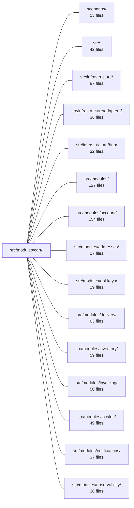

---
tags:
  - 2brain
  - 2brain/module
  - project/boilerplate-node-backend
type: module
module: src/modules/cart/
files: 71
updated: 2026-10-29T19:23:54.696105+00:00
---

# src/modules/cart/

## Purpose

The cart module owns the full lifecycle of a signed-in user's shopping basket: adding, removing, and adjusting line items, selecting a shipping method, merging a guest cart, reordering from a past order, and orchestrating checkout into the orders module. It enforces domain rules (stock availability, quantity caps, retention) and exposes a typed REST surface documented by its OpenAPI contract.

## Key parts

- **Domain rules** (`domain/`) — Pure, framework-free functions that answer single questions: is a line available, how many units can merge add, does a basket pass checkout gating, and does a quantity fit what is for sale. `domain/index.ts` is the barrel consumers import.
- **Service layer** (`services/`) — The business logic behind every endpoint. `items.ts` handles add/set/remove/clear; `checkout.ts` sequences pre-flight validation and delegates to `orderService.placeOrder`; `merge.ts` resolves guest-cart lines against stock and caps; `reorder.ts` copies an order's lines back into the cart; `shelf.ts` fetches product + ledger data in two queries; `cleanup.ts` exposes the user-erase and product-deletion hooks; `errors.ts` centralises shared refusal responses.
- **Controllers & routes** (`controllers/`, `routes.ts`) — Thin Express adapters that extract auth context, parse bodies, delegate to the service layer, and shape HTTP responses. `routes.ts` defines the authenticated router with per-route permissions and rate-limit middleware.
- **Persistence** (`model.ts`, `repository.ts`, `factories.ts`) — Mongoose schema (one document per user, keyed by `userId`), the CRUD-plus-domain-writes repository, and a fixture factory for seeds/tests.
- **Cross-cutting declarations** (`events.ts`, `analytics.ts`, `audit.ts`, `metrics.ts`, `config.ts`) — TypeScript module-augmentation maps for domain events, analytics event names, audit action names, and Prometheus counters, plus the three runtime-tunable knobs (retention, quantity ceiling, unpaid-order cap).
- **Module manifest & contracts** (`module.ts`, `openapi.yaml`, `probes.ts`, `rate-limits.*.ts`) — The kernel registration point, the OpenAPI 3.1 contract that drives SDKs and docs, hand-written failure-path test probes, and the generated rate-limit budgets for checkout and merge.

## How it connects

- **orders** — The checkout service (`services/checkout.ts`) is the single cart operation that writes into the orders collection via `orderService.placeOrder`. The reorder service reads an order's lines and writes them into the cart, preserving the declared `cart → orders` dependency direction.
- **inventory / products** — `shelf.ts` fetches product documents (catalogue) and inventory-ledger units in two queries to produce a per-line availability view. The product-deletion cleanup hook removes a deleted product from every cart. Stock checks in `domain/stock.ts` gate checkout, merge, and the cart view.
- **users / account** — The `personalData.erase` hook in `services/cleanup.ts` hard-deletes a user's cart as part of another module's data-erasure transaction. Routes authenticate via the `update:Cart` and `checkout:Cart` permissions.
- **payments / addresses / delivery** — Checkout pre-flight validates payment eligibility, billing address presence, and a selected shipping method before any stock is held.
- **notifications / observability / locales** — Domain events (`events.ts`) and analytics/audit declarations (`analytics.ts`, `audit.ts`) publish cart mutations for listeners; `metrics.ts` exposes Prometheus counters to the shared registry. `module.ts` declares the locale file path for i18n strings.

## Where to start

Read `domain/rules.ts` first — it is short, dependency-free, and shows the typed-verbatim pattern (`ok` / `refused + reason`) that every service and controller builds on. Then jump to `services/items.ts` to see how a service composes those rules, calls the repository, and returns a priced `CartView` that the presenter shapes into the wire format. Together they cover the read/write happy path without touching Express.

## Connected modules

[[boilerplate-node-backend_ROOT|/ (repository root)]] · [[boilerplate-node-backend_scenarios|scenarios/]] · [[boilerplate-node-backend_src|src/]] · [[boilerplate-node-backend_src_infrastructure|src/infrastructure/]] · [[boilerplate-node-backend_src_infrastructure_adapters|src/infrastructure/adapters/]] · [[boilerplate-node-backend_src_infrastructure_http|src/infrastructure/http/]] · [[boilerplate-node-backend_src_modules|src/modules/]] · [[boilerplate-node-backend_src_modules_account|src/modules/account/]] · [[boilerplate-node-backend_src_modules_addresses|src/modules/addresses/]] · [[boilerplate-node-backend_src_modules_api-keys|src/modules/api-keys/]] · [[boilerplate-node-backend_src_modules_delivery|src/modules/delivery/]] · [[boilerplate-node-backend_src_modules_inventory|src/modules/inventory/]] · [[boilerplate-node-backend_src_modules_invoicing|src/modules/invoicing/]] · [[boilerplate-node-backend_src_modules_locales|src/modules/locales/]] · [[boilerplate-node-backend_src_modules_notifications|src/modules/notifications/]] · … and 6 more

## Files
- `src/modules/cart/analytics.ts` — Declares the analytics event name constants for the cart module and registers them into the app-wide `AnalyticsEventMap` via TypeScript declaration merging. It exists so that every cart-related analytics event is typed, discoverable in one place, and co-located with the code that owns the names (the cart module), following the same pattern as `./audit.ts`.
- `src/modules/cart/audit.ts` — Declares the audit action names the cart module emits and registers them into the app-wide `AuditActionMap` via TypeScript module augmentation. The actions exist to create an auditable trail of customer-initiated cart mutations (item removal, bulk reorder) that serve as the authoritative record for support disputes about cart contents.
- `src/modules/cart/config.ts` — Defines the three runtime-adjustable knobs for the cart module—retention period, per-line quantity ceiling, and open-unpaid-order cap—and exposes typed accessor functions that read them. It exists so that inventory-denial guards (OWASP OAT-021) and cart lifecycle rules can be tuned without code changes.
- `src/modules/cart/controllers/delete-cart-item.ts` — Thin Express adapter for the `DELETE /cart/items/:productId` endpoint. Extracts the product ID from the path, delegates to `cartService.removeItemById`, and shapes the HTTP response (success or error) without containing business logic.
- `src/modules/cart/controllers/delete-cart-items.ts` — Thin Express adapter for `DELETE /cart/items` that delegates to `cartService.remove` to wipe **all** items from a user's cart. It exists as a deliberately separate, bodyless endpoint so the destructive "clear everything" action is explicitly requested by URL name, distinguishing it from partial-item removal.
- `src/modules/cart/controllers/get-cart-summary.ts` — HTTP adapter for the `GET /cart/summary` endpoint. It extracts the authenticated user's ID from the request, delegates to `cartService.getForBadge`, and writes the resulting cart summary into the response. It exists to keep routing, service logic, and response shaping in separate layers.
- `src/modules/cart/controllers/get-cart.ts` — Thin HTTP adapter that handles `GET /cart` by delegating to `cartService.getForView` and formatting the result into a standard JSON response. It contains no business logic; its sole job is to bridge Express request/response objects to the cart service layer.
- `src/modules/cart/controllers/patch-cart-item.ts` — Express route handler for `PATCH /cart/items/:productId`. Acts as a thin HTTP adapter that extracts the path `productId`, parses the quantity from the body, and delegates to `cartService.updateItemQuantity`. Returns the full updated cart or a 404 if the line item (or product) is not found.
- `src/modules/cart/controllers/post-cart-items.ts` — Thin HTTP adapter for `POST /cart/items`. It parses and validates the request body, extracts the authenticated user, delegates to `cartService.addItem`, and serializes the full cart back as a `200` response. All business logic (eligibility, line creation vs. quantity increment) lives in the service layer.
- `src/modules/cart/controllers/post-cart-merge.ts` — Thin Express controller for `POST /cart/merge`. Validates the incoming body, delegates to `cartService.merge`, and shapes the HTTP response. Exists solely as the HTTP-adapter layer between the Express route and the cart service, keeping transport concerns (body parsing, response formatting, error mapping) out of the service.
- `src/modules/cart/controllers/post-checkout.ts` — Thin HTTP adapter for `POST /cart/checkout`. It validates the request body, delegates to `cartService.orderConfirm`, records the `cart_checkout_total` business metric on every outcome (success, business-level refusal, or thrown error), and returns a `201 Created` with the newly built order in the same wire shape as `POST /orders`.
- `src/modules/cart/controllers/post-reorder.ts` — Thin HTTP adapter for `POST /cart/reorder`. Validates the request body, delegates to `cartService.reorderIntoCart`, and maps the result onto an Express response. All business logic lives in the service layer; this file only handles parsing, auth-context extraction, and status-code translation.
- `src/modules/cart/controllers/put-cart-shipping-method.ts` — Thin HTTP adapter for the `PUT /cart/shipping-method` endpoint. Validates the incoming body, delegates to `cartService.setShippingMethod`, and formats the result into a standard success or refusal response. It exists to keep Express-specific concerns (parsing, status codes, auth extraction) out of the service layer.
- `src/modules/cart/domain/availability.ts` — Pure domain rule that resolves a single cart line (or wishlist line, merge result, or checkout validation) to one of seven availability states. It encodes the one precedence chain that governs what a saved line can do right now, separating the *judgement* from the *consequences* so callers (presenter, services, checkout) share a single source of truth.
- `src/modules/cart/domain/index.ts` — Barrel (re-export) file for the cart **domain layer**. It aggregates the pure, framework-free business rules—checkout validation, stock checks, merge planning, and line availability—into a single import surface so that consumers (services, presenter, tests) never need to reach into individual submodules.
- `src/modules/cart/domain/merge.ts` — Pure decision function that computes how many units a single guest cart line should add, given the current cart contents, the product's listed status, and the per-line cap. It exists to isolate the merge arithmetic from I/O so the cap and stock checks live in the service layer above.
- `src/modules/cart/domain/rules.ts` — Pure, stateless cart rules that produce typed verdicts (`ok` / `refused + reason`). No status codes, no i18n, no side-effects — the services layer maps these verdicts to HTTP responses. Exists so that checkout gating, shipping-requirement checks, and basket weight calculations all share one definition of "sellable" and "needs to ship."
- `src/modules/cart/domain/stock.ts` — Single pure function that answers one question — does a cart line's quantity fit what is for sale? — shared by three call-sites (checkout pre-flight, merge, and cart view) so they cannot disagree. It intentionally imports nothing from sibling domain modules; `available` is passed in from the service layer.
- `src/modules/cart/events.ts` — Declares the cart module's domain event payloads by augmenting the kernel's `DomainEventMap` interface (via `declare module '@kernel/events'`), so the event catalogue grows per-module without editing a central file. Also exports the event-name string constants so emitters and listeners share a single spelling.
- `src/modules/cart/factories.ts` — Factory for building cart fixtures ready to pass to `cartRepository.create`. It centralises the string-to-`ObjectId` conversion and the partial-document shape so that seed scripts and test setup don't each re-implement that logic. A cart is addressed solely by its owner (`userId`); no separate cart `_id` is produced here.
- `src/modules/cart/index.ts` — Public barrel for the cart module. It is the **only** import surface available to sibling modules (enforced per `docs/theory/strategic-ddd.md` §5). Internals such as `cartRepository` and the model's runtime values are deliberately kept private so siblings cannot bypass the service layer's rules.
- `src/modules/cart/metrics.ts` — Declares the domain-owned Prometheus counters for the cart module. Metrics live here (rather than in `infrastructure`) so the module is the single source of truth for what it tracks; the overview endpoint reads them from the shared registry without needing to import this file.
- `src/modules/cart/model.ts` — Defines the Mongoose schema, document interface, and model for the cart collection. One document per user (enforced by a unique index on `userId`) stores the cart's items and an optional shipping-method id. Field names are chosen to match the OpenAPI `CartItem` shape so stored and wire representations stay identical.
- `src/modules/cart/module.ts` — The cart module's manifest entry. It declares how the cart plugs into the application kernel: which routes it mounts, which domain events it subscribes to, what config and rate-limit slices it contributes, what personal-data hooks it exposes, and where its locale files live. It is the single registration point that ties together the cart's internal services, routes, and configuration.
- `src/modules/cart/openapi.yaml` — OpenAPI 3.1.0 contract for the **Cart** module. It defines the REST surface for managing a signed-in user's shopping basket (add, remove, clear, set quantities, choose a shipping method) and declares the module's full error-code taxonomy. Serves as the single source of truth for client SDKs, documentation generation, and the account-data-export bundler.
- `src/modules/cart/presenter.ts` — Pure shaping layer that converts a cart's pre-computed facts into the `CartResponse` wire format declared by `openapi.yaml`. All arithmetic is done upstream by the services; this file only assembles fields and derives two client-facing flags (`canIncrease`, `checkoutable`) that the API consumer would otherwise re-compute.
- `src/modules/cart/probes.ts` — Declares hand-written API test probes for the cart module — specific requests that exercise failure paths and boundary conditions the OpenAPI contract cannot express on its own (empty-cart checkout, dangling product references, catalogue-gated writes, schema-forbidden quantities). It exists so the test runner can verify behaviors that are invisible to a purely contract-driven suite.
- `src/modules/cart/rate-limits.generated.ts` — Generated data file that declares the rate-limit budgets (limits, windows, env-var overrides) for the cart module. It is produced from `src/modules/cart/module.yaml` by `npm run regenerate` so that the source of truth remains in the YAML and this file stays in sync without manual edits.
- `src/modules/cart/rate-limits.ts` — Defines the cart module's two per-account rate-limit budgets (checkout and merge) and turns them into ready-to-use Express middleware. It pairs the numeric limits from the generated data file with the shared keying strategy so the cart module plugs into the same rate-limit pipeline as every other module.
- `src/modules/cart/repository.ts` — The cart repository: standard CRUD (via the shared repository factory) plus the six domain-specific writes a cart actually takes — upsert a line (set/add/update), remove a line, clear all lines (plain and version-guarded), and the two cleanup writes owed to product/user deletion. All cart writes are keyed by `userId` alone, since the schema's `unique: true` index makes that a complete document address.
- `src/modules/cart/routes.ts` — Defines the Express router for all cart endpoints (read, mutate, merge, reorder, checkout). Every route is authenticated and scoped to the caller's own basket via the `update:Cart` permission; `POST /checkout` additionally demands a fresh session with `checkout:Cart`.
- `src/modules/cart/services/checkout.ts` — The checkout orchestrator for the cart module: the single cart operation that writes into another module's collection (orders). It sequences pre-flight validation (payment, shipping, billing, stock) before delegating to `orderService.placeOrder`, ensuring a race cannot overcharge or oversell. All refusals are resolved before any stock is held.
- `src/modules/cart/services/cleanup.ts` — Provides the two external cleanup entry points for the cart module: one for hard-deleting a user's cart (called as a `personalData.erase` hook from another module's transaction) and one for removing a product from all carts (subscribed as a domain-event handler). Neither is reachable from a cart route; they exist because a cart references a user and a product it does not own, and no other code tidies up after either.
- `src/modules/cart/services/errors.ts` — Centralizes the refusal responses that more than one cart service raises, so the error code and user-facing message live in a single place and cannot drift between the services that depend on them.
- `src/modules/cart/services/index.ts` — Barrel (namespace) export for the cart service layer. It aggregates sub-service modules (`items`, `checkout`, `reorder`, `merge`, `cleanup`, `shelf`) into a single `cartService` object so that controllers and sibling modules have one consistent entry point rather than reaching into individual service files.
- `src/modules/cart/services/items.ts` — Service layer for reading and mutating the lines in a user's cart (add, set, remove, clear) and for selecting the cart's shipping method. Every write returns a priced `CartView` (lines joined with product data), and the three single-product operations carry an HTTP response envelope because they can 404; `cartRemove` is idempotent and returns a bare `CartView`.
- `src/modules/cart/services/merge.ts` — Server-side merge of a guest (signed-out) cart into the signed-in user's cart. Lives here rather than in the browser because a delisted line must produce a persistent notification (`cart.merge_refused`), and the per-line answer requires the stock read and the cart cap in one place — neither is achievable via a client-side loop of `POST /cart/items` calls.
- `src/modules/cart/services/preorder.ts` — Classifies cart line items as preorder or backorder using the product's release date, and reshapes joined products into the structure the cart's availability rule expects. It exists so the cart can name *which* products need allowance-based (preorder) or cap-based (backorder) availability checks before delegating the actual quantity logic to the inventory/ledger service.
- `src/modules/cart/services/reorder.ts` — Copies an order's product lines back into the caller's cart. It lives in the cart module (not orders) because the *write* target is the cart; the order is only read. Placing it here preserves the declared `cart → orders` dependency direction and avoids forcing the orders module to reach into cart state.
- `src/modules/cart/services/shelf.ts` — Provides a "shelf" read — the joined product document and its inventory-ledger units fetched together in exactly **two queries** (catalogue, then ledger) regardless of product count. This gives the cart merge step a single, consistent view of what is on the shelf per product, and exposes helpers that turn that view into a `LineAvailability`.
- `src/modules/cart/services/view.ts` — Cart projection layer: turns a stored `CartDocument` into the `CartView` that API responses and sibling services consume. It is internal to `services/` and shared by `checkout.ts`, `items.ts`, and `preorder.ts` rather than owned by any one of them. Every operation is a single addressed read; absence and emptiness are equivalent (no 404).
- `src/modules/cart/tests/contract/api.contract.test.ts` — Contract tests for every `/cart` route (GET, POST items, POST merge, etc.). All six endpoints share one `CartResponseEnvelope`, making them a natural hiding place for serialization drift. Carts are built exclusively through the live API rather than fixture builders, because `CartResponse` is a computed view—not a serialization of the stored document—so a hand-written fixture would assert a shape the app never produces. Behavioral assertions live in the service suites; this file exists to confirm each contract branch is reachable and correctly shaped.
- `src/modules/cart/tests/integration/analytics-consent.test.ts` — Integration test that verifies the `analyticsConsent` value stamped onto `cart_item_added` events by exercising the full HTTP stack (login → auth middleware → route → service). It locks in the consent-resolution rule: a stored account answer always wins; the `Analytics-Consent` request header is consulted only when the account was never asked.
- `src/modules/cart/tests/integration/backorder.test.ts` — Integration tests covering the backorder lifecycle as seen by the cart: the four availability states a single cart line can report, and the checkout behavior when shelf stock is insufficient (how many units are frozen as owed, what promise date is recorded, and what happens when the request exceeds both shelf and backorder cap).
- `src/modules/cart/tests/integration/checkout-expected-total.test.ts` — Integration test verifying the `expectedTotal` invariant on `POST /cart/checkout`: the endpoint must reject any checkout where the named total differs from the cart's current total (price change, basket change, wrong currency), return **both** totals so the UI can prompt the buyer, and leave no side effects (no order, no held stock, cart intact). Also covers input validation (missing/malformed `expectedTotal` → 422) and priority (stock check runs before total check).
- `src/modules/cart/tests/integration/checkout-interleavings.test.ts` — Integration test that verifies the cart version-guard catches a **real** cart mutation landing between the version read and the cart clear during `orderConfirm`, and that a mid-checkout reprice cannot produce a half-applied price. Unlike `cart-races.test.ts` (scheduler-dependent overlap) and `stock.test.ts` (stubbed `clearLinesIfUnchanged`), this file injects the write at a deterministic point so the interleaving is identical on every run.
- `src/modules/cart/tests/integration/checkout-rate-limit.test.ts` — Integration test that verifies the per-account checkout rate limiter (`POST /cart/checkout`) over real HTTP. It exercises the limiter with a trivial Express handler rather than the full checkout flow, so the property under test (budget enforcement) is isolated from database I/O. The real-route wiring is covered separately in `routes.test.ts`.
- `src/modules/cart/tests/integration/checkout-stock-divergence.test.ts` — Integration test that pins the stock-authority invariant at checkout: when the product catalogue's cached counters and the `stocklevels` ledger disagree, the ledger is the source of truth. It verifies that a stale cache can neither cause an oversell nor a false refusal, and that a failed cache-sync after a write does not break the hold or delay convergence to the correct state.
- `src/modules/cart/tests/integration/checkout-version.test.ts` — Integration test (run against a real MongoDB instance) that verifies every cart-mutating write bumps the document's `__v` version field, and that the conditional clear (`clearLinesIfUnchanged`) correctly uses that version as an optimistic-lock guard. The guarantee being locked in is the driver's `$inc` behavior: a write that skips the bump would be invisible to the checkout race guard, allowing a concurrent line change to be silently dropped.
- `src/modules/cart/tests/integration/line-availability.test.ts` — Integration tests that verify how the cart presents two distinct product states to the user: a **hidden** product (`active: false`) reads as `removed` and is refused on new-add (404) and checkout (409, `CART_PRODUCT_UNAVAILABLE`), while an **off-sale** product (`purchasable: false`) reads as `unavailable`, is accepted into the cart, and is refused at checkout under the stock path (409, `CART_INSUFFICIENT_STOCK`). Also covers `cartService.merge` behavior and the `CART_MERGE_REFUSED` domain event for each state.
- `src/modules/cart/tests/integration/merge-effects.test.ts` — Integration tests for the observable side-effects of cart merge and product-removal operations that the answer-shape tests do not cover: the analytics events emitted (or intentionally not emitted) during a merge, the single refusal path that only a concurrent race can trigger, and the `CART_LINES_REMOVED` domain event announced when a product is purged from carts.
- `src/modules/cart/tests/integration/merge-rate-limit.test.ts` — Integration test that verifies the per-account merge rate limiter (`mergeLimiter`) enforces its budget on `POST /cart/merge`: it returns 429 once an account's allowance is exhausted and keeps accounts isolated from each other. It uses a trivial success handler because the property under test belongs to the limiter itself; route mounting is asserted separately in `../unit/routes.test.ts`.
- `src/modules/cart/tests/integration/merge.test.ts` — Integration test suite for the guest-to-signed-in cart merge operation (`cartService.merge`). It verifies the merge contract line-by-line: quantities sum, the 999-per-line ceiling caps (never truncates), stock only *flags* a line (`insufficient_stock`, `out_of_stock`) without altering its quantity, removed products are answered with `availability: 'removed'`, and the `CART_MERGE_REFUSED` domain event fires when a line cannot be added at all. Every assertion reads the cart back via `cartService.get` rather than trusting the response alone.
- `src/modules/cart/tests/integration/preorder.test.ts` — Integration tests that verify the cart's preorder lifecycle: how a preorder line is read (availability states), how checkout claims backorder allowance while leaving on-shelf stock untouched, how the frozen promise survives a later release-date change, and how a basket mixing preorder and in-stock items is accepted atomically.
- `src/modules/cart/tests/integration/product-removal-protects-orders.test.ts` — Integration test verifying that a product removed, deactivated, or restored *after* an order was placed does not retroactively affect that order: the order stays pending, no cancellation email fires, card and offline payments still succeed, and stock holds persist until explicitly released. Also asserts that a failed product write (simulated DB error) never emits the deletion event, so the cart line and product row survive.
- `src/modules/cart/tests/integration/product-restored-meanwhile.test.ts` — Integration test for the race condition where a relay-retried `product.deleted` delivery arrives *after* the product has been restored. Because a restore writes no compensating event, the stale retry is the only signal that could still say "deleted"—this file verifies that cart and wishlist handlers correctly ignore it.
- `src/modules/cart/tests/integration/schema-contract.test.ts` — Integration test that verifies schema-level guarantees (unique index, defaults, `required`, `select: false`) against a real MongoDB instance. It exists because these are Mongoose/Mongo behaviours—not application logic—and a mock would only assert its own opinion rather than the actual schema contract.
- `src/modules/cart/tests/integration/service.test.ts` — Integration tests for `cartService` against a real MongoDB instance. The file targets the highest-risk seam in the cart domain — the shared `upsertCartItem` path behind `set` vs `add` — and additionally pins the over-serialization guard on the cart view, the per-user single-document invariant, and the absence of per-line `_id`s. Real Mongo is used deliberately because the guarded writes in `cartRepository.upsertLine` cannot be exercised through a mock.
- `src/modules/cart/tests/integration/stock-flag.test.ts` — Integration tests for the `availability` field on cart line items. They verify two invariants: (1) the field is the correct named enum (`in_stock`, `insufficient_stock`, `out_of_stock`, `removed`) for each stock/reserved/visibility scenario, and (2) the value is always a name — never a numeric stock count — so no cart response leaks a shelf number beyond the single enum token.
- `src/modules/cart/tests/integration/stock.test.ts` — Integration test suite for the reservation-based stock model across the full order lifecycle (checkout → payment → cancel/expiry). It verifies that units are *held* (`reserved`) at checkout and only leave the shelf (`onHand` decremented) once paid, using a real MongoDB instance so conditional-write guarantees are exercised end-to-end.
- `src/modules/cart/tests/integration/totals.test.ts` — Integration test verifying that the cart's `totalPrice` is the exact amount carried by the order and payment intent. It guards against floating-point epsilon drift that occurs when two decimal values (item price + shipping) are summed as floats rather than converted to integer minor units first.
- `src/modules/cart/tests/integration/upsert-retry.test.ts` — Deterministically exercises the retry budget (3 attempts) inside `cartRepository.upsertLine` by forcing the model's atomic write to fail or miss on demand. It verifies three invariants: a duplicate-key loss is retried and the increment is applied exactly once; exhausting the budget throws (duplicate-key or "exhausted retries") and writes nothing; and non-duplicate-key errors are surfaced immediately without retry. The actual race condition is covered in `concurrency/cart-races.test.ts`; this file isolates the *bound* that a real race cannot trigger deterministically.
- `src/modules/cart/tests/unit/config.test.ts` — Unit tests for the cart's checkout-cap configuration, specifically `maxOpenUnpaidOrdersPerAccount`. Because the function under test is a pure environment-variable read (no I/O, no HTTP), the unit suite is sufficient here; the resulting 409 response is exercised separately in the integration suite.
- `src/modules/cart/tests/unit/domain-rules.test.ts` — Unit tests for the three pure domain-rule functions in the cart module — `evaluateCheckout`, `basketWeight`, and `evaluateShippingRequirement`. No mocks, no database; the tests exercise the rules exactly as a caller would invoke them, with pre-resolved product data. The verdict-to-HTTP-status mapping is intentionally excluded (covered in `service.test.ts`).
- `src/modules/cart/tests/unit/factories.test.ts` — Unit tests for the `makeCart` factory builder. They verify the factory's one critical transformation—converting string product/user IDs into real `Types.ObjectId` instances—and that it handles the absence vs. explicit empty-cart distinction correctly, ensuring seeded carts actually join against the catalogue rather than silently matching nothing.
- `src/modules/cart/tests/unit/line-availability.test.ts` — Unit tests that exhaustively exercise the `lineAvailability` precedence table (cart and wishlist variants) and the `isBuyable` gate. The file exists to pin down every row of the availability decision matrix so that cart, wishlist, merge, and checkout all agree on a single source of truth.
- `src/modules/cart/tests/unit/merge-rule.test.ts` — Unit tests for `planMergeLine`, the cart's merge rule in the domain layer. The suite asserts the rule's invariants over a full input grid (quantity × held × visibility) rather than relying on a handful of examples, and pins the precedence order when multiple reasons apply. No mocks, no database — the function under test is pure.
- `src/modules/cart/tests/unit/retention.test.ts` — Unit test that verifies the cart collection's TTL index is created with the correct `expireAfterSeconds` value derived from `NODE_CART_RETENTION_DAYS`. Because the TTL index is built once at import time in the model, the test re-imports the model under a fresh module registry to trigger that import-time read again.
- `src/modules/cart/tests/unit/routes.test.ts` — Unit test that pins the cart router's public contract: the exact set of routes, their middleware chain (auth → permission → budget → idempotency → cache), and the deliberate *absence* of shared caching. It exists so that adding, reordering, or removing middleware on any cart route breaks CI immediately.
- `src/modules/cart/tests/unit/schema-contract.test.ts` — Unit test that pins the Mongoose schema contract for the `cart` collection: required fields, indexes, defaults, TTL expiry, and the shape of each line item. It exists so that any accidental schema drift (a missing index, a wrong default, an extra field) fails at test time rather than surfacing as a production query or data bug.
- `src/modules/cart/tests/unit/stock-rule.test.ts` — Unit test for the `fitsStock` stock rule in the cart domain layer. It verifies the boundary conditions of `fitsStock` (including zero and unknown availability) and cross-checks its verdict against `evaluateCheckout` to guarantee the checkout gate and the cart view never disagree on whether a quantity fits.

---
[[boilerplate-node-backend_INDEX|← boilerplate-node-backend index]]
