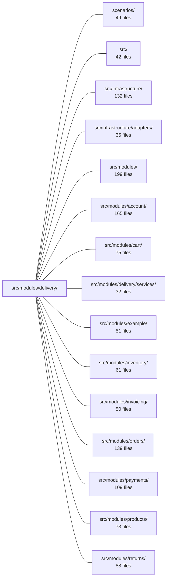

---
tags:
  - 2brain
  - 2brain/module
  - project/boilerplate-node-backend
type: module
module: src/modules/delivery/
files: 67
updated: 2026-11-15T00:31:27.867006+00:00
---

# src/modules/delivery/

## Purpose

The delivery module owns everything that happens **after** a sale: splitting a paid order into fulfillment orders, cutting shipments from those orders, tracking each shipment through its lifecycle (shipped → delivered / lost / found), managing shipping-rate quotes, handling preorder date changes, and giving staff the operations to hold, release, correct, or reship parcels. It exposes a set of HTTP endpoints, emits domain events and webhooks, and sends buyer-facing emails for every lifecycle transition.

## Key parts

- **`domain/`** — Pure, side-effect-free business rules. `fulfillment.ts` splits order lines into fulfillment orders; `lifecycle.ts` is the shipment state-transition table; `lost.ts` and `reship.ts` encode the invariants for lost parcels and legal-guarantee replacements; `rates.ts` holds the static shipping-rate table; `preorder.ts` computes board state and buyer-notification decisions; `hold-notice.ts` maps internal hold reasons to buyer-safe copy. `index.ts` is the single import point for the domain layer.
- **`controllers/`** — One file per HTTP endpoint (reads for fulfillment orders, shipments, shipping methods, preorder board; writes for processing, shipping, delivering, holding, marking lost, correcting tracking). All are thin: validate, delegate to the service layer, shape the response.
- **`model.ts` / `repository.ts`** — Mongoose schemas for **FulfillmentOrder** and **Shipment**, plus the persistence layer (reads, optimistic-concurrency writes, board search, idempotent inserts) that every service call goes through.
- **`module.ts` / `module.yaml`** — The module manifest consumed by the kernel at boot: registers HTTP mounts, subscribes to cross-module domain events, declares webhook projections and GDPR sections.
- **`events.ts` / `emails.ts` / `asyncapi.webhooks.yaml`** — Outbound communication: typed domain-event payloads (transactional outbox), fully-resolved email copy per language, and the AsyncAPI fragment for the three public webhook events.
- **`pii.ts` / `authorization.yaml` / `config.ts` / `audit.ts`** — Cross-cutting concerns: field-level address encryption, role/action rules, the single config value (hold-note retention), and audit-action identifiers registered into the shared map.
- **`presenter.ts`** — Shapes stored documents into the wire forms declared by `openapi.yaml`, applying per-request visibility (staff notes, computed fields like `remaining`).
- **`jobs.ts`** — Two scheduled jobs: a delivery reaping sweep and a daily preorder sweep.
- **`openapi.yaml`** — The OpenAPI 3.1 contract that pins every route's request/response shape for consumers and contract tests.
- **`tests/`** — Contract tests (validated against the OpenAPI spec) and unit/integration suites for domain and service logic.

## How it connects

- **`orders`** — Delivery subscribes to order lifecycle events (e.g. `paid`) and transitions the order through `processing → shipped → delivered`. The `post-process-order` controller lives under `/orders/:id/process` to keep the path natural.
- **`inventory`** — Subscribed events (stock availability, restock) feed fulfillment-order holds and release-date-impact previews.
- **`products`** — Product data (weight, dimensions) feeds the shipping-rate and weight checks in `domain/rates.ts`.
- **`cart`** — Consumes the public `GET /delivery/methods` endpoint and `rates.ts` logic to show shipping costs before checkout.
- **`returns`** — The `domain/reship.ts` rules determine which fulfillment orders reopen when a delivered item is returned and replaced.
- **`account`** — `emails.ts` follows the same resolved-copy contract (`language` in → final text out) as `@modules/account/emails`, so the mailer adapter renders both identically.
- **`payments`** — Order processing (the `paid → processing` transition) is gated on a successful payment event; delivery acts only after that state change.
- **`infrastructure/adapters`** — The mailer adapter, outbox publisher, and job scheduler that the module's events, emails, and jobs flow through.
- **`delivery/services/`** — The service layer (a sibling directory) sits between controllers and the domain/repository, holding the transactional business-logic acts that controllers delegate to.

## Where to start

1. **`domain/lifecycle.ts`** — A short, pure data table of the three allowed shipment transitions and the birth status. Understanding this state machine makes every controller, event, and email in the module click.
2. **`domain/fulfillment.ts`** — The core splitting logic: how a paid order's lines become fulfillment orders, what remains, and what a shipment may carry. Reading this before touching any controller or service will give you the vocabulary and invariants the rest of the module assumes.

## Connected modules

[[boilerplate-node-backend_ROOT|/ (repository root)]] · [[boilerplate-node-backend_scenarios|scenarios/]] · [[boilerplate-node-backend_src|src/]] · [[boilerplate-node-backend_src_infrastructure|src/infrastructure/]] · [[boilerplate-node-backend_src_infrastructure_adapters|src/infrastructure/adapters/]] · [[boilerplate-node-backend_src_modules|src/modules/]] · [[boilerplate-node-backend_src_modules_account|src/modules/account/]] · [[boilerplate-node-backend_src_modules_cart|src/modules/cart/]] · [[boilerplate-node-backend_src_modules_delivery_services|src/modules/delivery/services/]] · [[boilerplate-node-backend_src_modules_example|src/modules/example/]] · [[boilerplate-node-backend_src_modules_inventory|src/modules/inventory/]] · [[boilerplate-node-backend_src_modules_invoicing|src/modules/invoicing/]] · [[boilerplate-node-backend_src_modules_orders|src/modules/orders/]] · [[boilerplate-node-backend_src_modules_payments|src/modules/payments/]] · [[boilerplate-node-backend_src_modules_products|src/modules/products/]] · … and 3 more

## Files
- `src/modules/delivery/asyncapi.webhooks.yaml` — AsyncAPI fragment that declares the delivery module's three outbound webhook events (`shipment.shipped`, `shipment.delivered`, `shipment.lost`). It is not a standalone document; a build script merges it into the root `webhooks/asyncapi.yaml` contract, and it disappears from the published contract the moment the delivery module is unregistered.
- `src/modules/delivery/audit.ts` — Declares the set of audit-action identifiers that the delivery module emits and registers them into the shared `AuditActionMap` so that the observability layer can type-check every delivery audit entry at compile time.
- `src/modules/delivery/authorization.yaml` — Declares the authorization rules and role sets for the delivery module. It defines which actions a tenant-scoped principal may perform against `Shipment` (update and start) and groups them into named sets that other modules or identity providers reference when granting permissions.
- `src/modules/delivery/config.ts` — Declares the delivery module's single configuration value — the retention window for a staff's free-text hold note — and exposes a typed getter. It follows the read-per-call pattern (rather than a cached constant) so tests can vary the value case by case.
- `src/modules/delivery/controllers/get-date-impact.ts` — Defines the two staff-facing preview endpoints (`GET /delivery/fulfillment-orders/release-date-impact` and `…/restock-date-impact`) that let a user see what would change before actually committing a date move. Both handlers are produced by a single factory so the only differences are the query field, the business cause, and the Zod schema.
- `src/modules/delivery/controllers/get-fulfillment-order.ts` — Thin Express handler for `GET /delivery/fulfillment-orders/:id`. It validates the route parameter, delegates to the delivery service, and maps the service result to an HTTP response. Exists as the single HTTP-facing entry point for fetching one fulfillment order (buyer-scoped or staff-visible, per the service layer).
- `src/modules/delivery/controllers/get-order-fulfillment-lists.ts` — Provides the two HTTP handlers that power the order shipping panel: one returns the fulfillment orders (the plan) for a given order, the other returns the shipments cut from them (what left). Both are unpaged lists, expected to be small, and are only meaningful once the order is paid.
- `src/modules/delivery/controllers/get-preorder-fulfillment-orders.ts` — Defines the two read-only controllers behind the preorder board: one returns a paginated list of fulfillment orders, the other returns per-product unit-count summaries. Both are thin adapters that parse/validate query params and delegate to the delivery service.
- `src/modules/delivery/controllers/get-shipment.ts` — HTTP controller for the `GET /delivery/shipments/:id` endpoint. It retrieves a single shipment by ID for staff viewing/correction and serializes the result into a standard success or refusal response.
- `src/modules/delivery/controllers/get-shipping-methods.ts` — Express route handler for `GET /delivery/methods`. Returns the full list of shipping methods the shop offers (flat rates, free-above thresholds, etc.). Deliberately public so a guest can see shipping costs before deciding to sign up.
- `src/modules/delivery/controllers/patch-shipment.ts` — HTTP handler for `PATCH /delivery/shipments/:id`. It lets staff correct a shipment's tracking code by validating the request, delegating to the delivery service, and returning the updated `Shipment`.
- `src/modules/delivery/controllers/post-deliver-shipment.ts` — Handler for `POST /delivery/shipments/:id/deliver`. It lets staff mark a shipment as delivered; when the *last* pending shipment for an order is delivered, the order transitions `shipped → delivered` (logic lives in the service layer).
- `src/modules/delivery/controllers/post-fulfill-fulfillment-order.ts` — HTTP controller handler for `POST /delivery/fulfillment-orders/:id/fulfill`. Fulfills a *digital* fulfillment order — a shipment with no physical parcel that is born in the delivered state. Delegates the business logic to the delivery service and translates the result into an HTTP response.
- `src/modules/delivery/controllers/post-hold-fulfillment-order.ts` — Express route handlers for holding and releasing a fulfillment order (`POST /delivery/fulfillment-orders/:id/hold` and `…/release`). They validate the request, delegate to the delivery service, and shape the HTTP response.
- `src/modules/delivery/controllers/post-mark-shipment-lost.ts` — HTTP controller for `POST /delivery/shipments/:id/mark-lost`. It validates the route parameter and request body, then delegates the actual "mark shipment lost" operation to the delivery service. It exists to keep route-handling logic (parsing, auth, error formatting) separate from domain logic in the service layer.
- `src/modules/delivery/controllers/post-process-order.ts` — HTTP controller handler for `POST /orders/:id/process`. It is the single endpoint that transitions an order from `paid` to `processing`, called by staff to signal that fulfillment has begun — before any parcel or shipment record exists.
- `src/modules/delivery/controllers/post-ship-fulfillment-order.ts` — HTTP controller that handles `POST /delivery/fulfillment-orders/:id/shipments`. It validates the request, delegates to the delivery service to cut one or more shipments from the remaining quantity of a fulfillment order, and returns the created shipment.
- `src/modules/delivery/domain/fulfillment.ts` — Pure domain rules that decide how an order's lines split into fulfillment orders, what remains on each line, what status a fulfillment order derives, and which lines a shipment may carry. No I/O, no database — every rule is unit-testable in isolation.
- `src/modules/delivery/domain/hold-notice.ts` — Maps an internal `FulfillmentHoldReason` to the buyer-safe notice string and decides whether the hold warrants a buyer notification (mail + inbox row). The mapping deliberately collapses risk-related and "other" holds into a generic "delayed" notice so that the screening rationale is never exposed to the buyer, while still surfacing actionable states (address correction, stock waiting).
- `src/modules/delivery/domain/index.ts` — Barrel (re-export) file that exposes the delivery domain's full public API—lifecycle, rates, fulfillment, lost-shipment, reship, tracking, and preorder rules—without pulling in the module's HTTP or service surface. It is the single import point consumers use to access domain logic, as described in `docs/theory/domain-layer.md`.
- `src/modules/delivery/domain/lifecycle.ts` — Defines the shipment lifecycle as a pure data table (no I/O) that maps the three allowed status transitions—`deliver`, `lose`, `find`—and declares the birth status for physical parcels. Every repository write and service action validates against this table rather than spelling out statuses independently.
- `src/modules/delivery/domain/lost.ts` — Pure domain logic for a delivery fulfillment order's lines when a shipment is reported lost and when that same parcel later turns up. Encodes the invariant that shipped + canceled never exceeds what was bought, and defines when restoration is allowed (all-or-nothing). No I/O or database access, so every case is unit-testable.
- `src/modules/delivery/domain/preorder.ts` — Pure domain rules for preorders whose release date slips. Given a current date, a new date, and a shop timezone, it decides whether the buyer must be told (email) or left in silence, computes the date a fulfillment order is now expected, and derives the board state and lateness a UI or sweep reads. All functions are side-effect-free; the clock is always an argument, so every branch is testable in isolation.
- `src/modules/delivery/domain/rates.ts` — Pure-function module that defines the shop's static shipping-rate table and all price/eligibility queries over it. It exists so that shipping quotes, weight checks, and the refund ceiling for shipping are computed in exactly one place, with all money arithmetic in minor units. It lives in `domain/` (not `services/`) because it has no I/O — just a table and math over it.
- `src/modules/delivery/domain/reship.ts` — Pure domain logic that decides which fulfillment orders must reopen when a customer returns delivered goods and a replacement is resent (legal-guarantee replacement), and how to distribute the "owed" portion (the part the shelf could not cover) across those reopened orders. Extracted as side-effect-free functions so every case is testable in isolation.
- `src/modules/delivery/domain/tracking.ts` — Defines the single rule that determines whether a shipment is "awaiting tracking" — i.e. it shipped via a tracked method but the carrier's code has not yet been recorded. This one predicate drives the `Shipment.awaitingTracking` flag and the "tracked, still without a code" row in the staff digest.
- `src/modules/delivery/emails.ts` — Builds the finished, fully-resolved email copy for all delivery lifecycle notifications (shipped, delivered, lost, hold-notice, fulfillment-delayed). The language is an input argument; the output is final text that the mailer adapter renders without further resolution — the same contract as `@modules/account/emails`.
- `src/modules/delivery/events.ts` — Defines the domain-event payload types for the delivery module and registers them into the kernel's shared `DomainEventMap` via TypeScript module augmentation. Every payload here corresponds to an event that rides the transactional outbox, written in the same transaction as the act that caused it. `shipment.*` events are public (projected into the webhooks catalogue); `fulfillment_order.*` events are internal.
- `src/modules/delivery/index.ts` — Public barrel for the delivery module. It is the **only** import surface that sibling modules (cart, returns, tests) may use, enforcing the strategic-DDD boundary rule. It re-exports domain pricing logic, events, email helpers, service functions, and type definitions, while keeping repositories and runtime model internals private.
- `src/modules/delivery/jobs.ts` — Declares the two scheduled jobs owned by the `delivery` module—a delivery reaping job and a daily preorder sweep—by wrapping domain service calls into `JobDeclaration` objects that the kernel registry can schedule.
- `src/modules/delivery/model.ts` — Defines the two Mongoose schemas and compiled models for the delivery module: **FulfillmentOrder** (a group of an order's lines that should leave together, created when the order is paid) and **Shipment** (what actually left, with one tracking code). Both are keyed by a unique `{ orderId, number }` pair. The file also declares the TypeScript document interfaces, embedded sub-schemas, indexes, and serialization transforms consumed by the repository and service layers.
- `src/modules/delivery/module.ts` — Module manifest entry that wires the delivery domain (shipping rates, fulfillment orders, shipments) into the application kernel. It registers HTTP mounts, subscribes to domain events from `orders`/`inventory`/`products`, declares the public webhook projections, and declares GDPR export/re-encryption sections — all in a single object the kernel registry consumes at boot.
- `src/modules/delivery/module.yaml` — Declarative module definition for the **delivery** subdomain (group: `shop`). It scopes the delivery domain — shipping-rate rules, fulfillment orders, staff shipment operations (cut, arrive, lost, hold/release), and late-preorder buyer notifications — and declares the module's cross-module dependencies and two scheduled background jobs.
- `src/modules/delivery/openapi.yaml` — The OpenAPI 3.1.0 contract for the **delivery** module — the "after the sale" family. It declares the module's public API surface (shipping-method catalogue, fulfillment-order and shipment reads, order-processing transition, preorder board) together with its error taxonomy and personal-data export bindings, so that every consumer (UI, bundler, docs) agrees on the same shapes before any code is written.
- `src/modules/delivery/order-routes.ts` — Defines the Express router for the three delivery operations that live under an order path (`/orders/:id/…`): starting fulfillment via `process`, and reading the order's fulfillment-orders and shipments lists. It exists to keep those routes colocated with the delivery module while still mounting under the `/orders` prefix.
- `src/modules/delivery/pii.ts` — Field-level encryption/decryption of the destination address stored on a shipment. It is the delivery-side twin of `orders/pii.ts`, using the same `NODE_PII_ENCRYPTION_KEY` ring. The encrypted address records *where this parcel went*; the AAD binds every field to the shipment's `_id` so a ciphertext cannot be replayed against a different shipment.
- `src/modules/delivery/presenter.ts` — Single place where stored delivery documents (fulfillment orders, shipments) are shaped into the wire forms declared by `openapi.yaml` and the board/export views. Shapes are *built*, not serialized: computed fields like `remaining` don't exist on the stored document, and per-request decisions (caller `actions`, staff-only notes) are applied here.
- `src/modules/delivery/repository.ts` — Persistence layer for the delivery module. It wires the two Mongoose collections (fulfillment orders, shipments) to the act/services above them, providing the reads, optimistic-concurrency writes (`claim`), idempotent inserts, board search, and product summarisation that every delivery act is driven through.
- `src/modules/delivery/routes.ts` — Defines the Express route table for the delivery module. It maps HTTP paths to controllers, attaching the appropriate authentication, permission, idempotency, and cache middleware per route. The guard strategy is tiered: shipping-methods lookups are public, fulfillment reads require `read:Order`, and every write requires `update:Shipment`.
- `src/modules/delivery/tests/contract/api.contract.test.ts` — Contract tests for the delivery module's ten HTTP routes, run against a real server with `setupTestDb`. Each response is automatically validated against the OpenAPI spec via the `@tests/contract` side-effect import. The file pins that every audience branch (public, owner, staff) is reachable over HTTP and returns the documented shape; business-rule correctness is deferred to unit and integration suites.
- `src/modules/delivery/tests/factories.ts` — Test factories for the delivery module that drive an order through shipping and delivery using the module's own service API (the "doors"), so test fixtures carry the same fulfillment orders, shipments, summaries, and status transitions a real order would. A few helpers bypass the service to set clock-dependent state (dates, shipped quantities) that no public action can reach.
- `src/modules/delivery/tests/integration/backorder.test.ts` — Integration test that exercises the full paid-backorder lifecycle through the delivery module: grouping a split into a shippable shelf line and an `on_hold` owed line, the daily preorder sweep that notifies buyers when a 30-day default promise is due, stock arrival that releases held lines, and restock-date changes that update or clear a buyer's expected date. Only the mailer is mocked; inventory, outbox, products, and shop run for real against a test database.
- `src/modules/delivery/tests/integration/destination.test.ts` — Integration tests verifying the lifetime of a shipment's destination address: it is copied from the order at ship-time, encrypted at rest, isolated from later address corrections, included in account exports, removed on order scrub, and migrated during PII key rotation. Runs against a real MongoDB instance.
- `src/modules/delivery/tests/integration/lost-parcel.test.ts` — Integration test suite for the "lost parcel" lifecycle in the delivery module. It verifies that when a shipment is reported lost, the units reopen on the *same* fulfillment order, the stock hold is re-reserved, the order regresses `shipped → processing` and can be re-shipped and delivered through the normal path, the buyer receives exactly one templated email, and no side effects (new order, invoice, re-charge) occur. Uses a real Mongo instance and a real outbox; the mailer is the only mocked boundary.
- `src/modules/delivery/tests/integration/order-status-races.test.ts` — Integration tests that verify the delivery ship-door and the order cancel endpoint are mutually exclusive under real concurrent HTTP contention. They assert that N simultaneous ship requests produce exactly one 201 (and one email), that a ship racing a cancel leaves a single coherent outcome, and that a lost-update on `markProcessing` is surfaced as a 409 rather than a silent half-ship.
- `src/modules/delivery/tests/integration/override-sync.test.ts` — Integration test verifying that when an admin overrides an order's status forward (`shipped` or `delivered`), the delivery module's event handler force-creates or completes shipments at the override's own recorded instant, without sending email or emitting public `shipment.*` domain events. Also confirms idempotency (re-delivering the event is a no-op) and that a backward override to `processing` leaves fulfillment records untouched.
- `src/modules/delivery/tests/integration/preorder-board.test.ts` — Integration tests for the preorder board's read surface (`listPreorderFulfillmentOrders` and `summarizePreorders`). The file verifies that each state filter returns exactly the rows whose own `state` field says so (keeping the Mongo query and `boardStateOf` in lockstep), exercises the Late view and due-soon warning, confirms the product summary arithmetic, checks buyer/admin/anon access control, and distinguishes preorder from backorder causes.
- `src/modules/delivery/tests/integration/preorder-late.test.ts` — Integration test for the "late preorder" scenario (state P5): an admin moves a product's release date to a later date (or clears it), and the delivery module notifies the buyer via email and a `fulfillment_order.delayed` domain event while keeping the fulfillment order on hold. The test exercises the full path — real Mongo, real outbox processing, real product-service update — with only the mailer mocked at its queue boundary. It verifies that delivery *tells* (sends a notice, records state) but never *asks* or *cancels*.
- `src/modules/delivery/tests/integration/preorder.test.ts` — Integration test that exercises the full paid-preorder delivery lifecycle against a real database and real outbox. It verifies the seam between the inventory and delivery modules: that fulfillment orders start `on_hold` for stock, that a stock receipt allocates units (releasing whole or splitting short), and that the grouping rule reads the order's frozen release date rather than the live catalogue.
- `src/modules/delivery/tests/integration/release-date-impact.test.ts` — Integration test that verifies the `deliveryService.previewDateImpact` result matches the actual side-effect of moving a product's release date. For each scenario, it asserts that the preview's `notify` count (distinct orders) equals the number of distinct orders that receive a `fulfillment_order.delayed` outbox event after the save. Uses a real MongoDB and a real outbox; the mailer adapter is mocked at the queue boundary.
- `src/modules/delivery/tests/integration/retention.test.ts` — Integration tests for the `scrubHoldNotes` retention job against a real database. Verifies that hold notes older than the configured retention window are cleared while all other fields on the fulfillment order (status, reason, lines) remain untouched, that notes inside the window are preserved, and that a second run is a no-op.
- `src/modules/delivery/tests/integration/service.test.ts` — Integration test suite for the delivery module's service layer, covering shipping-rate pricing, fulfillment-order lifecycle (creation, idempotency, race conditions), and the ship action (shipment write, order-status transition, tracking email). It runs against a real MongoDB instance and asserts email side-effects through a mocked queue rather than a real transport.
- `src/modules/delivery/tests/integration/ship-actions-parity.test.ts` — Integration test that verifies the `FulfillmentOrderActions.ship` boolean exposed on the fulfillment-orders view matches the actual accept/reject behaviour of the `POST /delivery/fulfillment-orders/:id/shipments` endpoint. It sweeps every combination of staff role × order status to catch drift between the action flag and the authorization logic behind the ship endpoint.
- `src/modules/delivery/tests/integration/timeline.test.ts` — Integration test that verifies exactly what the delivery service writes to an order's timeline. It exercises the service's public methods (`shipFulfillmentOrder`, `deliverShipment`, `holdFulfillmentOrder`, `releaseFulfillmentOrder`, `fulfillFulfillmentOrder`, `processOrder`, `cancelAllForOrder`) against a real MongoDB instance, asserting the type, actor, and data of each timeline row and their ordering.
- `src/modules/delivery/tests/unit/emails.test.ts` — Unit tests for the four customer-facing shipment email builders. Each test block asserts that the builder produces a correctly named template, fully-interpolated copy in both supported locales, the right conditional fields (tracking code, remaining-items note, withdrawal deadline, owed items), and that no unrendered template keys leak into any output slot.
- `src/modules/delivery/tests/unit/fulfillment.test.ts` — Unit tests for the pure fulfillment domain rules: how an order's lines are split into fulfillment-order drafts, what remains after partial shipments or cancellations, which status a group derives from its lines and hold state, and which lines a shipment may carry. No I/O, no mocks — the tested functions are synchronous and side-effect free.
- `src/modules/delivery/tests/unit/hold-notice.test.ts` — Unit tests for the buyer-facing hold-notice logic: verifying that internal hold reasons map to the correct buyer-visible notice string, and that a buyer receives a mail notification only when appropriate. Encodes the privacy constraint that a risk-screening hold must be indistinguishable from any other check hold.
- `src/modules/delivery/tests/unit/lifecycle.test.ts` — Unit test suite for the `shipmentLifecycle` state machine. Verifies the full transition table (valid events per status), event targets, the initial state, and that `defineLifecycle` enforces its contract by rejecting unknown statuses.
- `src/modules/delivery/tests/unit/lost.test.ts` — Unit tests for the pure domain arithmetic around a **lost parcel**: how the loss mutates the origin fulfillment order's lines (`withLoss`), when a later "turn-up" is allowed to be recorded (`planRestoration`), how the restoration re-applies to those lines (`withRestoration`), how a lost shipment is reported in summaries (`summarize`), and how the owed-shipment date is computed (`owedDateOf`). The file exists to pin down invariants—floor-at-zero, all-or-nothing eligibility, exact inverse of `withLoss`/`withRestoration`—without touching any service or I/O layer.
- `src/modules/delivery/tests/unit/money-reconciliation.property.test.ts` — Property-based test that proves the **composition** of `orderTotal` (orders) and `priceShipping` (delivery) preserves money invariants — the exact arithmetic every caller (cart checkout, payment-intent freeze, confirmation email) performs independently. Neither `totals.property.test.ts` nor `money.property.test.ts` covers this cross-module combination; this file fills that gap so a regression in either side's rounding or summation surfaces as a single, reproducible counterexample.
- `src/modules/delivery/tests/unit/preorder.test.ts` — Unit tests for the pure, decision-only preorder slip rules defined in the delivery domain. Each test row pins a specific input (dates, order lines, timezone) against a fixed clock and asserts the verdict the domain logic returns — which verdict to notify the buyer, whether a due notice is needed, how many shop days slipped, and what date the buyer retains after a notice. No side effects, no I/O, no buyer interaction is exercised here.
- `src/modules/delivery/tests/unit/rates.property.test.ts` — Property-based tests for the shipping-rate domain (`rates.ts`). Where the companion `rates.test.ts` checks three hand-picked points around the free-shipping threshold, this file asserts the invariants hold for *every* basket value: no NaN/negative output, no charge above the flat rate, correct free/flat behavior at the threshold, and exact weight-range boundaries.
- `src/modules/delivery/tests/unit/rates.test.ts` — Unit tests for the pure-function shipping-rates domain (`rates.ts`). Validates pricing rules, method lookup, weight constraints, and the static `SHIPPING_METHODS` table shape without mocks or a database. The file header explicitly contrasts this with `tests/integration/service.test.ts`, which needs a real database to prove persistence — the pricing rule itself does not.
- `src/modules/delivery/tests/unit/reship.test.ts` — Unit tests for the pure reshipment (reopening) domain logic: verifying that `planReopening` picks units from the latest physical fulfillment orders first, that `shareOwed` caps each order at its reopened quantity, and that `withLoss` correctly adjusts or removes lines when units move to the owed order.
- `src/modules/delivery/tests/unit/routes.test.ts` — Unit test suite that locks down the delivery module's route surface: the exact set of endpoints, their mount order, and the authentication/permission guards applied to each. It exists to catch two failure modes — a route silently added without a guard, or a guard silently removed — by asserting the full guard contract rather than individual behaviors.
- `src/modules/delivery/tests/unit/schema-contract.test.ts` — Unit tests that pin the shape, constraints, and defaults of the two Mongoose schemas in the delivery module (`fulfillmentOrderSchema`, `shipmentSchema`). They exist so that a schema change (a new required field, a renamed index, a widened enum) fails CI immediately instead of surfacing as a runtime surprise, and they encode the intent behind non-obvious choices (e.g. `deliveredAt` has no default because its absence *is* "in transit").
- `src/modules/delivery/tests/unit/tracking.test.ts` — Unit tests for the `isAwaitingTracking` pure function, which encodes the rule "a physical, still-`shipped` parcel on a tracked method with no tracking code." The file pins down both the positive condition and the full set of boundary cases that must return `false`.

---
[[boilerplate-node-backend_INDEX|← boilerplate-node-backend index]]
