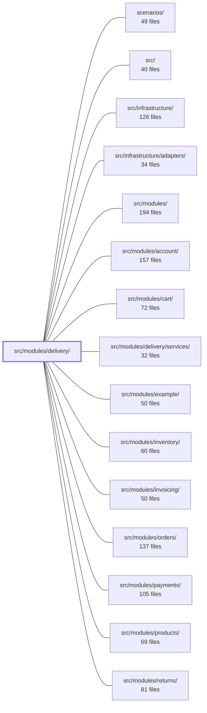

---
tags:
  - 2brain
  - 2brain/module
  - project/boilerplate-node-backend
type: module
module: src/modules/delivery/
files: 65
updated: 2026-11-08T10:50:09.789771+00:00
---

# src/modules/delivery/

## Purpose

The delivery module owns everything that happens after an order is paid and before (or after) the buyer receives it: creating and managing **fulfillment orders** (groups of order lines that should leave together), cutting **shipments** from them, tracking carrier codes, handling holds and releases, recording lost-in-transit parcels, managing preorder release dates, and computing shipping rates. It exposes these operations to staff via REST, emits domain events and buyer-facing notifications, and registers its scheduled jobs and webhook projections with the application kernel.

## Key parts

- **Domain layer (`domain/`)** — Pure, side-effect-free business rules: fulfillment grouping & status (`fulfillment.ts`), hold-notice mapping (`hold-notice.ts`), lost-in-transit lifecycle (`lost.ts`), preorder date slips (`preorder.ts`), the static shipping-rate table (`rates.ts`), replacement distribution (`reship.ts`), and the "awaiting tracking" predicate (`tracking.ts`). Re-exported through `domain/index.ts`.
- **Controllers (`controllers/`)** — One file per endpoint or tightly related pair (get/patch/post shipment, hold/release, ship/fulfill, date-impact previews, order-level lists). All are thin: validate input, delegate to the service layer, shape the HTTP response.
- **Service layer (`services/`)** — The business-orchestration tier that controllers call; coordinates domain rules, repository writes, event emission, and email dispatch. (Lives in `src/modules/delivery/services/`.)
- **Persistence** — `model.ts` defines the two Mongoose schemas (FulfillmentOrder, Shipment) with compound indexes; `repository.ts` provides the CRUD and conditional-read/write operations every delivery act flows through.
- **Module wiring** — `module.ts` assembles the `AppModule` manifest (routes, jobs, events, webhooks, PII sections, config); `routes.ts` and `order-routes.ts` define the Express route table and middleware chains; `module.yaml` is the declarative module descriptor.
- **Contracts & authorization** — `openapi.yaml` (REST contract), `asyncapi.webhooks.yaml` (outbound webhook events under `shipment.*`), `authorization.yaml` (role/action sets for `Shipment`).
- **Cross-cutting concerns** — `events.ts` (domain event payloads via `DomainEventMap` augmentation), `emails.ts` (final copy for shipped/delivered/lost/hold notifications), `pii.ts` (address encryption bound to shipment ID), `presenter.ts` (domain → wire-form shaping), `jobs.ts` (retention reaper + daily preorder sweep), `audit.ts` (audit action identifiers), `config.ts` (hold-note retention window).
- **Tests (`tests/`)** — Contract tests validating every endpoint against the OpenAPI spec, plus factories that drive orders through the public service API for integration coverage.

## How it connects

- **`src/modules/orders/`** — Delivery is downstream of order payment: fulfillment orders are created from an order's frozen lines, and the module drives the order's `processing → shipped → delivered` status transitions. The `POST /orders/:id/process` endpoint lives here but mounts under the orders path.
- **`src/modules/cart/`** — Cart consults the public `GET /delivery/methods` endpoint and the `rates.ts` table during checkout to show shipping costs before sign-up.
- **`src/modules/inventory/`** — Fulfillment orders track per-line quantities against stock; the reship domain logic coordinates with inventory when a shelf cannot cover a replacement.
- **`src/modules/payments/`** — Delivery operations (ship, hold, deliver) are meaningful only after the order is in the paid state; the module reads payment status as a precondition.
- **`src/modules/returns/`** — When a buyer returns delivered goods, the `reship.ts` domain rules decide which fulfillment orders reopen and how owed units are distributed, then the delivery service executes the replacement shipment.
- **`src/modules/account/`** — Shares the same email-copy contract pattern (`emails.ts`) and contributes PII export sections (encrypted destination addresses) to the account data-export flow.
- **`src/modules/users/`** — Staff authentication and the `update:Shipment` / `read:Order` permission checks applied in the middleware chain depend on the user/identity module.
- **`src/infrastructure/adapters/`** — The mailer adapter renders the final email text produced by `emails.ts`; the PII encryption adapter provides the key ring used by `pii.ts`.
- **`src/modules/delivery/services/`** — The internal service layer that sits between controllers and the domain/repository, orchestrating the actual business transactions.

## Where to start

1. **`src/modules/delivery/domain/fulfillment.ts`** — Reading the pure rules that turn order lines into fulfillment orders, derive status, and validate shipment contents gives you the core mental model without any HTTP, database, or infrastructure noise.
2. **`src/modules/delivery/routes.ts`** — Next, skim the route table to see the full set of operations, their audience (public / order-owner / staff), and the middleware each one runs through. This maps the "surface" of the module before you drill into individual controllers or services.

## Connected modules

[[boilerplate-node-backend_ROOT|/ (repository root)]] · [[boilerplate-node-backend_scenarios|scenarios/]] · [[boilerplate-node-backend_src|src/]] · [[boilerplate-node-backend_src_infrastructure|src/infrastructure/]] · [[boilerplate-node-backend_src_infrastructure_adapters|src/infrastructure/adapters/]] · [[boilerplate-node-backend_src_modules|src/modules/]] · [[boilerplate-node-backend_src_modules_account|src/modules/account/]] · [[boilerplate-node-backend_src_modules_cart|src/modules/cart/]] · [[boilerplate-node-backend_src_modules_delivery_services|src/modules/delivery/services/]] · [[boilerplate-node-backend_src_modules_example|src/modules/example/]] · [[boilerplate-node-backend_src_modules_inventory|src/modules/inventory/]] · [[boilerplate-node-backend_src_modules_invoicing|src/modules/invoicing/]] · [[boilerplate-node-backend_src_modules_orders|src/modules/orders/]] · [[boilerplate-node-backend_src_modules_payments|src/modules/payments/]] · [[boilerplate-node-backend_src_modules_products|src/modules/products/]] · … and 3 more

## Files
- `src/modules/delivery/asyncapi.webhooks.yaml` — AsyncAPI **fragment** (not a standalone document) that declares the delivery module's outbound webhook events under the `shipment.*` namespace. It defines the channels, operations, message components, and payload/envelope schemas that subscribers receive. The bundler (`scripts/contracts/asyncapi-section-fragments.ts`) merges it into the top-level `webhooks/asyncapi.yaml` only while the delivery module is registered; deleting the module removes these events from the contract and from `GET /webhooks/events`.
- `src/modules/delivery/audit.ts` — Declares the set of audit action identifiers that delivery-related admin operations emit, and registers them into the shared `AuditActionMap` type via module augmentation. Exists so that every delivery service has a single, type-safe source of truth for the action strings it records.
- `src/modules/delivery/authorization.yaml` — Declares the authorization rules and role sets for the delivery module. It defines which actions a tenant-scoped principal may perform against `Shipment` (update and start) and groups them into named sets that other modules or identity providers reference when granting permissions.
- `src/modules/delivery/config.ts` — Declares the delivery module's single configuration value — the retention window for a staff's free-text hold note — and exposes a typed getter. It follows the read-per-call pattern (rather than a cached constant) so tests can vary the value case by case.
- `src/modules/delivery/controllers/get-date-impact.ts` — Defines the two staff-facing preview endpoints (`GET /delivery/fulfillment-orders/release-date-impact` and `…/restock-date-impact`) that let a user see what would change before actually committing a date move. Both handlers are produced by a single factory so the only differences are the query field, the business cause, and the Zod schema.
- `src/modules/delivery/controllers/get-fulfillment-order.ts` — Thin Express handler for `GET /delivery/fulfillment-orders/:id`. It validates the route parameter, delegates to the delivery service, and maps the service result to an HTTP response. Exists as the single HTTP-facing entry point for fetching one fulfillment order (buyer-scoped or staff-visible, per the service layer).
- `src/modules/delivery/controllers/get-order-fulfillment-lists.ts` — Provides the two HTTP handlers that power the order shipping panel: one returns the fulfillment orders (the plan) for a given order, the other returns the shipments cut from them (what left). Both are unpaged lists, expected to be small, and are only meaningful once the order is paid.
- `src/modules/delivery/controllers/get-preorder-fulfillment-orders.ts` — Defines the two read-only controllers behind the preorder board: one returns a paginated list of fulfillment orders, the other returns per-product unit-count summaries. Both are thin adapters that parse/validate query params and delegate to the delivery service.
- `src/modules/delivery/controllers/get-shipment.ts` — HTTP controller for the `GET /delivery/shipments/:id` endpoint. It retrieves a single shipment by ID for staff viewing/correction and serializes the result into a standard success or refusal response.
- `src/modules/delivery/controllers/get-shipping-methods.ts` — Express route handler for `GET /delivery/methods`. Returns the full list of shipping methods the shop offers (flat rates, free-above thresholds, etc.). Deliberately public so a guest can see shipping costs before deciding to sign up.
- `src/modules/delivery/controllers/patch-shipment.ts` — Controller handler for `PATCH /delivery/shipments/:id`. Validates the shipment ID and the request body, then delegates to the delivery service to update a shipment's tracking code on behalf of a staff member.
- `src/modules/delivery/controllers/post-deliver-shipment.ts` — Handler for `POST /delivery/shipments/:id/deliver`. It lets staff mark a shipment as delivered; when the *last* pending shipment for an order is delivered, the order transitions `shipped → delivered` (logic lives in the service layer).
- `src/modules/delivery/controllers/post-fulfill-fulfillment-order.ts` — HTTP controller handler for `POST /delivery/fulfillment-orders/:id/fulfill`. Fulfills a *digital* fulfillment order — a shipment with no physical parcel that is born in the delivered state. Delegates the business logic to the delivery service and translates the result into an HTTP response.
- `src/modules/delivery/controllers/post-hold-fulfillment-order.ts` — Express route handlers for holding and releasing a fulfillment order (`POST /delivery/fulfillment-orders/:id/hold` and `…/release`). They validate the request, delegate to the delivery service, and shape the HTTP response.
- `src/modules/delivery/controllers/post-mark-shipment-lost.ts` — HTTP controller for `POST /delivery/shipments/:id/lost`. Validates the request, then delegates to the delivery service to record that a parcel was lost or damaged in transit, responding with the updated shipment.
- `src/modules/delivery/controllers/post-process-order.ts` — HTTP handler for `POST /orders/:id/process`. It is the single entry point that transitions a paid order into the `processing` state (i.e., staff has begun fulfillment). It runs before any parcel exists, distinguishing it from later parcel-recording endpoints.
- `src/modules/delivery/controllers/post-ship-fulfillment-order.ts` — HTTP controller that handles `POST /delivery/fulfillment-orders/:id/shipments`. It validates the request, delegates to the delivery service to cut one or more shipments from the remaining quantity of a fulfillment order, and returns the created shipment.
- `src/modules/delivery/domain/fulfillment.ts` — Pure domain rules that turn an order's frozen lines into fulfillment-order drafts, derive a fulfillment order's status from its lines and hold state, and validate which lines a shipment may carry. Exists so that the grouping, status, and shipment-validation logic is fully testable in isolation, with no database or infrastructure dependency.
- `src/modules/delivery/domain/hold-notice.ts` — Maps an internal `FulfillmentHoldReason` to the buyer-safe notice string and decides whether the hold warrants a buyer notification (mail + inbox row). The mapping deliberately collapses risk-related and "other" holds into a generic "delayed" notice so that the screening rationale is never exposed to the buyer, while still surfacing actionable states (address correction, stock waiting).
- `src/modules/delivery/domain/index.ts` — Barrel (re-export) file that exposes the full public API of the delivery **domain layer** — the business rules, pricing logic, and state predicates — as a single importable surface, independent of the module's HTTP-facing code. It exists so that consumers (services, presenters, repositories) can pull domain rules without reaching into individual sub-module paths.
- `src/modules/delivery/domain/lost.ts` — Pure domain logic for the lost-in-transit lifecycle: it computes how a fulfillment order's lines change when a shipment is reported lost, decides whether the shipment may later be recorded as found (and what that restores), and derives the promised delivery date for the owed units. All functions are side-effect free so every branch is testable without a database.
- `src/modules/delivery/domain/preorder.ts` — Pure domain rules for preorders whose release date slips. Given a current date, a new date, and a shop timezone, it decides whether the buyer must be told (email) or left in silence, computes the date a fulfillment order is now expected, and derives the board state and lateness a UI or sweep reads. All functions are side-effect-free; the clock is always an argument, so every branch is testable in isolation.
- `src/modules/delivery/domain/rates.ts` — Pure-function rate table for shipping methods. Exists in the `domain/` layer (alongside `evaluateCheckout`) so that every quote, weight check, and refund ceiling derives from exactly one static source. The table is the single source of truth that `GET /delivery/methods` answers verbatim.
- `src/modules/delivery/domain/reship.ts` — Pure domain logic that decides which fulfillment orders must reopen when a customer returns delivered goods and a replacement is resent (legal-guarantee replacement), and how to distribute the "owed" portion (the part the shelf could not cover) across those reopened orders. Extracted as side-effect-free functions so every case is testable in isolation.
- `src/modules/delivery/domain/tracking.ts` — Defines the single rule that determines whether a shipment is "awaiting tracking" — i.e. it shipped via a tracked method but the carrier's code has not yet been recorded. This one predicate drives the `Shipment.awaitingTracking` flag and the "tracked, still without a code" row in the staff digest.
- `src/modules/delivery/emails.ts` — Builds the finished, fully-resolved email copy for all delivery lifecycle notifications (shipped, delivered, lost, hold-notice, fulfillment-delayed). The language is an input argument; the output is final text that the mailer adapter renders without further resolution — the same contract as `@modules/account/emails`.
- `src/modules/delivery/events.ts` — Defines the domain events emitted by the delivery module and their payload shapes. Uses TypeScript module augmentation to register payloads into the kernel's shared `DomainEventMap` (same pattern as `modules/orders/events.ts`), so every event rides the transactional outbox and exists exactly when the causing act does.
- `src/modules/delivery/index.ts` — Public barrel for the delivery module. It is the **only** import surface that sibling modules (cart, returns, tests) may use, enforcing the strategic-DDD boundary rule. It re-exports domain pricing logic, events, email helpers, service functions, and type definitions, while keeping repositories and runtime model internals private.
- `src/modules/delivery/jobs.ts` — Declares the two scheduled jobs owned by the `delivery` module — a retention reaper (hold-note and lost-note scrubbing) and a daily preorder sweep — as a single `JobDeclaration[]` export that the module registry consumes.
- `src/modules/delivery/model.ts` — Defines the two MongoDB collections for the delivery module — **FulfillmentOrder** (a group of an order's lines that should leave together, created when the order is paid) and **Shipment** (a concrete parcel that left, with one tracking code and one timestamp) — including their Mongoose schemas, embedded sub-document schemas, compound indexes, and the compiled models used by the repository and services.
- `src/modules/delivery/module.ts` — Module manifest for the **delivery** domain (shipping rates, fulfillment orders, shipments). It wires together the module's HTTP routes, background jobs, event subscriptions, public webhook projections, PII export sections, and config into a single `AppModule` object consumed by the kernel at startup. It exists so the rest of the system (routing, webhooks, outbox, jobs, personal-data export) can discover delivery's surface through the generic `AppModule` contract rather than importing delivery internals.
- `src/modules/delivery/module.yaml` — Declarative module definition for the **delivery** subdomain (group: `shop`). It scopes the delivery domain — shipping-rate rules, fulfillment orders, staff shipment operations (cut, arrive, lost, hold/release), and late-preorder buyer notifications — and declares the module's cross-module dependencies and two scheduled background jobs.
- `src/modules/delivery/openapi.yaml` — OpenAPI 3.1.0 contract for the **delivery** module — the "After the sale" family covering fulfillment orders and shipments. It declares the module's REST endpoints, shared error-code vocabulary, and the slices of account data export the module contributes.
- `src/modules/delivery/order-routes.ts` — Defines the Express router for the three delivery operations that live under an order path (`/orders/:id/…`): starting fulfillment via `process`, and reading the order's fulfillment-orders and shipments lists. It exists to keep those routes colocated with the delivery module while still mounting under the `/orders` prefix.
- `src/modules/delivery/pii.ts` — Field-level encryption/decryption of the destination address stored on a shipment. It is the delivery-side twin of `orders/pii.ts`, using the same `NODE_PII_ENCRYPTION_KEY` ring. The encrypted address records *where this parcel went*; the AAD binds every field to the shipment's `_id` so a ciphertext cannot be replayed against a different shipment.
- `src/modules/delivery/presenter.ts` — Single place where stored delivery documents (fulfillment orders, shipments) are shaped into the wire forms declared by `openapi.yaml` and the board/export views. Shapes are *built*, not serialized: computed fields like `remaining` don't exist on the stored document, and per-request decisions (caller `actions`, staff-only notes) are applied here.
- `src/modules/delivery/repository.ts` — Persistence layer for the delivery module. Defines the two Mongoose collections (fulfillment orders, shipments), the shared CRUD factory, and the domain-specific conditional reads and revision-guarded writes that every delivery act is driven through. Return types are written out explicitly because Mongoose's generics are too large for TypeScript to infer at an export boundary (TS7056).
- `src/modules/delivery/routes.ts` — Defines the Express route table for the delivery module. It wires each HTTP method/path to its controller function and applies the correct middleware chain (auth, permissions, idempotency, caching) per route. The permission model is split by intent: shipping-method lookup is public, fulfillment reads require `read:Order`, and all mutations require `update:Shipment`.
- `src/modules/delivery/tests/contract/api.contract.test.ts` — Contract tests that exercise the delivery HTTP API (`/delivery/*`, fulfillment-order and shipment routes) against a real running server, validating every response automatically against the OpenAPI spec via `@tests/contract`. The file pins that each audience branch (public, order-owner, staff) is reachable over HTTP and returns the shape the spec promises; business-logic rules are covered separately in unit and integration suites.
- `src/modules/delivery/tests/factories.ts` — Test factories that drive an order through the delivery module's public service doors (`deliveryService`) so integration and contract tests get a fully consistent set of fulfillment orders, shipments, summaries, and status transitions — without manually assembling each document. Also provides a few targeted "backdate" helpers that mutate dates or quantities directly via the model, since no service door exposes that kind of time-travel.
- `src/modules/delivery/tests/integration/backorder.test.ts` — Integration test that exercises the full paid-backorder lifecycle through the delivery module: grouping a split into a shippable shelf line and an `on_hold` owed line, the daily preorder sweep that notifies buyers when a 30-day default promise is due, stock arrival that releases held lines, and restock-date changes that update or clear a buyer's expected date. Only the mailer is mocked; inventory, outbox, products, and shop run for real against a test database.
- `src/modules/delivery/tests/integration/destination.test.ts` — Integration tests verifying the lifetime of a shipment's destination address: it is copied from the order at ship-time, encrypted at rest, isolated from later address corrections, included in account exports, removed on order scrub, and migrated during PII key rotation. Runs against a real MongoDB instance.
- `src/modules/delivery/tests/integration/lost-parcel.test.ts` — Integration tests for the lost-in-transit parcel workflow. They pin the full lifecycle: an admin reports a shipment lost, the order regresses `shipped → processing`, stock hold is restored from free shelf (or overflowed to backorder), the order is re-shipped through the ordinary `shipFulfillmentOrder` path, and the replacement is delivered. They also cover the admin `overrideStatus` path and assert that `deliverShipment` accepts a lost parcel back only when all its units are still open. Uses real MongoDB and a real outbox; the mailer is the sole mock.
- `src/modules/delivery/tests/integration/order-status-races.test.ts` — Integration tests that verify concurrent status-change requests on the same order cannot both succeed. Two race scenarios are covered against real HTTP contention: (1) N admins simultaneously hitting the ship endpoint on one fulfillment order, and (2) a ship racing a full-order cancel. The file exists to guard the optimistic-revision claim that only one writer lands, and that the shipment email fires exactly once per real commit.
- `src/modules/delivery/tests/integration/override-sync.test.ts` — Integration test verifying that when an admin overrides an order's status forward (`shipped` or `delivered`), the delivery module's event handler force-creates or completes shipments at the override's own recorded instant, without sending email or emitting public `shipment.*` domain events. Also confirms idempotency (re-delivering the event is a no-op) and that a backward override to `processing` leaves fulfillment records untouched.
- `src/modules/delivery/tests/integration/preorder-board.test.ts` — Integration tests for the preorder board's read surface (`listPreorderFulfillmentOrders` and `summarizePreorders`). The file verifies that each state filter returns exactly the rows whose own `state` field says so (keeping the Mongo query and `boardStateOf` in lockstep), exercises the Late view and due-soon warning, confirms the product summary arithmetic, checks buyer/admin/anon access control, and distinguishes preorder from backorder causes.
- `src/modules/delivery/tests/integration/preorder-late.test.ts` — Integration test for the "release date moves later" scenario (PRODUCT_STATES P5) on a paid preorder. It verifies that the delivery module notifies the buyer, updates the fulfillment order to stay in `on_hold` with the new `expectedAt`, emits a `fulfillment_order.delayed` event, and sends exactly one email—using a real Mongo database and a real outbox, with only the mailer mocked at its queue boundary.
- `src/modules/delivery/tests/integration/preorder.test.ts` — Integration test that exercises the full paid-preorder delivery lifecycle against a real database and real outbox. It verifies the seam between the inventory and delivery modules: that fulfillment orders start `on_hold` for stock, that a stock receipt allocates units (releasing whole or splitting short), and that the grouping rule reads the order's frozen release date rather than the live catalogue.
- `src/modules/delivery/tests/integration/release-date-impact.test.ts` — Integration test that verifies the `deliveryService.previewDateImpact` result matches the actual side-effect of moving a product's release date. For each scenario, it asserts that the preview's `notify` count (distinct orders) equals the number of distinct orders that receive a `fulfillment_order.delayed` outbox event after the save. Uses a real MongoDB and a real outbox; the mailer adapter is mocked at the queue boundary.
- `src/modules/delivery/tests/integration/retention.test.ts` — Integration tests for the `scrubHoldNotes` retention job against a real database. Verifies that hold notes older than the configured retention window are cleared while all other fields on the fulfillment order (status, reason, lines) remain untouched, that notes inside the window are preserved, and that a second run is a no-op.
- `src/modules/delivery/tests/integration/service.test.ts` — Integration test suite for the delivery service and its domain rules. Validates shipping-rate pricing, fulfillment-order creation/idempotency, the full "ship" act (shipment write, order status transition, tracking email), and resilience paths (buyer-lookup failure, mail-queue failure, cancel-race) against a real MongoDB instance with only the mail adapter mocked.
- `src/modules/delivery/tests/integration/ship-actions-parity.test.ts` — Integration test that verifies the `ship` boolean exposed on a fulfillment order's actions always agrees with whether the actual `POST …/shipments` endpoint accepts the request (a 2xx response). It sweeps every combination of staff role × order status to catch any divergence between the read-model flag and the write-path authorization.
- `src/modules/delivery/tests/integration/timeline.test.ts` — Integration test that verifies exactly what the delivery service writes to an order's timeline. It exercises the service's public methods (`shipFulfillmentOrder`, `deliverShipment`, `holdFulfillmentOrder`, `releaseFulfillmentOrder`, `fulfillFulfillmentOrder`, `processOrder`, `cancelAllForOrder`) against a real MongoDB instance, asserting the type, actor, and data of each timeline row and their ordering.
- `src/modules/delivery/tests/unit/emails.test.ts` — Unit tests for the four customer-facing shipment email builders. Each test block asserts that the builder produces a correctly named template, fully-interpolated copy in both supported locales, the right conditional fields (tracking code, remaining-items note, withdrawal deadline, owed items), and that no unrendered template keys leak into any output slot.
- `src/modules/delivery/tests/unit/fulfillment.test.ts` — Unit tests for the pure fulfillment-rule functions that decide how an order's lines split into fulfillment orders, what remains after partial shipments or cancellations, what status a fulfillment order takes, and which lines a shipment may carry. The file exists to lock down the grouping, remainder, status, and ship-check contracts without any service or transport layer.
- `src/modules/delivery/tests/unit/hold-notice.test.ts` — Unit tests for the buyer-facing hold-notice logic: verifying that internal hold reasons map to the correct buyer-visible notice string, and that a buyer receives a mail notification only when appropriate. Encodes the privacy constraint that a risk-screening hold must be indistinguishable from any other check hold.
- `src/modules/delivery/tests/unit/lost.test.ts` — Unit tests for the pure domain arithmetic around a **lost parcel**: how the loss mutates the origin fulfillment order's lines (`withLoss`), when a later "turn-up" is allowed to be recorded (`planRestoration`), how the restoration re-applies to those lines (`withRestoration`), how a lost shipment is reported in summaries (`summarize`), and how the owed-shipment date is computed (`owedDateOf`). The file exists to pin down invariants—floor-at-zero, all-or-nothing eligibility, exact inverse of `withLoss`/`withRestoration`—without touching any service or I/O layer.
- `src/modules/delivery/tests/unit/money-reconciliation.property.test.ts` — Property-based test that proves the **composition** of `orderTotal` (orders) and `priceShipping` (delivery) preserves money invariants — the exact arithmetic every caller (cart checkout, payment-intent freeze, confirmation email) performs independently. Neither `totals.property.test.ts` nor `money.property.test.ts` covers this cross-module combination; this file fills that gap so a regression in either side's rounding or summation surfaces as a single, reproducible counterexample.
- `src/modules/delivery/tests/unit/preorder.test.ts` — Unit tests for the pure, decision-only preorder slip rules defined in the delivery domain. Each test row pins a specific input (dates, order lines, timezone) against a fixed clock and asserts the verdict the domain logic returns — which verdict to notify the buyer, whether a due notice is needed, how many shop days slipped, and what date the buyer retains after a notice. No side effects, no I/O, no buyer interaction is exercised here.
- `src/modules/delivery/tests/unit/rates.property.test.ts` — Property-based tests for the shipping-rate domain (`rates.ts`). Where the companion `rates.test.ts` checks three hand-picked points around the free-shipping threshold, this file asserts the invariants hold for *every* basket value: no NaN/negative output, no charge above the flat rate, correct free/flat behavior at the threshold, and exact weight-range boundaries.
- `src/modules/delivery/tests/unit/rates.test.ts` — Unit tests for the pure pricing/lookup functions in the delivery rates domain. Because the tested code operates over a static in-memory table with no I/O, this file needs no mocks or database—unlike the service-level tests that live in `tests/integration/`.
- `src/modules/delivery/tests/unit/reship.test.ts` — Unit tests for the pure reshipment (reopening) domain logic: verifying that `planReopening` picks units from the latest physical fulfillment orders first, that `shareOwed` caps each order at its reopened quantity, and that `withLoss` correctly adjusts or removes lines when units move to the owed order.
- `src/modules/delivery/tests/unit/routes.test.ts` — Unit test that pins the delivery module's route table to its documented shape: exact endpoint list and order, per-route guard assignments, and permission-key pairs. Its most important role is the final "sweep" test, which fails if any route is added without an `isAuth` guard, catching the drift risk called out in the file's module doc comment.
- `src/modules/delivery/tests/unit/schema-contract.test.ts` — Locks down the Mongoose schema contract for `fulfillmentOrderSchema` and `shipmentSchema`: required fields, enum vocabularies, default values, ObjectId references, timestamp options, and the shared `{ orderId, number }` unique index that enforces exactly-once semantics at the database level. Exists so that schema drift (a missing field, a widened enum, a lost unique index) is caught in CI before it reaches production.
- `src/modules/delivery/tests/unit/tracking.test.ts` — Unit tests for the `isAwaitingTracking` pure function, which encodes the rule "a physical, still-`shipped` parcel on a tracked method with no tracking code." The file pins down both the positive condition and the full set of boundary cases that must return `false`.

---
[[boilerplate-node-backend_INDEX|← boilerplate-node-backend index]]
