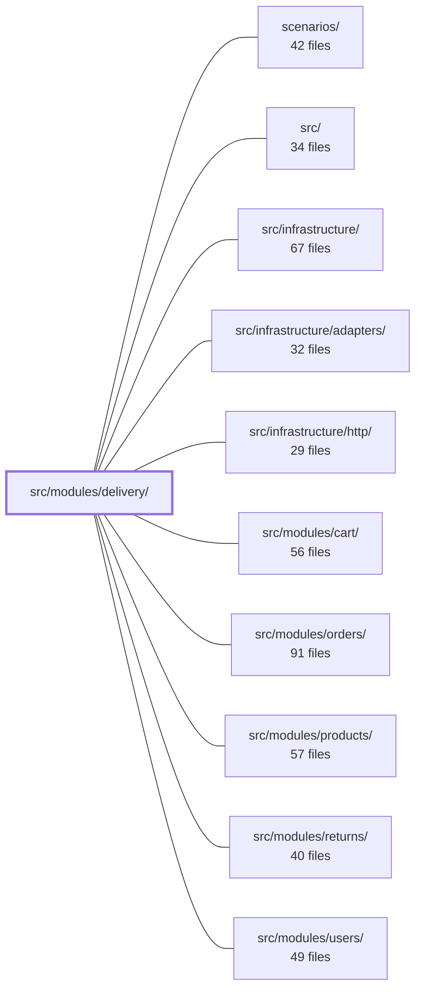

---
tags:
  - 2brain
  - 2brain/module
  - project/boilerplate-node-backend
type: module
module: src/modules/delivery/
files: 27
updated: 2026-10-07T23:57:23.163518+00:00
---

# src/modules/delivery/

## Purpose

The delivery module owns the post-payment shipment lifecycle: transitioning an order from `paid` through `processing`, `shipped`, and finally `delivered` (or, for digital-only orders, straight to `delivered`). It provides the shipping-method catalogue used at checkout, tracks the single parcel record per order, and emits the customer-facing "your item has shipped" notification.

## Key parts

- **HTTP layer** — `routes.ts` wires the six endpoints with per-route auth guards; `controllers/` holds one thin handler per endpoint (start, ship, deliver, fulfill, get-by-order, get-methods). `openapi.yaml` is the machine-readable contract all of them must satisfy.
- **Service** — `service.ts` orchestrates the three status doors and delegates every order-status write to the `orders` module. It also exposes the shipping-method list and the forced-override permission gate.
- **Domain** — `domain/rates.ts` is a pure, side-effect-free pricing table (three methods, flat-rate and free-above-threshold tiers) importable without pulling in any HTTP or service code.
- **Persistence** — `model.ts` defines the Mongoose `Shipment` schema (one doc per order, unique `orderId`); `repository.ts` adds the domain-specific queries (idempotent create, atomic conditional status update, batch lookup).
- **Emails** — `emails.ts` resolves locale-specific, fully-translated `EmailContent` for the shipment notification, decoupled from the template engine.
- **Wiring & public surface** — `module.ts` is the `AppModule` manifest (routes, permissions, locale path); `index.ts` is the **only** barrel sibling modules may import (DDD boundary rule); `audit.ts` registers the four delivery audit-action strings into the global `AuditActionMap`.
- **Tests** — `tests/` splits into contract (wire-level spec compliance), integration (real Mongo, cross-module status transitions), and unit (pure rates, email rendering, schema shape, route table, property-based invariants).

## How it connects

- **`src/modules/orders/`** — The delivery service never mutates order status itself; it calls the orders module for every transition (`paid→processing`, `processing→shipped`, `shipped→delivered`, `processing→delivered`). This keeps the single source of truth for order state in one place.
- **`src/modules/cart/`** — Cart's checkout step imports the shipping-method catalogue and pricing functions through delivery's public `index.ts` barrel to show costs before purchase.
- **`src/infrastructure/`** — Shared HTTP utilities, the audit-event emitter, and the mail-transport adapter are consumed here; `audit.ts` plugs delivery's action strings into the global observability map.
- **`src/modules/users/`** — Customer address and locale data (used for email personalisation and shipping-cost lookups) originate in the users module and flow into delivery's email builder.
- **`scenarios/`** — End-to-end scenario tests exercise the delivery endpoints as part of full purchase-to-delivery flows.

## Where to start

1. **`domain/rates.ts`** — A short, dependency-free file that shows the three shipping methods and the pricing logic. Reading it first gives you the core business rule without any framework noise.
2. **`service.ts`** — The orchestration heart of the module: you'll see how each status door writes the parcel record, calls the orders module, triggers the email, and emits an audit event. Everything else in the directory is a thinner layer around these functions.

## Connected modules

[[boilerplate-node-backend_ROOT|/ (repository root)]] · [[boilerplate-node-backend_scenarios|scenarios/]] · [[boilerplate-node-backend_src|src/]] · [[boilerplate-node-backend_src_infrastructure|src/infrastructure/]] · [[boilerplate-node-backend_src_infrastructure_adapters|src/infrastructure/adapters/]] · [[boilerplate-node-backend_src_infrastructure_http|src/infrastructure/http/]] · [[boilerplate-node-backend_src_modules_cart|src/modules/cart/]] · [[boilerplate-node-backend_src_modules_orders|src/modules/orders/]] · [[boilerplate-node-backend_src_modules_products|src/modules/products/]] · [[boilerplate-node-backend_src_modules_returns|src/modules/returns/]] · [[boilerplate-node-backend_src_modules_users|src/modules/users/]]

## Files
- `src/modules/delivery/audit.ts` — Declares the four audit-action string constants that the delivery domain emits and registers them into the shared `AuditActionMap` interface via TypeScript module augmentation. This keeps the audit vocabulary colocated with the domain that produces it while remaining visible to the global observability infrastructure.
- `src/modules/delivery/controllers/get-shipment-by-order.ts` — Controller for `GET /delivery/order/:orderId`. Returns the parcel associated with a given order — its tracking code and arrival status — consumed by the order page's shipping panel once the order status is `shipped`.
- `src/modules/delivery/controllers/get-shipping-methods.ts` — Express route handler for `GET /delivery/methods`. Returns the shop's full list of available shipping methods (flat rates and free-above-threshold tiers). It is intentionally public so that guests can see shipping costs before signing up.
- `src/modules/delivery/controllers/post-deliver-order.ts` — HTTP controller for `POST /delivery/order/:orderId/deliver`. Validates the request body against a Zod schema, then delegates to the delivery service to record a parcel's arrival — the sole transition that moves an order from `shipped` to `delivered`.
- `src/modules/delivery/controllers/post-fulfill-order.ts` — Handles `POST /delivery/order/:orderId/fulfill`. Marks a digital-only order as fulfilled, transitioning it from `processing` to `delivered` without creating any parcel record. This is the fulfillment path for orders that have nothing physical to ship (e.g. software, licenses), as an alternative to the `ship`/`deliver` flow.
- `src/modules/delivery/controllers/post-ship-order.ts` — HTTP handler for `POST /delivery/order/:orderId/ship`. It validates the inbound request body, delegates the actual state transition (`processing → shipped`) to the delivery service, and formats the success or rejection response. It exists so the route layer can stay thin and this single concern (shipping an order) lives in one testable function.
- `src/modules/delivery/controllers/post-start-order.ts` — Thin HTTP controller for `POST /delivery/order/:orderId/start`. It is the single entry point that transitions an order from `paid` to `processing` before any parcel record exists. All domain logic is delegated to the delivery service; this file only wires the request context through and shapes the response.
- `src/modules/delivery/domain/index.ts` — Barrel file for the delivery **domain** layer. It re-exports the rate-related API from `./rates` so that consumers can import shipping rules without pulling in the module's HTTP/service surface. This keeps the domain layer independently importable (see `docs/theory/domain-layer.md`).
- `src/modules/delivery/domain/rates.ts` — Pure, side-effect-free shipping-rate logic over a static three-method table. It lives in the `domain/` layer so that every consumer—checkout, the delivery service, tests—derives quotes from exactly one place. `ShippingMethod` (the API schema) is this table plus a runtime `currency` field the service stamps on per call.
- `src/modules/delivery/emails.ts` — Provides the resolved, locale-specific email content for delivery notifications. It exists to separate _what text is sent_ from _how it is rendered_: the function returns a fully-translated `EmailContent` object, and whatever email template engine consumes it later performs no further resolution. This follows the same convention as `src/modules/account/emails.ts`.
- `src/modules/delivery/index.ts` — Public barrel for the delivery module. It is the **only** import surface allowed for sibling modules (enforced by the DDD boundary rule in `docs/theory/strategic-ddd.md` §5). It re-exports the service, domain rules, email templates, and model types so that consumers like cart's checkout can price a shipping method without reaching into internal files.
- `src/modules/delivery/model.ts` — Defines the Mongoose schema and compiled model for the **Shipment** collection — one document per order, enforced by a `unique` index on `orderId`. It captures carrier-specific facts (tracking code, delivered timestamp) that the Order model does not carry, and provides the serialization transform used when the repository returns lean reads.
- `src/modules/delivery/module.ts` — Module manifest (entry point) for the **delivery** module. It declares the module's identity, HTTP routes, permission keys, personal-data collection entry, and locale path, then exports the whole thing as an `AppModule` so the kernel can register it. The file is a wiring file — no business logic lives here.
- `src/modules/delivery/openapi.yaml` — OpenAPI 3.0.3 contract for the delivery module. It defines the six HTTP endpoints that expose shipping-method catalogue, per-order shipment tracking, and the order-lifecycle transitions the warehouse performs (`paid → processing → shipped → delivered`, plus a digital-only shortcut). It exists so that API consumers, the UI, and the module's implementation agree on shapes, auth, and error semantics without reading the code.
- `src/modules/delivery/presenter.ts`
- `src/modules/delivery/repository.ts` — Defines the shipment repository: standard CRUD (delegated to the shared factory) plus the domain-specific lookups the carrier service performs — single/batch retrieval by order, idempotent shipment creation, and an atomic conditional status transition. It is the persistence boundary for the delivery module.
- `src/modules/delivery/routes.ts` — Defines the Express route table for the delivery module. Each endpoint is wired to a controller handler and given a per-route authorization chain, distinguishing public pre-purchase lookups, caller-scoped reads, and staff-only write transitions (start, ship, deliver, fulfill).
- `src/modules/delivery/service.ts` — Service layer for the delivery module. Orchestrates the three status doors — `startFulfilment` (paid → processing), `recordShipment`/`recordDelivery` (processing → shipped → delivered), and `fulfillOrder` (processing → delivered, digital-only) — by writing the parcel record first and then delegating every status change to the `orders` module. It also owns the shipping-method list endpoint and the shared "forced override" permission gate.
- `src/modules/delivery/tests/contract/api.contract.test.ts` — Contract tests for the five `/delivery` HTTP routes across three authentication audiences (public, owner, staff). Each test asserts the response satisfies the API spec (`toSatisfyApiSpec`) and pins the correct status code and audience-level access. Business-logic rules are intentionally left to unit and integration suites; this file only verifies the wire-level contract is reachable and well-formed.
- `src/modules/delivery/tests/integration/service.test.ts` — Integration tests for the delivery module covering two concerns: the rates domain (pricing rules and method metadata) and the shipment lifecycle service (`recordShipment`, `recordDelivery`, `getForOrder`). Runs against a real Mongo instance (`setupTestDb`) so that repository writes and cross-module order-status transitions are exercised end-to-end; only the mailer and (in one case) the logger are mocked.
- `src/modules/delivery/tests/unit/emails.test.ts` — Unit test for the `shipmentShippedEmail` builder. It verifies that the dispatch email renders correctly: the tracking code is interpolated (never left as a raw `{{…}}` token), the customer's name appears in the greeting, every copy slot is resolved to real text rather than an i18n key, and locale selection drives actual translation differences.
- `src/modules/delivery/tests/unit/export-shipment-contract.test.ts`
- `src/modules/delivery/tests/unit/rates.property.test.ts` — Property-based tests (via `fast-check`) for the shipping-rate domain module. Where `rates.test.ts` pins three fixed points around the free-shipping threshold, this file checks invariants across _all_ valid item totals, using a fixed seed so any counterexample is reproducible and can be promoted back to a concrete example in the fixed-point suite.
- `src/modules/delivery/tests/unit/rates.test.ts` — Unit tests for the pure-function pricing and weight logic in the delivery domain. The file header explicitly separates these from the integration-level `service.test.ts` (which requires a database): here there are no mocks, no DB — only assertions over a static table and three small functions.
- `src/modules/delivery/tests/unit/return-address.test.ts`
- `src/modules/delivery/tests/unit/routes.test.ts` — Unit tests that pin the delivery route table to its documented contract: the exact set and order of endpoints, and the authentication/permission guard attached to each. The file exists so that adding or modifying a route in `routes.ts` without the correct guard is caught immediately rather than discovered in production.
- `src/modules/delivery/tests/unit/schema-contract.test.ts` — Unit test that pins down the structural contract of `shipmentSchema`: which fields are required, the database-level uniqueness guarantee on `orderId`, the ObjectId reference to `Order`, the `ShipmentStatus` enum with its `shipped` default, and the intentional absence of a `deliveredAt` default. It exists so that schema changes that would break exactly-once dispatch semantics are caught immediately.

---
[[boilerplate-node-backend_INDEX|← boilerplate-node-backend index]]
