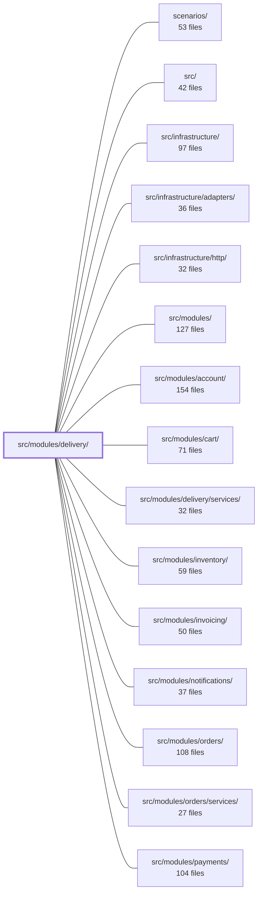

---
tags:
  - 2brain
  - 2brain/module
  - project/boilerplate-node-backend
type: module
module: src/modules/delivery/
files: 63
updated: 2026-10-29T19:24:23.470127+00:00
---

# src/modules/delivery/

## Purpose

The delivery module owns the "what leaves the shop and when" half of the order lifecycle. It takes a paid order's frozen lines, splits them into fulfillment orders (ordinary, bespoke, waiting-for-stock), cuts physical shipments from those, tracks parcels, and walks the order through processing → shipped → delivered. It also covers the edge cases that stretch that happy path: holds and releases, lost-in-transit recovery, preorder date slips, backorder sweeps, and reshipping under guarantee. Shipping-rate quoting and the public methods list live here too, so checkout and guest previews read from the same source.

## Key parts

- **Domain rules (`domain/`)** — Pure, I/O-free functions that encode the business logic: line-splitting into fulfillment orders (`fulfillment.ts`), hold-reason → buyer-safe notice translation (`hold-notice.ts`), lost-shipment line recovery and re-supply dates (`lost.ts`), preorder slip obligations (`preorder.ts`), shipping-rate evaluation and the static method table (`rates.ts`), reshipment distribution (`reship.ts`), and the single "still awaiting tracking?" check (`tracking.ts`). A barrel (`domain/index.ts`) re-exports everything for consumers that need rules without the HTTP surface.
- **Controllers (`controllers/`)** — One thin file per endpoint (GET / POST / PATCH). Each validates input, delegates to `deliveryService`, and shapes the HTTP response. A shared `dateImpactController` factory covers both release-date and restock-date previews.
- **Persistence & presentation** — `model.ts` defines the two Mongoose schemas (`FulfillmentOrder`, `Shipment`); `repository.ts` provides all read/write queries with revision guards; `presenter.ts` transforms stored documents into the wire shapes from `openapi.yaml`, computing derived fields and applying per-caller visibility.
- **Wiring & routing** — `module.ts` is the manifest that registers routes, jobs, config, webhook projections, and event subscriptions into the kernel. `routes.ts` (under `/delivery`) and `order-routes.ts` (under `/orders`) declare the Express route tables with their middleware chains. `index.ts` is the sole public import surface for sibling modules.
- **Cross-cutting concerns** — `pii.ts` (field-level address encryption), `emails.ts` (finalised localised email copy), `events.ts` (typed domain-event payloads), `audit.ts` (audit-action identifiers), `config.ts` (hold-note retention window), `jobs.ts` + `jobs.generated.ts` (scheduled hold/lost-note scrub and daily preorder sweep), `openapi.yaml` (the API contract).
- **Tests (`tests/`)** — Contract tests over real HTTP, integration tests for backorder/destination lifecycles, and factory helpers that drive the module through its own service "doors."

## How it connects

- **`src/modules/orders/` & `src/modules/orders/services/`** — Delivery operates on *paid* orders. The `POST /orders/:id/process` entry point and the "empty lists until paid" guards in the fulfilment-list controllers show that the orders module is the upstream trigger; delivery never creates or mutates order state directly beyond the status transitions it owns (processing → shipped → delivered).
- **`src/modules/inventory/`** — `domain/fulfillment.ts` decides which lines ship now vs. go `on_hold` based on shelf availability; the backorder integration test references stock arrival releasing a hold. Inventory commits and reservations are the data that the domain rules read.
- **`src/modules/notifications/`** — Listed as a consumer of delivery's `DomainEventMap` (see `events.ts`). Holds, preorder slips, and lost-shipment notices flow into the notifications module via those typed events.
- **`src/modules/products/`** — The date-impact preview controllers reference product release/restock dates, and `domain/preorder.ts` reads product state (P5). Product data is an input to delivery's scheduling decisions.
- **`src/modules/cart/` / `src/modules/payments/`** — Checkout consumes `domain/rates.ts` for shipping quotes; the public `GET /delivery/methods` endpoint serves the same table. Payment status gates delivery reads.
- **`src/modules/returns/`** — `domain/reship.ts` encodes the replacement-under-guarantee logic, which is the delivery-side counterpart to a return.
- **`src/modules/account/`** — The presenter applies an "account-export" visibility mode, and `module.ts` registers personal-data export sections for delivery records.
- **`src/modules/tickets/`** — Cited in `events.ts` as a consumer of delivery domain events.
- **`src/modules/delivery/services/`** — The service layer that every controller delegates to; it sits between the HTTP handlers and the repository/domain and owns transactional outbox writes.
- **`src/infrastructure/` (adapters, http)** — Provides the Express runtime, mailer, i18n translator, and database connection that the module's wiring (`module.ts`) plugs into at boot.

## Where to start

1. **`module.ts`** — the single wiring point that shows what the module registers (routes, jobs, events, webhooks, config). Reading it first gives you the map of every subsystem before you dive into any one of them.
2. **`domain/fulfillment.ts`** — the core business rule: how a paid order's lines become fulfillment orders and what status each gets. Everything downstream (shipments, holds, preorders) hangs off this split, and because it is pure, you can read it without setting up a database or HTTP server.

## Connected modules

[[boilerplate-node-backend_ROOT|/ (repository root)]] · [[boilerplate-node-backend_scenarios|scenarios/]] · [[boilerplate-node-backend_src|src/]] · [[boilerplate-node-backend_src_infrastructure|src/infrastructure/]] · [[boilerplate-node-backend_src_infrastructure_adapters|src/infrastructure/adapters/]] · [[boilerplate-node-backend_src_infrastructure_http|src/infrastructure/http/]] · [[boilerplate-node-backend_src_modules|src/modules/]] · [[boilerplate-node-backend_src_modules_account|src/modules/account/]] · [[boilerplate-node-backend_src_modules_cart|src/modules/cart/]] · [[boilerplate-node-backend_src_modules_delivery_services|src/modules/delivery/services/]] · [[boilerplate-node-backend_src_modules_inventory|src/modules/inventory/]] · [[boilerplate-node-backend_src_modules_invoicing|src/modules/invoicing/]] · [[boilerplate-node-backend_src_modules_notifications|src/modules/notifications/]] · [[boilerplate-node-backend_src_modules_orders|src/modules/orders/]] · [[boilerplate-node-backend_src_modules_orders_services|src/modules/orders/services/]] · … and 5 more

## Files
- `src/modules/delivery/audit.ts` — Declares the set of audit-action identifiers that the delivery module emits and registers them into the shared `AuditActionMap` via TypeScript module augmentation. It exists so that every delivery service file can reference a typed, exhaustive set of action names without a central enum, while still participating in one global map.
- `src/modules/delivery/config.ts` — Defines the single tunable setting for the `delivery` module — the retention window (in days) for a hold note attached to a fulfillment order. Exists so the value is centralised, validated, and readable on every call (rather than captured once at import time), enabling tests to vary it per case.
- `src/modules/delivery/controllers/get-date-impact.ts` — Implements two read-only staff preview endpoints that show the fulfillment-order impact of moving a product's release or restock date. A single generic factory (`dateImpactController`) is parameterised per field so both handlers share identical validation and delegation logic.
- `src/modules/delivery/controllers/get-fulfillment-order.ts` — Express route handler for `GET /delivery/fulfillment-orders/:id`. Extracts the order ID, delegates to the delivery service, and returns a single `FulfillmentOrder` to the authenticated buyer or to staff who can view all orders.
- `src/modules/delivery/controllers/get-order-fulfillment-lists.ts` — Provides two Express controller handlers for the order shipping panel: listing an order's fulfillment orders (the fulfillment plan) and the shipments cut from them (what has shipped). Both are unpaged by design—a single order carries only a handful of each. The endpoints return empty lists until the order is paid.
- `src/modules/delivery/controllers/get-preorder-fulfillment-orders.ts` — Defines the two read-only HTTP handlers for the preorder board: a paginated list of fulfillment orders and a per-product unit-count summary. Both are thin wrappers that delegate to `deliveryService` after validating and parsing query parameters.
- `src/modules/delivery/controllers/get-shipment.ts` — Route handler for `GET /delivery/shipments/:id`. Extracts the shipment ID from the request, delegates the lookup to the delivery service, and shapes the HTTP response (success, 404, 403, or error). Exists so the delivery module can expose a single-shipment endpoint for staff correction workflows.
- `src/modules/delivery/controllers/get-shipping-methods.ts` — Handler for the public `GET /delivery/methods` endpoint. It returns the shop's full list of available shipping methods (flat rates, free-above thresholds, etc.) so a guest can see shipping costs before signing up or checking out.
- `src/modules/delivery/controllers/patch-shipment.ts` — HTTP controller for `PATCH /delivery/shipments/:id`. It lets staff correct a shipment's tracking code by validating the ID and request body, delegating to the delivery service, and returning the updated shipment or an appropriate error.
- `src/modules/delivery/controllers/post-deliver-shipment.ts` — Thin HTTP controller for `POST /delivery/shipments/:id/deliver`. Staff uses this endpoint to record that a shipment has arrived; when it is the last outstanding shipment on an order, the underlying service transitions the order from `shipped` to `delivered`. All business logic is delegated to `deliveryService.deliverShipment`—this file only wires the HTTP layer to the service.
- `src/modules/delivery/controllers/post-fulfill-fulfillment-order.ts` — Handles `POST /delivery/fulfillment-orders/:id/fulfill`. A staff user marks a digital fulfillment order (a shipment with no physical parcel) as fulfilled, which creates a new `Shipment` record. The controller extracts the order ID, delegates to the delivery service, and returns the created shipment with a `201` response.
- `src/modules/delivery/controllers/post-hold-fulfillment-order.ts` — Express route handlers for the two staff-facing endpoints that pause (`hold`) or resume (`release`) a fulfillment order by ID. They validate the request, delegate to the delivery service, and shape the HTTP response.
- `src/modules/delivery/controllers/post-mark-shipment-lost.ts` — Controller handler for `POST /delivery/shipments/:id/lost`. It validates the request (path ID, JSON body) and delegates to the delivery service so staff can mark a shipment as lost or damaged in transit.
- `src/modules/delivery/controllers/post-process-order.ts` — HTTP handler for `POST /orders/:id/process`. It is the single endpoint that transitions a paid order into the `processing` state (staff confirming fulfilment has started), called before any parcel record exists.
- `src/modules/delivery/controllers/post-ship-fulfillment-order.ts` — HTTP controller handler for `POST /delivery/fulfillment-orders/:id/shipments`. It validates the incoming request (path ID, body schema) and delegates the business logic of cutting a shipment from a fulfillment order to the delivery service layer, then maps the result to a `201 Created` response.
- `src/modules/delivery/domain/fulfillment.ts` — Pure domain rules that turn a paid order's frozen lines into fulfillment orders: how lines are split (ordinary vs. bespoke vs. waiting), what remains on each line, and what status follows from the lines' state. Keeping this logic free of I/O makes every branch testable without a database.
- `src/modules/delivery/domain/hold-notice.ts` — Pure domain logic that translates an internal fulfillment-hold reason into a buyer-safe notice and decides whether that hold warrants a buyer notification (email + inbox row). It exists to enforce a security boundary: staff-side reasons (especially risk screening) must never leak through the buyer-facing message, while still giving the buyer actionable information when one applies (e.g. fixing an address).
- `src/modules/delivery/domain/index.ts` — Barrel (re-export) file for the delivery **domain** layer. It aggregates every public symbol from the individual domain submodules into a single import path, so consumers can pull fulfillment rules, shipping-rate logic, lost-shipment math, preorder scheduling, and related types without reaching into each file. The doc comment makes explicit that this layer is pure rules, importable without the module's HTTP surface (presenter, repository, services).
- `src/modules/delivery/domain/lost.ts` — Pure domain logic for the lost-in-transit lifecycle of a shipment: it computes how a fulfillment order's lines change when a shipment is reported lost, determines whether (and what) can be restored when the same parcel is later found, and derives the promised date for units that must be re-supplied. All functions are side-effect-free so every case is testable without a database.
- `src/modules/delivery/domain/preorder.ts` — Pure domain rules (PRODUCT_STATES P5) for what a slipped preorder date owes the buyer. All functions are side-effect-free and take the clock as an argument, so every branch is testable in isolation. The module encodes the "shop tells, person decides" policy: it never cancels on the buyer's behalf and never asks the buyer anything.
- `src/modules/delivery/domain/rates.ts` — Pure, stateless shipping-rate logic and the static method table that defines what the shop offers. Kept in `domain/` (alongside `evaluateCheckout`) so every part of the system derives a shipping quote from exactly one source. `GET /delivery/methods` serves this table verbatim.
- `src/modules/delivery/domain/reship.ts` — Pure domain logic for reshipping (replacement under legal guarantee): determines which physical fulfillment orders must be reopened to cover the units being sent again, and how the "owed" portion (what the shelf could not cover) is distributed back to those orders. Exists as a dependency-free module so every case is unit-testable without a database.
- `src/modules/delivery/domain/tracking.ts` — Defines the single domain rule that answers "is this shipment still waiting for the carrier's tracking code?" It is the authoritative source for the `Shipment.awaitingTracking` flag and the staff digest's "tracked, still without a code" row, keeping that determination in one place rather than duplicating the logic across services.
- `src/modules/delivery/emails.ts` — Resolves the copy for all delivery-related buyer emails into finished, fully-localized strings. Each exported function takes a locale and structured input, calls the i18n translator, and returns an `EmailContent` object ready for the mailer to send. Nothing is left to be resolved at render time — the language is an argument, the output is final text.
- `src/modules/delivery/events.ts` — Defines the delivery module's domain event payloads by augmenting the kernel's `DomainEventMap` (via `declare module '@kernel/events'`). Each event is written transactionally in the outbox at the moment the causing act occurs. The file exists so that every consumer—this module's services, the `notifications` module, `tickets`, and the public webhook catalogue—shares one typed contract for what each event carries.
- `src/modules/delivery/index.ts` — Public barrel for the delivery module. Per the strategic DDD rule (see `docs/theory/strategic-ddd.md` §5), this is the **only** surface a sibling module may import from. It re-exports the module's public API while keeping the two repositories and the models' runtime internals private — no write handle on a collection leaks through here.
- `src/modules/delivery/jobs.generated.ts` — Auto-generated data file that declares delivery scheduled-job metadata (name, cron schedule, human-readable summary) as a typed constant. It exists so that job definitions live in a single YAML source (`module.yaml`) and are emitted here by `npm run regenerate`, keeping the data separate from the execution logic that lives in `jobs.ts`.
- `src/modules/delivery/jobs.ts` — Declares the two scheduled jobs owned by the `delivery` module—the hold/lost-note scrub and the daily preorder sweep—as a single `JobDeclaration[]` array consumed by the module registration system.
- `src/modules/delivery/model.ts` — Defines the two Mongoose document models for the delivery module — `FulfillmentOrder` (a group of order lines that should leave together) and `Shipment` (what actually left, with one tracking code) — including their schemas, TypeScript interfaces, indexes, and serialization transforms. Both records are keyed by `{ orderId, number }` for idempotency.
- `src/modules/delivery/module.ts` — Module manifest and wiring point for the **delivery** module (shipping rates, fulfillment orders, shipments). It registers routes, background jobs, config, public webhook projections, personal-data export sections, and domain-event subscriptions into the kernel's `AppModule` contract so the host can boot the module without knowing its internals.
- `src/modules/delivery/openapi.yaml` — OpenAPI 3.1.0 contract for the delivery module. It defines the API surface for fulfillment orders, shipments, and shipping methods, plus the module's custom error codes and its contribution to the account data export. The spec is the single source of truth for what the delivery endpoints accept, return, and how they fail.
- `src/modules/delivery/order-routes.ts` — Defines the Express router for delivery operations mounted under `/orders`. It wires three routes—order processing and the two fulfilment-list lookups—to their respective controllers, applying the shared auth/permission middleware chain to each. It exists to keep route declarations, middleware ordering, and permission keys in one place so `module.ts` can mount them as a unit.
- `src/modules/delivery/pii.ts` — Field-level encryption/decryption of the destination address stored on a shipment record. It is the delivery-side twin of the order's PII module, using the same `NODE_PII_ENCRYPTION_KEY` ring. Each address field is encrypted with an AAD that binds it to the specific shipment's `_id`, so a ciphertext cannot be transplanted to another shipment without failing the auth tag.
- `src/modules/delivery/presenter.ts` — Single-point presentation layer that transforms stored delivery domain documents (`FulfillmentOrderDocument`, `ShipmentDocument`) into the wire shapes declared by `openapi.yaml`. Rather than serializing the stored form, it computes derived fields (`remaining`, `boardStateOf`, `isLate`, `slippedDays`), decrypts PII, and applies per-caller visibility rules (buyer vs. staff, API vs. account-export) so that no client performs business-logic counting or access decisions.
- `src/modules/delivery/repository.ts` — The persistence layer for the delivery module. It wires the two Mongoose collections (fulfillment orders, shipments) to the rest of the module and defines the conditional, revision-guarded writes through which every delivery act mutates state. It also builds the Mongo query filters behind the preorder board's reads and product summaries.
- `src/modules/delivery/routes.ts` — Defines the Express route table for the delivery module. Each route wires a controller to the appropriate chain of authorization, idempotency, and cache-control middleware, encoding the access policy per endpoint (public, customer-scoped, staff-only).
- `src/modules/delivery/tests/contract/api.contract.test.ts` — Contract tests that exercise every `/delivery` route (and related order routes) over real HTTP, with responses automatically validated against the shared spec via `@tests/contract`. They pin that each authorization branch (public, owner, staff) and each status transition is reachable and shaped correctly at the wire level, complementing the unit and integration suites that test internal logic.
- `src/modules/delivery/tests/factories.ts` — Test factory helpers for the delivery module that advance an order through shipping and delivery **via the module's own service methods** (the "doors"), so fulfillment orders, shipments, status transitions, and inventory all stay consistent. A smaller set of helpers writes directly to the model for time-dependent states that no service call can produce. Also provides one-shot setup for paid preorder and backorder orders with inventory reserved and committed.
- `src/modules/delivery/tests/integration/backorder.test.ts` — Integration test covering the **paid backorder** lifecycle through the delivery module: the grouping rule (shelf ships immediately, owed part goes `on_hold`), the daily sweep that notifies buyers at their promised date, stock arrival releasing the hold, and restock-date changes triggering (or suppressing) buyer notifications. Uses a real database and real outbox; only the mailer is mocked.
- `src/modules/delivery/tests/integration/destination.test.ts` — Integration tests (against a real Mongo via `setupTestDb`) that verify the full lifecycle of a shipment's `destination` field: it is copied from the order's shipping address at the moment of the cut, stored encrypted, survives later address corrections, appears in the account export, is scrubbed when the order's address is scrubbed, and is re-encrypted on PII key rotation.
- `src/modules/delivery/tests/integration/lost-parcel.test.ts` — Integration test for the "parcel lost in transit" workflow. It verifies the full lifecycle—reporting a shipment lost, reopening its units on the same fulfillment order, topping up the stock hold, stepping the order back to `processing`, reshipping, and delivering the replacement—against a real MongoDB with the mailer mocked at its queue boundary.
- `src/modules/delivery/tests/integration/order-status-races.test.ts` — Integration test that verifies two concurrent HTTP status-change requests on the same order cannot both succeed. It exercises the delivery "ship door" under real contention (N-way ship-vs-ship, ship-vs-cancel) over live HTTP against a real database, asserting exactly-one-winner semantics, no duplicate emails, and no half-written state.
- `src/modules/delivery/tests/integration/override-sync.test.ts` — Integration tests for the delivery module's reaction to an admin status override that moves an order *forward* (to `shipped` or `delivered`). They verify that the override's event causes the delivery module to close out all remaining fulfillment lines as a single **forced** shipment at the override's own timestamp, without emitting any public `shipment.*` domain event or sending a customer email.
- `src/modules/delivery/tests/integration/preorder-board.test.ts` — Integration test suite that verifies the preorder board's read paths against fulfillment orders in every lifecycle state. It asserts that the Mongo query conditions used by `listPreorderFulfillmentOrders` and the `boardStateOf` helper agree on which rows belong to which state, validates the Late view and due-soon warning, checks that the product summary arithmetic is consistent, and enforces row-level visibility (buyer vs. admin vs. anonymous).
- `src/modules/delivery/tests/integration/preorder-late.test.ts` — Integration test for the "preorder date slips" scenario (PRODUCT_STATES P5): an admin moves a paid preorder's release date and the delivery module notifies the buyer. Verifies that the shop only informs—never asks, cancels, or requires buyer action—and that the notice, the fulfillment-order state mutation, and the emitted event land atomically, with email following via the outbox. Uses real Mongo and the real outbox; the mailer is mocked at its queue boundary.
- `src/modules/delivery/tests/integration/preorder.test.ts` — Integration test that verifies the paid-preorder flow across the delivery ↔ inventory seam: a preorder line is held (`on_hold` / `awaiting_stock`) until stock is received, the release date is read from the order's frozen snapshot (never the live catalogue), and incoming stock either releases the whole fulfillment order or splits it into an open partial plus a still-held remainder.
- `src/modules/delivery/tests/integration/release-date-impact.test.ts` — Integration test that verifies the delivery module's `previewDateImpact` contract: the number of distinct orders the preview reports as "to be notified" must equal the number of `fulfillment_order.delayed` outbox events actually written after the same date change is persisted. It runs against a real MongoDB instance and a real outbox, with only the mailer adapter mocked at the `enqueueEmail` boundary.
- `src/modules/delivery/tests/integration/retention.test.ts` — Integration test suite for the `reap:delivery` retention task (`scrubHoldNotes`). It verifies against a real database that hold notes older than the configured retention window are unset while all other fields on the fulfillment order remain untouched, and that the operation is idempotent.
- `src/modules/delivery/tests/integration/service.test.ts` — Integration tests for the delivery service covering three areas: shipping-rate pricing rules, fulfillment-order lifecycle (creation on the `paid` event, idempotency, guard conditions), and the ship operation (writing the shipment, advancing order status, sending the tracking email). Runs against a real Mongo instance via `setupTestDb`; only the mailer is mocked.
- `src/modules/delivery/tests/integration/ship-actions-parity.test.ts` — Integration test that asserts the `actions.ship` boolean exposed on the fulfillment-order view (the "door sign") always matches whether the `POST /delivery/fulfillment-orders/:id/shipments` endpoint (the "door itself") actually accepts the request. It sweeps every supported staff role against every order status and collects disagreements, failing if any role × status combination disagrees.
- `src/modules/delivery/tests/integration/timeline.test.ts` — Integration test that verifies what timeline (audit-log) rows each delivery action writes onto an order. It exercises `deliveryService` through its public API against real MongoDB and asserts row types, actor attribution, data payloads (ids, tracking codes, reason codes), and—critically—that a hold's free-text note is never persisted.
- `src/modules/delivery/tests/unit/emails.test.ts` — Unit tests for the four customer-facing delivery email builders. Each test verifies that the actionable fields a customer relies on (tracking code, withdrawal deadline, owed items) render correctly, that i18n keys are fully resolved (never leaked as raw `delivery.*` strings), and that locale-specific copy differs between `en` and `it`.
- `src/modules/delivery/tests/unit/fulfillment.test.ts` — Unit tests for the pure fulfillment domain rules: how an order's lines are grouped into fulfillment orders, how remaining quantities are computed, what status derives from a set of lines and a hold flag, and which lines a shipment may carry. It exists to lock down the grouping, remainder, status, and shipping-validation logic without any I/O.
- `src/modules/delivery/tests/unit/hold-notice.test.ts` — Unit tests for the buyer-facing hold-notice logic in the delivery module. They lock in two contracts: how an internal hold reason maps to a public notice string, and whether a given reason/message combination triggers a buyer mail.
- `src/modules/delivery/tests/unit/lost.test.ts` — Unit tests for the pure domain arithmetic that models a lost parcel: how a loss rewrites the origin fulfillment order's lines, when the parcel may be restored (all-or-nothing), what the restoration puts back, and how the owed-units promise date is computed. The file exists to pin down the invariants of these transformations without involving services, I/O, or mocking.
- `src/modules/delivery/tests/unit/money-reconciliation.property.test.ts` — Property-based test proving that the **composition** of `orders.orderTotal` and `delivery.priceShipping` preserves cent-level arithmetic — the same composition that cart checkout, payment-intent freeze, and the confirmation email each perform independently. It fills the gap left by `totals.property.test.ts` and `money.property.test.ts`, which verify each module in isolation but not their combined use.
- `src/modules/delivery/tests/unit/preorder.test.ts` — Unit tests for the pure preorder-slip functions defined in the delivery domain. Verifies the decision logic the shop uses to tell a buyer about a moved or cleared delivery date, to compute the effective expected date across order lines, and to determine when the daily sweep should fire a due-notice. All cases run against a fixed reference clock so results are deterministic.
- `src/modules/delivery/tests/unit/rates.property.test.ts` — Property-based tests (via `fast-check`) for the shipping-rate domain module. Where `rates.test.ts` pins three fixed points around the free-shipping threshold, this file checks invariants across _all_ valid item totals, using a fixed seed so any counterexample is reproducible and can be promoted back to a concrete example in the fixed-point suite.
- `src/modules/delivery/tests/unit/rates.test.ts` — Unit tests for the shipping-rates domain module. Every case exercises pure functions over the committed `SHIPPING_METHODS` table — no mocks, no database. The file exists separately from the integration test (`tests/integration/service.test.ts`) because the pricing rules themselves have no I/O dependency and can be verified in isolation.
- `src/modules/delivery/tests/unit/reship.test.ts` — Unit tests for the pure reshipment planning logic in the delivery domain. Verifies that `planReopening` selects the correct fulfillment orders (latest first) and their shipped units, that `shareOwed` distributes owed units without exceeding what each order reopened, and that `withLoss` rewrites lines after units are taken back.
- `src/modules/delivery/tests/unit/routes.test.ts` — Unit test suite that pins down the delivery module's route table: the exact set and order of endpoints, and the per-route security guards (authentication and permission checks). It exists to catch the most likely drift — a new route added without a guard — via a final "sweep" assertion that only `GET /methods` remains unauthenticated.
- `src/modules/delivery/tests/unit/schema-contract.test.ts` — Unit tests that pin down the declarative contract of the two delivery Mongoose schemas — `fulfillmentOrderSchema` and `shipmentSchema`. They assert required paths, unique indexes, ObjectId references, allowed enum values, defaults, and timestamp options so that any schema drift is caught at test time rather than at runtime.
- `src/modules/delivery/tests/unit/tracking.test.ts` — Unit tests for the `isAwaitingTracking` domain rule: a physical parcel that is still in `shipped` status, fulfilled via a tracked method, but has no tracking code yet. The file exists to lock in both the single positive case and the six documented negative cases.

---
[[boilerplate-node-backend_INDEX|← boilerplate-node-backend index]]
