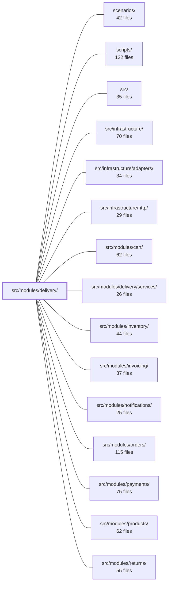

---
tags:
  - 2brain
  - 2brain/module
  - project/boilerplate-node-backend
type: module
module: src/modules/delivery/
files: 43
updated: 2026-10-15T13:38:20.756269+00:00
---

# src/modules/delivery/

## Purpose

The delivery module owns the post-payment shipping lifecycle: pricing shipments, splitting a paid order into fulfillment orders, cutting and tracking individual shipments, handling preorder late-slip notifications, and transitioning an order through `processing → shipped → delivered`. It also exposes the public shipping-method catalogue, the staff preorder board, and hold/release controls.

## Key parts

- **Domain rules** (`domain/`) — Pure, side-effect-free functions for the three core rule sets: `rates.ts` (static shipping-rate table, pricing, method selection), `fulfillment.ts` (line-splitting into fulfillment orders, remaining-quantity math, status derivation), and `preorder.ts` (slip-decision logic: notify / ask / cancel). `domain/index.ts` is the barrel that re-exports all three.
- **Persistence** — `model.ts` defines the two Mongoose schemas (FulfillmentOrder, Shipment); `repository.ts` wraps those collections in a typed repository with conditional reads and optimistic-concurrency writes.
- **HTTP surface** — `routes.ts` builds the Express router and attaches auth guards (public → buyer-scoped → staff, with optional step-up re-auth). `controllers/` holds one handler per endpoint (GET order fulfilment, POST start/ship/deliver/hold/release/fulfill, PATCH tracking, GET methods, preorder-board reads, confirm-wait).
- **Module manifest** — `module.ts` is the single `AppModule` entry that declares routes, domain events, event subscriptions, personal-data export sections, locales, and config. `index.ts` is the only public import surface for sibling modules.
- **Cross-cutting** — `events.ts` registers delivery domain-event names into the app-wide `DomainEventMap`; `audit.ts` registers audit-action identifiers; `emails.ts` builds locale-resolved email content for shipped / delivered / preorder-delayed notifications; `presenter.ts` maps stored documents to the wire shapes declared in `openapi.yaml`; `config.ts` centralises the hold-note retention window.
- **Contract & tests** — `openapi.yaml` is the OpenAPI 3.1 spec for every endpoint. The `tests/` tree spans unit tests for each domain rule, integration tests for the full service→DB→outbox stack (preorder, retention, timeline, override-sync), and contract tests that validate real HTTP responses against the spec.

## How it connects

- **`src/modules/orders/`** — Delivery reads the paid order's lines at fulfilment time and writes back order-level status (`shipped`, `delivered`) plus the fulfillment summary. The `orders` module is the parent document; delivery records are children.
- **`src/modules/inventory/`** — Stock-arrival events from inventory release the `on_hold / awaiting_stock` state on fulfillment orders (verified in `preorder.test.ts` integration tests).
- **`src/modules/payments/`** — Delivery is gated on a completed payment; `post-start-order` transitions a *paid* order into `processing`.
- **`src/modules/notifications/`** — The mailer adapter (via `src/infrastructure/adapters/`) delivers the email content built in `emails.ts` for shipped, delivered, and preorder-delayed notifications.
- **`src/modules/products/`** — Preorder release dates are read from product data (the frozen date on the order, not the live catalogue).
- **`src/modules/delivery/services/`** — The service layer that every controller delegates to; it orchestrates domain rules, repository calls, event emission, and email dispatch.
- **`src/infrastructure/http/`** — Provides the Express app, middleware, and response helpers that `routes.ts` and the controllers consume.
- **`src/modules/users/`** — Personal-data export sections registered in `module.ts` contribute delivery fields to a user's data-export bundle.

## Where to start

1. **`module.ts`** — The one-file manifest that shows every route, event, subscription, and export section the module exposes. Reading it gives the full shape of the module's public surface in about a minute.
2. **`domain/fulfillment.ts`** — The core business rules (line splitting, status derivation, remaining-quantity math) in pure, dependency-free TypeScript. Understanding these rules before touching controllers or the repository makes the rest of the module much easier to follow.

## Connected modules

[[boilerplate-node-backend_ROOT|/ (repository root)]] · [[boilerplate-node-backend_scenarios|scenarios/]] · [[boilerplate-node-backend_scripts|scripts/]] · [[boilerplate-node-backend_src|src/]] · [[boilerplate-node-backend_src_infrastructure|src/infrastructure/]] · [[boilerplate-node-backend_src_infrastructure_adapters|src/infrastructure/adapters/]] · [[boilerplate-node-backend_src_infrastructure_http|src/infrastructure/http/]] · [[boilerplate-node-backend_src_modules_cart|src/modules/cart/]] · [[boilerplate-node-backend_src_modules_delivery_services|src/modules/delivery/services/]] · [[boilerplate-node-backend_src_modules_inventory|src/modules/inventory/]] · [[boilerplate-node-backend_src_modules_invoicing|src/modules/invoicing/]] · [[boilerplate-node-backend_src_modules_notifications|src/modules/notifications/]] · [[boilerplate-node-backend_src_modules_orders|src/modules/orders/]] · [[boilerplate-node-backend_src_modules_payments|src/modules/payments/]] · [[boilerplate-node-backend_src_modules_products|src/modules/products/]] · … and 3 more

## Files
- `src/modules/delivery/audit.ts` — Declares the audit action identifiers for the delivery domain and registers them into the shared `AuditActionMap` type, so that delivery service code can emit type-safe audit events without a runtime enum.
- `src/modules/delivery/config.ts` — Defines the single tunable setting for the `delivery` module — the retention window (in days) for a hold note attached to a fulfillment order. Exists so the value is centralised, validated, and readable on every call (rather than captured once at import time), enabling tests to vary it per case.
- `src/modules/delivery/controllers/get-order-fulfillment.ts` — HTTP controller for `GET /delivery/order/:orderId`. Returns the fulfillment orders and their shipments for a given order. Consumed by the order page's shipping panel after the order has been paid; before payment both lists are empty.
- `src/modules/delivery/controllers/get-preorder-fulfillment-orders.ts` — Defines the two read controllers for the preorder board: a paginated list of fulfillment orders and a per-product unit-count summary. It wires query-string validation to the corresponding service calls so that `GET /delivery/fulfillment-orders` and `GET /delivery/fulfillment-orders/summary` can be registered on the delivery router.
- `src/modules/delivery/controllers/get-shipping-methods.ts` — Handler for the public `GET /delivery/methods` endpoint. It returns the shop's full list of available shipping methods (flat rates, free-above thresholds, etc.) so a guest can see shipping costs before signing up or checking out.
- `src/modules/delivery/controllers/patch-shipment.ts` — HTTP controller for `PATCH /delivery/shipments/:id`. It lets staff correct a shipment's tracking code by validating the ID and request body, delegating to the delivery service, and returning the updated shipment or an appropriate error.
- `src/modules/delivery/controllers/post-confirm-wait.ts` — Express controller handler for `POST /delivery/fulfillment-orders/:id/confirm-wait`. It lets a buyer acknowledge a late preorder and explicitly choose to keep waiting, delegating the actual state change to the delivery service.
- `src/modules/delivery/controllers/post-deliver-shipment.ts` — Route handler for `POST /delivery/shipments/:id/deliver`. Accepts a staff's delivery confirmation for a shipment, validates the input, and delegates to the delivery service to record the arrival — which, when it is the final shipment, transitions the order from `shipped` to `delivered`.
- `src/modules/delivery/controllers/post-fulfill-fulfillment-order.ts` — Controller handler for `POST /delivery/fulfillment-orders/:id/fulfill`. It validates the order ID, delegates to the delivery service to fulfill a digital fulfillment order (a shipment with no parcel, "born delivered"), and writes the resulting `Shipment` to the HTTP response.
- `src/modules/delivery/controllers/post-hold-fulfillment-order.ts` — Express route handlers for the two staff-facing endpoints that pause (`hold`) or resume (`release`) a fulfillment order by ID. They validate the request, delegate to the delivery service, and shape the HTTP response.
- `src/modules/delivery/controllers/post-ship-fulfillment-order.ts` — Express route handler for `POST /delivery/fulfillment-orders/:id/shipments`. Validates the incoming request (id presence, body schema), delegates the "cut a shipment" operation to the delivery service, and maps the result to an appropriate HTTP response (201 with the created `Shipment`, or a rejection/error status).
- `src/modules/delivery/controllers/post-start-order.ts` — Controller handler for `POST /delivery/order/:orderId/start`. It is the single endpoint that transitions a paid delivery order into the `processing` state (fulfilment start), called by staff before any parcel is yet recorded.
- `src/modules/delivery/domain/fulfillment.ts` — Pure domain rules for fulfillment: how an order's lines split into fulfillment orders at payment time, what quantity remains on each line, which status follows from the lines and any hold, and the summary the parent `orders` document carries. Every function is side-effect-free so the whole rule set is testable without a database.
- `src/modules/delivery/domain/index.ts` — Barrel (re-export) file for the delivery domain layer. It aggregates the public API of the three pure-rule submodules—`rates`, `fulfillment`, and `preorder`—so that consumers can import all domain logic without touching the module's HTTP surface. It exists to give a single, stable import path for the rules while keeping each rule file independently testable.
- `src/modules/delivery/domain/preorder.ts` — Pure domain rules for preorders whose delivery date slips. Given the agreed date, the current expected date, and the slip count, it decides what the buyer must be told (notify, ask, or nothing) and when silence converts to a cancellation. All time is injected as an argument so every branch is unit-testable without waiting.
- `src/modules/delivery/domain/rates.ts` — Defines the static shipping-rate table and the pure functions that price, validate, and select methods. Lives in the `domain/` layer (like `evaluateCheckout`) so that every quote in the system is computed from exactly one source, and so the logic is testable without touching services or I/O.
- `src/modules/delivery/emails.ts` — Builds the finished-text email content for the three delivery notifications: shipment shipped, shipment delivered, and preorder delayed. Following the same convention as `@modules/account/emails`, the buyer's language is a parameter and every string is fully resolved before the mailer receives it — no template variables survive past this file.
- `src/modules/delivery/events.ts` — Defines the delivery module's domain event names, payload interfaces, and registers them into the kernel's app-wide `DomainEventMap` via TypeScript module augmentation. This file is the single source of truth for what the delivery module can emit, ensuring type-safe producers and consumers across the codebase.
- `src/modules/delivery/index.ts` — Public barrel for the delivery module. Per the strategic DDD rule (see `docs/theory/strategic-ddd.md` §5), this is the **only** surface a sibling module may import from. It re-exports the module's public API while keeping the two repositories and the models' runtime internals private — no write handle on a collection leaks through here.
- `src/modules/delivery/model.ts` — Defines the two Mongoose schemas and compiled models that persist the delivery module's core records — **FulfillmentOrder** (a group of an order's lines that should ship together) and **Shipment** (what actually left, with one tracking code). All shape, indexing, and serialization concerns for these two records live here; business rules and queries are deliberately kept out.
- `src/modules/delivery/module.ts` — Module entry point for **delivery** (shipping rates, fulfillment orders, shipments). Wires the module into the kernel by declaring its routes, public webhook events, event subscriptions, personal-data export sections, locales, and config. It is the single `AppModule` manifest that `kernel/registry.ts` and `src/modules.ts` consume.
- `src/modules/delivery/openapi.yaml` — OpenAPI 3.1.0 contract for the delivery module. It defines the REST endpoints for shipping-method catalogue, order fulfilment lifecycle (start, ship, deliver, hold, release), and the admin preorder board. It also declares the module's error-code vocabulary and the sections it contributes to the account data export, so that the module can be added or removed without touching the shared root spec.
- `src/modules/delivery/presenter.ts` — Pure transformation layer that turns stored delivery documents into the wire shapes declared in `openapi.yaml` (and account-export variants). It exists so that per-request decisions—caller `actions`, staff-only hold note visibility, computed `remaining` quantities—are applied at the edge rather than baked into the stored record.
- `src/modules/delivery/repository.ts` — The persistence layer for the delivery module. It wraps the two Mongoose collections (fulfillment orders and shipments) behind a typed repository object, exposing the conditional reads and optimistic-concurrency writes that every delivery "act" (fulfill, cut, hold, notice, board) drives through. Return types are written out explicitly to sidestep Mongoose generics that TypeScript cannot serialize at an export boundary (TS7056).
- `src/modules/delivery/routes.ts` — Defines the Express `Router` for the delivery module, mapping every delivery endpoint to its controller and attaching the correct authorization guard per route. Guards range from fully public (shipping-methods lookup) through buyer-scoped reads to staff-permission writes, with two routes that additionally require a step-up re-authentication when the `forced` override flag is present.
- `src/modules/delivery/tests/contract/api.contract.test.ts` — Contract tests for the `/delivery` API surface over real HTTP. Every response is automatically validated against the API spec via the `@tests/contract` side-effect import. The file pins that each contract branch (status codes, body shape, error codes, audience-specific fields) is actually reached over the wire, for three audiences: public (methods catalogue), the order owner (fulfilment read), and staff (all write operations).
- `src/modules/delivery/tests/factories.ts` — Test factories for the delivery module. They drive an order through the module's own service layer (`ensureFulfillmentOrders`, `shipFulfillmentOrder`, `deliverShipment`) so that the resulting database state — fulfillment orders, shipments, status transitions, and inventory — matches what a real staff action would produce. Used by integration and unit tests that need "a shipped order" or "a delivered order" without hand-rolling the records.
- `src/modules/delivery/tests/integration/override-sync.test.ts` — Integration tests for the delivery module's reaction to an admin status-override event. Verifies that forwarding an order to `shipped` or `delivered` causes all remaining fulfillment records to be closed at the override's own timestamp (the one `withdrawUntil` was counted from), marked `forced: true`, with **no** email sent and **no** public `shipment.*` domain event emitted. Also covers idempotent re-delivery of the same override event and confirms that a backward override (to `processing`) leaves fulfillment records untouched.
- `src/modules/delivery/tests/integration/preorder-board.test.ts` — Integration test for the preorder board's read queries. Verifies that every state filter (`waiting`, `awaiting_yes`, `allocated`, `shipped`, `cancelled`) returns exactly the rows whose own `state` field matches, that the Late view and due-soon warning surface the correct rows, that the product summary totals reconcile with what was paid, and that row visibility respects caller identity. It exists to keep the Mongo filter conditions and `boardStateOf` in lockstep.
- `src/modules/delivery/tests/integration/preorder-late.test.ts` — Integration test for the "release date slips" scenario (PRODUCT_STATES P5) on a paid preorder. It exercises the full lifecycle through real infrastructure: an admin moves the product's release date, the delivery module decides whether to merely notify or ask the buyer to confirm, the buyer answers, and the daily sweep handles a date that has already passed. Real Mongo and real outbox are used; only the mailer is mocked at the queue boundary.
- `src/modules/delivery/tests/integration/preorder.test.ts` — Integration tests for the paid-preorder delivery flow. They verify that the grouping rule reads the release date the order *frozen* (not the live catalogue), that fulfillment orders start `on_hold / awaiting_stock`, and that stock arriving through the outbox releases the hold — either in one shot or by splitting the order when the delivery is short. The tests use a real inventory service and a real outbox so the seam between the two modules is exercised end-to-end.
- `src/modules/delivery/tests/integration/retention.test.ts` — Integration test suite for the `reap:delivery` retention task (`scrubHoldNotes`). It verifies against a real database that hold notes older than the configured retention window are unset while all other fields on the fulfillment order remain untouched, and that the operation is idempotent.
- `src/modules/delivery/tests/integration/service.test.ts` — Integration test suite for the delivery module's service layer. It exercises the full stack — real MongoDB, real domain logic, real event/outbox flow — with only the mailer adapter mocked. It pins the invariants the module's doc comment calls out: free-above pricing, idempotent fulfillment-order creation, atomic ship-and-move, partial-shipping state, withdrawal-clock timing, holds, digital fulfilment, forced shipments, and cancel.
- `src/modules/delivery/tests/integration/timeline.test.ts` — Integration tests that assert exactly which rows are written to an order's timeline (and with what `data`) when delivery services execute ship, deliver, fulfill, hold/release, and cancel acts. Runs against a real MongoDB instance via `setupTestDb`, exercising the services' public API rather than internal helpers. The central contract under test: the timeline records ids, codes, and reason codes — never free-text notes — and order-level status rows appear only when the last unit is affected.
- `src/modules/delivery/tests/unit/emails.test.ts` — Unit tests for the two shipment email builders (`shipmentShippedEmail`, `shipmentDeliveredEmail`). They verify that the customer-facing fields a recipient must act on—tracking code, line items, remaining-units notice, withdrawal deadline—are populated correctly, are locale-aware, and never leak unresolved i18n keys or template placeholders.
- `src/modules/delivery/tests/unit/export-shipment-contract.test.ts`
- `src/modules/delivery/tests/unit/fulfillment.test.ts` — Unit tests for the pure fulfillment domain rules: how an order's lines are split into fulfillment orders (grouping), how remaining quantities are computed, what status follows from a line set and hold state, which lines a shipment may carry, how the summary is assembled for the `orders` module, and which action predicates (`isShippable`, `isHoldable`, etc.) a fulfillment order exposes.
- `src/modules/delivery/tests/unit/preorder.test.ts` — Unit tests for the pure preorder-slip decision functions defined in `domain/preorder.ts`. Each test case pins a "fixed clock" (agreed date 2026-12-01, "now" 2026-12-20) and asserts which action the system should take—`notify`, `ask`, `earlier`, re-notice, or wait-expiry—for a given delivery-slip scenario.
- `src/modules/delivery/tests/unit/rates.property.test.ts` — Property-based tests (via `fast-check`) for the shipping-rate domain module. Where `rates.test.ts` pins three fixed points around the free-shipping threshold, this file checks invariants across _all_ valid item totals, using a fixed seed so any counterexample is reproducible and can be promoted back to a concrete example in the fixed-point suite.
- `src/modules/delivery/tests/unit/rates.test.ts` — Unit tests for the pure shipping-rate domain functions in `../../domain/rates`. They verify the static `SHIPPING_METHODS` table and the three pricing/lookup helpers without any database or mocking, since the pricing rule is deterministic over committed data. The file's header explicitly contrasts this with `tests/integration/service.test.ts`, which exists because shipment *persistence* needs a real DB.
- `src/modules/delivery/tests/unit/return-address.test.ts` — Unit tests for `cheapestStandardShipping`, verifying the flat-rate and free-threshold behavior of standard delivery costs. The file name is a historical leftover: the original return-address tests were moved to the `orders` module, leaving only these rate tests behind under the old name.
- `src/modules/delivery/tests/unit/routes.test.ts` — Unit tests for the delivery route table. Verifies that all mounted endpoints appear in the expected order, that each route carries the correct auth guard (none, `isAuth`, or `requirePermissionGuard`), and that no route ships unauthenticated except `GET /methods`. The "sweep" test at the bottom is the safety net that catches a newly added route with no guard.
- `src/modules/delivery/tests/unit/schema-contract.test.ts` — Unit tests that pin the Mongoose schema contracts for `fulfillmentOrderSchema` and `shipmentSchema`. They verify that required fields, unique compound indexes, ObjectId references, enum boundaries, and defaults match the intended data model so that the database — not application logic — enforces invariants like "one fulfillment order per number per order" and "one shipment per number per order."

---
[[boilerplate-node-backend_INDEX|← boilerplate-node-backend index]]
