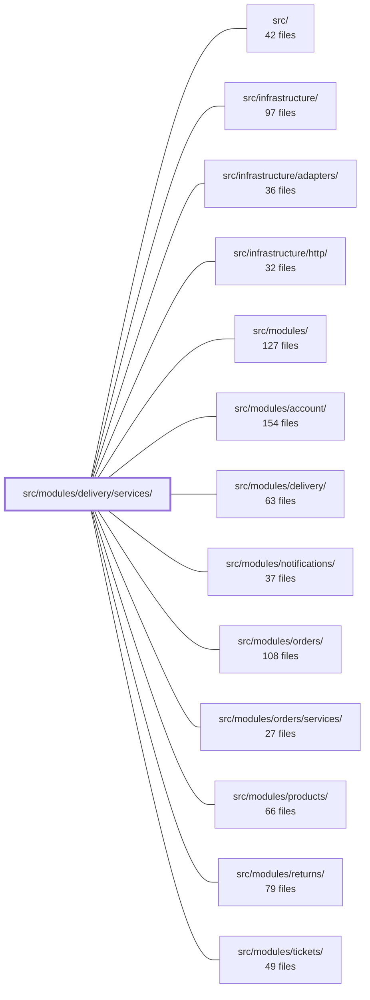

---
tags:
  - 2brain
  - 2brain/module
  - project/boilerplate-node-backend
type: module
module: src/modules/delivery/services/
files: 32
updated: 2026-10-29T19:24:46.091017+00:00
---

# src/modules/delivery/services/

## Purpose

This module is the service layer of the delivery domain: every business operation that mutates or reads fulfillment orders and shipments lives here. It wraps each write path in a single Mongoose transaction (the `act` boundary), keeps the parent order's summary and status in sync, emits outbox events and timeline rows atomically with the mutation, and exposes a flat `deliveryService` facade for controllers and sibling modules.

## Key parts

- **Transactional core** — `act.ts` (the transaction wrapper, refusal error, shared two-document read helper), `progress.ts` (recomputes the order summary and *requests* a status change from the `orders` module). Every other write file builds on these.
- **Shipping & delivery pipeline** — `cut.ts` (creates the shipment document), `ship.ts` (physical ship act), `deliver.ts` (records arrival / final delivery), `fulfill.ts` (instant digital fulfilment), `ship-gate.ts` (shared preconditions for ship/fulfil).
- **Lifecycle states & edge cases** — `holds.ts`, `lost.ts`, `found.ts`, `cancel-remainder.ts`, `reship.ts`, `owed.ts`, `split.ts`. These cover hold/release, lost-parcel reporting and restoration, partial cancellations, guarantee replacements, and short-stock splits.
- **Preorder & stock-arrival loop** — `ensure.ts` (idempotent creation safety net), `release-allocated.ts` + `split.ts` (inventory allocation → open order), `slip.ts` (product date-change listener), `preorder-sweep.ts` + `notice.ts` (missed-date notices), `release-date-impact.ts` (dry-run impact preview).
- **Reads & permissions** — `read.ts` (all list/fetch operations), `board.ts` (admin preorder board), `actions.ts` (permission-flag computation and client-facing views), `digest.ts` (staff attention counts).
- **Side-effects & notifications** — `announce.ts` (outbox event + timeline row in one commit), `notify.ts` (best-effort buyer emails).
- **Cross-cutting utilities** — `process.ts` (shipping-method catalogue, paid→processing), `tracking.ts` (tracking-code set/correct), `retention.ts` (PII text sweeps), `reencrypt.ts` (key-ring re-encryption), `override-sync.ts` (admin status-override reconciliation), `index.ts` (barrel / `deliveryService` object).

## How it connects

- **`src/modules/orders/`** — `progress.ts` is the *only* point where delivery asks the orders module to change an order's status; `board.ts` batch-reads buyer identity and `paidAt` from orders for the admin board; `cancel-remainder.ts` is called *inside* the returns caller's transaction, so delivery never owns the money/stock writes.
- **`src/modules/returns/`** — `cancel-remainder.ts`, `reship.ts`, and `owed.ts` are the delivery-side "doors" that `returns` invokes while it owns the Return record, refund, and stock-release writes.
- **`src/modules/products/`** — `slip.ts` listens to `product.release_date_changed` / `product.restock_date_changed`; `release-allocated.ts` consumes inventory's allocation announcement (which originates from the products/inventory domain).
- **`src/modules/notifications/`** — `notify.ts` composes emails from `../emails` templates and queues them through the mailer adapter; `announce.ts` writes outbox events that downstream webhook/mail/inbox listeners (owned by the notifications module) consume.
- **`src/modules/account/`** — `read.ts` provides the two bulk read operations the account data-export feature needs.
- **`src/infrastructure/`** — `act.ts` and every write file rely on Mongoose transactions (infrastructure-level session support); `reencrypt.ts` delegates the actual field-level crypto to `@infrastructure/security/reencrypt`.
- **`src/modules/delivery/`** (parent) — pure state predicates live in `../domain`; email templates live in `../emails`; this services layer is the only place that combines them with repository writes.

## Where to start

1. **`act.ts`** — read this first to internalise the transaction boundary, the `ActRefusal` pattern, and the shared "load both documents or 404" helper. Every other write file is a thin body inside that wrapper.
2. **`ship.ts`** (or `deliver.ts` if you prefer the arrival side) — a concrete end-to-end act: precondition check → `cutShipment` → `progress` sync → `announce` → post-commit side-effects. Reading one act top-to-bottom shows how the pieces in `progress.ts`, `announce.ts`, `cut.ts`, and `notify.ts` slot together.

## Connected modules

[[boilerplate-node-backend_ROOT|/ (repository root)]] · [[boilerplate-node-backend_src|src/]] · [[boilerplate-node-backend_src_infrastructure|src/infrastructure/]] · [[boilerplate-node-backend_src_infrastructure_adapters|src/infrastructure/adapters/]] · [[boilerplate-node-backend_src_infrastructure_http|src/infrastructure/http/]] · [[boilerplate-node-backend_src_modules|src/modules/]] · [[boilerplate-node-backend_src_modules_account|src/modules/account/]] · [[boilerplate-node-backend_src_modules_delivery|src/modules/delivery/]] · [[boilerplate-node-backend_src_modules_notifications|src/modules/notifications/]] · [[boilerplate-node-backend_src_modules_orders|src/modules/orders/]] · [[boilerplate-node-backend_src_modules_orders_services|src/modules/orders/services/]] · [[boilerplate-node-backend_src_modules_products|src/modules/products/]] · [[boilerplate-node-backend_src_modules_returns|src/modules/returns/]] · [[boilerplate-node-backend_src_modules_tickets|src/modules/tickets/]]

## Files
- `src/modules/delivery/services/act.ts` — Defines the transactional execution boundary for delivery fulfillment acts. Each act (ship, deliver, fulfil, hold, release, cancel-remainder) must write the fulfillment order, the parent order's summary, any status transition, and outbox events atomically. This module provides the transaction wrapper, the refusal mechanism that aborts the transaction cleanly, and a shared read helper so sibling services don't each re-implement the "load the two documents in-session or 404" step.
- `src/modules/delivery/services/actions.ts` — Centralises the "what can this caller do?" decision for fulfillment orders and shipments. It combines the caller's permission keys with the entity's state (the pure state predicates live in `../domain`) to produce a set of boolean action flags, and provides the wire-format "view" functions that hand those flags to the client so no consumer re-derives the rules.
- `src/modules/delivery/services/announce.ts` — Announces delivery-domain state transitions to two consumers in the same transaction: the **outbox** (event stream for webhooks, mail, inbox) and the **order timeline** (human-readable history row). It exists so that the narrative (timeline) and the fact (event) commit atomically with the domain mutation, and so that free-text notes are never duplicated into the timeline where they have a different retention clock than the event payload.
- `src/modules/delivery/services/board.ts` — Implements the two read operations behind the admin preorder board (feature ADMIN_SALES 3): listing fulfillment orders (with buyer and payment context) and summarising per-product unit counts. It owns the date-based filters (`late`, `dueWithin`), the consent/hold state, and the delivery-arrived check; buyer identity and `paidAt` are pulled from the `orders` module in a single batched read per page.
- `src/modules/delivery/services/cancel-remainder.ts` — Cancels the unshipped remainder of a fulfillment order (partial withdrawal) or every fulfillment order of an order that itself was cancelled. It is a "door" called by the `returns` module inside the caller's own transaction, because `returns` already owns the money, stock, and Return-record writes and must keep them atomic with the delivery-side status change.
- `src/modules/delivery/services/cut.ts` — The single write path that turns a fulfillment order's remaining lines into a concrete shipment document. Every shipping flow (staff shipping, digital fulfilment, admin override sync) funnels through `cutShipment`, which claims the order by revision, creates the shipment, and optionally decrements stock — all inside one transactional session.
- `src/modules/delivery/services/deliver.ts` — Records a shipment's arrival (the "delivery door"). Stamps the shipment as delivered, recomputes the order's progress/summary, and—when this is the last undelivered shipment—transitions the order to `delivered` and starts its withdrawal clock from that arrival instant (CRD Art. 9(2)(b)(i)). A lost shipment that turns up is accepted through the same path. All mutations occur in a single Mongoose transaction.
- `src/modules/delivery/services/digest.ts` — Computes four attention counts for the daily staff digest on the delivery side: late preorders, over-age holds, shipped parcels missing a tracking code, and undelivered parcels. Returns numbers only — no shipment or order data — so the digest payload stays small.
- `src/modules/delivery/services/ensure.ts` — Guarantees that a paid order has its fulfillment orders created. The normal creation path is the `paid` outbox listener, but this function re-runs the same idempotent create on every read and `start` of a paid order as a safety net—because the outbox stops retrying after its last attempt, and a missing fulfillment order would leave the order with no ship door.
- `src/modules/delivery/services/found.ts` — Handles the "lost parcel turns up" scenario: a shipment previously marked `lost` is restored to `delivered`. Provides both the **act** (`restoreLostShipment`) and the **read-side** predicate (`restorableIds`) so that the `ShipmentActions.deliver` flag and the actual act always agree on whether restoration is still possible.
- `src/modules/delivery/services/fulfill.ts` — Fulfils a **digital** fulfillment order end-to-end in a single transaction: cuts a shipment that is simultaneously born and delivered (no tracking, no parcel), advances the order's fulfilment state, settles it, and emits both "shipped" and "delivered" announcements. It is the digital counterpart to the physical shipping pipeline — Shopify-style instant delivery where no carrier is involved.
- `src/modules/delivery/services/holds.ts` — Implements the hold and release lifecycle for a fulfillment order. Staff can put an order on hold (with a Shopify-style reason code and optional notes) or release it from hold. The file wraps each operation in a Mongoose transaction, enforces preconditions (order still in-flight, fulfillment order in a holdable/releasable state), performs the state write, fires progress and announcement side-effects, records an audit entry, and returns the fulfillment order view.
- `src/modules/delivery/services/index.ts` — Facade (barrel) for the entire delivery service layer. It re-exports every function, type, and the `ActRefusal` error from the per-flow submodules (`./ship`, `./deliver`, `./read`, `./ensure`, etc.) and bundles them into a single `deliveryService` object. No logic lives here; its only job is to give controllers and sibling modules one import path for all fulfillment-order and shipment operations.
- `src/modules/delivery/services/lost.ts` — Handles staff reporting a parcel as lost or damaged in transit. It marks the shipment `lost`, reopens its units on the **same** fulfillment order (no new order, invoice, or revenue), tops up the stock hold, and—if the shelf cannot cover the full quantity—creates a new fulfillment order on hold for the owed remainder. All mutations commit in a single Mongoose transaction.
- `src/modules/delivery/services/notice.ts` — Single place where a preorder date-change notice is built, recorded, and announced. It serves two entry points — an admin moving the release date and the daily sweep detecting a missed date — and writes the fulfillment-order state change plus the delayed event in one transaction, deferring the buyer-facing email to after commit.
- `src/modules/delivery/services/notify.ts` — Email notification dispatchers for the delivery module. Each exported function maps a domain event (shipment shipped/delivered/lost, fulfillment delayed, hold noticed, tracking changed) to a buyer-facing email, composed from templates in `../emails` and queued via the mailer adapter. All functions are best-effort: a mail failure is logged and swallowed so it can never roll back the underlying act.
- `src/modules/delivery/services/override-sync.ts` — Listener for the `order.status_overridden` event: when an admin manually moves an order to `shipped` or `delivered`, this module reconciles the fulfillment records by force-shipping any unfulfilled remainder and (for `delivered`) marking all outstanding shipments as delivered. The resulting shipments are `forced`, take no stock, and fire no email or webhook, honoring the override's "no parcel, no email" contract.
- `src/modules/delivery/services/owed.ts` — Creates the "owed" side of a re-send: the units the shop still owes the buyer (a lost parcel or a guarantee replacement) that shelf stock cannot cover. It resolves a restock-based promise date and writes a fulfillment order that is placed **on hold for stock** (`cause: backorder`), outside the normal backorder cap, so the units ship once restocked.
- `src/modules/delivery/services/preorder-sweep.ts` — Implements the daily "preorder sweep" (PRODUCT_STATES P5): finds fulfillment orders that are on hold awaiting stock, whose expected delivery date has passed, and sends the buyer a single informational email saying the date will be missed and no new one is set. The email asks nothing and cancels nothing — the buyer may still cancel, and staff handle the rest on the Late board.
- `src/modules/delivery/services/process.ts` — Handles two delivery-service concerns that sit *before* any shipment exists: the static shipping-methods catalogue for checkout, and the `paid → processing` state transition that marks an order as being fulfilled. Neither operation creates a fulfillment order or shipment, so neither lives inside a delivery "act."
- `src/modules/delivery/services/progress.ts` — Synchronizes the `orders` record with delivery's fulfillment state inside an act's transaction. It recomputes the fulfillment summary from the actual records (never adjusts it) and asks `orders` to move status only when the summary justifies a transition. This file is the single point where delivery *requests* an order-status change; `orders` remains the only writer.
- `src/modules/delivery/services/read.ts` — All read operations for the delivery domain: listing and fetching fulfillment orders and shipments per order, the narrow reads the `returns` module makes (shipped quantities, remainder options), and the two bulk reads the account data export needs. Ownership is never on the delivery entity itself — every read resolves through the parent order's scope.
- `src/modules/delivery/services/reencrypt.ts` — Domain-level orchestration that re-encrypts every shipment's destination PII fields onto the newest key in the PII encryption key ring. It exists so the generic infrastructure re-encryption machinery (`@infrastructure/security/reencrypt`) can be driven with delivery-specific field mappings, AAD bindings, and the shipment repository in a single, dry-run-capable call.
- `src/modules/delivery/services/release-allocated.ts` — Event listener for inventory's allocation announcement: when stock arrives and inventory allocates a receipt to a paid preorder, this module moves the allocated units out of `awaiting_stock` by calling `splitForAllocation` on the matching fulfillment orders. It exists to close the loop between "paid preorder waiting for stock" and "stock is actually available."
- `src/modules/delivery/services/release-date-impact.ts` — Read-only dry-run that tells a staff member how many orders would receive an email if a product's release date (preorder) or restock date (backorder) were set to a given value. It reuses the exact same judgment logic as the save path so the preview can never drift from what actually happens on save.
- `src/modules/delivery/services/reship.ts` — Implements the replacement-after-return flow: reopens already-delivered or shipped fulfillment orders so the same units can leave again under the legal guarantee. No new order, invoice, or revenue is created — the original fulfillment orders are re-claimed with updated lines, the stock hold is topped up, any shortfall the shelf cannot cover is parked on a dedicated owed fulfillment order, and the parent order is transitioned back to `processing` to re-enter the ordinary shipping pipeline.
- `src/modules/delivery/services/retention.ts` — Implements the personal-data retention sweeps for the delivery module. When a fulfillment order or shipment has been quiet long enough, this file unsets the free-form text staff typed (hold notes, lost-parcel notes) and the destination address copies on shipments. The underlying rows stay; only the personal text goes.
- `src/modules/delivery/services/ship-gate.ts` — Shared gate logic for the ship and fulfil acts: determines whether a shipment may leave an order in a given status, whether the caller is permitted to make the `paid → processing` transition, and how to refuse/audit that refusal. Extracted from `ship.ts` and `fulfill.ts` so neither act (nor their `actions` flags) need to import each other.
- `src/modules/delivery/services/ship.ts` — Implements the staff "ship" action: cutting a shipment from a fulfillment order. All domain mutations (shipment creation, stock units leaving the shelf, order summary/status update, `shipment.shipped` event) commit in a single Mongoose transaction. Post-commit side effects (stock-cache refresh, audit row) run outside that transaction.
- `src/modules/delivery/services/slip.ts` — Listener for `product.release_date_changed` and `product.restock_date_changed` events. When a product's release or restock date moves, this module determines the new expected date for every fulfillment order still waiting on that product and decides what the buyer is owed (nothing, or an email with a cancel option), applying the result inside a per-order transaction.
- `src/modules/delivery/services/split.ts` — Implements the *split* of a short-stock delivery: when partial stock arrives against a fulfillment order held `on_hold` for `awaiting_stock`, the allocated units are moved into a new `open` fulfillment order that can ship immediately, while the remainder stays held. If the arrival covers the entire remainder, the hold simply ends and no second order is created. Called exclusively by `releaseAllocated` inside the inventory-allocation transaction; no HTTP route reaches it directly.
- `src/modules/delivery/services/tracking.ts` — Service function for setting or correcting a shipment's tracking code. It validates that the shipment is physical, persists the code via the repository, records an audit entry, and conditionally notifies the buyer (first code → "added" email; replacement → "corrected" email). Exists as a dedicated service so the tracking-edit use case is isolated from other shipment mutations.

---
[[boilerplate-node-backend_INDEX|← boilerplate-node-backend index]]
