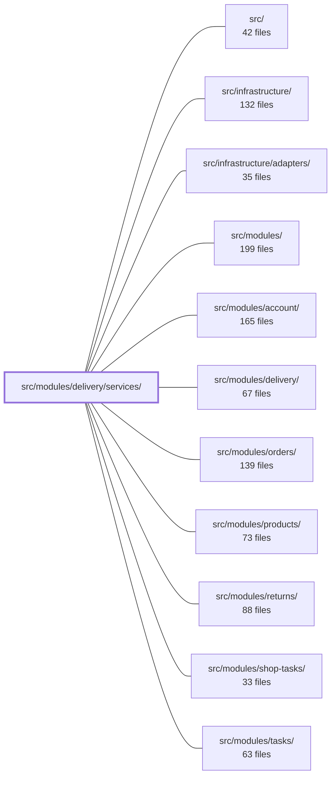

---
tags:
  - 2brain
  - 2brain/module
  - project/boilerplate-node-backend
type: module
module: src/modules/delivery/services/
files: 32
updated: 2026-11-15T00:31:47.765578+00:00
---

# src/modules/delivery/services/

## Purpose

The delivery services layer contains every write act, read query, event listener, and policy sweep that manages the lifecycle of fulfillment orders and shipments—from the moment an order is paid and fulfillment records are created, through shipping, delivery, loss/found, holds, and final retention. It owns the transactional boundary for all delivery state changes and is the authoritative source for per-order delivery progress.

## Key parts

- **Fulfillment acts** — `act.ts` (transactional envelope + refusal mechanism), `ship.ts` (cut + record a physical shipment), `deliver.ts` (stamp arrival, settle order), `fulfill.ts` (digital fulfilment), `holds.ts` (hold / release), `lost.ts` / `found.ts` (loss reporting and restoration), `cancel-remainder.ts`, `reship.ts`, `owed.ts`, `split.ts`, `release-allocated.ts`, `ensure.ts`, `process.ts`. Each act is a single-transaction write path; `act.ts` guarantees atomicity across the fulfillment write, parent-order update, and outbox events.
- **Shipment creation core** — `cut.ts` is the single funnel through which every shipping path creates a shipment (optimistic-concurrency protected); `ship-gate.ts` extracts the shared "may a shipment leave this status?" predicate so acts and action flags stay in agreement.
- **Read & query surface** — `read.ts` (order-page listings, returns queries, account export), `board.ts` (admin preorder board), `digest.ts` (daily staff counts), `release-date-impact.ts` (staff preview of date-change impact), `actions.ts` (per-caller action-availability map).
- **Notifications** — `announce.ts` (transactional outbox + order timeline), `notify.ts` (fire-and-forget buyer emails), `notice.ts` (delay notification within the caller's transaction).
- **Reactive event listeners** — `slip.ts` (product date changes), `override-sync.ts` (admin status override), `release-allocated.ts` (inventory allocation).
- **Policy & ops** — `retention.ts` (PII scrub after quiet window), `reencrypt.ts` (PII key rotation), `tracking.ts` (tracking-code correction).
- **Cross-module bridge** — `progress.ts` (recomputes delivery summary, requests status move from `orders`).
- **Facade** — `index.ts` bundles everything into the single `deliveryService` object consumed by controllers.

## How it connects

- **`src/modules/delivery/`** (parent) — Controllers and routes in the delivery module import `deliveryService` from `index.ts` and invoke the acts, reads, and listeners defined here.
- **`src/modules/orders/`** — `progress.ts` asks `orders` to move the parent order's status (orders remains the sole status writer). `board.ts` batch-fetches buyer and payment details from `orders`. `read.ts` resolves caller scope through `orderService`.
- **`src/modules/returns/`** — `returns` drives `cancel-remainder.ts` and `reship.ts` inside its own transaction; `read.ts` serves the narrow "what has shipped / what a remainder cancel would remove" queries that `returns` needs.
- **`src/modules/products/`** — `slip.ts` reacts to `product.release_date_changed` / `product.restock_date_changed` events; `release-date-impact.ts` reads the live catalogue to compute preview dates for the same events.
- **`src/modules/account/`** — `read.ts` provides the two data sections (fulfillment + shipment) that the account export surfaces to the buyer.
- **`src/infrastructure/`** — `reencrypt.ts` delegates field-level PII re-encryption to the shared infrastructure engine; all acts rely on the Mongoose session/transaction primitives provided here.

## Where to start

1. **`act.ts`** — Understanding the transactional envelope (how the three writes commit atomically and how `ActRefusal` aborts the whole thing) is prerequisite to reading any individual act.
2. **`index.ts`** — The facade shows the complete public surface of the module at a glance; from there you can follow each named operation into its file and see the grouping (acts, reads, listeners, policy) that the bullet list above describes.

## Connected modules

[[boilerplate-node-backend_ROOT|/ (repository root)]] · [[boilerplate-node-backend_src|src/]] · [[boilerplate-node-backend_src_infrastructure|src/infrastructure/]] · [[boilerplate-node-backend_src_infrastructure_adapters|src/infrastructure/adapters/]] · [[boilerplate-node-backend_src_modules|src/modules/]] · [[boilerplate-node-backend_src_modules_account|src/modules/account/]] · [[boilerplate-node-backend_src_modules_delivery|src/modules/delivery/]] · [[boilerplate-node-backend_src_modules_orders|src/modules/orders/]] · [[boilerplate-node-backend_src_modules_products|src/modules/products/]] · [[boilerplate-node-backend_src_modules_returns|src/modules/returns/]] · [[boilerplate-node-backend_src_modules_shop-tasks|src/modules/shop-tasks/]] · [[boilerplate-node-backend_src_modules_tasks|src/modules/tasks/]]

## Files
- `src/modules/delivery/services/act.ts` — Provides the transactional envelope for every delivery fulfillment act (ship, deliver, fulfill, hold, release, remainder-cancel). It guarantees that the fulfillment order write, the parent order's status/summary update, and the outbox events commit atomically, and gives the act a single mechanism (`ActRefusal`) to abort the transaction and surface a structured `ResponseReject` at the HTTP boundary.
- `src/modules/delivery/services/actions.ts` — Centralises the decision of *what a caller is allowed to do* with a fulfillment order or a shipment. It combines the caller's permission standing (kernel) with pure domain state predicates (lifecycle, fulfillability, etc.) to produce an action-availability map, then hands that map to the presenters so the wire response always reflects the requesting user's rights. No client re-derives these rules.
- `src/modules/delivery/services/announce.ts` — Writes delivery events to the transactional outbox **and** appends the matching order-timeline row inside the same Mongoose session, so the narrative history commits atomically with the state change it describes. All outbox events are keyed on the order ID to preserve per-order ordering.
- `src/modules/delivery/services/board.ts` — Provides the two read operations behind the admin preorder board (ADMIN_SALES 3): a paginated list of fulfillment orders with their buyer and payment details, and a paginated per-product unit-count summary. The `delivery` module owns the relevant dates, consent state, and hold logic, making it the authoritative source for these queries; buyer and payment data are fetched in one batched call into `orders`.
- `src/modules/delivery/services/cancel-remainder.ts` — Cancels the unshipped remainder of a fulfillment order (partial withdrawal via `returns`) or every fulfillment order of an order that itself was canceled. This module only touches delivery-side state (lines, status, summary); money, stock, and Return records are owned by `returns`, which drives this file inside its own transaction.
- `src/modules/delivery/services/cut.ts` — Implements the "cut" — the single write path that creates a shipment from a fulfillment order inside the act's transaction. All shipping paths (staff shipping, digital fulfillment, admin status override) funnel through `cutShipment`. It uses optimistic concurrency (revision claim) so two acts racing the same remainder cannot both land.
- `src/modules/delivery/services/deliver.ts` — Records a shipment's arrival — the delivery door. In a single transaction it stamps the shipment as delivered (or restores one previously marked lost), recomputes the order's delivery progress, and, when this was the last undelivered shipment with nothing left to ship, settles the order to `delivered` and starts the withdrawal clock from that arrival instant.
- `src/modules/delivery/services/digest.ts` — Computes four aggregate counts for the daily staff digest on the delivery side: late preorders, long-open staff holds, shipped parcels missing a tracking code, and parcels shipped but never marked arrived. Returns numbers only — no shipment payloads — so the digest consumer never touches raw shipment data.
- `src/modules/delivery/services/ensure.ts` — Creates an order's fulfillment orders idempotently once the order is paid. The `paid` event listener is the normal trigger, but the same `ensureFulfillmentOrders` call is also made by `start`, by a preorder allocation, and by an operator reviving a dead `paid` event after the outbox exhausts its retries. A read path never creates them.
- `src/modules/delivery/services/found.ts` — Handles the "found" lifecycle of a lost shipment: the moment a parcel that was marked `lost` physically arrives. It restores the shipment's units onto the origin fulfillment order, closes any owed (backorder) fulfillment orders with no refund, and releases the stock top-up — all inside a single transaction, all-or-nothing. It also exposes the read-side predicate (is this lost shipment still restorable?) so the `ShipmentActions.deliver` flag can never disagree with the act.
- `src/modules/delivery/services/fulfill.ts` — Implements the digital-fulfilment act: fulfilling a `digital` fulfillment order with no physical parcel. The shipment is cut and marked delivered in the same atomic write (mirroring Shopify's digital-line behaviour), the order is settled, and all announcements fire within one Mongoose transaction.
- `src/modules/delivery/services/holds.ts` — Implements the two staff-facing mutations for a fulfillment order's hold state: **hold** (stop shipping, record a reason) and **release** (clear the hold, resume shipping). Both run inside a Mongoose transaction, enforce preconditions, write through the repository, fire downstream notifications, and emit an audit entry before returning the updated order view.
- `src/modules/delivery/services/index.ts` — Aggregation facade for the delivery service layer. It imports every operation (reads, state-changing acts, administrative utilities) from the individual flow files in `src/modules/delivery/services/` and bundles them into a single `deliveryService` object that controllers and cross-module consumers call. This keeps the import surface to one name per module rather than scattering imports across a dozen siblings.
- `src/modules/delivery/services/lost.ts` — Service that lets staff report a parcel as lost or damaged in transit. It reopens the units on the **same** fulfillment order (no new order, invoice, or revenue), tops up the stock hold, creates a new owed fulfillment order for any quantity the shelf cannot cover, steps the order back to `processing`, marks the shipment `lost`, and announces the loss to the buyer — all committed in a single Mongoose transaction.
- `src/modules/delivery/services/notice.ts` — Single point where a preorder's buyer is notified that their delivery date moved (admin edit) or will be missed (daily sweep). It stamps the fulfillment order with notice metadata, applies the new/cleared expected date, records the `FulfillmentOrderDelayed` event, and delegates the actual announcement to the announce service — all within the caller's Mongoose transaction.
- `src/modules/delivery/services/notify.ts` — Buyer-facing email notifications for delivery events. Each exported function is a fire-and-forget listener that reacts to one domain event (`shipment.shipped`, `shipment.delivered`, `shipment.lost`, `fulfillment_order.delayed`, `fulfillment_order.hold_noticed`), loads the needed context, and enqueues an email. A failure to send never propagates or undoes the underlying business act.
- `src/modules/delivery/services/override-sync.ts` — Listener for the `order.status_overridden` event. When an admin manually moves an order's status to `shipped` or `delivered`, this module reconciles the fulfillment records by force-cutting any remaining lines as a shipment and, if the target is `delivered`, marking outstanding shipments as delivered — all stamped with the override's own timestamp.
- `src/modules/delivery/services/owed.ts` — Handles the portion of a re-send that available stock cannot cover immediately: units the shop still owes the buyer (a lost parcel or a guarantee replacement). Computes the restock-based promise dates and creates the fulfillment order that sits on hold awaiting stock, outside the normal backorder cap.
- `src/modules/delivery/services/preorder-sweep.ts` — Implements the daily sweep over waiting preorders: finds fulfillment orders whose expected date is imminent or passed while still on hold awaiting stock, and sends a single informational notice to the buyer that the date will be missed. It never cancels, reschedules, or prompts the buyer—silence leaves the order in the buyer's hands and lets staff handle the late order on the board.
- `src/modules/delivery/services/process.ts` — Service layer that (1) exposes the full shipping-methods catalogue for the checkout selector and (2) moves a paid order into `processing` (the `paid → processing` door). Neither operation concerns a fulfillment order or a shipment, which is why it lives here rather than in a fulfillment "act."
- `src/modules/delivery/services/progress.ts` — Bridge between delivery acts and the `orders` module. Inside an act's Mongoose transaction it recomputes the fulfillment summary from the delivery records themselves (never mutates it) and asks `orders` to move its status accordingly. `orders` remains the sole status writer; this file only requests the move and refuses the act when the order can no longer fulfil.
- `src/modules/delivery/services/read.ts` — Read-only service functions for a delivery order's fulfillment data. It serves three consumers: the order page's fulfillment/shipment listings, the `returns` module's narrow queries (what has shipped, what a remainder cancel would remove), and the account export's two data sections. Ownership is always the order's, resolved through `orderService.callerScope`.
- `src/modules/delivery/services/reencrypt.ts` — Application-level orchestration for re-encrypting every shipment's `destination` address onto the newest PII encryption key. It is invoked by the ops `reencrypt` script and delegates the actual field-by-field work to the shared infrastructure re-encrypt engine.
- `src/modules/delivery/services/release-allocated.ts` — EventListener that moves units out of `awaiting_stock` when `inventory` announces a receipt has been allocated to a paid preorder. It receives the post-allocation **state** (`waiting`: what the order still claims) rather than a delta, so it is naturally idempotent on redelivery.
- `src/modules/delivery/services/release-date-impact.ts` — Provides a **read-only staff preview** of how changing a product's release date (preorder) or restock date (backorder) would affect waiting orders. It runs the same judgment logic (`judgeMove`, `expectedDateOfWaiting`) that the actual save listener uses, so the preview count cannot drift from the real outcome. No writes are performed.
- `src/modules/delivery/services/reship.ts` — Implements the replacement-after-return flow: when delivered goods are returned under legal guarantee, this file reopens the **same** fulfillment orders to ship replacement units. No new order, invoice, or revenue is created. It tops up the stock hold, parks any shelf-uncoverable quantity on a new owed fulfillment order, and reverts the parent order to `processing` so the replacement ships through the normal pipeline. All mutations run inside the caller's transaction.
- `src/modules/delivery/services/retention.ts` — Implements the `reap:delivery` retention sweep: it scrubs personal free-text data (staff hold notes, loss notes, and shipment destination addresses) from fulfillment orders and shipments once the associated order has been quiet past the configured retention window. It exists to satisfy the data-retention policy that only personal text goes while the structural record of what was promised and shipped stays.
- `src/modules/delivery/services/ship-gate.ts` — Answers the single order-state question shared by the ship act, the fulfill act, and their `actions` flags: *may a shipment leave an order in this status?* Extracted into its own module so that `ship.ts`, `fulfill.ts`, and `actions.ts` can each consume the gate without importing one another. Also centralises the "may this caller make the `paid → processing` move?" check that both acts perform themselves.
- `src/modules/delivery/services/ship.ts` — Implements the staff-facing "ship" action: cutting a shipment (some or all) from a fulfillment order. It orchestrates a single-transaction write (fulfillment lines, new shipment, stock decrement, order status) and then runs post-commit side effects (shelf-cache refresh, audit row, buyer notification). It is the public entry point that controllers call to record that goods left the shelf.
- `src/modules/delivery/services/slip.ts` — Listener for `product.release_date_changed` and `product.restock_date_changed` events. For every fulfillment order still waiting on the affected product, it determines the new expected date from the live catalogue and applies the pure verdict table from `domain/preorder.ts`: if the date moved earlier (or is unchanged) the order is silently updated; if it moved later or was cleared, the buyer receives an email and a cancel option. The handler is idempotent so at-least-once outbox redelivery is safe.
- `src/modules/delivery/services/split.ts` — Implements the "short-stock split": when a preorder line requested more units than arrived in stock, the arrived units are moved into a new `open` fulfillment order (which can ship immediately) while the remainder stays `on_hold` with `awaiting_stock`. Without this split the partial stock could never ship because a manual release of `awaiting_stock` is refused. Called exclusively by `releaseAllocated` when inventory allocates stock to a paid preorder; no HTTP route reaches it.
- `src/modules/delivery/services/tracking.ts` — Service that sets or corrects a physical shipment's tracking code at any point in its lifecycle. It validates the shipment, performs a conditional write, records an audit entry, and notifies the buyer when the code actually changed. It exists to isolate this "evidence-critical" mutation from the broader delivery service surface.

---
[[boilerplate-node-backend_INDEX|← boilerplate-node-backend index]]
