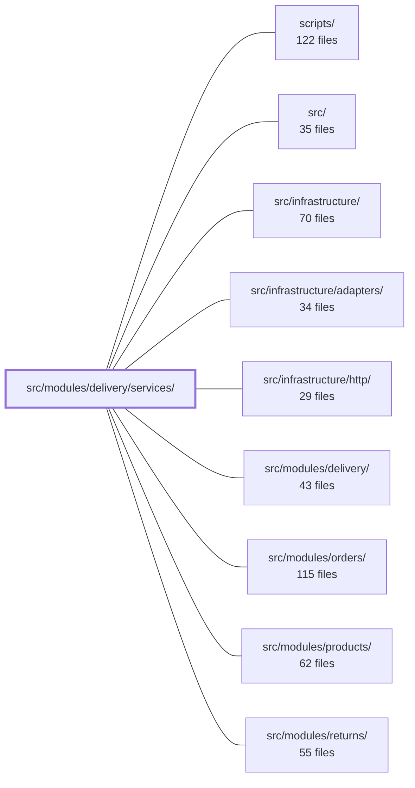

---
tags:
  - 2brain
  - 2brain/module
  - project/boilerplate-node-backend
type: module
module: src/modules/delivery/services/
files: 26
updated: 2026-10-15T13:38:37.504496+00:00
---

# src/modules/delivery/services/

## Purpose

The delivery service layer owns every write and read operation that moves a paid order toward fulfilment: creating shipments, recording delivery, holding and releasing, digital fulfilment, and all the narration, permission checks, and cross-module coordination those acts require. Each state-changing act runs inside a single Mongoose transaction so that the fulfillment-order lines, shipment record, order summary, status transition, timeline entry, and outbox event commit atomically or not at all.

## Key parts

- **Transactional acts & their boundaries** — `act.ts` wraps every write act in a transaction and standardises rejection shape. The individual act files (`ship.ts`, `deliver.ts`, `fulfill.ts`, `holds.ts`, `cancel-remainder.ts`, `confirm-wait.ts`) each implement one buyer- or staff-facing operation and all call through `cut.ts` (the single shipment-creation path with optimistic concurrency) and `force.ts` (shared `forced: true` validation).
- **In-transaction narration & sync** — `announce.ts` appends the timeline row and enqueues the outbox event inside the same transaction. `progress.ts` recomputes the order summary and asks the `orders` module to advance (or abort) the order status. `notice.ts` records a date-moved/passed notice before the buyer email is sent.
- **Read-side services** — `read.ts` serves the order-page GET, narrow reads for `returns`, and the account data export. `board.ts` answers the admin preorder-board queries (filtered fulfillment orders + per-product counts). `actions.ts` centralises "can this caller perform this act?" so no client re-derives rules.
- **Event listeners (reactive paths)** — `release-allocated.ts` reacts to inventory allocation and calls `split.ts` to carve allocated units out of an on-hold order. `slip.ts` reacts to a product release-date change and re-judges waiting orders. `override-sync.ts` reconciles fulfillment records when an admin force-moves an order to `shipped`/`delivered`.
- **Post-commit side effects & housekeeping** — `notify.ts` sends best-effort buyer emails (shipped, delivered, delay) only after the act has committed. `retention.ts` wipes expired `holdNote` free text. `ensure.ts` idempotently re-creates a missing fulfillment order as a self-healing safety net. `tracking.ts` corrects a tracking code while the shipment is still in `shipped`.
- **Orchestration & entry** — `start.ts` handles the paid→processing transition and the shipping-methods catalogue. `index.ts` is the barrel that re-exports a single `deliveryService` object for controllers.

## How it connects

- **`src/modules/orders/`** — `progress.ts` calls into `orders` to advance or abort status within the act's transaction; `board.ts` batch-reads buyer details and `paidAt` from `orders`; `start.ts` orchestrates the paid→processing status change; `ensure.ts` re-creates fulfillment orders for paid orders whose initial creation was lost.
- **`src/modules/returns/`** — `cancel-remainder.ts` is the delivery-side door that `returns` invokes (inside `returns`'s own transaction) to mark unshipped lines as cancelled. `read.ts` exposes the narrow reads `returns` needs (what has shipped, what a remainder cancel would take).
- **`src/modules/products/`** — `slip.ts` subscribes to the `product.release_date_changed` event and re-evaluates waiting fulfillment orders against the updated catalogue date.
- **`src/modules/delivery/`** (parent) — controllers and routes in the parent module import the `deliveryService` object from `index.ts`; this folder is the service tier beneath them.
- **`src/infrastructure/` & `src/infrastructure/http/`** — the acts rely on the Mongoose transaction adapter for atomicity and use the HTTP reject shape defined in the infrastructure layer; `act.ts` translates in-transaction refusals into that shape.
- **`scripts/`** — the ops sweep script calls `retention.ts` for periodic free-text cleanup.

## Where to start

1. **`act.ts`** — Reading this first gives you the transactional contract every other write file obeys: what commits together, how refusals are surfaced, and why the act files look the way they do.
2. **`ship.ts`** — It is the most complete single-act walkthrough (claim via `cut`, narration via `announce`, progress sync, post-commit email via `notify`), so it demonstrates the full pattern in one file before you explore the specialised acts.

## Connected modules

[[boilerplate-node-backend_ROOT|/ (repository root)]] · [[boilerplate-node-backend_scripts|scripts/]] · [[boilerplate-node-backend_src|src/]] · [[boilerplate-node-backend_src_infrastructure|src/infrastructure/]] · [[boilerplate-node-backend_src_infrastructure_adapters|src/infrastructure/adapters/]] · [[boilerplate-node-backend_src_infrastructure_http|src/infrastructure/http/]] · [[boilerplate-node-backend_src_modules_delivery|src/modules/delivery/]] · [[boilerplate-node-backend_src_modules_orders|src/modules/orders/]] · [[boilerplate-node-backend_src_modules_products|src/modules/products/]] · [[boilerplate-node-backend_src_modules_returns|src/modules/returns/]]

## Files
- `src/modules/delivery/services/act.ts` — Provides the transactional boundary for every delivery fulfillment act (ship, deliver, fulfil, hold, release, cancel-remainder). It guarantees that an act's writes—fulfillment order, shipment, order summary, status transition, and outbox events—commit atomically or not at all, and converts in-transaction refusals into the standard HTTP reject shape.
- `src/modules/delivery/services/actions.ts` — Centralises the "what may this caller do to this order/shipment?" decision so that no client re-derives the rules. Combines caller standing (staff key, rank, ownership) with pure domain state predicates to produce per-action booleans, and exposes the final wire-ready view functions used by read paths.
- `src/modules/delivery/services/announce.ts` — Transactional narration layer for delivery. Every act (ship, hold, release, delay, etc.) calls the appropriate `announce*` function to do two things atomically within the act's MongoDB transaction: append a human-readable row to the order's timeline and enqueue a domain event on the outbox. This file never mutates delivery state itself — it only records what already happened, so the history and the event commit together or not at all.
- `src/modules/delivery/services/board.ts` — Read-side service for the admin preorder board (ADMIN_SALES 3). It answers two questions for a given page: "which preorder fulfillment orders match these filters, with buyer and payment attached?" and "what are the per-product unit counts?" Because `delivery` owns the dates, consent state, and hold, it is the module that can answer; buyer details and `paidAt` are fetched from `orders` in one batched read per page.
- `src/modules/delivery/services/cancel-remainder.ts` — Cancels the unshipped remainder of fulfillment orders. It is the delivery-side "door" that the `returns` module calls (inside `returns`'s own transaction) to mark lines as cancelled after a buyer's partial withdrawal or a full order cancellation. Money, stock, and Return records are left to `returns`; this file only mutates fulfillment-order lines and status.
- `src/modules/delivery/services/confirm-wait.ts` — Implements the buyer's "keep waiting" action on a late preorder: it transitions the fulfillment order's consent to `confirmed` and clears the `consentDeadline`, thereby cancelling the window after which silence would trigger an automatic cancel-and-refund. Only the order's own buyer may invoke it; staff cannot consent on the buyer's behalf (FTC 16 CFR 435.2, CRD Art. 18).
- `src/modules/delivery/services/cut.ts` — Implements the single write path that turns a portion of a fulfillment order into a shipment document. Every shipping flow—staff shipping, digital fulfilment, and admin status overrides—funnels through this one function so the claim, shipment creation, and stock decrement stay consistent. It runs inside the act's Mongoose transaction and uses optimistic concurrency (revision-based claim) to prevent two acts from shipping the same remaining lines.
- `src/modules/delivery/services/deliver.ts` — Records a shipment's arrival (the "delivery door"). Within a single Mongoose transaction it stamps the shipment as delivered, recomputes the parent order's summary, and—when this was the last undelivered shipment with nothing left to ship—transitions the order to `delivered` and starts the CRD withdrawal clock. Supports a "forced" path that bypasses carrier confirmation but requires an override permission and a recorded reason.
- `src/modules/delivery/services/ensure.ts` — Creates fulfillment orders for a paid order, idempotently. It is the safety-net re-run of the same create logic that the `paid` event listener performs: because the outbox drops after its last retry, a missing fulfillment order would leave the order with no ship door at all. This file re-attempts the create on every read and `start` of a paid order, so the gap self-heals.
- `src/modules/delivery/services/force.ts` — Centralizes the validation rule for the `forced: true` request flag so that both delivery entry points (`ship` and `deliver`) enforce identical requirements and cannot drift apart. Without this shared guard, each door would need its own copy of the permission and reason checks.
- `src/modules/delivery/services/fulfill.ts` — Implements the **digital fulfilment** flow: fulfilling a `digital`-kind fulfillment order where no physical parcel exists. The shipment is cut with no tracking number and is both born and delivered in the same transaction (mirroring Shopify's treatment of digital lines). When nothing else remains unshipped, the order is completed in that same write, with the withdrawal clock anchored to the payment date (Art. 9(2)(c) digital content).
- `src/modules/delivery/services/holds.ts` — Implements the two staff-facing acts that stop or resume a fulfillment order: **holding** (with a Shopify-style reason and optional note) and **releasing**. Both acts run inside a Mongoose transaction, enforce optimistic-concurrency via a revision check, and are gated behind the delivery "rank rule" before any state change is committed.
- `src/modules/delivery/services/index.ts` — Barrel file that aggregates every public export from the delivery service layer and exposes a single `deliveryService` object. It exists so that controllers import one handle rather than reaching into a dozen sibling files, and so the module's public surface stays in one place. The doc comment notes the folder was split out of a single >1 000-line file (see `docs/theory/layers.md`).
- `src/modules/delivery/services/notice.ts` — Single place that builds and records a "your date moved or passed" notice on a fulfillment order. Two callers trigger it (an admin changing the release date, or the daily sweep detecting a passed date); both perform their state write and event in one transaction, and the buyer's email is sent only after that transaction commits.
- `src/modules/delivery/services/notify.ts` — Sends best-effort buyer emails after a shipment transaction has already committed. Three events are covered — shipped ("on its way"), delivered ("arrived"), and a preorder delay notice. A failed email never undoes the underlying act; the shipment or notice is already a fact by the time this file runs.
- `src/modules/delivery/services/override-sync.ts` — Listener for the `order.status_overridden` event: when an admin manually moves an order to `shipped` or `delivered`, this module reconciles the fulfillment records by force-shipping any unfulfilled remainder and (for `delivered`) marking all outstanding shipments as delivered. The resulting shipments are `forced`, take no stock, and fire no email or webhook, honoring the override's "no parcel, no email" contract.
- `src/modules/delivery/services/preorder-sweep.ts` — Implements the daily sweep over waiting preorders (PRODUCT_STATES P5). In a single pass it (1) asks buyers whose expected date has passed with no stock, and (2) marks and announces waits whose 30-day silent window has expired so that `returns` can cancel and refund. Only `on_hold` orders awaiting stock are considered; already-allocated goods are out of scope (they appear in the admin Late view instead).
- `src/modules/delivery/services/progress.ts` — Keeps the `orders` module in step with delivery's writes, inside an act's transaction. It recomputes the fulfillment summary from the delivery records themselves (never adjusts it) and asks `orders` to move the order's status exactly when the summary indicates all goods have left or all have arrived. If `orders` refuses (e.g., the order was cancelled in the meantime), this file aborts the act.
- `src/modules/delivery/services/read.ts` — Read-side service for a delivery order's fulfillment. Answers the order-page `GET /delivery/order/:orderId`, provides narrow reads consumed by `returns` (what has shipped, what a remainder cancel would take), and supplies the two batch sections of the account data export. Ownership of fulfillment orders and shipments is always the order's; the caller's scope is enforced through the order read.
- `src/modules/delivery/services/release-allocated.ts` — Event listener for inventory's allocation announcement: when stock arrives and inventory allocates a receipt to a paid preorder, this module moves the allocated units out of `awaiting_stock` by calling `splitForAllocation` on the matching fulfillment orders. It exists to close the loop between "paid preorder waiting for stock" and "stock is actually available."
- `src/modules/delivery/services/retention.ts` — Data-retention service that wipes free-text `holdNote` values from fulfillment orders once they have been quiet (unchanged) for a configurable number of days. It exists so the ops sweep script can call a single, well-scoped function rather than inlining the date arithmetic and repo call.
- `src/modules/delivery/services/ship.ts` — Implements the staff "ship" action: cutting one or more shipments out of a fulfillment order. All data changes (lines, shipment record, units, order summary, status, `shipped` flag) commit in a single transaction; mail, audit, and shelf-cache refresh happen only after the commit succeeds.
- `src/modules/delivery/services/slip.ts` — Listener for the `product.release_date_changed` event. When a product's release date moves, this file finds every fulfillment order still waiting for it, computes the new expected date from the catalogue, applies the pure verdict from `judgeSlip`, and acts within a transaction (update date, record a notice, or ask the buyer). It is the delivery-side narrator because `orders` cannot subscribe to `products` directly (import direction).
- `src/modules/delivery/services/split.ts` — Splits a fulfillment order that is held for `awaiting_stock` when partial stock arrives. The allocated units are carved into a new `open` fulfillment order (ready to ship) while the remainder stays on hold. If the arrival covers the full outstanding quantity, the hold is simply lifted and no second order is created. This runs only inside a transaction initiated by `releaseAllocated`; no HTTP route reaches it directly.
- `src/modules/delivery/services/start.ts` — Handles two distinct, non-"act" concerns in the delivery module: starting fulfilment on a **paid** order (the `paid → processing` transition) and serving the shipping-methods catalogue for the checkout selector. It exists as a service layer that orchestrates the order-status change, ensures fulfillment orders exist, and records the audit event — without belonging to any individual fulfillment-order or shipment workflow.
- `src/modules/delivery/services/tracking.ts` — Provides the business logic for correcting a shipment's tracking code (fixing a typo, not creating a new fact). The correction is only allowed while the shipment is still in `shipped` status; once delivered, the code is immutable history.

---
[[boilerplate-node-backend_INDEX|← boilerplate-node-backend index]]
