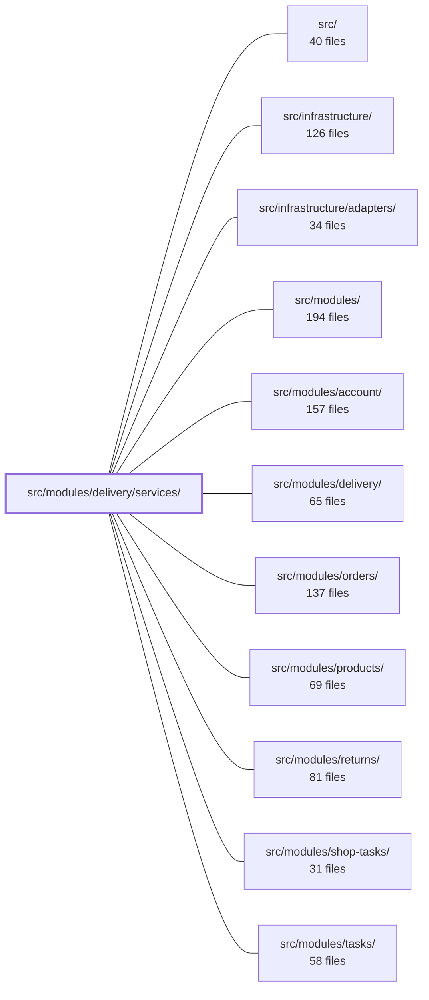

---
tags:
  - 2brain
  - 2brain/module
  - project/boilerplate-node-backend
type: module
module: src/modules/delivery/services/
files: 32
updated: 2026-11-08T10:50:28.872126+00:00
---

# src/modules/delivery/services/

## Purpose

The service layer of the delivery module. Every state change a fulfillment order or shipment goes through—creation from a paid order, cutting a shipment, marking delivery, holding, releasing, handling loss, reshipping, and the full preorder lifecycle—executes here. It is the transactional workhorse that controllers, event listeners, and sibling modules call, guaranteeing that multi-document writes commit atomically and that the order's status, outbox events, and human-readable timeline stay consistent.

## Key parts

- **Act envelope & core write path** — `act.ts` provides the shared transaction envelope and `ActRefusal` abort mechanism; `ship.ts`, `cut.ts`, `fulfill.ts`, and `deliver.ts` implement the four primary state transitions (ship, digital-fulfill, deliver, found) each inside a single Mongoose transaction.
- **Loss & replacement lifecycle** — `lost.ts`, `found.ts`, `reship.ts`, and `owed.ts` cover the full lost-parcel arc: reporting loss, restoring a found parcel, re-shipping under guarantee, and creating the owed (backorder) fulfillment order when stock is short.
- **Preorder & hold management** — `ensure.ts` (idempotent creation), `holds.ts` (hold/release), `split.ts` (short-stock split), `release-allocated.ts` (inventory receipt → release), `slip.ts` (release-date change reactions), `preorder-sweep.ts` (daily late-notice sweep), `notice.ts` (buyer delay notice), and `release-date-impact.ts` (staff preview of date-change impact) together cover the waiting-on-stock lifecycle end-to-end.
- **State sync & cross-module contracts** — `progress.ts` drives the parent order's status machine forward inside the act's transaction; `announce.ts` writes outbox events and timeline rows atomically; `ship-gate.ts` centralises the "may a shipment leave in this status?" check shared by ship, fulfill, and the actions flags.
- **Reads, permissions & boards** — `read.ts` (order-page and export reads), `board.ts` (admin preorder board queries), `actions.ts` (permission × state → action flags), and `process.ts` (paid→processing start, shipping-method catalogue).
- **Notifications & event listeners** — `notify.ts` (buyer email per domain event), `override-sync.ts` (admin status-override reconciliation), `cancel-remainder.ts` (returns-side door for partial/full cancellation).
- **Ops & maintenance** — `retention.ts` (PII scrub after quiet window), `reencrypt.ts` (PII key rotation), `tracking.ts` (tracking-code correction), `digest.ts` (aggregate counts for the staff digest).
- **Facade** — `index.ts` aggregates every export into a single `deliveryService` object so controllers and sibling modules have one import target.

## How it connects

- **`src/modules/orders/`** — `progress.ts` is the sole writer that moves the order's status machine (`paid → processing → shipped → delivered` / `→ canceled`); `board.ts` batch-fetches buyer and payment details; `ensure.ts` creates fulfillment orders in response to the order's `paid` event. The delivery module never writes order status independently.
- **`src/modules/returns/`** — `cancel-remainder.ts` is called *by* returns (inside returns' own transaction) to mark unshipped lines canceled; `reship.ts` runs inside a return-receipt transaction to reopen the same fulfillment order for a guarantee replacement.
- **`src/modules/products/`** — `slip.ts` listens to `product.release_date_changed` / `product.restock_date_changed` events; `release-date-impact.ts` reads the live catalogue to compute what a date change would affect.
- **`src/modules/tasks/` / `src/modules/shop-tasks/`** — `preorder-sweep.ts` and `digest.ts` provide the work and aggregate counts that scheduled tasks consume daily.
- **`src/infrastructure/`** — Mongoose transactions, the outbox, and the shared re-encryption engine are provided by infrastructure; `reencrypt.ts` delegates field-level work to the infra re-encrypt helper.
- **`src/modules/delivery/`** (parent) — this directory *is* the parent module's service layer; domain rules live in `domain/`, repositories in `repositories/`, and HTTP routing in `controllers/`, all coordinating through the services exported here.

## Where to start

Read **`act.ts`** first to understand the transaction envelope, the `ActRefusal` abort path, and how every write in this module guarantees atomicity. Then read **`index.ts`** to see the full public surface of the service layer and how the ~25 internal files collapse into one import that controllers and sibling modules actually use.

## Connected modules

[[boilerplate-node-backend_ROOT|/ (repository root)]] · [[boilerplate-node-backend_src|src/]] · [[boilerplate-node-backend_src_infrastructure|src/infrastructure/]] · [[boilerplate-node-backend_src_infrastructure_adapters|src/infrastructure/adapters/]] · [[boilerplate-node-backend_src_modules|src/modules/]] · [[boilerplate-node-backend_src_modules_account|src/modules/account/]] · [[boilerplate-node-backend_src_modules_delivery|src/modules/delivery/]] · [[boilerplate-node-backend_src_modules_orders|src/modules/orders/]] · [[boilerplate-node-backend_src_modules_products|src/modules/products/]] · [[boilerplate-node-backend_src_modules_returns|src/modules/returns/]] · [[boilerplate-node-backend_src_modules_shop-tasks|src/modules/shop-tasks/]] · [[boilerplate-node-backend_src_modules_tasks|src/modules/tasks/]]

## Files
- `src/modules/delivery/services/act.ts` — Provides the transactional envelope for every delivery fulfillment act (ship, deliver, fulfill, hold, release, remainder-cancel). It guarantees that the fulfillment order write, the parent order's status/summary update, and the outbox events commit atomically, and gives the act a single mechanism (`ActRefusal`) to abort the transaction and surface a structured `ResponseReject` at the HTTP boundary.
- `src/modules/delivery/services/actions.ts` — Centralizes the decision of *what a caller is allowed to do* to a fulfillment order or shipment. It combines the caller's permission standing (kernel) with the entity's current state (domain) to produce a flat set of boolean action flags, so that no client, presenter, or downstream service re-derives those rules independently.
- `src/modules/delivery/services/announce.ts` — The single "commit" point where delivery state changes are recorded: each function writes an outbox event **and** the matching row on the order's human-readable timeline, both inside the caller's Mongoose transaction, so the narrative and the fact commit atomically.
- `src/modules/delivery/services/board.ts` — Provides the two read operations behind the admin preorder board (ADMIN_SALES 3): a paginated list of fulfillment orders with their buyer and payment details, and a paginated per-product unit-count summary. The `delivery` module owns the relevant dates, consent state, and hold logic, making it the authoritative source for these queries; buyer and payment data are fetched in one batched call into `orders`.
- `src/modules/delivery/services/cancel-remainder.ts` — Marks unshipped lines on fulfillment orders as canceled. It is the delivery-side door that `returns` calls (inside its own transaction) when a buyer or staff partially withdraws, and the listener hook when an entire order is canceled. Money, stock, and Return records are owned by `returns`; this file only updates fulfillment-order lines, status, and order settlement.
- `src/modules/delivery/services/cut.ts` — Implements the single write path that turns a portion of a fulfillment order into a shipment inside the act's transaction. Every way a shipment is produced—staff shipping, digital fulfillment, and admin-status-override—funnels through `cutShipment`, so the claim, shipment write, and stock decrement happen once, consistently, with optimistic concurrency on the fulfillment order's revision.
- `src/modules/delivery/services/deliver.ts` — Records a shipment's arrival (the "delivery door"). Stamps the shipment as delivered, recomputes the order's fulfilment progress, and—if this was the last undelivered shipment—moves the order to `delivered` and starts its withdrawal clock. Also handles the special case of a previously-lost shipment that is found and accepted back. All state changes commit in a single Mongoose transaction.
- `src/modules/delivery/services/digest.ts` — Computes four aggregate counts for the daily staff digest on the delivery side: late preorders, long-open staff holds, shipped parcels missing a tracking code, and parcels shipped but never marked arrived. Returns numbers only — no shipment payloads — so the digest consumer never touches raw shipment data.
- `src/modules/delivery/services/ensure.ts` — Creates fulfillment orders for a paid order, idempotently. It is both the normal creation path (triggered by the `paid` event listener) and a safety net re-run on every read and `start` of a paid order, because the outbox gives up after its last retry and a missing fulfillment order would leave no ship door at all.
- `src/modules/delivery/services/found.ts` — Handles the "found" lifecycle of a lost shipment: the moment a parcel that was marked `lost` physically arrives. It restores the shipment's units onto the origin fulfillment order, closes any owed (backorder) fulfillment orders with no refund, and releases the stock top-up — all inside a single transaction, all-or-nothing. It also exposes the read-side predicate (is this lost shipment still restorable?) so the `ShipmentActions.deliver` flag can never disagree with the act.
- `src/modules/delivery/services/fulfill.ts` — Implements the digital fulfillment act: it cuts a shipment that is born already delivered (no tracking, no parcel), then in the same transaction starts the fulfillment clock, reports progress, settles the order, and announces both "shipped" and "delivered" — completing a digital order in one write.
- `src/modules/delivery/services/holds.ts` — Implements the two staff-facing mutations for a fulfillment order's hold state: **hold** (stop shipping, record a reason) and **release** (clear the hold, resume shipping). Both run inside a Mongoose transaction, enforce preconditions, write through the repository, fire downstream notifications, and emit an audit entry before returning the updated order view.
- `src/modules/delivery/services/index.ts` — Barrel/facade for the delivery service layer. It aggregates every operation (reads, writes, acts, notifications, retention, preorders) into a single `deliveryService` object so that controllers and sibling modules interact with the domain through one door instead of reaching into individual sub-files. The header docstring references `docs/theory/layers.md` for the layering rationale.
- `src/modules/delivery/services/lost.ts` — Staff-facing service that reports a parcel lost or damaged in transit. It marks the shipment as `lost`, reopens its units on the **same** fulfillment order (no new order, invoice, or revenue), tops up the stock hold, and—if the shelf cannot cover the gap—creates a new owed fulfillment order on hold for stock. All writes commit in a single Mongoose transaction.
- `src/modules/delivery/services/notice.ts` — The single place where a preorder buyer's notice is built and recorded when their delivery date moves (admin edit) or will be missed (daily sweep). It writes the fulfillment order's new state and the `FulfillmentOrderDelayed` event in the caller's transaction; the actual email is dispatched by the announce layer after commit.
- `src/modules/delivery/services/notify.ts` — Buyer-facing email notifications for delivery events. Each exported function is a fire-and-forget listener that reacts to one domain event (`shipment.shipped`, `shipment.delivered`, `shipment.lost`, `fulfillment_order.delayed`, `fulfillment_order.hold_noticed`), loads the needed context, and enqueues an email. A failure to send never propagates or undoes the underlying business act.
- `src/modules/delivery/services/override-sync.ts` — Listener for the `order.status_overridden` event. When an admin manually moves an order's status to `shipped` or `delivered`, this module reconciles the fulfillment records by force-cutting any remaining lines as a shipment and, if the target is `delivered`, marking outstanding shipments as delivered — all stamped with the override's own timestamp.
- `src/modules/delivery/services/owed.ts` — Handles the portion of a re-send that available stock cannot cover immediately: units the shop still owes the buyer (a lost parcel or a guarantee replacement). Computes the restock-based promise dates and creates the fulfillment order that sits on hold awaiting stock, outside the normal backorder cap.
- `src/modules/delivery/services/preorder-sweep.ts` — Implements the daily sweep over waiting preorders: finds fulfillment orders whose expected date is imminent or passed while still on hold awaiting stock, and sends a single informational notice to the buyer that the date will be missed. It never cancels, reschedules, or prompts the buyer—silence leaves the order in the buyer's hands and lets staff handle the late order on the board.
- `src/modules/delivery/services/process.ts` — Provides two delivery-service operations that sit outside the fulfillment/shipment domain: starting the `paid → processing` transition on an order, and exposing the shipping-methods catalogue for the checkout selector. It exists to keep "what the caller can do to an order from `paid`" and "what methods are available" as a single, act-free service layer.
- `src/modules/delivery/services/progress.ts` — Keeps the `orders` module's status in sync with what a delivery act has written, inside that act's transaction. It recomputes the fulfillment summary from the fulfillment orders and shipments (never adjusts it incrementally) and drives the order's status machine forward — `paid → processing → shipped → delivered`, or `processing → canceled` for lost parcels. `orders` remains the sole status writer; this file only asks it to move and refuses the act when it cannot.
- `src/modules/delivery/services/read.ts` — Read-only service layer for fulfillment orders and shipments. Serves the order-page `GET` endpoints (`/orders/:id/fulfillment-orders`, `/shipments`), the narrow reads the `returns` module needs (shipped quantities, remainder options), and the two bulk sections of the account data export. Fulfillment orders and shipments carry no ownership of their own; access is always scoped through the parent order.
- `src/modules/delivery/services/reencrypt.ts` — Application-level orchestration for re-encrypting every shipment's `destination` address onto the newest PII encryption key. It is invoked by the ops `reencrypt` script and delegates the actual field-by-field work to the shared infrastructure re-encrypt engine.
- `src/modules/delivery/services/release-allocated.ts` — EventListener that moves units out of `awaiting_stock` when `inventory` announces a receipt has been allocated to a paid preorder. It receives the post-allocation **state** (`waiting`: what the order still claims) rather than a delta, so it is naturally idempotent on redelivery.
- `src/modules/delivery/services/release-date-impact.ts` — Provides a **read-only staff preview** of how changing a product's release date (preorder) or restock date (backorder) would affect waiting orders. It runs the same judgment logic (`judgeMove`, `expectedDateOfWaiting`) that the actual save listener uses, so the preview count cannot drift from the real outcome. No writes are performed.
- `src/modules/delivery/services/reship.ts` — Implements the **reship (replacement under legal guarantee)** workflow. When returned goods must be sent out again, this file reopens the *same* fulfillment orders (no new order, invoice, or revenue), tops up the stock hold, routes any shortfall into a new owed fulfillment order, and resets the order to `processing` so the replacement exits through the ordinary shipping pipeline. It always executes inside the caller's Mongoose transaction (a return's receipt) and is all-or-nothing.
- `src/modules/delivery/services/retention.ts` — Implements the `reap:delivery` retention sweep: it scrubs personal free-text data (staff hold notes, loss notes, and shipment destination addresses) from fulfillment orders and shipments once the associated order has been quiet past the configured retention window. It exists to satisfy the data-retention policy that only personal text goes while the structural record of what was promised and shipped stays.
- `src/modules/delivery/services/ship-gate.ts` — Answers the single order-state question shared by the ship act, the fulfill act, and their `actions` flags: *may a shipment leave an order in this status?* Extracted into its own module so that `ship.ts`, `fulfill.ts`, and `actions.ts` can each consume the gate without importing one another. Also centralises the "may this caller make the `paid → processing` move?" check that both acts perform themselves.
- `src/modules/delivery/services/ship.ts` — The "shipping door" for staff: cuts one or more shipments from a fulfillment order inside a single Mongoose transaction. Everything the shipment changes (fulfillment lines, the shipment document, stock units, order summary/status, `shipment.shipped`) commits atomically; the shelf-cache refresh and audit row follow after the commit. Also handles the automatic `paid → processing` transition when the caller holds `start:Shipment`.
- `src/modules/delivery/services/slip.ts` — Listener for `product.release_date_changed` and `product.restock_date_changed` events. For every fulfillment order still waiting on the affected product, it determines the new expected date from the live catalogue and applies the pure verdict table from `domain/preorder.ts`: if the date moved earlier (or is unchanged) the order is silently updated; if it moved later or was cleared, the buyer receives an email and a cancel option. The handler is idempotent so at-least-once outbox redelivery is safe.
- `src/modules/delivery/services/split.ts` — Implements the short-stock split: when a preorder fulfillment order is held for `awaiting_stock` and only partial inventory arrives, this file moves the arrived units into a new `open` fulfillment order (ready to ship) while the remainder stays on hold. If the arrival covers everything, the hold simply ends without creating a second order. It is invoked exclusively by `releaseAllocated` when `inventory` allocates stock to a paid preorder; no HTTP route reaches it directly.
- `src/modules/delivery/services/tracking.ts` — Service that sets or corrects a physical shipment's tracking code at any point in its lifecycle. It validates the shipment, performs a conditional write, records an audit entry, and notifies the buyer when the code actually changed. It exists to isolate this "evidence-critical" mutation from the broader delivery service surface.

---
[[boilerplate-node-backend_INDEX|← boilerplate-node-backend index]]
