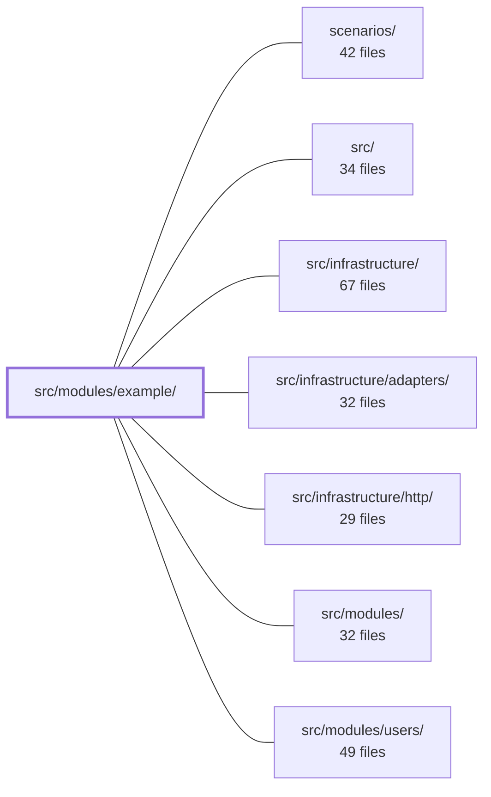

---
tags:
  - 2brain
  - 2brain/module
  - project/boilerplate-node-backend
type: module
module: src/modules/example/
files: 39
updated: 2026-10-07T23:57:37.000779+00:00
---

# src/modules/example/

## Purpose

The `example` module implements a single resource ("example") end-to-end: its domain model, CRUD and cover-update services, REST controllers, and the surrounding cross-cutting concerns (analytics, auditing, events, metrics, rate-limiting, email notifications, and health probes). It serves as a fully wired reference implementation of the project's module architecture.

## Key parts

- **Domain & model** – `domain/` (lifecycle, index), `model.ts`, `factsories.ts` define the entity shape, state transitions, and object construction.
- **Services** – `services/` splits business logic by concern: `crud.ts` (create/read/update/delete), `cover.ts` (cover-image handling), `owner.ts` (ownership checks), `notify.ts` (event-driven notifications), `personal-data.ts` (PII extraction/export).
- **Controllers & routes** – `controllers/` expose the HTTP verbs (`get-example`, `post-example`, `put-example`, `update-example`, `delete-example`, `put-example-cover`, `get-examples`); `routes.ts` wires them into the HTTP layer.
- **Cross-cutting** – `analytics.ts`, `audit.ts`, `events.ts`, `metrics.ts`, `rate-limits.ts`, `emails.ts`, `probes.ts`, `config.ts` each own one operational concern for the resource.
- **Module wiring** – `module.ts` and `index.ts` register the module (routes, services, event handlers) with the application container.
- **Tests** – `tests/` covers the resource at three levels: unit (domain, analytics, emails, manifest, routes), integration (service behavior, translations, capabilities), and API contract.

## How it connects

- **`src/infrastructure/http/`** provides the HTTP framework (router, middleware) that `routes.ts` and the controllers plug into.
- **`src/infrastructure/adapters/`** supplies external adapters (e.g., email sending, object storage) that services like `notify.ts`, `cover.ts`, and `emails.ts` consume.
- **`src/infrastructure/`** offers shared concerns (logging, configuration loading) used by `config.ts`, `audit.ts`, and `analytics.ts`.
- **`src/modules/users/`** is referenced by the ownership and personal-data services; `owner.ts` likely resolves the acting user, and `personal-data.ts` reads user-scoped records.
- **`scenarios/`** and **`src/`** (root) provide the project-wide test harness and application bootstrap that the integration/contract tests and `module.ts` registration depend on.
- **`src/modules/`** (sibling modules) may consume events published by `events.ts` or share the presenter/output contract via `presenter.ts`.

## Where to start

1. **`src/modules/example/module.ts`** – the single registration point that shows how routes, services, events, and config are assembled into the app. Reading this first gives you the module's public surface.
2. **`src/modules/example/services/crud.ts`** – the core business logic behind every controller endpoint; understanding it makes the controllers, domain lifecycle, and repository trivially readable.

## Connected modules

[[boilerplate-node-backend_ROOT|/ (repository root)]] · [[boilerplate-node-backend_scenarios|scenarios/]] · [[boilerplate-node-backend_src|src/]] · [[boilerplate-node-backend_src_infrastructure|src/infrastructure/]] · [[boilerplate-node-backend_src_infrastructure_adapters|src/infrastructure/adapters/]] · [[boilerplate-node-backend_src_infrastructure_http|src/infrastructure/http/]] · [[boilerplate-node-backend_src_modules|src/modules/]] · [[boilerplate-node-backend_src_modules_users|src/modules/users/]]

## Files
- `src/modules/example/analytics.ts`
- `src/modules/example/audit.ts`
- `src/modules/example/config.ts`
- `src/modules/example/controllers/delete-example.ts`
- `src/modules/example/controllers/get-example.ts`
- `src/modules/example/controllers/get-examples.ts`
- `src/modules/example/controllers/post-example.ts`
- `src/modules/example/controllers/put-example-cover.ts`
- `src/modules/example/controllers/update-example.ts`
- `src/modules/example/domain/index.ts`
- `src/modules/example/domain/lifecycle.ts`
- `src/modules/example/emails.ts`
- `src/modules/example/events.ts`
- `src/modules/example/factories.ts`
- `src/modules/example/index.ts`
- `src/modules/example/metrics.ts`
- `src/modules/example/model.ts`
- `src/modules/example/module.ts`
- `src/modules/example/presenter.ts`
- `src/modules/example/probes.ts`
- `src/modules/example/rate-limits.ts`
- `src/modules/example/repository.ts`
- `src/modules/example/routes.ts`
- `src/modules/example/services/cover.ts`
- `src/modules/example/services/crud.ts`
- `src/modules/example/services/index.ts`
- `src/modules/example/services/notify.ts`
- `src/modules/example/services/owner.ts`
- `src/modules/example/services/personal-data.ts`
- `src/modules/example/tests/contract/api.contract.test.ts`
- `src/modules/example/tests/factories.ts`
- `src/modules/example/tests/integration/capabilities.test.ts`
- `src/modules/example/tests/integration/service.test.ts`
- `src/modules/example/tests/integration/translations.test.ts`
- `src/modules/example/tests/unit/analytics.test.ts`
- `src/modules/example/tests/unit/domain.test.ts`
- `src/modules/example/tests/unit/emails.test.ts`
- `src/modules/example/tests/unit/manifest.test.ts`
- `src/modules/example/tests/unit/routes.test.ts`

---
[[boilerplate-node-backend_INDEX|← boilerplate-node-backend index]]
