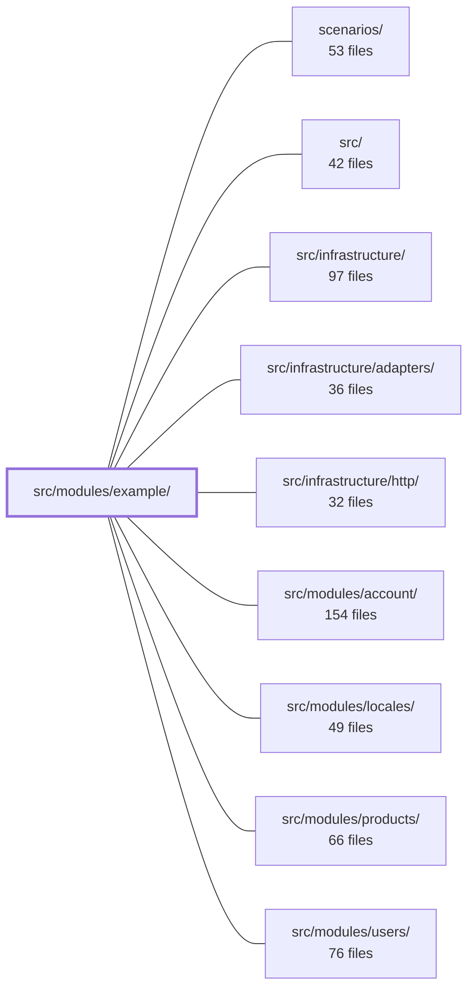

---
tags:
  - 2brain
  - 2brain/module
  - project/boilerplate-node-backend
type: module
module: src/modules/example/
files: 47
updated: 2026-10-29T19:25:12.664396+00:00
---

# src/modules/example/

## Purpose

The `example` module is the canonical, fully-wired template for a domain module in this codebase. It implements a small "note" resource (owner, status, optional cover image) with a draft → published → archived lifecycle, and exercises every capability a module can opt into—events, rate limits, webhooks, translations, image uploads, personal-data hooks—so that it can be copied verbatim when bootstrapping a new domain and deleted once the new module has its own manifest.

## Key parts

- **Domain rules** (`domain/`) — A pure, dependency-free state machine (`lifecycle.ts`) that defines the three statuses, the legal transitions between them, and synchronous query helpers. Lint-enforced to contain no framework imports.
- **Data layer** (`model.ts`, `repository.ts`) — The Mongoose schema and wire-shape transform live in `model.ts`; `repository.ts` is the sole collection access point, extending a shared `createRepository` factory with scoped reads, transactional delete, optimistic status transitions, and image writeback.
- **Service layer** (`services/`) — Organised by capability: `crud.ts` (create/read/search/update/delete), `transition.ts` (publish/archive/unarchive with conditional writes and outbox events), `cover.ts` (image upload flow), `notify.ts` (publish email via domain-event listener), `owner.ts` (cross-module owner lookup + presentation shaping), `actions.ts` (per-row ability resolution), and `personal-data.ts` (GDPR export/erase). `services/index.ts` aggregates them into a single facade.
- **HTTP layer** (`controllers/`, `routes.ts`) — Thin controllers built on shared factories (`createItemController`, `createSearchController`, `createUpdateController`, `eventHandler`). `routes.ts` partitions endpoints into public and authenticated zones and wires middleware (auth, permissions, caching, rate-limiting, idempotency, upload) in front of each handler.
- **Module manifest & config** (`module.ts`, `config.ts`) — `module.ts` is the `AppModule` declaration listing every opted-in capability; `config.ts` is the only file that reads `process.env`.
- **Cross-cutting contracts** (`events.ts`, `analytics.ts`, `audit.ts`, `metrics.ts`, `emails.ts`, `probes.ts`) — Each declares its module's slice of a global union (domain events, analytics names, audit actions, Prometheus counters, email copy, API probes) so the app-level registry grows automatically.
- **Rules generation** (`rules.schema.ts`, `rules.generated.ts`) — Zod schema + `GenerateSpec` that drives `npm run regenerate` to emit typed audit/analytics constants from `rules.yaml`.
- **Presentation & rate-limiting** (`presenter.ts`, `rate-limits.ts`, `rate-limits.generated.ts`) — A single mapping from stored rows to the OpenAPI `Example` contract, and the Express middleware for per-account endpoint budgets.
- **Testing** (`tests/`, `factories.ts`) — Contract tests (OpenAPI conformance), integration tests (real in-memory MongoDB for CRUD, transitions, capabilities, translations), and in-memory fixture builders.

## How it connects

- **`src/modules/users/`** — `services/owner.ts` imports the users barrel strictly to resolve the owner's display name for the wire response.
- **`src/modules/account/`** — Invokes `personal-data.ts` (export / erase) through the module-registry pattern declared in `module.ts`; neither side imports the other's files directly.
- **`src/modules/locales/`** — Writes translations onto the example collection (non-fallback title overlay, fallback-title copy) and resolves `Accept-Language` on reads, as verified by the integration tests.
- **`src/infrastructure/`** — Consumes the shared mailer (`services/notify.ts`), the Prometheus registry (`metrics.ts`), and the `createRepository` / `createSearchController` / `createUpdateController` / `createItemController` factories used throughout the controller and repository layers.
- **`src/infrastructure/http/`** — `routes.ts` wires the shared Express middleware stack (auth guard, rate-limit, idempotency, upload) in front of each controller.
- **`src/` (kernel)** — `events.ts` augments the global `DomainEventMap`; `analytics.ts` and `audit.ts` augment their respective app-wide unions, so the kernel's registries pick up this module's entries automatically.
- **`scenarios/` & repo root** — `probes.ts` is consumed by the bundle script under `scripts/contracts/`; `rules.schema.ts` documents the shared-rules pattern that `npm run regenerate` (defined at the repo root) executes to produce `rules.generated.ts`.

## Where to start

1. **`domain/lifecycle.ts`** — Twenty lines that define the entire state machine and its query helpers. Reading it first gives you the business rules every other file enforces or exposes.
2. **`services/crud.ts`** — The single door controllers and sibling modules call into for reads and writes. Tracing one operation (e.g. `create`) from here into the repository, presenter, and side-effects (audit, metrics, events) shows how the layers compose without needing to understand every optional capability at once.

## Connected modules

[[boilerplate-node-backend_ROOT|/ (repository root)]] · [[boilerplate-node-backend_scenarios|scenarios/]] · [[boilerplate-node-backend_src|src/]] · [[boilerplate-node-backend_src_infrastructure|src/infrastructure/]] · [[boilerplate-node-backend_src_infrastructure_adapters|src/infrastructure/adapters/]] · [[boilerplate-node-backend_src_infrastructure_http|src/infrastructure/http/]] · [[boilerplate-node-backend_src_modules_account|src/modules/account/]] · [[boilerplate-node-backend_src_modules_locales|src/modules/locales/]] · [[boilerplate-node-backend_src_modules_products|src/modules/products/]] · [[boilerplate-node-backend_src_modules_users|src/modules/users/]]

## Files
- `src/modules/example/analytics.ts` — Declares the analytics event names that the *example* module is allowed to fire, by re-exporting a generated constant and augmenting the app-wide `AnalyticsEventMap` type. This is the single source of truth for which events belong to this module; the app-level union of all analytics events grows automatically from each module that includes this file.
- `src/modules/example/audit.ts` — Declares the audit-action vocabulary for the `example` module and registers it into the app-wide `AuditActionMap` union. The actions themselves (create, update, status change, delete, cover change) are generated from `rules.yaml` and re-exported here so that downstream services and tests can reference them through a single, typed entry point.
- `src/modules/example/config.ts` — Declares and validates the example module's slice of the environment at boot. It is the **only** file in the module that reads `process.env`; every other file consumes the typed values it exports.
- `src/modules/example/controllers/delete-example.ts` — Implements the single `DELETE /examples/:id` endpoint for the example module. It is hand-written (rather than generated by the shared delete factory) because that factory expects a soft/hard delete triplet, and this module has no soft-delete tier.
- `src/modules/example/controllers/get-example.ts` — Read-one controller for `GET /examples/:id`. It delegates entirely to the shared item-controller factory so that 404 semantics (unknown or malformed ID → same response) live in one place. Published examples sit above the auth gate and are readable by anyone.
- `src/modules/example/controllers/get-examples.ts` — Thin controller for `GET /examples` and `POST /examples/search`. Decodes the incoming request, delegates to `exampleService.search`, and returns a shaped response. Built entirely on the shared `createSearchController` factory so the controller layer contains no business logic.
- `src/modules/example/controllers/post-example-event.ts` — Provides the three lifecycle action handlers (`publish`, `archive`, `unarchive`) for the example module. All three share identical HTTP plumbing (id validation, service call, success/refusal/error response), so a single `eventHandler` factory generates each one. The controllers are intentionally thin; the business rules live in the service layer.
- `src/modules/example/controllers/post-example.ts` — Handles `POST /examples` by validating the request body against a generated Zod schema (with whitespace trimming), delegating to the example service, and responding with `201` + a `Location` header. It is the HTTP entry point for the "create example" operation.
- `src/modules/example/controllers/put-example-cover.ts` — Handles `PUT /examples/:id/cover`. It reads the image that the upload middleware attached to the request, validates that a file is actually present, and delegates the cover update to `exampleService.setCover`. It exists as the single HTTP entry-point for replacing an example's cover image.
- `src/modules/example/controllers/update-example.ts` — Wires up the `PUT /examples/:id` (replace) and `PATCH /examples/:id` (merge) endpoints for the example module. All shared mechanics—id lookup, `If-Match` / `ETag` handling, and the request pipeline—live in the `createUpdateController` factory; this file only supplies the two trimmed body schemas and the service call.
- `src/modules/example/domain/index.ts` — Barrel (re-export) file for the `example` module's domain layer. It exposes the pure-business-rule vocabulary defined in `./lifecycle.ts` under a single import path, keeping the rest of the module (services, tests, the module root) from reaching into sub-paths directly. The domain layer is lint-enforced to contain no Express, Mongoose, or other tier dependencies.
- `src/modules/example/domain/lifecycle.ts` — Declares the example's lifecycle state machine — the three statuses (draft, published, archived), the events that move between them, and a set of pure query helpers the services layer calls to decide what a given caller may do. No I/O; every export is a synchronous decision.
- `src/modules/example/emails.ts` — Turns the "example published" email copy into finished, locale-aware strings. It is the single source of truth for what text the owner receives when they publish an example — language is an input, plain text is the output, and no template rendering happens here.
- `src/modules/example/events.ts` — Declares the domain events this module emits by augmenting the kernel's global `DomainEventMap` interface (module augmentation pattern, per `modules/orders/events.ts`). Currently defines a single event, `example.published`, which fires when an example transitions to the published state (initially or after un-archiving) and is surfaced as a public webhook via `module.ts`.
- `src/modules/example/factories.ts` — Test and seed fixture builder for the `example` module. It produces a `Partial<ExampleDocument>` ready to hand to `exampleRepository.create`, intentionally bypassing the validation a service layer would enforce. It is reachable at `@modules/example/factories` and is deliberately excluded from the barrel export.
- `src/modules/example/index.ts` — Public barrel for the `example` module — the sole import surface that sibling modules are allowed to use. It aggregates the module's services, domain rules, events, and email templates, and re-exports the model's *types* (not its runtime values). This file exists so that external code never reaches into the module's internal file layout.
- `src/modules/example/metrics.ts` — Declares the Prometheus counter(s) owned by the `example` module and registers them on the shared metrics registry. Currently exposes a single counter tracking how many examples have been created, giving operators a basic usage signal for the module.
- `src/modules/example/model.ts` — Defines the Mongoose schema, document/model types, and shared wire-shape transform for the "example" resource (a note with an owner, status, and optional cover image). Every other file in the module reads or writes this collection through the exports here, so the schema and serialization rules live in one place.
- `src/modules/example/module.ts` — Template module manifest that declares every capability a domain module can opt into (events, rate limits, webhooks, translations, image targets, personal-data hooks, etc.) in a single `AppModule` object. It exists to be copied when bootstrapping a new domain and deleted once the new module has its own manifest. Its only concrete behavior is a small "note" resource with a draft → published → archived lifecycle.
- `src/modules/example/presenter.ts` — The single place a stored row (Mongoose document or search row) is shaped into the `Example` wire contract declared in `openapi.yaml`, so every read and write path returns the same shape. It exists to keep that mapping out of the service layer.
- `src/modules/example/probes.ts` — Declares the example module's collection of API probes — requests that exercise refusal paths the OpenAPI contract cannot express on its own. The bundle script (`scripts/contracts/client-collections-bundle.ts`) consumes this array to run them against a live server. The file is explicitly marked as deletable once every refusal becomes contract-reachable.
- `src/modules/example/rate-limits.generated.ts` — Auto-generated data file that declares the rate-limit budgets for the `example` module. It exists to separate declarative configuration (the "what") from runtime logic (the "how"), which lives in `rate-limits.ts`.
- `src/modules/example/rate-limits.ts` — Declares the rate-limit budgets for the example module and turns them into Express middleware. Each budget defines how many times an authenticated account may invoke a given endpoint within a window; the actual numeric limits live in the generated file, and the middleware wiring is shared infrastructure.
- `src/modules/example/repository.ts` — The sole access point to the `example` collection within the module. It spreads the shared `createRepository` factory (plain CRUD + search) and layers on the operations this collection uniquely needs: scoped reads, transactional hard-delete, optimistic status transitions, translation, and image writeback. Services import this file; nothing outside the module does.
- `src/modules/example/routes.ts` — Route table for the example module. Declares every Express endpoint, partitions them into a public zone and an authenticated zone via a single positional `router.use(getAuth, isAuth)` guard, and wires the required middleware (permissions, caching, rate-limiting, idempotency, upload) in front of each controller handler.
- `src/modules/example/rules.generated.ts` — Auto-generated vocabulary file that centralizes the audit-action strings and analytics event names owned by the `example` module. It exists so that consumers reference a single source of truth instead of hard-coding string literals, and so those strings stay in sync with `rules.yaml`.
- `src/modules/example/rules.schema.ts` — Defines the Zod schema for the example module's `rules.yaml` and the `GenerateSpec` that tells `npm run regenerate` what to emit. It serves as the canonical example of the shared-rules pattern, demonstrating how a module declares its audit actions and analytics events and how those lists get code-generated into a TypeScript module.
- `src/modules/example/services/actions.ts` — Resolves, per row, which actions a given caller is allowed to take on an `Example` record. It composes the kernel's ability check (which `authorization.yaml` keys apply) with the domain's lifecycle-based moves, so the client never re-derives permissions. Exists to centralise the "what may I do?" answer for one module in a single place.
- `src/modules/example/services/cover.ts` — Implements the cover-image upload flow for the Example module: applies the image fields produced by the upload middleware to an already-loaded example row, persists the change, hands a pending image to the digest pipeline, deletes the replaced cover, and records an audit entry.
- `src/modules/example/services/crud.ts` — Service layer for the `example` entity's five CRUD operations (create, read, search, update, delete). It is the single door controllers and sibling modules call into: it applies domain rules, issues repository calls, and fires side-effects (audit, metrics, i18n, image cleanup). Status transitions are explicitly out of scope here and live in `./transition.ts`.
- `src/modules/example/services/index.ts` — Barrel (facade) for the example module's service layer. It aggregates the per-capability sub-services (CRUD, cover, status transitions) into a single exported object so that controllers and the module barrel have exactly one door to call through, rather than reaching into individual function exports.
- `src/modules/example/services/notify.ts` — Event listener that mails the owner of an example when it is published. Registered by the module's `subscribe` call; the publishing service never knows this listener exists. It handles locale-aware email composition and account-state guards, then enqueues the email through the infrastructure mailer.
- `src/modules/example/services/owner.ts` — The single cross-module read boundary for the example module. It fetches the owner's display name from the `users` module (strictly via its barrel) and provides the two presentation paths that turn a stored `ExampleDocument` into the public contract type `Example` — one for an authenticated caller, one for anonymous readers.
- `src/modules/example/services/personal-data.ts` — Implements the personal-data lifecycle for the `example` module: collecting every example a person owns (for account export) and erasing them (for account deletion). Registered on the module manifest as `personalData`, so `account` and `users` invoke these operations through the registry without importing this file directly.
- `src/modules/example/services/transition.ts` — Service layer for the example lifecycle: it exposes one function per state transition (`publishById`, `archiveById`, `unarchiveById`) that validates the move against domain rules, performs a conditional (status-guarded) write so that concurrent racers resolve to exactly one winner, and fires the winner's side effects (outbox event, analytics, audit). It exists to keep transition logic out of the HTTP handler and out of the domain model.
- `src/modules/example/tests/contract/api.contract.test.ts` — Contract tests for the `/examples` routes, verifying that each HTTP response shape actually matches what `openapi.yaml` declares. Where the integration suite asserts behavioural rules, this file confirms that every *declared* response (status, headers, body shape) is reachable over real HTTP. It also encodes the cross-tenant convention: a non-owner requesting another user's example receives **404**, never **403**, so an id leaks nothing about ownership.
- `src/modules/example/tests/factories.ts` — Test-side persistence helpers for the `example` module. While `../factories.ts` builds in-memory example documents (the BUILDER), this file writes them to the test database and provides a small read-back utility so test assertions don't need to chain `findById` calls inline.
- `src/modules/example/tests/integration/capabilities.test.ts` — Integration tests proving each optional capability of the example module against a real in-memory MongoDB: the publish notification mail (via the domain-event → `subscribe` wiring), the cover-image lifecycle (`setCover`), GDPR personal-data export/erasure, and the three writes the `locales` port makes on the example collection. Each capability is tested in isolation so a regression in one does not mask the others.
- `src/modules/example/tests/integration/service.test.ts` — Integration tests that exercise `exampleService` against a **real database** (`setupTestDb`). They verify ownership scoping (own / any / nothing), the status lifecycle enforced on write, single-stamping of `publishedAt`, exactly-once publish announcement via the outbox, and the environment-driven body-length ceiling.
- `src/modules/example/tests/integration/translations.test.ts` — End-to-end integration test proving that the **example** module is a translatable entity through the `locales` door: writing a translation via `PATCH /locales/translations/example/:id` copies the fallback-language title onto the row (what lists display), stores non-fallback titles in the overlay, rejects undeclared fields, and that `GET /examples/:id` (and the list) resolves the title from the request's `Accept-Language` header — including the staff-only preview path for deactivated languages.
- `src/modules/example/tests/unit/analytics.test.ts` — Unit test that pins the exact string values of the example module's analytics events and verifies they are registered in the app-wide `AnalyticsEventMap` union. It exists to prevent accidental string changes (which would break Umami dashboards) and to guard against the `declare module` augmentation being silently removed.
- `src/modules/example/tests/unit/domain.test.ts` — Unit tests for the example module's domain (lifecycle) rules: status transition validity, the `publishedAt` stamping policy, body-length ceiling, and per-status action availability. The file exists to pin down the pure, database-free logic in `src/modules/example/domain` so that transition or stamping regressions are caught before they reach integration or UI layers.
- `src/modules/example/tests/unit/emails.test.ts` — Unit tests for the `examplePublishedEmail` helper, verifying that the published-example email copy (subject, greeting, body) is correctly resolved for a given locale and owner name.
- `src/modules/example/tests/unit/lifecycle.property.test.ts` — Property-based tests (fast-check) for the public surface of the `lifecycle` domain module. It pins the invariants a client relies on—event legality, state transition, permission gating, and key pass-through—without enumerating every (status, permits) pair by hand. The file exists so that a future change to `canApply` or `exampleActionsFor` is caught by random exploration rather than only by hand-written cases.
- `src/modules/example/tests/unit/manifest.test.ts` — Unit tests that pin down the example module's manifest contract: its name, mount path, public webhook projection, translatable fields, image-target registration, personal-data hooks, and rate-limit wiring. Exists to catch unintended changes to the surface the application (and `account`/`users` integrators) consume from the module.
- `src/modules/example/tests/unit/routes.test.ts` — Unit tests for the example module's route table. They assert the exact set and order of mounted endpoints, verify the positional auth-guard boundary (which routes are open-read vs. keyed), and check middleware chain ordering on write endpoints. Because the guard split is defined purely by its position relative to `router.use(getAuth, isAuth)`, these tests encode that ordering as an invariant.
- `src/modules/example/tests/unit/schema-contract.test.ts` — Contract tests that pin down the shape, defaults, enum constraints, index definition, and timestamp option of the `exampleSchema`. They guard against silent schema drift (e.g., a new required field, a changed default status, or a missing index) that would break the owner's listing queries and lifecycle semantics.

---
[[boilerplate-node-backend_INDEX|← boilerplate-node-backend index]]
