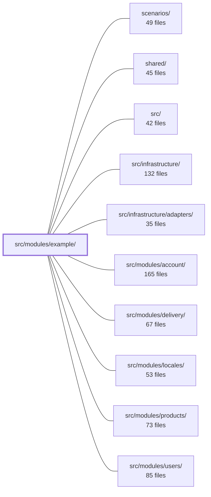

---
tags:
  - 2brain
  - 2brain/module
  - project/boilerplate-node-backend
type: module
module: src/modules/example/
files: 51
updated: 2026-11-15T00:32:07.479695+00:00
---

# src/modules/example/

## Purpose

The `example` module is a small, fully-wired reference domain (an "example" note with an owner, a lifecycle status, and an optional cover image) that doubles as the canonical **copy-paste template** for building new domain modules. Every capability the codebase supports—CRUD, status transitions, webhooks, audit, analytics, rate-limiting, personal-data export/erasure, email notification, contract tests—is implemented here at minimal scale so a new team can fork the pattern, rename it, and delete the originals.

## Key parts

- **Domain & model** — `model.ts` (Mongoose schema + wire-shape transform), `domain/lifecycle.ts` (pure status-machine with publish/archive/unarchive), `domain/index.ts` (barrel).
- **Service layer** — `services/index.ts` is the single facade (`exampleService`). Behind it: `crud.ts` (create/read/search/update/delete), `transition.ts` (lifecycle doors with optimistic concurrency), `cover.ts` (image upload), `owner.ts` (cross-module name resolution + presentation), `notify.ts` (event listener for `example.published` email), `personal-data.ts` (GDPR export/erase), `actions.ts` (per-row permission set).
- **Controllers** — One file per HTTP verb/action under `controllers/`; each is a thin HTTP edge that delegates to the service. `delete-example.ts` is hand-written (single hard-delete tier); the rest use shared factories.
- **Data access & routing** — `repository.ts` (sole data-access file; composes the shared CRUD/search factory with scoped reads, status moves, bulk erasure, image cleanup); `routes.ts` (endpoint table + per-route middleware ordering that separates public from signed-in paths).
- **Contracts & configuration** — `openapi.yaml` (full HTTP contract), `asyncapi.webhooks.yaml` (webhook event), `authorization.yaml` (role/action rules), `rules.yaml` + `rules.schema.ts` (audit/analytics vocabulary fed into codegen), `config.ts` (typed env-var single source of truth), `rate-limits.ts` (budget declarations).
- **Cross-cutting registrations** — `analytics.ts`, `audit.ts`, `events.ts`, `metrics.ts` (each augments a shared app-wide type union or registers a Prometheus counter), `emails.ts` (locale-ready mail copy, pure strings).
- **Module entry & presentation** — `index.ts` (the only import surface siblings may use), `module.ts` / `module.yaml` (manifest wiring subscriptions, rate limits, personal-data hooks, etc.), `presenter.ts` (document → wire-contract shaping), `probes.ts` (API refusal-path probes).
- **Fixtures & tests** — `factories.ts` (pure document builders), `tests/factories.ts` (persistence helpers), `tests/contract/api.contract.test.ts` (HTTP contract pinned to `openapi.yaml`).

## How it connects

- **`users`** — `services/owner.ts` is the *only* file that reads another module's data, resolving an owner's display name. `module.ts` declares the dependency.
- **`shared/`** — Relies on the shared CRUD/search factory (`repository.ts`), shared item-controller factory (`get-example.ts`), shared `buildRateLimiter` helper (`rate-limits.ts`), and the app-wide `AuditActionMap`, `AnalyticsEventMap`, and `DomainEventMap` type unions that this module augments.
- **`src/infrastructure/` & `src/infrastructure/adapters/`** — Provides the Mongoose driver, upload middleware, observability registry, and other runtime adapters the module consumes but never configures directly.
- **`src/modules/delivery/`** — `emails.ts` composes the "example published" copy; actual SMTP/API sending is delegated to the delivery module.
- **`src/modules/locales/`** — Supplies locale resolution so `emails.ts` and `presenter.ts` can return the correct language variant.
- **`src/modules/account/`** — Invokes the `personal-data.ts` export/erase functions via the manifest registration in `module.ts`, without importing them directly.
- **`/` (root) & codegen** — `rules.yaml` → `npm run regenerate` → `rules.generated.ts` at the repository root; `probes.ts` is consumed by `scripts/contracts/client-collections-bundle.ts`.
- **`scenarios/`** — Provides end-to-end scenario definitions that exercise this module's public routes.

## Where to start

1. **`index.ts`** — It is the only door another module may import through, so reading it tells you exactly what the module exposes (services, domain rules, events, emails, model types) and nothing more.
2. **`domain/lifecycle.ts`** — A short, I/O-free file that shows the three-status state machine and the predicates the rest of the module (services, presenters, controllers) build on. From there, `services/transition.ts` shows how a transition is actually applied, and `services/crud.ts` shows the full read/write path.

## Connected modules

[[boilerplate-node-backend_ROOT|/ (repository root)]] · [[boilerplate-node-backend_scenarios|scenarios/]] · [[boilerplate-node-backend_shared|shared/]] · [[boilerplate-node-backend_src|src/]] · [[boilerplate-node-backend_src_infrastructure|src/infrastructure/]] · [[boilerplate-node-backend_src_infrastructure_adapters|src/infrastructure/adapters/]] · [[boilerplate-node-backend_src_modules_account|src/modules/account/]] · [[boilerplate-node-backend_src_modules_delivery|src/modules/delivery/]] · [[boilerplate-node-backend_src_modules_locales|src/modules/locales/]] · [[boilerplate-node-backend_src_modules_products|src/modules/products/]] · [[boilerplate-node-backend_src_modules_users|src/modules/users/]]

## Files
- `src/modules/example/analytics.ts` — Declares the analytics event names that the *example* module fires, and registers them into the app-wide `AnalyticsEventMap` union via TypeScript module augmentation. The single event, `example_published`, is emitted when a publish lands. The event names themselves are sourced from a generated file (`rules.generated.ts`) derived from `rules.yaml`.
- `src/modules/example/asyncapi.webhooks.yaml` — AsyncAPI fragment that declares the `example` module's single webhook event (`example.published`) so it appears in the merged `webhooks` contract. It exists as a copyable template for other modules to model their own webhook events.
- `src/modules/example/audit.ts` — Declares the set of audit actions the example module can emit (create, update, status change, delete, cover change) and registers them into the app-wide `AuditActionMap` union via TypeScript module augmentation. The concrete values are generated from `rules.yaml` into `rules.generated`; this file's role is purely to widen the shared type so downstream consumers see this module's actions as a valid discriminant.
- `src/modules/example/authorization.yaml` — Declares the authorization rules and rule sets for the `example` module. It defines which actions a caller may perform on `Example` rows, distinguishing self-scoped operations (bound to `$caller.id`) from cross-user "staff" operations (`display`, `admin`), and groups them into assignable sets.
- `src/modules/example/config.ts` — Declares the single source of truth for the example module's environment variables. Every env var the module reads is typed, validated, and given defaults here at boot; no other file in the module touches `process.env` directly.
- `src/modules/example/controllers/delete-example.ts` — Hand-written controller for `DELETE /examples/:id`. It exists in place of the shared delete factory because that factory emits a soft/hard delete triplet, while the example module has only a single (hard) delete tier. It validates the id, enforces caller permissions, supports optimistic concurrency via `If-Match`, and delegates to the example service.
- `src/modules/example/controllers/get-example.ts` — Defines the `GET /examples/:id` handler by delegating to the shared item-controller factory. It exists so that reading a single published example is a one-liner with consistent 404 semantics, and because this route sits **above** the auth gate (any visitor may read a published example).
- `src/modules/example/controllers/get-examples.ts` — Thin wiring controller for the Example module's search surface. It defines a single search controller that serves both `GET /examples` and `POST /examples/search`, decoding the incoming request into a validated query and delegating the actual lookup to `exampleService.search`.
- `src/modules/example/controllers/post-example-event.ts` — Thin action controller that exposes the three lifecycle doors for the example resource — `POST /examples/:id/publish`, `/archive`, and `/unarchive`. Each handler validates the id, delegates to the corresponding service method, and formats the HTTP response. All business rules live in the service; this file only wires the HTTP edges.
- `src/modules/example/controllers/post-example.ts` — HTTP handler for `POST /examples`. Validates the JSON body against the generated Zod schema (with whitespace trimming applied), delegates to `exampleService.create`, and answers `201 Created` with a `Location` header pointing to the new resource.
- `src/modules/example/controllers/put-example-cover.ts` — Express handler for `PUT /examples/:id/cover`. Reads the uploaded image (left on the request by the upload middleware) and delegates the cover replacement to the module's service. Exists as the thin controller layer between the HTTP contract and the business logic.
- `src/modules/example/controllers/update-example.ts` — Defines the `PUT` (full replace) and `PATCH` (partial merge) handlers for `/examples/:id`. Both share a single pipeline built by the `createUpdateController` factory (which owns the id lookup, `If-Match` validation, and `ETag` response). This file supplies only what is module-specific: the two body schemas and the service call.
- `src/modules/example/domain/index.ts` — Barrel file that re-exports the entire public API of the `example` module's domain layer. It exists so that consumers (services, tests, the module entry point) can import domain rules from a single path without reaching into sub-files. No logic lives here — it is a pure re-export surface.
- `src/modules/example/domain/lifecycle.ts` — Pure, I/O-free status-machine definition for the `example` entity. It declares the three lifecycle events (publish, archive, unarchive), validates them against the status enum at module load via `defineLifecycle`, and exposes small query predicates that services use to enforce transitions, compute permissions, and apply side-effect rules (publish-date stamping, body-length ceiling).
- `src/modules/example/emails.ts` — Translates the "example published" email copy into finished, locale-specific strings. It is the single place where the module's outgoing mail text is composed; actual sending is handled elsewhere. The file is intentionally a pure "string factory" — it resolves no templates and performs no I/O.
- `src/modules/example/events.ts` — Declares the domain events this module emits by augmenting the kernel's shared `DomainEventMap` interface, and exports the event name as a string constant. This keeps event payload types registered app-wide (rather than in a central list) so any consumer gets typed access to `example.published`.
- `src/modules/example/factories.ts` — Builds ready-to-insert `ExampleDocument` fixtures for tests and seeds. It exists outside the service layer so callers can write rows directly via `exampleRepository.create`, bypassing the validation and invariants a service would enforce.
- `src/modules/example/index.ts` — Public barrel file for the `example` module. It is the **only** import surface a sibling module is allowed to use. It re-exports the module's services, domain rules, events, emails, and the model's types — and nothing else.
- `src/modules/example/metrics.ts` — Defines the Prometheus counters owned by the `example` module and registers them on the shared observability registry. Currently exposes a single counter (`example_created_total`) that tracks how many examples have been created, giving a signal of whether the module is being used at all.
- `src/modules/example/model.ts` — Defines the Mongoose schema, document type, and shared wire-shape transform for the **example** resource (a note with an owner, a status, and an optional cover). It is the single source of truth for what a row looks like in the database, on the wire, and as a contract type—used by both the repository and the presenter.
- `src/modules/example/module.ts` — The manifest entry for the `example` module. It is a **template**: every capability the module wants the application to provide (event subscriptions, rate limits, webhook projections, image writeback, translations, personal-data export/erasure, routes) is declared here in one object, and the supporting files for each capability live alongside. The file's stated job is to be copied when starting a new domain and then deleted. Nothing in the codebase depends on it; it depends on `users` (via its barrel) only for the owner's name.
- `src/modules/example/module.yaml` — A declarative module definition that serves as a copy-paste scaffold for new domain modules. It declares the example note's metadata, its dependency on `users`, and the rate-limit policy for the creation endpoint. The summary explicitly marks it as disposable: delete it once you've forked the pattern into your own domain.
- `src/modules/example/openapi.yaml` — OpenAPI 3.1.0 contract for the **example** module — a small, complete reference domain intended as the starting template for new modules. It declares the full CRUD surface (`/examples`, `/examples/search`, `/examples/{id}`), the status lifecycle (draft → published → archived), custom error codes, and the module's slice of the account data export. The tag description explicitly notes it is safe to delete.
- `src/modules/example/presenter.ts` — The single place where a stored Mongoose document or repository row is shaped into the wire contract (`Example` / `ExportExample`) declared in `openapi.yaml`. It exists so that every read and write path answers with the same structure, and so that concerns the document cannot supply (`ownerName` from `users`, `actions` from the caller's service) are injected by the caller rather than fetched here.
- `src/modules/example/probes.ts` — Defines the example module's probe collection — a set of API requests that exercise refusal paths the OpenAPI contract cannot express (e.g. anonymous 404s, invalid ObjectId shapes). These probes are executed by the generated client-collection runner (`scripts/contracts/client-collections-bundle.ts`) to verify that the server's error responses are indistinguishable from legitimate "not found" cases. The file should be deleted once every refusal is reachable from the contract alone.
- `src/modules/example/rate-limits.ts` — Declares this module's rate-limit budgets as data and turns them into Express middleware via the shared `buildRateLimiter` helper. Each budget defines *what* is limited (a route's write action), *how* it is keyed (account vs. address), and *how much* is allowed (pulled from the generated file). Delete this file if the module no longer needs any budget.
- `src/modules/example/repository.ts` — The sole data-access layer for the "example" collection within the module. It composes the shared CRUD/search factory with the concerns this collection uniquely needs—scoped authorization reads, conditional status moves, bulk erasure with image cleanup, translation metadata, and image-writeback. The service layer is the public door; nothing outside the module imports this file directly.
- `src/modules/example/routes.ts` — The route table for the example module. It declares every HTTP endpoint (GET, POST, PUT, PATCH, DELETE) for example resources, wires each to its controller, and orders authentication, authorization, caching, rate-limiting, and idempotency middlewares per route. Positional placement relative to `router.use(getAuth, isAuth)` is the sole mechanism that separates public routes from signed-in routes.
- `src/modules/example/rules.schema.ts` — Defines the Zod validation schema for this module's `rules.yaml` file and declares what the `npm run regenerate` codegen step should emit from it. Acts as the single source of truth for the audit-action and analytics-event vocabulary owned by the `example` module.
- `src/modules/example/rules.yaml` — Declarative registry of audit and analytics event names for the example module. It is the single source of truth from which `npm run regenerate` emits `rules.generated.ts`, providing strongly-typed constant strings for the app-wide `AuditActionMap` and `AnalyticsEventMap` unions.
- `src/modules/example/services/actions.ts` — Centralises the per-row answer to "what may this caller do?" for the Example module. It combines kernel-level ability checks (`update`, `delete`, own-rows) with the domain's lifecycle-derived moves so that clients receive a ready-made action set and never re-derive permissions themselves. The file exists to be deleted if the module has no per-row actions that need to be greyed out or enabled.
- `src/modules/example/services/cover.ts` — Applies a cover-image upload (already parsed by upload middleware) to an `Example` document, enqueues the new image for the digest pipeline, and deletes the image it replaced. It is the module's upload-capability service for the example's cover image.
- `src/modules/example/services/crud.ts` — The CRUD service for the example module. It implements create, read, search, update, and delete of `Example` documents, applying access scoping, body-length validation, presentation, translation, audit logging, and metrics. Status transitions are intentionally excluded (delegated to `./transition.ts`). Composed as the single service door by `./index.ts`; controllers and sibling modules call its exports.
- `src/modules/example/services/index.ts` — Barrel/facade for the example module's service layer. It aggregates the individual capability files (CRUD, cover, status transitions) into a single `exampleService` object, which is the **only** entry point controllers are expected to call. The folder structure exists so each optional capability keeps its own file; this index is the one door.
- `src/modules/example/services/notify.ts` — Listener for the `example.published` domain event. When the example module publishes an example, this handler emails the owner a confirmation in their preferred locale. It is attached by `module.ts`'s `subscribe` call, so the publishing service is unaware of its existence.
- `src/modules/example/services/owner.ts` — The single point in the example module where another module's (users) data is read. It resolves an owner's display name and presents stored example documents as the contract's `Example` shape — either for a signed-in caller (with per-caller actions) or publicly (with actions disabled).
- `src/modules/example/services/personal-data.ts` — Defines the two GDPR-style personal-data operations for the example module: **collect** (export all examples a person owns, shaped to the export contract) and **erase** (delete those examples and their cover images). Registered on the module manifest as `personalData`, so `account` and `users` invoke these functions without importing this file directly.
- `src/modules/example/services/transition.ts` — Implements the lifecycle "door" for the Example entity — the single point where a draft, published, or archived example can change status. Each transition is a standalone service function (not a field on the update payload) that checks domain legality, performs a conditional write (so only one racer lands), and fires side effects (outbox announcement, analytics, audit) only for the winner.
- `src/modules/example/tests/contract/api.contract.test.ts` — Contract tests for the `/examples` API surface. Each case exercises a route over real HTTP (via supertest) and asserts the declared response is actually reached: correct status, `Location`/`ETag` headers, field-level error shape, and response body structure. Behavioural rules (row state, side-effects) are the integration suite's job; this file exists to pin the HTTP contract to `openapi.yaml`.
- `src/modules/example/tests/factories.ts` — Test-database persistence layer for the `example` module. It sits one level below the pure builder (`src/modules/example/factories.ts`) and exists so tests can *store* and *selectively read back* example documents without hand-writing `repository` calls or destructuring `findById` results inline.
- `src/modules/example/tests/integration/capabilities.test.ts` — Integration tests for the example module's optional capabilities, each proven in isolation: publish-mail dispatch (via the real `subscribe` wiring), cover-image management, GDPR data export/erasure, the two writes the `locales` port performs on the collection, and the image digest writeback. The suite exercises real module subscriptions and repository calls against a test database, while stubbing only external side-effects (mail, file-system removal, audit emission).
- `src/modules/example/tests/integration/service.test.ts` — Integration test suite that exercises `exampleService` against a real database (via `setupTestDb`). It verifies ownership scoping (own / any / nothing), the draft→published→archived lifecycle on write, one-time `publishedAt` stamping, exactly-once publish announcement through the outbox, and the environment-driven body-length ceiling.
- `src/modules/example/tests/integration/translations.test.ts` — Integration tests that exercise the full translation lifecycle for an **example** entity through the real `/locales` HTTP routes. They verify that writing a fallback-language title copies the value onto the row, that a non-fallback language stores a translation slot without touching the row, that invalid payloads are rejected (422) with the row left unchanged, and that reads (single + list) resolve the correct title based on `Accept-Language`, including draft-language preview rules for staff vs. visitors.
- `src/modules/example/tests/unit/analytics.test.ts` — Unit test that pins the analytics event strings emitted by the example module. It exists to catch accidental renames of the string values (e.g. `example_published` → `example.published`) that would silently break Umami dashboards, since TypeScript alone cannot detect a changed string literal once the constant name is refactored.
- `src/modules/example/tests/unit/domain.test.ts` — Unit tests for the example domain's lifecycle rules and validation helpers. It locks down the state machine (which events are legal from which status), the `publishedAt` stamping invariant, the body-length ceiling, and the permission-aware action list — all without a database.
- `src/modules/example/tests/unit/emails.test.ts` — Unit tests for the `examplePublishedEmail` function, verifying that the publish-notification email copy (subject, greeting, body) resolves correctly into finished strings for each supported locale.
- `src/modules/example/tests/unit/lifecycle.property.test.ts` — Property-based tests (via `fast-check`) for the lifecycle domain module. Instead of hand-picking fixture cases, the suite generates random combinations of status and permission keys and asserts the invariants a client relies on: opened events are always legal from the current status, no event is a no-op, and a caller without edit permission gets no actions. The file is `@module` — it exports nothing.
- `src/modules/example/tests/unit/manifest.test.ts` — Unit test that pins the public contract of the `example` module: the shape of its webhook projection, which fields are translatable, the registered image target key, the personal-data export/erasure pair, and the rate-limit budget it ships. It exists so that other modules (`account`, `users`) can rely on this surface without importing the module directly, and so regressions in the manifest are caught immediately.
- `src/modules/example/tests/unit/routes.test.ts` — Verifies the **mount order** and **positional auth guard** of the example module's Express router. Because the sign-in gate is enforced purely by placement (everything after `router.use(getAuth, isAuth)`), a misplaced route is silently wrong; these tests pin down *which* routes sit above the gate, *which* sit below, and *in what order* they are registered.
- `src/modules/example/tests/unit/schema-contract.test.ts` — Contract test that pins down the public shape of `exampleSchema`: its required fields, status lifecycle defaults, the single composite index, and timestamp behavior. It exists so any schema change that silently breaks the owner-list query or the draft→published flow is caught before it reaches the database.
- `src/modules/example/title-rule.ts` — Defines the single shared validation rule for the Example entity's `title` field. It exists so that every HTTP entry point that accepts a title (the owner's own endpoint and the generic translator endpoint) applies identical trim-then-validate logic, preventing whitespace-only values from slipping through as blank column values.

---
[[boilerplate-node-backend_INDEX|← boilerplate-node-backend index]]
