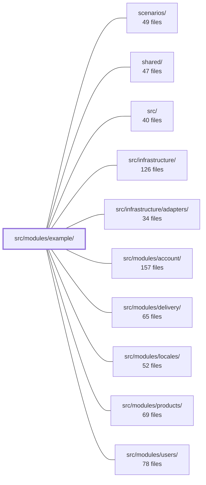

---
tags:
  - 2brain
  - 2brain/module
  - project/boilerplate-node-backend
type: module
module: src/modules/example/
files: 50
updated: 2026-11-08T10:50:47.750852+00:00
---

# src/modules/example/

## Purpose

The `example` module is a **reference implementation and copy-paste scaffold** for new domain modules in this codebase. It provides a small, complete CRUD domain (an "Example" note with an owner, a status lifecycle, and an optional cover image) that demonstrates every pattern the kernel expects: contract-first design, code-generated rules, layered services, and cross-module integration. Every manifest file explicitly marks itself as disposable—duplicate the directory for your new domain, then delete this one.

## Key parts

- **Module manifest & contracts** — `module.ts`, `module.yaml`, `openapi.yaml`, `asyncapi.webhooks.yaml`, `authorization.yaml` define the module's capabilities, HTTP surface, webhook events, and authorization rules. A build tooling step (bundler at the repo root) merges these into the app-wide spec.
- **Code-generated rules** — `rules.yaml` → `rules.schema.ts` → `rules.generated.ts` (via `npm run regenerate`) produces typed constants for audit actions and analytics events, which `audit.ts` and `analytics.ts` widen into app-wide type unions.
- **Domain layer** — `domain/lifecycle.ts` (pure status-machine predicates) and `domain/index.ts` (barrel) hold I/O-free business rules.
- **Service layer** — `services/` is the public door. `services/index.ts` aggregates `crud.ts`, `transition.ts`, `cover.ts`, `notify.ts`, `actions.ts`, `owner.ts`, and `personal-data.ts` into a single `exampleService` object. Controllers and sibling modules only import this facade.
- **HTTP layer** — `routes.ts` declares every endpoint and middleware ordering; `controllers/` contains one thin file per route that validates input and delegates to the service.
- **Data layer** — `model.ts` (Mongoose schema + wire-shape transform) and `repository.ts` (sole data-access file, scoped reads, conditional writes, image cleanup).
- **Observability & config** — `metrics.ts`, `events.ts`, `emails.ts`, `config.ts`, `rate-limits.ts`, `presenter.ts` cover Prometheus counters, domain events, email copy, env-var validation, rate-limit budgets, and the document→wire mapping.
- **Tests** — `tests/contract/api.contract.test.ts` verifies the declared OpenAPI surface over HTTP; `tests/factories.ts` provides the persistence layer for integration tests; `factories.ts` (top-level) builds raw fixtures.
- **Probes** — `probes.ts` encodes refusal paths (anonymous 404s, invalid ObjectId shapes) that the contract cannot express.

## How it connects

- **`src/modules/users/`** — The example module's only cross-module data read goes through `services/owner.ts`, which resolves the owner's display name from the users module. The `authorization.yaml` also references `$caller.id` (a user identity) for self-scoped actions.
- **`src/modules/account/`** and **`src/modules/users/`** — Both invoke the `personal-data.ts` operations (export / erase) registered on the module manifest, without importing the file directly.
- **`src/modules/locales/`** — Consumed by `emails.ts` and the translation hooks in the repository to resolve locale-specific strings.
- **`src/modules/delivery/`** — Handles the actual email send that `services/notify.ts` enqueues (the notify service composes the message; delivery transports it).
- **`shared/`** — Provides the shared CRUD/search factory (`createUpdateController`, search factory), `buildRateLimiter`, `defineLifecycle`, the shared `AnalyticsEventMap`/`AuditActionMap`/`DomainEventMap` interfaces, and the Mongoose/Express adapters this module composes.
- **`src/infrastructure/` & `src/infrastructure/adapters/`** — Supply the underlying Mongoose connection, Express app wiring, upload middleware, and outbox writer that the repository and controllers depend on.
- **Repository root / build scripts** — `scripts/contracts/` merges the AsyncAPI fragment and OpenAPI section into the root spec; `npm run regenerate` emits `rules.generated.ts` from `rules.yaml`.
- **`scenarios/`** — Test scenarios (e.g., personal-data export flows) exercise this module alongside others.
- **`src/modules/products/`** — Listed as a sibling in the dependency graph; no direct import relationship is evident in this module's files.

## Where to start

1. **`module.ts`** — Read this first. It is the single wiring point that shows every optional capability (events, rate limits, webhooks, translations, cover images, personal-data) and how they compose into the `AppModule` the kernel boots. It is the table of contents for the whole directory.
2. **`services/index.ts`** — The only door controllers use. Skimming its exports (and the short `crud.ts` it re-exports) gives you the full picture of what the module *does* at the business-logic level before you drill into any single controller or repository call.

## Connected modules

[[boilerplate-node-backend_ROOT|/ (repository root)]] · [[boilerplate-node-backend_scenarios|scenarios/]] · [[boilerplate-node-backend_shared|shared/]] · [[boilerplate-node-backend_src|src/]] · [[boilerplate-node-backend_src_infrastructure|src/infrastructure/]] · [[boilerplate-node-backend_src_infrastructure_adapters|src/infrastructure/adapters/]] · [[boilerplate-node-backend_src_modules_account|src/modules/account/]] · [[boilerplate-node-backend_src_modules_delivery|src/modules/delivery/]] · [[boilerplate-node-backend_src_modules_locales|src/modules/locales/]] · [[boilerplate-node-backend_src_modules_products|src/modules/products/]] · [[boilerplate-node-backend_src_modules_users|src/modules/users/]]

## Files
- `src/modules/example/analytics.ts` — Declares the analytics event names that the *example* module fires, and registers them into the app-wide `AnalyticsEventMap` union via TypeScript module augmentation. The single event, `example_published`, is emitted when a publish lands. The event names themselves are sourced from a generated file (`rules.generated.ts`) derived from `rules.yaml`.
- `src/modules/example/asyncapi.webhooks.yaml` — AsyncAPI fragment that declares the `example.published` webhook event for the example module. It is a **fragment**, not a standalone document: it references `#/servers/subscriberEndpoint` and `#/components/schemas/WebhookHeaders` that live in the root `webhooks/asyncapi.yaml`. The bundler (`scripts/contracts/asyncapi-section-fragments.ts`) merges this file into the `webhooks` section only while the example module is registered. Deleting the module removes its events from the contract.
- `src/modules/example/audit.ts` — Declares the set of audit actions the example module can emit (create, update, status change, delete, cover change) and registers them into the app-wide `AuditActionMap` union via TypeScript module augmentation. The concrete values are generated from `rules.yaml` into `rules.generated`; this file's role is purely to widen the shared type so downstream consumers see this module's actions as a valid discriminant.
- `src/modules/example/authorization.yaml` — Declares the authorization rules and rule sets for the `example` module. It defines which actions a caller may perform on `Example` rows, distinguishing self-scoped operations (bound to `$caller.id`) from cross-user "staff" operations (`display`, `admin`), and groups them into assignable sets.
- `src/modules/example/config.ts` — Declares the single source of truth for the example module's environment variables. Every env var the module reads is typed, validated, and given defaults here at boot; no other file in the module touches `process.env` directly.
- `src/modules/example/controllers/delete-example.ts` — Hand-written controller for `DELETE /examples/:id`. It exists in place of the shared delete factory because that factory emits a soft/hard delete triplet, while the example module has no soft-delete tier to flag.
- `src/modules/example/controllers/get-example.ts` — Defines the `GET /examples/:id` handler by delegating to the shared item-controller factory. It exists so that reading a single published example is a one-liner with consistent 404 semantics, and because this route sits **above** the auth gate (any visitor may read a published example).
- `src/modules/example/controllers/get-examples.ts` — Thin wiring controller for the Example module's search surface. It defines a single search controller that serves both `GET /examples` and `POST /examples/search`, decoding the incoming request into a validated query and delegating the actual lookup to `exampleService.search`.
- `src/modules/example/controllers/post-example-event.ts` — Thin action controller for the three lifecycle endpoints of the `example` resource (`POST /examples/:id/publish`, `/archive`, `/unarchive`). Each handler validates the route `:id`, delegates to the corresponding `exampleService` method, and shapes the HTTP response. All business rules live in the service layer; this file exists only to wire the HTTP contract to those calls.
- `src/modules/example/controllers/post-example.ts` — Create controller for `POST /examples`. Validates the JSON body against a trimmed Zod schema, delegates to `exampleService.create`, and responds with `201` + `Location` header. Exists to keep the HTTP layer (parsing, status codes, headers) separate from domain logic.
- `src/modules/example/controllers/put-example-cover.ts` — Upload controller for `PUT /examples/:id/cover`. It reads the uploaded image data left on the request by upload middleware, validates that an image is actually present, and delegates to `exampleService.setCover` to persist the new cover. Exists as the thin HTTP→service bridge for the example module's cover-replacement endpoint.
- `src/modules/example/controllers/update-example.ts` — Defines the `PUT` (replace) and `PATCH` (merge) handlers for `/examples/:id`. Both verbs share a single pipeline produced by the shared `createUpdateController` factory, which owns the id-existence check, `If-Match`/`ETag` enforcement, and response shaping. This file only supplies the two trimmed request schemas and the service call.
- `src/modules/example/domain/index.ts` — Barrel file that re-exports the entire public API of the `example` module's domain layer. It exists so that consumers (services, tests, the module entry point) can import domain rules from a single path without reaching into sub-files. No logic lives here — it is a pure re-export surface.
- `src/modules/example/domain/lifecycle.ts` — Pure, I/O-free status-machine definition for the `example` entity. It declares the three lifecycle events (publish, archive, unarchive), validates them against the status enum at module load via `defineLifecycle`, and exposes small query predicates that services use to enforce transitions, compute permissions, and apply side-effect rules (publish-date stamping, body-length ceiling).
- `src/modules/example/emails.ts` — Translates the "example published" email copy into finished, locale-specific strings. It is the single place where the module's outgoing mail text is composed; actual sending is handled elsewhere. The file is intentionally a pure "string factory" — it resolves no templates and performs no I/O.
- `src/modules/example/events.ts` — Declares the domain events this module emits by augmenting the kernel's shared `DomainEventMap` interface, and exports the event name as a string constant. This keeps event payload types registered app-wide (rather than in a central list) so any consumer gets typed access to `example.published`.
- `src/modules/example/factories.ts` — Builds ready-to-insert `ExampleDocument` fixtures for tests and seeds. It exists outside the service layer so callers can write rows directly via `exampleRepository.create`, bypassing the validation and invariants a service would enforce.
- `src/modules/example/index.ts` — Public barrel file for the `example` module. It is the **only** import surface a sibling module is allowed to use. It re-exports the module's services, domain rules, events, emails, and the model's types — and nothing else.
- `src/modules/example/metrics.ts` — Declares the Prometheus counters owned by the `example` module. It registers them on the shared observability registry so they are exposed alongside counters from all other modules. The module currently tracks a single metric: how many examples have been created.
- `src/modules/example/model.ts` — Defines the Mongoose schema, document interface, registered model, and shared wire-shape serialization for the **Example** entity (a note with an owner, a status, and an optional cover image). This is the single source of truth for the collection's shape and the transform both the repository and the presenter consume, keeping the persistence and presentation layers in agreement without either importing the other.
- `src/modules/example/module.ts` — Module manifest for the `example` domain. It is explicitly a **copy-paste template**: its sole job is to be duplicated when starting a new domain and then deleted. It wires together each optional capability (events, rate limits, webhooks, translations, cover images, config, personal-data) into a single `AppModule` object the kernel can boot.
- `src/modules/example/module.yaml` — A declarative module definition that serves as a copy-paste scaffold for new domain modules. It declares the example note's metadata, its dependency on `users`, and the rate-limit policy for the creation endpoint. The summary explicitly marks it as disposable: delete it once you've forked the pattern into your own domain.
- `src/modules/example/openapi.yaml` — OpenAPI 3.1.0 contract for the "example" module — a small, complete reference domain meant as a template for new modules. It defines the full CRUD surface for an `Example` resource (list, create, search, read, replace, update, delete, plus status-transition operations) and declares module-level metadata (tags, custom error codes, personal-data export section) that a bundler consumes to assemble the root spec.
- `src/modules/example/presenter.ts` — Single mapping layer that turns a stored example (Mongoose document or raw repository row) into the wire shape declared by `openapi.yaml`. It exists so every read and write path returns the identical `Example` structure, with the two fields a stored row cannot supply (`ownerName`, `actions`) injected by the caller.
- `src/modules/example/probes.ts` — Defines the example module's probe collection — a set of API requests that exercise refusal paths the OpenAPI contract cannot express (e.g. anonymous 404s, invalid ObjectId shapes). These probes are executed by the generated client-collection runner (`scripts/contracts/client-collections-bundle.ts`) to verify that the server's error responses are indistinguishable from legitimate "not found" cases. The file should be deleted once every refusal is reachable from the contract alone.
- `src/modules/example/rate-limits.ts` — Declares this module's rate-limit budgets as data and turns them into Express middleware via the shared `buildRateLimiter` helper. Each budget defines *what* is limited (a route's write action), *how* it is keyed (account vs. address), and *how much* is allowed (pulled from the generated file). Delete this file if the module no longer needs any budget.
- `src/modules/example/repository.ts` — The sole data-access layer for the "example" collection within the module. It composes the shared CRUD/search factory with the concerns this collection uniquely needs—scoped authorization reads, conditional status moves, bulk erasure with image cleanup, translation metadata, and image-writeback. The service layer is the public door; nothing outside the module imports this file directly.
- `src/modules/example/routes.ts` — The route table for the example module. It declares every HTTP endpoint (GET, POST, PUT, PATCH, DELETE) for example resources, wires each to its controller, and orders authentication, authorization, caching, rate-limiting, and idempotency middlewares per route. Positional placement relative to `router.use(getAuth, isAuth)` is the sole mechanism that separates public routes from signed-in routes.
- `src/modules/example/rules.schema.ts` — Defines the Zod schema for the example module's `rules.yaml` and the `GenerateSpec` that `npm run regenerate` consumes to produce `rules.generated.ts`. This file is the single source of truth for the two rule lists (audit actions and analytics events) that the module owns and that the PHP twin copies from.
- `src/modules/example/rules.yaml` — Declarative registry of audit and analytics event names for the example module. It is the single source of truth from which `npm run regenerate` emits `rules.generated.ts`, providing strongly-typed constant strings for the app-wide `AuditActionMap` and `AnalyticsEventMap` unions.
- `src/modules/example/services/actions.ts` — Centralizes the per-row authorization and lifecycle answer for the **example** module. Given a caller and a row, it determines which actions (`update`, `delete`, and status transitions) are available, so no client re-derives permissions. The ability check is built once per page, then applied row-by-row.
- `src/modules/example/services/cover.ts` — Applies a cover-image upload (already parsed by upload middleware) to an `Example` document, enqueues the new image for the digest pipeline, and deletes the image it replaced. It is the module's upload-capability service for the example's cover image.
- `src/modules/example/services/crud.ts` — The CRUD service for the example module. It implements create, read, search, update, and delete of `Example` documents, applying access scoping, body-length validation, presentation, translation, audit logging, and metrics. Status transitions are intentionally excluded (delegated to `./transition.ts`). Composed as the single service door by `./index.ts`; controllers and sibling modules call its exports.
- `src/modules/example/services/index.ts` — Barrel/facade for the example module's service layer. It aggregates the individual capability files (CRUD, cover, status transitions) into a single `exampleService` object, which is the **only** entry point controllers are expected to call. The folder structure exists so each optional capability keeps its own file; this index is the one door.
- `src/modules/example/services/notify.ts` — Listener for the `example.published` domain event. When the example module publishes an example, this handler emails the owner a confirmation in their preferred locale. It is attached by `module.ts`'s `subscribe` call, so the publishing service is unaware of its existence.
- `src/modules/example/services/owner.ts` — The single point in the example module where another module's (users) data is read. It resolves an owner's display name and presents stored example documents as the contract's `Example` shape — either for a signed-in caller (with per-caller actions) or publicly (with actions disabled).
- `src/modules/example/services/personal-data.ts` — Defines the two GDPR-style personal-data operations for the example module: **collect** (export all examples a person owns, shaped to the export contract) and **erase** (delete those examples and their cover images). Registered on the module manifest as `personalData`, so `account` and `users` invoke these functions without importing this file directly.
- `src/modules/example/services/transition.ts` — Implements the lifecycle "door" for the Example entity — the single point where a draft, published, or archived example can change status. Each transition is a standalone service function (not a field on the update payload) that checks domain legality, performs a conditional write (so only one racer lands), and fires side effects (outbox announcement, analytics, audit) only for the winner.
- `src/modules/example/tests/contract/api.contract.test.ts` — Contract tests for every `/examples` route over HTTP, asserting that each response declared in `openapi.yaml` is actually reachable. The file enforces one access-control invariant—cross-tenant resources return **404, never 403**, so an ID leaks no ownership information—and pins status codes, field-level validation shapes, and public-vs-private visibility. Behavioural logic lives in the integration suite; this file only verifies that the declared surface is hit.
- `src/modules/example/tests/factories.ts` — Test-database persistence layer for the `example` module. It sits one level below the pure builder (`src/modules/example/factories.ts`) and exists so tests can *store* and *selectively read back* example documents without hand-writing `repository` calls or destructuring `findById` results inline.
- `src/modules/example/tests/integration/capabilities.test.ts` — Integration tests that prove the example module's optional capabilities end-to-end against a real test database: the publish email (driven through the module's own `subscribe` wiring), cover-image management, GDPR-style data export and erasure, and the two writes the `locales` port performs on the collection.
- `src/modules/example/tests/integration/service.test.ts` — Integration test suite that exercises `exampleService` against a real database (via `setupTestDb`). It verifies ownership scoping (own / any / nothing), the draft→published→archived lifecycle on write, one-time `publishedAt` stamping, exactly-once publish announcement through the outbox, and the environment-driven body-length ceiling.
- `src/modules/example/tests/integration/translations.test.ts` — End-to-end integration test that exercises the full translation lifecycle for the **example** module's `title` field. It verifies that writing a translation through `/locales/translations` correctly copies the fallback language onto the row, stores non-fallback languages separately, rejects undeclared fields, and that the i18n override layer resolves the right language on single-item and list reads—including staff-only preview of an inactive language.
- `src/modules/example/tests/unit/analytics.test.ts` — Unit test that pins the analytics event strings emitted by the example module. It exists to catch accidental renames of the string values (e.g. `example_published` → `example.published`) that would silently break Umami dashboards, since TypeScript alone cannot detect a changed string literal once the constant name is refactored.
- `src/modules/example/tests/unit/domain.test.ts` — Unit tests for the example domain's lifecycle rules and validation helpers. It locks down the state machine (which events are legal from which status), the `publishedAt` stamping invariant, the body-length ceiling, and the permission-aware action list — all without a database.
- `src/modules/example/tests/unit/emails.test.ts` — Unit tests for the `examplePublishedEmail` function, verifying that the publish-notification email copy (subject, greeting, body) resolves correctly into finished strings for each supported locale.
- `src/modules/example/tests/unit/lifecycle.property.test.ts` — Property-based tests (via `fast-check`) that pin the public invariants of the example lifecycle: only legal events are ever offered, every offered event actually changes status, and permission gating behaves correctly. The event table itself is private to the domain module; these tests exercise the contract a client sees through `canApply` and `exampleActionsFor`.
- `src/modules/example/tests/unit/manifest.test.ts` — Unit tests that pin down the public contract of the example module's manifest: what name it registers, which webhook fields are exposed, which fields are translatable, what personal-data hooks it declares, and which rate-limit budget governs creation. It exists so that refactors to `module.ts`, `events.ts`, or `rate-limits.ts` that silently change the manifest surface fail immediately.
- `src/modules/example/tests/unit/routes.test.ts` — Unit test that verifies the example module's route table is mounted correctly: endpoint signatures and their order, the positional placement of the auth gate (`getAuth` / `isAuth`), and the ordering of middleware chains (budget guards before controllers). The assertions are deliberately positional because a route typed into the wrong half of the auth split would pass a naive presence check.
- `src/modules/example/tests/unit/schema-contract.test.ts` — Contract test that pins down the public shape of `exampleSchema`: its required fields, status lifecycle defaults, the single composite index, and timestamp behavior. It exists so any schema change that silently breaks the owner-list query or the draft→published flow is caught before it reaches the database.

---
[[boilerplate-node-backend_INDEX|← boilerplate-node-backend index]]
