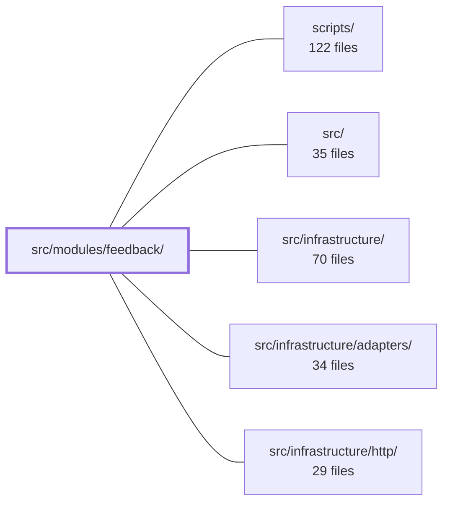

---
tags:
  - 2brain
  - 2brain/module
  - project/boilerplate-node-backend
type: module
module: src/modules/feedback/
files: 30
updated: 2026-10-15T13:39:11.834738+00:00
---

# src/modules/feedback/

## Purpose

The feedback module implements the public "contact us" form and the corresponding admin triage queue. It owns the full lifecycle of a `FeedbackRequest` ticket—from a stranger's submission through spam filtering, operator notification, status transitions, and eventual deletion or GDPR export inclusion.

## Key parts

- **Domain rules** (`domain/`) — Pure business logic for the four-value status vocabulary and the two lifecycle decisions (initial classification, `respondedAt` stamping). Kept separate because the vocabulary exceeds the project's inline threshold.
- **Service & persistence** (`service.ts`, `repository.ts`, `model.ts`) — The write-path orchestrator (create, search, update, delete, email side-effects) sits above a shared repository factory that wraps the Mongoose schema, TTL index, and serialization transform.
- **HTTP surface** (`routes.ts`, `controllers/`) — One public `POST /feedback/contact` endpoint and four admin endpoints (list, search, update, delete). Controllers are thin: they validate, delegate to the service, and shape the response via `presenter.ts`.
- **Module wiring** (`module.ts`, `config.ts`, `audit.ts`, `rate-limits.ts`) — The `AppModule` manifest mounts routes, registers rate-limit budgets (per-address, per-email, per-address-block), declares operator-facing config, and contributes the module's read-into-the-`AuditActionMap` (reads are audited here because tickets carry a stranger's email and free text).
- **Emails & contract** (`emails.ts`, `openapi.yaml`) — Operator-notification email copy (rendered in the server locale, never re-translating customer input) and the OpenAPI 3.1 spec that also declares the module's GDPR `x-personal-data` export contribution.
- **Tests** (`tests/`) — Layered from unit (lifecycle, rate-limit invariants, routes structure, emails) through integration (service behaviour, model serialization, rate-limit middleware, export guards) to contract (API shape, public-vs-admin field isolation).

## How it connects

- **`src/infrastructure/http/`** supplies the shared controller factories (`createUpdateController`, search-controller factory) and the `buildRateLimiter` helper that `rate-limits.ts` consumes to produce Express middleware. The hand-written delete controller exists precisely because the shared `createDeleteController` factory models a soft/hard-delete triplet that feedback does not use.
- **`src/infrastructure/`** provides the shared repository factory that `repository.ts` plugs into, plus the mailer adapter that `emails.ts` targets. The `AppModule` shape assembled in `module.ts` is the contract the kernel registry in `src/` consumes to mount routes and wire the personal-data exporter.
- **`src/`** — `audit.ts` augments the app-wide `AuditActionMap` via TypeScript module augmentation, making feedback read-actions visible to the global audit pipeline.
- **Repository root (`/`)** — `index.ts` re-exports per the DDD strategy rule documented in `docs/theory/strategic-ddd.md`, ensuring sibling modules import only from the barrel.

## Where to start

1. **`service.ts`** — Reading the create/search/update/delete functions shows the full orchestration in one place: validation, domain-rule invocation, persistence, email dispatch, and audit logging. It is the shortest path to understanding what the module *does*.
2. **`openapi.yaml`** — The contract defines the exact wire shapes, security boundaries (public vs. admin), and the `x-personal-data` export declaration. Pairing it with `service.ts` gives a newcomer both the "what" and the "how" in under ten minutes.

## Connected modules

[[boilerplate-node-backend_ROOT|/ (repository root)]] · [[boilerplate-node-backend_scripts|scripts/]] · [[boilerplate-node-backend_src|src/]] · [[boilerplate-node-backend_src_infrastructure|src/infrastructure/]] · [[boilerplate-node-backend_src_infrastructure_adapters|src/infrastructure/adapters/]] · [[boilerplate-node-backend_src_infrastructure_http|src/infrastructure/http/]]

## Files
- `src/modules/feedback/audit.ts` — Declares the feedback module's audit-action vocabulary and registers it into the app-wide `AuditActionMap` via TypeScript module augmentation. Feedback rows carry a stranger's email address and free text, so _reads_ (not just mutations) are audit-relevant here — a data-protection concern that does not apply to, e.g., the public product catalogue.
- `src/modules/feedback/config.ts` — Declares the operator-facing configuration schema for the feedback module: the notification email address, ticket retention period, and whether tickets are included in data exports. It centralises these values so the rest of the feedback feature can read them through a typed shape rather than hard-coding environment-variable lookups.
- `src/modules/feedback/controllers/delete-feedback.ts` — Controller for `DELETE /feedback/:id` (admin). Permanently removes a feedback ticket. It is hand-written rather than derived from the shared `createDeleteController` factory because that factory models a soft/hard delete triplet, and the feedback module has no soft-delete tier.
- `src/modules/feedback/controllers/get-feedback.ts` — Controller for the admin feedback triage queue (`GET /feedback` and `POST /feedback/search`). It validates and coerces query/pagination params, then delegates to the feedback service via the shared search-controller factory. Exists to keep the admin search surface thin and consistent with other search endpoints while enforcing that the result is per-admin (never cached).
- `src/modules/feedback/controllers/post-feedback-contact.ts` — Controller for `POST /feedback/contact`, the single public write endpoint in the feedback module. It validates and trims the incoming body, delegates ticket creation (and the resulting support email) to the service layer, and returns a `201` with the created resource.
- `src/modules/feedback/controllers/update-feedback-status.ts` — Provides the `PUT /feedback/:id` (replace) and `PATCH /feedback/:id` (merge) admin handlers for updating a feedback ticket's status and notes. Both handlers are generated in a single `createUpdateController` call, keeping the replace/patch pair co-located and consistent.
- `src/modules/feedback/domain/index.ts` — Barrel file for the Feedback domain layer. It re-exports the pure business rules (status vocabulary and lifecycle helpers) so consumers can import from a single `domain/` path without reaching into sub-files. The dedicated folder exists because the status vocabulary is 4-wide—past the project's threshold that makes inlining into `service.ts` insufficient.
- `src/modules/feedback/domain/lifecycle.ts` — Encodes the two business rules around a feedback ticket's status lifecycle: how a fresh ticket is initially classified, and when the `respondedAt` timestamp gets stamped. Unlike the orders/payments domains, there is no `canTransition` gate—staff may move a ticket to any of the four `FeedbackRequestStatus` values in any direction.
- `src/modules/feedback/emails.ts` — Resolves all outgoing email copy for the feedback module into finished, interpolated strings. Follows the same convention as `@modules/account/emails`: language is passed in as an argument, output is a complete `EmailContent` object ready for the mailer. Because these emails go to the **support mailbox** (not the customer), they render in `NODE_DEFAULT_LOCALE` and the customer's own input is never re-translated.
- `src/modules/feedback/index.ts` — Public barrel for the feedback module. It is the single re-export surface that sibling modules are allowed to import from (per the DDD strategy rule in `docs/theory/strategic-ddd.md` §5), so external consumers never reach into internal sub-modules directly.
- `src/modules/feedback/model.ts` — Defines the Mongoose schema, model, and serialization transform for the `FeedbackRequest` collection. It is the single persistence-layer entry point for feedback tickets: field definitions, index creation, TTL expiry, and the `_id`/`__v` normalization that turns stored documents into wire-shaped API objects.
- `src/modules/feedback/module.ts` — Module manifest for the feedback (contact-form) feature. It assembles the router, rate limits, config, and personal-data exporter into a single `AppModule` object that the kernel registry consumes to mount routes, register budgets, and wire GDPR export under the `feedback.*` key.
- `src/modules/feedback/openapi.yaml` — OpenAPI 3.1.0 contract for the feedback module: the public contact-submission endpoint and the authenticated admin queue (list, search, update, delete) for visitor feedback requests. It also declares the module's contribution to the account data export via the `x-personal-data` extension.
- `src/modules/feedback/presenter.ts` — Centralizes the transformation from a Mongoose feedback document to the wire shape declared in `openapi.yaml`, so the two feedback controllers share one transform instead of each casting `.toJSON()` independently.
- `src/modules/feedback/rate-limits.ts` — Defines the rate-limit budgets that govern the feedback contact form (`POST /feedback/contact`). It declares three `RateLimitBudget` configurations—keyed by client address, submitted email, and address block—and converts them into Express middleware via `buildRateLimiter`. This isolates the feedback module's limits so they are tunable, auditable, and independently testable from the middleware infrastructure.
- `src/modules/feedback/repository.ts` — Defines the data-access layer for feedback requests. It wires the Mongoose model, the document→domain transform, and a declarative search spec into the shared repository factory so that the service layer can query, sort, and retrieve `FeedbackRequest` records without touching ODM specifics directly.
- `src/modules/feedback/routes.ts` — Express router that defines the HTTP route table for the feedback module: one public visitor contact-form endpoint and a set of admin-only endpoints for reading, updating, and deleting submitted feedback entries. The single exported `router` is what `module.ts` mounts into the application.
- `src/modules/feedback/service.ts` — Write-path service for the feedback module: creating contact requests (with operator notification and anti-spam gating), searching tickets, and applying status/notes updates or deletion. Business rules for initial status and `respondedAt` stamping live in `./domain`; this file orchestrates persistence, side-effects (email, audit), and HTTP response shaping around them.
- `src/modules/feedback/tests/contract/api.contract.test.ts` — Contract tests for the `/feedback` API, which is the only feedback resource with a publicly-writable endpoint (`POST /feedback/contact`, `security: []`) alongside admin-only read/write routes. The file verifies that public responses carry no admin fields, admin routes return 401/403 rather than leaking data, and that validation boundaries (field lengths, enum values, pagination limits) match the OpenAPI spec end-to-end. Records are created exclusively through the public endpoint since no fixture builder exists.
- `src/modules/feedback/tests/integration/contact-identity-rate-limit.test.ts` — Integration test for the identity-keyed dimension of the contact-form rate limiter (`contactLimiters`). It verifies that the submitted-email budget (`NODE_SUBMISSION_RATE_LIMIT_EMAIL_MAX`) is enforced independently of the per-address budget, and that the limiter is actually wired into the `POST /feedback/contact` route. The per-address-only case is covered in `submission-rate-limit.test.ts`.
- `src/modules/feedback/tests/integration/export.test.ts` — Integration tests for the feedback section of a personal-data export. They verify the GDPR Art. 12(6) guard: tickets are matched to an export by email address, so they must only be included when the requesting account has actually verified that address. They also confirm that staff-only fields never leak into the export payload.
- `src/modules/feedback/tests/integration/model.test.ts` — Integration test that enforces the serialization contract for feedback requests: the internal MongoDB fields `_id` and `__v` must never appear in a consumer-facing payload, whether the data arrives as a hydrated Mongoose document (`toJSON`) or as a `.lean()` list mapped through the service layer.
- `src/modules/feedback/tests/integration/schema-contract.test.ts` — Schema contract tests for the feedback-request Mongoose schema. Unlike sibling transform specs, this file asserts what Mongoose itself enforces at the schema level (serialization shape, defaults, required fields, `select: false`). It runs against a real MongoDB because a mocked model would only restate the mock's assumptions about Mongoose semantics.
- `src/modules/feedback/tests/integration/service.test.ts` — Integration test suite for the feedback request service. It runs against a real test database (`setupTestDb`) to pin down service-level invariants that unit tests cannot: input normalisation (email lowercasing, field trimming, blank-name coercion), the one-shot `respondedAt` stamp, honeypot and disposable-email spam disposition, operator-notification side-effects, search filtering/pagination, status transitions, and removal.
- `src/modules/feedback/tests/integration/submission-rate-limit.test.ts` — Integration test for `submissionLimiter`, the rate-limit budget on `POST /feedback/contact`. It sends real HTTP requests through the `express-rate-limit` middleware (via `supertest`) to verify that the limiter counts *every* request—success or failure—and that each 429 refusal is logged, since nothing downstream records it.
- `src/modules/feedback/tests/unit/emails.test.ts` — Unit tests for the `contactRequestEmail` function — the notification email sent to an OPERATOR (not a customer) when a contact request / ticket is submitted. The suite pins down subject construction, data pass-through, name fallback, field labeling, and locale translation so that regressions in any of those behaviors are caught at the function boundary.
- `src/modules/feedback/tests/unit/lifecycle.test.ts` — Unit tests for the two pure functions exported by `domain/lifecycle.ts`: `shouldStampRespondedAt` (decides whether a ticket transition warrants a "responded at" timestamp) and `initialFeedbackStatus` (maps a spam-signal flag to the starting status of a new ticket). No mocks or database are used; the tests exercise the functions in isolation.
- `src/modules/feedback/tests/unit/rate-limits.test.ts` — Unit tests that pin the _numerical relationships_ between the contact-form rate-limit budgets declared in the feedback module. They assert that per-identity and per-address budgets stay well below the global browsing budget, and that the address-block budget exceeds the per-address budget it widens. The file explicitly does **not** exercise the middleware at runtime; that concern is delegated to the integration tests.
- `src/modules/feedback/tests/unit/routes.test.ts` — Pins the structural contract of the feedback router: exactly which routes exist, their order, and the middleware/guard chain attached to each. The tests are deliberately **positional** because the auth gate (`router.use(getAuth, …)`) is mounted by position, not by name—so asserting "this route has a guard" alone would pass even if the gate were mis-ordered. This file exists so a refactor that silently moves the gate, drops a limiter, or reorders routes fails immediately.
- `src/modules/feedback/tests/unit/schema-contract.test.ts` — Contract test for `feedbackRequestSchema`. Pins the schema's public shape — required vs. optional fields, enum bounds, defaults, index definitions, and TTL — so that any change to the feedback-request contract is either intentional and reviewed or caught here. The design intent encoded in the tests: a stranger must supply enough to be reachable (email, subject, message) but is not obliged to identify themselves (name optional), and operator-side fields must remain absent until an operator acts.

---
[[boilerplate-node-backend_INDEX|← boilerplate-node-backend index]]
