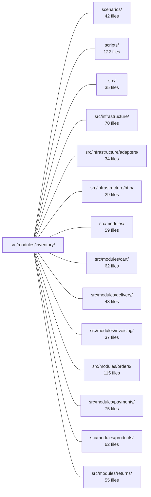

---
tags:
  - 2brain
  - 2brain/module
  - project/boilerplate-node-backend
type: module
module: src/modules/inventory/
files: 44
updated: 2026-10-15T13:39:32.102442+00:00
---

# src/modules/inventory/

## Purpose

The inventory module owns the application's stock-state truth: per-product counters (`onHand`, `reserved`, `preordered`), the reservation (hold) lifecycle, the append-only stock-movement ledger, and the admin operations (receipts, stocktake adjustments, preorder limits) that mutate those counters. Every other module that needs to claim, release, or read shelf units does so through this module's narrow public surface, ensuring a single audit trail and atomic, at-most-once counter semantics.

## Key parts

- **Domain rules** (`domain/`) — Pure, infrastructure-free logic: `transitions.ts` maps each of the nine named transitions to its counter effect; `hold-lines.ts` computes partial-shipment/remainder-cancel arithmetic. Upper layers import only through the barrel `domain/index.ts`.
- **Persistence** (`model.ts`, `repository.ts`) — Mongoose schemas for `StockLevel`, `StockMovement`, and `Reservation`, plus the repository that owns conditional Mongo write-guards. Services never see raw `ObjectId` or `QueryFilter`.
- **Core services** (`services/`) — `transition.ts` is the single chokepoint for every counter change (update + ledger row + cache refresh). Around it sit `reserve.ts` (all-or-nothing hold), `holds.ts` (commit/ship/release lifecycle), `allocate.ts` (preorder-to-hold conversion at receipt), `sweep.ts` (expiry tick), `admin.ts` (receipt/adjustment/preorder-limit writes), `levels.ts` (read-side board & gauges), and `returns.ts` (restock ledger entry). `types.ts` holds shared I/O shapes.
- **HTTP layer** (`routes.ts`, `controllers/`) — Staff-facing Express router and thin controllers for stock levels, movements, adjustments, receipts, reservation sweep, and preorder limits. Customer-facing availability is exposed via the product document, not a route here.
- **Module wiring** (`module.ts`, `index.ts`, `events.ts`, `metrics.ts`, `config.ts`, `audit.ts`) — The manifest that the kernel loads at boot, the public barrel (the only entry point siblings may import), domain-event declarations, Prometheus gauge registration, deployment-tunable config reads, and the typed audit-action vocabulary.
- **Contract & tests** (`openapi.yaml`, `tests/`) — OpenAPI 3.1 spec as the API contract; a contract-test suite pins HTTP response shapes; property-based and integration tests verify ledger replayability, multi-line race safety, cache invalidation, and reservation-claim atomicity against real Mongo.

## How it connects

- **`src/modules/orders/`** — Orders call inventory to reserve, commit, release, and expire holds. Inventory emits a `RESERVATION_EXPIRED` domain event so orders can cancel the now-fulfillable order without importing inventory directly (avoiding the existing orders→inventory import cycle).
- **`src/modules/cart/`** — Cart queries inventory's `available` lookup before checkout to present accurate stock to the buyer.
- **`src/modules/products/`** — Inventory subscribes to `PRODUCT_CREATED` / `PRODUCT_DELETED` events to open or remove the stock-level row. The product document's `available` field is a cached copy refreshed by inventory's transition chokepoint.
- **`src/modules/delivery/`** — Imports only the inventory event name constant to react to shipment-related notifications, avoiding a full module dependency.
- **`src/modules/payments/`** — A successful payment triggers the hold-commit path in `services/holds.ts`, converting a reservation into a shipped or confirmed state.
- **`src/modules/returns/`** — After a return is approved and received, the caller invokes inventory's `returns.ts` to write a `restock` ledger entry inside the caller's transaction.
- **`src/infrastructure/`** — Provides the shared HTTP framework, MongoDB adapters, and the metrics registry that `metrics.ts` registers its gauges onto.
- **`scripts/` / `scenarios/`** — Operational tooling and the Docker crontab entry (`npm run sweep:reservations`) hit the `POST /inventory/reservations/sweep` endpoint on schedule.

## Where to start

1. **`services/transition.ts`** — Every stock-counter mutation in the application funnels through `applyTransition`. Reading it first gives you the atomic update + ledger-write + cache-refresh pattern that every other service relies on, and shows exactly what a "named transition" means at the data layer.
2. **`domain/transitions.ts`** — A small, total mapping of each of the nine transitions to its `onHand` / `reserved` / `preordered` deltas. Pairing it with the transition service above lets you trace any ledger row back to a concrete rule without touching infrastructure.

## Connected modules

[[boilerplate-node-backend_ROOT|/ (repository root)]] · [[boilerplate-node-backend_scenarios|scenarios/]] · [[boilerplate-node-backend_scripts|scripts/]] · [[boilerplate-node-backend_src|src/]] · [[boilerplate-node-backend_src_infrastructure|src/infrastructure/]] · [[boilerplate-node-backend_src_infrastructure_adapters|src/infrastructure/adapters/]] · [[boilerplate-node-backend_src_infrastructure_http|src/infrastructure/http/]] · [[boilerplate-node-backend_src_modules|src/modules/]] · [[boilerplate-node-backend_src_modules_cart|src/modules/cart/]] · [[boilerplate-node-backend_src_modules_delivery|src/modules/delivery/]] · [[boilerplate-node-backend_src_modules_invoicing|src/modules/invoicing/]] · [[boilerplate-node-backend_src_modules_orders|src/modules/orders/]] · [[boilerplate-node-backend_src_modules_payments|src/modules/payments/]] · [[boilerplate-node-backend_src_modules_products|src/modules/products/]] · [[boilerplate-node-backend_src_modules_returns|src/modules/returns/]]

## Files
- `src/modules/inventory/audit.ts` — Declares the inventory module's audit-action vocabulary and registers it into the app-wide `AuditActionMap` via TypeScript module augmentation. It exists so that every inventory-specific audit event is a typed, centralized constant rather than an ad-hoc string scattered across service files. The module doc comment records the design rationale: lifecycle transitions (reserve, commit, release, expire) are audited by their owning callers (checkout, payment, cancellation), so this module only owns actions that are consequences of an admin operation or an invariant failure local to inventory itself.
- `src/modules/inventory/config.ts` — Defines the deployment-tunable numbers for inventory stock behavior (reservation TTL, low-stock threshold). Values are exposed as per-call function reads rather than import-time constants so individual tests can vary them case-by-case, while a live deployment changes them via env vars + restart.
- `src/modules/inventory/controllers/get-inventory-levels.ts` — Controller for `GET /inventory/levels` — returns a paginated list of inventory levels (stock counters and availability, scarcest first). It is a thin layer that parses/validates query params and delegates to the inventory service.
- `src/modules/inventory/controllers/get-preorder-levels.ts` — Controller for `GET /inventory/preorders`. Returns a paginated view of the preorder board: each product's allowance, outstanding quantity, and the split between paid and unpaid orders. Exists to translate the HTTP query layer into a single service call via the shared list-controller factory.
- `src/modules/inventory/controllers/get-stock-movements.ts` — HTTP controller that handles `GET /inventory/movements`, returning a paginated list of stock-movement ledger entries (newest first) that can be narrowed by `productId` and `reason`. It is a thin adapter that wires the query-parameter schema to the inventory service.
- `src/modules/inventory/controllers/post-adjustment.ts` — Controller for `POST /inventory/adjustments` — the audited stocktake-correction endpoint. It validates the incoming adjustment (product ID, signed delta, reason note), rejects zero-delta no-ops, and delegates to the inventory service, which records the admin, the delta, and the typed reason as a ledger row. It exists as a dedicated file because this is the module's single highest-visibility endpoint (an unexplained correction *is* how shrinkage appears externally).
- `src/modules/inventory/controllers/post-receipt.ts` — Handles `POST /inventory/receipts` — the endpoint through which units from a supplier are added to shop inventory. It validates the incoming body, delegates to the inventory service, and returns the resulting stock level (or a refusal).
- `src/modules/inventory/controllers/post-reservations-sweep.ts` — HTTP controller for `POST /inventory/reservations/sweep`. It is the on-demand entry point an operator or platform scheduler can hit to expire overdue reservations. The recurring crontab (`docker/crontab` → `npm run sweep:reservations`) is the actual schedule and never reaches this route. The handler is intentionally thin: it delegates the sweep to the inventory service and reports how many reservations were expired.
- `src/modules/inventory/controllers/put-preorder-limit.ts` — HTTP handler for `PUT /inventory/levels/:productId/preorder-limit`. Validates the product ID and request body, then delegates to the inventory service to set (or update) the maximum number of units a buyer may preorder for a given product. The operation is treated as auditable because it defines the contractual cap shown to customers.
- `src/modules/inventory/domain/hold-lines.ts` — Pure arithmetic for removing lines from a hold: given what a hold currently sets aside and the lines being shipped or cancelled, it computes how much actually comes out and what remains. Extracted as a pure module so the partial-shipment and remainder-cancel calculations are testable in isolation, without a database.
- `src/modules/inventory/domain/index.ts` — Barrel (re-export) file for the inventory domain layer. It provides a single import surface for the two pure-rule modules (`transitions` and `hold-lines`) so that upper layers (services, tests) can consume domain logic without reaching into individual files. The doc-comment enforces that nothing here may pull in Express, Mongoose, or any infrastructure tier.
- `src/modules/inventory/domain/transitions.ts` — Pure domain rule that maps each of the nine inventory transitions (reserve, ship, release, expire, preorder, allocate, receive, restock, adjust) to its effect on the three stock counters (`onHand`, `reserved`, `preordered`). Exists as a single, total decision point so that adding a tenth transition requires one entry here plus one enum value in `openapi.yaml`, and so that the ledger remains replayable regardless of which service or hold-line produced the movement.
- `src/modules/inventory/events.ts` — Declares the inventory module's two domain events by augmenting the kernel's `DomainEventMap`, and exports their name constants. The events exist to decouple listeners (`orders`, `delivery`) from this module without creating an import cycle: `orders` already imports inventory, and `delivery` imports only the event name.
- `src/modules/inventory/index.ts` — Public barrel (re-export surface) for the Inventory module. It is the **only** entry point a sibling module is permitted to import, enforcing a narrow contract: callers may request a named transition and receive a boolean result, while all internal counter mechanics, repository implementations, and model values stay encapsulated within the module.
- `src/modules/inventory/metrics.ts` — Defines the inventory module's owned Prometheus gauges and registers them on the shared metrics registry. The file exists as a side-effect module: importing it registers the gauges, and the underscore-prefixed exports are never read. Placing gauges in the module (rather than `infrastructure`) keeps domain semantics local; the overview endpoint reads the values via the shared registry without importing this file.
- `src/modules/inventory/model.ts` — Defines the three Mongoose schemas, document interfaces, and registered models that the inventory module owns: **StockMovement** (append-only ledger), **StockLevel** (per-product stock counters), and **Reservation** (order holds). This is the single source of truth for collection shapes, indexes, and the serialization transforms used by the repository layer.
- `src/modules/inventory/module.ts` — Module manifest for inventory. Wires the module's HTTP routes, domain-event subscriptions, metrics gauges, and config into a single `AppModule` object that the kernel registry loads at boot. All cross-module communication flows through domain events rather than direct imports, keeping the dependency graph acyclic.
- `src/modules/inventory/openapi.yaml` — OpenAPI 3.1.0 contract for the inventory module. It defines the HTTP surface for stock counters (on-hand / reserved), preorder allowances, the stock-movement ledger, and the mutation endpoints (receipt, adjustment) that change those counters. Serves as the single source of truth for client and server teams building against this module.
- `src/modules/inventory/repository.ts` — Persistence boundary for the inventory module. It owns the three MongoDB collections (stock levels, stock movement ledger, reservations), defines the Mongo-level conditional write guards for every stock transition, and exposes repository methods that the service layer calls. By keeping `QueryFilter` and `ObjectId` inside this file, services are limited to asking for counter mutations and can never pass a raw Mongo condition downstream.
- `src/modules/inventory/routes.ts` — Defines the staff-facing Express router for the inventory module. All stock-level, movement, and adjustment endpoints live here; customer-facing stock visibility is exposed through each product's `available` field rather than through any route in this file.
- `src/modules/inventory/services/admin.ts` — Operator-facing stock writes: receiving supplier deliveries, applying stocktake corrections, and setting preorder limits. Exists to centralize the "back-office" mutations that change inventory counters, each with its own audit trail and failure semantics, while delegating the actual row-level math to the shared `transition` and `allocate` services.
- `src/modules/inventory/services/allocate.ts` — Allocates arrived stock to paid preorders (oldest payment first) inside the receipt's own transaction, so allocated units never appear sellable to other buyers in the gap between arriving and being claimed. Converts a paid preorder's claim (`preorder` kind) into a real hold (`stock` kind) on concrete shelf units, decrementing `available` while leaving the shelf count untouched.
- `src/modules/inventory/services/holds.ts` — Implements the post-creation lifecycle of inventory holds: committing at payment, shipping at dispatch (full or partial), releasing on cancel (full or partial), and the associated stock-cache refresh. Each operation uses a claim-then-act pattern inside a transaction so that a hold's status change and its counter movements are atomic and at-most-once.
- `src/modules/inventory/services/index.ts` — Barrel (re-export) file for the inventory service. It aggregates the public API of the `./reserve`, `./holds`, `./returns`, `./transition`, `./sweep`, `./levels`, and `./admin` sub-modules into a single import surface and also exposes them as a grouped `inventoryService` object. It exists so callers (controllers, cart services, ops scripts, tests) have one stable entry point rather than reaching into individual sub-files.
- `src/modules/inventory/services/levels.ts` — Read-side service over the `stocklevels` and `stockmovements` collections. It exposes the stock board, the preorder board, the low-stock gauge, the available-for-sale lookup, the movement ledger, and the two lifecycle hooks (`openLevel`, `removeLevel`) that the inventory module fires on product create/delete events.
- `src/modules/inventory/services/reserve.ts` — Implements the all-or-nothing reservation ("hold") of stock lines for an order. Takes every line or none: writes a hold document first as an exactly-once guard, then conditionally decrements each line's stock, rolling back any already-taken lines if a single line is refused or a write throws. Exists so that checkout can atomically claim shelf units or preorder allowance without leaking partial holds or creating deadlock-prone lock orderings.
- `src/modules/inventory/services/returns.ts` — Thin service that records customer returns as `restock` inventory-movement ledger entries. It deliberately performs no reservation or state transition itself — the caller's transaction and the return document's own `approved → received` transition guarantee at-most-once execution.
- `src/modules/inventory/services/sweep.ts` — Implements the reservation expiry tick: it finds holds whose window has closed, releases their stock units back into the available pool, and announces a `RESERVATION_EXPIRED` event so the orders module can cancel the now-fulfillable order. It exists to prevent stock from being locked indefinitely by stale reservations that the ordering side never cancels.
- `src/modules/inventory/services/transition.ts` — The single chokepoint for every stock-counter change in the application. All named transitions (receive, adjust, reserve, hold, release, expire, commit, ship, restock) funnel through `applyTransition`, which atomically updates the counter row, writes the ledger record, and (outside a transaction) refreshes the catalogue's cached copy. It exists so that counter semantics, guard rules, and the audit trail stay in one place rather than scattering across each service.
- `src/modules/inventory/services/types.ts` — Defines the input/output shapes shared by the inventory stock-operation services (reserve, hold, allocate, levels). Centralizing these interfaces keeps the service layer and its callers (orders, UI) in agreement without each file redefining its own structs.
- `src/modules/inventory/tests/contract/api.contract.test.ts` — Contract tests for every `/inventory` HTTP endpoint. Each test pins the response shape, status code, and error body for a specific branch (200, 401, 403, 404, 409, 422) so that API changes that break the documented contract fail loudly in CI. Business-rule logic (e.g. reservation expiry math) is intentionally left to the unit suite; this file only asserts what a client can observe over HTTP.
- `src/modules/inventory/tests/integration/cache-invalidation.test.ts` — Integration test that asserts every stock-writing operation (receipt, adjustment, reservation sweep, return restock) calls `invalidateCacheTagsLogged` with the `'products'` tag. It guards against a regression where a cached `GET /products/:id` response would keep serving a stale `available` count until the TTL expired.
- `src/modules/inventory/tests/integration/hold-crash-window.test.ts` — Integration tests verifying the atomicity guarantee of hold-status transitions: if a write to stock counters fails mid-transaction (simulated by a one-shot `applyDelta` rejection), the hold's status claim is rolled back so a retry can re-claim and complete the work. Also verifies that a counter mismatch on any line rolls back the claim *and* all previously-applied deltas.
- `src/modules/inventory/tests/integration/ledger.property.test.ts` — Property-based integration test that verifies the stock-movement ledger for a product is a faithful replay of its stored `onHand` and `reserved` counters. Instead of enumerating example transitions, it generates random sequences of caller-visible operations (via `fast-check`), executes them against a real MongoDB instance, then asserts that summing the ledger rows reproduces the counters exactly. The file also asserts two invariants: counters never go negative, and a refused transition writes no row.
- `src/modules/inventory/tests/integration/multi-line-race.test.ts` — Integration test that verifies two concurrent `reserveForOrder` calls—each holding the same two products but listing them in opposite order—cannot both fail when stock is sufficient for exactly one. It pins the interleaving deterministically (via a write-barrier) so the test asserts the invariant "exactly one stands, level reflects the standing holds" rather than depending on the scheduler.
- `src/modules/inventory/tests/integration/multi-line-reserve.property.test.ts` — Property-based integration test that verifies two stock-level invariants over *generated* sequences of multi-line holds, shipments, releases, and expiries: (1) `reserved` equals the sum of open-hold lines per product, and (2) `available = onHand − reserved`, with `onHand` reduced only by shipped units. Also asserts that a refused multi-line hold rolls back atomically, leaving no reservation and no counter change. Runs against a real, seeded MongoDB.
- `src/modules/inventory/tests/integration/opening-stock.test.ts` — Integration test that verifies the inventory module's `PRODUCT_CREATED` listener is idempotent under the outbox's at-least-once delivery guarantee: a redelivered event books the opening count exactly once, and a product created with zero stock creates the level row without producing a ledger movement.
- `src/modules/inventory/tests/integration/preorder.test.ts` — Integration test for the preorder-allowance lifecycle driven entirely through the public service API. It verifies that preorders claim a dedicated `preorderLimit` counter (never the shelf), that payment stamps a queue key, that a receipt allocates oldest *payment* first in its own transaction, and that release/expiry returns the allowance. The file exists so regressions in any of those invariants are caught before they reach production inventory logic.
- `src/modules/inventory/tests/integration/repository.test.ts` — Integration tests for `stockLevelRepository`'s **aggregate reads only** (`sumReserved`, `stockBoard`, `lowAvailabilityProductIds`) against a real Mongo instance. The file specifically asserts the empty-collection edge case (a `$group`/`$facet` pipeline returns no row rather than a zeroed one, so the `.at(0)` guard in calling code is exercised) and documents the intentional difference between the two "stock gauge" queries in terms of which product populations they count. Transition-path methods (`applyDelta`, `insertIfAbsent`) are deliberately out of scope here.
- `src/modules/inventory/tests/integration/service.test.ts` — Integration tests for the inventory module's own service edges: exactly-once reservation claims, the two admin transitions (receive/adjust) and their refusals, and the reservation sweep. Runs against real Mongo (via `setupTestDb`) because every guarantee under test is a conditional write. Cross-module lifecycle (cart→inventory) is deliberately excluded here and lives in `cart/tests/integration/stock.test.ts`.
- `src/modules/inventory/tests/unit/hold-lines.test.ts` — Unit tests for the `takeFromHold` pure function (the arithmetic of a partial shipment or cancelled remainder against an inventory hold). The file exists to pin down the function's exact input/output contract—especially the `kind`-aware behavior introduced with preorder claims—so that regressions are caught before they reach integration or e2e layers.
- `src/modules/inventory/tests/unit/routes.test.ts` — Unit test that pins the inventory route table to its documented contract: the exact set and order of endpoints, and the per-route guard chain that keeps every route staff-only. It exists so that a mis-ordered mount or a missing `requirePermission` is caught immediately rather than leaking counters and the ledger to unauthenticated callers.
- `src/modules/inventory/tests/unit/schema-contract.test.ts` — Contract test for the two inventory Mongoose schemas (`stockMovementSchema` and `reservationSchema`). It asserts the structural guarantees the database enforces—required fields, enum values, defaults, index definitions, and the absence of a TTL index—so that a silent schema drift (a dropped enum member, a missing default, a reordered index) is caught by CI even though no runtime code path would fail.
- `src/modules/inventory/tests/unit/transitions.test.ts` — Pure unit tests for the `counterDeltaFor` transition table. Rather than asserting individual return values in isolation, the suite pins three structural invariants of the inventory model: (1) only receipt/adjust/restock/ship change the physical unit count, (2) ship decrements `onHand` and `reserved` in lockstep so availability is unaffected, and (3) release/expire are exact inverses of reserve. The goal is to catch a table copied with wrong signs or magnitudes, not to restate the table.

---
[[boilerplate-node-backend_INDEX|← boilerplate-node-backend index]]
