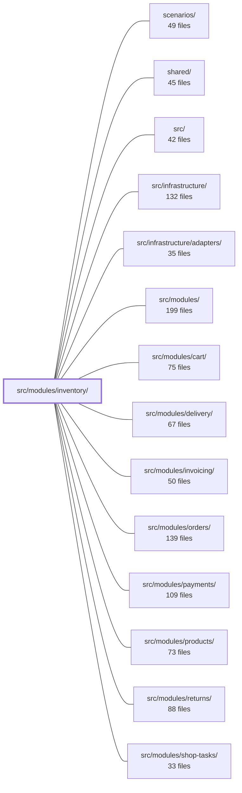

---
tags:
  - 2brain
  - 2brain/module
  - project/boilerplate-node-backend
type: module
module: src/modules/inventory/
files: 61
updated: 2026-11-15T00:32:23.664613+00:00
---

# src/modules/inventory/

## Purpose

The inventory module is the **sole writer of stock** in the application. It owns the three-counter stock level per product (`onHand`, `reserved`, `backordered`), the append-only stock-movement ledger, and per-order reservation holds. All stock in (receipt, restock), stock out (reservation, shipment), and reconciliation (stocktake adjustment, reservation sweep) flow through this module, and every mutation is paired with an audit-trail ledger row.

## Key parts

- **Domain rules (pure, side-effect-free):** `domain/transitions.ts` maps each `StockMovementReason` to the exact counter deltas; `domain/hold-lines.ts` handles hold line-item arithmetic. Together they define *what* a stock transition does without any I/O.
- **Service layer (one file per flow):** `services/reserve.ts` (all-or-nothing checkout hold), `services/allocate.ts` (backorder fulfilment on arrival), `services/holds.ts` (commit / ship / release / extend), `services/sweep.ts` (expired-reservation tick), `services/top-up.ts` (lost-parcel re-reservation), `services/returns.ts` (restock + re-allocate), `services/admin.ts` (receive, adjust, backorder limit), `services/levels.ts` (read-side boards, sellable-quantity lookup). All counter mutations funnel through `services/transition.ts`, the single chokepoint that pairs the guarded counter write with its ledger row.
- **Persistence:** `model.ts` (Mongoose schemas for StockLevel, StockMovement, Reservation) and `repository.ts` (conditional counter writes, board reads).
- **HTTP surface:** `routes.ts` maps endpoints to the individual controllers under `controllers/`; `presenter.ts` shapes responses to match `openapi.yaml`; `authorization.yaml` declares role-based access sets.
- **Module wiring & cross-cutting:** `module.ts` registers the module with the kernel (HTTP mount, event subscriptions, jobs, locales); `events.ts` augments the kernel `DomainEventMap` so sibling modules can react without importing inventory internals; `audit.ts` registers typed audit actions; `metrics.ts` and `services/orphan-counter.ts` declare Prometheus instruments; `config.ts` exposes tunable thresholds; `jobs.ts` declares the reservation-sweep cron job.
- **Tests:** `tests/contract/` pins HTTP status/shape contracts; `tests/integration/` verifies invariants like "paid backorder buyer is served first"; `tests/factories.ts` is the sanctioned door for sibling integration tests to seed inventory state.

## How it connects

- **`modules/orders/`** — Inventory reacts to order-creation, payment, and cancellation events (via `module.ts` subscriptions) to create, commit, or release holds. Conversely, it emits `RESERVATION_EXPIRED` so orders can cancel the underlying order.
- **`modules/products/`** — Product lifecycle events trigger creation or deletion of a stock-level row. The presenter receives product facts as plain arguments rather than querying the products module directly.
- **`modules/payments/`** — Payment-completed events drive backorder allocation; inventory never imports the payments module.
- **`modules/delivery/`** — Lost-parcel notifications trigger the top-up flow to re-reserve units.
- **`modules/returns/`** — Received returns call inventory's restock service to create ledger rows and re-allocate freed units.
- **`modules/cart/`** — Checkout invokes the reserve operation to atomically hold stock for a multi-line order.
- **`shared/`** — Supplies the kernel interfaces (`DomainEventMap`, `AuditActionMap`) that `events.ts` and `audit.ts` augment, plus the job-scheduler consumed by `jobs.ts`.
- **`infrastructure/`** — Provides Express (wired by `routes.ts`), Mongoose (used in `model.ts`/`repository.ts`), and the shared Prometheus registry that `metrics.ts` self-registers into.

## Where to start

Read **`services/transition.ts`** first: it is the single chokepoint every stock mutation passes through, and understanding its read-guard-apply-record pipeline explains the invariant the rest of the services rely on. Then read **`domain/transitions.ts`** to see the pure reason→delta mapping that defines what each stock transition actually does. Together they give you the semantic core before touching any controller, repository, or event wiring.

## Connected modules

[[boilerplate-node-backend_ROOT|/ (repository root)]] · [[boilerplate-node-backend_scenarios|scenarios/]] · [[boilerplate-node-backend_shared|shared/]] · [[boilerplate-node-backend_src|src/]] · [[boilerplate-node-backend_src_infrastructure|src/infrastructure/]] · [[boilerplate-node-backend_src_infrastructure_adapters|src/infrastructure/adapters/]] · [[boilerplate-node-backend_src_modules|src/modules/]] · [[boilerplate-node-backend_src_modules_cart|src/modules/cart/]] · [[boilerplate-node-backend_src_modules_delivery|src/modules/delivery/]] · [[boilerplate-node-backend_src_modules_invoicing|src/modules/invoicing/]] · [[boilerplate-node-backend_src_modules_orders|src/modules/orders/]] · [[boilerplate-node-backend_src_modules_payments|src/modules/payments/]] · [[boilerplate-node-backend_src_modules_products|src/modules/products/]] · [[boilerplate-node-backend_src_modules_returns|src/modules/returns/]] · [[boilerplate-node-backend_src_modules_shop-tasks|src/modules/shop-tasks/]]

## Files
- `src/modules/inventory/audit.ts` — Defines the inventory module's audit-action vocabulary and registers those actions into the app-wide `AuditActionMap` via TypeScript module augmentation. It exists so that admin-facing inventory operations (stock changes, sweeps, orphaned commits, backorder limits) emit typed, discoverable audit events without sharing a global enum — following the same pattern as `modules/account/audit.ts`.
- `src/modules/inventory/authorization.yaml` — Declarative authorization policy for the inventory module. Defines which subjects a tenant-scoped role may act upon (read, create, update, sweep) and groups those rules into named **sets** that the runtime permission check consults when a request hits an inventory route.
- `src/modules/inventory/config.ts` — Declares the tunable numbers a deployment sets for stock management (reservation TTL, low-stock threshold) and exposes them as call-time getters rather than import-time constants, so tests can vary them per case.
- `src/modules/inventory/controllers/get-inventory-level.ts` — HTTP controller that handles `GET /inventory/levels/:productId`, returning a single product's stock counters and availability. It validates the path parameter, delegates to the inventory service, and shapes the HTTP response.
- `src/modules/inventory/controllers/get-inventory-levels.ts` — Controller for `GET /inventory/levels` — the stock-board listing endpoint. It validates and parses query-string parameters (pagination + filters), coerces the `lowOnly` boolean, then delegates to the inventory service to return a page of inventory levels ordered scarcest-first.
- `src/modules/inventory/controllers/get-preorder-levels.ts` — Controller for `GET /inventory/preorders`. Returns a paginated list of preorder levels — each product's allowance and the outstanding balance split between paid and unpaid orders. Exists to expose this read-only board view via the inventory module's HTTP surface.
- `src/modules/inventory/controllers/get-stock-movements.ts` — Exposes the `GET /inventory/movements` endpoint as a paginated, filterable listing of stock-movement records (newest first). It exists to wire the HTTP layer to the inventory domain service without the caller needing to know the service's internal signature.
- `src/modules/inventory/controllers/patch-inventory-level.ts` — Controller for `PATCH /inventory/levels/:productId`. Updates the single editable field on a product's inventory level — the backorder (preorder) limit. The mutation is audited because this value is the cap the shop's purchase promise is made under.
- `src/modules/inventory/controllers/post-adjustment.ts` — HTTP handler for `POST /inventory/levels/:productId/adjust` — the audited stocktake-correction endpoint. It validates the request, rejects a zero delta, and delegates to the inventory service to write a ledger row recording the admin, the signed quantity change, and a human-supplied reason.
- `src/modules/inventory/controllers/post-receipt.ts` — Controller for `POST /inventory/levels/:productId/receive`. Handles incoming stock from a supplier — one of only two audited pathways for units to enter the shop. Validates the request, delegates to the inventory service, and shapes the HTTP response.
- `src/modules/inventory/controllers/post-reservations-sweep.ts` — HTTP handler for `POST /inventory/reservations/sweep`. It triggers a one-shot reservation-expiry sweep on demand, intended for an operator or a platform scheduler that prefers calling an endpoint over relying on the cron-based job (`npm run job sweep:reservations`). The sweep itself is delegated to `inventoryService.runReservationSweep`; this file only wires the request, response, and error handling.
- `src/modules/inventory/domain/hold-lines.ts` — Pure arithmetic for mutating a hold's line items: subtracting lines (partial shipment or remainder cancel) and adding lines (topping a hold up after a lost parcel). Keeping the math free of I/O makes it directly unit-testable.
- `src/modules/inventory/domain/index.ts` — Barrel file for the inventory domain layer. It re-exports the pure business rules (reason→delta logic and hold-line manipulation) under a single import path, so callers never need to reach into individual domain files. The doc comment enforces the tier boundary: this layer must remain free of Express, Mongoose, and all higher tiers.
- `src/modules/inventory/domain/transitions.ts` — Pure, side-effect-free rules that map a `StockMovementReason` to the exact deltas applied to a stock level's three counters (`onHand`, `reserved`, `backordered`). It exists as the single authoritative place defining what each inventory transition does, so that services, repositories, and tests all read the same semantics without duplicating the logic.
- `src/modules/inventory/events.ts` — Declares the inventory module's domain events by augmenting the kernel's `DomainEventMap` interface and exports one named constant per event. Its role is to let downstream modules (`orders`, `delivery`, `tasks`) react to inventory state changes without importing the inventory services back, thereby avoiding circular dependencies.
- `src/modules/inventory/index.ts` — Public barrel (entry point) for the inventory module. It is the **only** surface a sibling module is permitted to import from, enforcing a narrow contract: sibling code requests a named transition and receives a boolean, with no visibility into the repositories, concrete models, or counter primitives that live inside the module. This encapsulation is intentional per `docs/theory/strategic-ddd.md` §5.
- `src/modules/inventory/jobs.ts` — Declares the single scheduled job owned by the `inventory` module — the stale-hold (reservation) sweep — as a `JobDeclaration` array consumed by the kernel's job scheduler.
- `src/modules/inventory/metrics.ts` — Declares the Prometheus gauges owned by the inventory module. The gauges self-register into the shared registry at import time; nothing in the codebase imports the gauge handles themselves. Placing them here (in the module) rather than in `infrastructure` keeps ownership local — the same convention used by `modules/account/metrics.ts`.
- `src/modules/inventory/model.ts` — Defines the Mongoose schemas, model instances, and document interfaces for the three collections the inventory module owns: the append-only **StockMovement** ledger, the **StockLevel** counter row (one per product), and the **Reservation** hold (one per order). All persistence-level concerns (index definitions, serialization transforms, enum constraints) live here; queries and business rules are delegated to `repository.ts` and `services/` respectively.
- `src/modules/inventory/module.ts` — Module registration file for the **inventory** domain. It wires the inventory module into the application kernel: declares its name, HTTP mount, background jobs, config schema, event subscriptions, locales, and personal-data policy. It also defines *when* inventory reacts to external domain events (product lifecycle, payment-driven stock movements) without importing the emitting modules directly.
- `src/modules/inventory/module.yaml` — Module manifest for the inventory subdomain. Declares this module as the **sole writer of stock** in the application, lists its cross-module dependencies with the reason each is needed, and registers its scheduled background jobs.
- `src/modules/inventory/openapi.yaml` — OpenAPI 3.1.0 contract for the inventory module. It defines the REST surface for stock levels, preorder allowances, the stock-movement ledger, and counter-changing operations (receive, adjust), including auth scopes, idempotency requirements, and shared error codes.
- `src/modules/inventory/presenter.ts` — Presentation layer for the inventory module: it takes internal stock counters (owned by this module) and, together with product facts supplied by callers, produces the exact wire shapes that `openapi.yaml` declares. It never imports or queries another module itself — services fetch the cross-module data and pass it in as plain arguments.
- `src/modules/inventory/repository.ts` — Persistence boundary for the inventory module. Owns the three MongoDB collections (`stockLevel`, `stockMovement`, `reservation`), exposes the `stockLevelRepository` object that services use to perform conditional counter writes and board reads, and keeps raw Mongo filter syntax out of the service layer. Business rules (which transition means what) live in `./services`; this file only translates a transition into a guarded write.
- `src/modules/inventory/routes.ts` — Express router that maps all staff-facing inventory HTTP endpoints to their controllers. Customer-facing stock visibility is deliberately absent (it surfaces via `available` on the product resource instead). Authentication accepts both session auth and `sk_…` API keys, reflecting that warehouse/ERP integrations talk to this surface.
- `src/modules/inventory/services/admin.ts` — Operator-facing stock write operations for the inventory domain: recording incoming deliveries (`receive`), applying signed stocktake corrections (`adjust`), and managing the backorder allowance (`setBackorderLimit`). Each write is audited, atomically applied, and returns the product's counters so the caller can render the post-write state.
- `src/modules/inventory/services/allocate.ts` — Allocates newly-arrived stock to paid preorders (backorders), oldest payment first. It converts a preorder's `backorder` claim into a real `stock` hold on actual units, decrementing `available` while leaving the shelf count untouched. Everything runs inside the caller's transaction so units are never visible as sellable to anyone else between arrival and allocation.
- `src/modules/inventory/services/holds.ts` — Manages the post-creation lifecycle of inventory holds (reservations): committing at payment, shipping, releasing, extending, and retaking released units. It ensures every status transition is a single atomic claim-plus-counter-movement, and that the paid-buyer queue is served first whenever shelf units become free.
- `src/modules/inventory/services/index.ts` — Barrel (facade) file for the inventory services module. It re-exports every public service function and shared type from the per-flow sub-modules and bundles them into a single `inventoryService` object, giving consumers one import target instead of reaching into individual files. The module doc comment states the core invariant: all stock changes flow through `applyTransition`, pairing a counter move with a ledger row, and that one file exists per flow (not one monolith).
- `src/modules/inventory/services/levels.ts` — Read-side and lifecycle functions for stock level rows: the stock board, the preorder board, the low-stock gauge, the sellable-quantity lookup for checkout, and the movement ledger. It sits between the repositories (raw counters) and the HTTP layer (presented, paginated responses), and also exposes two `@internal` helpers that `module.ts`'s event listeners call to create or erase a level row.
- `src/modules/inventory/services/orphan-counter.ts` — Defines a single Prometheus counter (`inventory_commit_orphaned_total`) that backs the **PaidOrderWithoutHold** alert. It is deliberately kept in its own module—separate from `../metrics.ts`—so that importing `holds.ts` in tests or auxiliary processes does not also pull in two DB-querying gauges onto every process's metrics registry.
- `src/modules/inventory/services/reserve.ts` — Implements the all-or-nothing "reserve stock for an order" operation. For each order line it atomically decrements shelf or backorder counters within a single transaction, records the take on a durable hold, and either commits the full reservation or unwinds every line taken so far. Exists to guarantee that a checkout never half-holds inventory and that concurrent multi-line checkouts cannot deadlock.
- `src/modules/inventory/services/returns.ts` — Provides a single entry point for restocking goods that a customer returned and staff received. It creates `restock` ledger movements for each line and immediately re-allocates the returned units to waiting backorders, all within the caller's Mongoose transaction so the operation is atomic.
- `src/modules/inventory/services/sweep.ts` — Implements the reservation-expiry tick: it finds all holds whose time window has closed, releases their units back to inventory, and publishes a `RESERVATION_EXPIRED` event so the `orders` module can cancel the underlying order. It runs in bounded batches so a pathological backlog terminates within the job's lease window, with the next external tick picking up where it left off.
- `src/modules/inventory/services/top-up.ts` — Re-reserves inventory for an order whose parcel was reported lost. Because the original units already left the shelf at shipment, this module splits each line into a **shelf** portion (drawn from currently available stock) and an **owed** portion (claimed as a backorder outside the new-sale cap), then records both on the order's hold. It exists to honour a promise the shop already made without double-counting units held for other orders.
- `src/modules/inventory/services/transition.ts` — The single chokepoint through which every stock-counter mutation and its corresponding ledger row pass. It encapsulates the read-guard-apply-record-sync pipeline so that higher-level services (reserve, allocate, returns, top-up, admin) never touch the repositories directly for a counter move.
- `src/modules/inventory/services/types.ts` — Defines the input and output type shapes for all inventory stock operations (reserve, hold, top-up, level reads, movement reads). It exists so the service layer and its external consumers share a single vocabulary for "what a stock operation takes and what it answers back."
- `src/modules/inventory/tests/contract/api.contract.test.ts` — Contract tests that pin every HTTP-level branch of the `/inventory` API surface: the two read endpoints, the two write transitions (receive, adjust) with their 200/404/409/422 responses, the reservation sweep, and the preorders list. The transition *rules* (e.g. reservation invariants) are covered in the unit suite; this file only asserts what a client sees over the wire—status codes, response shapes, and meta envelopes.
- `src/modules/inventory/tests/factories.ts` — A test-only re-export layer that gives sibling modules' integration tests controlled access to inventory's internal storage primitives (stock rows, reservation rows, level service). It exists because the import boundary blocks those tests from reaching `../repository` or `../model` directly; this file is the sanctioned door.
- `src/modules/inventory/tests/integration/backorder-arrivals.test.ts` — Integration tests that verify the "serve the paid backorder buyer first" invariant: whenever any write operation makes a unit sellable (stocktake, return restock, hold expiry, order cancellation, partial shipment release), the unit is allocated to the committed backorder reservation rather than becoming freely available.
- `src/modules/inventory/tests/integration/backorder-spill.test.ts` — Integration test that verifies the "backorder spill" path of `inventoryService.reserveForOrder`: when a reservation line is marked `spill: true` and the shelf cannot fully cover it, the service splits the quantity into a `stock` portion and a `backorder` portion against the product's backorder cap — all inside one transaction. The seven cases cover full-shelf, partial-spill, full-backorder, refusal, multi-line rollback, concurrent racing, and mid-transaction failure rollback.
- `src/modules/inventory/tests/integration/backorder-unlimited.test.ts` — Integration tests that pin down the semantics of the `backorderLimit` field: `null` means unlimited (no ceiling), `0` means closed (refuses all claims), and a stock-level document that simply lacks the field is treated as closed—not open. Each case is exercised through the full service layer against a real database.
- `src/modules/inventory/tests/integration/cache-invalidation.test.ts` — Integration test verifying that every stock-mutating operation in the inventory service (receive, adjust, reservation sweep, return restock) triggers a `['products']` cache-tag invalidation. This guards against the catalogue's `GET /products/:id` and list endpoints serving stale `available` counts after a stock write.
- `src/modules/inventory/tests/integration/hold-crash-window.test.ts` — Integration test that verifies the atomicity guarantee of inventory status transitions: if a write fails partway through a hold-status claim + counter move (simulated as a dropped connection), the entire operation—including the status claim—is rolled back so a retry can re-claim and finish cleanly. Covers ship, release, releaseCommitted, reserve-unwind, and the reservation sweep interacting with a mid-reserve crash.
- `src/modules/inventory/tests/integration/ledger.property.test.ts` — Property-based integration test that verifies the inventory ledger (stock-movement rows) faithfully reproduces a product's `onHand` and `reserved` counters for *every* generated sequence of transitions, not just a fixed table of examples. It runs against real MongoDB because the invariant under test is the atomicity of the conditional write that moves a counter and inserts a ledger row simultaneously; mocking the repository would only re-test `counterDeltaFor`'s arithmetic.
- `src/modules/inventory/tests/integration/multi-line-race.test.ts` — Integration test that fires two `reserveForOrder` calls for the **same two products in opposite line order**, then asserts that exactly one hold stands and the stock level reflects only the winner. The interleaving is forced deterministically (barrier on the repository write) so the race is reproducible on every run rather than scheduler-dependent.
- `src/modules/inventory/tests/integration/multi-line-reserve.property.test.ts` — Property-based integration test (against a real seeded MongoDB) that verifies two stock-level invariants over randomly generated sequences of multi-line hold, ship, release, and expire operations: (1) `reserved` always equals the sum of that product's lines across all `held`/`committed` reservations, and (2) a refused multi-line hold rolls back cleanly, leaving no open reservation and no counter moved.
- `src/modules/inventory/tests/integration/opening-stock.test.ts` — Integration test verifying that the inventory module's `PRODUCT_CREATED` event listener is **idempotent** under the outbox's at-least-once delivery guarantee: a redelivered event must neither create a duplicate stock-level row nor book a spurious movement.
- `src/modules/inventory/tests/integration/preorder-cache.test.ts` — Integration test verifying that when a payment allocates a preorder (backorder), the products module's stock *copy* is refreshed only after the outbox relay delivers the `PREORDER_ALLOCATED` announcement—not directly inside the payer's transaction. Also confirms that a plain (non-preorder) payment triggers no announcement and no copy refresh.
- `src/modules/inventory/tests/integration/preorder.test.ts` — Integration tests that exercise the full preorder lifecycle through `inventoryService`: claiming against `backorderLimit` (never touching `onHand`), committing (payment), receiving stock into the queue, and releasing or expiring the claim. Runs against a real database via `setupTestDb`.
- `src/modules/inventory/tests/integration/repository.test.ts` — Integration tests for `stockLevelRepository`'s **aggregate reads** (`sumReserved`, `stockBoard`, `lowAvailabilityProductIds`) against a real MongoDB instance. The file exists to pin down two things that unit tests cannot: (1) what a `$group`/`$facet` pipeline returns over an empty collection (no row, not a zeroed row — so the `.at(0)` guard in calling code is asserted, not assumed), and (2) that the two stock gauges intentionally count different populations (all products vs. publicly-visible-only). Transition logic (`applyDelta`, `insertIfAbsent`) is deliberately out of scope here.
- `src/modules/inventory/tests/integration/service.test.ts` — Integration tests for the inventory service's own contractual edges: exactly-once reservation claims, admin stock transitions (and their refusals), and the orphan sweep. Cross-module lifecycle is delegated to `cart/tests/integration/stock.test.ts` and the replay invariant to `ledger.property.test.ts`. All tests run against a real Mongo instance because every guarantee under test is a conditional write.
- `src/modules/inventory/tests/integration/stock-cache-order.test.ts` — Integration test that guards against a stale cache-write race: if the first buyer's `syncStockCache` write is delayed past the second buyer's completion, the older snapshot must not overwrite the newer one in the product document, and no spurious `PRODUCT_BUYABLE_AGAIN` outbox event may be emitted. The interleaving is forced deterministically with a manual gate rather than relying on thread scheduling.
- `src/modules/inventory/tests/integration/top-up.test.ts` — Integration tests for the "top-up" flow: reserving additional units onto an order's existing hold after a parcel was lost or partially returned. Verifies that the inventory service correctly splits a top-up between shelf stock and owed (backorder) units, respects existing holds from other orders, reopens already-shipped holds, and handles release-back semantics.
- `src/modules/inventory/tests/unit/hold-lines.test.ts` — Unit tests for the pure hold-line arithmetic (`takeFromHold`, `withAdded`) in the inventory domain. Covers partial extraction, over-asking, product deduplication, purity, and the two-kind (shelf vs. backorder/preorder claim) interaction rules.
- `src/modules/inventory/tests/unit/presenter.test.ts` — Unit tests for the two public presenter functions in the inventory module (`presentInventoryLevel`, `presentPreorderLevel`). The tests pin down the wire-form contract: a stored `null` cap must serialise as an **absent key**, never as an explicit `null` value.
- `src/modules/inventory/tests/unit/routes.test.ts` — Verifies the inventory module's route table is correctly composed: the right endpoints exist in the documented order, every route is protected by an identity guard followed by a permission guard, and no route is accidentally public. It acts as a structural safety net so that adding or reordering a route requires an explicit test update.
- `src/modules/inventory/tests/unit/schema-contract.test.ts` — Contract tests for the two inventory Mongoose schemas (`stockMovementSchema` and `reservationSchema`). They pin down database-level invariants—defaults, required fields, enum values, index definitions—that no application code path enforces. Weakening any of these wouldn't crash a request; the guarantee would simply stop existing silently. The tests exist so that "silently" becomes "this test fails."
- `src/modules/inventory/tests/unit/stock-writes-name-a-caller.test.ts` — Compile-time test that verifies `receive` and `adjust` on the inventory service **refuse** to be called without a caller identifier. It exists to pin down the type-level contract that every stock mutation must attribute itself to a named actor.
- `src/modules/inventory/tests/unit/sweep-cap.test.ts` — Unit test for `inventoryService.runReservationSweep` that verifies the batch-count cap: the sweep must stop after reading 50 consecutive full batches, emit a single warning that more work remains, and terminate cleanly so it cannot outlive its job lease. A second case confirms that a short (incomplete) batch stops the loop early with no warning.
- `src/modules/inventory/tests/unit/transitions.test.ts` — Pure unit tests for `counterDeltaFor`, the inventory transition table. The tests assert three domain invariants (only receipt/adjustment/shipment change unit existence; shipment moves both counters equally; reserve/release-expire are exact inverses) rather than merely restating the table, so a test that would pass against a wrong copy of the table is explicitly ruled out. No mocks, no database.

---
[[boilerplate-node-backend_INDEX|← boilerplate-node-backend index]]
