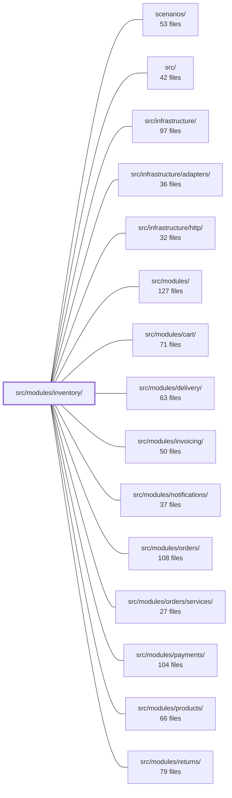

---
tags:
  - 2brain
  - 2brain/module
  - project/boilerplate-node-backend
type: module
module: src/modules/inventory/
files: 59
updated: 2026-10-29T19:25:34.440311+00:00
---

# src/modules/inventory/

## Purpose

The inventory module owns the full lifecycle of stock: receiving deliveries, reserving units for orders (holds), backorder/preorder claims, shipping, returning, expiring stale reservations, and correcting counts after stocktakes. It maintains three per-product counters (`onHand`, `reserved`, `backordered`), an append-only movement ledger, and reservation records, exposing a typed service API to sibling modules while keeping all persistence and HTTP concerns internal.

## Key parts

- **Domain rules** (`domain/`) — Pure, I/O-free functions: `transitions.ts` maps each named stock event to exact counter deltas; `hold-lines.ts` computes hold arithmetic. Lint-guaranteed free of Express/Mongoose.
- **Services** (`services/`) — The business-logic core. `reserve.ts` handles all-or-none hold creation; `transition.ts` is the single chokepoint every counter write passes through; `holds.ts` manages the post-creation hold lifecycle (commit, ship, release, expire); `admin.ts`, `allocate.ts`, `returns.ts`, `sweep.ts`, `top-up.ts` cover back-office writes, backorder fulfilment, restocking, expiry ticks, and lost-parcel top-ups. `levels.ts` provides all read paths. `index.ts` bundles them into one `inventoryService` object.
- **HTTP layer** (`routes.ts` + `controllers/`) — Express router and thin handlers for the six staff endpoints (levels, preorders, movements, receive, adjust, sweep). Auth, permission, and idempotency wiring live in `routes.ts`; controllers delegate straight to the service.
- **Data access** (`model.ts`, `repository.ts`) — Mongoose schemas for the three collections and the conditional "guard-then-write" query layer that keeps `available` consistent.
- **Module wiring** (`module.ts`, `index.ts`, `events.ts`, `metrics.ts`, `config.ts`, `audit.ts`) — Manifest that mounts routes, registers domain-event subscriptions and Prometheus gauges; public barrel that is the *only* import path siblings may use; typed event names; deployment-tunable config; audit-action registration.
- **Contract & integration tests** (`tests/`) — HTTP contract tests pin endpoint shapes; integration tests verify invariants like backorder-first allocation and spill math across write paths; `factories.ts` lets sibling-module tests seed stock without crossing the import boundary.

## How it connects

- **`src/modules/orders/`** — Imports the public barrel (`index.ts`) to request and release holds. Listens to inventory's `RESERVATION_EXPIRED` and `STOCK_COMMITTED` domain events to cancel or fulfil orders. Inventory itself never calls back into orders.
- **`src/modules/products/`** — Publishes product-created / product-deleted events; inventory's `levels.ts` hooks (`openLevel` / `removeLevel`) react to create the corresponding stock row or remove it.
- **`src/modules/payments/`** — Emits a payment-completed event that inventory's `holds.ts` subscribes to, triggering the commit transition.
- **`src/modules/returns/`** — Calls `inventoryService.restock` within its own transaction to write a `restock` movement and drain backorders.
- **`src/modules/delivery/`** — Triggers the `ship` transition (via the public barrel) when a parcel is dispatched.
- **`src/modules/cart/`** — Reads per-product availability through the service's `checkAvailability` path (exposed via `index.ts`) during checkout.
- **`src/infrastructure/`** — Supplies the Mongoose driver, Prometheus registry, Express app, and job-scheduler adapters that `module.ts` and `jobs.ts` consume.
- **`scenarios/`** — End-to-end test scenarios that exercise the inventory HTTP surface alongside orders, payments, and delivery.

## Where to start

1. **`services/transition.ts`** — Every stock counter movement funnels through this single file. Reading it first gives you the vocabulary (receive, hold, ship, release, commit, backorder, adjust, expire) and the guard-then-write pattern that the rest of the module assumes.
2. **`domain/transitions.ts`** — A short, pure table mapping each transition to its exact deltas. Pairs naturally with the file above: here you see *what* happens to the counters; there you see *how* it is applied atomically.

## Connected modules

[[boilerplate-node-backend_ROOT|/ (repository root)]] · [[boilerplate-node-backend_scenarios|scenarios/]] · [[boilerplate-node-backend_src|src/]] · [[boilerplate-node-backend_src_infrastructure|src/infrastructure/]] · [[boilerplate-node-backend_src_infrastructure_adapters|src/infrastructure/adapters/]] · [[boilerplate-node-backend_src_infrastructure_http|src/infrastructure/http/]] · [[boilerplate-node-backend_src_modules|src/modules/]] · [[boilerplate-node-backend_src_modules_cart|src/modules/cart/]] · [[boilerplate-node-backend_src_modules_delivery|src/modules/delivery/]] · [[boilerplate-node-backend_src_modules_invoicing|src/modules/invoicing/]] · [[boilerplate-node-backend_src_modules_notifications|src/modules/notifications/]] · [[boilerplate-node-backend_src_modules_orders|src/modules/orders/]] · [[boilerplate-node-backend_src_modules_orders_services|src/modules/orders/services/]] · [[boilerplate-node-backend_src_modules_payments|src/modules/payments/]] · [[boilerplate-node-backend_src_modules_products|src/modules/products/]] · … and 2 more

## Files
- `src/modules/inventory/audit.ts` — Declares the inventory module's audit-action vocabulary and registers it into the app-wide `AuditActionMap` via TypeScript declaration merging. It exists so that inventory-specific audit events have a single, typed source of truth without introducing a cross-module shared enum (the rationale for the augmentation pattern is documented in `modules/account/audit.ts`).
- `src/modules/inventory/config.ts` — Defines the deployment-tunable numbers for inventory stock behavior (reservation TTL, low-stock threshold). Values are exposed as per-call function reads rather than import-time constants so individual tests can vary them case-by-case, while a live deployment changes them via env vars + restart.
- `src/modules/inventory/controllers/get-inventory-level.ts` — Express route handler for `GET /inventory/levels/:productId`. Validates the path parameter, delegates to the inventory service, and returns a single product's counters and availability (or a structured error).
- `src/modules/inventory/controllers/get-inventory-levels.ts` — Controller for `GET /inventory/levels` — returns a paginated list of inventory levels (stock counters and availability, scarcest first). It is a thin layer that parses/validates query params and delegates to the inventory service.
- `src/modules/inventory/controllers/get-preorder-levels.ts` — Controller for `GET /inventory/preorders`. Returns a paginated view of the preorder board: each product's allowance, outstanding quantity, and the split between paid and unpaid orders. Exists to translate the HTTP query layer into a single service call via the shared list-controller factory.
- `src/modules/inventory/controllers/get-stock-movements.ts` — HTTP controller that handles `GET /inventory/movements`, returning a paginated list of stock-movement ledger entries (newest first) that can be narrowed by `productId` and `reason`. It is a thin adapter that wires the query-parameter schema to the inventory service.
- `src/modules/inventory/controllers/patch-inventory-level.ts` — Express controller handler for `PATCH /inventory/levels/:productId`. It edits a product's backorder (preorder) limit — the only mutable field on an inventory level — and records the change with caller context for auditing, since that cap is the promise the shop makes to buyers.
- `src/modules/inventory/controllers/post-adjustment.ts` — Handles `POST /inventory/levels/:productId/adjust` — the audited stocktake-correction endpoint. It validates the request (product exists, body schema, non-zero delta) and delegates to the inventory service, which records the admin, signed delta, and operator-supplied reason. The file exists to keep this single, high-consequence mutation behind one thin controller with explicit refusal paths.
- `src/modules/inventory/controllers/post-receipt.ts` — Handles `POST /inventory/levels/:productId/receive`, the endpoint for recording stock received from a supplier. It validates the product ID and request body, delegates to the inventory service, and returns the updated `InventoryLevel`. The receipt is audited: it records which admin added how many units.
- `src/modules/inventory/controllers/post-reservations-sweep.ts` — HTTP controller for `POST /inventory/reservations/sweep`. It exposes the reservation-expiry sweep as an on-demand endpoint so an operator or a platform scheduler that prefers HTTP can trigger it. The recurring schedule is handled by a separate CLI job (`npm run job sweep:reservations` via `docker/crontab`) that never reaches this route.
- `src/modules/inventory/domain/hold-lines.ts` — Pure arithmetic helpers for manipulating the line items of an inventory hold. It answers two questions without touching a database: "if I ship (or cancel) these lines, what is left and what came out?" (`takeFromHold`) and "if I add these lines on top, what does the hold name now?" (`withAdded`). Keeping the math in a standalone module makes it unit-testable in isolation.
- `src/modules/inventory/domain/index.ts` — Barrel file for the inventory **domain layer**. It re-exports the pure business rules (counter-delta computation and hold-line manipulation) so that consumers can import them from a single path. The layer is explicitly lint-guaranteed free of Express, Mongoose, and any persistence or transport concern—every export is a rule testable without a database.
- `src/modules/inventory/domain/transitions.ts` — Pure domain rules that map each of the nine stock-movement transitions to the exact deltas applied to a product's three counters (`onHand`, `reserved`, `backordered`). No I/O, no status codes, no i18n — data in, a `CounterDelta` out. It also provides a small helper to compute remaining preorder allowance. This is the single source of truth for what a transition does; adding a tenth transition means one more case here plus one enum value in `openapi.yaml`.
- `src/modules/inventory/events.ts` — Declares the inventory module's four domain events by augmenting the kernel's `DomainEventMap` interface, and exports a typed constant for each event name. The events exist to break import cycles (e.g., `orders` already imports inventory, so it listens to an event rather than inventory calling back) and to give cross-module listeners a single, typo-safe string to subscribe to.
- `src/modules/inventory/index.ts` — Public barrel (re-export surface) for the Inventory module. It is the **only** entry point a sibling module is permitted to import, enforcing a narrow contract: callers may request a named transition and receive a boolean result, while all internal counter mechanics, repository implementations, and model values stay encapsulated within the module.
- `src/modules/inventory/jobs.generated.ts` — Generated metadata file that declares inventory's scheduled jobs as static data (name, cron schedule, human-readable summary). It exists to decouple job *definitions* from job *implementations*: this file says **when** jobs run and **what** they are; `jobs.ts` says **how** they run. The file is regenerated from `module.yaml` and must not be edited by hand.
- `src/modules/inventory/jobs.ts` — Declares the scheduled jobs owned by the `inventory` module. Currently exposes a single job — the stale-hold drain (reservation sweep) — as a typed `JobDeclaration[]` for the scheduler to pick up.
- `src/modules/inventory/metrics.ts` — Defines the two Prometheus gauges that the inventory module owns and registers into the shared `metricsRegistry`. The file exists so that gauge registration is a pure side-effect import (bound to underscore-prefixed variables) and so the overview endpoint can read the metrics without creating a dependency back into this module.
- `src/modules/inventory/model.ts` — Defines the three Mongoose schemas, interfaces, and models that back the inventory module's collections — **StockLevel** (per-product counters), **StockMovement** (append-only ledger), and **Reservation** (order holds). This file is pure data-shape: it declares what a document looks like and how it is indexed, but contains no queries or business rules. It exists so that repository, services, and tests all agree on the wire/storage shape without importing from each other.
- `src/modules/inventory/module.ts` — The inventory module's manifest entry point. Wires routes, domain-event subscriptions, background jobs, config, metrics gauges, and locales into a single `AppModule` export that the kernel registry loads. Encodes the module's external contract: which events it listens to, what it mounts, and its data-retention posture.
- `src/modules/inventory/openapi.yaml` — OpenAPI 3.1.0 module contract for the inventory domain. Defines the admin-facing REST surface for stock levels, preorder allowances, and the stock-movement ledger, plus the custom error code the module can raise.
- `src/modules/inventory/presenter.ts` — Pure mapping layer that converts raw stock counters (read from the repository) into the wire shapes declared in `openapi.yaml`. Product facts (title, release date, cap eligibility) are injected as parameters by the services layer, so this module performs no I/O and never reaches into another module.
- `src/modules/inventory/repository.ts` — The data-access layer for the inventory module. It owns reads and writes against the three Mongo collections (`stockLevel`, `stockMovement`, `reservation`) and translates domain-level transitions (reserve, ship, release, backorder, allocate, etc.) into conditional counter updates. Business rules live in `./services`; this file only enforces the atomic "guard-then-write" step and keeps `available` in sync with `onHand`/`reserved`.
- `src/modules/inventory/routes.ts` — Defines the Express router for all staff-facing inventory HTTP endpoints (stock levels, preorder board, stock movements, receipts, adjustments, and the reservations sweep trigger). It exists to centralise routing, authentication, permission checks, and idempotency wiring so each controller stays a pure handler. The customer-facing half of the module is intentionally absent — shoppers see availability via the product's `available` field, not through these routes.
- `src/modules/inventory/services/admin.ts` — Operator-facing stock write operations: receiving a delivery, correcting stock after a stocktake, and setting the backorder allowance. It is the "back-office" counterpart to the customer-facing allocation path, ensuring every write is transactional, audited, and reflected in the catalogue cache.
- `src/modules/inventory/services/allocate.ts` — Serves arrived stock to paid preorders (oldest payment first) inside the receipt's own transaction, converting `backorder` claim lines into real `stock` hold lines. It exists so units never appear sellable to an outside buyer in the gap between receipt and allocation.
- `src/modules/inventory/services/holds.ts` — Manages the post-creation lifecycle of inventory holds (reservations): committing at payment, shipping at dispatch, releasing/expiring, re-taking a released hold when a late payment lands, and refreshing the catalogue stock cache. Every state transition is an at-most-once conditional claim wrapped in a transaction so a hold is never left claimed-with-counters-unmoved.
- `src/modules/inventory/services/index.ts` — Barrel (index) file for the inventory service. It re-exports every stock-mutation and stock-query function from the individual flow modules (`reserve`, `holds`, `top-up`, `returns`, `transition`, `sweep`, `levels`, `admin`) and bundles them into a single `inventoryService` object. Consumers import from this one entry point rather than reaching into sub-files. The file also re-exports the shared type surface so callers never need to import from `./types` directly.
- `src/modules/inventory/services/levels.ts` — Read-side service over the `stocklevels` and `stockmovements` collections. It exposes the stock board, the preorder board, the low-stock gauge, the per-product availability check used by checkout, the single-level item read, and the paginated ledger. It also owns the level-row lifecycle hooks (`openLevel` / `removeLevel`) that `module.ts` event listeners call on product create/hard-delete.
- `src/modules/inventory/services/orphan-counter.ts` — Defines a single Prometheus counter — `inventory_commit_orphaned_total` — that counts paid or shipping orders found with no hold to settle. The file is intentionally split out from `../metrics.ts` so that importing holds (or the holds tests) does not drag in two gauge collectors that query the database on every scrape.
- `src/modules/inventory/services/reserve.ts` — Implements the all-or-none stock reservation (hold) for an order. Either every line in the order is taken from inventory, or none are — partial state is never exposed to the caller. It handles simple shelf reservations, backorder/preorder claims, and "spilling" lines that draw partly from shelf and partly from the backorder cap, all while maintaining a consistent lock order to avoid deadlocks between concurrent checkouts.
- `src/modules/inventory/services/returns.ts` — Single-purpose module for restocking returned goods into the inventory ledger. It writes one `restock` movement per returned line and then releases those units to backordered customers, all inside a caller-supplied Mongoose transaction.
- `src/modules/inventory/services/sweep.ts` — Implements the reservation-expiry tick: finds holds whose time window has closed, releases their stock units, and announces a `RESERVATION_EXPIRED` event so the `orders` module can cancel the corresponding order. Runs in bounded batches so a pathological backlog cannot outlive the job's lease. The file exports a single entry point (`runReservationSweep`) meant to be called by an external scheduler or an operator's on-demand HTTP route.
- `src/modules/inventory/services/top-up.ts` — Re-reserves inventory units for an order after one of its parcels is reported lost. Units that left the shelf at shipping time are re-taken from whatever the shelf still has free; the shortfall is claimed as an **uncapped** backorder (the existing backorder cap governs new sales, not a promise already made). The operation runs inside the caller's Mongoose transaction.
- `src/modules/inventory/services/transition.ts` — The single chokepoint through which every stock counter movement and its corresponding ledger row pass. Named transitions (receive, adjust, hold, release, expire, commit, ship, backorder) all delegate here, making it the one place that knows how to compute deltas, apply them conditionally, write the movement record, and keep the catalogue's stock cache in step.
- `src/modules/inventory/services/types.ts` — Defines the request/response shapes (interfaces and type aliases) shared across the inventory stock-operation services. It exists as a single module so that allocate, holds, levels, reserve, and top-up services — plus external consumers in cart and orders — agree on the exact data contracts without importing implementation details from one another.
- `src/modules/inventory/tests/contract/api.contract.test.ts` — Contract tests that pin the HTTP-level behaviour of every `/inventory` endpoint — status codes, response shapes, pagination metadata, and error envelopes — without re-testing the business rules themselves. Each test exercises one reachable branch (200, 403, 404, 409, 422) so that a change to the API surface is caught before it reaches a consumer. The transitions' internal invariants are intentionally left to the unit suite.
- `src/modules/inventory/tests/factories.ts` — A test-only re-export and helper surface that lets **sibling** modules (cart, delivery, orders, payments, returns) read and manipulate inventory stock rows directly, without crossing the import boundary that forbids them from importing `../repository` or `../model` themselves.
- `src/modules/inventory/tests/integration/backorder-arrivals.test.ts` — Integration test that verifies a single invariant: whenever stock becomes sellable through **any** write path (stocktake, return restock, hold expiry, order cancellation, partial-shipment release), the committed backorder buyer is served first, inside that write's own transaction. It exists to catch regressions where a code path forgets to drain the backorder queue.
- `src/modules/inventory/tests/integration/backorder-spill.test.ts` — Integration tests for the "spill" reservation path: when a line item requests more units than the shelf holds, the service splits the hold into a `stock` portion and a `backorder` portion (claimed against the product's backorder cap) within a single transaction. The tests verify the split math, the hold record's `kind` annotations, refusal and rollback semantics, and concurrent-assignment correctness.
- `src/modules/inventory/tests/integration/backorder-unlimited.test.ts` — Integration tests verifying how the inventory reservation system handles three edge cases of the `backorderLimit` field: an explicit `null` (unlimited ceiling), an explicit `0` (closed, refuses claims), and a missing field on the level row (treated as closed, *not* as open). Confirms correct behavior across reservation, pre-flight availability, and preorder listing.
- `src/modules/inventory/tests/integration/cache-invalidation.test.ts` — Integration test verifying that every stock-mutating operation in `inventoryService` (receive, adjust, reservation sweep, return restock) triggers a cache invalidation on the `'products'` tag. It exists to catch regressions where a write path forgets to clear the catalogue's response cache, which would leave `GET /products/:id` and list endpoints serving stale `available` counts until TTL expiry.
- `src/modules/inventory/tests/integration/hold-crash-window.test.ts` — Integration test verifying that the claim-and-move-counter transaction in inventory operations is atomic. If a write throws mid-transaction (simulating a dropped connection), the status claim is rolled back alongside any counters already applied, so a subsequent retry succeeds instead of hitting a "hold already closed" guard.
- `src/modules/inventory/tests/integration/ledger.property.test.ts` — Property-based integration test that verifies the stock-movement ledger and the stored counters are always in lockstep: for *any* generated sequence of caller-visible inventory operations (receive, adjust, reserve, commit, ship, release, expire), summing the ledger rows must reproduce the exact `onHand` and `reserved` values, neither counter may go negative, and refused transitions must write zero rows. Runs against real MongoDB (not a mocked repository) so the conditional-write coupling between counter and row is exercised end-to-end.
- `src/modules/inventory/tests/integration/multi-line-race.test.ts` — Integration test that proves `reserveForOrder` correctly serialises two concurrent multi-line holds that list the **same two products in opposite order**. By forcing a deterministic interleaving (both first-line writes land before any second-line write starts), it verifies that exactly one hold stands, the stock level reflects only the standing hold, and a refused hold leaves no residue.
- `src/modules/inventory/tests/integration/multi-line-reserve.property.test.ts` — Property-based integration test that verifies two stock-level invariants over *generated* sequences of multi-line holds, shipments, releases, and expiries: (1) `reserved` equals the sum of open-hold lines per product, and (2) `available = onHand − reserved`, with `onHand` reduced only by shipped units. Also asserts that a refused multi-line hold rolls back atomically, leaving no reservation and no counter change. Runs against a real, seeded MongoDB.
- `src/modules/inventory/tests/integration/opening-stock.test.ts` — Integration test that verifies the `PRODUCT_CREATED` listener is **idempotent** under the outbox's at-least-once delivery guarantee: a redelivered event must not create a second stock-level row, must not alter an existing on-hand count, and must never book a spurious ledger movement.
- `src/modules/inventory/tests/integration/preorder-cache.test.ts` — Integration tests for the preorder-allocation → catalogue-refresh flow. A preorder payment moves inventory counters inside the payer's transaction, where the product's catalogue copy cannot be written; the hold's owner announces `PREORDER_ALLOCATED` and the relay refreshes the copy. These tests verify that refresh happens (and only happens for preorders) via the outbox/relay path.
- `src/modules/inventory/tests/integration/preorder.test.ts` — End-to-end integration tests for the preorder (backorder) flow driven entirely through the public `inventoryService` API. Covers the full lifecycle: claiming against `backorderLimit`, refusing over-claims, releasing on cancel/expiry, committing (payment), and receipt allocation with FIFO-by-payment-order and partial-delivery splitting.
- `src/modules/inventory/tests/integration/repository.test.ts` — Integration tests for `stockLevelRepository`'s **aggregate reads only** (`sumReserved`, `stockBoard`, `lowAvailabilityProductIds`) against a real Mongo instance. The file specifically asserts the empty-collection edge case (a `$group`/`$facet` pipeline returns no row rather than a zeroed one, so the `.at(0)` guard in calling code is exercised) and documents the intentional difference between the two "stock gauge" queries in terms of which product populations they count. Transition-path methods (`applyDelta`, `insertIfAbsent`) are deliberately out of scope here.
- `src/modules/inventory/tests/integration/service.test.ts` — Integration tests for the inventory service's own guarantees—exactly-once claims, admin transitions, their refusals, and the sweep—run against a real Mongo instance because every guarantee is a conditional write. Cross-module lifecycle is deferred to `cart/tests/integration/stock.test.ts`; the replay invariant to `ledger.property.test.ts`.
- `src/modules/inventory/tests/integration/top-up.test.ts` — Integration tests for the top-up flow (`reserveMoreForOrder` / `releaseTopUpForOrder`), which handles reserving additional stock for an order whose parcel was lost. Verifies that only free shelf units are reserved (never another order's hold), that overage claims land in `backordered` even when the backorder cap is closed, that a `shipped` hold reopens as `committed` while retaining its original queue position, and that releasing a top-up ends the hold as `shipped` rather than `released`.
- `src/modules/inventory/tests/unit/hold-lines.test.ts` — Unit tests for the pure hold-line arithmetic: removing quantity from a hold (partial shipment or cancelled remainder) via `takeFromHold`, and appending quantity to a hold via `withAdded`. Exists to pin down the invariants of these operations—especially the interaction between shelf units and preorder (`backorder`) claims—so that regressions in allocation logic are caught at the function level.
- `src/modules/inventory/tests/unit/presenter.test.ts` — Unit tests for the inventory presenter functions that shape raw stock counters into their wire form. The file verifies the "absent key, never `null`" convention: when a cap is absent, the key must be omitted from the output object entirely.
- `src/modules/inventory/tests/unit/routes.test.ts` — Locks in the inventory route table's security contract: every endpoint must sit behind `getAuth` + `requirePermissionGuard`, appear in a fixed order, and no unguarded route may exist. It exists so that accidentally mounting a route above the auth gate, or dropping a `requirePermission` from a mount, is caught immediately rather than leaking stock counters and the ledger to the public.
- `src/modules/inventory/tests/unit/schema-contract.test.ts` — Asserts that the inventory Mongoose schemas (`stockMovementSchema`, `reservationSchema`) encode the correct database-level contracts—required fields, enum values, defaults, type references, and indexes. These guarantees are enforced by the database rather than any code path, so weakening them causes no runtime failure; this test is the only thing that would catch a silent loss.
- `src/modules/inventory/tests/unit/stock-writes-name-a-caller.test.ts` — A compile-time contract test that verifies `inventoryService.receive` and `inventoryService.adjust` **refuse to type-check** when the required `caller` argument is omitted. The file exists to guard the invariant that every stock write is attributable to a named caller, enforced by the TypeScript type signature rather than a runtime check.
- `src/modules/inventory/tests/unit/sweep-cap.test.ts` — Unit tests for `runReservationSweep`'s batch-cap guard: the sweep must stop after 50 full batches and log a single warning that work remains, rather than looping unboundedly and outliving the job's lease. The tests isolate the loop logic by mocking the repository and suppressing all hold releases.
- `src/modules/inventory/tests/unit/transitions.test.ts` — Pure unit tests for the `counterDeltaFor` transition table. Rather than restating the table, the tests assert three invariants: (1) only receipt/adjust/restock/ship change on-hand count, (2) ship moves both on-hand and reserved equally so availability (`onHand − reserved`) is untouched, and (3) reserve is exactly reversed by release or expire. No mocks, no database.

---
[[boilerplate-node-backend_INDEX|← boilerplate-node-backend index]]
