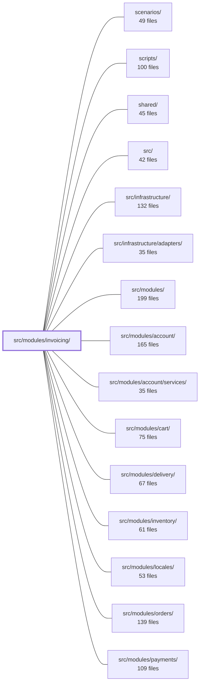

---
tags:
  - 2brain
  - 2brain/module
  - project/boilerplate-node-backend
type: module
module: src/modules/invoicing/
files: 50
updated: 2026-11-15T00:32:40.915005+00:00
---

# src/modules/invoicing/

## Purpose

The invoicing module freezes paid orders into immutable invoice documents and settled refunds into credit-note documents, then serves those documents as rendered PDFs. It owns the full compliance lifecycle—per-year numbering, PII encryption of buyer addresses, tax-retention sweeps, and the legal guarantee that a document, once issued, is never modified or deleted.

## Key parts

- **Domain (pure rules):** `domain/` — VAT-rate apportionment for partial credits (`credit-shares`), jurisdictional tax-clock retention (`retention`), and the canonical line-item shape (`tax-items`) shared with `orders` tax helpers. No framework or persistence imports.
- **Write path (issue):** `services/issue-invoice.ts` and `services/issue-credit-note.ts` are the only two mutation sites, triggered exclusively by event listeners. `services/numbering.ts` allocates gap-free per-year numbers inside the same transaction.
- **Read path (serve PDFs):** `routes.ts` → `controllers/` → `services/render.ts` → `providers/` (EJS + Puppeteer). `controllers/send-pdf.ts` shares the HTTP response header logic. `rate-limits.ts` caps the two render endpoints.
- **Model & persistence:** `model.ts` (Mongoose schemas, frozen fields) and `repository.ts` (hand-written, no generic CRUD—documents are written once, read by `orderId`).
- **Compliance & PII:** `pii.ts` (address encryption/decryption), `services/retention.ts` + `jobs.ts` (nightly buyer-block and stored-PDF reapers), `domain/retention.ts` (retention clock math).
- **Module wiring:** `module.ts` / `module.yaml` (route, job, event, and personal-data registration), `index.ts` (the sole public import surface), `config.ts` (provider name, retention knobs), `audit.ts` (type-safe action strings).
- **Presentation:** `emails.ts` (PDF copy/i18n/number formatting), `presenter.ts` (JSON wire shapes for account export and credit-note list).
- **Contract & tests:** `openapi.yaml`, `tests/contract/`, `tests/integration/`, `tests/factories.ts`.

## How it connects

- **`orders/`** — Subscribes to `ORDER_STATUS_CHANGED` (status → `paid`) to trigger invoice issuance; `services/for-caller.ts` and `services/credit-breakdown.ts` resolve order data and reuse the orders tax breakdown.
- **`payments/`** — Subscribes to `PAYMENT_REFUNDED` to trigger credit-note issuance; integration tests drive refunds through the payments module's `refundForOrder`.
- **`account/`** — Contributes the `invoicing` section to `POST /account/export` via `services/personal-data.ts` and `presenter.ts`; the same pattern for audit-action registration is mirrored in `account/audit.ts`.
- **`shared/` / `src/infrastructure/`** — Uses the shared PII encryption key ring, i18n utilities, and generic re-encryption helpers; registers its two scheduled jobs in the kernel job registry; augments the infrastructure audit-action map.
- **`locales/`** — Resolves every PDF label and locale-specific formatting through the shared locale layer.

## Where to start

1. **`module.ts`** — Shows the module's entire external surface in one file: which events it listens to, which routes it mounts, which jobs it schedules, and which personal-data hook it exposes. Reading this gives you the module's contract before diving into internals.
2. **`services/issue-invoice.ts`** — The single write path. Walking through it (numbering → PII encryption → insert → idempotency guard) reveals the module's core invariant—documents are frozen at issue—and the transactional guarantees that every other read path relies on.

## Connected modules

[[boilerplate-node-backend_ROOT|/ (repository root)]] · [[boilerplate-node-backend_scenarios|scenarios/]] · [[boilerplate-node-backend_scripts|scripts/]] · [[boilerplate-node-backend_shared|shared/]] · [[boilerplate-node-backend_src|src/]] · [[boilerplate-node-backend_src_infrastructure|src/infrastructure/]] · [[boilerplate-node-backend_src_infrastructure_adapters|src/infrastructure/adapters/]] · [[boilerplate-node-backend_src_modules|src/modules/]] · [[boilerplate-node-backend_src_modules_account|src/modules/account/]] · [[boilerplate-node-backend_src_modules_account_services|src/modules/account/services/]] · [[boilerplate-node-backend_src_modules_cart|src/modules/cart/]] · [[boilerplate-node-backend_src_modules_delivery|src/modules/delivery/]] · [[boilerplate-node-backend_src_modules_inventory|src/modules/inventory/]] · [[boilerplate-node-backend_src_modules_locales|src/modules/locales/]] · [[boilerplate-node-backend_src_modules_orders|src/modules/orders/]] · … and 5 more

## Files
- `src/modules/invoicing/audit.ts` — Declares the audit action strings the invoicing module emits and registers them in the infrastructure audit-action map via TypeScript module augmentation. This keeps the set of valid actions for `invoicing` type-safe across the codebase without requiring a shared enum (the same pattern is used in `modules/account/audit.ts`).
- `src/modules/invoicing/config.ts` — Defines the runtime configuration schema for the invoicing module—specifically which e-invoicing provider is used and how long invoice PDFs and buyer blocks are retained. It exists so these knobs are validated, typed, and overridable per environment (or per test) without hard-coding values in service code.
- `src/modules/invoicing/controllers/get-order-credit-note.ts` — HTTP controller that serves the PDF credit note for a given order. It is the credit-note counterpart to `get-order-invoice`: it returns `200` with the rendered PDF when the caller is authorised, `404` when the order or credit note does not exist (or belongs to another order), and `500` on render failure.
- `src/modules/invoicing/controllers/get-order-credit-notes.ts` — Handler for `GET /orders/:id/credit-notes`. Returns the list of settled credit notes (refunds) on a given order so a client can pick one to download. Scope is enforced at the service layer: non-admin callers see only their own order, staff with the payments read role see assigned orders, and an order the caller cannot access yields a `404`.
- `src/modules/invoicing/controllers/get-order-invoice.ts` — HTTP handler for `GET /orders/:id/invoice`. Resolves the caller's invoice for an order, renders the PDF (served from storage or generated on the fly), and streams the bytes back. Enforces that non-admin callers only access their own order's invoice.
- `src/modules/invoicing/controllers/send-pdf.ts` — Single-purpose utility that writes a rendered PDF buffer back to the client with the correct headers (inline disposition, no caching). It exists so the two PDF-download controllers (invoice and credit note) share one response path instead of duplicating header logic.
- `src/modules/invoicing/domain/credit-shares.ts` — Pure domain logic that splits a partial refund across an invoice's distinct VAT rates, producing one credit-note line per rate. It exists so the apportionment arithmetic can be tested and reused without a database, ORM model, or tax-calculation dependency.
- `src/modules/invoicing/domain/index.ts` — Barrel (re-export) file for the invoicing **domain layer**. It gives external consumers a single import path for the pure business rules defined in sibling files, while the JSDoc contract guarantees the module contains no framework or persistence imports (no Express, Mongoose, or "tier" code).
- `src/modules/invoicing/domain/retention.ts` — Pure, side-effect-free rules that compute when an invoice's buyer block (tax record) must be deleted. Encapsulates the jurisdictional tax-clock (IT art. 2220 c.c., DE, FR): retention runs through the **end** of the issue year plus N full years, so the due instant is local midnight of 1 January in year `issueYear + N + 1`, in the document's frozen timezone.
- `src/modules/invoicing/domain/tax-items.ts` — Defines the single canonical line-item shape that the shared tax functions (`orderTaxBreakdown`, `lineTaxFromRateTotals`) expect. By funneling every document's lines through one mapper, it guarantees that the invoice email, credit-note totals, and VAT breakdown all interpret a "priced, taxed line" identically rather than each spelling the shape their own way.
- `src/modules/invoicing/emails.ts` — Builds the fully-rendered text content (the "copy") for invoice and credit-note PDFs. It takes a frozen `EInvoicingDocument` and a locale, resolves every label via i18n, formats all monetary values with `Intl.NumberFormat`, and returns a plain object ready for EJS template interpolation. Despite the `emails.ts` name (inherited from the orders module's convention for "this file builds a document's copy"), nothing here is mailed — the PDF is downloaded by the user.
- `src/modules/invoicing/index.ts` — Public barrel for the invoicing module. It is the **only** import surface available to sibling modules (per `docs/theory/strategic-ddd.md` §5), re-exporting the module's services, domain, emails, and model types while keeping all runtime write-path (repository, model instantiation) internal.
- `src/modules/invoicing/jobs.ts` — Declares the two scheduled jobs owned by the `invoicing` module: a stored-PDF reaper and a buyer-block reaper. Each job wires together a concrete action (deletion of expired documents or invoice buyer records) with logging, and is registered via the kernel job registry.
- `src/modules/invoicing/model.ts` — Defines the Mongoose schemas, TypeScript interfaces, and model exports for issued invoices, credit notes, and their shared yearly numbering counters. Every field is frozen at issue time and never re-read from the source order or operator config; the documents are never serialized to JSON — the rendered PDF is the sole output.
- `src/modules/invoicing/module.ts` — Module manifest for the invoicing domain. It registers routes, jobs, config, rate limits, event subscriptions, and personal-data hooks into the kernel's `AppModule` contract. Its core responsibility is to issue **frozen** `Invoice` and `CreditNote` documents exclusively via event listeners (never via HTTP routes), reacting to facts already recorded by `orders` or `payments`. Once issued, these documents are immutable—there is no delete, update, or re-render path.
- `src/modules/invoicing/module.yaml` — Module manifest for the invoicing subdomain. Declares the module's identity (supporting subdomain, shop group), its upstream dependencies, the rate-limit budget governing PDF renders, and the two nightly retention jobs that clean up stored invoices and credit notes.
- `src/modules/invoicing/openapi.yaml` — OpenAPI 3.1.0 contract for the **invoicing** module. It defines the three order-scoped endpoints (download invoice PDF, list credit notes, download a credit-note PDF), the module's error-code vocabulary, and the `invoicing` section the bundler injects into `POST /account/export`. It is the single source of truth for what the invoicing API exposes and how errors/limits are signalled.
- `src/modules/invoicing/pii.ts` — Field-level PII codec for the buyer's billing address on invoices and credit notes. It encrypts the five address strings before they are persisted and decrypts them on the one read path that needs plaintext, using the shared `NODE_PII_ENCRYPTION_KEY` ring. The document itself is kept whole as the legal copy; only its storage representation is protected (GDPR Art. 32).
- `src/modules/invoicing/presenter.ts` — The single serialization point for the invoicing module's frozen documents into JSON wire shapes. It powers the `POST /account/export` response section and the per-order credit-note list. Every other read endpoint in this module serves rendered PDFs, never the raw document—this file is the exception.
- `src/modules/invoicing/providers/index.ts` — Defines the e-invoicing provider port: the interface, the document type it operates on, and the provider registry that maps a deployment-configured name (`NODE_EINVOICING_PROVIDER`) to a concrete implementation. It mirrors the `payments/providers` pattern — one interface, one shipped adapter (`pdf`), and a registry a new adapter can join with a single entry.
- `src/modules/invoicing/providers/pdf.ts` — The default (and only shipped) implementation of the `EInvoicingProvider` port. It renders an invoice or credit note to a PDF by piping an EJS template through Puppeteer/Chromium.
- `src/modules/invoicing/rate-limits.ts` — Defines the invoicing module's rate-limit budget (`INVOICING_RENDER_BUDGET`) and the resulting Express middleware (`invoicingLimiter`) that protects the two invoice-rendering GET routes. Both routes share a single budget because each hit spawns a full Chromium launch (`renderHtmlToPdf`), which is far more expensive than a typical request.
- `src/modules/invoicing/repository.ts` — Hand-written persistence layer for invoices, credit notes, and their two yearly number counters. It exists as a deliberate alternative to the generic `create-repository` CRUD factory: every document here is written exactly once and later read back by `orderId` (or by a few specific lookup keys), so generic search/pagination/update/delete operations are never needed.
- `src/modules/invoicing/routes.ts` — Defines the Express router that exposes three invoicing download endpoints (invoice PDF, credit-note list, single credit-note PDF) under `/orders`. It exists so these read-only file-serving routes can be mounted alongside the `orders` module's own router without path collisions, while sharing the same auth and rate-limiting concerns.
- `src/modules/invoicing/services/credit-breakdown.ts` — Extracts the VAT/tax breakdown for a partial credit note by reusing the same tax function the original invoice used, so the credit figures reconcile exactly with the invoice. It lives in `services/` (not `domain/`) because it imports from the sibling `orders` module, which domain folders are not permitted to do.
- `src/modules/invoicing/services/for-caller.ts` — Provides the three caller-scoped read operations behind the invoice and credit-note routes. Each function resolves the order through the caller's own scope first (so an unauthorized caller simply receives a 404), then layers the credit-note-specific permission check on top. The controller is left to handle only what requires the raw request (staff-read audit, PDF streaming).
- `src/modules/invoicing/services/index.ts` — Barrel (facade) module for the invoicing service layer. It aggregates every operation a controller, event listener, or test might call into a single `invoicingService` object so callers have one import target instead of reaching into individual sibling files.
- `src/modules/invoicing/services/issue-credit-note.ts` — Issues a credit note for each payment refund on an order. Full refunds mirror the original invoice's lines and totals; partial refunds derive only the refunded share (via credit-shares). One credit note per refund, so an order refunded in parts accumulates one per part. Serves as the handler for the `PAYMENT_REFUNDED` event in the invoicing module.
- `src/modules/invoicing/services/issue-invoice.ts` — The single write path in the invoicing module. When an order transitions to `paid` (via the `ORDER_STATUS_CHANGED` listener in `module.ts`), this file freezes that order into an immutable `InvoiceDocument` — allocating a number, encrypting the billing address, and inserting the row — all inside one transaction. Idempotent by construction: a duplicate-key abort returns the already-issued invoice rather than creating a second.
- `src/modules/invoicing/services/numbering.ts` — Allocates gap-free, per-year invoice and credit-note numbers (`{year}-{sequence}`) that are always taken inside the same Mongoose transaction as the document insert. This guarantees no legal number gap (VAT Directive Art. 226(2), Art. 219) and provides a single recovery path for the rare lost-race duplicate-key collision.
- `src/modules/invoicing/services/personal-data.ts` — Implements the invoicing module's contribution to `POST /account/export`. Given a `userId`, it gathers every invoice and credit note tied to that account's orders and returns them in export-ready shape. It is the `personalData` handler referenced by the module's route registration.
- `src/modules/invoicing/services/reencrypt.ts` — Domain-level orchestrator that re-encrypts the buyer address (`billingAddress`) on all invoices and credit notes onto the newest PII encryption key. It translates invoicing-specific concerns (which fields, which AAD binding, which collections) into calls on the generic infrastructure re-encryption utilities.
- `src/modules/invoicing/services/render.ts` — The single entry point that turns a frozen `InvoiceDocument` or `CreditNoteDocument` into PDF bytes. Controllers never resolve the e-invoicing provider port themselves; they call one of this file's two exports and receive a `Buffer`. Rendering is deferred to the **first** download (not issue time) and the result is cached on disk, making the stored PDF a regenerable copy of the Mongo source of truth.
- `src/modules/invoicing/services/retention.ts` — Implements the `reap:invoices` sweep: once a buyer's tax-retention window has expired, the buyer block is blanked from the invoice or credit-note document and its cached PDF is deleted. The numbered document itself (seller, line items, amounts) is preserved so revenue stats and credit-note→invoice links remain intact. Only the personal data is removed.
- `src/modules/invoicing/services/stats.ts` — Aggregates invoiced and credited amounts per currency and time-bucket for reporting. It is the single source of money figures in stats because invoices and credit notes are the frozen, dated rows (`issuedAt`); orders carry no total and refunds carry no VAT/shipping split.
- `src/modules/invoicing/tests/contract/api.contract.test.ts` — Contract tests for the three invoicing routes mounted under `/orders/{id}`: the invoice PDF, the credit-note list, and a single credit-note PDF. Each test drives one declared API branch over HTTP and asserts the response matches the documented spec (status code, error shape, content type). Ownership-scope, busy-queue (503), and number-series concerns are explicitly out of scope and belong to `tests/integration/`.
- `src/modules/invoicing/tests/factories.ts` — Test helpers for the invoicing module. Provides a polling wrapper around the asynchronous "freeze invoice" side-effect (triggered by a fire-and-forget `ORDER_STATUS_CHANGED` listener) and re-exports the internal `issueCreditNote` service so sibling tests can exercise it without going through the public service surface.
- `src/modules/invoicing/tests/integration/credit-note-catch-up.test.ts` — Integration test verifying the "catch-up" path: when an invoice-issuing event died in the outbox and is later revived, the system re-issues the invoice and then creates one credit note per already-settled refund (oldest first, idempotently), while skipping any refund that has not yet settled. Runs against real Mongo through the real `invoicingModule` subscription to the paid event.
- `src/modules/invoicing/tests/integration/download.test.ts` — Integration tests for `GET /orders/{id}/invoice` and `GET /orders/{id}/credit-notes` over real HTTP. Verifies status-code contracts (404 unissued, 200 issued, 503 busy), ownership scoping (stranger gets 404, admin gets 200), PDF rendering details (plaintext address, stored seller name), the stored-copy cache, the `actions.invoice` flag on the order, and audit logging for admin downloads.
- `src/modules/invoicing/tests/integration/issue-credit-note.test.ts` — Integration test verifying that a credit note is frozen **only** when a `PAYMENT_REFUNDED` event settles on a `succeeded` payment, exercised through the real `payments` module's `refundForOrder` and the invoicing module's event subscription—not by calling `issueCreditNote` directly (except in targeted edge-case tests). Covers numbering, PII re-encryption, partial-refund mirroring, idempotency, timezone-aware year, seller preservation, and race/failure rollback.
- `src/modules/invoicing/tests/integration/issue-invoice.test.ts` — End-to-end integration tests for invoice issuance triggered by the `ORDER_STATUS_CHANGED` event. The suite proves that an order's `pending → paid` transition is the sole path to freezing an invoice, exercising the real `module.ts` subscription and event wiring rather than calling `issueInvoice` in isolation. It also covers PII re-encryption, VAT rounding semantics, number allocation under race conditions, timezone-aware year numbering, and timeline bookkeeping.
- `src/modules/invoicing/tests/integration/reencrypt.test.ts` — Integration test that verifies the invoicing module's `reencrypt` walk: when the PII encryption key is rotated (a new key is prepended to the `NODE_PII_ENCRYPTION_KEY` environment variable), the buyer address fields stored on an invoice are re-encrypted under the new key version, remain decryptable under the invoice's own id, and a second invocation is a no-op (idempotency).
- `src/modules/invoicing/tests/integration/retention.test.ts` — Integration test for the `reap:invoices` retention job. Verifies that once an invoice or credit note passes its tax retention window (local New Year of issue year + 11), the buyer block (`billingAddress`) is blanked, the cached PDF is deleted from the document store, all other fields remain untouched, and a second run is a no-op.
- `src/modules/invoicing/tests/unit/credit-breakdown.test.ts` — Unit tests for `creditBreakdownOf`, verifying that a partial credit note's per-rate rows (net, tax, gross) sum to exactly the refunded amount, that VAT is extracted once per rate, and that currency-specific rounding (decimal vs. zero-decimal) is handled correctly.
- `src/modules/invoicing/tests/unit/credit-shares.test.ts` — Unit tests for the pure-arithmetic `creditShares` function: spreading a refunded amount across an invoice's VAT rates in proportion to what each rate collected. By testing the function in isolation (no database, no real tax service), these tests pin the distribution math; companion integration tests cover the function through the full refund flow.
- `src/modules/invoicing/tests/unit/emails.test.ts` — Unit tests for the invoice / credit-note document renderer (`buildDocumentView`) and the EN 16931 tax-category helper (`taxCategoryCode`). It locks down rendering correctness (line rows, VAT block, supplier block, locale, reversal notices, buyer erasure) so that a formatting slip is caught before a customer reads it as a billing error. Adapted from the retired `invoiceDocument` suite in `orders/tests/unit/emails.test.ts`.
- `src/modules/invoicing/tests/unit/render.test.ts` — Unit tests for the invoice and credit-note PDF rendering service (`renderInvoicePdf` / `renderCreditNotePdf`). The provider is mocked (no Chromium), while the document store runs against a real temp directory, so the assertions target caching semantics: the second download streams the stored file, retention `0` stores nothing, and a failing store never prevents a successful render.
- `src/modules/invoicing/tests/unit/retention.test.ts` — Unit tests for the buyer-retention "tax clock" rule: a document is due on local midnight of 1 January of (issue year + N + 1), computed in the document's own timezone, and the scan bound must never exclude a document that is already due. The tests pin down timezone-sensitive edge cases that are easy to get wrong with UTC-naive arithmetic.
- `src/modules/invoicing/tests/unit/routes.test.ts` — Unit test that asserts the static shape of the invoicing router: which routes are mounted, which auth guards protect them, and which rate-limit namespace budgets them. It exists to catch accidental route re-signatures, guard regressions, or rate-limit misconfigurations before they reach integration or production.
- `src/modules/invoicing/tests/unit/schema-contract.test.ts` — Verifies the schema-level contract shared by the two frozen tax documents (invoice and credit note): both **require** the `orderNumber` and `currency` fields (copied from the originating order) and provide no fallback when either is absent.

---
[[boilerplate-node-backend_INDEX|← boilerplate-node-backend index]]
