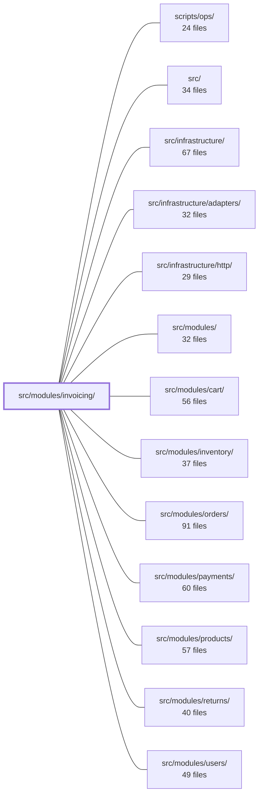

---
tags:
  - 2brain
  - 2brain/module
  - project/boilerplate-node-backend
type: module
module: src/modules/invoicing/
files: 33
updated: 2026-10-07T23:58:33.837817+00:00
---

# src/modules/invoicing/

## Purpose

The invoicing module owns the full lifecycle of invoices and credit notes tied to orders: issuing them, assigning sequential numbers, rendering them as PDFs, delivering them by email, and managing the personal data (PII) embedded in those documents. It also handles partial credits and re-encryption of stored invoice data.

## Key parts

- **Services** (`services/`) — the business-logic core: `issue-invoice.ts` and `issue-credit-note.ts` orchestrate document creation; `numbering.ts` manages sequential identifiers; `partial-credit.ts` computes credit amounts; `reencrypt.ts` refreshes encryption on stored PII; `render.ts` turns a document model into display-ready output.
- **Controllers** (`controllers/`) — read endpoints: `get-order-invoice.ts`, `get-order-credit-note.ts`, `get-order-credit-notes.ts` expose existing documents for retrieval.
- **Providers** (`providers/pdf.ts`) — wraps PDF generation so it can be swapped or mocked.
- **PII & personal data** (`pii.ts`, `services/personal-data.ts`) — isolates the extraction, storage, and re-encryption of customer personal information so the rest of the module never handles raw PII.
- **Repository & model** (`repository.ts`, `model.ts`) — persistence and schema definitions for invoices and credit notes.
- **Cross-cutting files** — `emails.ts` (email templates/dispatch), `rate-limits.ts` (throttling), `audit.ts` (action logging), `config.ts` (module settings), `presenter.ts` (shape data for the API layer).
- **Module wiring** (`module.ts`, `routes.ts`, `index.ts`) — NestJS module definition, route registration, and public barrel export.
- **Tests** (`tests/`) — integration tests cover end-to-end issue/download/reencrypt flows; unit tests cover email formatting, partial-credit math, rendering, route guards, and schema contracts.

## How it connects

- **Orders** (`src/modules/orders/`) — invoices and credit notes reference an order; the module reads order line items and totals as the source of truth for document content.
- **Payments** (`src/modules/payments/`) — payment status and method inform what appears on the invoice.
- **Returns** (`src/modules/returns/`) — a credit note is issued in response to a return; this module consumes return data to compute the credit amount.
- **Products** (`src/modules/products/`) — line-item descriptions, SKUs, and pricing come from product records.
- **Users** (`src/modules/users/`) — customer name, address, and contact details for the invoice header and email delivery.
- **Cart / Inventory** — consulted indirectly when assembling order line-item snapshots for the document.
- **Infrastructure** (`src/infrastructure/http/`, `src/infrastructure/adapters/`) — provides the HTTP transport for the read endpoints and adapter interfaces (e.g., email delivery, object storage for PDFs) that the module's providers consume.
- **`scripts/ops/`** — operational scripts (backfill, re-encryption sweeps) invoke this module's services directly.

## Where to start

1. **`services/issue-invoice.ts`** — the primary "what happens when a customer requests an invoice" flow; reading it reveals the service composition, PII handling, and numbering steps in one pass.
2. **`module.ts`** (with `routes.ts`) — a quick map of which providers, controllers, and guards are registered, so you know the module's public surface before diving deeper.

## Connected modules

[[boilerplate-node-backend_ROOT|/ (repository root)]] · [[boilerplate-node-backend_scripts_ops|scripts/ops/]] · [[boilerplate-node-backend_src|src/]] · [[boilerplate-node-backend_src_infrastructure|src/infrastructure/]] · [[boilerplate-node-backend_src_infrastructure_adapters|src/infrastructure/adapters/]] · [[boilerplate-node-backend_src_infrastructure_http|src/infrastructure/http/]] · [[boilerplate-node-backend_src_modules|src/modules/]] · [[boilerplate-node-backend_src_modules_cart|src/modules/cart/]] · [[boilerplate-node-backend_src_modules_inventory|src/modules/inventory/]] · [[boilerplate-node-backend_src_modules_orders|src/modules/orders/]] · [[boilerplate-node-backend_src_modules_payments|src/modules/payments/]] · [[boilerplate-node-backend_src_modules_products|src/modules/products/]] · [[boilerplate-node-backend_src_modules_returns|src/modules/returns/]] · [[boilerplate-node-backend_src_modules_users|src/modules/users/]]

## Files
- `src/modules/invoicing/audit.ts`
- `src/modules/invoicing/config.ts`
- `src/modules/invoicing/controllers/get-order-credit-note.ts`
- `src/modules/invoicing/controllers/get-order-credit-notes.ts`
- `src/modules/invoicing/controllers/get-order-invoice.ts`
- `src/modules/invoicing/emails.ts`
- `src/modules/invoicing/index.ts`
- `src/modules/invoicing/model.ts`
- `src/modules/invoicing/module.ts`
- `src/modules/invoicing/pii.ts`
- `src/modules/invoicing/presenter.ts`
- `src/modules/invoicing/providers/index.ts`
- `src/modules/invoicing/providers/pdf.ts`
- `src/modules/invoicing/rate-limits.ts`
- `src/modules/invoicing/repository.ts`
- `src/modules/invoicing/routes.ts`
- `src/modules/invoicing/services/index.ts`
- `src/modules/invoicing/services/issue-credit-note.ts`
- `src/modules/invoicing/services/issue-invoice.ts`
- `src/modules/invoicing/services/numbering.ts`
- `src/modules/invoicing/services/partial-credit.ts`
- `src/modules/invoicing/services/personal-data.ts`
- `src/modules/invoicing/services/reencrypt.ts`
- `src/modules/invoicing/services/render.ts`
- `src/modules/invoicing/tests/integration/download.test.ts`
- `src/modules/invoicing/tests/integration/issue-credit-note.test.ts`
- `src/modules/invoicing/tests/integration/issue-invoice.test.ts`
- `src/modules/invoicing/tests/integration/reencrypt.test.ts`
- `src/modules/invoicing/tests/unit/emails.test.ts`
- `src/modules/invoicing/tests/unit/partial-credit.test.ts`
- `src/modules/invoicing/tests/unit/render.test.ts`
- `src/modules/invoicing/tests/unit/routes.test.ts`
- `src/modules/invoicing/tests/unit/schema-contract.test.ts`

---
[[boilerplate-node-backend_INDEX|← boilerplate-node-backend index]]
