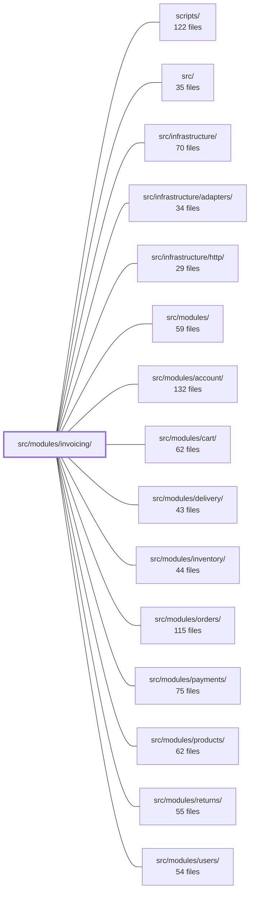

---
tags:
  - 2brain
  - 2brain/module
  - project/boilerplate-node-backend
type: module
module: src/modules/invoicing/
files: 37
updated: 2026-10-15T13:39:52.195090+00:00
---

# src/modules/invoicing/

## Purpose

The invoicing module freezes a paid order into an immutable **Invoice** and a settled refund into an immutable **Credit Note**, then renders either as a downloadable PDF. All document creation is event-driven (no HTTP request writes a document); the module reacts to domain events from `orders` and `payments`, copies the needed fields once, and never re-reads the source. The only consumer-facing output is a PDF; the MongoDB row is a frozen legal copy, not a live record.

## Key parts

- **Write path (event → frozen document)**
  - `services/issue-invoice.ts` — single idempotent write triggered by `ORDER_STATUS_CHANGED (to: paid)`.
  - `services/issue-credit-note.ts` — single idempotent write triggered by `PAYMENT_REFUNDED`; handles full and partial refunds.
  - `services/numbering.ts` — atomic per-year gap-free number allocation (`YYYY-NNNNNN`) inside the same transaction as the insert.
  - `domain/credit-shares.ts` — pure arithmetic that splits a partial refund across the original invoice's VAT rates.

- **Read / render path**
  - `controllers/` — three thin HTTP handlers (invoice PDF, credit-note list, credit-note PDF) under the `/orders` mount.
  - `services/render.ts` — single call-site for the e-invoicing provider; lazy PDF generation with disk cache and configurable retention.
  - `emails.ts` — builds the fully-formatted, localized view context that the EJS template interpolates (named for convention with `orders`, though nothing is mailed).
  - `presenter.ts` — trims frozen documents into the JSON shapes used by `POST /account/export` and the credit-note list endpoint.

- **Persistence & security**
  - `model.ts` — Mongoose schemas for `Invoice`, `CreditNote`, and two per-year counters; every field is write-once.
  - `repository.ts` — hand-written persistence (no generic CRUD factory) because documents are written once and read only by `orderId`.
  - `pii.ts` — encrypts/decrypts the buyer billing address frozen on each document (GDPR Art. 32).

- **E-invoicing provider seam**
  - `providers/index.ts` — the `EInvoicingProvider` port and registry; a new national network is added as one file + one registration call.
  - `providers/pdf.ts` — the sole shipped implementation (EJS → Puppeteer → A4 PDF buffer).

- **Module wiring & cross-cutting**
  - `module.ts` — declares the `AppModule`, wires routes, config, rate limits, PII hooks, and the two event listeners.
  - `routes.ts` — Express router attaching the three endpoints under the shared `/orders` prefix.
  - `config.ts`, `audit.ts`, `rate-limits.ts` — module config (provider selection, PDF retention), audit-action vocabulary, and the shared Chromium-launch budget.
  - `index.ts` — the **only** public import surface permitted to sibling modules (strategic-DDD rule).

- **Services barrel & helpers**
  - `services/index.ts` — single import path for controllers, listeners, and external modules.
  - `services/stats.ts` — per-currency, per-bucket invoiced/credited totals (the sole source of money figures for reporting).
  - `services/personal-data.ts` — the `POST /account/export` slice for this module.
  - `services/reencrypt.ts` — re-encrypts PII after a key rotation.
  - `services/credit-breakdown.ts` — thin adapter so the domain layer never imports `orders` directly.

## How it connects

- **`src/modules/orders`** — publishes `ORDER_STATUS_CHANGED (to: paid)` which this module subscribes to in order to freeze an invoice. `orders/config.ts` holds seller-identity fields (legal name, VAT, address) so that `orders`'s own withdrawal notice can print them without depending on invoicing. This module reads the order's lines, totals, and VAT data at issue time and never re-joins.
- **`src/modules/payments`** — publishes `PAYMENT_REFUNDED`; this module's listener issues the corresponding credit note. One credit note is created per settled refund, so an order refunded in parts accumulates one note per part.
- **`src/modules/account`** — `POST /account/export` delegates to `services/personal-data.ts` to collect the account's invoices and credit notes for the export payload.
- **`src/modules/returns`** — upstream of `payments`: a return settles into a refund, which flows through `PAYMENT_REFUNDED` into this module. This module is the terminal consumer of that chain.
- **`src/infrastructure/http`** — provides the Express app, shared route mounting, and `buildRateLimiter` factory that this module's `rate-limits.ts` feeds.
- **`src/infrastructure/adapters`** — supplies the Puppeteer/EJS rendering stack used by `providers/pdf.ts`.
- **`scripts/`** — the global `reencrypt` ops script calls into `services/reencrypt.ts` as the invoicing-domain half of a key-rotation walk.

## Where to start

1. **`module.ts`** — the module manifest. In ~60 lines it shows the two event subscriptions, the route mount, the config, and the PII hooks. Reading it first gives you the full "what happens and when" map before diving into any individual service.
2. **`services/issue-invoice.ts`** — the core write path. It demonstrates the idempotency pattern, the numbering transaction, PII encryption, and the "copy-once, never re-read" invariant in a single readable flow. Pair it with `domain/credit-shares.ts` if you need to understand how partial refunds are split.

## Connected modules

[[boilerplate-node-backend_ROOT|/ (repository root)]] · [[boilerplate-node-backend_scripts|scripts/]] · [[boilerplate-node-backend_src|src/]] · [[boilerplate-node-backend_src_infrastructure|src/infrastructure/]] · [[boilerplate-node-backend_src_infrastructure_adapters|src/infrastructure/adapters/]] · [[boilerplate-node-backend_src_infrastructure_http|src/infrastructure/http/]] · [[boilerplate-node-backend_src_modules|src/modules/]] · [[boilerplate-node-backend_src_modules_account|src/modules/account/]] · [[boilerplate-node-backend_src_modules_cart|src/modules/cart/]] · [[boilerplate-node-backend_src_modules_delivery|src/modules/delivery/]] · [[boilerplate-node-backend_src_modules_inventory|src/modules/inventory/]] · [[boilerplate-node-backend_src_modules_orders|src/modules/orders/]] · [[boilerplate-node-backend_src_modules_payments|src/modules/payments/]] · [[boilerplate-node-backend_src_modules_products|src/modules/products/]] · [[boilerplate-node-backend_src_modules_returns|src/modules/returns/]] · … and 1 more

## Files
- `src/modules/invoicing/audit.ts` — Declares the audit action strings the invoicing module can emit and registers them into the shared `AuditActionMap` via TypeScript module augmentation. This provides compile-time safety so that only recognized action keys can be logged for this module, while keeping each module's vocabulary local rather than centralized in a shared enum.
- `src/modules/invoicing/config.ts` — Declares the module-level configuration for the invoicing subsystem: which e-invoicing provider is active and how long rendered PDFs are retained before reaping. It deliberately excludes seller identity fields (legal name, VAT, address), which belong to `@modules/orders/config.ts` because the withdrawal notice also prints them and `orders` must not depend on this module.
- `src/modules/invoicing/controllers/get-order-credit-note.ts` — Serves the PDF credit note for a specific order (i.e. a confirmed refund). It is the credit-note counterpart of the order-invoice controller: returns a `200` with the rendered PDF, a `404` when the credit note was never issued, belongs to a different order, or the order itself is absent/invisible to the caller, and a `500` if PDF rendering fails.
- `src/modules/invoicing/controllers/get-order-credit-notes.ts` — HTTP controller for `GET /orders/:id/credit-notes`. Resolves an order (scoped to the authenticated caller), then returns the list of settled credit notes (refunds) on that order. Yields `[]` when no refund exists, `404` when the order is missing or invisible to the caller.
- `src/modules/invoicing/controllers/get-order-invoice.ts` — HTTP handler for `GET /orders/:id/invoice`. Resolves the caller's order, locates its invoice, renders a PDF synchronously on the request thread, and streams the bytes back. Exists to give the frontend a single endpoint that returns the invoice file or a structured 404 explaining why one isn't available.
- `src/modules/invoicing/domain/credit-shares.ts` — Pure arithmetic that splits a **partial** credit-note refund across the VAT rates of the original invoice, producing one credit line per rate. It distinguishes two refund modes — goods-specific (weighs only the returned lines plus delivery) and goodwill (pro-rata by gross amount) — so the downstream tax extraction mirrors what the invoice itself did.
- `src/modules/invoicing/domain/index.ts` — Barrel file for the invoicing domain layer. It re-exports the pure business rules (specifically credit-share logic) so that higher tiers (services, tests) can import from a single, stable entry point without reaching into individual domain files. The module docblock asserts that this layer is lint-enforced to contain no Express, Mongoose, or other tier dependencies.
- `src/modules/invoicing/emails.ts` — Builds the fully-formatted, localized view context (all labels, amounts, and dates as finished strings) that the EJS PDF template interpolates for invoices and credit notes. It performs no calculation beyond formatting: every tax figure is frozen onto the document at issue time. The file is named `emails.ts` to match the `@modules/orders` convention for "this file builds a document's copy," even though nothing here is mailed—the PDF is downloaded, never sent.
- `src/modules/invoicing/index.ts` — Public barrel for the invoicing module. It is the **only** import surface that sibling modules (payments, returns, stats, etc.) are permitted to use, per the strategic DDD rule (`docs/theory/strategic-ddd.md` §5). It re-exports the module's services, domain types, email helpers, and model types while keeping the `invoicingRepository` and model runtime internals private to this module.
- `src/modules/invoicing/model.ts` — Defines the Mongoose schemas, TypeScript interfaces, and models for the two frozen legal documents in the invoicing domain—**Invoice** and **CreditNote**—plus their independent per-year numbering counters. Every field is copied from the source order (or invoice) at the moment of issue and never re-read or re-joined afterwards. Neither document is ever serialized to JSON; the only consumer-facing representation is a rendered PDF.
- `src/modules/invoicing/module.ts` — The module manifest for the Invoicing module. It declares the module's identity (`AppModule`) and wires together its routes, config, rate limits, PII hooks, and the two event-driven listeners that freeze invoices and credit notes. No HTTP request ever creates a document; both are produced solely in reaction to domain events published by `orders` and `payments`.
- `src/modules/invoicing/pii.ts` — Encrypts and decrypts the buyer's billing-address fields frozen on an invoice or credit note. The document itself remains the legal copy; only its storage is protected (GDPR Art. 32). It mirrors the orders module's PII codec and shares the same `NODE_PII_ENCRYPTION_KEY` ring.
- `src/modules/invoicing/presenter.ts` — Presentation-layer mapper for the invoicing module. It converts frozen internal documents (`InvoiceDocument`, `CreditNoteDocument`) into the trimmed JSON shapes consumed by `POST /account/export` and the credit-note list endpoint. No other read path in this module serves the raw document — they all render a PDF.
- `src/modules/invoicing/providers/index.ts` — Defines the e-invoicing provider **port** (interface + registry) — the seam through which any national e-invoicing network is wired in as a deployment choice via `NODE_EINVOICING_PROVIDER`. Ships a single implementation (`pdf`); a live deployment adds one file and one `registerEInvoicingProvider` call without editing this file. The pattern mirrors `payments/providers`.
- `src/modules/invoicing/providers/pdf.ts` — The sole shipped implementation of the `EInvoicingProvider` port. It renders an invoice or credit note to PDF by piping an EJS template through Puppeteer (A4), returning a byte buffer with a `application/pdf` content type. It exists so that consumers of the port in `./index.ts` get a concrete, self-contained rendering path without depending on any other provider.
- `src/modules/invoicing/rate-limits.ts` — Declares the invoicing module's rate-limit budget for its two PDF-render endpoints (`GET /orders/:id/invoice` and `GET /orders/:id/credit-notes/:creditNoteId`). Both endpoints spawn a Chromium launch, so they share a single per-account budget rather than having separate ones. The budget object is fed through the shared `buildRateLimiter` factory to produce an Express middleware.
- `src/modules/invoicing/repository.ts` — Hand-written persistence layer for invoices, credit notes, and their two per-year numbering counters. It deliberately avoids the generic `create-repository` factory because every document is written once and read back only by `orderId` — no searching, paginating, updating, or deleting ever occurs, so the generic CRUD would add nothing.
- `src/modules/invoicing/routes.ts` — Express router that registers the three invoicing download endpoints (invoice PDF, credit-note list, single credit-note PDF) under the shared `/orders` mount. It exists so invoicing can attach its routes to the same URL prefix as the `orders` module without path collisions (all invoicing paths have two or more segments after `/:id`).
- `src/modules/invoicing/services/credit-breakdown.ts` — Computes the VAT/tax breakdown for a partial credit note by reusing the same tax function the original invoice used. It exists as a thin service-layer adapter so the invoicing **domain** layer never imports from the sibling `orders` module directly.
- `src/modules/invoicing/services/index.ts` — Barrel / entry-point module for the invoicing service layer. It re-exports every public function, type, and the `invoicingService` convenience object from sibling service files, giving controllers, event listeners, and external modules a single import path (`@/modules/invoicing/services`) for all invoicing operations.
- `src/modules/invoicing/services/issue-credit-note.ts` — Issues a credit note in response to a settled payment refund (`PAYMENT_REFUNDED` event). A full refund mirrors the original invoice's lines and totals verbatim; a partial refund re-derives the refunded share via the domain's `creditShares` logic. One credit note is created per refund, so an order refunded in parts accumulates one note per part.
- `src/modules/invoicing/services/issue-invoice.ts` — Freezes a paid order into an immutable invoice. This is the single write path the invoicing module performs in response to `ORDER_STATUS_CHANGED` (`to: 'paid'`), delegated by `module.ts`'s listener. The operation is idempotent: a redelivered event or a racing settlement that loses the duplicate-key race reads back the winner's row instead of inserting a second invoice.
- `src/modules/invoicing/services/numbering.ts` — Allocates and formats the next sequential number for invoices and credit notes within a shop-calendar year. Each series (invoice, credit note) has its own atomic counter, so numbers are gap-free: the increment happens inside the same Mongoose transaction that inserts the document, and a lost race aborts the whole transaction. The output format (`YYYY-NNNNNN`) intentionally mirrors the order-numbering convention.
- `src/modules/invoicing/services/personal-data.ts` — Serves the invoicing module's slice of the `POST /account/export` endpoint by collecting every invoice and credit note tied to an account's own orders. It exists as a dedicated file so that `module.ts` can register it as the `personalData` handler without coupling that logic to the repository or presenter directly.
- `src/modules/invoicing/services/reencrypt.ts` — Re-encrypts the buyer (`billingAddress`) PII stored on every invoice and credit note so that it is bound to the newest `NODE_PII_ENCRYPTION_KEY`. Serves as the invoicing-domain half of the global `reencrypt` ops script.
- `src/modules/invoicing/services/render.ts` — Converts a frozen invoice or credit note into its PDF bytes. It is the single call-site for `resolveEInvoicingProvider`, so controllers never need to know the e-invoicing port exists. Rendering is lazy (first download, not issue time) and the result is cached on disk for a configurable retention period; the frozen Mongo row remains the source of truth.
- `src/modules/invoicing/services/stats.ts` — Computes per-currency, per-bucket money totals (invoiced vs. credited) from frozen invoice and credit-note rows. It exists as the single source of money figures for reporting because orders carry no totals and refunds carry no VAT/shipping split—only issued documents do.
- `src/modules/invoicing/tests/integration/download.test.ts` — Integration tests for `GET /orders/{id}/invoice` and the credit-note endpoints, exercised over real HTTP against a live test database. Verifies status codes (404 / 200 / 503), ownership scoping, admin access, audit logging, PDF rendering behaviour (including the stored-copy optimisation), and the `actions.invoice` flag surfaced on the order resource.
- `src/modules/invoicing/tests/integration/issue-credit-note.test.ts` — Integration test that verifies credit-note issuance as a full pipeline: a refund on a `succeeded` payment fires `PAYMENT_REFUNDED`, which the invoicing module's subscription handles to freeze a credit note. It covers numbering, PII re-encryption, line mirroring, partial refunds, idempotency, timezone-aware series, concurrent-writer safety, number-counter rollback, and the no-invoice no-op path.
- `src/modules/invoicing/tests/integration/issue-invoice.test.ts` — Integration test proving that an order's `pending → paid` transition — triggered via the real `markPaid` path and the invoicing module's event subscription — freezes exactly one correct invoice. It validates the full wiring (event → listener → `issueInvoice`), PII re-encryption, VAT rounding semantics, numbering, and idempotency without calling `issueInvoice` in isolation (except in the race/idempotency block).
- `src/modules/invoicing/tests/integration/reencrypt.test.ts` — Integration test that verifies the invoicing module's `reencrypt` walk: when the PII encryption key is rotated, buyer address fields frozen on an invoice are re-encrypted under the newest key, remain decryptable via the invoice's own ID, and a subsequent no-op run reports zero rewrites.
- `src/modules/invoicing/tests/unit/credit-breakdown.test.ts`
- `src/modules/invoicing/tests/unit/credit-shares.test.ts`
- `src/modules/invoicing/tests/unit/emails.test.ts` — Unit tests for `buildDocumentView` and `taxCategoryCode` in the invoicing email module. Verifies that rendered invoice/credit-note documents have correct line items, VAT tables, currency formatting, locale-aware labels, EN 16931 tax-category codes, and structural guards (no float re-multiplication, no i18n leakage into user-supplied titles).
- `src/modules/invoicing/tests/unit/render.test.ts` — Unit tests for the invoice and credit-note PDF rendering service. It exercises `renderInvoicePdf` / `renderCreditNotePdf` against a **real** file-backed document store (a temp directory) while replacing the e-invoicing provider (no Chromium). The assertions target three behaviours: the second render streams the stored file instead of re-issuing, a retention of `0` stores nothing, and a store that throws never turns a download into a failure.
- `src/modules/invoicing/tests/unit/routes.test.ts` — Unit test for the invoicing route table. Verifies the exact set of mounted endpoints, their authorization guards, and their rate-limiting assignments — essentially a contract check on `router` so that route changes surface immediately in CI.
- `src/modules/invoicing/tests/unit/schema-contract.test.ts` — Verifies the frozen tax-document schema contract: both the invoice and credit-note schemas must declare `orderNumber` and `currency` as required fields (copied from the parent order, with no fallback). The file exists to lock in this invariant so a future schema change that drops or makes optional either field fails CI immediately.

---
[[boilerplate-node-backend_INDEX|← boilerplate-node-backend index]]
