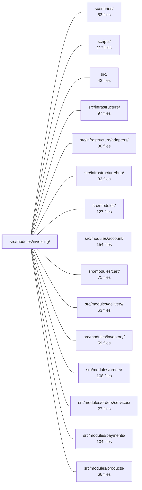

---
tags:
  - 2brain
  - 2brain/module
  - project/boilerplate-node-backend
type: module
module: src/modules/invoicing/
files: 50
updated: 2026-10-29T19:25:57.141696+00:00
---

# src/modules/invoicing/

## Purpose

The invoicing module freezes paid orders into numbered, PII-encrypted invoice documents and settles refunds into credit notes, then serves those documents as rendered PDFs. All document creation is event-driven (subscribing to `ORDER_STATUS_CHANGED → paid` and `PAYMENT_REFUNDED`); no HTTP route can issue an invoice or credit note. It also owns the buyer-PII retention sweep, the per-year numbering counter, and the authoritative money totals that feed statistics.

## Key parts

- **Domain layer (`domain/`)** — Framework-free rule functions: `credit-shares.ts` (splitting a partial refund across VAT rates), `retention.ts` (computing when the buyer block may be deleted), `tax-items.ts` (normalising a flat line into the shape the shared tax helpers expect). Importable from a single barrel.
- **Services (`services/`)** — The operational core: `issue-invoice.ts` (idempotent freeze of a paid order), `issue-credit-note.ts` (numbered credit note per refund), `numbering.ts` (gap-free per-year sequence via atomic counters), `render.ts` (lazy PDF generation with disk caching), `for-caller.ts` (ownership-scoped reads behind the HTTP routes), `retention.ts` (buyer-block reaper), `stats.ts` (per-currency invoiced/credited totals), `credit-breakdown.ts` (VAT figures for partial credits), `personal-data.ts` (GDPR export contribution), `reencrypt.ts` (key-rotation helper).
- **Model & persistence** — `model.ts` defines the frozen Mongoose schemas for `Invoice`, `CreditNote`, and the yearly counters; `repository.ts` provides the minimal write-once / read-by-order operations (no generic CRUD, no pagination, no updates).
- **Providers (`providers/`)** — An `EInvoicingProvider` port with a single shipped `pdf` adapter (EJS + Puppeteer) and a registry that lets deployments swap implementations via `NODE_EINVOICING_PROVIDER`.
- **HTTP surface** — `routes.ts` mounts three endpoints under `/orders/:id/…`; controllers (`get-order-invoice`, `get-order-credit-notes`, `get-order-credit-note`) resolve documents and stream PDFs; `send-pdf.ts` centralises the response headers. `rate-limits.ts` caps Chromium-launch cost per account.
- **Module wiring** — `module.ts` is the `AppModule` manifest (routes, event subscriptions, jobs, config, rate limits, PII hooks). `config.ts` holds the per-deployment knobs (active provider, retention window). `jobs.ts` / `jobs.generated.ts` declare the two scheduled reapers. `audit.ts` types the module's audit-action constants.
- **Presentation & formatting** — `emails.ts` assembles the localised render context; `presenter.ts` maps documents to the trimmed JSON used by `POST /account/export` and the credit-note list; `pii.ts` encrypts/decrypts the buyer block.
- **Tests** — Contract tests per route, integration tests for issue / credit-note / download flows, and shared factories in `tests/`.

## How it connects

- **`src/modules/orders/`** — Invoicing subscribes to the orders module's `ORDER_STATUS_CHANGED` event to trigger invoice issuance, reads order data through `orderService.getForCaller` for ownership scoping, reuses the orders module's `renderHtmlToPdf` pipeline (via the PDF provider), and calls the shared tax functions (`orderTaxBreakdown`, `lineTaxFromRateTotals`) from `services/credit-breakdown.ts`. Seller-identity fields remain owned by orders.
- **`src/modules/payments/`** — Invoicing subscribes to `PAYMENT_REFUNDED` to issue credit notes; integration tests drive this path through the real payments module's `refundForOrder`.
- **`src/modules/account/`** — The invoicing module contributes its documents to the account's personal-data export (`services/personal-data.ts` is called by the account module's export handler).
- **`src/infrastructure/`** — Mongoose models and the atomic counter rely on the shared persistence layer; Express routes and the rate-limit middleware come from `src/infrastructure/http/`.
- **`src/modules/returns/`** — Credit notes represent settled refunds; the returns module's refund lifecycle is the upstream trigger, but invoicing reacts solely to the `PAYMENT_REFUNDED` event, not to returns-module state directly.
- **Sibling modules (stats, etc.)** — Consume invoicing's public API (re-exported from `index.ts`) for money totals and document metadata; they never import internal services or the repository directly.

## Where to start

1. **`module.ts`** — Read this first. It shows the two event listeners that are the *only* write paths, the three HTTP routes, the scheduled jobs, and how config/rate-limits/PII hooks are wired together. It gives you the full surface in one file.
2. **`services/issue-invoice.ts`** — Next, trace the happy path from event to frozen document (numbering, PII encryption, idempotent insert). Understanding this flow makes the controllers, render pipeline, and retention sweep straightforward to follow.

## Connected modules

[[boilerplate-node-backend_ROOT|/ (repository root)]] · [[boilerplate-node-backend_scenarios|scenarios/]] · [[boilerplate-node-backend_scripts|scripts/]] · [[boilerplate-node-backend_src|src/]] · [[boilerplate-node-backend_src_infrastructure|src/infrastructure/]] · [[boilerplate-node-backend_src_infrastructure_adapters|src/infrastructure/adapters/]] · [[boilerplate-node-backend_src_infrastructure_http|src/infrastructure/http/]] · [[boilerplate-node-backend_src_modules|src/modules/]] · [[boilerplate-node-backend_src_modules_account|src/modules/account/]] · [[boilerplate-node-backend_src_modules_cart|src/modules/cart/]] · [[boilerplate-node-backend_src_modules_delivery|src/modules/delivery/]] · [[boilerplate-node-backend_src_modules_inventory|src/modules/inventory/]] · [[boilerplate-node-backend_src_modules_orders|src/modules/orders/]] · [[boilerplate-node-backend_src_modules_orders_services|src/modules/orders/services/]] · [[boilerplate-node-backend_src_modules_payments|src/modules/payments/]] · … and 3 more

## Files
- `src/modules/invoicing/audit.ts` — Declares the audit action strings the invoicing module emits and registers them in the global `AuditActionMap` via TypeScript module augmentation. Exists so that any code path that produces an invoicing audit event can reference a typed, module-scoped constant instead of a raw string literal.
- `src/modules/invoicing/config.ts` — Defines the runtime configuration surface for the invoicing module—specifically which e-invoicing provider is active and how long rendered PDFs and buyer identity blocks are retained. It exists as a separate, per-call-readable config so that individual tests can override values without mutating shared state, and so that seller-identity fields (which belong to the `orders` module) stay decoupled.
- `src/modules/invoicing/controllers/get-order-credit-note.ts` — HTTP controller that serves the PDF of an order's credit note (a landed refund) at `GET /orders/:id/credit-notes/:creditNoteId`. Explicitly documented as the twin of `getOrderInvoice`: it returns `200` with the rendered PDF, `404` when the credit note does not exist, belongs to a different order, or the caller lacks access, and `500` on a render failure.
- `src/modules/invoicing/controllers/get-order-credit-notes.ts` — Express controller handler for `GET /orders/:id/credit-notes`. It returns the list of settled credit notes (refunds) on an order so a client can pick one to download. Returns `[]` when the order has no refunds or the caller lacks read access, and `404` when the order is invisible to the caller.
- `src/modules/invoicing/controllers/get-order-invoice.ts` — HTTP handler for `GET /orders/:id/invoice`. Resolves the caller's invoice (either a stored document or a fresh render), records a staff-read audit event, and streams the PDF bytes back. Returns `200` with the PDF, `404` if the order is unknown or has no invoice, or `500` if rendering fails.
- `src/modules/invoicing/controllers/send-pdf.ts` — Shared helper that serialises a rendered PDF buffer into a private, uncached Express response. Both the invoice and credit-note download endpoints call this single function, so the response headers (content type, disposition, cache policy) are defined in one place.
- `src/modules/invoicing/domain/credit-shares.ts` — Pure arithmetic module that splits a partial refund across an invoice's VAT rates, producing one credit-note line per rate. It isolates the apportionment logic from persistence, models, and the tax-extraction step so the math can be unit-tested in isolation.
- `src/modules/invoicing/domain/index.ts` — Barrel file for the invoicing **domain layer**. It re-exports the public API (functions and types) from the three sibling rule modules so that consumers can import from a single path. The domain layer is intentionally framework-free — no Express, Mongoose, or any other tier — enforced by lint rules (see `docs/theory/domain-layer.md`).
- `src/modules/invoicing/domain/retention.ts` — Pure rule functions that determine when an invoice's buyer block becomes due for deletion under tax record-keeping obligations (IT art. 2220 c.c., DE, FR). The "tax clock" runs to the end of the issue year plus N full years, so the deadline is local midnight of 1 January of (issue year + N + 1). This file isolates that calculation from any I/O so it can be reused and tested in isolation.
- `src/modules/invoicing/domain/tax-items.ts` — Provides a single canonical mapping from a document's flat line shape (`quantity`, `unitPrice`, `taxRate`) into the nested shape that the shared tax functions (`orderTaxBreakdown`, `lineTaxFromRateTotals`) expect. It exists so that every consumer—invoice email rendering, credit-note totals, and VAT breakdown—reads a line the same way instead of each reinterpreting the fields independently.
- `src/modules/invoicing/emails.ts` — Builds the finished, localized text content for invoicing documents (invoices and credit notes) that the PDF provider interpolates into an EJS template. All monetary figures are already frozen onto the document at issue time; this file only formats and assembles them into a render context. Despite the name (inherited from the orders module's convention), nothing here is mailed — the document is downloaded as a PDF.
- `src/modules/invoicing/index.ts` — Public barrel for the invoicing module. It is the **only** import surface that sibling modules (payments, returns, stats, etc.) are permitted to use, per the strategic DDD rule (`docs/theory/strategic-ddd.md` §5). It re-exports the module's services, domain types, email helpers, and model types while keeping the `invoicingRepository` and model runtime internals private to this module.
- `src/modules/invoicing/jobs.generated.ts` — Generated data file that declares the invoicing module's scheduled jobs (name, cron schedule, human-readable summary) as a frozen object. It is produced from `src/modules/invoicing/module.yaml` by `npm run regenerate` and serves as the single source of job metadata consumed at runtime by `jobs.ts`.
- `src/modules/invoicing/jobs.ts` — Declares the two scheduled jobs owned by the invoicing module — a stored-PDF reaper and a buyer-block reaper — and exports them as a `JobDeclaration` array for the kernel registry.
- `src/modules/invoicing/model.ts` — Defines the Mongoose schemas, embedded sub-schemas, and exported models for issued **invoices** and **credit notes**, plus the shared yearly numbering-counter model. Both document types are *frozen at issue*: every field is copied once from the source order (or invoice, for credit notes) and never updated or re-joined. Neither document is ever serialized to JSON—the only output path is a rendered PDF—so no serialization transforms are defined here.
- `src/modules/invoicing/module.ts` — Module manifest (entry point) for the invoicing domain. Wires together routes, event subscriptions, background jobs, config, rate limits, personal-data hooks, and locale/template paths into a single `AppModule` object that the kernel registry mounts. The two domain-event listeners registered here are the **only** code paths that create `Invoice` or `CreditNote` records — no HTTP route can request one.
- `src/modules/invoicing/pii.ts` — Encrypts and decrypts the buyer's billing-address fields frozen on an invoice or credit note. The document itself remains the legal copy; only its storage is protected (GDPR Art. 32). It mirrors the orders module's PII codec and shares the same `NODE_PII_ENCRYPTION_KEY` ring.
- `src/modules/invoicing/presenter.ts` — Presentation-layer mapper for the invoicing module. It converts frozen internal documents (`InvoiceDocument`, `CreditNoteDocument`) into the trimmed JSON shapes consumed by `POST /account/export` and the credit-note list endpoint. No other read path in this module serves the raw document — they all render a PDF.
- `src/modules/invoicing/providers/index.ts` — Defines the **e-invoicing provider port** — the single interface that any national e-invoicing network (SdI, Peppol, etc.) plugs into. It ships one built-in implementation (`pdf`) and exposes a registry + resolver so a deployment can swap implementations via `NODE_EINVOICING_PROVIDER` without touching call sites. The design mirrors `payments/providers`: one interface, one adapter per file, one registry entry.
- `src/modules/invoicing/providers/pdf.ts` — The default (and only shipped) implementation of the `EInvoicingProvider` port. It renders an invoice or credit note to a PDF by running the document's view through an EJS template and then printing the resulting HTML with Puppeteer, reusing the same `renderHtmlToPdf` pipeline the `orders` module uses for receipts.
- `src/modules/invoicing/rate-limits.generated.ts` — Declares the rate-limit budget data (names, namespaces, defaults, environment-variable overrides) for the invoicing module as a frozen constant. It is generated from `src/modules/invoicing/module.yaml` so the YAML remains the single source of truth for limit configuration.
- `src/modules/invoicing/rate-limits.ts` — Defines the shared rate-limit budget for the two invoice-rendering routes (`GET /orders/:id/invoice` and `GET /orders/:id/credit-notes/:creditNoteId`). Both endpoints spawn a Chromium launch via `renderHtmlToPdf`, so they share a single per-account budget to cap the CPU/memory cost that a normal request handler would not incur.
- `src/modules/invoicing/repository.ts` — Hand-written persistence layer for the invoicing domain: it provides the exact read and write operations that invoices, credit notes, and their two numbering counters need. It intentionally bypasses the generic `@infrastructure/persistence/create-repository` CRUD factory because neither document type is ever searched, paginated, updated, or deleted — each is written once and read back by `orderId`.
- `src/modules/invoicing/routes.ts` — Defines the Express router for invoicing's three PDF/JSON download endpoints under `/orders/:id/…`. It exists so that invoice and credit-note retrieval can be mounted alongside the `orders` module's own router on the same path prefix without collisions, while enforcing authentication and (for PDF routes) a Chromium-launch rate limit.
- `src/modules/invoicing/services/credit-breakdown.ts` — Extracts the VAT figures for a partial credit note by running its credit-share lines through the `orders` tax function. It is the single seam where credit-share data meets tax calculation, and it exists as a separate service file (rather than living in `domain/`) because it must import from the `orders` module—a boundary the `invoicing/domain` folder is not allowed to cross.
- `src/modules/invoicing/services/for-caller.ts` — Provides the three read operations behind the invoice and credit-note HTTP routes, each resolving a document through the caller's own scope rather than by raw ID. Reading the order first through `orderService.getForCaller` means an unauthorized caller receives the order's natural 404, and the credit-note visibility rule (who may actually see refund amounts) is enforced here, next to the lookup it guards. The controller retains only what a request layer uniquely does: the staff-read audit and PDF byte generation.
- `src/modules/invoicing/services/index.ts` — Facade (barrel) file that re-exports every invoicing operation into a single `invoicingService` object. It exists so that controllers, event listeners, tests, and sibling modules have one import site instead of reaching into individual service files.
- `src/modules/invoicing/services/issue-credit-note.ts` — Issues a numbered credit note for a settled refund against an existing invoice. Full refunds mirror the original invoice's lines and totals; partial refunds carry only the refunded share (split across VAT rates via `creditShares`). One credit note per refund event, so an order refunded in parts yields multiple notes. Called exclusively by the `PAYMENT_REFUNDED` listener in `module.ts`.
- `src/modules/invoicing/services/issue-invoice.ts` — Freezes a paid order into a numbered, PII-encrypted invoice document. This is the single write path the invoicing module performs in response to an `ORDER_STATUS_CHANGED → paid` event, and it is idempotent by construction: a redelivered event or a racing settlement on the same order both attempt the same insert, and the duplicate-key failure aborts the loser's transaction (including the number allocation) while it falls back to reading the winner's row.
- `src/modules/invoicing/services/numbering.ts` — Allocates gap-free, per-year invoice and credit-note numbers in `{year}-{sequence}` format by incrementing atomic MongoDB counters inside the caller's transaction, and provides a shared recovery helper for duplicate-key races. The transaction requirement ensures a failed insert aborts the increment, so no legal gap (VAT Directive Art. 226(2)) can appear.
- `src/modules/invoicing/services/personal-data.ts` — Implements the invoicing module's contribution to the `POST /account/export` endpoint (GDPR personal-data export). It gathers all invoices and credit notes belonging to an account by walking through that account's orders, since neither the invoice nor credit-note collections are keyed by `userId`.
- `src/modules/invoicing/services/reencrypt.ts` — Re-encrypts the buyer (`billingAddress`) PII stored on every invoice and credit note so that it is bound to the newest `NODE_PII_ENCRYPTION_KEY`. Serves as the invoicing-domain half of the global `reencrypt` ops script.
- `src/modules/invoicing/services/render.ts` — Converts a frozen invoice or credit-note row into its PDF bytes. It is the single call site for the e-invoicing provider's `issue` method, so controllers never reference the provider port directly. PDFs are rendered lazily on first download (not at issue time), cached on disk for a configurable retention window, and streamed back on subsequent downloads.
- `src/modules/invoicing/services/retention.ts` — Implements the `reap:invoices` sweep: after the configured buyer-retention period expires, this service blanks the buyer (PII) block on invoices and credit notes while preserving the numbered document (seller, lines, amounts). It also deletes the cached PDF for each blanked record so the PII doesn't linger in the document store.
- `src/modules/invoicing/services/stats.ts` — Computes invoiced and credited money totals per currency and time bucket. It is the authoritative source for every money figure in stats: invoices and credit notes are the frozen, dated rows (`issuedAt`) that carry the full VAT/shipping split, whereas orders store no total and refunds hold only a single gross amount.
- `src/modules/invoicing/tests/contract/api.contract.test.ts` — Contract tests for the three invoicing routes under `/orders/{id}` (invoice PDF, credit-note list, and a single credit-note PDF). Each test exercises a declared HTTP branch and asserts the response shape against the API spec. Ownership-scoping, the 503 busy-queue path, and invoice number-series behaviour are explicitly out of scope — those belong in `tests/integration/`.
- `src/modules/invoicing/tests/factories.ts` — Test-factory helpers for the invoicing module. It provides a single entry point that test files use to wait for a fire-and-forget `ORDER_STATUS_CHANGED` listener to finish freezing an invoice, and re-exports the `issueCreditNote` service so sibling tests can drive it directly without importing the service path themselves.
- `src/modules/invoicing/tests/integration/credit-note-catch-up.test.ts` — Integration test for the credit-note catch-up path: when an invoice domain event was lost (the "dead invoice" scenario) and refunds settled in the meantime, reviving the event must issue the invoice and then create one credit note per settled refund (oldest first), without duplicates and without notes for refunds that never settled. Runs against real MongoDB through the invoicing module's own event subscription rather than calling services directly.
- `src/modules/invoicing/tests/integration/download.test.ts` — Integration tests that exercise the invoice and credit-note download endpoints (`GET /orders/{id}/invoice`, `GET /orders/{id}/credit-notes`) over real HTTP. They verify status codes, response headers, ownership scoping (customer vs. admin), PDF rendering behavior (fresh render vs. cached copy), audit logging for admin views, and graceful handling of a full render queue.
- `src/modules/invoicing/tests/integration/issue-credit-note.test.ts` — Integration test suite that verifies credit-note issuance end-to-end: a refund settling on a `succeeded` payment is the *only* trigger that freezes a credit note. The happy path is exercised through the real `payments` module's `refundForOrder` and the real `invoicing/module.ts` subscription to `PAYMENT_REFUNDED`—never by calling `issueCreditNote` directly. Direct calls are reserved for edge-case tests (idempotency, races, timezone, missing invoice).
- `src/modules/invoicing/tests/integration/issue-invoice.test.ts` — Integration test suite that verifies invoice issuance end-to-end via the real event subscription path: an order's `pending → paid` transition triggers invoice freezing through `orders`' `markPaid` and the `invoicing` module's `ORDER_STATUS_CHANGED` handler. It also exercises idempotency, number allocation/rollback, PII re-encryption, VAT rounding, and timezone-aware numbering directly through `invoicingService.issueInvoice` to simulate race and failure scenarios.
- `src/modules/invoicing/tests/integration/reencrypt.test.ts` — Integration test that verifies the invoicing module's `reencrypt` walk correctly migrates a buyer's PII fields (billing address) from an old encryption key to the newest key after a key rotation, that the operation is idempotent, and that the migrated data still decrypts under the invoice's own ID.
- `src/modules/invoicing/tests/integration/retention.test.ts` — End-to-end integration tests for the `invoicingService.eraseDueBuyers` ("reap:invoices") operation. They verify that an invoice or credit note has its buyer block (`billingAddress`) blanked exactly when the tax retention window (issue year + 11, evaluated in the stored timezone) has elapsed, that the cached PDF is removed, that no other field is touched, and that a second run is a no-op.
- `src/modules/invoicing/tests/unit/credit-breakdown.test.ts` — Unit tests for `creditBreakdownOf`, verifying that a partial credit note's per-rate tax rows reconcile to the refunded gross amount to the cent, that shipping is folded into rate rows rather than listed separately, and that multi-rate and zero-decimal-currency edge cases produce correct net/tax splits.
- `src/modules/invoicing/tests/unit/credit-shares.test.ts` — Unit tests for `creditShares`, the pure function that spreads a refunded amount across an invoice's VAT rates proportionally to gross weight. Pinned here without a database or the tax function so the arithmetic (rounding, rate assignment, line-item filtering) is verified in isolation; higher-level integration tests cover the full refund flow.
- `src/modules/invoicing/tests/unit/emails.test.ts` — Unit tests for `buildDocumentView` and `taxCategoryCode` from the invoicing email module. They verify that the rendered document view — the thing a customer actually reads — produces correct line items, VAT arithmetic, i18n strings, and regulatory labels (EN 16931 category codes, Art. 226(8) net unit prices) without re-deriving values that were already frozen at order time.
- `src/modules/invoicing/tests/unit/render.test.ts` — Unit tests for the invoice and credit-note PDF render service. The e-invoicing provider (the actual PDF generator) is mocked out; the document store is real (a temporary directory). The tests verify the caching and resilience contract: a second download streams the stored file, retention `0` bypasses storage, and store failures never block a download.
- `src/modules/invoicing/tests/unit/retention.test.ts` — Unit tests for the buyer document retention clock. Verifies that the retention deadline is computed as local midnight of 1 January in the year (issue year + N + 1) *in the document's timezone*, that the expiry predicate flips exactly at that instant, and that the scan bound always remains before any still-due document.
- `src/modules/invoicing/tests/unit/routes.test.ts` — Unit test for the invoicing route table. Verifies the exact set of mounted endpoints, their authorization guards, and their rate-limiting assignments — essentially a contract check on `router` so that route changes surface immediately in CI.
- `src/modules/invoicing/tests/unit/schema-contract.test.ts` — Verifies the frozen tax-document schema contract: both the invoice and credit-note schemas must declare `orderNumber` and `currency` as required fields (copied from the parent order, with no fallback). The file exists to lock in this invariant so a future schema change that drops or makes optional either field fails CI immediately.

---
[[boilerplate-node-backend_INDEX|← boilerplate-node-backend index]]
