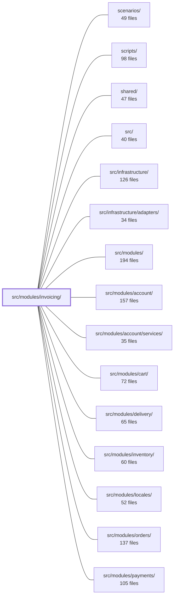

---
tags:
  - 2brain
  - 2brain/module
  - project/boilerplate-node-backend
type: module
module: src/modules/invoicing/
files: 50
updated: 2026-11-08T10:51:27.537078+00:00
---

# src/modules/invoicing/

## Purpose

The invoicing module is the shop's e-invoicing subdomain: it freezes an order into an immutable `Invoice` when payment settles, mirrors a settled refund into an immutable `CreditNote`, serves both as rendered PDFs, encrypts the buyer's billing address at rest, and reaps expired personal data per jurisdictional tax-retention law. All write paths are event-driven (no HTTP mutation); all read paths are either a PDF download or a JSON export for the account data-portal.

## Key parts

- **Write path (event listeners):** `services/issue-invoice.ts` and `services/issue-credit-note.ts` are the sole mutation points, wired as `ORDER_STATUS_CHANGED` and `PAYMENT_REFUNDED` listeners in `module.ts`. `services/numbering.ts` allocates gap-free `{year}-{sequence}` numbers inside the same transaction.
- **Read / serve path:** `routes.ts` mounts three GET endpoints under `/orders`. Controllers (`controllers/`) delegate to `services/for-caller.ts` for scoped lookup and `services/render.ts` for PDF generation. `providers/` defines the `EInvoicingProvider` port and the default EJS→Chromium `pdf` implementation.
- **Pure domain rules:** `domain/` (re-exported via `domain/index.ts`) contains side-effect-free logic — VAT rate apportionment (`credit-shares.ts`), tax-retention deadline calculation (`retention.ts`), and the canonical taxed line-item shape (`tax-items.ts`).
- **Persistence & PII:** `model.ts` defines the Mongoose schemas; `repository.ts` is a hand-written CRUD layer (write-once, read-by-order). `pii.ts` encrypts/decrypts the five billing-address strings; `services/reencrypt.ts` migrates them to the newest key.
- **Module wiring & config:** `module.ts` registers routes, jobs, events, and personal-data hooks into the kernel `AppModule`. `module.yaml` declares identity, upstream deps, and the two nightly retention sweeps. `config.ts` validates the provider choice and retention window. `jobs.ts` declares the two cron jobs.
- **Copy & export:** `emails.ts` builds the i18n'd PDF body. `presenter.ts` is the only serializer to JSON (used by `POST /account/export`). `openapi.yaml` is the normative API contract.
- **Tests:** `tests/` contains contract tests (endpoint shape), integration tests (issuance, download, catch-up), and shared `factories.ts` helpers.

## How it connects

- **`src/modules/orders/`** — The primary upstream. Invoicing subscribes to `ORDER_STATUS_CHANGED → paid` to issue invoices, reads the order through the caller's scope for authorization, and relies on the order's frozen line items as the source of truth for every document it produces.
- **`src/modules/payments/`** — Invoicing subscribes to `PAYMENT_REFUNDED` (succeeded) to issue credit notes. Integration tests drive this path through the real `payments` module's `refundForOrder` service.
- **`src/modules/account/`** — Shares the audit-action registration pattern (`audit.ts` mirrors `account/audit.ts`) and contributes the invoicing section to the `POST /account/export` personal-data endpoint via `services/personal-data.ts`.
- **`src/infrastructure/`** — `audit.ts` augments the infrastructure audit-action map; `providers/pdf.ts` calls the shared Chromium rendering adapter; `pii.ts` uses the shared `NODE_PII_ENCRYPTION_KEY` ring; `rate-limits.ts` plugs into the shared rate-limit middleware.
- **`src/shared/`** — `services/credit-breakdown.ts` and `domain/tax-items.ts` consume the shared tax functions (`orderTaxBreakdown`, `lineTaxFromRateTotals`) so invoice, credit-note, and VAT figures always reconcile.
- **`src/modules/locales/`** — `emails.ts` resolves every PDF label through the locale system before template interpolation.

## Where to start

1. **`module.ts`** — Read this first to see the module's full registration surface: which events it listens to, which routes it mounts, which jobs it schedules, and how config/PII hooks are wired. It gives you the 30-second architecture map.
2. **`services/issue-invoice.ts`** — The single write path. Walking through the transaction (number allocation → PII encryption → insert → idempotency guard) shows you the core invariant: documents are frozen at issue and never mutated.

## Connected modules

[[boilerplate-node-backend_ROOT|/ (repository root)]] · [[boilerplate-node-backend_scenarios|scenarios/]] · [[boilerplate-node-backend_scripts|scripts/]] · [[boilerplate-node-backend_shared|shared/]] · [[boilerplate-node-backend_src|src/]] · [[boilerplate-node-backend_src_infrastructure|src/infrastructure/]] · [[boilerplate-node-backend_src_infrastructure_adapters|src/infrastructure/adapters/]] · [[boilerplate-node-backend_src_modules|src/modules/]] · [[boilerplate-node-backend_src_modules_account|src/modules/account/]] · [[boilerplate-node-backend_src_modules_account_services|src/modules/account/services/]] · [[boilerplate-node-backend_src_modules_cart|src/modules/cart/]] · [[boilerplate-node-backend_src_modules_delivery|src/modules/delivery/]] · [[boilerplate-node-backend_src_modules_inventory|src/modules/inventory/]] · [[boilerplate-node-backend_src_modules_locales|src/modules/locales/]] · [[boilerplate-node-backend_src_modules_orders|src/modules/orders/]] · … and 4 more

## Files
- `src/modules/invoicing/audit.ts` — Declares the audit action strings the invoicing module emits and registers them in the infrastructure audit-action map via TypeScript module augmentation. This keeps the set of valid actions for `invoicing` type-safe across the codebase without requiring a shared enum (the same pattern is used in `modules/account/audit.ts`).
- `src/modules/invoicing/config.ts` — Defines the runtime configuration schema for the invoicing module—specifically which e-invoicing provider is used and how long invoice PDFs and buyer blocks are retained. It exists so these knobs are validated, typed, and overridable per environment (or per test) without hard-coding values in service code.
- `src/modules/invoicing/controllers/get-order-credit-note.ts` — HTTP controller that serves a single order's credit-note PDF on `GET /orders/:id/credit-notes/:creditNoteId`. It is the credit-note counterpart to `get-order-invoice`: returns **200** with the rendered PDF, **404** when the credit note doesn't exist, belongs to another order, or the order itself is missing, and **500** if PDF rendering fails.
- `src/modules/invoicing/controllers/get-order-credit-notes.ts` — Handler for `GET /orders/:id/credit-notes`. Returns the list of settled credit notes (refunds) on a given order so a client can pick one to download. Scope is enforced at the service layer: non-admin callers see only their own order, staff with the payments read role see assigned orders, and an order the caller cannot access yields a `404`.
- `src/modules/invoicing/controllers/get-order-invoice.ts` — HTTP handler for `GET /orders/:id/invoice`. Resolves the caller's permission to view the invoice, renders the PDF (from stored bytes or on the request thread), and streams it back. Returns `200`, `404` (order missing or never invoiced), or `500` (render failure).
- `src/modules/invoicing/controllers/send-pdf.ts` — Single-purpose utility that writes a rendered PDF buffer back to the client with the correct headers (inline disposition, no caching). It exists so the two PDF-download controllers (invoice and credit note) share one response path instead of duplicating header logic.
- `src/modules/invoicing/domain/credit-shares.ts` — Pure domain logic that splits a partial refund across an invoice's distinct VAT rates, producing one credit-note line per rate. It exists so the apportionment arithmetic can be tested and reused without a database, ORM model, or tax-calculation dependency.
- `src/modules/invoicing/domain/index.ts` — Barrel (re-export) file for the invoicing **domain layer**. It gives external consumers a single import path for the pure business rules defined in sibling files, while the JSDoc contract guarantees the module contains no framework or persistence imports (no Express, Mongoose, or "tier" code).
- `src/modules/invoicing/domain/retention.ts` — Pure, side-effect-free rules that compute when an invoice's buyer block (tax record) must be deleted. Encapsulates the jurisdictional tax-clock (IT art. 2220 c.c., DE, FR): retention runs through the **end** of the issue year plus N full years, so the due instant is local midnight of 1 January in year `issueYear + N + 1`, in the document's frozen timezone.
- `src/modules/invoicing/domain/tax-items.ts` — Defines the single canonical line-item shape that the shared tax functions (`orderTaxBreakdown`, `lineTaxFromRateTotals`) expect. By funneling every document's lines through one mapper, it guarantees that the invoice email, credit-note totals, and VAT breakdown all interpret a "priced, taxed line" identically rather than each spelling the shape their own way.
- `src/modules/invoicing/emails.ts` — Builds the fully-rendered text content (the "copy") for invoice and credit-note PDFs. It takes a frozen `EInvoicingDocument` and a locale, resolves every label via i18n, formats all monetary values with `Intl.NumberFormat`, and returns a plain object ready for EJS template interpolation. Despite the `emails.ts` name (inherited from the orders module's convention for "this file builds a document's copy"), nothing here is mailed — the PDF is downloaded by the user.
- `src/modules/invoicing/index.ts` — Public barrel for the invoicing module. It is the **only** import surface available to sibling modules (per `docs/theory/strategic-ddd.md` §5), re-exporting the module's services, domain, emails, and model types while keeping all runtime write-path (repository, model instantiation) internal.
- `src/modules/invoicing/jobs.ts` — Declares the two scheduled jobs owned by the `invoicing` module — the stored-PDF reaper and the buyer-block reaper — as a single `JobDeclaration` array that the kernel registry can dispatch on a cron schedule.
- `src/modules/invoicing/model.ts` — Defines the Mongoose schemas, TypeScript interfaces, and model exports for issued invoices, credit notes, and their shared yearly numbering counters. Every field is frozen at issue time and never re-read from the source order or operator config; the documents are never serialized to JSON — the rendered PDF is the sole output.
- `src/modules/invoicing/module.ts` — Module manifest for the invoicing domain. It registers routes, jobs, config, rate limits, event subscriptions, and personal-data hooks into the kernel's `AppModule` contract. Its core responsibility is to issue **frozen** `Invoice` and `CreditNote` documents exclusively via event listeners (never via HTTP routes), reacting to facts already recorded by `orders` or `payments`. Once issued, these documents are immutable—there is no delete, update, or re-render path.
- `src/modules/invoicing/module.yaml` — Module manifest for the invoicing subdomain. Declares the module's identity (supporting subdomain, shop group), its upstream dependencies, the rate-limit budget governing PDF renders, and the two nightly retention jobs that clean up stored invoices and credit notes.
- `src/modules/invoicing/openapi.yaml` — Module-level OpenAPI 3.1 contract for the invoicing domain. It defines the public API surface for downloading frozen invoice and credit-note PDFs, listing an order's credit notes, and declares the invoicing section that the data-export bundler appends to `POST /account/export`. It exists so that clients, generated SDKs, and AI assistants have a single normative source for this module's endpoints, error semantics, and schema shapes.
- `src/modules/invoicing/pii.ts` — Field-level PII codec for the buyer's billing address on invoices and credit notes. It encrypts the five address strings before they are persisted and decrypts them on the one read path that needs plaintext, using the shared `NODE_PII_ENCRYPTION_KEY` ring. The document itself is kept whole as the legal copy; only its storage representation is protected (GDPR Art. 32).
- `src/modules/invoicing/presenter.ts` — The single serialization point for the invoicing module's frozen documents into JSON wire shapes. It powers the `POST /account/export` response section and the per-order credit-note list. Every other read endpoint in this module serves rendered PDFs, never the raw document—this file is the exception.
- `src/modules/invoicing/providers/index.ts` — Defines the e-invoicing provider port: the interface a national e-invoicing network plugs into. It mirrors the `payments/providers` pattern—one contract, one shipped implementation (`pdf`), and a registry that a deployment configures via `NODE_EINVOICING_PROVIDER`. The file exists so that adding a real SdI/Peppol adapter later is "one file plus one line here" without touching call-sites.
- `src/modules/invoicing/providers/pdf.ts` — The default (and only shipped) e-invoicing PDF provider. It renders an invoice or credit note to PDF by piping an EJS template through the shared Chromium rendering adapter. It exists to satisfy the `EInvoicingProvider` port so the invoicing module can issue documents without depending on a concrete renderer.
- `src/modules/invoicing/rate-limits.ts` — Defines the invoicing module's rate-limit budget (`INVOICING_RENDER_BUDGET`) and the resulting Express middleware (`invoicingLimiter`) that protects the two invoice-rendering GET routes. Both routes share a single budget because each hit spawns a full Chromium launch (`renderHtmlToPdf`), which is far more expensive than a typical request.
- `src/modules/invoicing/repository.ts` — Hand-written persistence layer for invoices, credit notes, and their two yearly number counters. It exists as a deliberate alternative to the generic `create-repository` CRUD factory: every document here is written exactly once and later read back by `orderId` (or by a few specific lookup keys), so generic search/pagination/update/delete operations are never needed.
- `src/modules/invoicing/routes.ts` — Defines the Express router that exposes three invoicing download endpoints (invoice PDF, credit-note list, single credit-note PDF) under `/orders`. It exists so these read-only file-serving routes can be mounted alongside the `orders` module's own router without path collisions, while sharing the same auth and rate-limiting concerns.
- `src/modules/invoicing/services/credit-breakdown.ts` — Extracts the VAT/tax breakdown for a partial credit note by reusing the same tax function the original invoice used, so the credit figures reconcile exactly with the invoice. It lives in `services/` (not `domain/`) because it imports from the sibling `orders` module, which domain folders are not permitted to do.
- `src/modules/invoicing/services/for-caller.ts` — Provides the three caller-scoped read operations behind the invoice and credit-note routes. Each reads the order through the caller's own scope first (so an unauthorized caller gets the order's natural 404), then resolves the document. Credit-note visibility is gated here with a `display:Payment` check that goes beyond basic order readability.
- `src/modules/invoicing/services/index.ts` — Barrel (facade) module for the invoicing service layer. It aggregates every operation a controller, event listener, or test might call into a single `invoicingService` object so callers have one import target instead of reaching into individual sibling files.
- `src/modules/invoicing/services/issue-credit-note.ts` — Handles the issuance of credit notes in response to settled payment refunds. For a full refund it mirrors the original invoice's lines and totals wholesale; for a partial refund it re-derives the refunded share across the applicable VAT rates. It is the entire job of the `PAYMENT_REFUNDED` listener wired up in `module.ts`.
- `src/modules/invoicing/services/issue-invoice.ts` — The single write path in the invoicing module. When an order transitions to `paid` (via the `ORDER_STATUS_CHANGED` listener in `module.ts`), this file freezes that order into an immutable `InvoiceDocument` — allocating a number, encrypting the billing address, and inserting the row — all inside one transaction. Idempotent by construction: a duplicate-key abort returns the already-issued invoice rather than creating a second.
- `src/modules/invoicing/services/numbering.ts` — Allocates gap-free, per-year invoice and credit-note numbers (`{year}-{sequence}`) that are always taken inside the same Mongoose transaction as the document insert. This guarantees no legal number gap (VAT Directive Art. 226(2), Art. 219) and provides a single recovery path for the rare lost-race duplicate-key collision.
- `src/modules/invoicing/services/personal-data.ts` — Implements the invoicing module's contribution to `POST /account/export`. Given a `userId`, it gathers every invoice and credit note tied to that account's orders and returns them in export-ready shape. It is the `personalData` handler referenced by the module's route registration.
- `src/modules/invoicing/services/reencrypt.ts` — Domain-level orchestrator that re-encrypts the buyer address (`billingAddress`) on all invoices and credit notes onto the newest PII encryption key. It translates invoicing-specific concerns (which fields, which AAD binding, which collections) into calls on the generic infrastructure re-encryption utilities.
- `src/modules/invoicing/services/render.ts` — Single rendering point for both invoice and credit-note PDFs. It lazily renders on first download (not at issue time), optionally caches the bytes on disk, and shields controllers from the e-invoicing provider port. The frozen row in Mongo is the source of truth; the stored file is a regenerable copy.
- `src/modules/invoicing/services/retention.ts` — Implements the `reap:invoices` sweep: once a buyer's tax-retention window has expired, the buyer block is blanked from the invoice or credit-note document and its cached PDF is deleted. The numbered document itself (seller, line items, amounts) is preserved so revenue stats and credit-note→invoice links remain intact. Only the personal data is removed.
- `src/modules/invoicing/services/stats.ts` — Aggregates invoiced and credited amounts per currency and time-bucket for reporting. It is the single source of money figures in stats because invoices and credit notes are the frozen, dated rows (`issuedAt`); orders carry no total and refunds carry no VAT/shipping split.
- `src/modules/invoicing/tests/contract/api.contract.test.ts` — Contract tests for the three invoicing endpoints under `/orders/{id}` (invoice PDF, credit-note list, credit-note PDF). They verify that each declared response branch — status code, error-code body, content-type — matches the spec over HTTP. Ownership scoping, the busy-queue (503), and number-series logic are explicitly delegated to `tests/integration/`.
- `src/modules/invoicing/tests/factories.ts` — Test helpers for the invoicing module. Provides a polling wrapper around the asynchronous "freeze invoice" side-effect (triggered by a fire-and-forget `ORDER_STATUS_CHANGED` listener) and re-exports the internal `issueCreditNote` service so sibling tests can exercise it without going through the public service surface.
- `src/modules/invoicing/tests/integration/credit-note-catch-up.test.ts` — Integration test that verifies the credit-note catch-up path: when an invoice event was missed (the invoice row was lost) and the `ORDER_STATUS_CHANGED → paid` event is re-emitted, the system issues the invoice and then creates one credit note per **settled** refund in settlement order, idempotently, while skipping refunds that never settled. Runs against real Mongo with the full module registry.
- `src/modules/invoicing/tests/integration/download.test.ts` — Integration tests that exercise the `GET /orders/{id}/invoice` and `GET /orders/{id}/credit-notes` endpoints over real HTTP against a real test database. They verify status codes (404 / 200 / 503), ownership scoping, PDF rendering and caching behaviour, audit logging for admin access, and the `actions.invoice` flag surfaced on the order resource.
- `src/modules/invoicing/tests/integration/issue-credit-note.test.ts` — Integration test verifying that a credit note is frozen **only** when a `PAYMENT_REFUNDED` event settles on a `succeeded` payment, exercised through the real `payments` module's `refundForOrder` and the invoicing module's event subscription—not by calling `issueCreditNote` directly (except in targeted edge-case tests). Covers numbering, PII re-encryption, partial-refund mirroring, idempotency, timezone-aware year, seller preservation, and race/failure rollback.
- `src/modules/invoicing/tests/integration/issue-invoice.test.ts` — Integration test proving that invoice issuance is driven exclusively by the `ORDER_STATUS_CHANGED` event (order `pending → paid`) flowing through the real module subscription, not by a direct `issueInvoice` call. Verifies the full wiring: event emission, subscription handler, PII re-encryption, VAT rounding, sequential numbering, idempotency under race, and timezone-aware year boundaries.
- `src/modules/invoicing/tests/integration/reencrypt.test.ts` — Integration test that verifies the invoicing module's `reencrypt` walk correctly migrates the buyer's billing address from an old PII encryption key to the newest one, and that a second run is a no-op (idempotent). It also confirms the re-encrypted value still decrypts under the invoice's own ID.
- `src/modules/invoicing/tests/integration/retention.test.ts` — Integration test for the `reap:invoices` buyer-erasure job. Verifies the full end-to-end behavior of `invoicingService.eraseDueBuyers`: once an invoice or credit note passes its tax-retention deadline (local New Year of issue-year + 11), its `billingAddress` is blanked, its cached PDF is deleted, all other fields and aggregate stats are untouched, and a second run is a no-op.
- `src/modules/invoicing/tests/unit/credit-breakdown.test.ts` — Unit tests for `creditBreakdownOf`, verifying that a partial credit note's per-rate rows (net, tax, gross) sum to exactly the refunded amount, that VAT is extracted once per rate, and that currency-specific rounding (decimal vs. zero-decimal) is handled correctly.
- `src/modules/invoicing/tests/unit/credit-shares.test.ts` — Unit tests for the pure-arithmetic `creditShares` function: spreading a refunded amount across an invoice's VAT rates in proportion to what each rate collected. By testing the function in isolation (no database, no real tax service), these tests pin the distribution math; companion integration tests cover the function through the full refund flow.
- `src/modules/invoicing/tests/unit/emails.test.ts` — Unit tests for the invoice / credit-note document renderer (`buildDocumentView`) and the EN 16931 tax-category helper (`taxCategoryCode`). It locks down rendering correctness (line rows, VAT block, supplier block, locale, reversal notices, buyer erasure) so that a formatting slip is caught before a customer reads it as a billing error. Adapted from the retired `invoiceDocument` suite in `orders/tests/unit/emails.test.ts`.
- `src/modules/invoicing/tests/unit/render.test.ts` — Unit tests for the invoice and credit-note PDF rendering service. The e-invoicing provider is fully mocked (no Chromium), while the document store is real (backed by a per-test temp directory), so the assertions target the caching and resilience behaviour that matters in production: the second download returns the stored file, `retention 0` stores nothing, and a failing store never breaks the download.
- `src/modules/invoicing/tests/unit/retention.test.ts` — Unit tests for the buyer document-retention rule: given an issue date, a timezone, and a retention period *N*, the functions compute a local-midnight deadline (1 Jan of issue-year + N + 1), check whether that deadline has passed, and produce a UTC scan bound that never excludes a document whose retention has expired.
- `src/modules/invoicing/tests/unit/routes.test.ts` — Unit test that asserts the static shape of the invoicing router: which routes are mounted, which auth guards protect them, and which rate-limit namespace budgets them. It exists to catch accidental route re-signatures, guard regressions, or rate-limit misconfigurations before they reach integration or production.
- `src/modules/invoicing/tests/unit/schema-contract.test.ts` — Verifies the schema-level contract shared by the two frozen tax documents (invoice and credit note): both **require** the `orderNumber` and `currency` fields (copied from the originating order) and provide no fallback when either is absent.

---
[[boilerplate-node-backend_INDEX|← boilerplate-node-backend index]]
