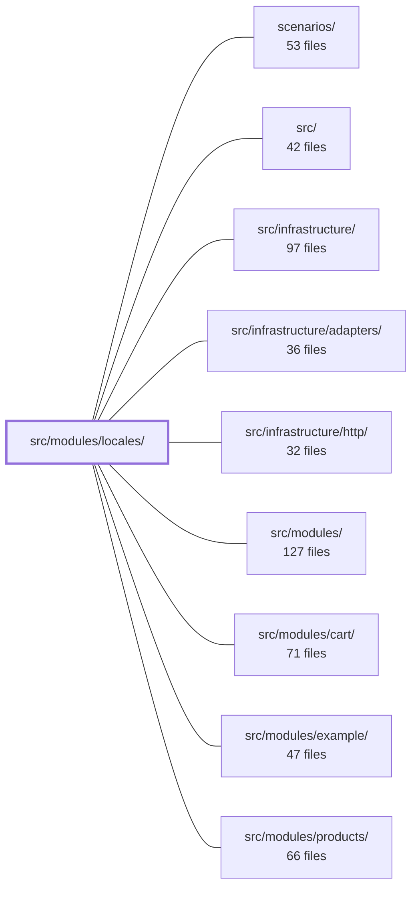

---
tags:
  - 2brain
  - 2brain/module
  - project/boilerplate-node-backend
type: module
module: src/modules/locales/
files: 49
updated: 2026-10-29T19:26:17.939157+00:00
---

# src/modules/locales/

## Purpose

The locales module owns the runtime-editable translation tier of the i18n system. It manages the MongoDB-backed collections for registered languages, per-key dictionary entries (scoped by language, app, and key), and entity-level translation overrides. It exposes an admin API for CRUD on all three, and on every write it signals the `@infrastructure/i18n` overlay to re-read its cache so that `t()` picks up changes without a restart.

## Key parts

- **App keyspace & config** — `apps.ts` and `config.ts` define the fixed set of translation app IDs (one `backend`, the rest `frontends`) from environment variables, so a typo cannot silently create an unserved keyspace.
- **Data model & persistence** — `model.ts` declares the three Mongoose schemas (Language, LocaleEntry, entity translation); `repository.ts` centralises every read/write and enforces the invariant that each entry mutation atomically bumps the language `revision` counter.
- **Services layer** — `services/` contains the domain logic: `languages.ts` (language lifecycle + fallback protection), `entries.ts` (dictionary CRUD + bulk import), `messages.ts` (frontend/backend override reads), `translations.ts` (entity translation plan-then-apply pipeline), `capabilities.ts` (merged manifest for `GET /locales`), `actions.ts` (per-caller permission block), `keys.ts` (key validation rules), `overlay.ts` (single refresh hook), and `translatables.ts` (registry of which entity types are translatable). `services/index.ts` is the single `localeService` facade controllers import.
- **Controllers & routes** — `routes.ts` wires Express at `/locales`; the `controllers/` directory holds thin adapters (one per endpoint) that validate params, delegate to `localeService`, and shape the response. No business logic lives here.
- **Module wiring** — `module.ts` registers the two kernel ports the module owns (locale-override provider, translation port) and publishes the manifest consumed during `registerModules`. `index.ts` is the barrel that enforces the rule that sibling modules import only through this file.
- **Supporting** — `audit.ts` declares the module's audit-action vocabulary; `presenters.ts` maps a stored entry document to its wire shape; `openapi.yaml` is the 3.1.0 contract; `factories.ts` builds in-memory test fixtures.
- **Tests** — `tests/contract/` guards the two-tier boundary (file-backed vs. DB-backed languages); `tests/integration/` drives the real HTTP stack for cache invalidation, manifest visibility, and schema serialization.

## How it connects

- **`src/infrastructure/`** — The locales module calls the i18n overlay-refresh function (wrapped in `services/overlay.ts`) after every write so the shared translation cache re-reads the override rows. It also reads/writes MongoDB collections defined in `model.ts`, which `@infrastructure/i18n` consumes at boot and on a timer.
- **`src/infrastructure/http/`** — `routes.ts` mounts an Express router and applies the shared auth middleware (`getAuth`, `requirePermission`) that the HTTP infrastructure provides.
- **`src/modules/products/`** (and other entity-owning modules) — Each module registers its translatable entity descriptor via the `onRegistered` hook that `module.ts` exposes. The locales `translatables.ts` registry is built once at boot from those descriptors, making products (and any future module) discoverable by the `PUT/PATCH /locales/translations/:entityType/:id` endpoints without locales importing them directly.
- **`src/modules/cart/`, `src/modules/example/`** — These are frontend consumers of the translation service; they call `t()` (served by the infrastructure overlay) and read the manifest via `GET /locales`. They do not import locales internals.
- **Kernel / module registry** — `module.ts` publishes a manifest the kernel consumes during `registerModules`, wiring the locale-override provider and translation port into the dependency graph.

## Where to start

1. **`services/index.ts`** — It is the single facade (`localeService`) every controller imports. Reading its exports gives you the full vocabulary of what the module can do in about a page.
2. **`model.ts`** — The three schemas (Language, LocaleEntry, entity translation) define the data shape and the `baseLanguage` derivation hook. Understanding these two files together makes the repository, services, and controllers straightforward.

## Connected modules

[[boilerplate-node-backend_ROOT|/ (repository root)]] · [[boilerplate-node-backend_scenarios|scenarios/]] · [[boilerplate-node-backend_src|src/]] · [[boilerplate-node-backend_src_infrastructure|src/infrastructure/]] · [[boilerplate-node-backend_src_infrastructure_adapters|src/infrastructure/adapters/]] · [[boilerplate-node-backend_src_infrastructure_http|src/infrastructure/http/]] · [[boilerplate-node-backend_src_modules|src/modules/]] · [[boilerplate-node-backend_src_modules_cart|src/modules/cart/]] · [[boilerplate-node-backend_src_modules_example|src/modules/example/]] · [[boilerplate-node-backend_src_modules_products|src/modules/products/]]

## Files
- `src/modules/locales/apps.ts` — Defines the fixed set of translation keyspaces ("apps") for a deployment. An app is one consumer of the translation service, identified by the `(language, app, key)` triple. The id set is deliberately configuration-driven (env vars) rather than database rows so that an import typo cannot silently create a keyspace nobody serves. Exactly one app is the `backend` (the API's own copy); every other is a `frontend`.
- `src/modules/locales/audit.ts` — Declares the set of audit action identifiers the locales module emits when an admin writes data (create/update/delete locales, entries, imports, and batch translation updates). It registers those identifiers into the app-wide `AuditActionMap` via TypeScript module augmentation so the audit infrastructure knows the locales module's vocabulary. Reads are intentionally not audited; these strings are the only history of what changed.
- `src/modules/locales/config.ts` — Declares the locales module's configuration slice: the set of translation app IDs this deployment holds words for. It defines the shape and defaults so the rest of the module (and any consumer) can read validated values rather than raw env vars.
- `src/modules/locales/controllers/activate-locale.ts` — Thin Express handlers for `POST /locales/:locale/activate` and `POST /locales/:locale/deactivate`. All business logic (refusal rules, cache invalidation, overlay refresh, audit logging) lives in the locale service; this file only invokes the service, maps the stored language into a response, and formats success/refusal/error responses.
- `src/modules/locales/controllers/create-locale.ts` — Admin controller for `POST /locales`. Registers a new language in the dynamic tier; once created, the language is immediately available for content negotiation, product text, and search. API error messages fall back to the default language until a dictionary file is deployed for the new locale.
- `src/modules/locales/controllers/delete-locale-entry.ts` — Thin HTTP adapter that handles `DELETE /locales/:locale/apps/:app/entries/:entryId`. It validates the path parameter, delegates to `localeService.removeEntry`, and maps the service result to an Express response (204 on success, error on refusal). It exists to keep route wiring in `routes.ts` free of business logic.
- `src/modules/locales/controllers/delete-locale.ts` — Thin HTTP adapter that exposes `DELETE /locales/:locale` (admin) by delegating to `localeService.removeLanguage`. It translates the service's result into an Express response (204 on success, 409 if the language is still active) and maps errors to a standard JSON error shape. No business logic lives here.
- `src/modules/locales/controllers/get-entity-translations.ts` — Thin HTTP adapter for `GET /locales/translations/:entityType/:id`. It validates the path params, delegates to `localeService.getEntityTranslations`, and shapes the HTTP response — keeping all translation-fetching logic in the service layer.
- `src/modules/locales/controllers/get-locale-apps.ts` — Thin HTTP adapter that exposes `GET /locales/apps`. It calls `localeService.listApps()` and returns the result wrapped in a standard success envelope. The controller knows nothing about *where* the app list originates (environment, config, etc.) — that concern lives in the service layer.
- `src/modules/locales/controllers/get-locale-entries.ts` — Thin HTTP controller for three admin GET routes that read locale dictionary entries: list all entries for a language, list one app's slice of a language, and fetch a single entry by ID. Serves as the read counterpart to the PUT/POST write routes at the same addresses, delegating all domain logic to `localeService`.
- `src/modules/locales/controllers/get-locale-messages.ts` — Thin HTTP adapter for the `GET /locales/:locale/messages` endpoint. It validates the query string, delegates to `localeService.readMessages`, and shapes the result into a standard success or refusal response. It exists to keep route wiring and business logic separated from Express request/response handling.
- `src/modules/locales/controllers/get-locales.ts` — Express route handlers for the three locale-reading endpoints (`GET /locales`, `GET /locales/:locale`, `GET /locales/:locale/dictionary`). The first two delegate to `localeService` with caller-scoped permissions; the third serves the API's own ~60-key message dictionary straight from the filesystem, acting as a fallback when the database-backed catalog is unavailable.
- `src/modules/locales/controllers/update-locale.ts` — Builds the `PUT /locales/:locale` (replace) and `PATCH /locales/:locale` (merge) handlers by calling the shared `createUpdateController` factory. The locale tag is treated as an immutable identity key — it comes from the URL path and is never accepted from the request body.
- `src/modules/locales/controllers/write-entity-translations.ts` — Thin HTTP adapters for `PUT` and `PATCH /locales/translations/:entityType/:id`. Each handler validates the path param and body, then delegates to `localeService.replaceEntityTranslations` or `localeService.updateEntityTranslations`. The file exists to keep the two endpoints' shared request-parsing, auth-context extraction, and error-shaping logic in one place via a generic builder.
- `src/modules/locales/controllers/write-locale-entries.ts` — Express handlers for the write (create/read/replace) operations on a locale app's dictionary entries. Covers single-entry create/update and two bulk import modes (full replace vs. JSON-merge-patch), all scoped to the `/locales/:locale/apps/:app/entries` resource path.
- `src/modules/locales/factories.ts` — Builds in-memory fixtures (ready-made documents) for the two locale collections—**Language** and **LocaleEntry**—used in tests and seeding. It exists so that test code never hand-rolls raw document objects; instead it calls a factory that fills identity fields, derives schema-linked values (e.g. `baseLanguage`), and strips undefined keys, producing a record that matches what the API itself would produce.
- `src/modules/locales/index.ts` — Barrel file (public API surface) for the `locales` module. Enforces the strategic-DDB rule (§5) that sibling modules may only import through this file, not directly from internal subfolders.
- `src/modules/locales/model.ts` — Defines the three Mongoose schemas and their document/model type aliases for the **OVERRIDE tier** of the i18n system: registered languages, per-key dictionary entries, and entity-level translations. These are the runtime-editable rows that the `@infrastructure/i18n` overlay reads at boot, on a timer, and after writes. Nothing in this file is ever awaited on the request path—a Mongo outage or a malformed key only makes the overlay stale, never fails a request.
- `src/modules/locales/module.ts` — Module registration entry-point for the **locales** feature. Wires the two kernel ports this module owns (the locale-override provider and the translation port) and publishes the module manifest that the kernel consumes during `registerModules`. It is the single file where the locales module's dependencies are connected; all other locales files are pure logic.
- `src/modules/locales/openapi.yaml` — OpenAPI 3.1.0 specification for the locales module. It defines the public contract (endpoints, request/response schemas, error codes) for managing deployment languages, their capabilities, and the two tiers of translation data (deployed API dictionaries vs. client-facing database rows). It exists so that clients, admin screens, and the API itself share a single source of truth for the locales surface.
- `src/modules/locales/presenters.ts` — Provides the single presentation step that converts a stored `LocaleEntryDocument` into its wire-shape `LocaleEntry` (the `_id` → `id` rename and date → ISO-string mapping). It exists because the repository returns documents in their stored shape, and a single-document write path needs the wire shape before handing data to the client. Languages and list-search do not need a presenter: the language wire shape is built by `localeService.describeStoredLanguage`, and `search()` already returns `LocaleEntry` via the repository's lean transform.
- `src/modules/locales/repository.ts` — Repository layer over the `languages` and `localeentries` MongoDB collections. It centralises every read and write the locales module performs against the database and enforces one caller-invisible invariant: every mutation to an entry also atomically bumps the language's `revision` counter, so no service call can alter a dictionary without signalling clients to re-fetch.
- `src/modules/locales/routes.ts` — Express router mounted at `/locales` that exposes locale discovery, dictionary reads, and full translation administration. Public reads require no token; all writes are individually gated with `getAuth → isAuthOrCredential → requirePermission(…)` and invalidate the shared `locales` Redis cache tag on success.
- `src/modules/locales/services/actions.ts` — Centralizes the decision of *what a caller may do to a language* (update, activate, deactivate, delete) in one place, combining the language's runtime state (active? fallback?) with the caller's key holding (standing). This keeps the permission rules out of every client/presenter, which only maps the finished `LanguageActions` block.
- `src/modules/locales/services/capabilities.ts` — The manifest service for the locales module. It assembles the single `Language[]` list that `GET /locales` and `GET /locales/{tag}` return, by merging two tiers — languages deployed as ICU files (static) and languages registered as database rows (dynamic) — into one representation that also carries per-caller visibility (`scope`) and available actions (`standing`).
- `src/modules/locales/services/entries.ts` — CRUD service layer for locale entries (translated keys) scoped to a single language and app. Provides paginated reads, single-key create/update/delete, and bulk import (replace or merge). Every operation validates the app against the language's configured apps before touching the repository, and every write emits an audit record and refreshes the overlay cache.
- `src/modules/locales/services/index.ts` — Facade for the locale **override tier**. It aggregates every function from the sibling service modules (`keys`, `capabilities`, `actions`, `languages`, `entries`, `messages`, `translatables`, `translations`) plus two items from outside `services/` (`listApps`, `localeDisplayName`) into a single `localeService` object. It exists so that controllers, `module.ts`, and tests all import from **one name** rather than reaching into individual files. Nothing here is ever awaited by `t()` or the locale middleware; writes flow to `t()` only via a request-path overlay rebuild.
- `src/modules/locales/services/keys.ts` — Centralizes every rule that decides whether a translation key is storable and renderable. Shared by `entries.ts` and `messages.ts` within the locales services; neither file "owns" it. Pure functions, no database access.
- `src/modules/locales/services/languages.ts` — Service layer for the CRUD lifecycle of language rows (register, edit, activate/deactivate, delete) in the locales module. It owns the cross-cutting guard that rejects writes targeting an app this deployment does not recognize, and it centralises the fallback-locale protection so no operator can accidentally deactivate or delete the locale every translatable entity's source row lives in.
- `src/modules/locales/services/messages.ts` — Provides the two read paths for stored locale copy: `readMessages` serves a frontend app's downloadable overrides to a client, and `readApiOverrides` rebuilds the API's own backend overlay. Both expand flat `key/value` rows through `buildMessageTree` but differ in which app's keyspace they serve. A third entry point, `readLocaleOverlay`, bundles the backend overrides with the active/inactive language lists into a single atomic refresh for the i18n provider.
- `src/modules/locales/services/overlay.ts` — Thin wrapper around the i18n overlay-refresh function so that every locale write path (`entries.ts`, `languages.ts`) automatically triggers a re-read of the override cache. Centralising the call here means a future write path picks up the refresh by construction rather than by each controller remembering to do it.
- `src/modules/locales/services/translatables.ts` — Holds a process-wide, read-only lookup of translatable targets (entity type → target descriptor). The map is **not** built here: `locales` cannot import other modules' manifests (the same circularity wall the kernel translation port avoids), so an app-tier hook (`onRegistered` in `../module.ts`) assembles the lookup via `resolveTranslatables(modules)` once all enabled modules are known, then injects it here at boot.
- `src/modules/locales/services/translations.ts` — The service-layer "door" for reading and writing an entity's translations. It exposes a generic, registry-driven API (PUT / PATCH / internal batch) that validates every locale slot against the `translatables` registry and the `locales` collection, then applies the writes atomically. It is intentionally split into a **plan** (validate-all) and **apply** (write) phase so callers that embed translations inside a larger entity write (e.g. `productService.create`) can reuse the same pipeline without re-validating.
- `src/modules/locales/tests/contract/api.contract.test.ts` — Contract tests for the `/locales` API surface. The file guards a specific architectural boundary: languages shipped as **deployed files** (the API's own error messages, available in outages) versus languages **registered in the database** (client-facing, editable at runtime). The tests assert that a language existing in the DB never silently implies the API can answer in it, so a future change collapsing the two tiers fails here rather than in a client.
- `src/modules/locales/tests/contract/support.ts` — Shared setup helper for the locales contract test suites. It defines a default language payload and a single function that registers a language by calling the real `POST /locales` route, so that individual test files don't repeat the boilerplate.
- `src/modules/locales/tests/contract/translations.contract.test.ts` — Contract tests for the `/locales/translations/:entityType/:id` endpoint (GET, PATCH, PUT). Validates the wire shape and validation rules for an entity's translated fields. Lives in its own file because `product` is the only entity type registered today — deleting the shop module should remove this file without touching the language or dictionary contract suites.
- `src/modules/locales/tests/factories.ts` — Test-persistence layer for locale fixtures. It wraps the pure builder (`makeLocale`) from the production factories module with a single `repository.create` call so that integration tests get a real row in the test database without repeating that two-step pattern.
- `src/modules/locales/tests/integration/locale-cache-invalidation.test.ts` — Integration test that drives the real HTTP stack end-to-end to verify admin writes to the locale routes actually evict the cached public dictionary (and manifest), rather than merely asserting that an invalidation function was invoked. It exists because the read-tag and write-tag are two untyped strings that nothing in the compiler links together; a mismatch would be invisible in development (TTL clamped to 30 s) but would serve stale translations for an hour in production.
- `src/modules/locales/tests/integration/manifest-visibility.test.ts` — Integration test verifying that `GET /locales` reports a file-backed language (one with a deployed dictionary like `shared/locales/it.json`) as `active: false` once its database row is switched off, for both anonymous visitors and authenticated staff. It also confirms the language reappears as active after re-activation, and that a file-backed language with no row at all still defaults to `active: true`.
- `src/modules/locales/tests/integration/model.test.ts` — Integration tests that pin down the Mongoose schema-level behavior for the locales module: serialization (no `_id`/`__v` leakage on either the `toJSON` or `.lean()` path), schema defaults, tag normalization, and the `baseLanguage` derivation hook. They exist because the lean path bypasses `toJSON` entirely and 95 OpenAPI schemas declare `additionalProperties: false`, so a regression in either path would silently break the wire contract.
- `src/modules/locales/tests/integration/repository.test.ts` — Integration tests for the locales write paths, run against a real MongoDB instance. The file verifies properties an in-memory fake would satisfy trivially: the revision counter incrementing (or not) on each write, cross-collection cascades on language deletion, and the side-effects of `importEntries` on rows the caller did not supply. Despite living under `tests/integration/`, the file's own comment classifies these as unit tests in this repo's taxonomy — no HTTP, no auth, just repository/service calls.
- `src/modules/locales/tests/integration/translations.test.ts` — Integration test suite for `getEntityTranslations` and `updateEntityTranslations` on `localeService`, run against a real MongoDB instance. It verifies the full write/read path for entity translations—including registry validation, locale-row existence checks, draft/preview gating, orphan-row exclusion, fallback-locale special-casing, and transaction atomicity with the derived-index tag bump on `products`.
- `src/modules/locales/tests/integration/update-audit.test.ts` — Integration tests that assert the **audit-event metadata** emitted by the locale service when a language is updated, deactivated, or an entry is updated. The core contract under test: language-level changes record each field's old→new value; entry-level changes record the key and *which* fields moved, but **never** the text itself (the audit trail is not a second copy of the dictionary).
- `src/modules/locales/tests/unit/apps.fixture.ts` — Provides canonical app-id constants for the locales unit-test suite. Instead of hardcoding ids, it reads them live from the `apps` registry so that tests can never drift from the values the service actually accepts.
- `src/modules/locales/tests/unit/apps.test.ts` — Unit tests for the app registry readers exported by `apps.ts`. Each case sets the relevant `NODE_LOCALE_*` environment variables, calls the lazy readers, and asserts the resulting app list or classification, ensuring the registry behaves correctly from defaults through custom and extended configurations.
- `src/modules/locales/tests/unit/routes.test.ts` — Unit test that locks the locales route table's three structural invariants: exact endpoint set and ordering, per-route authorization (no router-level gate), and the public/entry/translation caching split. It exists so that "fixing" a deliberate design choice—making a read private, adding a shared gate, or reordering `/apps` past `/:locale`—fails loudly instead of silently.
- `src/modules/locales/tests/unit/schema-contract.test.ts` — Unit tests that pin the schema contracts for the two locale collections (`localeSchema`, `localeEntrySchema`) and the `deriveBaseLanguage` helper. They assert required paths, unique indexes, field-level normalisation options, defaults, and enum restrictions so that a regression in any of those invariants (e.g. a lost `lowercase: true` or a changed compound index) fails in CI rather than in production.
- `src/modules/locales/tests/unit/service.test.ts` — Unit tests for the pure, database-free half of `localeService`: the message-tree builder, key-collision detectors, capability manifest merge, RTL detection, and language naming. These functions are "decisions rather than plumbing" that fail silently when wrong, so they are asserted directly here. The write paths that call them are covered elsewhere (Mongo in `repository.test.ts`, HTTP in the contract suite).
- `src/modules/locales/tests/unit/translations.test.ts` — Unit tests for the pure function `deriveSourceDigest`, which computes a deterministic fingerprint of a translation's source fields. This file isolates the digest logic from any database or registry interaction; those concerns live in the sibling integration test.

---
[[boilerplate-node-backend_INDEX|← boilerplate-node-backend index]]
