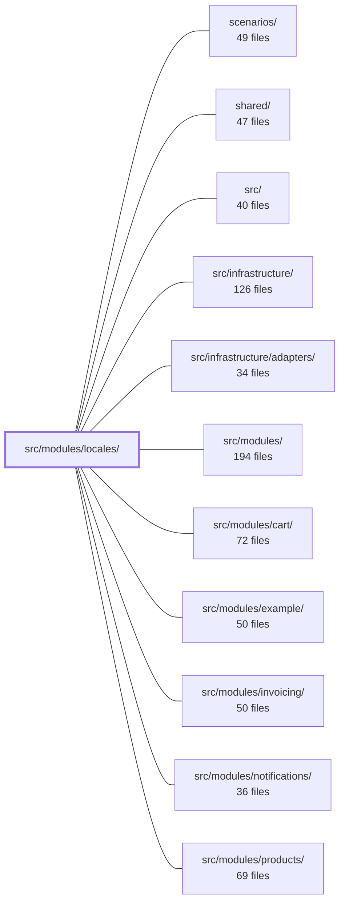

---
tags:
  - 2brain
  - 2brain/module
  - project/boilerplate-node-backend
type: module
module: src/modules/locales/
files: 52
updated: 2026-11-08T10:51:43.769227+00:00
---

# src/modules/locales/

## Purpose

The locales module manages a deployment's multilingual capability: it registers, activates, and serves languages; stores per-app translation dictionaries in MongoDB; and exposes entity-level translation read/write endpoints. It operates a **two-tier model** — languages shipped as static deployment files (answerable) versus languages registered as database rows (downloadable) — and installs two kernel ports (a locale-override provider and a translation port) so that every other module can look up translated copy and entity translations without knowing the storage details.

## Key parts

- **Module shell** — `module.ts` (manifest, port installation, bootstrap), `index.ts` (public barrel), `openapi.yaml` (wire contract), `authorization.yaml` (permission sets), `audit.ts` (audit-action identifiers), `config.ts` + `apps.ts` (app/keyspace registry).
- **Data layer** — `model.ts` (Mongoose schemas for `Locale`, `LocaleEntry`, `Translation`), `repository.ts` (all Mongo queries; enforces the revision-counter invariant on every entry write), `presenters.ts` (stored-document → wire-shape transform).
- **Service layer** (`services/`) — `languages.ts` (dynamic-tier CRUD + cross-file invariants), `entries.ts` (per-app dictionary CRUD + bulk import), `messages.ts` (read paths for frontend copy and API overrides), `translations.ts` (entity-translation read/write via the translatables registry), `capabilities.ts` (merged two-tier manifest), `actions.ts` (per-language permission flags), `keys.ts` (shared key validation + tree-building), `overlay.ts` (guaranteed overlay refresh on every write), `translatables.ts` (entityType → target registry), `index.ts` (facade: `localeService`).
- **HTTP layer** — `routes.ts` (Express router, middleware ordering, cache config), and the `controllers/` directory (one file per endpoint; thin adapters that validate input, delegate to `localeService`, and shape the response).
- **Tests** — `tests/contract/` (API contract suites guarding the two-tier distinction and entity-translation surface), `tests/factories.ts` (persistence-aware seeding for integration tests), `factories.ts` (pure builders for locale/entry fixtures).

## How it connects

- **`src/modules/products/`, `src/modules/cart/`, `src/modules/invoicing/`, `src/modules/notifications/`, `src/modules/example/`** — These are consumers of the translation port installed by `module.ts`. Each module registers a translatable-target entry that the locales `translatables.ts` registry collects at boot (the registry is supplied externally to avoid a circular import). The contract tests in `tests/contract/translations.contract.test.ts` are scoped to the `product` entity type, confirming that `products/` is a first-class translation target.
- **`src/infrastructure/` and `src/infrastructure/adapters/`** — Provide the shared Express plumbing, Mongoose connection, and response-envelope helpers that controllers and the repository rely on.
- **`shared/`** — Supplies the app-wide `AuditActionMap` (extended by `audit.ts`) and other cross-module utilities (e.g. the `createUpdateController` factory used by several controllers).
- **`scenarios/`** — Hosts integration/contract test harnesses that the locales test suites build upon.
- **`src/` (application shell)** — The kernel that calls `module.ts`'s `onRegistered` callback to install the locale-override and translation ports, making them available to all registered modules.

## Where to start

1. **`services/index.ts`** — One read gives you the full surface of `localeService` (every function controllers and `module.ts` call). It is the single boundary between the HTTP layer and the internal service files, so understanding what it exposes tells you what the module *does*.
2. **`model.ts`** — The three Mongoose schemas and their serialization transforms define the data shape every other file (repository, services, presenters, tests) revolves around. Reading this first means the service-layer code in the next step is immediately concrete.

## Connected modules

[[boilerplate-node-backend_ROOT|/ (repository root)]] · [[boilerplate-node-backend_scenarios|scenarios/]] · [[boilerplate-node-backend_shared|shared/]] · [[boilerplate-node-backend_src|src/]] · [[boilerplate-node-backend_src_infrastructure|src/infrastructure/]] · [[boilerplate-node-backend_src_infrastructure_adapters|src/infrastructure/adapters/]] · [[boilerplate-node-backend_src_modules|src/modules/]] · [[boilerplate-node-backend_src_modules_cart|src/modules/cart/]] · [[boilerplate-node-backend_src_modules_example|src/modules/example/]] · [[boilerplate-node-backend_src_modules_invoicing|src/modules/invoicing/]] · [[boilerplate-node-backend_src_modules_notifications|src/modules/notifications/]] · [[boilerplate-node-backend_src_modules_products|src/modules/products/]]

## Files
- `src/modules/locales/apps.ts` — Defines the fixed set of "apps" (keyspaces) a deployment recognises in the locales service. Each translation entry is scoped by `(language, app, key)`, so two apps can reuse the same key for unrelated strings. App IDs are **configuration**, not database rows — the list is assembled at runtime from environment variables and exposed to the API surface (`GET /locales/apps`) and to internal services that need to validate or enumerate apps.
- `src/modules/locales/audit.ts` — Declares the audit-action identifiers for all write operations in the locales domain (locale CRUD, locale-entry CRUD/import, batch translation updates) and merges them into the app-wide `AuditActionMap` via TypeScript module augmentation. This file exists so that compliance queries can filter on a single, well-known prefix per event rather than per code path.
- `src/modules/locales/authorization.yaml` — Declares the authorization rules and named permission sets for the `locales` module. It defines what actions a tenant-scoped principal may perform on `Locale` subjects and groups those actions into composable sets consumed by the API layer.
- `src/modules/locales/config.ts` — Declares the locales module's configuration schema — specifically, which app IDs this deployment holds translation strings for. It is a pure definition file; consumers read the resolved values via `./apps.ts` rather than importing this file directly.
- `src/modules/locales/controllers/delete-locale-entry.ts` — Thin HTTP adapter for `DELETE /locales/:locale/apps/:app/entries/:entryId`. It validates the `entryId` parameter, delegates the actual deletion to `localeService.removeEntry`, and returns a `204 No Content` (or a refusal/error status) — no response body.
- `src/modules/locales/controllers/delete-locale.ts` — Thin HTTP adapter that handles `DELETE /locales/:locale` (admin). It translates the Express request into a call to `localeService.removeLanguage`, maps the service result to an HTTP status (204 on success, 409 on refusal), and delegates error formatting to the shared controller helpers. It exists to keep route wiring in `routes.ts` free of business logic.
- `src/modules/locales/controllers/get-entity-translations.ts` — HTTP controller for `GET /locales/translations/:entityType/:id` (admin). It validates the entity ID, delegates to `localeService.getEntityTranslations`, and shapes the result into a standard success or refusal response. It exists to keep Express request/response plumbing out of the service layer.
- `src/modules/locales/controllers/get-locale-apps.ts` — Thin Express controller for the `GET /locales/apps` endpoint. It delegates to `localeService.listApps()` and wraps the result in a standard success envelope, keeping the HTTP layer decoupled from the data source.
- `src/modules/locales/controllers/get-locale-entries.ts` — Thin HTTP adapter exposing three admin-facing `GET` endpoints for locale dictionary entries (all-apps list, per-app list, and single-entry fetch). Delegates all business logic to `localeService` and shapes responses with the shared infra response utilities.
- `src/modules/locales/controllers/get-locale-messages.ts` — Thin Express adapter for `GET /locales/:locale/messages`. It validates the query string, delegates to `localeService.readMessages`, and formats the HTTP response. Exists to keep HTTP concerns (parsing, status codes, error mapping) out of the service layer.
- `src/modules/locales/controllers/get-locales.ts` — Three Express GET controllers that expose the deployment's language capabilities and the API's own filesystem-backed message dictionary. They thin-wrap `localeService` (database-backed, role-scoped) and the i18n filesystem helpers so the routes file can stay declarative.
- `src/modules/locales/controllers/post-locale-activation.ts` — Thin Express handlers for the two admin action endpoints `POST /locales/:locale/activate` and `POST /locales/:locale/deactivate`. All business logic (refusal rules, cache invalidation, overlay refresh, audit) lives in `localeService`; this file only extracts the locale param and caller context, invokes the service, and maps the result to an HTTP response.
- `src/modules/locales/controllers/post-locale-entry.ts` — Controller handler for `POST /locales/:locale/apps/:app/entries`. Validates the request body, delegates to the locale service to add a single key to an app's dictionary, and responds with `201 Created` including a `Location` header pointing to the new entry.
- `src/modules/locales/controllers/post-locale.ts` — Admin controller for `POST /locales` that registers a new language in the dynamic tier. Once created, the language is immediately negotiable in subsequent requests; product text and search follow, and API messages fall back to the default language until a dictionary is deployed. It is the "create" half of the locale CRUD set (edit: `update-locale.ts`, delete: `delete-locale.ts`).
- `src/modules/locales/controllers/put-locale-entry.ts` — Express controller handler for `PUT /locales/:locale/apps/:app/entries/:entryId`. It validates the path parameter and request body, delegates to the locale service to update a single entry's value, and returns the updated entry as the HTTP response.
- `src/modules/locales/controllers/update-entity-translations.ts` — Thin HTTP adapters that expose `PUT` and `PATCH /locales/translations/:entityType/:id` as admin endpoints. Each handler validates the path id and body, then delegates to the corresponding `localeService` method (`replaceEntityTranslations` or `updateEntityTranslations`). The file exists to keep the replace/merge semantic split at the HTTP layer while sharing a single handler-builder closure.
- `src/modules/locales/controllers/update-locale-entries.ts` — Defines the two admin HTTP controllers for bulk-importing an app's locale entries. They are implemented as two distinct routes (PUT / PATCH) rather than a single route with a mode flag, so a mis-set boolean can't silently empty a dictionary.
- `src/modules/locales/controllers/update-locale.ts` — Builds the two HTTP handlers for the locale-update endpoints — `PUT /locales/:locale` (full replace) and `PATCH /locales/:locale` (partial merge) — by invoking the shared `createUpdateController` factory with locale-specific schema, lookup, and presentation logic. The language tag is always sourced from the URL path, never the request body, because it is the identity of the dictionary and cannot be renamed in place.
- `src/modules/locales/factories.ts` — Builds the two shapes of locale fixture data — a language row and a translated-entry row — for use by repositories' `create` methods. The factories exist so that test/integration code can seed records that are structurally identical to what the API would produce, without duplicating derivation logic (e.g. `baseLanguage`).
- `src/modules/locales/index.ts` — Public barrel for the **locales** module. It is the sole import surface that sibling modules may use (rule defined in `docs/theory/strategic-ddd.md` §5). Sibling code should never reach into `./model` or `./services` directly.
- `src/modules/locales/model.ts` — Defines the three Mongoose schemas, document/model types, indexes, and serialization transforms for the locale subsystem: **languages** (`Locale`), **dictionary entries** (`LocaleEntry`), and **entity translations** (`Translation`). It is the single source of truth for how these collections are shaped, indexed, and normalized on the way out of Mongo.
- `src/modules/locales/module.ts` — Module manifest and bootstrap wiring for the **locales** module. Declares the module's identity (name, routes, config, i18n files, personal-data hooks) and defines the `onRegistered` callback that installs two kernel ports — a locale-override provider and a translation port — only when the module is actually registered, not at import time.
- `src/modules/locales/openapi.yaml` — OpenAPI 3.1.0 contract for the **locales** module. It defines the public and admin endpoints for managing supported languages, their apps, dictionaries, and translation entries, plus the module's custom error-code catalogue. It exists so clients, docs generators, and the `module.ts` implementation all agree on the wire format without a second source of truth.
- `src/modules/locales/presenters.ts` — Provides the single-document wire-shape transform for locale entries. Because the repository's `search()` path already returns `LocaleEntry` directly and languages merge both tiers without needing a separate presenter, this module exists solely to give single-document write flows (create/update) a stored-document → wire-shape cast.
- `src/modules/locales/repository.ts` — Data-access layer for the locales module. Owns every MongoDB query against the `locale` (languages) and `localeEntry` (key/value strings) collections and enforces one invariant that callers must not be trusted with: every successful write to an entry also atomically bumps the language's `revision` counter so clients know when to re-download.
- `src/modules/locales/routes.ts` — Defines the Express router mounted at `/locales`, exposing public locale/translation reads (manifest, messages, dictionary) and authenticated admin writes for languages and their string entries. All routing, middleware ordering, and cache configuration for the locales module lives here.
- `src/modules/locales/services/actions.ts` — Centralizes the rules for what a caller may do to a registered language (update, activate, deactivate, delete). It combines the language's state (active, fallback) with the caller's permission keys into a single `LanguageActions` block so that presenters render flags without re-deriving the policy.
- `src/modules/locales/services/capabilities.ts` — Builds the locale capability manifest for a deployment: merges the static tier (languages shipped as files) with the dynamic tier (languages registered as database rows) into a single sorted list, and exposes read functions (`listCapabilities`, `readLanguage`, `describeStoredLanguage`) that the HTTP layer and write-confirmation responses call to produce a consistent representation of "which languages exist and what each can do."
- `src/modules/locales/services/entries.ts` — Service layer for locale entries — the individual translated keys within a language, always scoped to a single app. Provides the read (list, get), write (create, update, delete), and bulk-import operations that the translation editor routes call. Every mutation is validated against the `(locale, app)` boundary before touching the repository.
- `src/modules/locales/services/index.ts` — Single-entry-point facade for the locale service layer. Aggregates every function that the locales feature exposes to controllers, `module.ts`, and tests under one name — `localeService` — so that nothing outside `services/` needs to know the internal file layout. It is the "override tier" boundary: the rules and operations that make it safe to ask the locale system to write, validate, and restructure translation data.
- `src/modules/locales/services/keys.ts` — Pure, database-free validation and tree-building rules for locale translation keys. It decides whether a key is storable (length, forbidden segments, prefix collisions) and converts flat dotted-key entries into the nested object shape the `GET /locales/{locale}` endpoint returns. It exists as a shared module inside `services/` so that `entries.ts` and `messages.ts` apply identical rules without duplicating logic.
- `src/modules/locales/services/languages.ts` — Service layer for the dynamic language tier: creating, editing, activating/deactivating, and cascade-deleting a language row. It also centralises two cross-file validation rules shared by sibling services — refusing writes under an unknown app and protecting the deployment's fallback locale from deactivation or deletion.
- `src/modules/locales/services/messages.ts` — Provides the two read paths for stored locale copy: `readMessages` serves a single frontend app's per-language entries to a client, and `readApiOverrides` builds the backend's own override tree. A third function, `readLocaleOverlay`, bundles both plus the active/inactive tag lists so the i18n provider refreshes copy and served-language state atomically.
- `src/modules/locales/services/overlay.ts` — Thin service layer that wraps `refreshLocaleOverrides` so that every locale write path (entries, languages, and any future writer) triggers a DB overlay refresh by construction, eliminating the need for each controller to remember to call it.
- `src/modules/locales/services/translatables.ts` — Holds the app-wide translatable-target lookup (entityType → target) for the locales module. The registry is supplied externally at boot because `locales` cannot import from `src/modules/*` to collect each module's manifest entry — the same circular-dependency wall that motivates `kernel/translation.ts`'s translation port.
- `src/modules/locales/services/translations.ts` — The read/write service for entity translations: validates locale slots against the `locales` collection and the `translatables` registry, then applies the resulting plan (upserts, deletes, and the derived-index-column write) inside a caller-supplied transaction. Generic across any entity type the registry declares; never touches an entity's own collection except through `target.writeDerived`.
- `src/modules/locales/tests/contract/api.contract.test.ts` — Contract tests for the `/locales` API surface. The central invariant guarded is the **two-tier distinction**: languages shipped as static deployment files are *answerable* (the API can serve error messages in them), while languages registered only in the database are merely *downloadable* (clients can pull their message dictionaries). The tests assert that a DB-only language never makes the dictionary endpoint answer for it, that the manifest's shape matches `listSupportedLocales()`, and that merging a language present in both tiers produces a single unified row. The file exists so a future change collapsing the two tiers fails here rather than surfacing in a client.
- `src/modules/locales/tests/contract/support.ts` — Shared setup helper for the locales contract test suites. It registers a language through the real `POST /locales` route so that each contract test case starts from a known, valid state without duplicating HTTP boilerplate.
- `src/modules/locales/tests/contract/translations.contract.test.ts` — Contract tests for the `/locales/translations/:entityType/:id` endpoint (GET, PATCH, PUT). The suite is deliberately scoped to the `product` entity type so that removing the shop module deletes exactly this file without touching the language or dictionary contract suites.
- `src/modules/locales/tests/factories.ts` — Test-only persistence layer for the locale domain. It wraps the production builder (`makeLocale`) with a database write so integration and contract tests can seed a known locale row without hand-rolling repository calls. The design splits "build" (in `../factories.ts`) from "persist" (here) so the builder stays unit-testable without a database.
- `src/modules/locales/tests/integration/locale-cache-invalidation.test.ts` — End-to-end integration test that proves the cache tag declared by the public locale READ routes is the same tag cleared by the admin WRITE routes. It drives the real HTTP app (with the real TTL-clamp middleware) and asserts on `cache-status` response headers that a cached dictionary response is actually gone after an admin edit, rather than merely asserting that `invalidateCacheTags` was called.
- `src/modules/locales/tests/integration/manifest-visibility.test.ts` — Integration test verifying that `GET /locales` reports a file-backed language (one with a deployed dictionary file such as `shared/locales/it.json`) as `active: false` when its database row is switched off, and as `active: true` when the row is active or absent entirely. This guards the contract that every manifest consumer (client bundling logic, sitemap generator, etc.) sees a consistent visibility signal regardless of authentication level.
- `src/modules/locales/tests/integration/model.test.ts` — Integration tests that pin the serialization contract of the `locale` and `localeEntry` Mongoose models: both the `toJSON` (hydrated) and `.lean()` (list) paths must expose `id` and never leak `_id`/`__v`. Also asserts schema-level defaults (`direction`, `active`, `revision`, empty `value`), tag normalization, and the `baseLanguage` derivation hook.
- `src/modules/locales/tests/integration/repository.test.ts` — Integration tests for the locale write paths that run against a real MongoDB instance. They verify behaviors an in-memory fake cannot catch: revision-counter semantics across all five write paths, cascade spans across two collections, import effects on rows the caller did not supply, and transactional rollback of a mid-batch failure.
- `src/modules/locales/tests/integration/translations.test.ts` — Integration test suite that exercises `localeService.getEntityTranslations` and `localeService.updateEntityTranslations` against a real MongoDB instance. It validates the full read/write path for entity translations—registry lookup, locale existence checks, derived-index-column writes on `products`, and digest stamping—covering error responses, transaction atomicity, draft/active locale visibility, preview-tag scoping, and orphan-row handling.
- `src/modules/locales/tests/integration/update-audit.test.ts` — Integration tests that verify the **metadata shape** of audit events emitted by the three locale-service write operations (`updateLanguage`, `deactivateLanguage`, `updateEntry`). The file exists to pin down the audit contract: which fields are recorded, how "from/to" deltas are shaped, and what is deliberately *excluded* (entry text is never copied into the audit trail).
- `src/modules/locales/tests/unit/apps.fixture.ts` — Test fixture that exposes the two demo app IDs (backend and frontend) used across the locales test suite. The IDs are obtained by calling the registry functions in `apps.ts` rather than being spelled out as string literals, so tests always operate on values the service actually accepts and cannot silently drift if the registry changes.
- `src/modules/locales/tests/unit/apps.test.ts` — Unit tests for the app-registry readers exported by `../../apps`. Because every reader is lazy (reads `process.env` at call time), each test sets the environment variables it needs and then invokes the reader. The suite guards against cross-test pollution by unsetting its three variables before running.
- `src/modules/locales/tests/unit/routes.test.ts` — Asserts the route table, per-route authorization guards, and caching configuration of the locales router. Each test encodes a deliberate design decision (public reads, per-route guard ordering, shared vs. service-level cache invalidation) so that silently "fixing" any of them causes an immediate test failure.
- `src/modules/locales/tests/unit/schema-contract.test.ts` — Unit tests that pin down the database-level contracts of the locale and localeEntry schemas — unique indexes, field normalisation, defaults, and required paths — plus the behaviour of `deriveBaseLanguage`. They exist so that a schema refactor cannot silently break the invariants the language negotiator and the translation merge (upsert) rely on.
- `src/modules/locales/tests/unit/service.test.ts` — Unit tests for the pure, decision-making half of `localeService`: the message-tree builder, key-collision detectors, unsafe-segment guard, and the capability manifest merge. These functions make correctness-critical choices (dropping a key, misclassifying a language's tier) that fail silently rather than throwing at the DB or HTTP layer, so they are exercised here in isolation without Mongo or a running server.
- `src/modules/locales/tests/unit/translations.test.ts` — Unit tests for the `deriveSourceDigest` pure function from the locales repository. This file covers the deterministic, side-effect-free half of the translation write path — verifying that the digest is a stable, order-independent fingerprint of a translation's content.

---
[[boilerplate-node-backend_INDEX|← boilerplate-node-backend index]]
