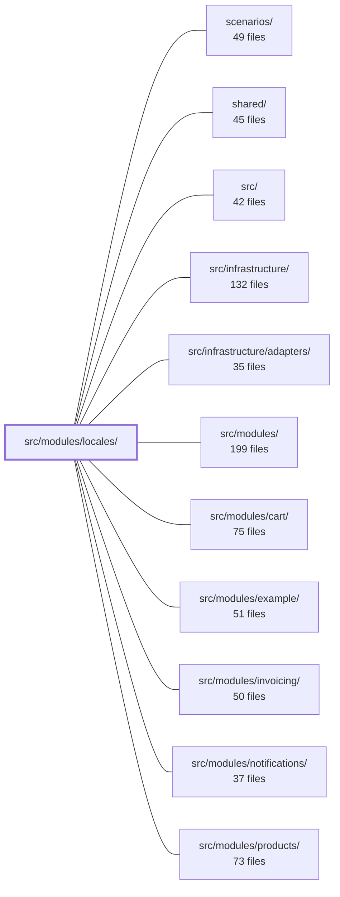

---
tags:
  - 2brain
  - 2brain/module
  - project/boilerplate-node-backend
type: module
module: src/modules/locales/
files: 53
updated: 2026-11-15T00:32:57.974173+00:00
---

# src/modules/locales/

## Purpose

The locales module implements the application's two-tier internationalization (i18n) system. It manages which languages a deployment supports (static file-deployed languages and dynamic database-registered languages), stores per-app translation dictionaries for frontend copy, and provides per-entity translation overrides for domain objects. It exposes the full `/locales` REST API for reading served language data and for administrative CRUD of languages, their entries, and entity translations.

## Key parts

- **Domain & persistence** — `model.ts` defines the three Mongoose schemas (`locales`, `localeEntries`, `translations`); `repository.ts` wraps every query behind narrow functions and enforces the revision-bump invariant on writes; `module.ts` is the bootstrap that registers kernel ports (locale-override provider, translation port) at runtime.
- **Service layer (`services/`)** — `languages.ts` handles dynamic-tier CRUD and cross-file validation rules; `entries.ts` manages per-app key-value entries; `messages.ts` builds the read paths for client and API copy; `translations.ts` is the generic admin door for per-entity translations; `keys.ts` provides shared key validation and tree-building; `overlay.ts` wraps the post-write DB overlay refresh; `capabilities.ts` and `actions.ts` build the manifest and per-language action flags.
- **HTTP layer (`controllers/`)** — A thin adapter per endpoint (GET/POST/PUT/PATCH/DELETE for locales, entries, and entity translations). Controllers parse requests, delegate to `localeService`, and shape responses; they contain no business logic.
- **Routing & configuration** — `routes.ts` mounts the Express router and middleware; `apps.ts` assembles the fixed app (keyspace) list from environment config; `config.ts` declares the config schema.
- **Cross-cutting definitions** — `authorization.yaml` (permission sets), `audit.ts` (audit-action identifiers merged into the app-wide map), `openapi.yaml` (API contract).
- **Tests** — `tests/contract/` contains API contract tests that guard the tier boundary and the product-translation endpoint; `tests/factories.ts` seeds DB rows for those suites.
- **Public surface** — `index.ts` is the sole import entry point for sibling modules (enforced by the strategic-DDD rule).

## How it connects

- **Sibling modules (`products`, `cart`, `invoicing`, `notifications`, `example`)** — Each module registers its translatable-entity manifest with the locales module at boot via the kernel translation port. The reverse import is deliberately forbidden (circular-dependency wall), so `services/translatables.ts` receives the registry externally. The translation contract tests are scoped to the `product` entity type to keep coupling explicit.
- **`shared/`** — Provides the app-wide `AuditActionMap` that `audit.ts` augments, and the shared controller-helper utilities used by individual controllers for error formatting.
- **`src/infrastructure/adapters/`** — Supplies the MongoDB driver adapter and the i18n runtime that `repository.ts` and `overlay.ts` rely on for persistence and cache refresh.
- **`scenarios/`** — End-to-end or integration test scenarios that exercise the locales API alongside other modules (e.g., product listing in a non-default locale).

## Where to start

1. **`module.ts`** — Read this first. It shows the module's identity, what kernel ports it installs, and the registration lifecycle, giving you the bird's-eye wiring before any individual service.
2. **`services/capabilities.ts`** — This is where the two-tier model (static vs. dynamic languages) is concretely built into the `GET /locales` manifest. Understanding the tier split here makes the rest of the module (entries, messages, overlay) much easier to follow.

## Connected modules

[[boilerplate-node-backend_ROOT|/ (repository root)]] · [[boilerplate-node-backend_scenarios|scenarios/]] · [[boilerplate-node-backend_shared|shared/]] · [[boilerplate-node-backend_src|src/]] · [[boilerplate-node-backend_src_infrastructure|src/infrastructure/]] · [[boilerplate-node-backend_src_infrastructure_adapters|src/infrastructure/adapters/]] · [[boilerplate-node-backend_src_modules|src/modules/]] · [[boilerplate-node-backend_src_modules_cart|src/modules/cart/]] · [[boilerplate-node-backend_src_modules_example|src/modules/example/]] · [[boilerplate-node-backend_src_modules_invoicing|src/modules/invoicing/]] · [[boilerplate-node-backend_src_modules_notifications|src/modules/notifications/]] · [[boilerplate-node-backend_src_modules_products|src/modules/products/]]

## Files
- `src/modules/locales/apps.ts` — Defines the fixed set of "apps" (keyspaces) a deployment recognises in the locales service. Each translation entry is scoped by `(language, app, key)`, so two apps can reuse the same key for unrelated strings. App IDs are **configuration**, not database rows — the list is assembled at runtime from environment variables and exposed to the API surface (`GET /locales/apps`) and to internal services that need to validate or enumerate apps.
- `src/modules/locales/audit.ts` — Declares the audit-action identifiers for all write operations in the locales domain (locale CRUD, locale-entry CRUD/import, batch translation updates) and merges them into the app-wide `AuditActionMap` via TypeScript module augmentation. This file exists so that compliance queries can filter on a single, well-known prefix per event rather than per code path.
- `src/modules/locales/authorization.yaml` — Declares the authorization rules and named permission sets for the `locales` module. It defines what actions a tenant-scoped principal may perform on `Locale` subjects and groups those actions into composable sets consumed by the API layer.
- `src/modules/locales/config.ts` — Declares the locales module's configuration schema — specifically, which app IDs this deployment holds translation strings for. It is a pure definition file; consumers read the resolved values via `./apps.ts` rather than importing this file directly.
- `src/modules/locales/controllers/delete-locale-entry.ts` — Thin HTTP adapter for `DELETE /locales/:locale/apps/:app/entries/:entryId`. It validates the `entryId` parameter, delegates the actual deletion to `localeService.removeEntry`, and returns a `204 No Content` (or a refusal/error status) — no response body.
- `src/modules/locales/controllers/delete-locale.ts` — Thin HTTP adapter that handles `DELETE /locales/:locale` (admin). It translates the Express request into a call to `localeService.removeLanguage`, maps the service result to an HTTP status (204 on success, 409 on refusal), and delegates error formatting to the shared controller helpers. It exists to keep route wiring in `routes.ts` free of business logic.
- `src/modules/locales/controllers/get-entity-translations.ts` — Thin HTTP adapter that exposes `GET /locales/translations/:entityType/:id`. It validates the route parameters, delegates to `localeService.getEntityTranslations`, and shapes the Express response (ETag, preconditions, success/error). The file exists so that the service layer stays free of Express concerns.
- `src/modules/locales/controllers/get-locale-apps.ts` — Thin Express controller for the `GET /locales/apps` endpoint. It delegates to `localeService.listApps()` and wraps the result in a standard success envelope, keeping the HTTP layer decoupled from the data source.
- `src/modules/locales/controllers/get-locale-entries.ts` — Thin HTTP adapter for the three admin GET routes that read locale dictionary entries: listing all apps' entries for a language, listing one app's slice, and fetching a single entry by id. Translates Express requests into `localeService.searchEntries` / `localeService.getEntry` calls and shapes the responses back.
- `src/modules/locales/controllers/get-locale-messages.ts` — Thin Express adapter for `GET /locales/:locale/messages`. It validates the query string, delegates to `localeService.readMessages`, and formats the HTTP response. Exists to keep HTTP concerns (parsing, status codes, error mapping) out of the service layer.
- `src/modules/locales/controllers/get-locales.ts` — Express route handlers for the three read-only locale endpoints (`GET /locales`, `GET /locales/:locale`, `GET /locales/:locale/dictionary`). They thin-wire the HTTP layer to `localeService` (database-backed) and to the filesystem-backed i18n dictionary, applying caller scoping, ETag caching, and standard error responses.
- `src/modules/locales/controllers/post-locale-activation.ts` — Express route handlers for `POST /locales/:locale/activate` and `POST /locales/:locale/deactivate`. They are thin orchestration layers: invoke the locale service, check for refusal, re-describe the stored language for the caller, and emit the success response. All domain logic (cache clear, overlay refresh, audit) lives in the service.
- `src/modules/locales/controllers/post-locale-entry.ts` — Controller handler for `POST /locales/:locale/apps/:app/entries`. Validates the request body, delegates to the locale service to add a single key to an app's dictionary, and responds with `201 Created` including a `Location` header pointing to the new entry.
- `src/modules/locales/controllers/post-locale.ts` — Controller for `POST /locales` (admin). Registers a new language in the dynamic tier, making it immediately servable for content negotiation, product text, and search. API-level messages fall back to the default language until a dictionary file is deployed for the new locale.
- `src/modules/locales/controllers/put-locale-entry.ts` — Handles the admin `PUT /locales/:locale/apps/:app/entries/:entryId` endpoint. It validates the entry ID and request body, delegates to the locale service to update a single entry's value, and returns the updated entry in a standard success shape.
- `src/modules/locales/controllers/update-entity-translations.ts` — Thin HTTP adapters for `PUT` and `PATCH /locales/translations/:entityType/:id`. Both handlers delegate to `localeService` but differ in semantics: PUT replaces the full translation set (unlisted locales are deleted), PATCH merges per RFC 7396 (absent keys are left alone). The two handlers share a single factory so request parsing, ETag/If-Match handling, and error mapping are written once.
- `src/modules/locales/controllers/update-locale-entries.ts` — Implements the two bulk-entry endpoints for a locale's app dictionary: **PUT** (replace everything not sent) and **PATCH** (merge patch; `null` deletes, omitted keys are kept). The operations are split into two separate routes rather than one route with a boolean flag so a mis-set flag cannot silently empty a dictionary.
- `src/modules/locales/controllers/update-locale.ts` — Handler pair for `PUT /locales/:locale` (full replace) and `PATCH /locales/:locale` (partial merge), built on the shared `createUpdateController` factory. The locale tag is always read from the path parameter, never from the request body, because changing a tag would effectively rename an entire dictionary referenced by every entry.
- `src/modules/locales/factories.ts` — Builds the two shapes of locale fixture data — a language row and a translated-entry row — for use by repositories' `create` methods. The factories exist so that test/integration code can seed records that are structurally identical to what the API would produce, without duplicating derivation logic (e.g. `baseLanguage`).
- `src/modules/locales/index.ts` — Public barrel for the **locales** module. It is the sole import surface that sibling modules may use (rule defined in `docs/theory/strategic-ddd.md` §5). Sibling code should never reach into `./model` or `./services` directly.
- `src/modules/locales/model.ts` — Defines the three Mongoose schemas behind the OVERRIDE tier — the `locales`, `localeEntries`, and `translations` collections. These schemas are the persistence contract for locale metadata, per-key translations, and entity-level translations. Nothing here is awaited on the request path; `t()` resolves through an i18n overlay that reads these rows at boot, on a timer, and after writes.
- `src/modules/locales/module.ts` — Module manifest and bootstrap wiring for the **locales** module. Declares the module's identity (name, routes, config, i18n files, personal-data hooks) and defines the `onRegistered` callback that installs two kernel ports — a locale-override provider and a translation port — only when the module is actually registered, not at import time.
- `src/modules/locales/openapi.yaml` — OpenAPI 3.1.0 contract for the **locales** module: supported languages, the API's own deployed dictionary, and client-editable translation entries. It exists so that both humans and AI assistants can understand the module's public surface, its two-tier translation model, and its error vocabulary without reading the implementation.
- `src/modules/locales/presenters.ts` — Provides the single-document wire-shape transform for locale entries. Because the repository's `search()` path already returns `LocaleEntry` directly and languages merge both tiers without needing a separate presenter, this module exists solely to give single-document write flows (create/update) a stored-document → wire-shape cast.
- `src/modules/locales/repository.ts` — Data-access layer for the locales module. Wraps every MongoDB query against the `locales`, `localeentries`, and `translations` collections behind a set of narrow, purpose-named functions. Its central invariant: every write to `localeentries` runs inside a transaction that also atomically bumps the owning language's `revision`, so a client can never observe changed entries without a changed revision, and an import's `If-Match` fence can never slip past a partially-written row.
- `src/modules/locales/routes.ts` — Defines the Express router mounted at `/locales`, exposing public locale/translation reads (manifest, messages, dictionary) and authenticated admin writes for languages and their string entries. All routing, middleware ordering, and cache configuration for the locales module lives here.
- `src/modules/locales/services/actions.ts` — Centralizes the rules for what a caller may do to a registered language (update, activate, deactivate, delete). It combines the language's state (active, fallback) with the caller's permission keys into a single `LanguageActions` block so that presenters render flags without re-deriving the policy.
- `src/modules/locales/services/capabilities.ts` — Builds the `GET /locales` manifest: a single merged list of every language the deployment offers, split into two tiers (file-deployed/static and row-registered/dynamic), each annotated with its capabilities (direction, apps, actions, entry count). It also provides the single-language read (`readLanguage`) and the write-response helper (`describeStoredLanguage`), all under the same scoping and standing rules so list, detail, and mutation responses are representationally identical.
- `src/modules/locales/services/entries.ts` — Service layer for reading and writing individual locale entries (translated key-value pairs) within a single language and app. Translates route-level requests into repository calls, enforces per-app key uniqueness, emits audit records, and triggers overlay refresh after every mutation.
- `src/modules/locales/services/index.ts` — Barrel file that aggregates every function under `src/modules/locales/services/` into a single `localeService` namespace object. It is the **only** import surface for controllers, `module.ts`, and tests—no file outside `services/` reaches the individual sub-modules directly. It exists so the persistence wall (controllers must not import `../model` or raw sub-service files) stays intact.
- `src/modules/locales/services/keys.ts` — Shared validation and tree-building logic for locale translation keys. It answers "can this key be stored and rendered?" with concrete rejections (not booleans), and converts flat dotted-key entries into the nested object shape the `GET /locales/{locale}` endpoint serves. Pure, database-free, and owned by nobody — both `entries.ts` and `messages.ts` import from it.
- `src/modules/locales/services/languages.ts` — Service layer for the dynamic language tier: creating, editing, activating/deactivating, and cascade-deleting a language row. It also centralises two cross-file validation rules shared by sibling services — refusing writes under an unknown app and protecting the deployment's fallback locale from deactivation or deletion.
- `src/modules/locales/services/messages.ts` — Provides the two read paths for stored locale copy: `readMessages` serves a single frontend app's per-language entries to a client, and `readApiOverrides` builds the backend's own override tree. A third function, `readLocaleOverlay`, bundles both plus the active/inactive tag lists so the i18n provider refreshes copy and served-language state atomically.
- `src/modules/locales/services/overlay.ts` — Thin service layer that wraps `refreshLocaleOverrides` so that every locale write path (entries, languages, and any future writer) triggers a DB overlay refresh by construction, eliminating the need for each controller to remember to call it.
- `src/modules/locales/services/translatables.ts` — Holds the app-wide translatable-target lookup (entityType → target) for the locales module. The registry is supplied externally at boot because `locales` cannot import from `src/modules/*` to collect each module's manifest entry — the same circular-dependency wall that motivates `kernel/translation.ts`'s translation port.
- `src/modules/locales/services/translations.ts` — The admin-facing service door for reading and writing per-locale translations on any translatable entity. It is fully generic: it resolves a target's declared fields and validation rules from the registry, validates a whole PUT/PATCH batch before any write, then applies the validated plan to the translations collection. It also writes the derived index column (fallback-locale content mirrored onto the entity document) in exactly one place so no caller can drift.
- `src/modules/locales/tests/contract/api.contract.test.ts` — Contract tests for the `/locales` API surface — the manifest, dictionary, per-locale read, and messages endpoints. The central property under guard is the **tier boundary**: a language that exists only in the database must never cause the API to claim it can answer in that language. The tests are written so that a future change collapsing the static (deployed-file) and dynamic (database) tiers fails here rather than surfacing as a client bug.
- `src/modules/locales/tests/contract/support.ts` — Shared setup helper for the locales contract test suites. It registers a language through the real `POST /locales` route so that each contract test case starts from a known, valid state without duplicating HTTP boilerplate.
- `src/modules/locales/tests/contract/translations.contract.test.ts` — Contract tests for the `/locales/translations/:entityType/:id` endpoint (GET, PATCH, PUT). The suite is deliberately scoped to the `product` entity type so that removing the shop module deletes exactly this file without touching the language or dictionary contract suites.
- `src/modules/locales/tests/factories.ts` — Test-only persistence layer for the locale domain. It wraps the production builder (`makeLocale`) with a database write so integration and contract tests can seed a known locale row without hand-rolling repository calls. The design splits "build" (in `../factories.ts`) from "persist" (here) so the builder stays unit-testable without a database.
- `src/modules/locales/tests/integration/blank-tag.test.ts` — Integration test verifying that a locale tag that trims to an empty string (e.g. `%20`) produces a 404 response on both `PUT` and `PATCH /locales/{locale}`, rather than hanging or returning an unexpected status. It guards against a class of bugs where whitespace-only identifiers bypass validation and cause indefinite waits.
- `src/modules/locales/tests/integration/locale-cache-invalidation.test.ts` — End-to-end integration test that proves an admin write to a locale entry or language list actually evicts the cached public dictionary response. It drives the real app (HTTP → middleware → routes) and asserts the stored response disappears by observing `cache-status` headers, rather than mocking the invalidation call. Its raison d'être is catching the class of bug where the tag written on the read path and the tag cleared on the write path disagree—undetectable in dev (TTL clamped to 30 s) but catastrophic in production (1-hour stale translations).
- `src/modules/locales/tests/integration/manifest-visibility.test.ts` — Integration test verifying that `GET /locales` reports a file-backed language (one with a deployed dictionary file such as `shared/locales/it.json`) as `active: false` when its database row is switched off, and as `active: true` when the row is active or absent entirely. This guards the contract that every manifest consumer (client bundling logic, sitemap generator, etc.) sees a consistent visibility signal regardless of authentication level.
- `src/modules/locales/tests/integration/model.test.ts` — Integration tests that pin the serialization contract of the `locale` and `localeEntry` models on both response paths (hydrated `toJSON` and lean list), verify schema-level defaults and hooks, and guard against `_id`/`__v` leaking into API responses. They exist because 95 schemas in `openapi.yaml` declare `additionalProperties: false`, so any stray field is a contract violation, and the lean path bypasses `toJSON` entirely.
- `src/modules/locales/tests/integration/repository.test.ts` — Integration tests for the locales repository **write paths** against a real MongoDB instance. The file exists because the properties under test—transactional atomicity between a row write and its revision bump, cascade deletion across collections, and an import's side-effect on rows it was not given—cannot be meaningfully faked in memory. Despite the "integration" label, the repo's convention treats these as unit tests: no HTTP, no auth, no network beyond the local Mongo.
- `src/modules/locales/tests/integration/translations.test.ts` — Integration tests for `getEntityTranslations` and `updateEntityTranslations` that run against a **real MongoDB** (via `setupTestDb`). The suite verifies the full read/write path for entity translations, including registry validation, locale-existence checks, derived-index writes on `products`, digest stamping, transactional atomicity, and draft/orphan-locale visibility rules.
- `src/modules/locales/tests/integration/update-audit.test.ts` — Integration tests that verify the audit metadata emitted when locale service mutations occur. It encodes the project's audit design principle: language-level changes record each display field's old/new values, while entry-level changes record only the key and the fact that `value` moved — never the text itself.
- `src/modules/locales/tests/unit/apps.fixture.ts` — Test fixture that exposes the two demo app IDs (backend and frontend) used across the locales test suite. The IDs are obtained by calling the registry functions in `apps.ts` rather than being spelled out as string literals, so tests always operate on values the service actually accepts and cannot silently drift if the registry changes.
- `src/modules/locales/tests/unit/apps.test.ts` — Unit tests for the app-registry readers exported by `../../apps`. Because every reader is lazy (reads `process.env` at call time), each test sets the environment variables it needs and then invokes the reader. The suite guards against cross-test pollution by unsetting its three variables before running.
- `src/modules/locales/tests/unit/routes.test.ts` — Asserts the route table, per-route authorization guards, and caching configuration of the locales router. Each test encodes a deliberate design decision (public reads, per-route guard ordering, shared vs. service-level cache invalidation) so that silently "fixing" any of them causes an immediate test failure.
- `src/modules/locales/tests/unit/schema-contract.test.ts` — Unit tests that lock down the schema contracts of `localeSchema` and `localeEntrySchema` (required fields, unique indexes, field-level normalisation, defaults, enums) and the `deriveBaseLanguage` helper. They exist to guarantee that the two unique indexes (`locales_tag`, `localeEntries_locale_app_key`) and the tag/app/locale normalisation rules cannot be silently weakened, because those rules are what make the translation tier addressable and merges safe as upserts.
- `src/modules/locales/tests/unit/service.test.ts` — Unit tests for the stateless, decision-making half of `localeService` — the message-tree builder, key-collision rules, and the capability-manifest merge. These functions fail silently when wrong (a dropped key, a language claiming a capability it lacks), so they are asserted directly here without a database. Write paths that call into them are covered elsewhere (`repository.test.ts`, the contract suite).
- `src/modules/locales/tests/unit/translations.test.ts` — Unit tests for the `deriveSourceDigest` pure function from the locales repository. This file covers the deterministic, side-effect-free half of the translation write path — verifying that the digest is a stable, order-independent fingerprint of a translation's content.

---
[[boilerplate-node-backend_INDEX|← boilerplate-node-backend index]]
