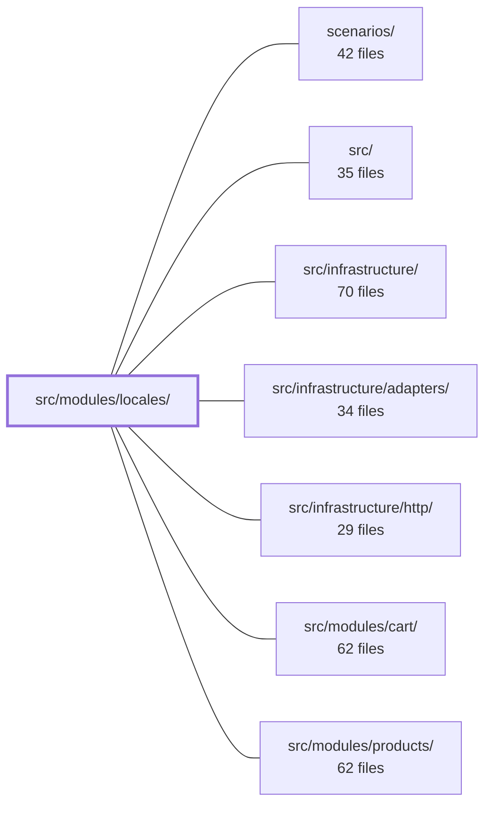

---
tags:
  - 2brain
  - 2brain/module
  - project/boilerplate-node-backend
type: module
module: src/modules/locales/
files: 44
updated: 2026-10-15T13:40:07.319160+00:00
---

# src/modules/locales/

## Purpose

The `locales` module owns all translation and internationalization concerns for the deployment: it registers the languages a deployment offers, stores per-app dictionary entries and per-entity translations in MongoDB, and exposes a two-tier lookup (file-based backend messages + database-backed client overrides) that feeds the application-wide `t()` call. It also defines the administrative HTTP surface for managing those languages, entries, and entity translations.

## Key parts

- **Configuration & registry** — `config.ts` (validated app-ID set), `apps.ts` (env-driven keyspace definitions with backend/frontend classification), `audit.ts` (audit-action identifiers for locale writes).
- **Data layer** — `model.ts` (Mongoose schemas for Language, LocaleEntry, and entity-translation collections), `repository.ts` (all query/write operations plus the revision-counter invariant), `factories.ts` (in-memory fixture builders for tests and seeding).
- **Service layer (`services/`)** — `languages.ts` (dynamic-locale CRUD + cascading delete), `entries.ts` (per-app entry CRUD and bulk import), `messages.ts` (flat-row → message-tree expansion for clients and the backend), `translations.ts` (entity-translation PUT/PATCH pipeline + kernel port adapters), `capabilities.ts` (merged two-tier manifest), `keys.ts` (shared key-validation / tree-build utilities), `overlay.ts` (single `refreshOverlay` entry point), `translatables.ts` (injected entityType → descriptor registry), `index.ts` (aggregated `localeService` barrel).
- **HTTP boundary** — `routes.ts` (Express router at `/locales` with auth guards and cache config), `controllers/` (thin Zod-validating adapters for every endpoint), `presenters.ts` (DB-document → wire-shape conversion), `openapi.yaml` (OpenAPI 3.1.0 contract).
- **Module wiring** — `module.ts` (kernel port registration, translatables injection, `AppModule` descriptor), `index.ts` (public barrel enforcing the strategic-import rule).
- **Tests** — `tests/contract/` (two-tier boundary and entity-translation contracts), `tests/integration/` (schema serialization, repository writes, translation read/write against real MongoDB), `tests/unit/` (app-registry behavior).

## How it connects

- **`src/infrastructure/`** — The module owns the *locale-override provider* and *translation* kernel ports wired in `module.ts`. After any write, it calls the i18n overlay refresh (exposed through `services/overlay.ts`) so the in-memory `t()` dictionary in `@infrastructure/i18n` stays current without blocking the request path.
- **`src/infrastructure/http/`** — Controllers use the shared Express/Zod validation utilities and response-envelope helpers provided by the HTTP infrastructure to keep every endpoint's shape consistent.
- **`src/modules/products/`** and **`src/modules/cart/`** — These feature modules register themselves as *translatable entities*. At boot the app tier assembles their manifests and injects them into `translatables.ts`, after which the locales module can validate and persist their per-field translations. Removing a feature module simply removes it from the registry; the locales module's code is unchanged.
- **`src/`** — The `index.ts` barrel is the *only* import path sibling modules use, enforcing the strategic-DDD rule that cross-module imports never reach into internal subfolders.

## Where to start

1. **`services/languages.ts`** — Reading the dynamic-locale CRUD lifecycle (create, edit, cascade-delete) gives you the smallest end-to-end slice: controller → service → repository → model, plus the overlay refresh and audit emit that every write path shares.
2. **`model.ts`** — The three schemas (Language, LocaleEntry, entity translation) and their `toJSON` transforms define the shapes every other file in the module speaks. Knowing these makes the presenters, repository queries, and contract tests immediately readable.

## Connected modules

[[boilerplate-node-backend_ROOT|/ (repository root)]] · [[boilerplate-node-backend_scenarios|scenarios/]] · [[boilerplate-node-backend_src|src/]] · [[boilerplate-node-backend_src_infrastructure|src/infrastructure/]] · [[boilerplate-node-backend_src_infrastructure_adapters|src/infrastructure/adapters/]] · [[boilerplate-node-backend_src_infrastructure_http|src/infrastructure/http/]] · [[boilerplate-node-backend_src_modules_cart|src/modules/cart/]] · [[boilerplate-node-backend_src_modules_products|src/modules/products/]]

## Files
- `src/modules/locales/apps.ts` — Defines the fixed set of translation keyspaces ("apps") for a deployment. An app is one consumer of the translation service, identified by the `(language, app, key)` triple. The id set is deliberately configuration-driven (env vars) rather than database rows so that an import typo cannot silently create a keyspace nobody serves. Exactly one app is the `backend` (the API's own copy); every other is a `frontend`.
- `src/modules/locales/audit.ts` — Declares the set of audit-action identifiers that the locales module emits when an admin performs a write operation (create, update, delete, import). These strings are the sole historical record of locale/translation changes—reads are deliberately not audited. The file also augments the app-wide `AuditActionMap` so TypeScript recognizes these values as valid audit actions.
- `src/modules/locales/config.ts` — Declares the locales module's configuration slice: the set of translation app IDs this deployment holds words for. It defines the shape and defaults so the rest of the module (and any consumer) can read validated values rather than raw env vars.
- `src/modules/locales/controllers/create-locale.ts` — Handles the `POST /locales` admin endpoint: registers a new language entry in the dynamic tier. It validates the request body against a Zod schema, delegates to the locale service, and returns a `201 Created` with a `Location` header. It is the "create" half of the locale CRUD trio (edit lives in `./update-locale.ts`, removal in `./delete-locale.ts`).
- `src/modules/locales/controllers/delete-locale-entry.ts` — Thin HTTP adapter for the admin `DELETE /locales/:locale/apps/:app/entries/:entryId` route. It validates the path parameter, delegates to `localeService.deleteEntry`, and maps the result onto an HTTP response. Exists to keep the route table free of business logic.
- `src/modules/locales/controllers/delete-locale.ts` — Thin HTTP adapter for the `DELETE /locales/:locale` (admin) endpoint. It extracts the locale param and caller context from the request, delegates to `localeService.deleteLanguage`, and maps the service result onto an Express response. It contains no business logic.
- `src/modules/locales/controllers/get-entity-translations.ts` — Thin HTTP adapter for `GET /locales/translations/:entityType/:id`. It validates the path params, delegates to `localeService.getEntityTranslations`, and shapes the HTTP response — keeping all translation-fetching logic in the service layer.
- `src/modules/locales/controllers/get-locale-apps.ts` — Thin HTTP adapter that exposes `GET /locales/apps`. It calls `localeService.listApps()` and returns the result wrapped in a standard success envelope. The controller knows nothing about *where* the app list originates (environment, config, etc.) — that concern lives in the service layer.
- `src/modules/locales/controllers/get-locale-entries.ts` — Thin HTTP adapter exposing two GET endpoints for listing locale dictionary entries — all apps or a single app — by delegating to `localeService.searchEntries`. It exists to keep route registration (in `routes.ts`) decoupled from the actual request-parsing and response-shaping logic.
- `src/modules/locales/controllers/get-locale-messages.ts` — Thin HTTP controller (Express handler) for `GET /locales/:locale/messages`. It validates query parameters, delegates to `localeService.readMessages`, and shapes the response. All business logic lives in the service layer; this file is purely an adapter between the HTTP boundary and the locale service.
- `src/modules/locales/controllers/get-locales.ts` — Express controllers for the two locale endpoints: a manifest of every language the deployment offers (`GET /locales`) and the API's own filesystem-backed dictionary for a single language (`GET /locales/:locale`). They separate the database-backed "what can we do?" tier from the filesystem "here are our own messages" tier, so a database outage degrades gracefully rather than failing both.
- `src/modules/locales/controllers/update-locale.ts` — Builds the `PUT /locales/:locale` (full replace) and `PATCH /locales/:locale` (partial merge) handlers on the shared `createUpdateController` factory. The language tag comes from the URL path and is never editable from the request body, because renaming a tag would rename an entire dictionary.
- `src/modules/locales/controllers/write-entity-translations.ts` — Thin Express controllers for `PUT` and `PATCH /locales/translations/:entityType/:id`. Each handler validates a Zod body schema, extracts the entity params, delegates to the corresponding `localeService` method, and formats the response. The two routes share a single internal factory so the only differences are the schema, the service call, and the operation name used in error logs.
- `src/modules/locales/controllers/write-locale-entries.ts` — HTTP controller handlers for all write operations on an app's locale entries: single-entry create/update, and two bulk-import modes (full replace vs. partial merge). Exists to keep Express routing logic, input validation, and response shaping in one place, delegating actual data mutations to the locale service.
- `src/modules/locales/factories.ts` — Builds in-memory fixtures (ready-made documents) for the two locale collections—**Language** and **LocaleEntry**—used in tests and seeding. It exists so that test code never hand-rolls raw document objects; instead it calls a factory that fills identity fields, derives schema-linked values (e.g. `baseLanguage`), and strips undefined keys, producing a record that matches what the API itself would produce.
- `src/modules/locales/index.ts` — Barrel file (public API surface) for the `locales` module. Enforces the strategic-DDB rule (§5) that sibling modules may only import through this file, not directly from internal subfolders.
- `src/modules/locales/model.ts` — Defines the three Mongoose schemas and models behind the OVERRIDE tier of i18n (languages, dictionary entries, entity translations). All lookup and write paths in the locales module read through these models; nothing here is awaited on the hot request path—`t()` resolves from an in-memory overlay that `@infrastructure/i18n` rebuilds at boot, on a timer, and after a write.
- `src/modules/locales/module.ts` — Module manifest and one-time registration entry point for the **locales** module. It wires the two kernel ports this module owns (locale-override provider and translation port) into the application, injects the `translatables` lookup it builds from all enabled modules, and exports the `AppModule` descriptor (routes, config, local locale files, personal-data classification) that the app tier consumes during boot.
- `src/modules/locales/openapi.yaml` — OpenAPI 3.1.0 contract for the **locales** module. It defines the REST surface for querying, creating, and editing the translation languages a deployment serves — both the API's own deployed dictionaries (Tier 1) and the client-facing dictionaries stored in MongoDB (Tier 2) — and for listing the translation "apps" (keyspaces) configured for a deployment.
- `src/modules/locales/presenters.ts` — Thin presentation layer that converts locale and locale-entry database documents into their wire (API response) shapes. It exists because the model types (`LocaleDocument`, `LocaleEntryDocument`) carry stored representation (`_id`, native dates), while the public types (`Language`, `LocaleEntry`) expect `id` and ISO date strings. The two presenters bridge that gap by calling the model's `.toJSON()` transform and casting to the wire type.
- `src/modules/locales/repository.ts` — Data-access layer for the locales module. Provides all query and write operations over the `locales` (languages) and `localeentries` collections, and enforces a single invariant: every write to entries atomically bumps the locale's `revision` counter, so no service call can mutate an entry without signalling to clients that their cached dictionary is stale.
- `src/modules/locales/routes.ts` — Express router mounted at `/locales` that exposes locale discovery (public dictionary reads) and full translation administration (CRUD on languages, per-app entries, and entity translations). It exists as the single HTTP surface for all locale-related endpoints, wiring together authorization guards, Redis cache configuration, and controller handlers.
- `src/modules/locales/services/capabilities.ts` — The locale manifest service. It assembles the single capabilities list returned by `GET /locales` by merging two tiers — languages shipped as deployment files (static) and languages registered as database rows (dynamic) — into one sorted array that states which apps can serve each language, its direction, and its activity status.
- `src/modules/locales/services/entries.ts` — Service-layer CRUD and bulk-import operations for locale translation entries (key/value pairs within a single language). Every read and write is scoped to a `(language-tag, app)` pair, enforcing that a key is unique only within one keyspace. All mutations trigger an audit record and an overlay cache refresh.
- `src/modules/locales/services/index.ts` — Barrel (namespace) file that aggregates every function the locale service layer exposes into a single `localeService` object. It exists so that controllers, `module.ts`, and tests all import **one** name rather than maintaining a parallel re-export list. It is the "override tier" — the write/read API for locale data that ultimately feeds `t()` via a request-path overlay, never synchronously.
- `src/modules/locales/services/keys.ts` — Pure, database-free validation and tree-building utilities that decide whether a translation key can be stored and rendered. It is shared internally by `entries.ts` and `messages.ts`; neither file "owns" it. No separate `domain/` folder is warranted because the rules are simple enough to live here.
- `src/modules/locales/services/languages.ts` — Service layer for the dynamic-locale CRUD lifecycle: registering a language, editing its display fields/visibility, and cascading-deleting it with all translated content beneath. Also hosts two shared write-path guards (unknown-app rejection, fallback-locale protection) that sibling service files import rather than re-implement.
- `src/modules/locales/services/messages.ts` — Two read functions that expand flat locale rows into message trees via `buildMessageTree`: one serves a single frontend app's downloadable overrides to clients, the other serves the backend app's full overlay (grouped by language) to the API's own i18n provider. They differ only in which app's keyspace they read and how they handle inactive languages.
- `src/modules/locales/services/overlay.ts` — Single-purpose wrapper module that ensures the i18n overlay is re-read after any write that may have changed locale overrides. It exists so that write paths in `entries.ts` and `languages.ts` call one stable entry point (`refreshOverlay`) rather than each remembering to invoke the infrastructure refresh directly.
- `src/modules/locales/services/translatables.ts` — Holds a single in-memory lookup table that maps an `entityType` string to its `TranslatableTarget` descriptor. It exists because the `locales` module cannot import other feature modules to discover their translatable manifests (circular-dependency constraint); instead the app tier assembles the full registry at boot and injects it here via a one-time setter.
- `src/modules/locales/services/translations.ts` — The service layer for reading and writing locale translations on any translatable entity. It owns the validate-then-apply pipeline for PUT (replace) and PATCH (merge) translation payloads, enforcing per-slot rules (locale exists and is active, fields are registered, fallback-locale cannot be deleted, entity-level field checks) before any repository write occurs. It also exposes two thin port adapters (`planForPort`, `writeForPort`) so the kernel translation port can drive the same logic without importing this module's internal types.
- `src/modules/locales/tests/contract/api.contract.test.ts` — Contract tests for the `/locales` API surface (list, per-locale dictionary, per-locale message tree, and language creation). The central invariant under guard is the **two-tier boundary**: a language existing in the database (client-side, downloadable) must never imply the API can serve its own copy in that language (server-side, file-based). The tests are written so that collapsing those tiers fails here rather than surfacing as a client bug.
- `src/modules/locales/tests/contract/support.ts` — Shared setup helper for the locales contract test suites. It registers a language through the real `/locales` route so that the contract tests (`api.contract.test.ts`, `translations.contract.test.ts`) can operate on a known language without duplicating the registration call.
- `src/modules/locales/tests/contract/translations.contract.test.ts` — Contract tests for the `/locales/translations` endpoint (GET, PATCH, PUT) that verify an entity's translated fields are read and written correctly through registered entity types. Because `products` is the only registered entity type today, this file is kept separate from the other `/locales` contract suites so that removing the shop module removes this file without touching the language or dictionary tests.
- `src/modules/locales/tests/factories.ts` — Test-persistence layer for locale fixtures. It wraps the pure builder (`makeLocale`) from the production factories module with a single `repository.create` call so that integration tests get a real row in the test database without repeating that two-step pattern.
- `src/modules/locales/tests/integration/model.test.ts` — Integration tests that pin down the Mongoose schema-level behavior for the locales module: serialization (no `_id`/`__v` leakage on either the `toJSON` or `.lean()` path), schema defaults, tag normalization, and the `baseLanguage` derivation hook. They exist because the lean path bypasses `toJSON` entirely and 95 OpenAPI schemas declare `additionalProperties: false`, so a regression in either path would silently break the wire contract.
- `src/modules/locales/tests/integration/repository.test.ts` — Integration tests for the locales repository write paths (create, edit, remove, import, delete) executed against a real MongoDB instance. They exist because the properties under test — the revision counter, cross-collection cascades, and import side-effects on rows not present in the request body — are trivially satisfied by any in-memory fake, so a real database is required to catch genuine regressions.
- `src/modules/locales/tests/integration/translations.test.ts` — Integration test for `localeService.getEntityTranslations` and `localeService.upsertEntityTranslations`, run against a real MongoDB instance. It verifies the full read/write path—including registry lookup, locale validation, derived-index-column writes on `products`, and source-digest stamping—without mocking any of those layers.
- `src/modules/locales/tests/unit/apps.fixture.ts` — Provides canonical app-id constants for the locales unit-test suite. Instead of hardcoding ids, it reads them live from the `apps` registry so that tests can never drift from the values the service actually accepts.
- `src/modules/locales/tests/unit/apps.test.ts` — Unit tests for the app registry readers exported by `apps.ts`. Each case sets the relevant `NODE_LOCALE_*` environment variables, calls the lazy readers, and asserts the resulting app list or classification, ensuring the registry behaves correctly from defaults through custom and extended configurations.
- `src/modules/locales/tests/unit/routes.test.ts` — Unit test for the locales module's Express router. It locks in three architectural invariants so that a future refactor fails loudly rather than silently: the exact set and order of mounted routes, the per-route guard composition (public reads are ungated, admin routes self-declare all three guards), and the caching contract (shared public cache with browser revalidation, uncached editing-screen reads, and tag-based invalidation on writes).
- `src/modules/locales/tests/unit/schema-contract.test.ts` — Unit tests that pin the schema contracts for the two locale collections (`localeSchema`, `localeEntrySchema`) and the `deriveBaseLanguage` helper. They assert required paths, unique indexes, field-level normalisation options, defaults, and enum restrictions so that a regression in any of those invariants (e.g. a lost `lowercase: true` or a changed compound index) fails in CI rather than in production.
- `src/modules/locales/tests/unit/service.test.ts` — Unit tests for the "pure" half of `localeService` — the tree builder, key-collision rules, manifest merge, RTL detection, and language-name helpers. These functions involve no database or HTTP, so they are asserted directly here rather than through the repository or contract suites.
- `src/modules/locales/tests/unit/translations.test.ts` — Unit tests for the pure function `deriveSourceDigest`, which computes a deterministic fingerprint of a translation's source fields. This file isolates the digest logic from any database or registry interaction; those concerns live in the sibling integration test.

---
[[boilerplate-node-backend_INDEX|← boilerplate-node-backend index]]
