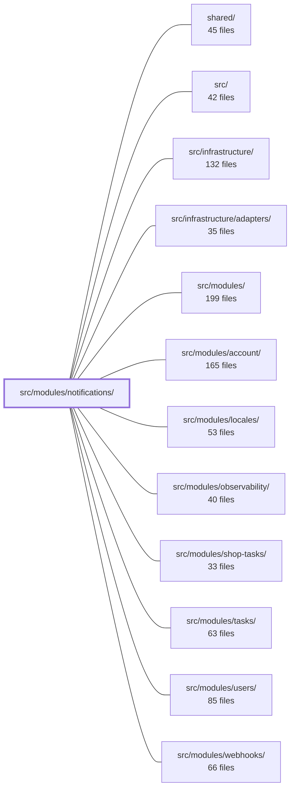

---
tags:
  - 2brain
  - 2brain/module
  - project/boilerplate-node-backend
type: module
module: src/modules/notifications/
files: 37
updated: 2026-11-15T00:33:18.442729+00:00
---

# src/modules/notifications/

## Purpose

The notifications module is the bounded context for a user's in-app inbox (personal "bell" notifications) and for staff work notices in a shop. It owns the persistence model, the REST and SSE delivery paths, the staff-routing rules that decide who hears about an event, optional email dispatch, and the GDPR collect/erase hooks. Every other module that needs to inform a user either emits a domain event handled here or calls the re-exported service directly.

## Key parts

- **Data & persistence** — `model.ts` (Mongoose schema, indexes, typed exports) and `repository.ts` (CRUD, dedup-aware upserts, per-audience trims, bulk deletes; every query is scoped by `userId` in the Mongo filter).
- **Service layer** — `services/inbox.ts` (read/write/delete the inbox, broadcast to open SSE streams), `services/staff.ts` (resolve audience by permission set, write a deduplicated notice row, optionally queue a courtesy email), `services/stream.ts` (per-user SSE fan-out, one stream per open tab), `services/subscribers.ts` (pure event→notice mappings attached to the event bus). `services/index.ts` aggregates them into a single `notificationsService` object.
- **HTTP layer** — `routes.ts` (Express router, auth middleware per route) and `controllers/` (one thin adapter per endpoint: list, get, delete, delete-all, read-all, SSE stream). `presenter.ts` builds the wire shape field-by-field so no undocumented field can leak.
- **Staff routing & email** — `staff-routing.ts` (the six foundation notices: which permission sets are told, email timing, frontend link) and `emails.ts` (builds the single email per notice, pulling wording from the notice code's i18n path).
- **Module wiring** — `module.ts` (registers routes, config, event subscriptions, personal-data handlers, locale paths with the kernel), `config.ts` (retention caps and TTLs in one typed place), `index.ts` (the sole public barrel; enforces the module boundary).
- **API contracts** — `openapi.yaml` (REST + SSE + data-export) and `asyncapi.yaml` (standalone AsyncAPI 3.0 for the SSE channel; merged into repo-root contracts by the bundler at build time).
- **Tests** — `tests/unit/` (presenter wire-shape, schema contract, stream byte format, routing table integrity, auth guards, SSE controller), `tests/contract/` (HTTP round-trip status/shape), `tests/integration/` (ownership isolation, cap enforcement, real-time push, staff audience, task-alerts, due-soon, overdue, stream caps), `tests/factories.ts` + `factories.ts` (seed helpers).

## How it connects

- **shared/** — `repository.ts` extends the shared `createRepository` CRUD factory; shared types and utilities underpin the model and service code.
- **src/infrastructure/ & src/infrastructure/adapters/** — the event bus (subscribed by `subscribers.ts`), the email queue (used by `staff.ts`), and the SSE/HTTP transport are provided here.
- **src/modules/observability/** — `services/stream.ts` explicitly reuses the same plain-HTTP, per-process SSE pattern as the observability stream (no broker fan-out, single-host assumption).
- **src/modules/users/** — `services/staff.ts` resolves which staff members must hear a notice by querying permission-set roles; `staff-routing.ts` references the permission-set identifiers defined there.
- **src/modules/tasks/ & src/modules/shop-tasks/** — These modules call `notificationsService` directly (via the `index.ts` barrel) to create project-specific notices, and their domain events (contact messages, system tasks, due-soon, overdue) are consumed by `subscribers.ts` to produce staff bell entries and emails.
- **src/modules/webhooks/** — External webhook events that fall into the notifications domain are mapped to staff notices through the same subscriber pipeline.
- **src/modules/account/** — `module.ts` registers personal-data collect/erase handlers, and `openapi.yaml` contributes an account-data-export section; both are consumed by the account module's GDPR flows.
- **src/modules/locales/** — `emails.ts` resolves notice wording from each notice code's i18n dictionary path; locale/template paths are registered in `module.ts` and served by the locales module.
- **/ (repository root)** — The build-time bundler merges this module's `asyncapi.yaml` into the root-level contract so the whole API surface can be linted as one document.

## Where to start

1. **`index.ts`** — read this first to see exactly what the module exposes to the outside world (the service object, the types, the subscribe function). It defines the contract every sibling module relies on.
2. **`services/inbox.ts`** — the core read/write/delete/broadcast logic for the user's bell. Understanding this one file makes the controllers, the SSE stream, and the cap-trim behaviour click. Pair it with a quick skim of `routes.ts` to see how the HTTP endpoints map onto the service.

## Connected modules

[[boilerplate-node-backend_ROOT|/ (repository root)]] · [[boilerplate-node-backend_shared|shared/]] · [[boilerplate-node-backend_src|src/]] · [[boilerplate-node-backend_src_infrastructure|src/infrastructure/]] · [[boilerplate-node-backend_src_infrastructure_adapters|src/infrastructure/adapters/]] · [[boilerplate-node-backend_src_modules|src/modules/]] · [[boilerplate-node-backend_src_modules_account|src/modules/account/]] · [[boilerplate-node-backend_src_modules_locales|src/modules/locales/]] · [[boilerplate-node-backend_src_modules_observability|src/modules/observability/]] · [[boilerplate-node-backend_src_modules_shop-tasks|src/modules/shop-tasks/]] · [[boilerplate-node-backend_src_modules_tasks|src/modules/tasks/]] · [[boilerplate-node-backend_src_modules_users|src/modules/users/]] · [[boilerplate-node-backend_src_modules_webhooks|src/modules/webhooks/]]

## Files
- `src/modules/notifications/asyncapi.yaml` — Self-contained AsyncAPI 3.0.0 contract for the per-user SSE stream served at `/notifications/stream`. It is a complete document (with its own server, channels, operations, and components) so it can be linted independently (`npm run lint:asyncapi:modules`) and read standalone; a bundler merges its contents into the repo-root contracts at build time.
- `src/modules/notifications/config.ts` — Declares the runtime configuration knobs for the notifications module: how many inbox notifications a user retains, and how many staff work-notice items are kept alongside a staff member (and for how long). It exists so these limits live in one typed, validated place rather than being scattered across services.
- `src/modules/notifications/controllers/delete-notification.ts` — Thin HTTP adapter for `DELETE /notifications/:id`. Validates the path parameter, delegates to `notificationsService.remove`, and maps the result to an appropriate HTTP response (204 on success, 404 / refused / error otherwise). Exists so the route layer can stay declarative while all transport concerns live here.
- `src/modules/notifications/controllers/delete-notifications.ts` — Thin HTTP adapter that handles the `DELETE /notifications` endpoint, delegating to `notificationsService.dismissAll` to remove all of the caller's notifications (optionally scoped to a single `audience`). It exists to keep route wiring in `routes.ts` decoupled from the service layer.
- `src/modules/notifications/controllers/get-notification.ts` — Thin HTTP adapter for the `GET /notifications/:id` endpoint. It extracts the notification ID from the route param, delegates to `notificationsService.get`, and shapes the Express response. The controller contains no business logic beyond param validation and response formatting.
- `src/modules/notifications/controllers/get-notifications-stream.ts` — Controller for `GET /notifications/stream`. It validates the caller's cookie-based session (SSE via `EventSource` cannot send an `Authorization` header) and then delegates the actual Server-Sent Events streaming to `notificationsService.stream`, passing a periodic re-check callback.
- `src/modules/notifications/controllers/get-notifications.ts` — A thin HTTP adapter that exposes `GET /notifications`. It extracts the authenticated caller from the request, delegates to `notificationsService.listVisible`, and serialises the result (or an error) back to the client. Exists so the route layer stays one-liner and all HTTP concerns are isolated here.
- `src/modules/notifications/controllers/post-read-all.ts` — Thin HTTP adapter that handles `POST /notifications/read-all`. It extracts the caller's ID from the authenticated request, delegates the "mark all read" work to `notificationsService.readAll`, and returns a 204 No Content on success or a structured error on failure.
- `src/modules/notifications/emails.ts` — Builds the single email a work-notice can send to a staff member: a short "what happened" summary in the recipient's language plus a deep link to the relevant screen. Only notices whose routing specifies `email: 'now'` produce a mail; all others remain bell-only. The wording is resolved from the notice code's own i18n dictionary path so each module ships its email copy alongside its notice definitions.
- `src/modules/notifications/factories.ts` — Test and seed factory for notification documents. It centralizes the construction of a valid `Partial<NotificationDocument>` so that tests and seed scripts don't repeat boilerplate, and it is deliberately excluded from the module barrel to keep it out of production code paths.
- `src/modules/notifications/index.ts` — Public barrel (re-export surface) for the **notifications** bounded context. It is the *only* entry point a sibling module is allowed to import from, enforcing the module boundary described in `docs/theory/strategic-ddd.md` §5. Siblings that need to inform a user typically emit a domain event; those that write a notice directly or query who is staffed on a set call the service re-exported here.
- `src/modules/notifications/model.ts` — Defines the Mongoose schema and typed exports for a notification row. Each row stores a `code` and its `params` (never a rendered sentence); the frontend translates the code from its own locale files, so a stored row is language-agnostic and outlives copy changes. This file is the single source of truth for the persisted shape and the index strategy.
- `src/modules/notifications/module.ts` — Module manifest for the notifications inbox. Registers the module's HTTP routes, configuration, domain-event subscriptions, personal-data handlers, and locale/template paths with the kernel registry so the application can mount the module, react to events, and fulfil GDPR collect/erase requests.
- `src/modules/notifications/openapi.yaml` — OpenAPI 3.1.0 contract for the notifications module: the signed-in user's in-app inbox (personal notifications) and shop work notices for staff. It defines the REST endpoints, the SSE live stream, the schema variants for notification payloads, and the account-data-export section contributed by this module.
- `src/modules/notifications/presenter.ts` — Transforms internal `NotificationDocument` objects into the exact wire shapes declared by `openapi.yaml`. Objects are **built** (field-by-field) rather than serialized, guaranteeing that any field not named in the contract can never leak into a response.
- `src/modules/notifications/repository.ts` — The data-access layer for notifications. It extends the shared `createRepository` CRUD factory with the specific read/write operations an inbox service needs (list, insert, dedup-aware upserts, per-audience trims, bulk deletes). Every query is scoped by `userId` in the Mongo filter itself, so cross-user access is structurally impossible rather than guarded by a separate check.
- `src/modules/notifications/routes.ts` — Defines the Express router for all notification endpoints under `/notifications`. It wires each route to its controller and attaches the correct authentication middleware per route. The file exists to keep route ordering, auth strategy, and origin checks in one place, separated from controller logic.
- `src/modules/notifications/services/inbox.ts` — The inbox service: the single place where notifications are read, written, and removed (owner delete, inbox empty, or cap trim). Every mutation is also broadcast to the owner's open streams via `publishToUser`, so multiple tabs stay in sync without a manual refresh.
- `src/modules/notifications/services/index.ts` — Barrel/facade for the notifications service layer. It aggregates the functions from `inbox`, `staff`, `stream`, and `subscribers` into a single `notificationsService` object so that controllers and sibling modules have exactly one import point, never reaching into the individual files directly.
- `src/modules/notifications/services/staff.ts` — Implements "work notices" for shop staff: resolves who must hear about an event (by permission-set role), writes a deduplicated notice row (the authoritative record), and optionally sends a courtesy email. A mail failure is logged and never propagated, because the written row is what matters.
- `src/modules/notifications/services/stream.ts` — Live delivery of notifications over Server-Sent Events, one stream per open tab, routed by user so a frame reaches only that user's connections. Uses the same plain-HTTP, per-process pattern as the observability stream: no broker fan-out, single-host assumption.
- `src/modules/notifications/services/subscribers.ts` — Maps each domain event in the notifications domain to the staff "notice" it should produce in the inbox. Each exported function is a pure mapping from an event payload to a `notifyStaff` / `notifyStaffMember` call; the module's `subscribe()` (wired in `services/index.ts`) attaches them to the event bus. The actual persistence of notices is delegated to `./staff`. Project-specific (shop) notices do **not** live here — they call `notificationsService` directly from the module that adds them.
- `src/modules/notifications/staff-routing.ts` — Defines the routing table for the six staff work notices that ship with every project: which permission sets are told, whether the notice earns an email (and of what class), and which frontend screen it links to. It is the single reference for auditing "who is told" for foundation notices. Modules that add their own notices keep their own table and pass it in per call; this file lists none of them.
- `src/modules/notifications/tests/contract/api.contract.test.ts` — Contract tests for the `/notifications` REST API. Each test asserts a specific HTTP status code and response shape (200 with an items array, 204 with no body, 404, 422) so that every contract branch — including refusals — is verified over a real HTTP round-trip. Ownership and capacity rules are deferred to the integration suite.
- `src/modules/notifications/tests/factories.ts` — Test-persistence layer for notifications. The in-memory BUILDER (`makeNotification`) lives in `../factories.ts`; this file wraps it with a database write so integration and contract tests can create real documents. It also exposes a simple count helper for assertions that verify *nothing* was written.
- `src/modules/notifications/tests/integration/service.test.ts` — Integration test suite for the notifications service (`notificationsService`). Validates ownership isolation, newest-first ordering, per-user inbox cap enforcement, real-time stream push on create/delete/dismiss, and audience-scoped bulk dismissal — all against a real database rather than mocks.
- `src/modules/notifications/tests/integration/staff.test.ts` — Integration tests for staff (work) notifications, exercised the same way production drives them: real modules registered, a domain event emitted at one end, and the member's notification "bell" read at the other. Verifies audience targeting (which roles/sets are told), idempotent redelivery, mail-queue routing by severity, role-scoped visibility at read time, tenant isolation, retention caps and TTL, and the shape of the data-export view.
- `src/modules/notifications/tests/integration/stream-cap.test.ts` — Integration test for the per-account and process-wide SSE stream caps on `GET /notifications/stream`. Verifies via a real HTTP socket that an account exceeding its share is refused (429 + `Retry-After`), that closing a stream frees the slot, that one account's streams don't count against another, and that the process ceiling yields a 503.
- `src/modules/notifications/tests/integration/task-alerts.test.ts` — Integration test suite that exercises task-alert notifications the way production drives them: real modules are registered, a contact message or system task is filed through the task service, and the test asserts both the in-app "bell" entries and the queued emails that result. It locks down *who* is notified (only members of the working role-set), *what* each channel carries (staff-notice mails get a category and a link, never the visitor's words; the support mailbox gets the full message), and *when* each channel fires (contact messages → mailbox only; system tasks → bell + per-person mail, never the mailbox).
- `src/modules/notifications/tests/integration/task-due-soon.test.ts` — Integration test for the due-soon reminder pipeline. Drives a task whose deadline is two days away through `taskService.remindDueSoon()` and verifies that (1) the right people receive exactly one bell notification and one staff mail, (2) duplicate delivery of the same domain event does not produce duplicates, (3) a privacy-category task additionally mails the support address in-thread, and (4) non-privacy contact categories stay silent.
- `src/modules/notifications/tests/integration/task-overdue.test.ts` — Integration test that drives the overdue-task reminder end-to-end the same way production does: a task is created, its due date backdated, and the tasks sweep (`remindOverdue`) executed. It verifies the reminder reaches the same audience as the original opener (bell notification + email), is delivered exactly once, is suppressed for closed tasks, and falls back to the support mailbox (or to nobody) when no qualified recipient exists.
- `src/modules/notifications/tests/unit/get-notifications-stream.test.ts` — Unit tests for the `GET /notifications/stream` controller. They verify three contract points: the handler delegates the raw response, caller id, and a permission-recheck callback to the notification streamer; the recheck callback is wired to `stillSignedInViaCookie` and the original request; and a request missing either `sessionRecheck` or `authContext.id` is refused with a 401 and no stream is opened.
- `src/modules/notifications/tests/unit/presenter.test.ts` — Unit tests for the notification presenter's wire contract: verifies that `presentNotification` and `presentNotifications` emit exactly the fields the API contract names (no more, no less), with correct serialization (IDs/dates as strings, `readAt` absent when unread) and per-code param pass-through.
- `src/modules/notifications/tests/unit/routes.test.ts` — Verifies the authentication guard configuration on every route in the notifications router. It ensures standard CRUD routes require a bearer session with no permission rule, and that the SSE stream route authenticates via cookie (because `EventSource` cannot send a `Authorization` header).
- `src/modules/notifications/tests/unit/schema-contract.test.ts` — Unit test that pins the **schema contract** (field declarations, constraints, and indexes) of `notificationSchema` without exercising document-level behavior. It guards against silent drift in required fields, enum membership, defaults, index shape, and timestamp options — changes that would break the inbox read, the cap trim, or deduplication even though no single fixture goes invalid.
- `src/modules/notifications/tests/unit/staff-routing.test.ts` — Unit tests for the staff-notification routing layer. Verifies that the `STAFF_ROUTES` table is complete and self-consistent (every notice has a valid route, referenced permission sets exist, email timing matches intent), and that the helper functions (`staffLinkOf`, `setsOfRoute`, `callerHoldsAnySet`, `staffNoticeEmail`) resolve links, permission gating, and localized email content correctly across the two served locales.
- `src/modules/notifications/tests/unit/stream.test.ts` — Unit tests for the per-user SSE (Server-Sent Events) notification hub. They verify the three failure modes that are invisible from the wire: the exact byte format of each frame (including the trailing blank line), per-user routing isolation, and clean teardown on disconnect. The clock is faked and the Express response is hand-built so assertions can inspect raw bytes.

---
[[boilerplate-node-backend_INDEX|← boilerplate-node-backend index]]
