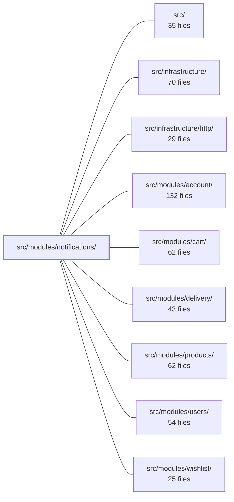

---
tags:
  - 2brain
  - 2brain/module
  - project/boilerplate-node-backend
type: module
module: src/modules/notifications/
files: 25
updated: 2026-10-15T13:40:22.525741+00:00
---

# src/modules/notifications/

## Purpose

The notifications module implements a per-user inbox: one persisted row per message, written exclusively by inbound domain events and read by the owning user over REST or a live SSE stream. It owns the full lifecycle—creation, read-marking, dismissal, per-user cap eviction, and cascade on account deletion—while deliberately exposing no import surface to producer modules (siblings emit events; they never call in).

## Key parts

- **Data & persistence** — `model.ts` (Mongoose schema; stores a semantic `code` + structured `params` pair, never rendered text), `repository.ts` (CRUD + cap-trim, every query scoped by `userId`), `factories.ts` (builds valid `Partial<NotificationDocument>` rows for tests and seeds).
- **Service layer** — `services/inbox.ts` (single entry point for all reads/writes/removals; fans out mutations to open SSE streams), `services/stream.ts` (per-process SSE hub keyed by user; heartbeats, permission recheck, teardown), `services/subscribers.ts` (thin adapters that map typed domain events into inbox rows), `services/index.ts` (facade bundling everything into `notificationsService`).
- **HTTP surface** — `routes.ts` (Express route table, permission guards, SSE cookie-auth path), `controllers/` (five thin adapters: list, delete, read-all, dismiss-all, open-stream).
- **Presentation & contract** — `presenter.ts` (maps documents to the exact `openapi.yaml` wire shape, field-by-field).
- **Module wiring** — `module.ts` (manifest the kernel boots: routes, config, event subscriptions, personal-data handlers), `index.ts` (public barrel; the only entry point siblings may import from, and only for *reading*), `config.ts` (single knob: max notifications per user).
- **Tests** — `tests/unit/` (presenter wire contract, stream hub framing/routing/teardown, controller delegation, route ordering), `tests/integration/` (service invariants against a real DB; full module wiring with cart/wishlist/products/delivery emitting events), `tests/contract/` (API shape assertions for every `/notifications` route).

## How it connects

- **`src/modules/cart/`, `src/modules/wishlist/`, `src/modules/products/`, `src/modules/delivery/`** — these modules emit domain events (e.g., order shipped, wishlist item back in stock) that the notifications module subscribes to via `module.ts` → `services/subscribers.ts`. The dependency direction is strictly event-producer → event-bus → notifications; no producer imports this module.
- **`src/modules/account/` / `src/modules/users/`** — account-deletion and user-scoping logic lives upstream; the notifications module reacts (cascade-delete rows) rather than driving those flows.
- **`src/infrastructure/http/`** — provides the Express app, auth middleware, and SSE utilities that `routes.ts` and the stream controller build on.
- **`src/infrastructure/`** — supplies the shared `createRepository` factory used by `repository.ts` and the event-bus implementation that `module.ts` hooks into.
- **`/` (repository root)** — `openapi.yaml` is the authoritative wire contract that `presenter.ts` and the contract tests both enforce.

## Where to start

1. **`module.ts`** — in one file you see every route, event subscription, and lifecycle hook the module registers, which makes the "written by events, not by imports" architecture concrete.
2. **`services/inbox.ts`** — the core CRUD + stream-fan-out logic; reading it after `module.ts` shows exactly what happens between a domain event arriving and a row appearing in the user's next `GET /notifications` response.

## Connected modules

[[boilerplate-node-backend_ROOT|/ (repository root)]] · [[boilerplate-node-backend_src|src/]] · [[boilerplate-node-backend_src_infrastructure|src/infrastructure/]] · [[boilerplate-node-backend_src_infrastructure_http|src/infrastructure/http/]] · [[boilerplate-node-backend_src_modules_account|src/modules/account/]] · [[boilerplate-node-backend_src_modules_cart|src/modules/cart/]] · [[boilerplate-node-backend_src_modules_delivery|src/modules/delivery/]] · [[boilerplate-node-backend_src_modules_products|src/modules/products/]] · [[boilerplate-node-backend_src_modules_users|src/modules/users/]] · [[boilerplate-node-backend_src_modules_wishlist|src/modules/wishlist/]]

## Files
- `src/modules/notifications/config.ts` — Declares the notifications module's configuration schema. Currently exposes a single knob — the maximum number of notifications a user can retain — so that the value is centrally defined, validated, and documented rather than scattered across service code.
- `src/modules/notifications/controllers/delete-notification.ts` — Thin HTTP adapter that maps `DELETE /notifications/:id` to `notificationsService.notificationDelete`. It performs no business logic itself; it only extracts the id, delegates to the service, and shapes the HTTP response.
- `src/modules/notifications/controllers/get-notifications-stream.ts` — Controller for `GET /notifications/stream`. Opens the caller's Server-Sent Events (SSE) stream and wires a periodic permission recheck to the same cookie that authenticated the initial request. Exists as a separate handler because SSE clients (`EventSource`) cannot send an `Authorization` header, so this route uses cookie-based auth rather than the standard bearer-token path.
- `src/modules/notifications/controllers/get-notifications.ts` — Thin HTTP adapter that handles the `GET /notifications` endpoint. It extracts the authenticated user's ID from the request, delegates to the notifications service, and maps the result into a standard success response (or a standard error response on failure).
- `src/modules/notifications/controllers/post-dismiss-all.ts` — Thin Express controller for `POST /notifications/dismiss-all`. It extracts the caller's ID from the auth context, delegates to `notificationsService.notificationsDismissAll`, and maps the result (or error) onto the HTTP response.
- `src/modules/notifications/controllers/post-read-all.ts` — Thin HTTP adapter that exposes the `POST /notifications/read-all` endpoint. It extracts the authenticated user's ID from the request, delegates to the notifications service, and maps the result (or error) onto an Express response. Exists so route wiring stays decoupled from business logic.
- `src/modules/notifications/factories.ts` — Test and seed factory that builds a `Partial<NotificationDocument>` ready for `notificationRepository.create`. It isolates the "how to construct a valid notification row" logic so tests and seeds don't repeat the shape and default wiring.
- `src/modules/notifications/index.ts` — Public barrel (single import surface) for the `notifications` module. Per the strategic-DDD rule (see `docs/theory/strategic-ddd.md` §5), sibling modules may only import from this file. It is designed primarily for *reading* notification data—siblings that need to *act* on a user should emit a domain event rather than call in.
- `src/modules/notifications/model.ts` — Defines the Mongoose schema and model for persisted notifications, plus the TypeScript type system that ties each `code` to its `params` shape. The design stores a semantic `code` + structured `params` pair (never rendered text) so that localization lives entirely in the frontend and a row remains valid across language changes.
- `src/modules/notifications/module.ts` — Module manifest for the **notifications inbox** — one row per message per user, persisted until the owner deletes it, the per-user cap evicts it, or the account is erased. It wires together routes, config, locales, personal-data handlers, and event subscriptions into a single `AppModule` export. The file exists so that the kernel can discover and boot the notifications feature without any producer module ever importing it (the inbox is written *by* domain events, not *for* producers, keeping the dependency graph acyclic).
- `src/modules/notifications/presenter.ts` — Presentation layer that maps internal `NotificationDocument` objects (and arrays) to the exact wire shape declared by `openapi.yaml`. The output is constructed field-by-field rather than serialized, guaranteeing that no field outside the contract can leak into a response.
- `src/modules/notifications/repository.ts` — Repository for the `notifications` collection. Extends the shared `createRepository` CRUD factory with the inbox-specific writes a caller actually performs (bulk insert, targeted delete, mark-read, cap-trim). Every operation is scoped by `userId` in the query itself, so cross-user access is structurally impossible rather than enforced by an application-level check.
- `src/modules/notifications/routes.ts` — Defines the Express route table for the notifications inbox (`/notifications`). It wires five endpoints to their controllers, applies the two permission keys (`read` and `delete`) per route, and places the SSE stream on a separate cookie-authenticated path ahead of the shared bearer chain.
- `src/modules/notifications/services/inbox.ts` — The inbox service: the single place where notifications are read, written, and removed (one-at-a-time, all-at-once, or by the per-user cap). Every mutation is fanned out to the owner's open streams so multiple tabs stay in sync. It sits between the HTTP layer (which it wraps in `ResponseSuccess`/`ResponseReject`) and the repository, and delegates presentation to the presenter.
- `src/modules/notifications/services/index.ts` — Barrel file and service facade for the notifications module. It re-exports the individual service functions (`inbox`, `stream`, `subscribers`) and additionally bundles the inbox CRUD operations into a single `notificationsService` object. Controllers and sibling modules import from here rather than reaching into the individual implementation files directly.
- `src/modules/notifications/services/stream.ts` — Implements live notification delivery over Server-Sent Events. Maintains a per-process `Map<string, Set<Response>>` keyed by user so that a published frame reaches only that user's open browser connections. Handles the full SSE lifecycle: stream opening, keep-alive heartbeats, periodic permission re-verification, and teardown on disconnect.
- `src/modules/notifications/services/subscribers.ts` — Maps domain events to inbox notification rows. Each exported function is a thin adapter: it takes a typed event payload, shapes it into one or more `NewNotification` objects, and hands them to `notificationsCreate` in `./inbox`. The module's `subscribe()` call (lived in `module.ts`) wires these functions to the event bus; the actual persistence stays in `inbox.ts`.
- `src/modules/notifications/tests/contract/api.contract.test.ts` — Contract tests for the `/notifications` HTTP surface. Each route must answer with one of two shapes — the inbox list or the plain success envelope — and the refusal paths (401, 404) must also match. Ownership and cap rules are deliberately excluded (they live in the integration suite). The SSE endpoint is tested only as far as the first event frame each test needs.
- `src/modules/notifications/tests/factories.ts` — Test-database persistence wrapper for the notifications module. It bridges the in-memory builder (`../factories.ts`) and the real repository so test suites can seed and query notification documents without re-implementing the persistence call.
- `src/modules/notifications/tests/integration/events.test.ts` — Integration test that verifies the **module wiring** in the notifications module (and the cart, wishlist, products, and delivery modules that emit the relevant domain events) produces the correct inbox rows. Nothing here calls a subscriber directly; the real modules are registered via the kernel registry, real services drive the domain actions, and the assertions inspect the resulting `notification` documents.
- `src/modules/notifications/tests/integration/service.test.ts` — Integration tests for the notifications service (`notificationsService`). Verifies the invariants of a user's inbox—ownership isolation, per-user cap enforcement, real-time push to open tabs, and cascade on account deletion—against a real test database rather than unit-level mocks.
- `src/modules/notifications/tests/unit/get-notifications-stream.test.ts` — Unit tests for the `getNotificationsStream` controller. Verifies three contracts: the controller delegates to the stream service without writing to the response itself, the permission recheck it passes is wired to the correct key and request, and the controller fails closed (401) when the auth context or recheck is absent.
- `src/modules/notifications/tests/unit/presenter.test.ts` — Unit tests for the notification presenter (`presentNotification` / `presentNotifications`). They lock in the wire contract: which fields appear, how ObjectIds and Dates are serialized, that `readAt` is *absent* (not `null`) while unread, and that each notification code's `params` pass through untouched.
- `src/modules/notifications/tests/unit/routes.test.ts` — Unit test that pins down the notifications router's public contract: the exact set and order of mounted endpoints, and the authentication guard each one uses. It exists to catch silent regressions in route ordering (literal vs. parametric segments) and to enforce that the SSE stream is cookie-authenticated rather than bearer-guarded.
- `src/modules/notifications/tests/unit/stream.test.ts` — Unit tests for the per-user SSE notification hub (`streamNotifications` and `publishToUser`). They verify the three failure modes that are invisible from inside the module: the SSE wire format (correct headers, `event:`/`data:`/blank-line framing), per-user routing (a frame reaches only that user's sockets), and teardown (timers and map entries are cleaned up on disconnect and on permission revocation).

---
[[boilerplate-node-backend_INDEX|← boilerplate-node-backend index]]
