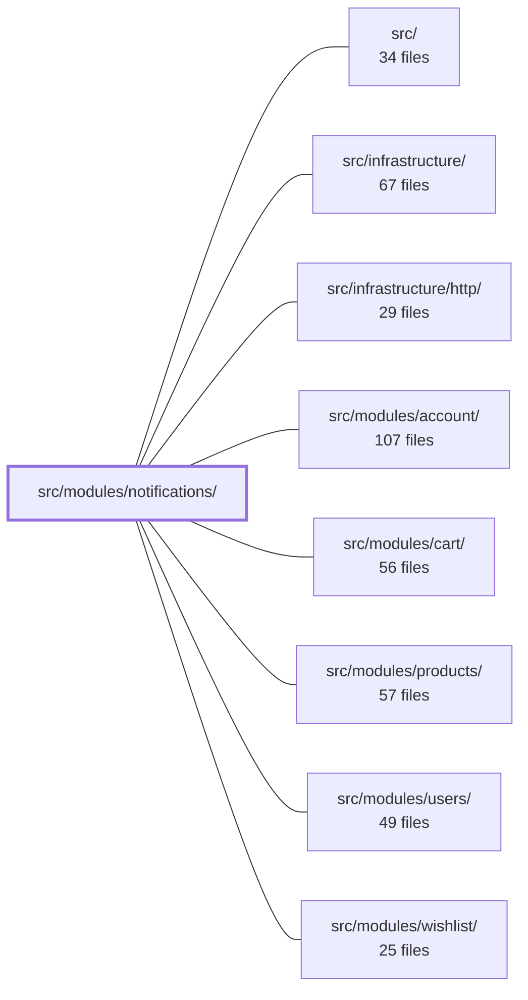

---
tags:
  - 2brain
  - 2brain/module
  - project/boilerplate-node-backend
type: module
module: src/modules/notifications/
files: 25
updated: 2026-10-07T23:59:09.230877+00:00
---

# src/modules/notifications/

## Purpose

The notifications module manages a user's notification inbox and real-time notification stream. It handles the full lifecycle of notifications—creation, listing, reading, dismissing, and deletion—while broadcasting new notifications to connected clients over a stream.

## Key parts

- **`model.ts` / `repository.ts`** — Core domain model for a notification and the data-access layer that persists and queries them.
- **`services/`** — Business logic split into three concerns: `inbox.ts` (CRUD and bulk actions like read-all / dismiss-all), `stream.ts` (SSE or equivalent server-sent stream for live delivery), and `subscribers.ts` (managing active stream connections per user).
- **`controllers/`** — Thin HTTP handlers that map incoming requests to service calls: `get-notifications`, `get-notifications-stream`, `delete-notification`, `post-read-all`, `post-dismiss-all`.
- **`routes.ts` / `module.ts`** — Route definitions and the NestJS module wiring (providers, imports, exports) that ties controllers, services, and the repository together.
- **`presenter.ts`** — Maps internal models to the API response shapes (DTOs) returned to clients.
- **`config.ts`** — Module-specific configuration (e.g., stream settings, retention).
- **`tests/`** — Unit tests for stream, presenter, and routes; integration tests for the service and event-driven flows; and a contract test validating the public API shape.

## How it connects

- **`src/infrastructure/http/`** — Provides the underlying HTTP transport used by the controllers and the stream endpoint (e.g., response headers, SSE plumbing).
- **`src/modules/users/`, `src/modules/account/`** — Notifications are scoped to a user/account identity; this module looks up user context to determine whose inbox to read from or stream to.
- **`src/modules/cart/`, `src/modules/products/`, `src/modules/wishlist/`** — Domain events from these modules (price changes, cart updates, wishlist alerts) are the primary triggers that cause new notifications to be created and pushed to the stream.

## Where to start

1. **`model.ts`** — Understand the shape of a notification and its lifecycle states (unread, read, dismissed) before anything else.
2. **`services/inbox.ts`** — See how the core operations (create, list, read-all, dismiss-all) are composed; the stream service builds directly on the same repository calls.

## Connected modules

[[boilerplate-node-backend_ROOT|/ (repository root)]] · [[boilerplate-node-backend_src|src/]] · [[boilerplate-node-backend_src_infrastructure|src/infrastructure/]] · [[boilerplate-node-backend_src_infrastructure_http|src/infrastructure/http/]] · [[boilerplate-node-backend_src_modules_account|src/modules/account/]] · [[boilerplate-node-backend_src_modules_cart|src/modules/cart/]] · [[boilerplate-node-backend_src_modules_products|src/modules/products/]] · [[boilerplate-node-backend_src_modules_users|src/modules/users/]] · [[boilerplate-node-backend_src_modules_wishlist|src/modules/wishlist/]]

## Files
- `src/modules/notifications/config.ts`
- `src/modules/notifications/controllers/delete-notification.ts`
- `src/modules/notifications/controllers/get-notifications-stream.ts`
- `src/modules/notifications/controllers/get-notifications.ts`
- `src/modules/notifications/controllers/post-dismiss-all.ts`
- `src/modules/notifications/controllers/post-read-all.ts`
- `src/modules/notifications/factories.ts`
- `src/modules/notifications/index.ts`
- `src/modules/notifications/model.ts`
- `src/modules/notifications/module.ts`
- `src/modules/notifications/presenter.ts`
- `src/modules/notifications/repository.ts`
- `src/modules/notifications/routes.ts`
- `src/modules/notifications/services/inbox.ts`
- `src/modules/notifications/services/index.ts`
- `src/modules/notifications/services/stream.ts`
- `src/modules/notifications/services/subscribers.ts`
- `src/modules/notifications/tests/contract/api.contract.test.ts`
- `src/modules/notifications/tests/factories.ts`
- `src/modules/notifications/tests/integration/events.test.ts`
- `src/modules/notifications/tests/integration/service.test.ts`
- `src/modules/notifications/tests/unit/get-notifications-stream.test.ts`
- `src/modules/notifications/tests/unit/presenter.test.ts`
- `src/modules/notifications/tests/unit/routes.test.ts`
- `src/modules/notifications/tests/unit/stream.test.ts`

---
[[boilerplate-node-backend_INDEX|← boilerplate-node-backend index]]
